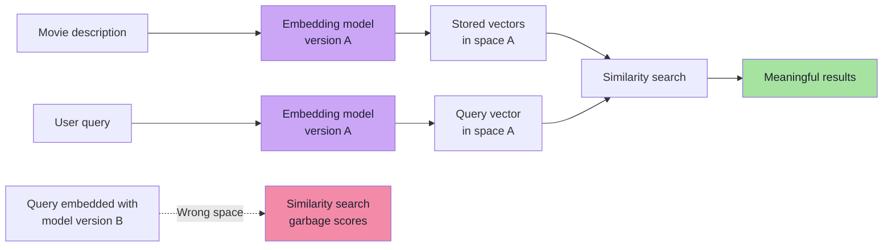
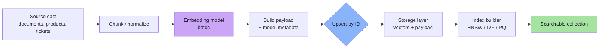
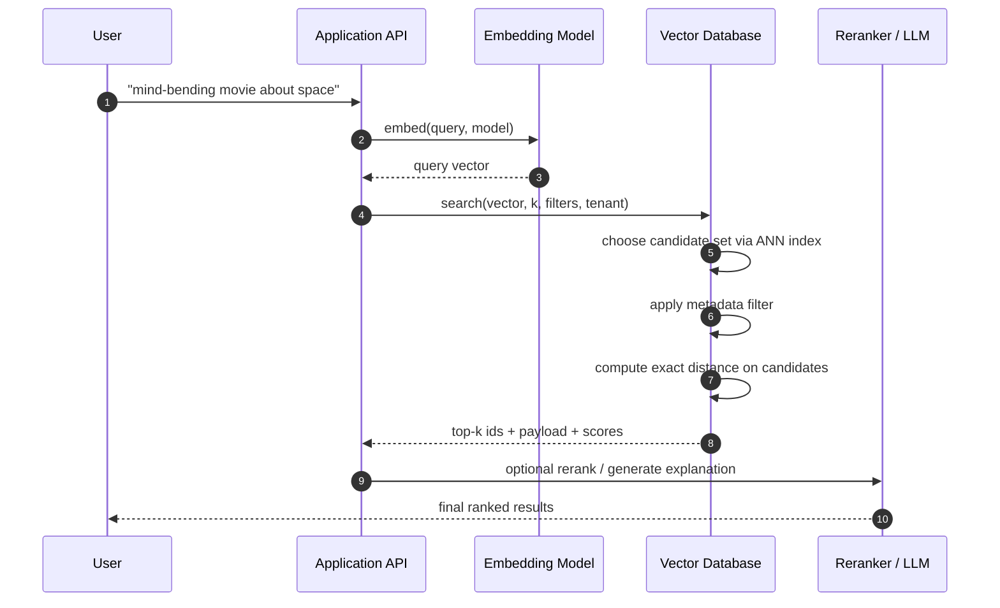
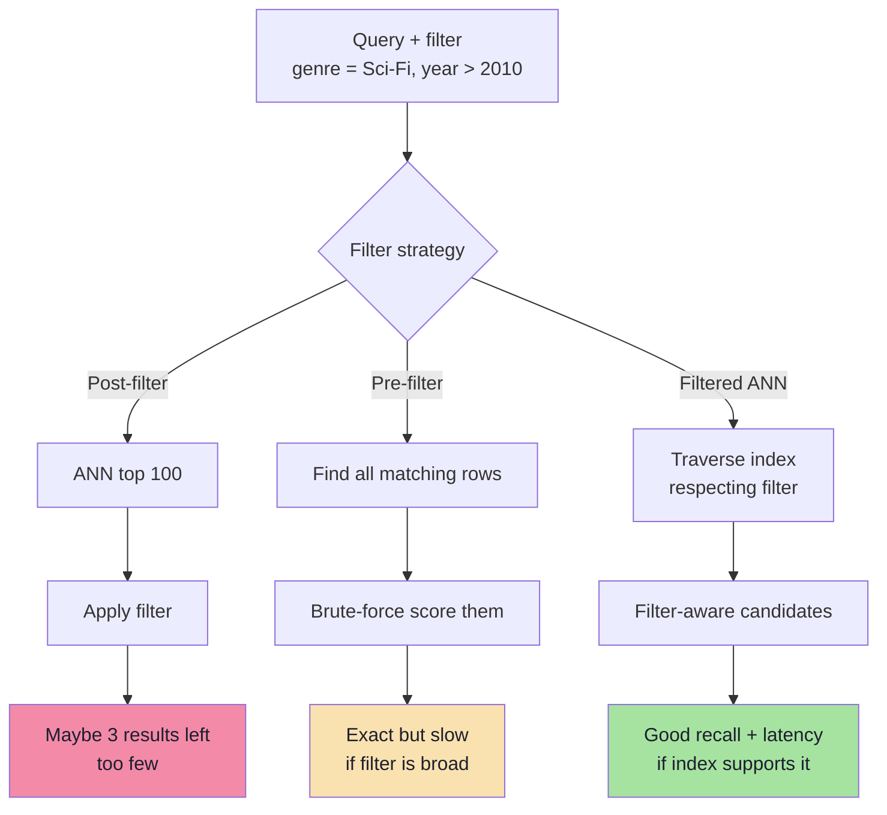
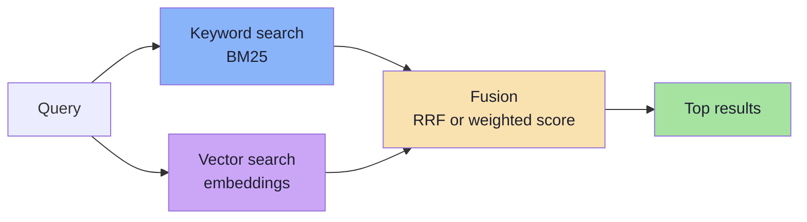
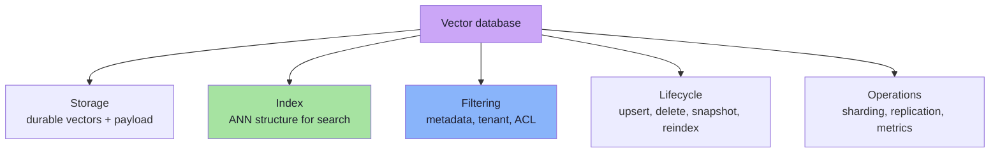

# Chapter 03: Anatomy of a Vector Database

> **Chapter Goal:** Open the black box. A vector database is not magic and not an "AI database" — it is a storage engine plus an index plus filtering plus lifecycle management. Learn the record model, write path, read path, and the exact division of labour between the **embedding model** and the **vector database**.

---

## 3.1 The Minimum Viable Vector Store

Forget Pinecone, Qdrant, Weaviate, Milvus, and `pgvector`. If we built the simplest possible vector-search system, what would we need?

At minimum: a table of vectors.

```text
VectorStore
---------------------------------------
ID        Vector
---------------------------------------
M1        [0.21, 0.72, 0.13, ...]
M2        [0.81, 0.11, 0.45, ...]
M3        [0.18, 0.69, 0.15, ...]
M4        [...]
```

That computes similarity but is not enough for a product. When a match is found, we need to know **what the vector represents**, and we often need to **filter** before ranking.

Practical system needs three conceptual pieces:

```text
ID  +  Vector  +  Metadata / reference to original data
```

| Piece | Why Needed |
|-------|------------|
| **ID** | Map winning vector back to real entity (movie, document, product) |
| **Vector** | Numeric representation used for similarity |
| **Metadata** | Structured attributes for filtering, display, authorization, routing |

Example record:

```text
ID:       M1
Vector:   [0.21, 0.72, 0.13, ...]
Metadata: title = Interstellar
          genre = Sci-Fi
          year  = 2014
          region = IN
          source = movies.description
```

Now the system answers what pure vectors cannot:

```text
Find movies similar to Interstellar
  BUT only where genre = Sci-Fi AND year > 2010
```

Similarity search and traditional filtering are not competitors — they are two halves of the same query.

---

## 3.2 The Expanded Record Model

Production systems store more than three minimum fields:

```ts
// Pseudo-code: a realistic vector record
interface VectorRecord {
  id: string;                    // stable, deterministic identifier
  embedding: number[];           // the vector itself
  payload: Record<string, unknown>; // metadata for filters and display
  document: string;              // original text, for returning or reranking
  tenantId?: string;             // multi-tenancy boundary
  modelId: string;               // which embedding model produced this vector
  modelVersion: number;          // for re-embedding migrations
  updatedAt: number;             // freshness tracking
}
```

| Field | Engineering Purpose |
|-------|--------------------|
| `id` | Idempotent upserts — re-ingesting same source overwrites, not duplicates |
| `embedding` | The searchable representation |
| `payload` | Filters, permissions, faceting, display |
| `document` | Avoid second DB round-trip when returning results |
| `tenantId` | Isolation; prevents cross-customer leakage |
| `modelId` / `modelVersion` | A vector is meaningless without knowing which model produced it |
| `updatedAt` | Freshness, cache invalidation, incremental re-indexing |

> **Critical rule:** An embedding is only comparable to embeddings produced by the **same model, same version, same preprocessing, and same distance metric**. Store those facts alongside the vector.

---

## 3.3 The Most Important Distinction: Embedding Model vs Vector Database

```text
Embedding Model
    meaning
       ↓
    numbers

Vector Database
    numbers
       ↓
    efficient retrieval
```

The vector database does **not** understand that Interstellar is about space, survival, astronauts, science fiction. It has no semantic knowledge. It knows coordinates and arithmetic — nothing else.

| Responsibility | Embedding Model | Vector Database |
|----------------|-----------------|-----------------|
| Understands language | Yes | No |
| Converts text to vector | Yes | No |
| Stores vectors durably | No | Yes |
| Builds search index | No | Yes |
| Computes / ranks distance | No | Yes |
| Filters metadata | No | Yes |
| Handles replication / sharding | No | Usually yes |

> The embedding model is the **translator**. The vector database is the **library index**. The library does not understand the book; it knows where the book sits.

Query embedding must be produced by the **same model** as stored vectors. Mixing models produces vectors in incompatible coordinate systems — arithmetic still runs, results are meaningless.



---

## 3.4 Collections, Namespaces, and Fixed Configuration

Most vector databases group records into a **collection** (Qdrant, Chroma), **index** (Pinecone, Elasticsearch), or **table** (Milvus, `pgvector`).

A collection typically fixes:

| Setting | Why Fixed |
|---------|-----------|
| Vector dimensions | Index built for one vector shape |
| Distance metric | Cosine, dot product, L2 produce different rankings |
| Index type / parameters | HNSW graph vs IVF lists are structural choices |
| Quantization | int8/binary compression changes on-disk format |

Consequences:
1. Cannot mix 768-dimensional and 1536-dimensional vectors in one index.
2. Upgrading embedding model usually means **new collection**, re-embed, then switch alias.
3. Changing cosine to L2 after the fact requires rebuilding index, not changing query parameter.

Namespaces/partitions provide logical isolation inside one deployment:

```text
collection: documents
  ├── namespace: tenant_acme
  ├── namespace: tenant_globex
  └── namespace: tenant_initech
```

Cheaper multi-tenancy than one collection per customer, while preventing cross-tenant retrieval.

---

## 3.5 The Write Path

Writing to a vector database is an **ETL pipeline**, not a single insert.



| Property | Meaning |
|----------|---------|
| **Idempotency** | Upsert with deterministic ID (`hash(sourceId + chunkIndex)`) so retries don't duplicate |
| **Batching** | Embed dozens-hundreds of inputs per API call to amortize latency |
| **Backpressure** | Rate-limit ingestion so embedding APIs and DB aren't overwhelmed |
| **Incremental indexing** | Only re-embed changed documents |
| **Atomicity per record** | Record visible only after vector + payload both written |
| **Tombstones** | Deletes logical first, then compacted out of index |

```ts
// Pseudo-code: idempotent ingestion
async function ingest(document: SourceDocument): Promise<void> {
  const chunks = chunkText(document.body, { size: 800, overlap: 100 });

  const vectors = await embeddingModel.embedBatch(
    chunks.map(c => c.text),
    { model: EMBEDDING_MODEL_ID },
  );

  const records = chunks.map((chunk, i) => ({
    id: `${document.id}:${chunk.index}`,       // deterministic
    embedding: vectors[i],
    document: chunk.text,
    payload: {
      sourceId: document.id,
      title: document.title,
      tenantId: document.tenantId,
      modelId: EMBEDDING_MODEL_ID,
      modelVersion: EMBEDDING_MODEL_VERSION,
      updatedAt: Date.now(),
    },
  }));

  await vectorDb.upsert(COLLECTION, records);
}
```

---

## 3.6 The Read Path

The read path has more steps than "embed and search":



| Stage | What Can Go Wrong |
|-------|-------------------|
| Query embedding | Wrong model version → incompatible space |
| ANN candidate selection | `efSearch` / `nprobe` too low → low recall |
| Metadata filtering | Post-filtering after top-k → too few results |
| Exact rescoring | Missing normalization → wrong ranking |
| Reranking | Latency blow-up, or reranker trained for another domain |
| Response assembly | Stale payload, missing permission checks |

> **Read path is where recall is won or lost.** Write path decides what *can* be found; read path decides what *is* found for a given query.

---

## 3.7 Metadata Filtering: Pre-Filter, Post-Filter, Filtered ANN

Filtering is the most underestimated part of vector search. Three strategies, each failing differently:



| Strategy | How It Works | Strength | Weakness |
|----------|--------------|----------|----------|
| **Post-filter** | Retrieve top k, then discard non-matching | Trivial to implement | Can return fewer than k; low-selectivity filters destroy recall |
| **Pre-filter** | Restrict candidate set first, then score | Exact within filtered subset | Can degrade to scan; expensive for broad filters |
| **Filtered ANN** | Index traversal skips non-matching nodes | Best balance at scale | Requires payload indexes; graph connectivity can suffer |

Practical rule:

```text
If filter matches large fraction of data  → filtered ANN
If filter matches tiny fraction (0.1%)    → pre-filter, then brute force
If filter only for display / auth        → post-filter is unacceptable
```

> **Authorization must never be post-filter.** If permissions applied after top-k, user can infer existence of unreadable documents through result counts and rankings. Tenant/ACL filters belong inside the query.

---

## 3.8 Hybrid Search: Lexical + Semantic

Pure vector search is bad at exact tokens (product codes, names, error strings). Pure keyword search is bad at paraphrases. Production blends both.



**Reciprocal Rank Fusion (RRF)** — most common fusion, needs no score calibration:

```text
RRF(d) = Σ over each ranked list L:  1 / (k + rank_L(d))

Typical k = 60
```

Document ranked highly by *either* retriever gets strong fused score. Only ranks used — BM25 and cosine scores never need normalization to same scale.

---

## 3.9 A Minimal Vector Database Interface

Contract every vector database exposes, TypeScript-style pseudo-code:

```ts
// Pseudo-code: essential vector DB contract
interface VectorStore {
  createCollection(config: {
    name: string;
    dimensions: number;
    metric: "cosine" | "dot" | "l2";
    index: { type: "hnsw" | "ivf" | "flat"; params?: Record<string, number> };
  }): Promise<void>;

  upsert(collection: string, records: VectorRecord[]): Promise<void>;

  search(
    collection: string,
    query: {
      vector: number[];
      k: number;
      filter?: Record<string, unknown>;
      includePayload?: boolean;
      efSearch?: number;      // recall/latency knob
    },
  ): Promise<Array<{ id: string; score: number; payload?: unknown }>>;

  delete(collection: string, ids: string[]): Promise<void>;

  stats(collection: string): Promise<{ count: number; dimensions: number }>;
}
```

Two details revealing mature implementation:
1. **`metric` declared once** at collection creation, not per query.
2. **`efSearch` / `nprobe` exposed per query** — recall/latency is a runtime trade-off.

---

## 3.10 What a Vector Database Is, Precisely



It is a database in the ordinary sense: persists data, indexes it, answers queries, manages failure. Unusual part: primary index is **geometric rather than ordered**.

---

## 3.11 Chapter Summary

| Concept | Takeaway |
|---------|----------|
| Minimum record | ID + vector + metadata |
| Production record | Adds document text, tenant, model id/version, timestamps |
| Embedding model | Understands meaning and produces vectors |
| Vector database | Stores, indexes, filters, retrieves — does not understand meaning |
| Write path | Chunk → embed → upsert → index |
| Read path | Embed query → ANN candidates → filter → rescore → rerank |
| Filtering | Pre-filter, post-filter, filtered ANN; never post-filter authorization |
| Hybrid search | Fuse lexical + semantic rankings with RRF |
| Collections | Fixed dimensions, metric, index type |

> **Final mental model:** A vector database is a normal database whose index is built for geometry instead of order. Everything else — records, upserts, filters, replication, lifecycle — is ordinary data engineering. The genuinely new part is the index, subject of Chapters 05–07.

---

## 3.12 Missing Topics Added for Depth

### 3.12.1 Why the Embedding Model and Vector DB Must Version Together
A vector `[0.21, -0.47, ...]` only means something relative to the model that produced it. If you upgrade from `text-embedding-3-small` to `text-embedding-3-large`:
- Old vectors live in space A (768 dims, model A's training)
- New vectors live in space B (1536 dims, model B's training)
- Comparing A-vector to B-vector yields garbage — arithmetic runs but geometry is incompatible

**Rule:** Every record must store `modelId` and `modelVersion`. Query embedding must use the same model/version as stored vectors.

### 3.12.2 Deterministic IDs Matter for Idempotency
Ingestion may retry due to network failures. If chunk IDs aren't deterministic, each retry inserts duplicate vectors:
```text
// Bad: random ID
id: randomUUID()        // every retry = new duplicate

// Good: deterministic
id: `${documentId}:${chunkIndex}`  // same input = same ID, upsert overwrites
```

### 3.12.3 The Document Field: Avoiding Extra Round-Trips
Storing original `document` text alongside the vector lets the API return results without a second lookup to the source database. Trade-off: increases index size. For large documents, store a reference + fetch on demand.

---

**Next:** [Chapter 04 — Brute Force and KNN: The Correct Baseline](./04_Brute_Force_KNN_The_Correct_Baseline.md)