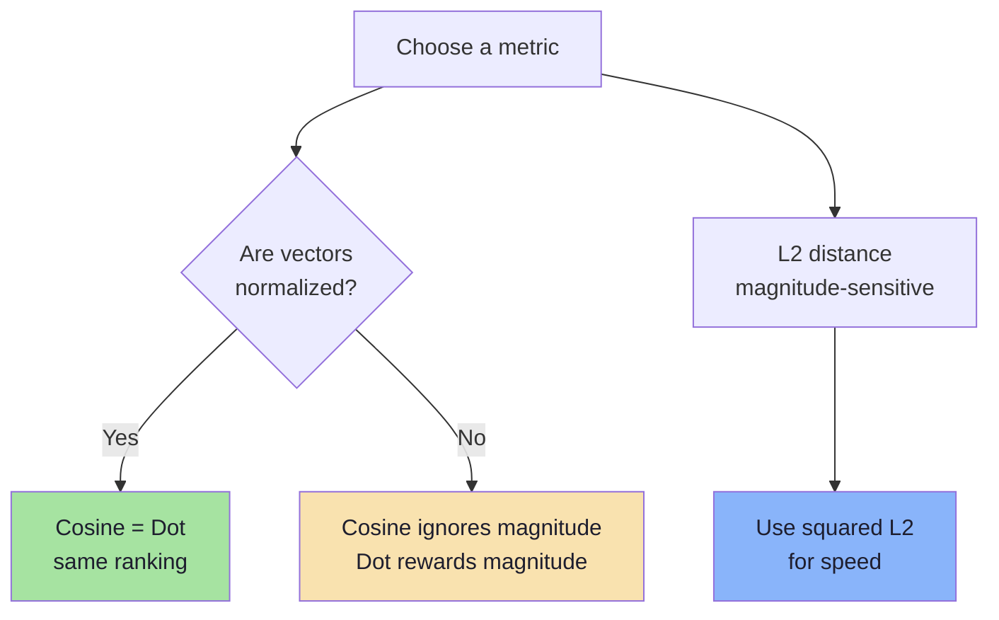
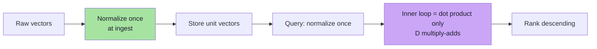
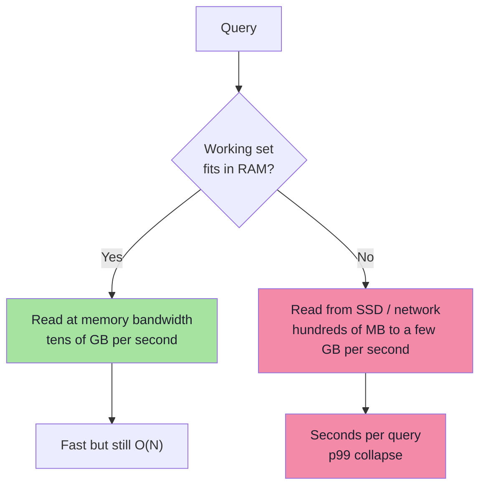
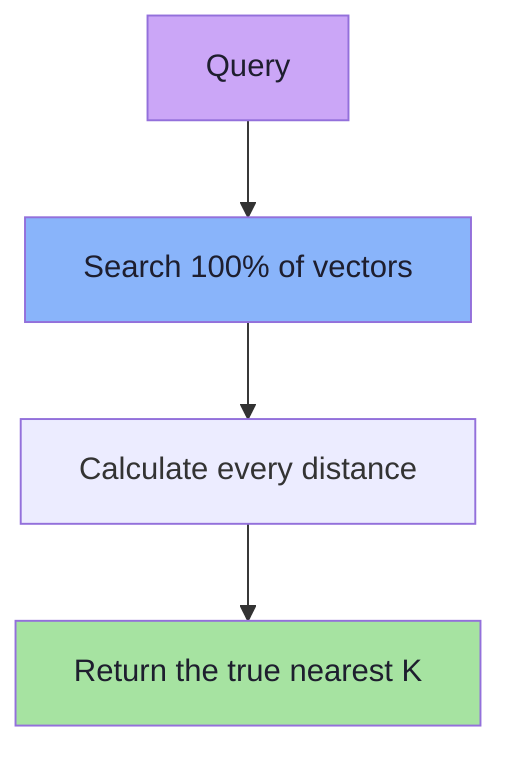
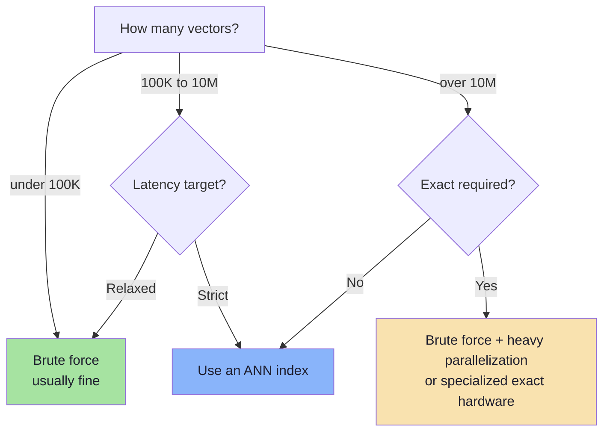

# Chapter 04: Brute Force and KNN — The Correct Baseline

> **Chapter Goal:** Understand the algorithm every vector database is trying to beat. Learn what K-Nearest Neighbor search means, how top-K selection works, which distance metric to use, and exactly how much CPU, memory, and I/O brute force costs at scale. This chapter is the **ground truth** against which every approximate index in Chapter 07 is measured.

---

## 4.1 K-Nearest Neighbor Search, Precisely

Given:
- N stored vectors `M1 … MN`, each D dimensions
- Query vector `Q`
- Integer `K`
- Distance/similarity function

KNN returns the K vectors closest to Q:

```text
KNN(Q, K) = the K stored vectors with the smallest distance(Q, Mi)
```

Naive implementation:

```ts
// Pseudo-code: complete brute-force KNN algorithm
function knn(query: number[], vectors: VectorRecord[], k: number): Scored[] {
  const scored: Scored[] = [];

  for (const record of vectors) {
    const score = cosineSimilarity(query, record.embedding);
    scored.push({ id: record.id, score });
  }

  scored.sort((a, b) => b.score - a.score);
  return scored.slice(0, k);
}
```

That is the entire algorithm. Everything else in this lecture is about avoiding parts of this loop.

---

## 4.2 What Does K Mean?

Query vector as a point; stored vectors as other points:

```text
              A ●

        B ●           ● C

                  X  ← query
                 ● D

                        ● E
```

| K | Result |
|---|--------|
| `K = 1` | Single closest point |
| `K = 3` | Three closest points |
| `K = 10` | Ten closest points |

`K` = how many nearest neighbours we return.

### How K Is Chosen in Practice

| Use Case | Typical K | Reason |
|----------|-----------|--------|
| Similar movies rail | 5–10 | UI space |
| Semantic search page | 10–20 | Then paginate or rerank |
| RAG context retrieval | 3–8 | Context window budget |
| Candidate generation for reranker | 50–200 | Recall > precision |
| Deduplication | 1–5 | Near-duplicates only |
| Evaluation (recall@K) | 10–100 | Retrieval quality measurement |

> **Important:** K is a **product** decision, not algorithm decision. The index doesn't care whether K is 3 or 300 — latency and memory do.

---

## 4.3 Similarity vs Distance (and Why the Sign Flips)

Two metric families:

| Family | Higher is better? | Example |
|--------|-------------------|---------|
| **Similarity** | Yes | Cosine similarity, dot product |
| **Distance** | No (lower better) | Euclidean L2, Manhattan L1 |

### Cosine Similarity
```text
cos(A, B) = (A · B) / (‖A‖ × ‖B‖)

Range: −1 … +1
+1 = same direction, 0 = orthogonal, −1 = opposite
```

### Dot Product
```text
dot(A, B) = Σ Ai × Bi
```
If vectors normalized to unit length, dot product **equals** cosine similarity.

### Euclidean Distance
```text
L2(A, B) = √( Σ (Ai − Bi)² )
```
For ranking, square root is monotonic, so implementations use **squared L2**:
```text
L2²(A, B) = Σ (Ai − Bi)²
```

### Manhattan Distance
```text
L1(A, B) = Σ |Ai − Bi|
```
Rare for text embeddings, useful in some image / sparse-vector settings.



> **Rule:** Metric at **index build time** must match metric at **query time**, both matching what embedding model trained for. Most modern text embedding models train for cosine similarity on normalized vectors.

---

## 4.4 Worked Example: One Query Against Five Movies

Query: `"mind-bending movie about space"`

```text
Q = [0.23, 0.70, 0.16, ...]
```

Stored vectors (illustrative):

| Movie | Cosine Similarity | Rank |
|-------|-------------------|------|
| Interstellar | 0.95 | 1 |
| The Martian | 0.91 | 2 |
| Gravity | 0.88 | 3 |
| Titanic | 0.29 | 4 |
| The Notebook | 0.21 | 5 |

With `K = 3`:
```text
1. Interstellar   0.95
2. The Martian    0.91
3. Gravity        0.88
```

Output is **ranked**, not filtered. No threshold by default. A threshold (`score >= 0.75`) is a separate product decision preventing weak matches.

---

## 4.5 True Cost of One Comparison

One vector comparison is **not** one operation. For D = 1536:

| Metric | Operations per comparison |
|--------|--------------------------|
| Dot product | 1536 multiplications + 1535 additions |
| Cosine | Dot product + 2 magnitudes (or 1 if pre-normalized) |
| Squared L2 | 1536 subtractions + 1536 multiplications + 1535 additions |

For cosine on pre-normalized vectors, magnitude work disappears → cosine becomes single dot product. This is why **normalizing at write time** is standard optimization — turns cosine into cheapest possible inner loop.



Total work per query:
```text
work ≈ N × D
```
- N = number of stored vectors
- D = number of dimensions

This is the `O(N × D)` cost.

---

## 4.6 Real Numbers: 10 Million Vectors

```text
N = 10,000,000
D = 1536

N × D = 10,000,000 × 1536
      = 15,360,000,000
      ≈ 15.36 billion dimension-level operations
```

**That is one query.**

Realistic traffic:

| QPS | Dimension Operations per Second |
|-----|---------------------------------|
| 1 | 15.36 billion |
| 10 | 153.6 billion |
| 100 | 1.536 trillion |
| 1,000 | 15.36 trillion |

At 100 QPS, brute force on 10M vectors ≈ **1.5 trillion multiply-adds/second**, before memory reads, filters, ranking. One CPU core does a few billion/second. Need dozens of cores just for arithmetic — data still must reach them.

> **Core observation:** With brute-force search, work grows with dataset size. Adding data makes every query slower.

---

## 4.7 Real Numbers: Storage and Memory

Assume float32 = 4 bytes.

```text
one vector = 1536 × 4 bytes = 6144 bytes ≈ 6 KB
```

| Number of Vectors | Raw Vector Storage |
|-------------------|-------------------|
| 1,000 | ~6 MB |
| 100,000 | ~600 MB |
| 1,000,000 | ~6 GB |
| 10,000,000 | ~60 GB |
| 100,000,000 | ~600 GB |
| 1,000,000,000 | ~6 TB |

Excludes:
- IDs + metadata (often 1–5 KB/record)
- Payload indexes
- ANN index (HNSW graphs add 30–100% overhead)
- Replication factor (×2 or ×3)
- Temporary build space (×1.5–2 during merges)
- DB overhead and fragmentation

Realistic rule of thumb:
```text
provisioned RAM ≈ raw vector bytes × 1.5 to 3
```

> **Consequence:** Storage is not just disk bill. If working set doesn't fit in RAM, queries hit disk — latency changes by orders of magnitude.

---

## 4.8 Hidden Cost: Memory Bandwidth and Disk I/O

Arithmetic often isn't bottleneck. Fetching bytes is.

```text
15.36 billion operations
         requires reading
61.44 GB of vector data
per query
```

At 50 GB/s memory bandwidth, that's > 1 second **just to stream vectors**, before math. If collection doesn't fit RAM, same read from SSD/network at 1–7 GB/s — query becomes unusable.



Serious vector systems use:
- **Quantization** (float32 → int8 → binary) to shrink bytes
- **Sharding** to fit each shard in memory
- **ANN indexes** to avoid reading most vectors

---

## 4.9 Top-K Selection Cost

After scoring, N scores:

```text
M1 → 0.71
M2 → 0.23
M3 → 0.94
M4 → 0.51
...
```

Need highest K. Two implementations:

| Approach | Cost | Notes |
|----------|------|-------|
| Sort all scores | O(N log N) | Simple, wasteful when K << N |
| Min-heap of size K | O(N log K) | Standard; memory O(K) |
| Quickselect | O(N) average | Good for batch/offline |
| Streaming threshold | O(N) | Keep current K-th best, compare |

```ts
// Pseudo-code: top-K with bounded min-heap
function topK(scores: Scored[], k: number): Scored[] {
  const heap = new MinHeap<Scored>((a, b) => a.score - b.score);

  for (const item of scores) {
    if (heap.size < k) {
      heap.push(item);
    } else if (item.score > heap.peek().score) {
      heap.replaceRoot(item); // drop weakest, keep best K
    }
  }

  return heap.drainSortedDescending();
}
```

For N = 10M, sorting all = ~230M comparisons. Size-K heap with K=10 needs ~10M × log2(10) ≈ 33M comparisons. Both dwarfed by 15.36B dimension ops, but heap avoids allocating 10M-element sorted array per query.

---

## 4.10 Exact Nearest-Neighbor Search

Brute-force advantage:

```text
We check EVERY vector.
```

True nearest neighbours **cannot be missed**.



This is **Exact Nearest-Neighbor Search** (flat / brute-force).

| Property | Value |
|----------|-------|
| Accuracy | Perfect (100% recall by definition) |
| Build time | None — no index |
| Insert cost | O(1) — append |
| Delete cost | O(1) swap-remove |
| Query cost | O(N × D) |
| Memory overhead | Minimal |
| Scalability | Poor |

Exact search isn't "bad." It is the **specification** approximate algorithms satisfy. Every ANN system evaluated against exact search on sample queries.

---

## 4.11 Making Brute Force Faster (Without Changing Result)

Before reaching for an index, constant-factor optimizations:

| Optimization | What It Does | Typical Gain |
|--------------|--------------|--------------|
| Pre-normalize vectors | Cosine → dot product | Removes 2 magnitude passes |
| float32 → float16 / int8 | Halves/quarters bytes read | 2–4× memory bandwidth |
| SIMD / vectorized loops | Process 8–16 floats/instruction | 2–8× |
| BLAS / matrix multiply | Batch queries into one GEMM | Large throughput gain |
| Batch queries | One query → matrix row | Amortizes overhead |
| Memory-mapped files | OS page cache does work | Avoids copies |
| Sharding + parallel scan | Split N across cores/machines | Near-linear in shards |
| Metadata pre-filter | Score eligible rows only | Proportional to selectivity |

These lower constant. They do **not** change O(N × D) growth curve — the fundamental limit.

```ts
// Pseudo-code: batched brute force as matrix multiplication
// embeddings: N x D matrix, queries: B x D matrix
// scores = queries @ embeddings.T   ->   B x N matrix
const scores: number[][] = matMul(normalize(queries), transpose(normalizedEmbeddings));
const results = scores.map(row => topKIndices(row, k));
```

Single large matrix multiplication often **orders of magnitude faster** than JS `for` loop — moves inner loop into optimized native code. That's what FAISS and `pgvector` do internally.

---

## 4.12 When Brute Force Is the Right Choice

Brute force is frequently correct engineering:

| Situation | Why Brute Force Wins |
|-----------|---------------------|
| N < 100,000 | Index build time/complexity outweigh query savings |
| Low QPS, latency budget > 100 ms | No need to optimize |
| Exact results required (compliance, dedup) | ANN can miss true neighbours |
| Data changes constantly | No index maintenance backlog |
| Need ground-truth baseline | Required to measure ANN recall |
| Filter extremely selective | Pre-filtering leaves tiny candidate set |
| Prototype / MVP | Ship simple first |



> **Engineering rule:** Start with brute force, measure, then add index when real latency/capacity constraint demands it. An index is a complexity purchase — buy only what you need.

---

## 4.13 Brute Force as the Evaluation Oracle

Cannot know whether ANN index is good without exact search. Standard workflow:

```text
1. Take 1,000 real queries.
2. Run exact KNN on each → ground truth.
3. Run ANN index on each → candidate results.
4. Compare: fraction of true neighbours ANN returned?
   → recall@K
```

```ts
// Pseudo-code: measuring ANN recall against exact search
function recallAtK(queries: Query[], ann: AnnIndex, exact: VectorStore, k: number): number {
  let hits = 0;
  let total = 0;

  for (const q of queries) {
    const truth = new Set(exact.knn(q.vector, k).map(r => r.id));
    const found = ann.search(q.vector, k).map(r => r.id);

    for (const id of found) {
      if (truth.has(id)) hits++;
    }
    total += k;
  }

  return hits / total;
}
```

This is why Chapter 07 treats **recall** as central quality metric for approximate indexes.

---

## 4.14 Chapter Summary

| Concept | Takeaway |
|---------|----------|
| KNN | Return K stored vectors closest to query |
| K | Product decision (UI size, context budget, reranker candidates) |
| Metric | Cosine, dot, L2, L1; must match model and index |
| Normalization | Turns cosine into dot product — major constant-factor win |
| Cost per query | O(N × D); 10M × 1536 = 15.36B operations |
| Storage | 1536 × 4 B ≈ 6 KB/vector; 1M ≈ 6 GB; 100M ≈ 600 GB |
| Hidden bottlenecks | Memory bandwidth, disk I/O, top-K selection |
| Top-K | Use bounded heap O(N log K), not full sort |
| Exact search | 100% recall, no build cost, poor scalability |
| Role in course | Baseline + ground truth for ANN |

> **Final mental model:** Brute force is the honest algorithm. It tells you truth and sends the bill — N × D per query plus moving N × D numbers through memory. Chapters 05–07 reduce that bill without lying too much about the answer.

---

## 4.15 Missing Topics Added for Depth

### 4.15.1 Why Exact Search Still Matters in Production
Even with ANN, exact search is needed:
- **Ground truth** to measure ANN recall
- **Small datasets** (N < 100K) where ANN overhead exceeds benefit
- **Compliance scenarios** requiring 100% recall (deduplication, audit)
- **Rescoring stage** after ANN candidate generation (top-K full-precision rescore)

### 4.15.2 Dot Product vs Cosine on Normalized Vectors
If vectors are unit-normalized (‖A‖ = ‖B‖ = 1):
```text
cos(A, B) = (A · B) / (1 × 1) = A · B
```
So dot product on normalized vectors = cosine similarity. Production systems normalize at ingest, store unit vectors, query-normalize once, then compute dot products — the cheapest inner loop possible.

### 4.15.3 Memory Bandwidth vs Compute Bound
Modern CPUs can do ~billions of FLOPs/second but memory bandwidth is ~tens of GB/s. For 10M × 1536 float32 vectors = 61 GB to read per query — memory bandwidth dominates before arithmetic. This is why quantization (fewer bytes) and ANN (fewer vectors read) are essential.

---

**Next:** [Chapter 05 — Indexes and Why Scalar Indexes Fail for Vectors](./05_Indexes_and_Why_Scalar_Indexes_Fail_for_Vectors.md)