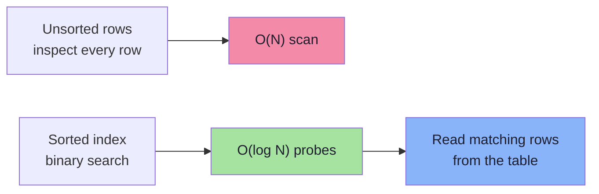
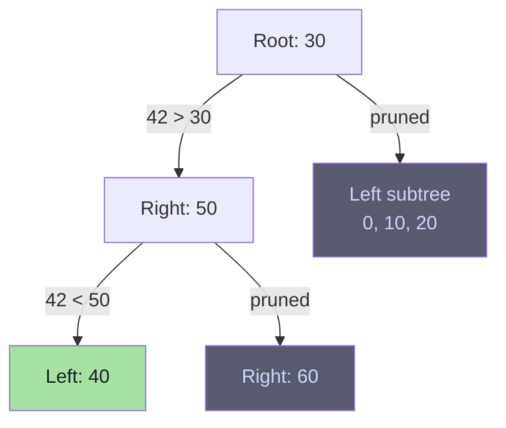
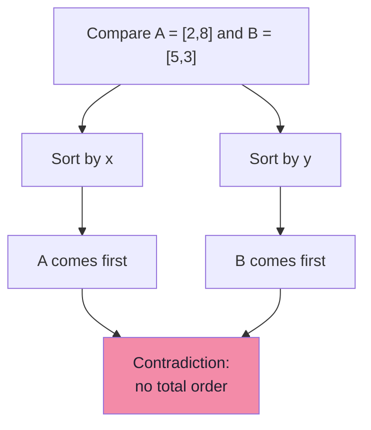
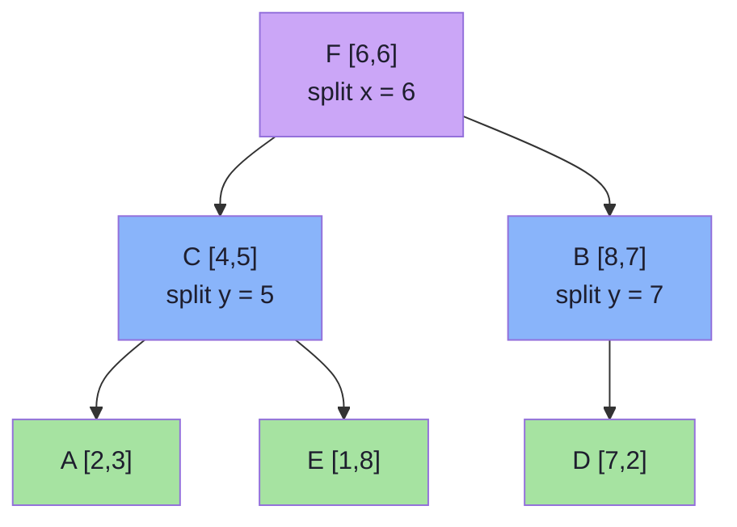
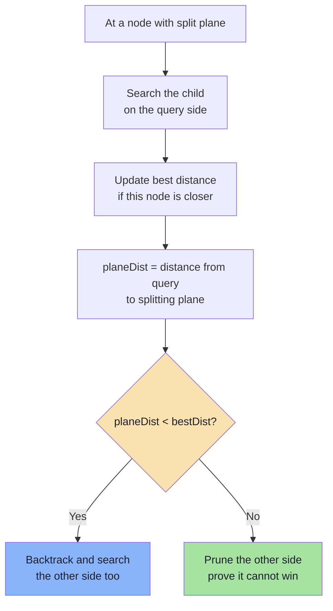
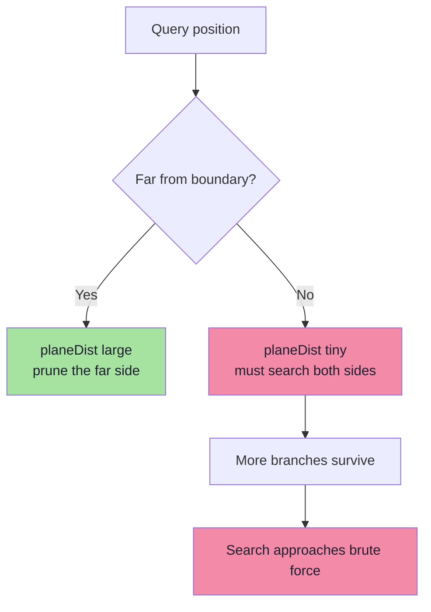

# Chapter 05: Indexes and Why Scalar Indexes Fail for Vectors

> **Chapter Goal:** Understand why a normal database index makes queries fast, then watch that reasoning collapse once a value has more than one dimension. Build a k-d tree by hand, search it, and learn the exact pruning rule — including when pruning is impossible. This chapter sets up the curse of dimensionality in Chapter 06.

---

## 5.1 The Question

Databases have solved many search-performance problems with indexes. So why can't we simply create a normal index for embeddings?

```text
If age = 32 can use a B-tree, why can't embedding = [0.21, -0.42, ...]?
```

To answer, first see **why** ordinary indexes work so well.

---

## 5.2 Why Ordinary Indexes Work

`employee` table with 10M rows:

```text
Employee
----------------
id
name
age
```

Query:

```sql
SELECT * FROM employee WHERE age = 32;
```

Without index, database inspects every row:

```text
23
41
19
32  ← match
56
32  ← match
...
```

This is a **full table scan**: `O(N)`.

With index on `age`, values stored sorted:

```text
18, 20, 23, 27, 32, 36, 41, 50, ...
```

Looking for `32`, current value `27` — we know:

```text
There is no reason to search toward smaller values.
```

Move toward larger side. Large parts of search space eliminated without inspection.



> **Deep reason indexes work:** Order lets you **prove** a region of search space cannot contain answer. Proof enables pruning. Scanning happens when you cannot prove anything.

---

## 5.3 The Mechanism: B-Trees and Selectivity

B-tree keeps keys sorted in pages, fans out with high branching factor:

```text
                 [ 30 | 60 ]
               /      |      \
      [10|20]   [40|50]   [70|80]
      /  |  \    /  |  \   /  |  \
   ... pages of sorted rows ...
```

For equality/range predicate, engine:
1. Descends from root, comparing key at each node
2. Discards every subtree whose key range cannot satisfy predicate
3. Reads only matching leaf pages

Works because scalar key has **total order**: for any `a` and `b`, exactly one of `a < b`, `a = b`, `a > b` holds.

| Property | Scalar Column | Embedding |
|----------|--------------|-----------|
| Total order | Yes | **No** |
| Equality meaningful | Yes | Almost never |
| Range meaningful | Yes | Not semantically |
| Can prove "subtree irrelevant" | Yes | Rarely |
| Index structure | B-tree, hash | Geometric structures needed |

Indexes exploit **selectivity**: `age = 32` matches 0.01% of rows, so reading index + few rows beats scanning 10M. Vector query has no exact key match equivalent.

---

## 5.4 One Dimension: A Number Line

Number line:

```text
0----10----20----30----40----50----60
```

Want value closest to `42`. Natural order, tree organizes values:

```text
                 30
              /      \
            10        50
           /  \      /  \
          0   20   40    60
```

For `42`:
```text
42 > 30  → move right
42 < 50  → move left
```

Never visit subtree `0, 10, 20`. Interval `[0, 30]` provably farther from `42` than `40`.



In 1D, pruning easy because geometry is interval and ordering total.

---

## 5.5 Two Dimensions: Order Disappears

Vectors with two dimensions:

```text
[x, y]

A = [2, 8]
B = [5, 3]
```

Which vector is smaller?
- Using `x`: `A.x (2) < B.x (5)` → A smaller
- Using `y`: `A.y (8) > B.y (3)` → A larger

**No single natural ordering** like number line. Points are incomparable without chosen criterion.



Not small inconvenience. B-trees rely on total order. Points in `R²` form only **partial order** (compare by chosen coordinate, but tells nothing about geometric proximity). Two points can be close in space while far apart on every axis, and vice versa.

> **Conceptual break:** Scalar indexes exploit 1D order. Vectors live in multi-dimensional geometry where no such order exists.

---

## 5.6 Partitioning Space One Dimension at a Time

Divide space using **one coordinate at a time** — leads to **k-d tree** (k-dimensional tree).

First split using `x`:

```text
                    x = 5
                 /         \
          x < 5             x >= 5
```

Inside each region, split using `y`:

```text
                          x = 5
                    /             \
                 y = 5            y = 5
               /      \          /      \
            ...       ...      ...       ...
```

Geometrically, plane divided into rectangular regions:

```text
    +----------------+----------------+
    |                |                |
    |       E        |       B        |
    |                |                |
    +----------------+-------F--------+
    |       C        |                |
    |                |                |
    |   A            |       D        |
    +----------------+----------------+
```

Each internal node owns **splitting plane**; each subtree owns **region**. Region makes pruning provable: if entire region farther from query than current best candidate, subtree can be skipped.

---

## 5.7 Building a Small k-d Tree (Worked Example)

Points:

```text
A = [2, 3]
B = [8, 7]
C = [4, 5]
D = [7, 2]
E = [1, 8]
F = [6, 6]
```

### Step 1 — Split on x

Sort temporarily by x:

```text
E [1,8]
A [2,3]
C [4,5]
F [6,6]
D [7,2]
B [8,7]
```

Choose median `F = [6,6]`:

```text
                          F [6,6]
                          x = 6
                        /        \
                  x < 6          x >= 6
```

Left: `E [1,8]`, `A [2,3]`, `C [4,5]`
Right: `D [7,2]`, `B [8,7]`

### Step 2 — Split each side on y

Left sorted by y: `A [2,3]`, `C [4,5]`, `E [1,8]` → choose `C = [4,5]`:

```text
C [4,5]
y = 5
 /     \
A       E
```

Right sorted by y: `D [7,2]`, `B [8,7]` → choose `B = [8,7]`:

```text
B [8,7]
y = 7
/
D [7,2]
```

### Step 3 — Complete Tree

```text
                          F [6,6]   ← x split at 6
                        /        \
               C [4,5]            B [8,7]
               y split at 5       y split at 7
               /       \          /
         A [2,3]     E [1,8]   D [7,2]
```

Tree represents geometric partitions of vector space.

> **Implementation note:** Median doesn't need exact. Many use middle element after partial sort, or stop when leaf holds small bucket (16–64 points), then brute-force bucket.



---

## 5.8 Building a k-d Tree: Pseudo-Code

```ts
// Pseudo-code: recursive k-d tree construction
type Point = { id: string; coords: number[] };

function buildKdTree(points: Point[], depth: number): KdNode | null {
  if (points.length === 0) return null;
  if (points.length <= LEAF_SIZE) return { leaf: points };

  const axis = depth % DIMENSIONS;             // cycle x, y, z, ...
  const sorted = [...points].sort((a, b) => a.coords[axis] - b.coords[axis]);
  const mid = Math.floor(sorted.length / 2);

  return {
    point: sorted[mid],
    axis,
    splitValue: sorted[mid].coords[axis],
    left: buildKdTree(sorted.slice(0, mid), depth + 1),
    right: buildKdTree(sorted.slice(mid + 1), depth + 1),
  };
}
```

| Property | Value |
|----------|-------|
| Build time | O(N log N) with median selection; O(N log² N) if fully sorting each level |
| Axis policy | Cycle dimensions, or choose widest-variance axis |
| Balance | Median split keeps tree balanced |
| Leaf bucket | Brute force small leaves |
| Memory | O(N) nodes |

---

## 5.9 Searching the k-d Tree

Query:

```text
Q = [7, 6]
```

Want nearest neighbour.

### Step 1 — Start at Root

Root `F = [6,6]`, split on x at 6.

```text
Q.x = 7
F.x = 6

7 > 6  → investigate RIGHT side first
```

Distance to node itself:
```text
distance(Q, F) = sqrt((7-6)² + (6-6)²) = 1
```

Current best: `F`, distance `1`.

### Step 2 — Descend Right Subtree

Node `B = [8,7]`, split on y at 7.

```text
Q.y = 6
B.y = 7

6 < 7  → go LEFT
```

Reach `D = [7,2]`:
```text
distance(Q, D) = sqrt((7-7)² + (6-2)²) = 4
```

Not better than 1.

### Step 3 — Backtrack and Test Splitting Plane

At node `B` (splitting plane y = 7):
```text
distance from Q to plane = |Q.y - 7| = |6 - 7| = 1
best distance so far     = 1
```

`1 < 1` false → prune other side of B.

At node `F` (splitting plane x = 6):
```text
distance from Q to plane = |Q.x - 6| = |7 - 6| = 1
best distance so far     = 1
```

`1 < 1` false → prune entire left subtree of F.

### Step 4 — Result

```text
Nearest neighbour: F = [6,6], distance 1
```

Verify all points:

| Point | Distance from Q |
|-------|-----------------|
| A [2,3] | 5.83 |
| B [8,7] | 1.41 |
| C [4,5] | 3.16 |
| D [7,2] | 4.00 |
| E [1,8] | 6.32 |
| **F [6,6]** | **1.00** |

Inspected F, B, D — 3 of 6 points — found true nearest neighbour.

> **Tie-handling:** using `distance_to_plane <= best_distance` preserves ties. Using `<` may skip equally-close point. Most implementations use `<=` on pruning test to be safe.

---

## 5.10 The Pruning Rule

Heart of every geometric index:

```text
1. Search the side containing the query first.
2. Keep track of best distance found so far.
3. Calculate distance from query to splitting plane.
4. If distance_to_plane < best_distance:
       search the other side too.
5. Otherwise:
       safely prune the other side.
```



Geometric logic: closest possible point on other side of plane is at least `planeDist` away. If lower bound exceeds best candidate, no point there can win.

---

## 5.11 k-d Tree Search: Pseudo-Code

```ts
// Pseudo-code: branch-and-bound nearest-neighbour search
function searchKdTree(node: KdNode | null, query: number[], best: Candidate): Candidate {
  if (node === null) return best;

  if (node.leaf) {
    for (const point of node.leaf) {
      const d = distance(query, point.coords);
      if (d < best.distance) best = { point, distance: d };
    }
    return best;
  }

  // 1. Compare against this node's own point
  const d = distance(query, node.point.coords);
  if (d < best.distance) best = { point: node.point, distance: d };

  // 2. Choose near side first
  const q = query[node.axis];
  const near = q < node.splitValue ? node.left : node.right;
  const far  = q < node.splitValue ? node.right : node.left;

  best = searchKdTree(near, query, best);

  // 3. Prune only if plane is farther than best found
  const planeDistance = Math.abs(q - node.splitValue);
  if (planeDistance < best.distance) {
    best = searchKdTree(far, query, best);
  }

  return best;
}
```

For K > 1, replace single `best` with bounded max-heap of size K, compare `planeDistance` against heap's current worst distance.

---

## 5.12 When Pruning Works

Split at x = 5:

```text
        x < 5   |   x >= 5
                |
                |            Q  (x = 8)
                |            *
----------------|----------------
                x = 5
```

Query far from boundary. Best distance 1. Opposite side starts at least 3 units away in x:

```text
planeDistance = |8 - 5| = 3
bestDistance  = 1
3 < 1         = false  →  prune
```

Left side cannot contain closer point. Search only right side — exactly what index should do.

---

## 5.13 When Pruning Fails

Query almost on boundary:

```text
                | Q  (x = 5.1)
                | *
----------------|----------------
                x = 5
```

```text
planeDistance = |5.1 - 5| = 0.1
bestDistance  = 2
0.1 < 2       = true  →  must search other side
```

Point just across boundary could be closer. Must search:

```text
RIGHT + LEFT
```

Pruning opportunity disappeared — not implementation bug, geometry genuinely doesn't permit proof.



---

## 5.14 Two Dimensions: Still Manageable

In 2D, query may be close to x boundary forcing both x regions. But might still be far from y boundaries, so other regions pruned.

k-d trees **can** be useful in low-dimensional spaces — typically 2 to ~10 dimensions. Used in graphics, collision detection, GIS.

---

## 5.15 Three Dimensions: More Boundaries

With x, y, z, query has more opportunities near dividing boundary. Every dimension adds another plane that can fail to prune.

```text
dimension 1 boundary   → maybe skip
dimension 2 boundary   → maybe skip
dimension 3 boundary   → maybe skip
```

Whenever cannot prove opposite region irrelevant, search it. More branches survive.

---

## 5.16 Complexity Summary

| Operation | Average (low D) | Worst Case |
|-----------|-----------------|------------|
| Build | O(N log N) | O(N log² N) naive sorting |
| Query | O(log N) | O(N) — every node visited |
| Insert | O(log N) | O(N) if unbalanced |
| Delete | O(log N) | O(N) plus rebalancing |
| Memory | O(N) | O(N) |

Worst case isn't theoretical — happens when pruning fails systematically, exactly as dimensionality grows (Chapter 06).

Other geometric structures:

| Structure | Partition Strategy | Typical Use |
|-----------|-------------------|-------------|
| k-d tree | Axis-aligned planes | Low-dimensional exact NN |
| Ball tree | Nested hyperspheres | Low-to-medium dimensions |
| R-tree | Bounding rectangles | GIS, spatial databases |
| VP-tree | Distance to vantage points | Metric spaces |
| Cover tree | Hierarchical covering | Theoretical guarantees in low intrinsic dimension |

All rely on same assumption: **a region of space can be proven irrelevant using cheap lower bound**. High dimensionality attacks that assumption directly.

---

## 5.17 Chapter Summary

| Idea | Takeaway |
|------|----------|
| Why indexes work | Total order lets you prove regions irrelevant |
| Scalar index | B-tree / hash; equality, range, joins |
| Vector space | No total order beyond one dimension |
| k-d tree | Recursively split space on alternating axes |
| Build | Choose median, split, recurse |
| Search | Near side first, then test splitting plane |
| Pruning rule | Search far side only if `planeDist < bestDist` |
| Pruning failure | Query near boundary → both sides searched |
| Dimensionality | More dimensions → more boundaries → less pruning |

> **Final mental model:** An index is a machine for *proving ignorance*. "I do not need to look there, and here is why." Scalar indexes prove it with order. k-d trees prove it with geometry — but each added dimension gives geometry more ways to say *"you might still need to look."* Chapter 06 turns that intuition into the curse of dimensionality.

---

## 5.18 Missing Topics Added for Depth

### 5.18.1 Why Partial Order Isn't Enough for Indexing
Vectors can be partially ordered (e.g., by x-coordinate), but partial order doesn't support range pruning:
- `A.x < B.x` tells nothing about `distance(Q, A)` vs `distance(Q, B)`
- A point with smaller x can be geometrically farther from Q than one with larger x
- B-tree pruning requires **total order** where `a < b` implies everything on one side is provably irrelevant

### 5.18.2 k-d Tree vs B-Tree: Key Differences
| Aspect | B-Tree | k-d Tree |
|--------|--------|----------|
| Splitting key | One scalar column | Alternating dimensions |
| Node structure | Sorted keys in pages | Splitting planes in space |
| Pruning proof | Key range comparison | Distance to splitting plane |
| Best for | Scalar equality/range | Low-dimensional geometric search |
| High-dimensional | Works | Fails (curse of dimensionality) |

### 5.18.3 Leaf Buckets and Practical k-d Trees
Pure recursive k-d trees with one point per node create deep trees. Production implementations:
- Stop splitting when node holds ≤ 32–64 points (leaf bucket)
- Brute-force scan the leaf bucket
- This reduces tree depth and improves cache locality

---

**Next:** [Chapter 06 — The Curse of Dimensionality](./06_The_Curse_of_Dimensionality.md)