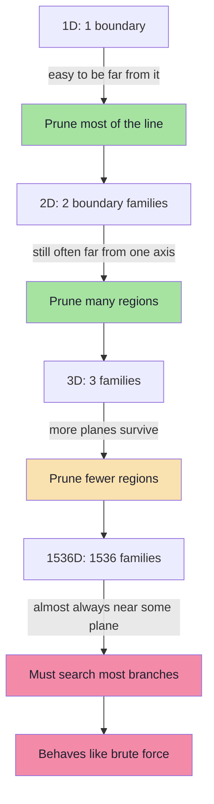
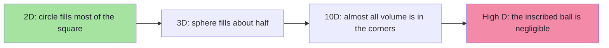
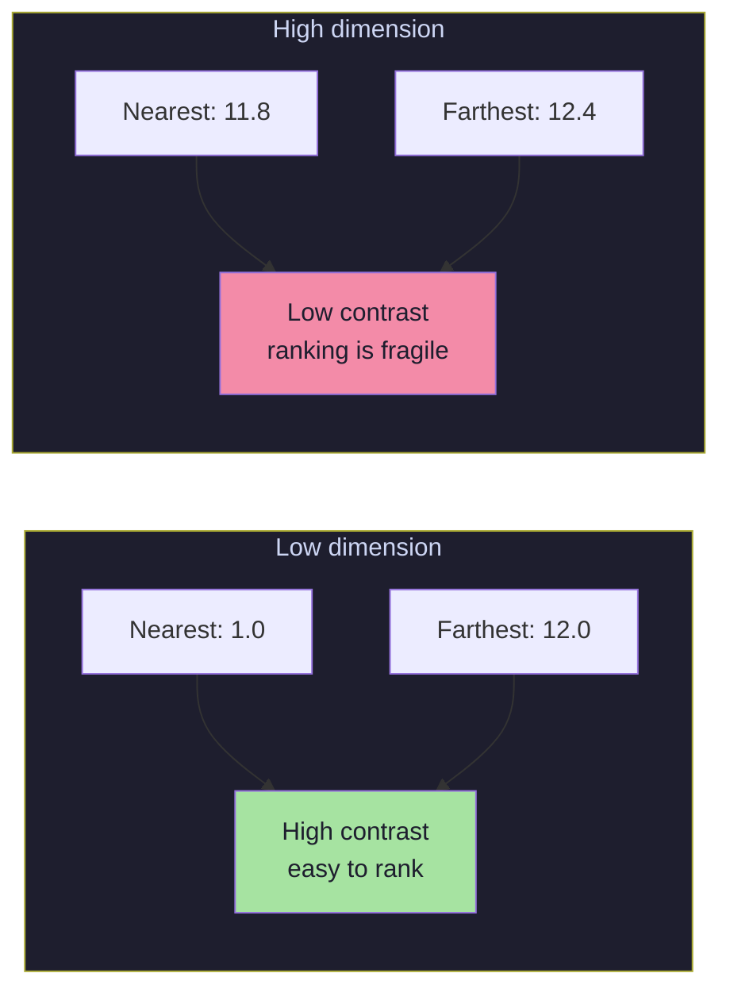
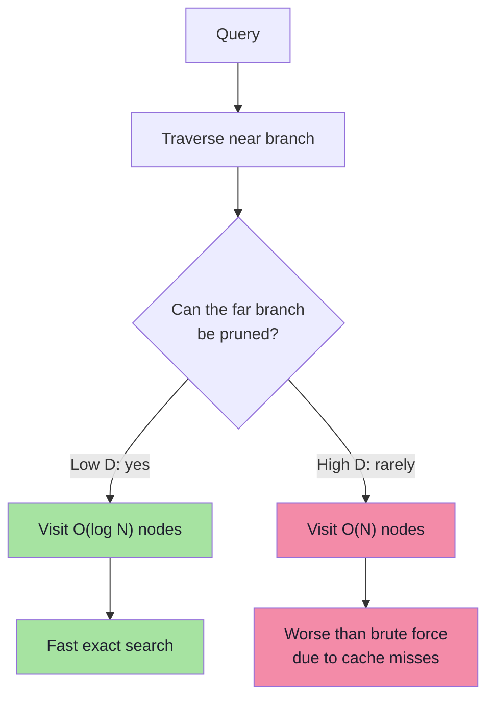
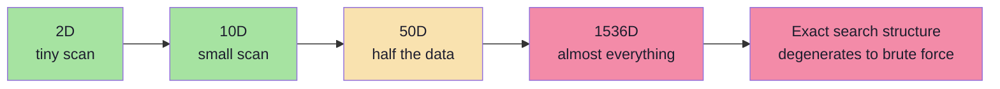
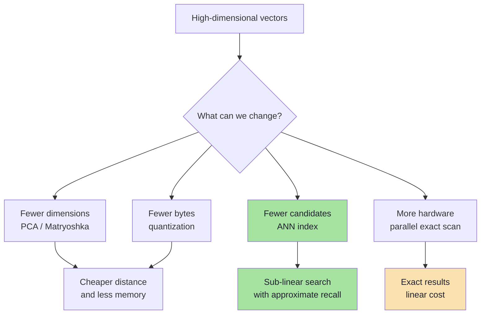
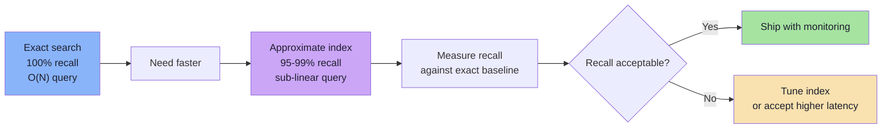

# Chapter 06: The Curse of Dimensionality

> **Chapter Goal:** Understand why geometric indexes that work beautifully in 2D and 3D collapse in 384, 768, or 1536 dimensions. Learn the two underlying phenomena — **boundary proliferation** and **distance concentration** — and why failure is gradual rather than a sudden cliff. This chapter explains why k-d trees are not the answer and motivates approximate indexes.

---

## 6.1 What the Curse Actually Means

Phrase sounds dramatic, so state precisely:

> **Curse of dimensionality:** as number of dimensions grows, geometry of space stops matching human intuition, and algorithms relying on partitioning or distance contrast lose ability to prune.

Excalidraw notes state nuance:

```text
"Curse of dimensionality does not mean that adding one extra dimension
suddenly breaks search.

It means that every extra dimension adds more possible ways for points
to differ and more regions that might contain a neighbour.

As dimensions keep increasing, our ability to safely eliminate large parts
of the search space gets weaker and weaker.

Eventually, an exact search structure may need to inspect so much of the
dataset that it starts behaving almost like brute force."
```

That is the entire chapter in one paragraph. The rest is the *why* and *how much*.

---

## 6.2 Boundary Proliferation

Every split in k-d tree is a boundary. 2D has two axes; 3D has three; 1536D has 1536.

```text
1D:   one boundary per split
2D:   x-boundaries and y-boundaries
3D:   x, y, z boundaries
1536D: 1536 families of boundaries
```

For pruning to fail at a node, query only needs to be **close to that node's splitting plane**. More dimensions → each node's plane on one axis, but tree deeper and far more nodes whose planes can be close to query.

Simplified probability: chance query within pruning margin of boundary is `p` per dimension. If independent, chance query **far from every boundary**:

```text
P(no near boundary) = (1 - p)^D
```

| Dimensions D | p = 0.01 | p = 0.05 |
|--------------|----------|----------|
| 2 | 0.980 | 0.902 |
| 10 | 0.904 | 0.599 |
| 100 | 0.366 | 0.0059 |
| 768 | 0.00045 | ~10⁻¹⁷ |
| 1536 | ~2×10⁻⁷ | ~10⁻³⁴ |

With D = 1536, even 1% per dimension makes it almost certain query is near **some** boundary. Every such boundary is subtree that cannot be pruned safely.



---

## 6.3 Volume of a High-Dimensional Ball

Compare sphere inscribed in cube:

- 2D: circle in square covers ~**78.5%** of area
- 3D: sphere in cube covers ~**52.4%** of volume

In D dimensions:

```text
volume of unit ball / volume of cube = π^(D/2) / (2^D × Γ(D/2 + 1))
```

Ratio **tends to zero** as D grows.

| Dimensions | Ball / Cube Volume |
|------------|-------------------|
| 2 | 0.785 |
| 3 | 0.524 |
| 10 | 0.0025 |
| 100 | ~10⁻⁷⁰ |
| 1536 | effectively 0 |



Implications:
- Most volume of high-dimensional cube sits near **corners**, not center
- Most uniformly sampled points are near **surface**, not interior
- "Radius" and "neighborhood" lose intuitive meaning from 2D/3D
- Rectangular partition from axis-aligned splits has enormous surface area relative to volume — queries likely near boundary

Axis-aligned partitioning stops being effective pruning strategy.

---

## 6.4 Distance Concentration

Second phenomenon — arguably more important for nearest-neighbour search.

For random points in high-dimensional space, distances between pairs become **surprisingly similar**:

```text
D = 2      distances differ a lot:   0.5, 3.1, 8.7, 12.0
D = 1536   distances cluster:        11.8, 12.1, 12.3, 12.5
```

Ratio between nearest and farthest neighbour tends toward `1`:

```text
(max distance − min distance) / min distance  →  0   as D grows
```



Why this matters for index:
- Pruning compares **lower bound** (`planeDist`) against **best distance**
- If all distances nearly equal, margin between lower bound and best candidate is tiny
- Tiny margins mean `planeDist < bestDist` true more often
- More true → more subtrees visited

Low dimensions: good candidate early gives strong bound pruning most of tree. High dimensions: almost every candidate similar distance, bound prunes almost nothing.

> **Deep reason ANN indexes abandon exact pruning.** Stop trying to prove region irrelevant, accept small probability of missing true neighbour.

---

## 6.5 What Happens to the Tree

Ideal k-d tree visits root-to-leaf path:

```text
ROOT
  ↓
  B
  ↓
  E
done
```

High dimensions, search looks like:

```text
        ROOT
     ↙        ↘
    A          B
   ↙ ↘        ↙ ↘
  C   D      E   F
  ...
```

Instead of few nodes, search may inspect:

```text
70%
80%
90%
...
of the dataset
```

Back to:

```text
for every vector:
    calculate distance
```

Brute-force with extra pointer-chasing overhead.



Degraded tree can be **slower than flat scan** — pointer-chasing visits random memory while brute force reads vectors sequentially (can use SIMD/BLAS).

---

## 6.6 Empirical Shape of Degradation

Exact numbers depend on data distribution, pattern consistent:

| Dimensions | Fraction Inspected by k-d Tree | Practical Verdict |
|------------|-------------------------------|-------------------|
| 2–3 | 0.01%–0.1% | Excellent |
| 5–10 | 1%–10% | Usable |
| 10–20 | 10%–50% | Marginal |
| 50–100 | 50%–90% | Poor |
| 384–1536 | 90%–100% | Useless as index |



Modern embedding search does **not** use k-d trees, R-trees, or quadtrees as primary index.

---

## 6.7 Why Embeddings Are Not Purely Random

Fair objection: "Embeddings aren't uniformly random, so curse is weaker."

Correct — be precise:

1. **Real embeddings lie on lower-dimensional manifold.** Intrinsic dimensionality smaller than nominal 1536. Meaningful variation occupies tens to hundreds of effective dimensions.
2. **Embeddings are anisotropic.** Cluster in cones rather than filling sphere uniformly.
3. **Semantic neighborhoods are real.** Movies about space really cluster together.

Curse is **mitigated, not eliminated**:

| Property | Effect on Search |
|----------|------------------|
| Low intrinsic dimension | Some pruning remains possible |
| Clustering / anisotropy | IVF and graph indexes work well |
| Nominal dimension still high | k-d trees still fail |
| Hubness (some points near everything) | Ranking gets noisy; reranking helps |

Successful indexes (Chapter 07) are **data-adaptive**:
- **HNSW** builds navigable graph from actual neighbor relationships, not axis-aligned boxes
- **IVF** clusters data with k-means, partitions follow distribution
- **PQ** compresses subspaces rather than partitioning whole space
- **LSH** uses random projections tuned to metric

---

## 6.8 Mitigation Strategies at a Glance

Four broad ways to cope with high dimensionality:

| Strategy | Idea | Trade-off |
|----------|------|-----------|
| **Reduce dimensions** | PCA, random projection, Matryoshka embeddings | Information loss; cheaper search |
| **Compress values** | float16, int8, binary quantization, product quantization | Less memory; slight accuracy loss |
| **Use data-adaptive ANN** | HNSW, IVF, LSH, ScaNN | Approximate results; needs tuning |
| **Accept brute force** | Parallel scan, GPU, sharding | Exact but expensive at very large N |



### Matryoshka Embeddings (Worth Knowing)
Some modern embedding models trained so **first n dimensions** form usable embedding on their own, like nested dolls:

```text
full vector:      [0.21, -0.47, 0.83, 0.11, ...]   1536 dims
truncated to 256: [0.21, -0.47, 0.83, 0.11, ...]    256 dims
```

Can then:
1. Use 256 dims for cheap candidate generation
2. Rescore top candidates with full 1536 dims

Practical two-stage pattern combining dimension reduction with exact rescoring.

---

## 6.9 The Curse Is Also a Blessing

High dimensionality not universally bad — depends on task:

| Task | Effect of More Dimensions |
|------|--------------------------|
| **Nearest-neighbour search** | Worse — distances concentrate, pruning fails |
| **Linear classification** | Better — classes more separable |
| **Random projection / hashing** | Still useful, needs more bits |
| **Compression** | Harder — more information to preserve |
| **Visualization** | Impossible beyond 2–3 dims without projection |

Lesson not "high dimensions are bad":

> **Algorithms must match geometry of their data.** A structure designed for 2D rectangles cannot index a 1536-dimensional semantic space, no matter how carefully implemented.

---

## 6.10 Precise Consequence for Vector Search

Engineering terms:

1. **Exact search still works** in high dimensions. Just costs `O(N × D)`.
2. **Exact geometric indexes stop pruning**, approach `O(N)` node visits with worse constants.
3. **Only remaining option for sub-linear search is to give up exactness.**
4. Giving up exactness must be **measured and bounded**, not accidental.

That fourth point is where **recall** becomes central metric:

```text
recall@K = (true neighbours retrieved) / K
```

ANN index returning 95 of true top 100 has `recall@100 = 0.95`. Whether acceptable is product decision, not mathematical one.



---

## 6.11 Chapter Summary

| Concept | Takeaway |
|---------|----------|
| Curse of dimensionality | High-dimensional geometry breaks partitioning and distance contrast |
| Not a cliff | Degrades gradually with each added dimension |
| Boundary proliferation | More dimensions → more planes → fewer safe prunes |
| Volume concentration | Most volume near corners/surface, not center |
| Distance concentration | Nearest and farthest distances become similar |
| Effect on k-d trees | 70–100% of dataset may be inspected |
| Effect on embeddings | Real data clustered, curse milder but still fatal for k-d trees |
| Mitigations | Dimension reduction, quantization, data-adaptive ANN, parallel exact search |
| Engineering response | Accept approximation, then **measure recall** against exact search |

> **Final mental model:** In low dimensions, geometry lets an index say *"nothing over there can beat what I already found."* In high dimensions, that sentence becomes harder to justify, until index forced to look almost everywhere. Curse isn't that search becomes impossible — it is that **provable pruning** becomes impossible, so we trade proof for probability.

---

## 6.12 Missing Topics Added for Depth

### 6.12.1 Intrinsic vs Nominal Dimensionality
Nominal dimension = 1536 (vector size). Intrinsic dimension = effective degrees of freedom in data manifold. Real embeddings often have intrinsic dimension of tens to hundreds, even though nominal is 1536. This is why ANN works at all — data isn't filling the full 1536D space uniformly.

### 6.12.2 Distance Concentration vs Semantic Clustering
Distance concentration applies to **random** points. Real embeddings cluster semantically — "space movies" are near each other. This clustering is what makes semantic search meaningful despite concentration. ANN indexes exploit this clustering rather than fighting it.

### 6.12.3 Why k-d Trees Get Slower Than Brute Force at High D
At high D, k-d tree visits most nodes PLUS pays pointer-chasing overhead (random memory access). Brute force reads vectors sequentially and can use SIMD/BLAS. So a degraded k-d tree can be **strictly worse** than flat scan — another reason production systems avoid tree indexes for high-D vectors.

---

**Next:** [Chapter 07 — Approximate Nearest Neighbor Indexes](./07_Approximate_Nearest_Neighbor_Indexes.md)