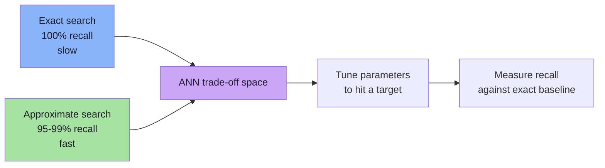
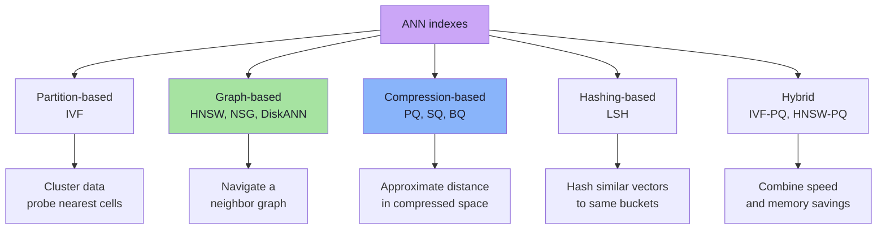
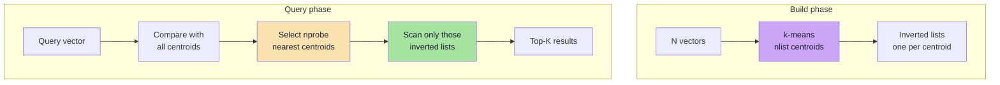
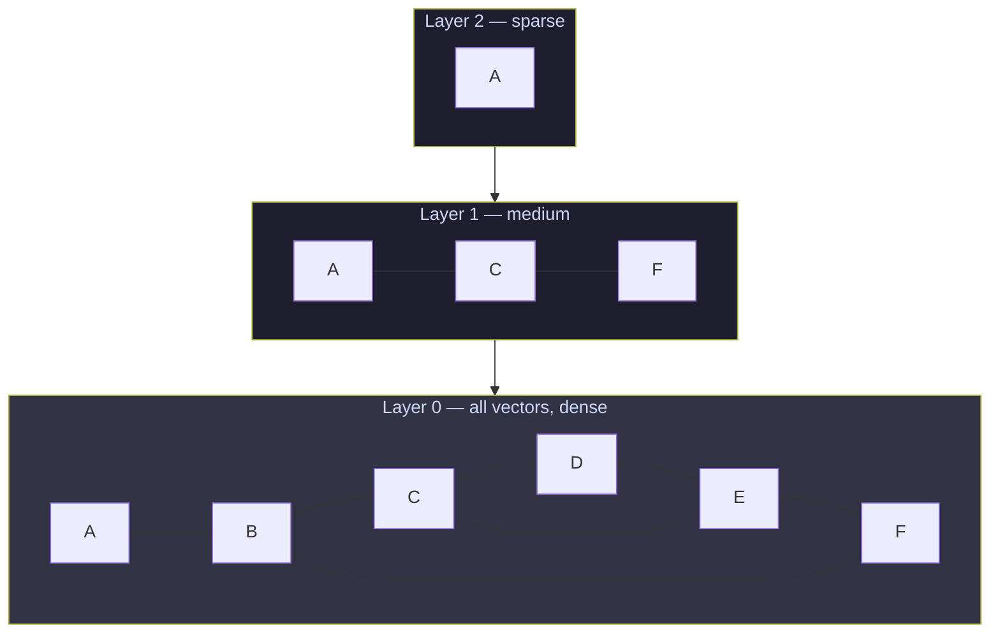
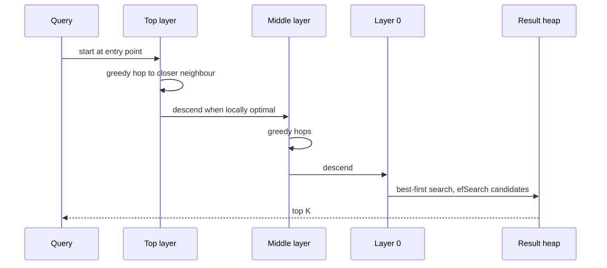
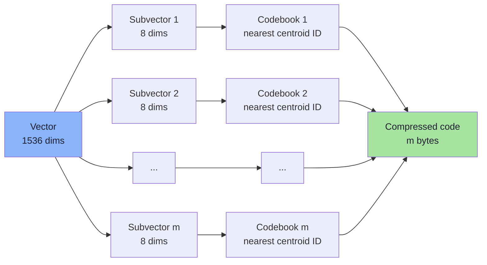
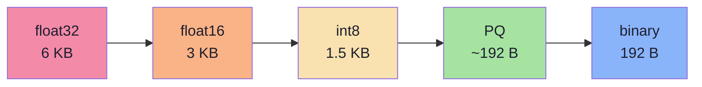
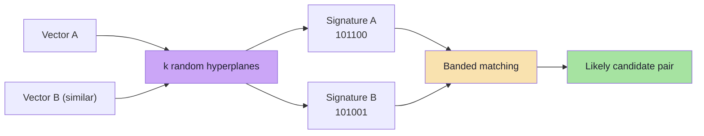
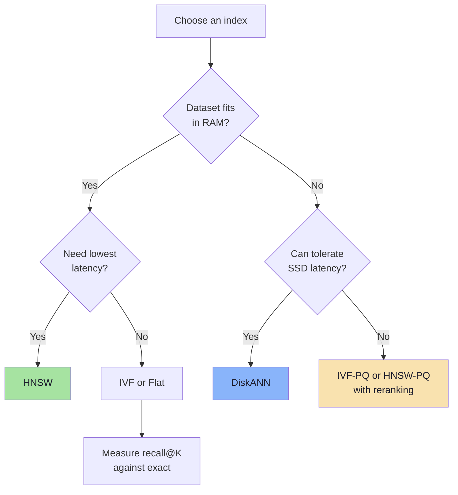
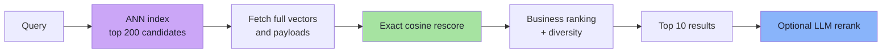

# Chapter 07: Approximate Nearest Neighbor Indexes

> **Chapter Goal:** Learn the indexes that actually power production vector search. Understand the shared trade-off (recall vs latency vs memory), then study the four families — **IVF**, **HNSW**, **PQ**, and **LSH** — well enough to reason about parameters, failure modes, and cost. This is the direct answer to the question Chapter 06 left open.

---

## 7.1 The Bargain

Exact search guarantees true top-K. High-dimensional geometry makes exact pruning impossible. Only way to get sub-linear search is to accept small chance of missing true neighbour:

```text
Exact:  search 100% of vectors  →  100% recall  →  O(N)
ANN:    search ~1% of vectors   →  95-99% recall  →  O(log N) or O(1)
```

Not a compromise invented by lazy engineers. Only known way to search billions of high-dimensional vectors with millisecond latency.



Trade-off has **five** dimensions:

| Dimension | Question | Typical Knob |
|-----------|----------|--------------|
| **Recall** | Fraction of true neighbours returned? | `efSearch`, `nprobe`, `rerank` |
| **Latency** | How long does query take (p50/p95/p99)? | index type, candidate count |
| **Memory** | Bytes per vector? | quantization, replication |
| **Build cost** | How long to index N vectors? | `efConstruction`, IVF training |
| **Freshness** | How fast do updates become searchable? | index type, segment merges |

> **Rule:** Never evaluate ANN index on latency alone. 1 ms query with 60% recall is worse than 5 ms query with 98% recall — first confidently returns wrong answer.

---

## 7.2 The Index Family Tree



Most production systems combine at least two — e.g., **IVF-PQ** for memory-efficient billion-scale search, or **HNSW + quantization** for low-latency memory-resident search.

---

## 7.3 IVF — Inverted File Index

### The Idea

Cluster vectors into `nlist` groups using k-means. At query time, find nearest centroids and search only those groups.

```text
Build:
  1. Run k-means on vectors → nlist centroids
  2. Assign every vector to nearest centroid
  3. Store inverted list per centroid

Query:
  1. Compare query to all nlist centroids
  2. Pick nprobe nearest centroids
  3. Scan only vectors in those lists
```



### Why It Works

Semantically similar vectors fall into same cluster. If query's nearest centroid is cluster containing true neighbours, scanning that cluster finds them. Vectors scanned drop to roughly:

```text
scanned ≈ N × (nprobe / nlist)
```

### Parameters

| Parameter | Meaning | Effect |
|-----------|---------|--------|
| `nlist` | Number of clusters | More clusters = smaller lists, more centroid comparisons |
| `nprobe` | Clusters scanned per query | Higher = better recall, higher latency |
| Training sample size | Vectors used for k-means | Too small = poor centroids |
| Distance metric | Must match query metric | Mismatch invalidates assignment |

### Strengths and Weaknesses

| Strengths | Weaknesses |
|-----------|------------|
| Simple and interpretable | k-means training expensive |
| Fast for large N | Bad on skewed data (one huge list) |
| Memory overhead modest | Recall depends heavily on `nprobe` |
| Easy to shard | Updates require assignment + retraining |
| Works well with PQ | Boundary points may belong to wrong list |

> **Intuition:** IVF is vector equivalent of library with rooms organized by topic. Check few rooms most likely to contain book, not every shelf.

---

## 7.4 IVF Query: Pseudo-Code and Tuning

```ts
// Pseudo-code: IVF search
function ivfSearch(query: number[], k: number, nprobe: number): Scored[] {
  // 1. Rank centroids by distance to query
  const probes = centroids
    .map((c, i) => ({ listId: i, dist: distance(query, c.vector) }))
    .sort((a, b) => a.dist - b.dist)
    .slice(0, nprobe);

  // 2. Scan only selected inverted lists
  const candidates: Scored[] = [];
  for (const probe of probes) {
    for (const record of invertedLists[probe.listId]) {
      candidates.push({
        id: record.id,
        score: similarity(query, record.embedding),
      });
    }
  }

  // 3. Keep best K
  return topK(candidates, k);
}
```

Tuning heuristic:

```text
Start with:  nlist  ≈ sqrt(N)
             nprobe ≈ 1% to 10% of nlist
Then measure recall@10 against exact search.
Increase nprobe until recall target met.
```

For N = 1,000,000: `nlist ≈ 1000`; `nprobe = 10` scans roughly 1% of data.

---

## 7.5 HNSW — Hierarchical Navigable Small World

HNSW is dominant index for low-latency, memory-resident vector search. It is a **multi-layer proximity graph**.

### The Structure



| Layer | Contents | Purpose |
|-------|----------|---------|
| Top layers | Exponentially fewer nodes | Long-range jumps, coarse navigation |
| Layer 0 | Every vector | Fine-grained local search |

Each node keeps bounded neighbour list (`M` on upper layers, `2M` on layer 0). Layers assigned randomly with exponential distribution, producing "small world" property — hops between any two nodes grow logarithmically.

### The Search

```text
1. Enter at top layer's entry point.
2. Greedily move to neighbour closest to query.
3. When no neighbour closer, drop down one layer.
4. Repeat until layer 0.
5. At layer 0, run best-first search with candidate queue
   of size efSearch, keep best K.
```



### Parameters

| Parameter | Meaning | Typical Range | Effect |
|-----------|---------|---------------|--------|
| `M` | Neighbours per node | 16–64 | Higher = better recall, more memory |
| `efConstruction` | Candidate list during build | 100–500 | Higher = better graph, slower build |
| `efSearch` | Candidate list during query | 50–500 | Higher = better recall, higher latency |

`efSearch` must be at least `K`. Main runtime knob:

```text
efSearch ↑  →  recall ↑  →  latency ↑
```

### Why HNSW Beats k-d Trees

HNSW does **not** partition space with axis-aligned planes. It builds graph following actual data distribution:
- Navigation based on **neighbour relationships**, not coordinates
- Hierarchy provides logarithmic path length even in high dimensions
- No pruning proof required — distance concentration doesn't invalidate it

### Strengths and Weaknesses

| Strengths | Weaknesses |
|-----------|------------|
| Excellent recall/latency curve | High memory (graph + vectors) |
| Fast queries (often sub-millisecond) | Slow build for large datasets |
| No training phase | Deletes tricky (tombstones, graph repair) |
| Works well in high dimensions | Poor fit for write-heavy workloads |
| Tunable at query time | Graph degrades after many updates |

> **Production note:** HNSW usually default when dataset fits in RAM and queries must be fast. For billion-scale or memory-constrained systems, pair with quantization or use DiskANN.

---

## 7.6 HNSW Search: Pseudo-Code

```ts
// Pseudo-code: HNSW greedy descent + layer-0 best-first search
function hnswSearch(query: number[], k: number, efSearch: number): Scored[] {
  let current = entryPoint;

  // 1. Greedy descent through upper layers
  for (let layer = topLayer; layer > 0; layer--) {
    let improved = true;
    while (improved) {
      improved = false;
      for (const neighbour of current.neighbours[layer]) {
        if (distance(query, neighbour.vector) < distance(query, current.vector)) {
          current = neighbour;
          improved = true;
        }
      }
    }
  }

  // 2. Best-first search on layer 0
  const candidates = new MinHeap<Candidate>(); // closest first
  const results = new MaxHeap<Candidate>();    // worst of best first
  candidates.push({ node: current, dist: distance(query, current.vector) });
  results.push({ node: current, dist: distance(query, current.vector) });

  while (candidates.size > 0) {
    const closest = candidates.pop();
    if (closest.dist > results.peek().dist) break;

    for (const neighbour of closest.node.neighbours[0]) {
      const d = distance(query, neighbour.vector);
      if (results.size < efSearch || d < results.peek().dist) {
        candidates.push({ node: neighbour, dist: d });
        results.push({ node: neighbour, dist: d });
        if (results.size > efSearch) results.pop(); // drop worst
      }
    }
  }

  return results.drainSortedAscending().slice(0, k);
}
```

Structure is **best-first graph traversal with bounded result heap** — closer to human social network navigation than B-tree sorted-key navigation.

---

## 7.7 PQ — Product Quantization

PQ addresses **memory** problem, not candidate-count problem.

### The Idea

Split each vector into `m` subvectors. Learn small codebook of centroids for each subspace. Encode every subvector as ID of nearest centroid.

```text
Original vector: 1536 floats = 6144 bytes

Split into m = 192 subvectors of 8 dimensions each.
For each subspace, learn 256 centroids (1 byte per centroid ID).

Compressed vector: 192 bytes
Compression ratio: 6144 / 192 = 32×
```



### Asymmetric Distance Computation (ADC)

At query time, query is **not** compressed. Precompute distance from query to every centroid in every codebook, then look up distances for each stored code:

```text
distance(query, code) ≈ Σ over subspaces:
    distanceTable[subspace][code[subspace]]
```

Turns 1536-dimensional distance computation into `m` table lookups (e.g., 192 lookups). Dramatically cheaper than full float distance.

### Strengths and Weaknesses

| Strengths | Weaknesses |
|-----------|------------|
| 4×–64× memory reduction | Approximate distances |
| Very fast distance estimation | Codebook training required |
| Composes with IVF/HNSW | Recall loss, especially at high compression |
| Enables billion-scale in RAM | Needs reranking with full vectors |

> **Standard production pattern:** IVF-PQ or HNSW-PQ to generate candidates, then **rerank** top 50–200 with original float32 vectors. Recovers most lost accuracy at small cost.

---

## 7.8 Scalar and Binary Quantization

PQ isn't only compression option:

| Method | Bytes per Dimension | 1536-dim Size | Notes |
|--------|--------------------|---------------|-------|
| float32 | 4 | 6144 B | Baseline |
| float16 | 2 | 3072 B | Usually negligible recall loss |
| int8 scalar | 1 | 1536 B | Needs per-dimension scaling |
| binary | 1 bit | 192 B | Hamming distance; large recall loss |
| PQ (m=192) | ~1 byte/subvector | ~192 B | Learned codebooks; better than binary |



Binary quantization surprisingly effective with **oversampling + reranking**: retrieve 10× candidates using Hamming distance, then rescore with full vectors.

---

## 7.9 LSH — Locality-Sensitive Hashing

LSH uses hash functions where **similar vectors likely land in same bucket**.

For cosine similarity, random hyperplane hashing:

```text
h(v) = sign(r · v)

r = a random vector
sign(...) = +1 or -1
```

Two vectors with small angle likely produce same sign for random hyperplane. Repeat with `k` random hyperplanes to build `k`-bit signature.



### Bands and Rows

Single signature too fragile, so LSH uses `b` bands of `r` rows each. Two vectors become candidates if **any** band matches exactly.

```text
signature length = b × r

Example: b = 20 bands, r = 5 rows → 100 hash bits
```

Collision probability for per-row collision probability `s`:

```text
P(candidate) = 1 − (1 − s^r)^b
```

`s` = chance two vectors produce same bit in one row. For random hyperplanes, `s = 1 − θ/π`, monotonic function of cosine similarity.

| Per-row collision probability s | P(candidate), b=20, r=5 |
|---------------------------------|-------------------------|
| 0.95 | ~1.000 |
| 0.80 | ~0.9996 |
| 0.50 | ~0.47 |
| 0.20 | ~0.006 |

LSH gives probabilistic guarantee: similar items collide with high probability, dissimilar rarely.

| Strengths | Weaknesses |
|-----------|------------|
| Theoretically grounded | Often lower recall than HNSW/IVF |
| Very fast candidate generation | Many hash tables consume memory |
| Handles streaming inserts well | Tuning b and r unintuitive |
| Works for multiple metrics | Struggles when similarity in narrow band |

---

## 7.10 DiskANN and Other Production Variants

| Index | Core Idea | Best For |
|-------|-----------|----------|
| **DiskANN / Vamana** | Graph index on SSD, compressed vectors in RAM | Billion-scale, low RAM budget |
| **ScaNN** | Anisotropic vector quantization | High-throughput, high-recall CPU search |
| **NSG** | Navigable Spreading Graph | Alternative graph index |
| **Annoy** | Random projection trees | Read-only, memory-mapped indexes |
| **Faiss** | Library implementing Flat, IVF, PQ, HNSW, LSH | Custom pipelines and research |
| **Symphony** | Multi-index routing | Very large distributed deployments |

Pattern across all: **reduce exact distance computations**, then recover accuracy with rescoring.

---

## 7.11 Comparison Table

| Index | Query Speed | Recall | Memory | Build | Updates | Best Use Case |
|-------|-------------|--------|--------|-------|---------|---------------|
| **Flat (brute force)** | Slow (O(N)) | 100% | Vectors only | None | Trivial | Small N, ground truth |
| **IVF** | Fast | Good, nprobe-dependent | Vectors + centroids | k-means training | Moderate | Large N, batch-heavy |
| **HNSW** | Very fast | Excellent | High (graph) | Slow | Tombstones | Low-latency in-RAM |
| **IVF-PQ** | Very fast | Good with rerank | Very low | Training + index | Moderate | Billion-scale, memory-bound |
| **LSH** | Very fast | Moderate | High (many tables) | Fast | Easy | Streaming, approximate dedup |
| **DiskANN** | Fast | Excellent | Low RAM, SSD | Slow | Moderate | Huge datasets on disk |



---

## 7.12 The Two-Stage Retrieval Pattern

Production search rarely relies on single ANN query. Standard architecture:

```text
Stage 1  Candidate generation   ANN over compressed/quantized vectors → 100-500 ids
Stage 2  Exact rescoring         Recompute full-precision similarity for candidates
Stage 3  Business ranking        Recency, popularity, diversity, filters
Stage 4  (Optional) LLM rerank   Cross-encoder or LLM relevance scoring
```



```ts
// Pseudo-code: candidate generation + exact rescoring
async function retrieve(query: string, k: number): Promise<Result[]> {
  const queryVector = await embeddingModel.embed(query);

  // Stage 1: cheap, approximate, high recall
  const candidates = await vectorDb.search({
    vector: queryVector,
    k: k * 20,              // oversample
    efSearch: 200,          // recall knob
    filter: { tenantId: currentTenant },
  });

  // Stage 2: exact, expensive, small set
  const rescored = candidates
    .map(c => ({
      ...c,
      score: cosineSimilarity(queryVector, c.fullVector),
    }))
    .sort((a, b) => b.score - a.score);

  // Stage 3: business logic
  return applyBusinessRules(rescored).slice(0, k);
}
```

> **Critical relationship:** Final recall cannot exceed candidate-stage recall. If stage 1 retrieves 200 candidates with `recall@200 = 0.92`, final `recall@10` is at most `0.92`. Perfect reranker cannot recover items never retrieved.

---

## 7.13 Tuning Playbook

| Symptom | Likely Cause | Fix |
|---------|--------------|-----|
| Low recall | `efSearch` / `nprobe` too low | Increase candidate budget |
| Low recall only for filtered queries | Post-filtering after top-K | Use filtered ANN or pre-filter |
| High p99 latency | Candidate set too large | Reduce `efSearch`, add quantization |
| High memory | float32 vectors + graph | int8/PQ, shard, or DiskANN |
| Slow ingestion | HNSW rebuild per batch | Batch upserts, use segments |
| Results feel random | Wrong metric or model mismatch | Verify model id/version and metric |
| Duplicate results | Near-duplicate documents | Deduplicate at ingest, MMR diversity |
| Good offline, bad online | Eval queries not representative | Build golden set from real traffic |

### Parameter Direction Cheat Sheet

```text
efSearch ↑        recall ↑        latency ↑
nprobe ↑          recall ↑        latency ↑
nlist ↑           smaller lists   more centroid comparisons
M ↑               recall ↑        memory ↑        build ↑
efConstruction ↑  graph quality ↑ build time ↑
PQ subvectors ↑   memory ↑        accuracy ↑
```

---

## 7.14 Common Mistakes

1. **Comparing ANN index against nothing.** Always measure recall against exact search on same queries.
2. **Setting `efSearch < K`.** Result heap cannot return more than it explores.
3. **Using wrong metric.** Cosine index + L2 query = silently wrong rankings.
4. **Post-filtering ACLs.** Security bug, not just relevance bug.
5. **Ignoring recall ceiling of stage 1.** Perfect reranker cannot fix missing candidates.
6. **Benchmarking with random vectors.** Real embeddings are clustered; random vectors make every index look worse and hide tuning issues.
7. **Forgetting deletes.** Tombstones accumulate; schedule compaction, monitor deleted ratio.
8. **Assuming ANN always necessary.** Under 100k vectors, flat search often faster end-to-end.

---

## 7.15 Chapter Summary

| Index | One-Line Description |
|-------|---------------------|
| **Flat** | Compare everything; exact; the baseline |
| **IVF** | Cluster, then probe a few clusters |
| **HNSW** | Navigate multi-layer neighbour graph |
| **PQ** | Compress vectors into codebook IDs |
| **LSH** | Hash similar vectors into same buckets |
| **DiskANN** | Graph index on SSD for huge datasets |

| Principle | Takeaway |
|-----------|----------|
| The bargain | Sub-linear speed requires approximate recall |
| Multiple trade-offs | Recall, latency, memory, build cost, freshness |
| HNSW | Best low-latency default when data fits in RAM |
| IVF | Simple, shardable, strong with PQ |
| Quantization | Solves memory, not candidate count |
| Two-stage retrieval | ANN candidates → exact rescore → business rank |
| Measurement | Recall@K against exact search is non-negotiable |

> **Final mental model:** ANN index is a **search strategy that bets on data distribution**. IVF bets neighbours share cluster. HNSW bets neighbours reachable through short chain of neighbours. PQ bets coarse code preserves enough distance. LSH bets similar vectors collide. All win most of the time — all require measuring how often they lose.

---

## 7.16 Missing Topics Added for Depth

### 7.16.1 Why Recall Is a Product Decision, Not Just Technical
95% recall means 1 in 20 queries misses a true neighbour. For movie recommendations, acceptable. For legal document retrieval or compliance search, unacceptable. The "right" recall target depends on:
- Cost of a missed result (false negative)
- Cost of showing irrelevant results (false positive)
- User tolerance for inconsistency
- Business SLAs

### 7.16.2 The Recall Ceiling Problem
Two-stage retrieval creates a hard ceiling:
- Stage 1 (ANN) retrieves candidates at recall@C (e.g., 92% at C=200)
- Stage 2 (reranker) can only reorder what Stage 1 returned
- Final recall@K ≤ Stage 1 recall@C
- **Improving reranker cannot fix missing candidates** — must increase candidate count or improve ANN index

### 7.16.3 Quantization vs Index Choice: Orthogonal Concerns
- **Index choice** (HNSW vs IVF) affects **candidate count** — how many vectors to examine
- **Quantization** (PQ vs int8 vs float32) affects **memory per vector** — how much RAM to store
- Production systems combine both: HNSW-PQ (graph index + compressed storage)

---

**Next:** [Chapter 08 — Production Vector Search Design](./08_Production_Vector_Search_Design.md)