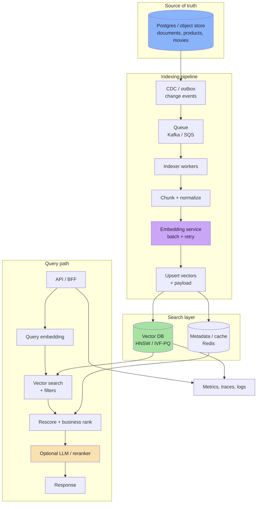
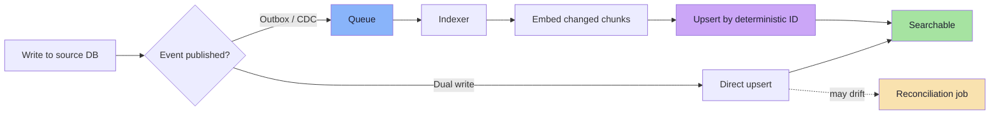
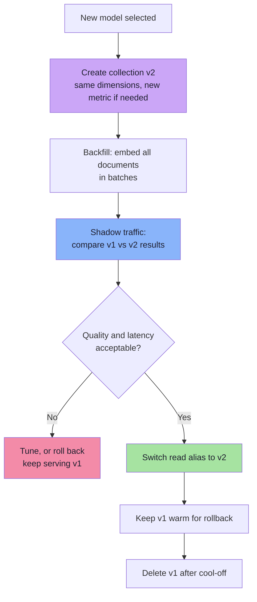
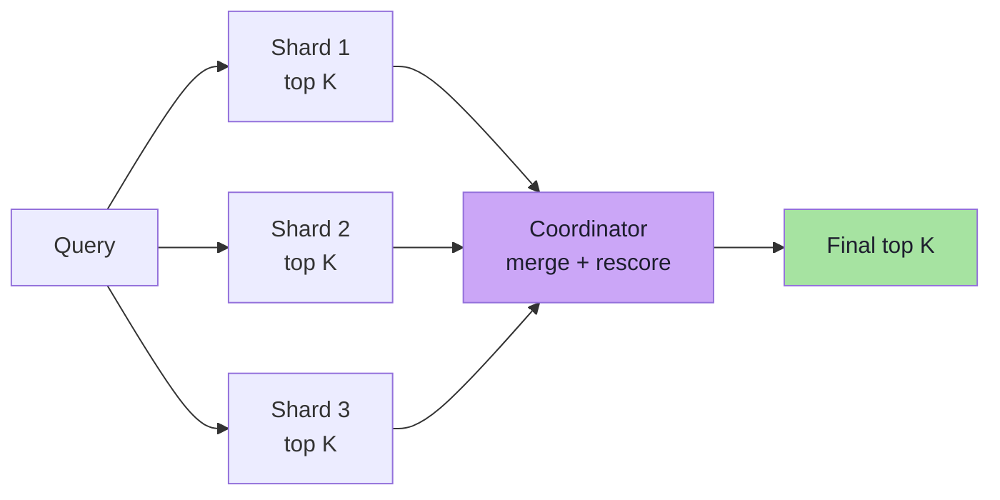
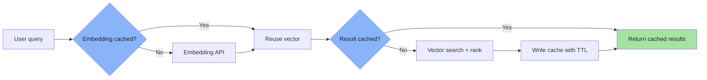
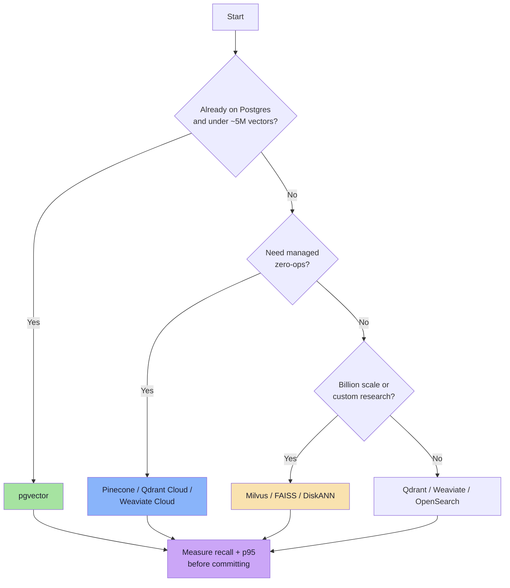

# Chapter 08: Production Vector Search Design

> **Chapter Goal:** Turn theory into operable system. Covers reference architecture, capacity planning with real numbers, ingestion and freshness, model-version migrations, sharding, evaluation, security, caching, and vendor landscape. Closes with production checklist, failure runbook, and consolidated takeaways of entire lecture.

---

## 8.1 Reference Architecture

Production vector search system is not "app plus vector database." It is a pipeline with source of truth, indexing path, query path, and observability layer.



### Responsibilities, Separated

| Component | Responsibility | Must Not Do |
|-----------|---------------|-------------|
| Source database | Truth, transactions, permissions | Store only vectors |
| CDC / queue | Reliable change propagation | Block write path |
| Indexer | Chunking, embedding, upsert | Own business logic |
| Embedding service | Model calls, batching, retries, caching | Store vectors |
| Vector DB | ANN search, filters, payload | Be source of truth |
| Retrieval API | Orchestration, rescoring, ranking | Expose raw DB errors |
| Reranker / LLM | Final relevance, explanation | Replace retrieval |

> **Architectural invariant:** Vector index must be **fully rebuildable** from source of truth plus embedding model. If not, durability and disaster-recovery problem.

---

## 8.2 Capacity Planning: A Worked Example

Document search product:

```text
Documents:            5,000,000
Chunks per document:  4 on average
Vectors:              20,000,000
Dimensions:           1536
Precision:            float32 (4 bytes)
Replicas:             2
```

### Raw Vector Memory

```text
bytes per vector = 1536 × 4 = 6,144 B ≈ 6 KB
raw vectors      = 20,000,000 × 6 KB = 120 GB
with 2 replicas  = 240 GB
```

### Add Index and Payload

| Component | Estimate |
|-----------|----------|
| Raw vectors (1 replica) | 120 GB |
| HNSW graph (M = 32, neighbour IDs + metadata) | 10–30 GB |
| Payload + IDs + document text | 40–100 GB |
| Working overhead (build, compaction) | 1.5× peak |
| **Total per replica** | **~200–300 GB** |
| **With 2 replicas** | **~400–600 GB** |

### Reduce with Quantization

```text
int8:   20M × 1536 B = 30 GB per replica   (4× reduction)
PQ:     20M × 192 B  = 3.8 GB per replica  (32× reduction)
```

With int8 plus full-precision rescoring cache for top candidates, 200 GB deployment becomes ~50–80 GB — often difference between "needs fleet" and "fits on two nodes."

### Query Capacity

```text
Peak QPS:            200
p95 latency target:  100 ms
Embedding call:      20-40 ms (cached: ~2 ms)
ANN search:          5-20 ms
Rescore + ranking:   5-15 ms
```

| Lever | Effect |
|-------|--------|
| Cache query embeddings | Removes 20–40 ms for repeated queries |
| Increase replicas | Linear read throughput |
| Reduce `efSearch` | Lower latency, lower recall |
| Quantize | Less memory bandwidth per query |
| Precompute popular results | Removes work for head queries |

> **Capacity planning rule:** Size memory for **index + payload + headroom**, not just vectors. Then size replicas for **peak QPS at p95**, not average QPS.

---

## 8.3 Ingestion, Freshness, and Reindexing

Vector index is a **materialized view** of data plus model. Treat it like one.

### Ingestion Patterns

| Pattern | How It Works | Best For |
|---------|--------------|----------|
| **Batch job** | Nightly scan of changed rows | Catalogs, low freshness needs |
| **CDC** | Stream inserts/updates/deletes from DB log | Near-real-time search |
| **Outbox table** | Write event in same transaction, relay later | Reliable events without CDC |
| **Dual write** | App writes DB and vector DB | Simple, but can drift |
| **Event-driven** | Domain events trigger re-indexing | Microservices |



### Freshness Targets

| Use Case | Acceptable Lag | Approach |
|----------|---------------|----------|
| Product catalogue | Minutes to hours | CDC + incremental embed |
| Support knowledge base | Minutes | Event-driven re-index |
| Chat with your own docs | Seconds | Streaming + chunk upsert |
| Compliance / audit search | Hours | Batch with verification |
| Recommendations | Hours | Batch rebuild |

### Handling Deletes and Updates

| Operation | Vector DB Action | Pitfall |
|-----------|-----------------|---------|
| Insert | Upsert new ID | Duplicate IDs from non-deterministic chunking |
| Update text | Re-embed + upsert same ID | Forgetting to delete stale chunks if chunk count shrinks |
| Delete | Tombstone, then compact | Deleted vectors still returned if filtered incorrectly |
| Model upgrade | New collection + alias swap | Mixed-model vectors in one index |

> **Chunk-count shrink bug:** Document that once produced 8 chunks and now produces 5 leaves 3 orphaned vectors unless you delete `id:6..8` explicitly. Always version chunks or delete-by-source-id before re-inserting.

---

## 8.4 Model Versioning and Zero-Downtime Re-Embedding

Most expensive operational event: changing embedding model. Every stored vector becomes incompatible.



### Migration Rules

1. **Never mix models in one collection.** Use new collection or `modelVersion` filter.
2. **Backfill in batches** with checkpointing; assume interrupted.
3. **Dual-serve** for a period: query both, compare recall and online metrics.
4. **Alias, don't hardcode.** Applications query `documents_live`, which points to a version.
5. **Keep old index** until rollback window closes.
6. **Record `modelId` and `modelVersion` in every payload** for auditability.

```ts
// Pseudo-code: versioned re-embedding with alias swap
async function migrateEmbeddingModel(from: string, to: string): Promise<void> {
  await vectorDb.createCollection({
    name: `documents_${to}`,
    dimensions: MODEL_DIMENSIONS[to],
    metric: "cosine",
    index: { type: "hnsw", params: { M: 32, efConstruction: 200 } },
  });

  await backfillInBatches({
    source: "documents",
    batchSize: 500,
    checkpointKey: `backfill:${to}`,
    handler: async (batch) => {
      const vectors = await embeddingModel.embedBatch(batch.map(d => d.text), { model: to });
      await vectorDb.upsert(`documents_${to}`, batch.map((d, i) => ({
        id: d.chunkId,
        embedding: vectors[i],
        payload: { ...d.payload, modelId: to, modelVersion: 2 },
      })));
    },
  });

  await vectorDb.setAlias("documents_live", `documents_${to}`);
}
```

### Cost of Re-embedding

```text
documents × chunks × tokens per chunk = total tokens
total tokens / 1,000,000 × price per million = API cost
```

5M documents × 4 chunks × 400 tokens = 8 billion tokens. At USD 0.02 per million tokens = **USD 160** embedding cost — usually cheaper than engineering time, but **backfill duration** and **double storage** are real constraints.

---

## 8.5 Sharding, Replication, and Multi-Tenancy

### Sharding

When index no longer fits on one node, split it:

| Strategy | How | Pros | Cons |
|----------|-----|------|------|
| **Hash by ID** | `shard = hash(id) % S` | Even distribution | Query hits all shards |
| **Tenant-based** | One shard per large tenant | Isolation, locality | Skew for small tenants |
| **Semantic / cluster** | Route by nearest centroid | Fewer shards per query | Rebalancing complexity |
| **Time-based** | Recent vs archive shards | Cheap archival | Cross-shard queries |

Hash sharding: every query fans out to all shards, each returns top-K, coordinator merges:

```text
Query → shard 1 → top K
      → shard 2 → top K
      → ...
      → merge + rerank → final top K
```



> **Tail latency warning:** Fan-out latency determined by **slowest shard**. With 20 shards, p99 of query ≈ p99.95 of single shard. Keep shards balanced, use hedged requests if latency matters.

### Replication

| Purpose | Mechanism |
|---------|-----------|
| Read throughput | Read replicas |
| High availability | Leader + followers, automatic failover |
| Disaster recovery | Cross-region snapshots |
| Zero-downtime rebuild | Build new index alongside old |

### Multi-Tenancy

| Model | Isolation | Cost | Use When |
|-------|-----------|------|----------|
| Collection per tenant | Strongest | Highest | Few large enterprise tenants |
| Namespace / partition | Strong logical | Medium | Many tenants, shared infra |
| Payload `tenantId` filter | Logical only | Lowest | Very high tenant count |

Whatever chosen, **tenant filtering must happen inside query**, tested adversarially. Missing filter is data breach, not relevance bug.

---

## 8.6 Evaluation: How Do You Know It Works?

Vector search quality cannot be judged by eyeballing a few results. Need repeatable evaluation harness.

### Offline Metrics

| Metric | Definition | Use |
|--------|------------|-----|
| **Recall@K** | Fraction of true top-K returned | Index tuning, ANN quality |
| **Precision@K** | Fraction of returned items relevant | Result quality |
| **MRR** | Mean reciprocal rank of first relevant | Ranking quality |
| **nDCG@K** | Graded relevance, discounted by position | Search ranking |
| **Coverage** | Fraction of queries with at least one good result | Recall of system |

```text
recall@K    = |returned ∩ relevant| / |relevant|
precision@K = |returned ∩ relevant| / K
MRR         = average(1 / rank_of_first_relevant)
```

### Online Metrics

| Metric | What It Tells You |
|--------|-------------------|
| CTR / click-through | Whether results attract attention |
| Conversion / task success | Whether search achieves goal |
| Zero-result rate | Queries index cannot serve |
| Query reformulation rate | Users not finding what they want |
| p50 / p95 / p99 latency | User-perceived speed |
| Freshness lag | Time from source write to searchable |
| Empty-after-filter rate | Filtering too aggressive |

### Building a Golden Set

```text
1. Sample 500–2,000 real queries (stratified by frequency).
2. Label truly relevant items for each (human or LLM-assisted, audited).
3. Freeze set and version it.
4. Run every index/model change against it.
5. Track recall@10 and nDCG@10 over time.
```

```ts
// Pseudo-code: offline evaluation report
interface EvalCase {
  query: string;
  relevantIds: string[];
}

async function evaluate(cases: EvalCase[], retriever: Retriever): Promise<Report> {
  let recallSum = 0;
  let mrrSum = 0;
  let latencySum = 0;

  for (const testCase of cases) {
    const started = performance.now();
    const results = await retriever.search(testCase.query, 10);
    latencySum += performance.now() - started;

    const returned = results.map(r => r.id);
    const hits = returned.filter(id => testCase.relevantIds.includes(id));
    recallSum += hits.length / testCase.relevantIds.length;

    const firstHit = returned.findIndex(id => testCase.relevantIds.includes(id));
    mrrSum += firstHit >= 0 ? 1 / (firstHit + 1) : 0;
  }

  return {
    recallAt10: recallSum / cases.length,
    mrr: mrrSum / cases.length,
    avgLatencyMs: latencySum / cases.length,
  };
}
```

> **Evaluate retrieval and generation separately.** Bad RAG answer can come from bad retrieval or bad LLM. Measure `recall@K` first; only then blame model.

---

## 8.7 Caching and Cost Optimization

Vector search has several expensive stages, each cacheable at different level.

| Cache | Key | Hit Saves | Invalidation |
|-------|-----|-----------|--------------|
| Query embedding cache | hash(normalized query + model) | 20–40 ms + API cost | Model version change |
| Result cache | hash(query + filters + k + index version) | Entire search | Index update, permission change |
| Semantic cache | nearest cached query above threshold | Full pipeline incl. LLM | High risk; needs guardrails |
| Payload cache | document ID | DB round-trip | Content update |
| Warm popular results | top-N trending queries | Compute per request | Periodic refresh |



### Semantic Cache Warning

Semantic cache returns answer to **similar** query. Large win for FAQs, subtle wrong answers for personalized/time-sensitive:

```text
Safe:     "What is your refund policy?"
Unsafe:   "What is my order status?"      (per-user)
Unsafe:   "What is the stock price?"      (time-sensitive)
Unsafe:   anything with authorization-scoped results
```

**Never** semantically cache results depending on user identity, permissions, or fresh data unless cache key includes all those dimensions.

### Cost Levers, Ordered by Impact

1. **Reduce vector count** — better chunking, deduplication, fewer redundant chunks
2. **Quantize** — int8 or PQ cuts memory 4×–32×
3. **Cache embeddings** — repeated queries common in production
4. **Use smaller embedding models** where quality allows (384 vs 1536 dimensions)
5. **Reduce `efSearch`** to lowest value meeting recall targets
6. **Batch ingestion** to reduce embedding API overhead
7. **Archive cold data** to separate cheaper index

---

## 8.8 Security, Privacy, and Compliance

Vector search introduces unusual risks because embeddings can leak information and filters control access.

| Risk | Description | Mitigation |
|------|-------------|------------|
| Cross-tenant retrieval | Missing tenant filter returns another customer's data | Enforce tenant filter in shared query builder; test adversarially |
| ACL post-filtering | Result counts reveal inaccessible documents | Filter inside query |
| Embedding inversion | Embeddings can partially reconstruct source text | Treat embeddings as sensitive; encrypt at rest |
| PII in payload | Metadata stores emails, phone numbers | Minimize payload; tokenize or hash |
| Prompt injection via retrieved text | Malicious document instructs LLM | Delimit retrieved content; instruct model to treat as data |
| Model provider data retention | Query text sent to external API | Use zero-retention endpoint or self-hosted model |
| Index poisoning | Attacker inserts content to manipulate results | Validate ingestion sources; sign documents; monitor anomalies |

> **Security invariant:** Authorization is a **query constraint**, never presentation-layer filter. If vector DB returns document to application, application must be allowed to see it.

### Data Residency

Embeddings derived from content. If content regulated, embeddings usually too. Plan for:
- Region-pinned collections
- Separate indexes per jurisdiction
- Deletion propagation (source delete → vector delete → backup expiry)
- Audit logs for retrieval of sensitive collections

---

## 8.9 Technology Landscape

| Option | Type | Strengths | Watch-outs |
|--------|------|-----------|------------|
| **pgvector** | Postgres extension | ACID, joins, familiar ops, HNSW/IVFFlat | Scaling beyond few million; index build memory |
| **Pinecone** | Managed SaaS | Zero ops, serverless, metadata filters | Vendor lock-in, cost at scale |
| **Qdrant** | Open source / cloud | Strong filtering, payload indexes, Rust performance | Operational ownership if self-hosted |
| **Weaviate** | Open source / cloud | Hybrid search, modules, GraphQL | Complexity, resource usage |
| **Milvus** | Open source / cloud | Billion-scale, many index types | Heavy infrastructure (etcd, object storage) |
| **FAISS** | Library | Fastest research-grade indexes, full control | Not a database: no persistence, auth, filtering |
| **Chroma** | Lightweight DB | Great DX for prototypes | Not built for large-scale production |
| **OpenSearch / Elasticsearch** | Search engine | BM25 + kNN + aggregations in one system | Vector performance trails dedicated DBs |
| **Redis** | In-memory store | Sub-millisecond, good for caching + small indexes | Memory cost; persistence trade-offs |
| **LanceDB** | Embedded columnar | Local/embedded, versioned datasets | Smaller ecosystem |

### Decision Framework



> **Vendor selection rule:** Benchmark with **your** embeddings, **your** filters, **your** query distribution. Public benchmarks use different data and rarely include filtered search — where most systems actually fail.

---

## 8.10 Failure Modes and Runbook

| Symptom | Probable Cause | First Checks | Fix |
|---------|---------------|--------------|-----|
| Zero results | Filters too strict, empty collection | `count()`, filter selectivity | Relax filters; verify ingestion |
| Sudden relevance drop | Model mismatch or bad deploy | `modelVersion` in payload, recent config diff | Roll back alias |
| Latency spike | Index rebuild, memory pressure, huge filter | p95 by stage, node memory, `efSearch` | Scale out, reduce candidates |
| Memory OOM | float32 + graph + replicas | bytes/vector × count | Quantize, shard, add RAM |
| Stale results | CDC lag or failed consumer | queue depth, consumer lag | Replay events, reconcile |
| Duplicates | Non-deterministic chunk IDs | ID generation logic | Deterministic IDs + dedupe |
| Deleted docs still appear | Tombstone not filtered | delete pipeline, cache TTL | Fix delete propagation |
| Cross-tenant leak | Missing filter in one code path | audit query builder | Enforce centrally, add tests |

### Runbook: Relevance Regression

```text
1. Confirm regression is real: run golden set, compare recall@10.
2. Check whether embedding model or index alias changed.
3. Compare ANN results against exact search for 50 queries.
4. Inspect filter selectivity and empty-after-filter rate.
5. Roll back alias or config if cause is a deploy.
6. Add failing queries to golden set.
```

### Runbook: Latency Regression

```text
1. Break down p95 by stage: embed, ANN, filter, rescore, rerank.
2. If embed: check cache hit rate and provider status.
3. If ANN: check efSearch/nprobe changes, segment count, memory pressure.
4. If filter: check for low-selectivity filters forcing scan.
5. If rescore/rerank: check candidate count explosion.
6. Add load test that reproduces traffic shape.
```

---

## 8.11 Production Checklist

### Data and Indexing

- [ ] Deterministic chunk IDs (idempotent upserts)
- [ ] Chunk size and overlap chosen and documented
- [ ] Deletes propagated (including orphaned chunks)
- [ ] Source of truth can rebuild entire index
- [ ] `modelId`, `modelVersion`, `updatedAt` stored in payload
- [ ] Incremental re-indexing for changed content
- [ ] Reconciliation job for dual-write drift

### Index and Query

- [ ] Metric matches embedding model
- [ ] Dimensions fixed and validated at write time
- [ ] ANN parameters tuned against exact recall
- [ ] `efSearch >= K` enforced
- [ ] Filtering strategy chosen (pre / filtered ANN / post)
- [ ] Two-stage retrieval with exact rescoring
- [ ] Query embedding cache with model-version key

### Operations

- [ ] p50/p95/p99 latency dashboards
- [ ] Recall@K tracked on versioned golden set
- [ ] Queue lag and freshness lag alerts
- [ ] Memory and disk alerts
- [ ] Snapshot and restore tested
- [ ] Zero-downtime reindex procedure documented
- [ ] Rollback plan for model and index changes

### Security

- [ ] Tenant/ACL filters inside query
- [ ] Adversarial tests for cross-tenant leakage
- [ ] Embeddings treated as sensitive data
- [ ] PII minimized in payloads
- [ ] Retrieved content delimited against prompt injection
- [ ] Provider data-retention policy reviewed
- [ ] Audit logging for sensitive collections

---

## 8.12 The Lecture in Twenty Takeaways

1. **Toy search is exact and linear.** 30 vectors is not a scale test.
2. **Storage and search are different problems.** Solve them separately.
3. **Relational databases can store vectors.** They cannot index similarity with B-tree.
4. **Traditional queries ask "does it match?"** Vector queries ask "how close is it?"
5. **An embedding model understands meaning.** A vector database only handles coordinates.
6. **A vector record is ID + vector + metadata.** Everything else is production detail.
7. **The metric is part of the schema.** Use consistently at build and query time.
8. **Brute force is the correct baseline.** `O(N × D)` per query, 100% recall.
9. **10M × 1536 = 15.36 billion operations.** For a single query.
10. **Storage math is unforgiving.** 6 KB per vector, 6 GB per million, 600 GB per 100M.
11. **Memory bandwidth often beats CPU as bottleneck.**
12. **Indexes work by proving regions irrelevant.** Order enables proof; geometry enables it only in low dimensions.
13. **A B-tree needs total order.** Vectors do not have one.
14. **A k-d tree splits one axis at a time.** Prunes beautifully in 2D, fails in 1536D.
15. **Curse of dimensionality is gradual.** More dimensions → more boundaries → fewer safe prunes.
16. **Distance concentration destroys pruning margins.** Nearest and farthest become similar.
17. **Sub-linear search requires approximation.** IVF, HNSW, PQ, LSH bet on data structure.
18. **Recall is quality metric for ANN.** Measure against exact search, always.
19. **Two-stage retrieval is production pattern.** Cheap candidates, exact rescoring, business ranking.
20. **Index is derived artifact.** Design it to be rebuilt, versioned, rolled back.

---

## 8.13 Exercises

1. **Cost estimation.** 40M products, 2 vectors each, 768 dims, float32. Compute raw vector bytes, bytes with int8, provisioned RAM with 2 replicas and 1.5× headroom.
2. **Metric check.** Team stores normalized embeddings but builds index with L2 and queries with cosine. Explain why results may look reasonable, and why this is still a bug.
3. **KNN by hand.** Q = [1, 1], points A = [0, 0], B = [2, 2], C = [1, 3]. Compute L2 distance and cosine similarity, rank for each. Do rankings agree?
4. **k-d tree.** Insert [5,4], [2,7], [8,1], [1,2], [9,6], [3,3] alternating axes. Search [6,5], list every node visited. Count brute-force nodes.
5. **Pruning proof.** Prove if `planeDistance >= bestDistance`, no point on far side of axis-aligned plane can be strictly closer.
6. **IVF sizing.** N = 8,000,000, choose `nlist` and `nprobe` to scan ~2% of data. Estimate centroid comparisons per query.
7. **Recall measurement.** Design experiment comparing HNSW `efSearch = 40` vs `efSearch = 200` on 500 real queries. Specify ground truth, metrics, acceptance criteria.
8. **Filtering bug.** k = 10, filter matches 0.5% corpus. Post-filtering returns 2 results. Explain why, propose two fixes with trade-offs.
9. **Freshness design.** Support chatbot must reflect edited articles within 60 seconds. Sketch ingestion pipeline, identify two staleness sources.
10. **Model migration.** Plan zero-downtime move from 768-dim to 1536-dim model for 30M chunks. Include storage, backfill, shadow eval, alias switch, rollback.

---

## 8.14 Chapter Summary

| Area | Key Decision |
|------|-------------|
| Architecture | Source of truth → CDC/queue → embed → index → retrieve → rerank |
| Capacity | Size for vectors + index + payload + headroom; replicate for QPS |
| Freshness | Batch, CDC, or event-driven depending on product promise |
| Model changes | New collection, batched backfill, shadow eval, alias swap, rollback |
| Scale | Shard by hash/tenant, replicate for reads, fan-out with tail-latency care |
| Quality | Golden set, recall@K, MRR/nDCG, online CTR and zero-result rate |
| Cost | Fewer vectors, quantization, embedding cache, tuned `efSearch` |
| Security | Tenant/ACL filters inside query; embeddings are sensitive data |
| Tooling | pgvector for simple, dedicated DB for scale, FAISS for research |

> **Final mental model of Lecture 14:**
>
> A vector database is not an "AI database." It is an ordinary database whose index is geometric.
>
> Exact search is simple, correct, and linear: `N × D` work per query. At scale that bill is too large.
>
> The natural fix — a tree that prunes space — works in 2D and 3D, then collapses under curse of dimensionality. Not because code is wrong, but because high-dimensional geometry stops allowing safe pruning.
>
> So we make deliberate bargain: search small part of data, return results *almost always* true nearest neighbours, and **measure difference**. That measurement is recall. That bargain is ANN.
>
> **REPRESENT → STORE → INDEX → RETRIEVE → RERANK → MEASURE.**

---

## 8.15 Where This Leads

| Next Topic | Why It Follows Naturally |
|------------|-------------------------|
| **RAG** | Retrieval is the "R"; this lecture builds retrieval layer |
| **Hybrid search** | Lexical + vector fusion for exact tokens and paraphrases |
| **Reranking** | Cross-encoders and LLMs improve top of ranking |
| **Vector DB operations** | Backups, upgrades, cost governance, multi-region |
| **Evaluation engineering** | Golden sets, human labels, online experiments |
| **Multi-modal retrieval** | CLIP-style shared spaces for image, audio, video |

---

**End of Lecture 14 — Vector Search and Storage: Scale, KNN & the Curse of Dimensionality.**

Back to the [Lecture 14 Index](./index.md).