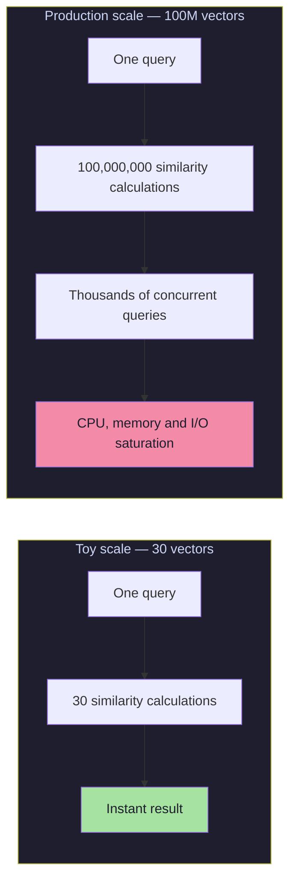
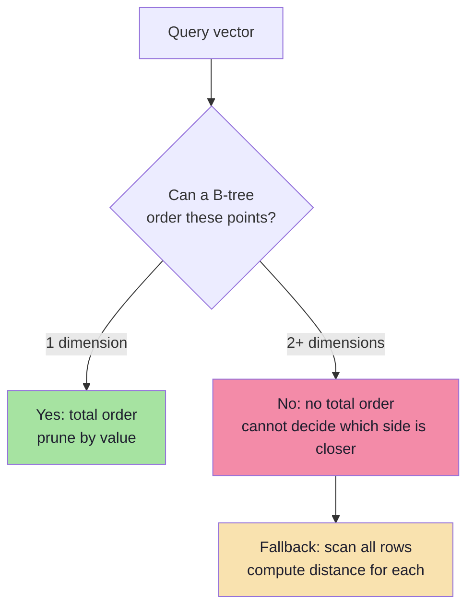
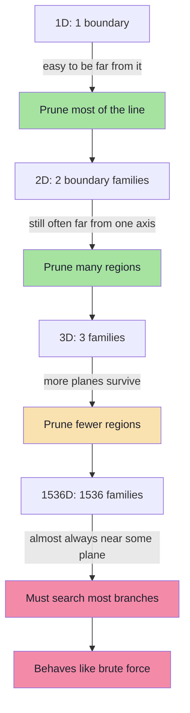
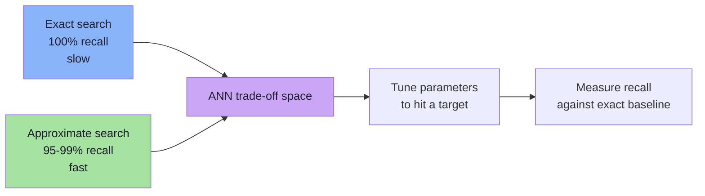
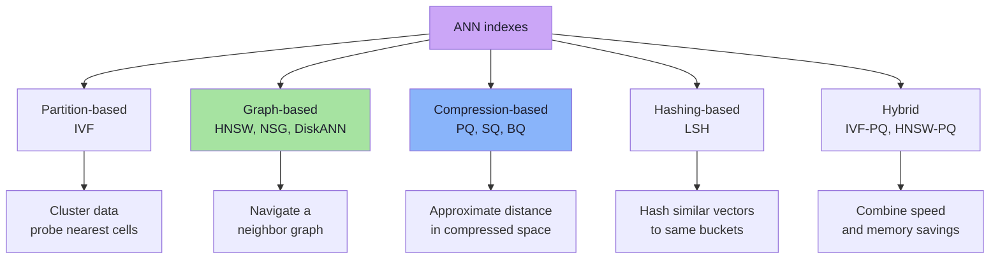
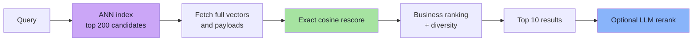

# Lecture 14 — Vector Search and Storage: Complete Notes

> **Source:** FDE L09 · Forward-Deployed-Engineer · **Phase:** 4 · Embeddings · **Level:** 🟡 Intermediate
>
> **Scope:** Vector search, storage, KNN, the curse of dimensionality, ANN indexes, and production design — synthesized from Chapters 01–08 of Lecture 09.

---

## How to Read This Document

- Part A gives the **end-to-end narrative** of the lecture in seven moves.
- Part B condenses each chapter into **key ideas and takeaways**.
- Part C is the **exam/retention cheat-sheet** derived from the twenty lecture takeaways.
- The individual chapter files in this folder contain the **deep, detailed notes** with full diagrams, worked examples, and pseudo-code.

---

## Part A — The End-to-End Narrative of Lecture 14

### The starting point: toy search is exact and linear

Lecture 14 opens with the movie-recommendation system from Lecture 13 — a list of 30 movies with embeddings, compared by cosine similarity, returning top-K. It worked instantly and exactly.

The algorithm was:

```text
User query → Embedding model → Query vector → Compare with ALL movies → Sort → Return top K
```

With `N = 30`, this was instant. With `N = 100,000,000`, a single query required **100 million similarity calculations**. The algorithm did not change; the cost did.



**The scale wall:** an algorithm whose cost is proportional to data size is fine for a demo and fatal for a product.

### The two separate problems: storage vs search

A central framing device of the lecture: vector search contains **two distinct engineering problems** that are often conflated:

1. **Storage** — Where do N × D floats live? (disk, RAM, replication, compression)
2. **Search** — How do we avoid comparing all N vectors? (indexes, ANN)

They can be solved independently, though the solutions interact.

| Concern | Storage | Search |
|---------|---------|--------|
| Core question | Where do the bytes live? | Which vectors are closest to this query? |
| Primary cost | Disk / RAM capacity, replication | CPU, memory bandwidth, I/O, latency |
| Typical solution | Object storage, DB persistence, vector DB layer | ANN index (HNSW, IVF, PQ, DiskANN) |
| Failure mode | "We ran out of memory" | "p99 latency is 4 seconds" |

### Why relational databases are not the answer (for search)

Myth: "Relational databases cannot store vectors."

Truth: they **can** store vectors (JSON, blobs, or native `vector` types like `pgvector`). The real limitation:

> **SQL answers exact/ordered predicates ("does this match?"). Vector search asks graded similarity ("how close is it?").**

B-trees need **total order** to prune. Vectors in multi-dimensions have **no natural total order**. A B-tree query for `age = 32` can discard all smaller values because of order. A vector query has no such ordering — hence B-tree "index" for vectors degenerates to scan.



### Brute-force KNN: the honest baseline

Before any index, the "correct" answer is brute-force KNN: compare the query against every vector, rank, return top K. Exactly the toy loop from the start, scaled up.

```ts
// Pseudo-code: complete brute-force KNN algorithm
function knn(query: number[], vectors: VectorRecord[], k: number): Scored[] {
  const scored: Scored[] = [];

  for (const record of vectors) {
    const score = cosineSimilarity(query, record.embedding);
    scored.push({ id: record.id, score });
  }

  scored.sort((a, b) => b.score - a.score);
  return scored.slice(0, k);
}
```

Properties of exact search:
- **Accuracy:** Perfect (100% recall by definition)
- **Build:** None
- **Query:** O(N × D) — e.g., 10M × 1536 = **15.36 billion operations per query**
- **Storage:** 6 KB per vector (float32, 1536 dims) → 6 GB per million → ~600 GB per 100M
- **Scalability:** Poor

The lecture's key numbers:
- One query on 10M vectors × 1536 dims ≈ 15.36 billion dimension-level operations
- Memory bandwidth, not CPU compute, becomes the bottleneck — 61.44 GB of vector data must be streamed per query before any math
- Top-K via full sort is wasteful; use bounded min-heap O(N log K)

> **Engineering rule:** Start with brute force, measure, add index only when latency/capacity constraint demands it. An index is a complexity purchase.

### The curse of dimensionality: why pruning dies

As dimensions grow, geometric indexes stop working. Two phenomena explain why:

1. **Boundary proliferation:** each dimension adds more potential splitting planes. With 1536 dimensions, query is almost always near *some* boundary → pruning fails almost always → search degrades toward brute force.

2. **Distance concentration:** in high dimensions, distances between points become similar — nearest vs farthest distances converge → no meaningful ranking signal → pruning margins collapse.

The formula `P(no near boundary) = (1 − p)^D` makes this concrete: with D = 1536 and per-dimension boundary probability p = 0.01, the probability of never being near a boundary is astronomically small.



Empirically, a k-d tree inspecting only 90–100% of dataset at 384–1536 dimensions — effectively useless as an index.

### Approximate Nearest Neighbor (ANN): the deliberate bargain

Since exact pruning is impossible at scale, the only way to sub-linear search is to **accept approximation** and **measure** it:

```text
Exact:  search 100% of vectors → 100% recall → O(N)
ANN:    search ~1% of vectors → 95-99% recall → O(log N) or O(1)
```

The trade-off has five dimensions (not two): recall, latency, memory, build cost, freshness.



### The ANN family tree: IVF, HNSW, PQ, LSH, DiskANN



Key index distinctions:

| Index | Approach | Recall / Latency | Memory | Best For |
|-------|----------|------------------|--------|----------|
| **Flat** | Compare everything | 100% / slow | Vectors only | Small N, ground truth |
| **IVF** | Cluster with k-means, probe n clusters | Good / moderate | Vectors + centroids | Large N, batch-heavy |
| **HNSW** | Multi-layer neighbour graph | Excellent / very fast | High (graph) | Low-latency in-RAM |
| **IVF-PQ** | IVF + product quantization | Good with rerank | Very low | Billion-scale, memory-bound |
| **LSH** | Random hyperplane hashing | Moderate / fast | High (many tables) | Streaming, approximate dedup |
| **DiskANN** | Graph on SSD, compressed in RAM | Excellent / fast | Low RAM, SSD | Huge datasets on disk |

HNSW parameters:
- `M` (neighbours per node): 16–64
- `efConstruction` (build candidates): 100–500
- `efSearch` (query candidates): 50–500 — **must be ≥ K**

```text
efSearch ↑  →  recall ↑  →  latency ↑
```

### Two-stage retrieval: the production pattern

Single ANN query is rarely the final answer. Standard architecture:

```text
Stage 1  Candidate generation   ANN over compressed/quantized vectors → 100–500 ids
Stage 2  Exact rescoring         Recompute full-precision similarity for candidates
Stage 3  Business ranking        Recency, popularity, diversity, filters
Stage 4  (Optional) LLM rerank   Cross-encoder or LLM relevance scoring
```



> **Critical:** Final recall cannot exceed candidate-stage recall. If stage 1 retrieves 200 candidates at recall@200 = 0.92, final recall@10 ≤ 0.92. A perfect reranker cannot recover missing candidates.

### Production design checklist (from Chapter 08)

Reference architecture: **Source of truth → CDC/queue → embed → index → retrieve → rerank → measure**.

Key decisions:

- **Vector index = derived artifact** — must be rebuildable from source of truth + embedding model. If not rebuildable, durability problem.
- **Metric is part of schema** — cosine, dot, L2 chosen once at collection creation; must be consistent at build and query time. (Common bug: normalized vectors, index built with L2, query with cosine → silently wrong rankings.)
- **Model versioning:** new collection → batched backfill → shadow evaluation → alias swap → keep old until rollback window closes. Never mix models in one collection.
- **Freshness:** batch job / CDC / outbox / event-driven / dual-write / direct upsert — pick by product promise.
- **Chunk-count shrink bug:** if document that produced 8 chunks now produces 5, orphan chunks 6–8 must be explicitly deleted. Always version chunks or delete-by-source-id before re-inserting.
- **Deletes:** tombstone then compact; otherwise deleted vectors can still be returned if filtered incorrectly.
- **Authorization:** must be inside query (tenant/ACL filters inside the query), never post-filter. Post-filter after top-K reveals existence through result counts.

Capacity planning example (5M docs × 4 chunks = 20M vectors, 1536 dims, float32, 2 replicas):
- Raw vectors: 120 GB (1 replica), 240 GB (2 replicas)
- + HNSW graph (M=32): 10–30 GB, + payload: 40–100 GB → ~200–300 GB per replica, ~400–600 GB for 2 replicas
- int8 → 30 GB, PQ → 3.8 GB per replica (4×–32× reduction)
- Query budget: 200 QPS peak, p95 100 ms, embed 20–40 ms (cached ~2 ms), ANN 5–20 ms, rescore/rank 5–15 ms

Caching layers: query-embedding cache, result cache, semantic cache (careful with PII/time-sensitivity/auth), payload cache, warm popular results.

---

## Part B — Chapter Summary (Consolidated)

### Chapter 01 — The Scale Wall
| Idea | Takeaway |
|------|----------|
| Toy loop from Lecture 13 | Correct, exact, fine for small N |
| Scale wall | Cost grows with N × D per query |
| Storage vs search | Distinct problems, distinct costs |
| Hidden costs | Memory reads, arithmetic, top-K all scale |
| New goal | Search fraction of data, keep near-perfect accuracy |

### Chapter 02 — Why Relational DBs Are Not Enough
| Claim | Reality |
|-------|---------|
| "Relational DBs cannot store vectors" | False — JSON/blobs/native types work |
| "Why not just use SQL?" | SQL answers exact/ordered predicates, not similarity |
| "An index will fix it" | B-trees need total order; vectors don't have one |
| "Vector DBs replace relational DBs" | No — derived structures beside source of truth |
| "Postgres is never enough" | Often enough, especially with `pgvector` at moderate scale |

### Chapter 03 — Anatomy of a Vector Database
| Concept | Takeaway |
|---------|----------|
| Minimum record | ID + vector + metadata |
| Production record | Adds document, tenant, model id/version, timestamps |
| Embedding model vs vector DB | Model understands meaning; DB handles coordinates |
| Write path | Chunk → embed → upsert → index |
| Read path | Embed query → ANN → filter → rescore → rerank |
| Filtering | Pre/post/filtered ANN; never post-filter authorization |
| Hybrid | RRF fusion of lexical + semantic |

### Chapter 04 — Brute Force and KNN
| Concept | Takeaway |
|---------|----------|
| KNN | Return K closest vectors |
| K | Product decision, not algorithm decision |
| Cost per query | O(N × D); 10M × 1536 = 15.36B ops |
| Storage | 6 KB/vector; 6 GB/1M; 600 GB/100M |
| Hidden bottlenecks | Memory bandwidth, disk I/O, top-K |
| Top-K | Bounded heap O(N log K), not full sort |
| Exact search | 100% recall, no build cost, poor scalability |

### Chapter 05 — Indexes and Why Scalar Indexes Fail
| Idea | Takeaway |
|------|----------|
| Ordinary indexes work via total order | B-tree proof-pruning |
| Vectors lack total order | Multi-dim geometry |
| k-d tree | Alternating axis splits; proves regions irrelevant via splitting-plane distance |
| Pruning rule | Search near side first; search far side only if `planeDist < bestDist` |
| Pruning fails when query near boundary | Must search both sides |

### Chapter 06 — The Curse of Dimensionality
| Concept | Takeaway |
|---------|----------|
| Curse | High-dim geometry breaks partitioning and distance contrast |
| Boundary proliferation | More dims → more planes → fewer safe prunes |
| Volume concentration | Volume near corners/surface, not center |
| Distance concentration | Nearest/farthest distances converge |
| Effect on k-d trees | 70–100% of dataset inspected → degenerates to brute force |
| Mitigations | Dimension reduction, quantization, data-adaptive ANN, parallel exact |

### Chapter 07 — Approximate Nearest Neighbor Indexes
| Index | One-Line |
|-------|----------|
| Flat | Compare everything; exact; baseline |
| IVF | Cluster, then probe few clusters |
| HNSW | Navigate multi-layer neighbour graph |
| PQ | Compress vectors into codebook IDs |
| LSH | Hash similar vectors to same buckets |
| DiskANN | Graph on SSD for huge datasets |

| Principle | Takeaway |
|-----------|----------|
| The bargain | Sub-linear speed requires approximate recall |
| Five dimensions | Recall, latency, memory, build cost, freshness |
| HNSW | Best low-latency default when data fits in RAM |
| Two-stage retrieval | ANN → rescore → business rank; ceiling enforced by stage-1 recall |

### Chapter 08 — Production Vector Search Design
| Area | Key Decision |
|------|-------------|
| Architecture | Source of truth → CDC/queue → embed → index → retrieve → rerank |
| Capacity | Size for vectors + index + payload + headroom; replicate for QPS |
| Freshness | Batch/CDC/event-driven by product promise |
| Model changes | New collection, backfill, shadow eval, alias swap, rollback |
| Scale | Shard by hash/tenant, replicate reads, fan-out with tail-latency care |
| Quality | Golden set, recall@K, MRR/nDCG, online CTR, zero-result rate |
| Cost | Fewer vectors, quantization, embedding cache, tuned efSearch |
| Security | Tenant/ACL inside query; embeddings sensitive; retrieved content delimited |

---

## Part C — Consolidated Cheat Sheet (from the Twenty Lecture Takeaways)

1. **Toy search is exact and linear.** 30 vectors is not a scale test.
2. **Storage and search are different problems.** Solve them separately.
3. **Relational DBs can store vectors.** They cannot index similarity with B-tree.
4. **Traditional queries ask "does it match?"** Vector queries ask "how close is it?"
5. **Embedding model understands meaning.** Vector DB handles coordinates.
6. **Vector record = ID + vector + metadata.** Everything else is detail.
7. **The metric is part of the schema.** Use consistently at build and query time.
8. **Brute force is the correct baseline.** O(N × D) per query, 100% recall.
9. **10M × 1536 = 15.36 billion operations.** For one query.
10. **Storage math is unforgiving.** 6 KB per vector, 6 GB per million, 600 GB per 100M.
11. **Memory bandwidth often beats CPU as bottleneck.**
12. **Indexes work by proving regions irrelevant.** Order enables proof; geometry enables it only in low dims.
13. **B-tree needs total order.** Vectors do not have one.
14. **k-d tree splits one axis at a time.** Prunes beautifully in 2D, fails in 1536D.
15. **Curse of dimensionality is gradual.** More dims → more boundaries → fewer safe prunes.
16. **Distance concentration destroys pruning margins.** Nearest and farthest become similar.
17. **Sub-linear search requires approximation.** IVF, HNSW, PQ, LSH bet on data structure.
18. **Recall is quality metric for ANN.** Measure against exact search, always.
19. **Two-stage retrieval is production pattern.** Cheap candidates, exact rescoring, business ranking.
20. **Index is derived artifact.** Design it to be rebuilt, versioned, rolled back.

---

## Part D — Final Mental Models

### The single strongest mental model of the entire lecture:

> A vector database is not an "AI database." It is an ordinary database whose index is geometric.

```
REPRESENT → STORE → INDEX → RETRIEVE → RERANK → MEASURE
```

### Where Lecture 14 leads next:

| Next Topic | Why It Follows Naturally |
|------------|-------------------------|
| **RAG** | Retrieval is the "R"; this lecture builds the retrieval layer |
| **Hybrid search** | Lexical + vector fusion for exact tokens and paraphrases |
| **Reranking** | Cross-encoders and LLMs improve top of ranking |
| **Vector DB operations** | Backups, upgrades, cost governance, multi-region |
| **Evaluation engineering** | Golden sets, human labels, online experiments |
| **Multi-modal retrieval** | CLIP-style shared spaces for image, audio, video |

---

## Sources

- `Forward-Deployed-Engineer/Lecture 09/notes/` — chapters 01–08 (this lecture's source)
- `Forward-Deployed-Engineer/Lecture 09/notes/Lecture_09_Complete_Notes.md`
- `Forward-Deployed-Engineer/Lecture 09/notes/Notes.pdf`
- `Forward-Deployed-Engineer/Lecture 09/notes/Excalidraw-Notes.svg`
- Roadmap mapping: `FDE-and-GenAI-Mastery/roadmap.md` → Lecture 14
