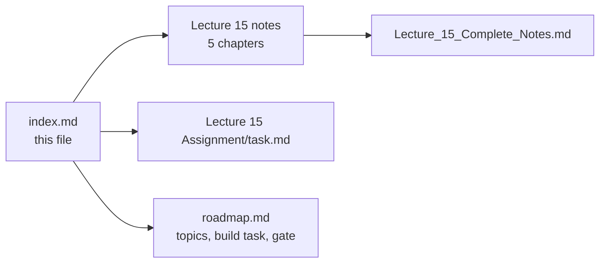

# Lecture 15 — Vector Databases and ANN Algorithms

**Phase 4 · Meaning & Retrieval: Embeddings · 🟠 Advanced · 5 chapters + 1 consolidated document**
**Folder:** **[📂 Lecture 15 - Vector Databases and ANN](./Lecture%2015%20-%20Vector%20Databases%20and%20ANN/)** · **[📄 Roadmap: Phase 4](./roadmap.md#-phase-4--meaning--retrieval-embeddings)**

| # | Chapter | One-line summary | Notes |
| :---: | :--- | :--- | :--- |
| **01** | **Vector Database Architecture and the Five Layers** | API → Query Engine → Filtering → Index → Storage; the record model `id + vector + payload`; pre-/post-/filter-aware search modes. | [📄 Chapter 01](./notes/01_Vector_Database_Architecture_and_the_Five_Layers.md) |
| **02** | **IVF — Inverted File Index** | k-means centroids partition space into lists; query probes nprobe lists; boundary problem; nlist/nprobe tuning; IVF-Flat/PQ/SQ. | [📄 Chapter 02](./notes/02_IVF_Inverted_File_Index.md) |
| **03** | **HNSW — Hierarchical Navigable Small World** | Multi-layer proximity graph; greedy descent + best-first search; M/M0/efConstruction/efSearch; memory, build cost, tombstones, filtered-search weakness. | [📄 Chapter 03](./notes/03_HNSW_Hierarchical_Navigable_Small_World.md) |
| **04** | **Product Quantization & Vector Compression** | Split→codebooks→codes; ADC table-lookup search; memory math (~128×); int8/binary comparison; IVF-PQ / HNSW+PQ combinations. | [📄 Chapter 04](./notes/04_Product_Quantization_and_Vector_Compression.md) |
| **05** | **Vector Database Engine Decisions & Production Operations** | pgvector vs Qdrant vs Milvus; hybrid search & RRF; sharding, replication, versioning; production RAG runbook; DiskANN & vendor landscape. | [📄 Chapter 05](./notes/05_Vector_Database_Engine_Decisions_and_Production_Operations.md) |

### 📄 Consolidated notes

A single document combining all five chapters — end-to-end narrative, parameter cheat sheets, decision tables, memory comparison, common pitfalls, and links back into each chapter for detail:

👉 **[Lecture_15_Complete_Notes.md](./notes/Lecture_15_Complete_Notes.md)**

### 🧩 This lecture's other artefacts

| Artefact | Link | Status |
| :--- | :--- | :---: |
| Lecture workspace README (objectives · level · source mapping · checklist) | [📄 README.md](./README.md) | ✅ |
| Chapter index for the lecture (reading order) | [📑 index.md](./index.md) | ✅ |
| Assignment — chapter-wise practice questions & completion gate | [📝 Assignment/task.md](./Assignment/task.md) | ⬜ to write |

