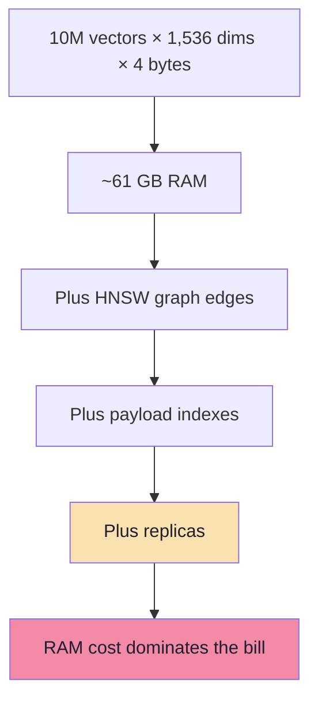
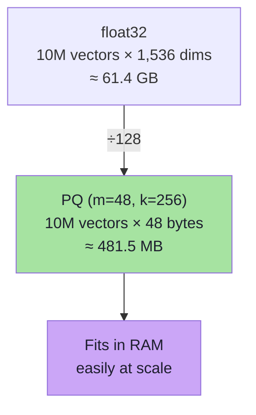
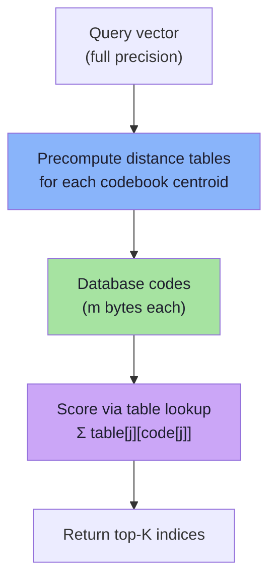
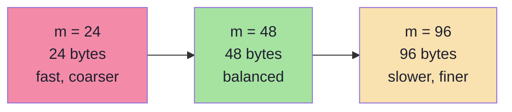
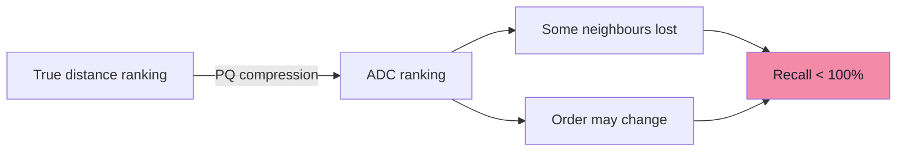
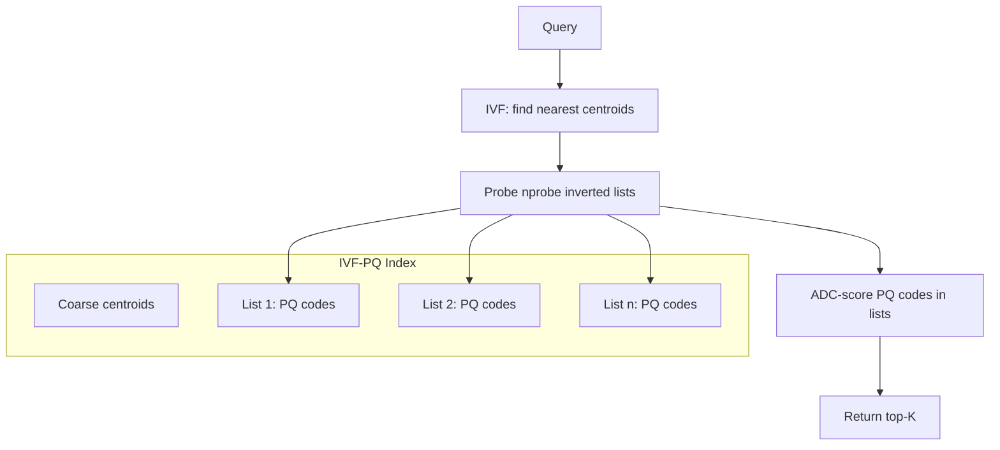

# Chapter 04: Product Quantization & Vector Compression

> **Chapter Goal:** Understand how quantization squeezes vector memory, how Product Quantization (PQ) trades exactness for scale, how it is combined with HNSW and IVF, and what to expect from recall loss. You should be able to reason about memory math, choose `m` and `k`, and explain when compression makes sense.

---

## 4.1 The Memory Problem

Embedding models produce high-dimensional float vectors. A single float32 vector of dimension `D` costs:

```text
D × 4 bytes
```

| Dimension | 1 vector | 10M vectors | 100M vectors |
|---|---|---|---|
| 128   | 512 B   | ~5 GB   | ~50 GB   |
| 768   | 3 KB    | ~30 GB  | ~300 GB  |
| 1,536 | 6 KB    | ~61 GB  | ~612 GB  |



Vectors must live in RAM for low-latency search. That memory bill does not include replicas, indexes, payload, or overhead.

### Why not shrink vectors directly?

Every vector dimension is a real number. Rounding every value to fewer bits:

- **Scalar quantization** (e.g. float32 → int8) saves 4× memory but still stores every dimension.
- **Binary quantization** (sign of each component) saves 32× memory but can destroy recall on real data.

The deeper question: **Do we need every dimension at full precision?**

Often not. Embedding vectors cluster in manifolds; nearby vectors share structure. We can represent many vectors with a small set of prototypes.

---

## 4.2 Scalar Quantization: The Simplest Form

Before PQ, there is scalar quantization: map each component independently into a smaller type.

```text
float32 component   →   int8 component
0.42                →   107
-0.18               →   -46
0.00                →   0
```

You need a min/max or scale per dimension to decode:

```ts
function encodeInt8(v: number[], scale: number[], zeroPoint: number[]): number[] {
  return v.map((x, i) => Math.round(x / scale[i] + zeroPoint[i]));
}

function decodeInt8(q: number[], scale: number[], zeroPoint: number[]): number[] {
  return q.map((x, i) => (x - zeroPoint[i]) * scale[i]);
}
```

| Type | Bytes per vector (D = 1,536) | Savings vs float32 |
|---|---|---|
| float32 | 6,144 B | baseline |
| int8 | 1,536 B | 4× |
| uint8 | 1,536 B | 4× |
| binary | 192 B | 32× |

Scalar quantization is lossy but bounded: each component keeps its own error. Product Quantization goes further: it groups dimensions and replaces whole blocks with prototypes.

---

## 4.3 The Product Quantization Idea

PQ partitions the vector into **subvectors** and quantizes each subvector with its own small codebook.

### The analogy

Suppose you need to store many 2D points:

```text
(0.1, 0.2), (0.4, 0.3), (0.12, 0.18), ...
```

Instead of storing exact coordinates:

1. Divide into two 1D subvectors: x-coordinates and y-coordinates.
2. Train codebooks for x and y separately:
   - x-codebook: {0.1, 0.4}
   - y-codebook: {0.2, 0.3}
3. Store only indices:

```text
point 1 → (x-code 0, y-code 0)
point 2 → (x-code 1, y-code 1)
point 3 → (x-code 0, y-code 0)
```

Reconstruction is a table lookup:

```text
point 1 ≈ (codebook_x[0], codebook_y[0]) = (0.1, 0.2)
```

The original full precision is never stored after training — only indices and codebooks.

### Formal setup

For a `D`-dimensional vector:

```text
D = m × dimsPerSubvector
```

where `m` is the number of subvectors (subquantizers). Each subvector gets its own codebook of `k` centroids:

```text
codebook[j] = [c_{j,0}, c_{j,1}, ..., c_{j,k-1}]   // j = 0..m-1
```

Each codebook centroid has `D/m` dimensions.

A vector is encoded as `m` indices:

```text
code[i] = [idx_0, idx_1, ..., idx_{m-1}]   // each idx in [0, k-1]
```

Reconstruction:

```text
reconstructed[i] = concat(codebook[0][idx_0], codebook[1][idx_1], ..., codebook[m-1][idx_{m-1}])
```

```mermaid
flowchart LR
    subgraph VQ["Original vector<br/>(D dims, float32)"]
        A["Subvector 0<br/>dim 0..D/m-1"]
        B["Subvector 1<br/>dim D/m..2D/m-1"]
        C["..."]
        Z["Subvector m-1<br/>dim ..."]
    end
    subgraph CB["Codebooks<br/>(m books × k centroids)"]
        CB0["Book 0"]
        CB1["Book 1"]
        CBM["Book m-1"]
    end
    subgraph EN["Encoded vector<br/>(m bytes)"]
        I0["idx 0"] I1["idx 1"] IM["idx m-1"]
    end

    A --> CB0 --> I0
    B --> CB1 --> I1
    Z --> CBM --> IM

    style EN fill:#a6e3a1,color:#1e1e2e
```

### Memory math

With `k = 256` centroids, each index needs 1 byte:

```text
encoded vector size = m bytes
codebook size = m × k × (D/m) × 4 = k × D × 4 bytes
```

For D = 1,536, m = 48, k = 256:

```text
per vector   = 48 bytes
codebook     = 256 × 1,536 × 4 ≈ 1.5 MB
10M vectors  = 480 MB + 1.5 MB ≈ 481.5 MB
```

Compare to float32:

```text
10M × 6,144 B ≈ 61.4 GB
```

Compression ratio:

```text
61.4 GB / 0.48 GB ≈ 128×
```



---

## 4.4 Training the Codebooks

PQ is not off-the-shelf. Each subquantizer needs its own k-means:

```text
training set: N_train vectors (sampled from corpus)
for each subvector j:
    extract j-th subvector from every training vector
    run k-means with k clusters
    store centroids as codebook[j]
```

```ts
function trainPQ(
  vectors: number[][],
  m: number,           // number of subvectors
  k: number,           // centroids per codebook
): number[][][] {      // codebook[m][k][D/m]

  const dimsPerSubvector = vectors[0].length / m;
  const codebook: number[][][] = [];

  for (let j = 0; j < m; j++) {
    const subvectors = vectors.map(v =>
      v.slice(j * dimsPerSubvector, (j + 1) * dimsPerSubvector)
    );
    codebook.push(kmeans(subvectors, k)); // returns k centroids
  }

  return codebook;
}
```

### Training data matters

| Training set | Effect |
|---|---|
| Random sample | General-purpose codebook |
| Same distribution as corpus | Better recall |
| Different distribution | Poor reconstruction, higher distance error |
| Too small | Centroids unstable, underfit |

> Train on data representative of what you will index. Codebooks trained on general text may underperform on code, legal docs, or multimodal embeddings.

---

## 4.5 Encoding a Vector

After training, each vector maps to indices by nearest-centroid lookup per subvector:

```ts
function encode(
  vector: number[],
  codebook: number[][][],
  dimsPerSubvector: number,
): Uint8Array {
  const m = codebook.length;
  const codes = new Uint8Array(m);

  for (let j = 0; j < m; j++) {
    const sub = vector.slice(j * dimsPerSubvector, (j + 1) * dimsPerSubvector);
    let bestIdx = 0;
    let bestDist = Infinity;

    for (let c = 0; c < codebook[j].length; c++) {
      const d = squaredDistance(sub, codebook[j][c]);
      if (d < bestDist) {
        bestDist = d;
        bestIdx = c;
      }
    }

    codes[j] = bestIdx;
  }

  return codes;
}
```

Cost per vector: `m × k` distance computations over `D/m` dims = `k × D` total. With k=256, that is moderate.

---

## 4.6 Decoding (Reconstruction)

```ts
function decode(
  codes: Uint8Array,
  codebook: number[][][],
): number[] {
  const m = codes.length;
  const vector: number[] = [];

  for (let j = 0; j < m; j++) {
    vector.push(...codebook[j][codes[j]]);
  }

  return vector;
}
```

This is just a table lookup — extremely cheap.

---

## 4.7 Searching with PQ: Two Distance Strategies

Once vectors are compressed, exact distances are impossible. Two approaches exist:

### Strategy A: Distance to reconstructed vectors

Decode every PQ code, compute the real distance to the query:

```text
query vs decoded(vector_i)
```

- Accurate-ish (depends on quantization error)
- Must decode all candidates — O(N) work
- Defeats the purpose of an index unless combined with something else

### Strategy B: Asymmetric Distance Computation (ADC) — the standard

The query stays uncompressed; database vectors stay compressed. Precompute distances from the query to every centroid in every codebook:

```text
distance(query, vector_i) ≈ Σ_j dist(query_sub_j, codebook_j[idx_{i,j}])
```

This is called **asymmetric** because the query is full precision and the database vectors are compressed.

```ts
function searchADC(
  query: number[],
  codes: Uint8Array[],       // N × m codes
  codebook: number[][][],
  dimsPerSubvector: number,
  topK: number,
): number[] {               // indices of top-K nearest

  const m = codebook.length;

  // Precompute: dist_table[j][c] = distance(query_sub_j, centroid_c)
  const distTable: number[][] = [];
  for (let j = 0; j < m; j++) {
    const qSub = query.slice(j * dimsPerSubvector, (j + 1) * dimsPerSubvector);
    distTable[j] = codebook[j].map(c => squaredDistance(qSub, c));
  }

  // Score every database vector by table lookup
  const scores: { idx: number; dist: number }[] = [];
  for (let i = 0; i < codes.length; i++) {
    let dist = 0;
    for (let j = 0; j < m; j++) {
      dist += distTable[j][codes[i][j]];
    }
    scores.push({ idx: i, dist });
  }

  scores.sort((a, b) => a.dist - b.dist);
  return scores.slice(0, topK).map(s => s.idx);
}
```



ADC cost: `m × k` precomputation + `N × m` table lookups. No full vector decode needed. This is why PQ search can be fast even at 100M+ scale.

---

## 4.8 PQ Parameters: `m` and `k`

| Parameter | Meaning | Typical | Increase → | Decrease → |
|---|---|---|---|---|
| `m` | Number of subvectors | 48–96 | More granular, better recall, larger codes | Smaller codes, worse recall |
| `k` | Centroids per codebook | 256 | Better reconstruction, larger codebooks | Fewer bytes per centroid index (k=256 → 1 byte) |

Rules:

1. **`k` is usually 256.** One byte per subvector. Values above 256 need 2 bytes per index, eroding compression.
2. **`m` must divide D.** If D = 1,536, valid m values include 1, 2, 3, 4, 6, 8, 12, 16, 24, 32, 48, 64, 96, 128, 256, 384, 512, 768, 1536.
3. **Larger `m` means finer quantization.** Each subvector is shorter, so centroids fit it better.
4. **Code size = `m` bytes** when k = 256.

```text
m = 48   → 48 bytes/vector
m = 96   → 96 bytes/vector
```

Memory vs recall curve: doubling `m` roughly doubles code size but improves recall with diminishing returns.



### Why not k = 65,536?

Each index would need 2 bytes:

```text
code size = 2 × m bytes
```

You lose half your compression for marginal recall gain. Production systems almost always use k = 256.

---

## 4.9 Quantization Error

PQ is lossy. Reconstructed vectors differ from originals:

```text
error = ||vector - reconstructed||²
```

Sources:

1. **Centroid approximation** — each subvector maps to its nearest centroid, not itself.
2. **Subvector independence** — correlations across subvector boundaries are ignored.
3. **Codebook mismatch** — training data ≠ query data distribution.

### Distance distortion

ADC approximates true distance:

```text
ADC(q, v) ≈ true_distance(q, v) + quantization_error(v)
```

Two vectors that were close in original space may appear farther apart (or vice versa) after compression. This causes:

- **Recall loss** — true neighbours drop out of the top-K.
- **Ranking changes** — neighbours are returned in the wrong order.



### The recall trade-off

| Setup | Recall@10 | Memory per vector |
|---|---|---|
| float32 flat | 100% | 6,144 B |
| int8 scalar | ~95–98% | 1,536 B |
| PQ m=48, k=256 | ~90–95% | 48 B |
| PQ m=24, k=256 | ~80–88% | 24 B |
| binary | ~60–80% | 192 B |

Numbers vary by dataset, dimension, and metric. Always measure on your own data.

---

## 4.10 PQ + IVF: IVF-PQ

IVF alone still stores full-precision vectors in each list. IVF-PQ compresses them:

```text
1. Train IVF centroids (coarse quantizer)
2. Assign every vector to a centroid (inverted lists)
3. Train PQ codebooks on residual vectors (vector - centroid)
4. Store PQ codes, not raw vectors
5. At query time: probe nprobe lists, ADC-score PQ codes
```

This is the classic "product quantization inverted file" from the original PQ paper. It is what makes billion-scale search feasible on a single machine.



IVF-PQ memory:

```text
centroids + (N × m bytes) + codebook
```

For 100M vectors, m=48: ~4.8 GB plus overhead. That changes the economics entirely.

---

## 4.11 PQ + HNSW

HNSW stores full vectors in RAM by default. PQ can compress them:

| Approach | What is compressed | What remains full precision |
|---|---|---|
| HNSW + PQ codes | Database vectors | Query vector |
| HNSW + scalar quantization | Database vectors | Query vector |

At query time:

```text
1. HNSW navigates the graph using distances computed via ADC (or decoded vectors)
2. efSearch candidates are re-ranked with full-precision vectors if available
3. Return top-K
```

Trade-off:

- Graph edges still reference node IDs, but distance calls use compressed codes.
- Navigation quality depends on ADC accuracy.
- Re-ranking with original vectors recovers some recall at extra cost.

> HNSW + PQ is common in production when memory is tight. HNSW + int8 scalar quantization is often a better first step because it preserves more recall per byte saved.

---

## 4.12 Scalar Quantization vs PQ

| | Scalar Quantization | Product Quantization |
|---|---|---|
| Granularity | Per component | Per subvector block |
| Codebook | None (fixed mapping) | Trained per subvector |
| Typical saving | 4× (float32→int8) | 32–128× |
| Recall impact | Small | Larger, tunable via m |
| Training needed | No | Yes |
| ADC support | Yes (simple) | Yes (native) |
| Best first step | Yes — try this first | When memory still too high |

### Recommended progression

```text
float32 flat
   ↓ (memory still too high)
int8 scalar quantization
   ↓ (still too much memory)
PQ with m = 48–96, k = 256
   ↓ (need graph speed too)
HNSW + PQ codes
   ↓ (still too much memory)
IVF-PQ (inverted lists + PQ codes)
```

---

## 4.13 When to Use Compression

Use compression when:

- Vectors do not fit in RAM at target query latency.
- You need more replicas than RAM allows.
- You are indexing billions of vectors.
- Recall target tolerates 2–10% loss.

Avoid compression when:

- Dataset is small enough for float32 flat (exact, simple).
- Recall must be 100% (e.g. duplicate detection).
- Query volume is tiny and memory is cheap.
- Embeddings are already low-dimensional (e.g. 64–128 dims).

---

## 4.14 Operational Considerations

### Retraining

Codebooks are trained once on a sample. If data distribution drifts:

```text
old codebook → poor reconstruction for new vectors
```

Remedy: periodic retraining and re-encoding. Some systems support online centroid updates; most require offline retraining.

### Re-encoding cost

Changing `m` or `k` requires re-encoding every vector. Plan for a rebuild.

### Mixed precision

Many engines keep full-precision vectors for re-ranking while storing PQ codes for filtering/navigation. This doubles vector storage partially — measure carefully.

### Metric sensitivity

PQ error interacts with distance metric:

- Cosine: normalise vectors before PQ; quantization error changes angles.
- L2 / inner product: more forgiving but still distorted.

Always benchmark with your actual metric.

---

## 4.15 Common Mistakes

1. **Training codebooks on unrepresentative data.** Recall collapses at query time.
2. **Using k > 256 without reason.** Doubles index size for marginal gain.
3. **Choosing m that does not divide D.** Implementation will pad or fail.
4. **Expecting 100% recall after PQ.** Quantization is lossy by design.
5. **Skipping ADC precomputation.** Decoding every vector makes search O(N) again.
6. **Applying PQ before checking if float32 flat fits.** Premature complexity.
7. **Ignoring re-ranking.** ADC-first results benefit from full-precision re-check of top candidates.
8. **Using PQ on very small datasets.** Overhead of codebooks outweighs savings.

---

## 4.16 Chapter Summary

| Concept | Meaning | Takeaway |
|---|---|---|
| Scalar quantization | float32 → int8 per component | Easy 4× saving, small recall loss |
| Product quantization | Split vector into subvectors, quantize each with a codebook | 32–128× saving, tunable via m |
| Codebook | Trained centroids per subvector | Must match data distribution |
| Encoding | Map subvector to nearest centroid index | m bytes per vector (k=256) |
| ADC | Query full precision, database compressed; table-lookup scoring | Fast approximate search without decoding |
| `m` | Subvectors per vector | More = better recall, larger codes |
| `k` | Centroids per codebook | Usually 256 (1 byte per index) |
| IVF-PQ | Inverted lists + PQ codes | Billion-scale single-machine search |
| Recall loss | True neighbours may drop out | Measure on your data; re-rank to recover |

> **Final mental model:** PQ replaces every vector with a short shopping list of prototype indices. You lose the exact vector, but you keep enough structure to rank candidates approximately. ADC turns that shopping list into a fast score by precomputing distances to prototypes. The cost is recall; the benefit is memory that fits.

---

**Next:** [Chapter 05 — Vector Database Engine Decisions & Production Operations](./05_Vector_Database_Engine_Decisions_and_Production_Operations.md)
