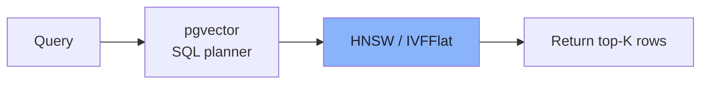
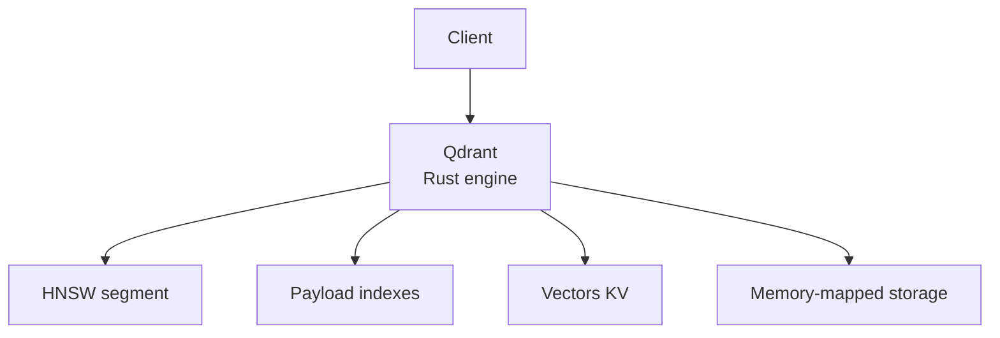
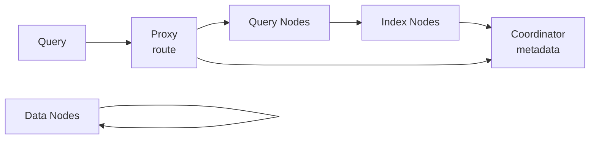
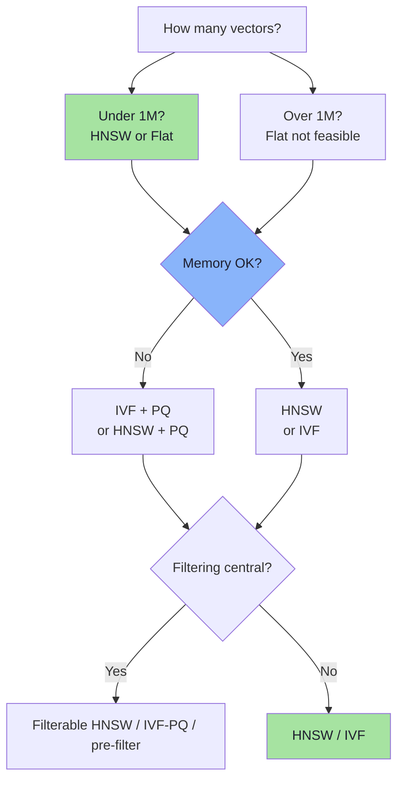
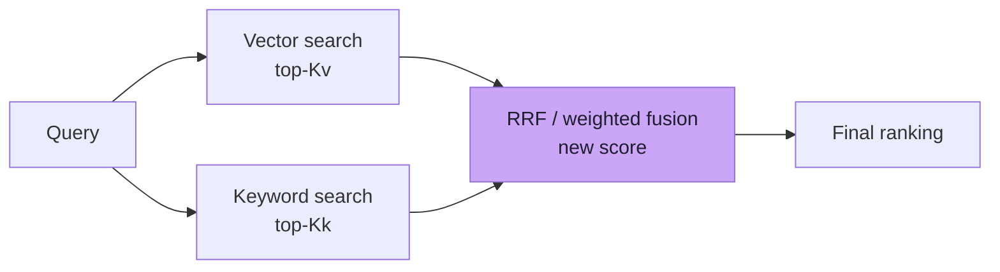
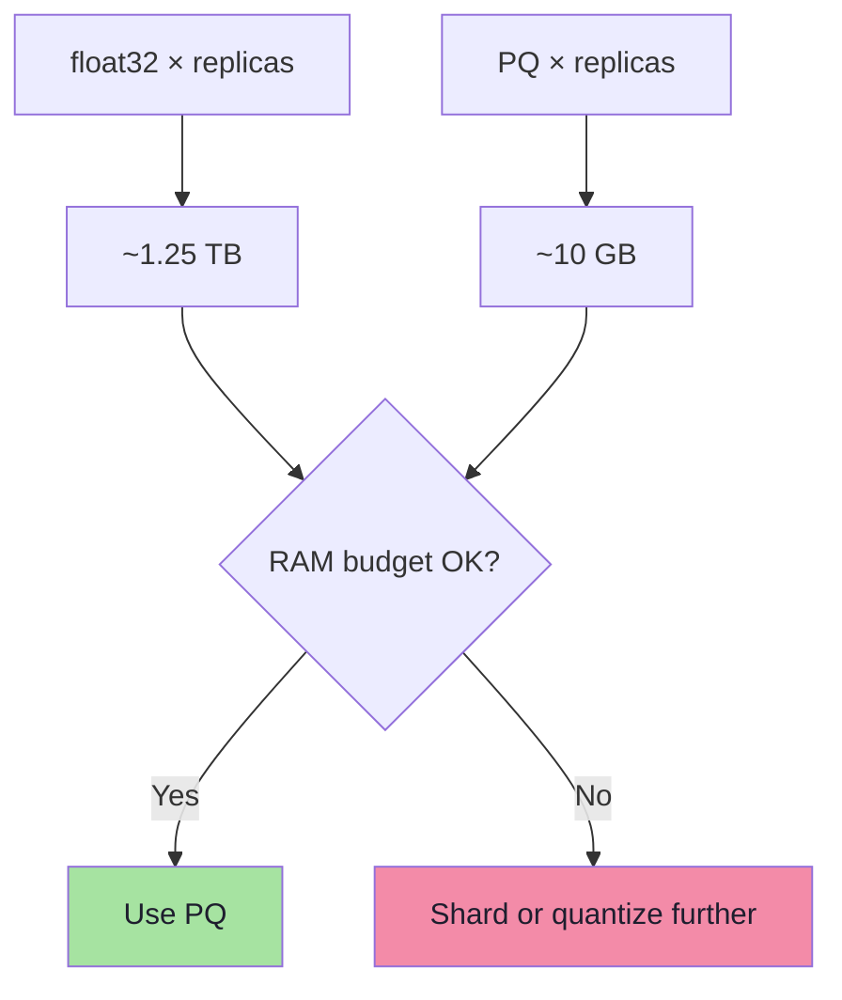
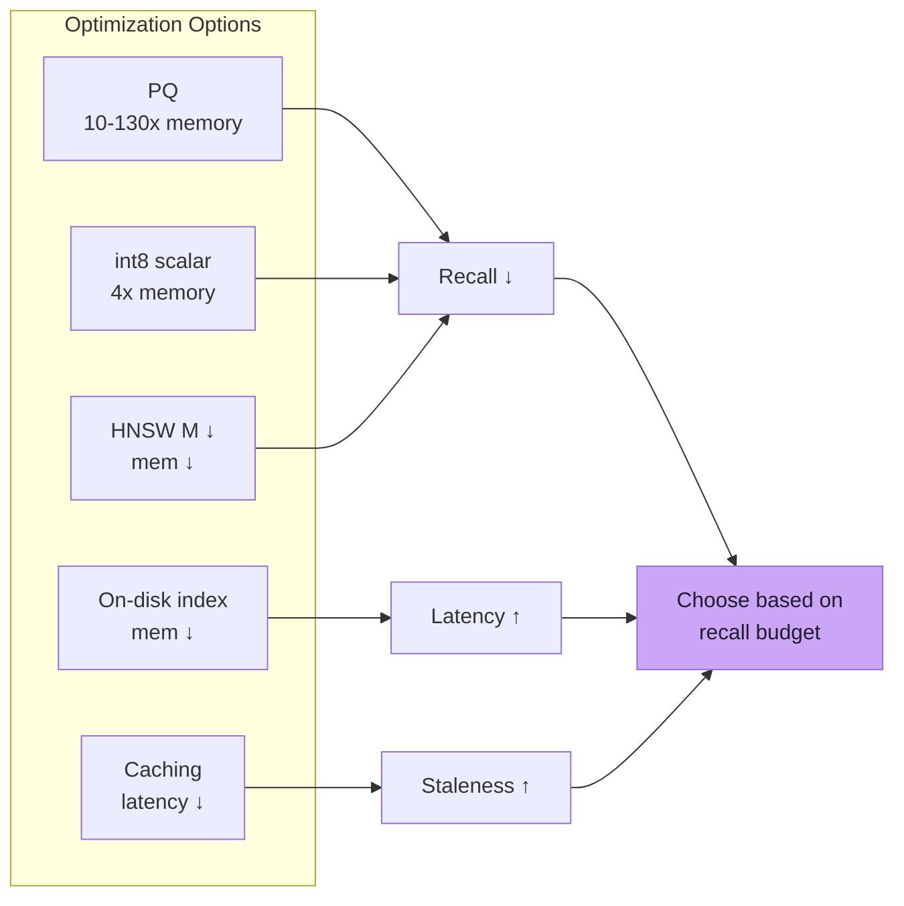

# Chapter 05: Vector Database Engine Decisions & Production Operations

> **Chapter Goal:** Understand the major vector database engines, how their index and deployment models differ, and how to operate vector search in production: scaling, monitoring, filtering, hybrid search, and cost.

---

## 5.1 Why So Many Engines?

Vector databases emerged from different roots:

| Engine | Origin | Design focus |
|---|---|---|
| **pgvector** | PostgreSQL extension | SQL-native, simplicity, integration |
| **Qdrant** | Rust research lab | Performance, filtering, binary payloads |
| **Weaviate** | Open-source DB | Graph-based, modules for AI apps |
| **Milvus / Zilliz | Distributed DB | Billion-scale, distributed architecture |
| **FAISS** | Meta research | Library, not a server — the reference implementation |
| **Chroma** | Open-source embedded DB | Dev/test simplicity, lightweight |

The choice is rarely "which is best" and more "which fits our stack".

---

## 5.2 pgvector: The SQL-First Choice

pgvector embeds vector search into PostgreSQL.

```sql
CREATE TABLE documents (
    id BIGSERIAL PRIMARY KEY,
    content TEXT NOT NULL,
    embedding vector(1536)
);

CREATE INDEX ON documents
USING hnsw (embedding vector_cosine_ops);

CREATE INDEX ON documents
USING ivfflat (embedding vector_cosine_ops);

-- Query
SELECT id, content
FROM documents
ORDER BY embedding <=> $1
LIMIT 10;
```



Key characteristics:

| Feature | Status in pgvector |
|---|---|
| Vector operators | `<=>` distance, `<#>` inner product, `<->` L2, `<=>` cosine |
| Index types | `ivfflat`, `hnsw` |
| Binary vectors | `vector(N) = halfvec(N)` |
| Filtering | Post-filtering via SQL; `hnsw.iterative_scan` |
| Multi-vector | Arrays / JSONB |
| CRUD | Normal SQL CRUD |
| Scaling | Extensions of Postgres: read replicas, partitioning |

Strengths:

- Runs alongside your relational data — joins, transactions, backups.
- No new infrastructure.
- Simple deployment.

Weaknesses:

- Index build memory and speed constrained by Postgres resources.
- ANN quality and tuning knobs are less extensive than purpose-built engines.
- Very large clusters need manual partitioning/sharding.
- Filtering quality for large sets is weaker without iterative scans.

### When pgvector is enough

- RAG over chat messages, product docs, support tickets.
- < tens of millions of vectors.
- Existing Postgres operations comfort.
- Simplicity is a feature.

### When it is not enough

- Billion-scale vectors.
- Need for advanced filtering + high recall at scale.
- Dedicated ANN performance requirements (millions of QPS).
- Multi-region sharding with independent availability.

---

## 5.3 Qdrant: The Rust Performance Engine

Qdrant (by Qdrant creators) is written in Rust, designed for high throughput and strong filtering.



Core design:

- **HNSW** as primary index; segments with independent indexes.
- **Payload storage** in same process — rich types (strings, enums, geo, JSON).
- **Binary quantization** and **product quantization** as optional.
- **Filterable HNSW**: extra links for payload-indexed fields to improve filtered search.
- **On-disk index** option for very large collections.
- **Async first** architecture; high concurrency.

Query flow:

```text
1. Apply filters (filter-aware graph navigation or pre-filter)
2. HNSW search with efSearch
3. Return top-K with payload
4. Optional re-ranking
```

Operationally:

- Start with `m=16, ef_construct=100`, tune `hnsw_ef`.
- For filtered workloads: use payload indexes + filterable HNSW; oversample.
- Monitor segments: number of segments affects search performance.

---

## 5.4 Milvus / Distributed Vector DBs

Milvus (and Zilliz) target distributed, billion-scale deployments:

- **Proxy**: query routing.
- **Coordinator**: metadata, scheduling.
- **Index nodes**: build/search indexes.
- **Data nodes**: storage.
- **Query nodes**: scale-out.



Strengths:

- Horizontal scaling.
- Billion-scale ingestion.
- Rich partitioning (tenant, by attribute).

Weaknesses:

- Operational complexity: more components, more failure modes.
- Higher latency for small datasets (overhead).
- More moving parts to run.

When to use: you have the engineering capacity and scale demands to justify distributed operation.

---

## 5.5 FAISS and Library Approaches

FAISS is a library, not a server. Used directly in application code, or via wrappers.

```text
FAISS
   ├── IndexFlatL2 — exact
   ├── IndexIVFFlat — IVF
   ├── IndexIVFPQ — IVF + PQ
   ├── IndexHNSWFlat — HNSW
   ├── IndexHNSWPQ — HNSW + PQ
   └── IndexIDMap — add ids
```

Key ideas:

- Swizzling for ANN quality (rotate vector indices).
- Re-rank with exact distance after ANN candidate generation.
- Multi-probe (IVF) tuning.

Strengths: maximal control, performance research-grade.

Weaknesses: you own re-ranking, monitoring, persistence, sharding.

---

## 5.6 Engine Comparison Summary

| Criterion | pgvector | Qdrant | Milvus | FAISS | Chroma |
|---|---|---|---|---|---|
| Server complexity | Low | Low | High | None (library) | Low |
| Filtering quality | Good (with iterative scan) | Excellent | Good | Basic | Basic |
| ANN quality knobs | Good | Good | Good | Excellent | Basic |
| Scale | Medium | Medium-High | High | High | Small-Medium |
| Ops burden | Low | Low-Med | High | Low-Med | Low |
| Persistence | Yes (native) | Yes | Yes | None | Yes |
| Deployment | Postgres | Embeddable | Distributed | Library | Embedded |

---

## 5.7 Choosing the Right Index

### Index selection guide

```text
Need exact answers?
├── Yes → Flat / brute force

Small corpus (< ~1M vectors)?
├── Yes → HNSW (quality) or Flat (exactness)
└── No → IVF or HNSW

Memory constrained?
├── Yes → IVF + PQ / HNSW + PQ / int8
└── No → HNSW

High write throughput + small index?
├── Yes → HNSW (incremental)
└── No → IVF (rebuidable) or HNSW

Filtering is central?
├── Yes → Qdrant filterable HNSW / IVF-PQ / pre-filter
└── No → HNSW / IVF

Billion-scale distributed?
├── Yes → Milvus-style distributed
└── No → Single-node HNSW/PQ
```

### Decision flow



---

## 5.8 Hybrid Search: Combining Vector + Keyword

Vector search alone misses exact matches (names, IDs, codes, rare terms). Hybrid combines:

```text
score = α × vector_score + (1 − α) × keyword_score
```

Or via **reciprocal rank fusion (RRF)**:

```text
RRF(k1, k2, k3) = RRF_k1 + RRF_k2
RRF_kf(d, S) = kf / (rank_kf(d, S) + kf)

score(d) = Σ_{k ∈ {vector, keyword}} RRF_k(rank of d in k's list)
```



Implementation notes:

- **RRF** is simple, no score calibration, works well with different scales.
- **Weighted sum** needs normalized vector scores (e.g. cosine similarity) and normalized BM25.
- Use `k` for keyword (e.g. 20–50) and vector candidates; over-fetch.
- Post-fusion re-ranking can use cross-encoder models.

> Hybrid is the standard for RAG now: vector for semantics, keyword for exactness.

---

## 5.9 Production Operations: Deployment

### Typical production stack

```text
Client ──► Load balancer ──► Vector service (Qdrant / Milvus / custom)
                        │
                        ├── In-memory index (HNSW/PQ)
                        ├── On-disk storage
                        └── Payload index
                        │
                        └── Redis / cache for hot queries
```

### Sizing basics

| Component | Rule of thumb |
|---|---|
| RAM | Vectors × (float32 ≈ 4 B/dim) × replicas + graph overhead + headroom |
| CPU | Search-heavy workloads: > cores; writes: ingestion parallelism |
| Disk | Full replicas for data safety; index in RAM or memory-mapped |

### Cost estimation example

```text
100M vectors, D = 1,536, HNSW M=16, 2 replicas:
- float32:      100M × 6,144 B × 2 ≈ 1.23 TB
- HNSW edges:   100M × ~64 B × 2 ≈    12.8 MB
- Payload:      estimate per tenant
- Total usable: ~1.25 TB RAM

With PQ (m=48, k=256):
- Codes:         100M × 48 B × 2 ≈   9.6 GB
- Codebooks:     1.5 MB × 2
- Total usable: ~10 GB RAM
```



---

## 5.10 Monitoring and Observability

### Key metrics

| Metric | Why |
|---|---|
| Recall / nDCG (offline) | Index quality vs ground truth |
| Query latency p50/p95/p99 | SLO compliance |
| Throughput (QPS, batch inserts) | Capacity planning |
| Memory usage | Indexing in RAM, cache |
| Segment count | Too many segments → slow rebuilds |
| Deleted ratio | Tombstone accumulation |
| Graph hit rate / search time breakdown | HNSW quality |

### Logging / tracing

- Log top-K candidate scores and final ordering.
- Log filter selectivity per query (helps diagnose under-filling).
- Trace query through index layers.

### Alerting

- Latency SLO breach.
- Recall regression after rebuild (compare before/after).
- Memory saturation.
- Insert failure rates.

---

## 5.11 Scaling Patterns

### Pattern 1: Single node, growing via sharding

```text
tenant_id → shard key
```

Each shard runs HNSW/IVF. Cross-shard search = fan-out + union. Best for multi-tenant isolation.

### Pattern 2: Partition + replica

- Partition for isolation and scale.
- Replica for read throughput (with consistency considerations).

### Pattern 3: Tiered storage

- Hot data: RAM index (HNSW/PQ).
- Warm/cold: on-disk index or rehydrate.

### Pattern 4: Caching

- Cache top-K results per query (hash of embedding).
- Cache popular queries in front of index.
- Re-cache invalidated on new inserts.

---

## 5.12 Cost Optimization

| Technique | Savings | Trade-off |
|---|---|---|
| PQ / binary quantization | 10–130× memory | Recall loss |
| Scalar int8 | 4× memory | Small recall loss |
| HNSW M reduction | Memory per node ↓ | Graph quality ↓ |
| Index on disk vs RAM | Memory ↓ | Latency ↑ |
| Replica reduction | Memory ↓ | Throughput ↓ |
| Partitioning (not replication) | Memory ↓ | Cross-shard complexity |
| Caching | Latency ↓ | Staleness ↑ |



---

## 5.13 Operational Recommendations by Stage

### Early stage (prototype / small product)

- pgvector or Chroma.
- HNSW, float32.
- Hybrid search from day one.

### Growth stage (product, meaningful users)

- Move to Qdrant (or managed Milvus).
- HNSW + PQ or IVF-PQ.
- Filtering enabled (payload indexes).
- Hybrid search.

### Scale stage (millions+ vectors, multi-tenant)

- Distributed engine (Milvus / Qdrant Cloud / custom).
- Sharding by tenant/region.
- Replication for HA.
- Monitoring + SLOs.

---

## 5.14 Failure Modes & Mitigations

| Failure | Cause | Mitigation |
|---|---|---|
| Under-filled results | Filters or tombstones | Oversample, iterative scan, compact |
| Recall collapse after filter | Graph disconnection | Filter-aware HNSW, payload indexes |
| Slow build | High efConstruction | Lower build quality or parallelize |
| Memory blowup | Float32 + replicas | Quantize, shard, reduce replicas |
| Stale results | Tombstones/segments | Optimizer triggers |
| Latency spikes | Large efSearch | Cap efSearch, cache |

---

## 5.15 Chapter Summary

| Area | Key points |
|---|---|
| Engines | pgvector (SQL-native), Qdrant (Rust, filtering), Milvus (distributed), FAISS (library), Chroma (embedded) |
| Indexes | Flat (exact), HNSW (RAM, fast), IVF (lists, memory), IVF-PQ (memory + ANN), HNSW+PQ (RAM + ANN) |
| Compression | Scalar int8 (4×), PQ (32–128×), binary (32×), on-disk |
| Hybrid | RRF / weighted fusion, keyword + vector |
| Ops | Memory sizing, monitoring, sharding, caching, cost |
| Decisions | Stage-based: small → HNSW; growth → Qdrant+PQ; scale → distributed |

> **Final mental model:** The vector database choice is an architecture decision, not a feature decision. Start simple (pgvector + HNSW), adopt purpose-built engines when scale or filtering demands require, and always plan for compression and hybrid search before you need them.

---

**Next:** Create `Lecture_15_Complete_Notes.md`
