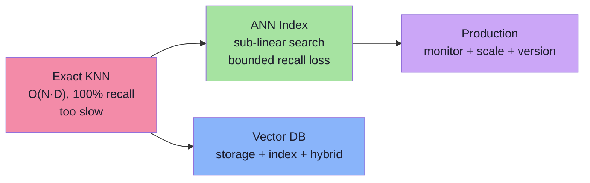
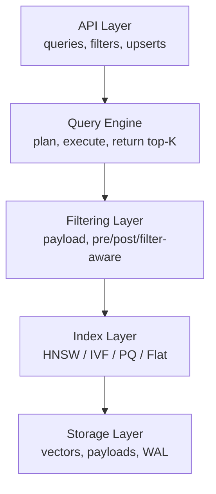
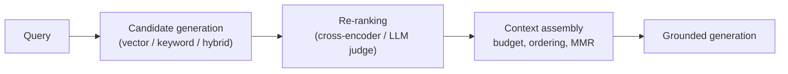

# Lecture 15 — Vector Databases and ANN Algorithms: Complete Notes

> **Source:** FDE L10 · gen-ai-cohort D04 · **Phase:** 4 · Embeddings · **Level:** 🟠 Advanced
>
> **Scope:** Vector database architecture, IVF, HNSW, Product Quantization, engine decisions, hybrid search, production RAG, sharding, versioning, and lifecycle — synthesized from Chapters 01–05 of the lecture notes.

---

## How to Read This Document

- **Part A** gives the end-to-end narrative of the lecture in eight moves.
- **Part B** condenses each chapter into a one-page cheat sheet (key ideas, parameters, trade-offs, pseudo-code highlights).
- **Part C** is the exam/retention cheat-sheet: parameters, decision tables, pitfalls.
- The individual chapter files in this folder (`01`–`05`) contain the deep, detailed notes with full diagrams, worked examples, and pseudo-code.

---

## Part A — The End-to-End Narrative of Lecture 15

### The core problem

You have embedded your corpus into vectors, and your embeddings are good — nearest neighbours in vector space are semantically related. Now you need to **find them fast**.

The baseline — brute-force KNN — compares the query against every stored vector. That is `O(N·D)` per query. With 1M vectors at D=1,536, that is ~1.5 billion multiply-adds per query. At 1k QPS, you have no CPU left for anything else.

**ANN — Approximate Nearest Neighbour — is the trade-off that makes vector search a product:** give up a bounded fraction of recall in exchange for sub-linear search time at scale.



### What is a vector database?

A vector database is a system that:

1. **Stores** vectors + metadata (payload).
2. **Indexes** them for sub-linear or near-constant lookup.
3. **Searches** by vector similarity, optionally constrained by filters.
4. **Serves** results with low latency at scale.
5. **Manages** lifecycle: writes, updates, deletes, versioning, re-indexing.

It is not an embedding model. It does not understand meaning. It only sees vectors and distances — and the quality of its answers is bounded by the quality of the geometry it is given.

### The three index families

Lecture 15 organises indexes into three families, each making a different engineering bet:

| Family | Core idea | Memory cost | Build cost | Best for |
|---|---|---|---|---|
| **Partitioning (IVF)** | Cluster vectors into lists; probe a few | Low (centroids + lists) | Moderate (k-means) | Huge, shardable corpora |
| **Graphs (HNSW)** | Connect neighbours; navigate greedily | Moderate (links) | High (incremental) | Low-latency, high-recall |
| **Compression (PQ)** | Replace vectors with codes; look up distances | Very low (codes + codebook) | Moderate (k-means) | Memory-bounded, billion-scale |

These are not alternatives you pick once; **real systems combine them**: HNSW for speed, PQ for memory, IVF-PQ for billion-scale on a single node.

### The narrative in seven moves

#### Move 1 — IVF: divide and probe

The Inverted File Index pre-partitions the corpus using k-means into `nlist` centroids. Each vector is assigned to its nearest centroid's **inverted list**. At query time, you compute the query against all centroids, pick the `nprobe` closest, then scan only those lists.

```text
Query → compute distance to nlist centroids → pick nprobe closest → scan those lists → return top-K
```

- **Parameters:** `nlist` (number of partitions), `nprobe` (how many partitions to scan).
- **The boundary problem:** a vector near the *edge* of a partition belongs with the next partition's vectors, but it is unreachable because only the `nprobe` closest centroids are scanned.
- **Variants:** IVF-Flat (stores raw vectors in lists), IVF-PQ (stores PQ codes), IVF-SQ (scalar quantization).
- **The 1M-vector arithmetic:** 10,000 partitions × 5 partitions scanned × ~200 vectors = ~1M comparisons vs 1M scanned in brute force. Same comparisons, but pruned to a meaningful subset.

> IVF is memory-efficient and shardable but pays recall loss at partition boundaries and cannot add a vector without re-assignment.

#### Move 2 — HNSW: build a road network from the data

Hierarchical Navigable Small World builds a **multi-layer graph** where upper layers are sparse highways and layer 0 is a dense local street map.

```text
Search in two phases:
1. Descend: greedy navigation through upper layers to a good entry point
2. Search: best-first search at layer 0 using a candidate heap of size efSearch
```

- **Parameters:** `M` / `M0` (max neighbours per node; layer 0 gets 2×M), `efConstruction` (build-time exploration), `efSearch` (query-time exploration).
- **Memory:** HNSW links add ~2% on top of float32 vectors, but dominate at high compression.
- **Deletes:** tombstones (nodes stay in the graph, skipped in results); requires compaction.
- **Filtered search weakness:** selective filters can exhaust the candidate budget on ineligible nodes, under-filling results.

> HNSW is the default choice for low-latency, high-recall search in RAM but requires careful tuning and periodic compaction.

#### Move 3 — PQ: replace vectors with shorthand codes

Product Quantization partitions a vector into `m` subvectors, each quantized against its own codebook of `k` centroids. The encoded vector is `m` bytes (for k=256).

```text
Encode: split → nearest centroid per subvector → store indices
Search (ADC): precompute distances from query to every centroid → sum table lookups per code
```

- **Memory math:** 1,536-dim float32 = 6,144 B → PQ(m=48, k=256) = 48 B → **128× compression**.
- **Recall loss:** is a trade-off for the compression ratio.
- **ADC is asymmetric:** the query stays full precision; only the database vectors are compressed. This is what makes PQ search fast.
- **Combinations:** IVF-PQ (lists + codes), HNSW+PQ (graph navigation on codes).

> PQ is the lever you pull when RAM is the bottleneck — it does not make search faster, it makes *storing* more vectors feasible.

#### Move 4 — The five layers of a vector database



Every vector database is these five layers, regardless of vendor.

#### Move 5 — Hybrid search and RRF

Dense (vector) search finds semantically related documents; lexical (BM25/keyword) search finds exact terms. They are **complementary failure modes**:

- Dense: misses rare terms, acronyms, IDs.
- Lexical: misses synonyms, paraphrase.

```text
Reciprocal Rank Fusion (RRF):
  score(d) = Σ_k  1 / (rank_k(d) + k_constant)
```

RRF is parameter-free and scale-invariant — the standard production choice over naive score averaging.

#### Move 6 — Engine ecosystems: Qdrant vs pgvector vs the landscape

Qdrant (Rust): embedded or server mode, strong filtering, payload indexes, segments.
pgvector (PostgreSQL): SQL-native, transactions, but limited index tuning compared to purpose-built engines.
Milvus / Pinecone / Weaviate / Chroma: managed or distributed, each optimizing for a particular trade-off.

The real cost of "just use Postgres": it hides operational complexity (no, there is no free lunch on memory or rebuild).

#### Move 7 — Production RAG retrieval, beyond the index



The **index is not the ceiling** — chunking quality and candidate re-ranking determine retrieval quality. Monitor recall@K, MRR, nDCG; enforce freshness; isolate tenants; and keep a failure runbook.

#### Move 8 — Going to production: scaling, versioning, lifecycle

- **Sharding:** partition by tenant or hash across nodes; pick shard key that distributes write evenly.
- **Replication:** for availability; consistency is eventual for ANN indexes.
- **Re-indexing & versioning:** alias-swap zero-downtime rollout, retrain codebooks on drift, monitor deleted-tombstone ratio, run optimizer/compaction on schedule.
- **Cost budgeting:** memory vs latency vs QPS per shard drives the capacity plan.

---

## Part B — Chapter Summaries

### Chapter 01 — Vector Database Architecture and the Five Layers

**Structure:** API → Query Engine → Filtering Layer → Index Layer → Storage Layer.

**Record model:** `id + vector + payload` (payload can be any JSON).

**Collections/Points/Segments:** the API groups vectors into collections; points are individual records; segments are internal chunks that engines rebuild and merge independently.

**Search modes:**
- **Pre-filter:** apply the filter first, then search the surviving set.
- **Post-filter:** search the whole space, then apply the filter (can return fewer than K).
- **Filter-aware:** the index navigates only eligible candidates (best for selective filters).

**What a vector DB does *not* do:** understand meaning, re-rank semantically, or enforce business logic. It navigates geometry.

### Chapter 02 — IVF — Inverted File Index

**Core:** k-means clusters `N` vectors into `nlist` partitions; each vector stored in the inverted list of its nearest centroid.

**Query:** compute distance to all centroids, scan the `nprobe` closest lists, return top-K from scanned candidates.

**Parameters and tuning:**

| Parameter | Meaning | Increase → | Decrease → |
|---|---|---|---|
| `nlist` | Number of partitions | Smaller lists, finer coverage, more centroids memory | Coarser lists, recall loss at boundaries |
| `nprobe` | Partitions scanned per query | Higher recall | Latency + CPU |

**Variants:** IVF-Flat, IVF-PQ, IVF-SQ. Use IVF-PQ when memory matters; IVF-Flat when recall must be high and RAM is available.

**The boundary problem:** a vector near a centroid boundary is only reachable through one list; `nprobe` controls how many lists are inspected, which determines whether the boundary neighbour is found.

**The 1M-vector arithmetic:** scanning all 1M vectors is O(N); partitioning into 10,000 lists of ~100 vectors and probing 5 lists yields ~500 candidates — the pruning comes from *only scanning partitions whose centroids are near the query*.

### Chapter 03 — HNSW — Hierarchical Navigable Small World

**Core:** a multi-layer proximity graph; upper layers are sparse highways, layer 0 is dense.

**Search:** greedy descent through upper layers to find an entry point, then best-first search at layer 0 bounded by `efSearch`.

**Parameters:**

| Parameter | Layer | Meaning | Tuning |
|---|---|---|---|
| `M` | upper | Max links per node | 16–64; higher recall + memory |
| `M0` | 0 | Max links at layer 0 (usually 2M) | More links, better recall |
| `efConstruction` | build | Candidate set while inserting | 100–500; higher = better graph permanently |
| `efSearch` | query | Candidate set while searching | ≥ K; primary recall/latency dial |

**Key insights:**
- Build-time quality (`efConstruction`, `M`) is **permanent**; cannot be fixed later by raising `efSearch`.
- Deletes are tombstones; requires compaction.
- Filtered search is the known weak point; use filter-aware HNSW or pre-filtering.
- Layer assignment uses exponential sampling (`level = floor(-ln(U) × mL)`, `mL = 1/ln(M)`); the rare high-level nodes become highway interchanges.

### Chapter 04 — Product Quantization & Vector Compression

**Core:** split a D-dim vector into `m` subvectors; train `m` codebooks of `k` centroids each; encode as `m` indices (1 byte each for k=256).

**Asymmetric Distance Computation (ADC):** keep the query full-precision; score compressed vectors by precomputing distances to each centroid and summing table lookups. This is the engine of fast PQ search.

**Memory math:** D=1,536, m=48, k=256 → 48 bytes/vector (vs 6,144 for float32) = **~128× compression**.

**Trade-offs:**

| Technique | Compression | Recall impact | When to use |
|---|---|---|---|
| Scalar (int8) | 4× | Small | Easy first step |
| PQ (m=48) | ~128× | Moderate-tunable | Memory-bounded scale |
| Binary | 32× | Often large | Extreme compression only |

**Combinations:** IVF-PQ (lists + codes), HNSW+PQ (graph at layer 0).

### Chapter 05 — Engine Decisions & Production Operations

**Engine selection by stage:**

| Stage | Recommendation |
|---|---|
| Prototype / small product | pgvector + HNSW |
| Growth / filtering | Qdrant + PQ or IVF-PQ |
| Scale / distributed | Milvus / managed vector DB |
| Need SQL / joins | pgvector or Postgres |
| Library-only / research | FAISS |

**Operations:**
- Monitor recall, latency p50/p95/p99, memory, deleted ratio, segment count.
- Shard by tenant or hash for scale.
- Re-index and rebuild codebooks on distribution drift.
- Use alias-swap for zero-downtime versioning; plan rollback.

**Production RAG recall is **bounded** by chunking quality and candidate re-ranking — the index is not the ceiling.**

---

## Part C — Cheat Sheet

### Memory comparison (10M vectors, D = 1,536)

| Format | Bytes/vector | Total 10M | Compression |
|---|---|---|---|
| float32 | 6,144 | ~61.4 GB | 1× |
| int8 scalar | 1,536 | ~15.4 GB | 4× |
| PQ m=48, k=256 | 48 | ~481 MB | 128× |
| binary | 192 | ~1.9 GB | 32× |

> PQ codebooks add ~1.5 MB — negligible. At extreme compression the **graph links, not vectors**, become the dominant memory cost.

### Index parameter cheat sheet

```text
IVF:        nlist (partitions)     → 1K–10K     nprobe (probed lists) → 1–all
IVF-PQ:     plus m (24–96), k (256)
HNSW:       M (16–64)              M0 (2×M)     efConstruction (100–500)
HNSW query: efSearch (≥ K, 50–300)
```

### Decision tables

**Which index? (by constraint)**

| Constraint | Best index |
|---|---|
| Recall must be near-exact | Flat / IVF-Flat HNSW |
| Memory is the bottleneck | IVF-PQ or HNSW+PQ |
| Need sub-ms latency | HNSW (tuned efSearch) |
| Billion-scale single machine | IVF-PQ |
| Frequent incremental writes | HNSW |
| Distributed, sharded | IVF or partitioned HNSW |

**Engine by stage**

| Stage | Engine | Reason |
|---|---|---|
| Prototype | pgvector | SQL-native, no infra |
| Growth | Qdrant | filtering, segments, PQ |
| Scale | Milvus | distributed, billion-scale |
| Research | FAISS | full control, library |

### Tuning sequence (HNSW)

```text
1. Build with M = 16, efConstruction = 200.
2. Measure recall@K at efSearch = 40, 80, 160, 320.
3. Pick smallest efSearch clearing the recall target.
4. If unreachable, rebuild with higher M / efConstruction.
5. Re-check filtered recall.
6. Watch deleted ratio + segment count (schedule compaction).
```

### Common pitfalls (do not do these)

1. Setting `efSearch < K` (impossible to return enough results).
2. Blaming the index for bad embeddings (semantics is the model's job).
3. Building with tiny `nlist` or `efConstruction` to save time — damage is permanent.
4. Ignoring filtered recall — it is often much worse than unfiltered recall.
5. Never compacting tombstones — memory grows while live data shrinks.
6. Treating recall as fixed — it depends on parameters, data and filters.

---

## Part D — Topic Coverage vs. Roadmap

| Roadmap topic | Covered in chapter |
|---|---|
| IVF: centroids, k-means training, inverted lists, query→probe→candidates | Ch 02 |
| IVF: boundary problem, nlist/nprobe, IVF-Flat/PQ/SQ | Ch 02 |
| IVF: updates, drift, filtering, tuning | Ch 02, Ch 05 |
| HNSW: flat-graph problem, exponential layer sampling | Ch 03 |
| HNSW: insertion & query algorithms, M/M0/efConstruction/efSearch | Ch 03 |
| HNSW: memory accounting, build cost, tombstones | Ch 03 |
| HNSW: filtered-search weakness, IVF vs HNSW | Ch 03 |
| PQ: scalar/binary quantization, split→codebooks→codes, ADC | Ch 04 |
| PQ: IVF-PQ / HNSW-PQ, capacity planning | Ch 04 |
| Anatomy: five layers, record model, collections/points/segments | Ch 01 |
| Hybrid search & RRF | Ch 05 |
| Qdrant: object model, Docker, JS client, collections, filter | Ch 05 |
| pgvector: schema, operators, HNSW/IVFFlat, iterative scans | Ch 05 |
| Vendor landscape, DiskANN, ScaNN, Annoy, FAISS | Ch 05 |
| Sharding, replication, selectivity | Ch 05 |
| Re-indexing, versioning, model migration, rollback | Ch 05 |
| Production RAG: chunking, query understanding, reranking | Ch 05 |
| Multi-tenancy isolation strategies | Ch 05 |

---

**Detailed chapter files:**

- [Chapter 01 — Vector Database Architecture and the Five Layers](./01_Vector_Database_Architecture_and_the_Five_Layers.md)
- [Chapter 02 — IVF — Inverted File Index](./02_IVF_Inverted_File_Index.md)
- [Chapter 03 — HNSW — Hierarchical Navigable Small World](./03_HNSW_Hierarchical_Navigable_Small_World.md)
- [Chapter 04 — Product Quantization & Vector Compression](./04_Product_Quantization_and_Vector_Compression.md)
- [Chapter 05 — Vector Database Engine Decisions & Production Operations](./05_Vector_Database_Engine_Decisions_and_Production_Operations.md)
