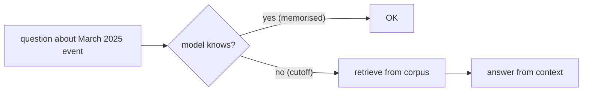
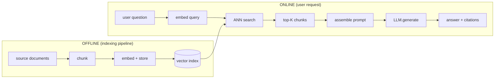
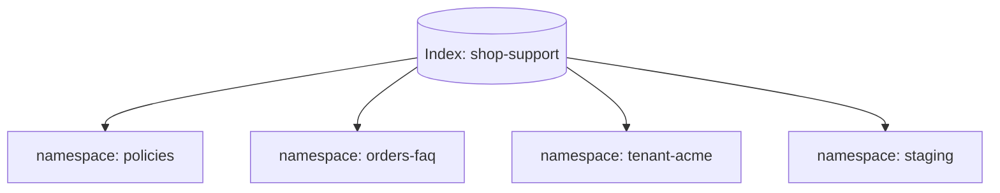
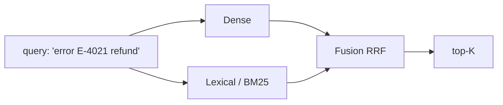
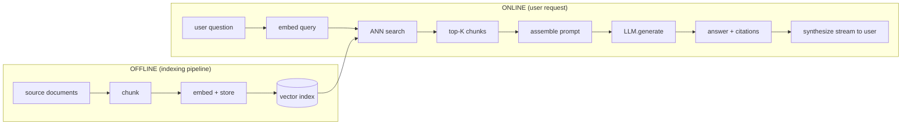
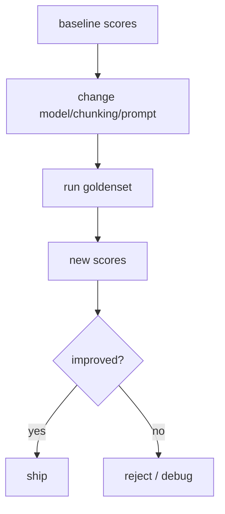
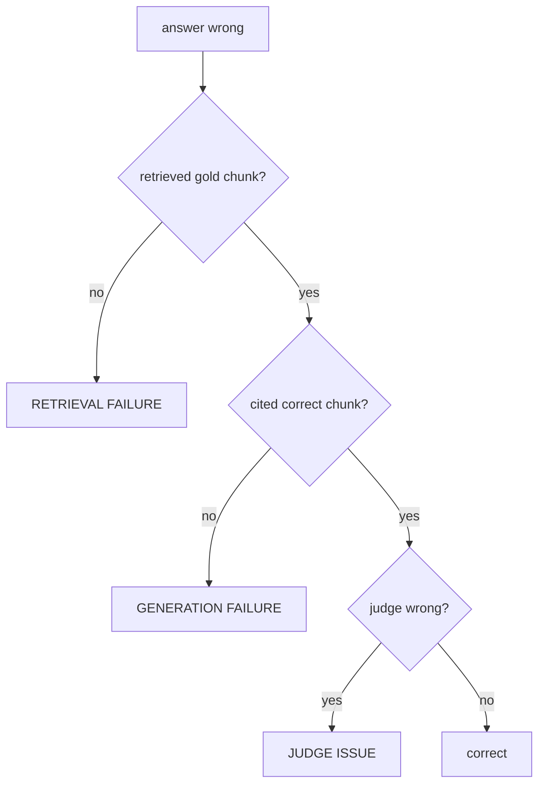
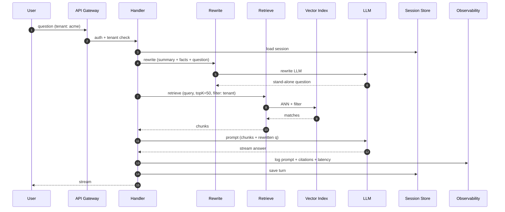
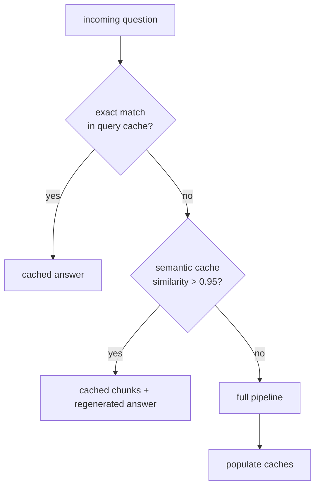
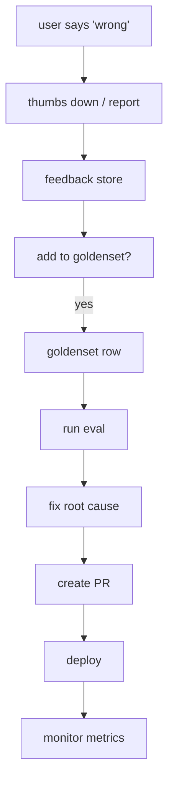

# Lecture 16 — RAG: Complete Notes (9 Chapters)

> **Lecture 16** — Retrieval-Augmented Generation. Roadmap topics: RAG definition, stateless model, knowledge cutoff, open-book architecture (two pipelines), ingestion, embeddings at query time, vector index, grounded generation, conversation state & memory, evaluation & debugging, production system design.

> **Source:** FDE L11 Chapters 01–09 + GAC D04 (RAG & Vector Stores).

> **Plan:** 9 chapters, each with mermaid diagrams, pseudo-code, and concrete takeaways.

> **Coverage:** All roadmap topics under a single coherent reference.

---

## Chunk Reference Map

| Chapter | Title | Roadmap mapping |
|---|---|---|
| 01 | RAG Fundamentals — Stateless Model | RAG definition; stateless model; knowledge cutoff |
| 02 | Open-Book Architecture — Two Pipelines | Open-book architecture; two pipelines |
| 03 | Ingestion — Documents to Chunks | Ingestion; chunking families; sizing arithmetic |
| 04 | Embeddings at Query Time | Embeddings at query time; model selection; dimensions |
| 05 | Vector Index — Retrieval Engine | Vector index; ANN; metadata filtering; hybrid search |
| 06 | Grounded Generation — Prompt Contract | Grounded generation; citation grammar; token budget |
| 07 | Conversation State & Memory | Conversation state; rewrite; summarisation; session store |
| 08 | Evaluation & Debugging | Goldenset; Hit Rate; LLM-as-judge; CI gating |
| 09 | Production System Design | Deployment; observability; tenancy; cost; feedback loop |

---

## Chapter 01: RAG Fundamentals — The Stateless Model

> **Core idea:** A RAG system is a coordinate system for knowledge. The model does not "know" anything; it places strings in space. Correctness comes from putting questions and answers in the same space.

### 1.1 What RAG Solves

- **Knowledge cutoff** — the model's training data has a hard stop; retrieval brings in current information.
- **Open-book advantage** — the model reasons over *provided* context rather than from parameter-level memorisation.
- ** Statelessness per request** — no user history carries across requests unless you explicitly persist it (Chapter 07).

### 1.2 Stateless vs Stateful

| Property | Stateless | Stateful |
|---|---|---|
| History across turns | None (must rewrite) | Persisted session |
| Retrieval context | Fresh per question | May include prior chunks |
| Cost per turn | Lower (no summary) | Higher (history in prompt) |
| Correctness risk | "What was the question again?" | Summaries may lose nuance |

> **Rule:** treat every request as stateless unless you have an explicit session contract (Chapter 07).

### 1.3 Knowledge Cutoff



- Embedding models have *no* knowledge cutoff — they embed whatever you give them.
- The **LLM** has the cutoff; that is why retrieval exists.

### 1.4 Four "Escapes" (Lecture 10 framing)

| Escape | What it defends against |
|---|---|
| Model cannot answer | Refuse honestly |
| Knowledge not in corpus | Retrieve; if missing, refuse |
| Model hallucinates | Citation grammar + groundedness check |
| User asks outside scope | Redirect or refuse |

> **These four escapes recur in Chapters 06, 07, 08, 09** under their respective headings.

### 1.5 Mental model

> The embedding model is a **coordinate system**, not a knowledge base. It does not retrieve; it only places. The index retrieves; the generation answers. Keep the boundary clean.

---

## Chapter 02: Open-Book Architecture — Two Pipelines

> **Core idea:** RAG has two parallel pipelines: an offline indexing pipeline and an online retrieval-and-generation pipeline. They meet at the prompt.

### 2.1 The Two Pipelines



### 2.2 The Prompt as Join Point

The prompt is where the two pipelines intersect. If a chunk is in the index but not in the prompt, the model cannot cite it — and that is acceptable, as long as the answer says so.

### 2.3 Anti-Patterns

| Anti-pattern | Symptom |
|---|---|
| "Pipeline drift" | Ingestion changed but serving did not |
| "Prompt leakage" | Context includes chunks from other tenants |
| "Top-K too large" | Prompt overflows window; generation quality drops |
| "No metadata filter" | Cross-tenant data leak |

### 2.4 Mental model

> The indexing pipeline is the **library** — it organises and stores knowledge. The online pipeline is the **librarian** — it finds the right book, brings it to the reader, and makes sure the reader only sees what they are allowed to see. The prompt is the **counter** where the transaction happens.

---

## Chapter 03: Ingestion — Documents to Chunks

> **Core idea:** Ingestion is the *only* path by which knowledge enters the index. Poor ingestion = poor retrieval, no matter how good the model is.

### 3.1 Extraction Hazards

| Hazard | Effect |
|---|---|
| HTML tags left in text | Vectors encode boilerplate, not signal |
| Mixed languages in one chunk | Embedding model may mix embeddings |
| Very long sections (>2k tokens) | Truncation at embedding limit; tail lost |
| Tables / code pasted raw | Token-heavy, low semantic density |

> **Defend in code:** sanitise, normalise, and log every oversized input (§4.6).

### 3.2 Chunking Families

| Family | How it works | Best for |
|---|---|---|
| **Fixed-size** | Slide window, fixed tokens | Uniform retrieval; simple |
| **Recursive** | Split by paragraph → sentence → character | Narrative text; preserves structure |
| **Semantic** | Split at topic boundaries (LLM / keyphrase) | Policy docs; sections have meaning |
| **Sentence-window** | Keep N sentences context around each chunk | Adjacent context is needed |

### 3.3 Sizing Arithmetic

```text
tokens_per_chunk = chunk_size_tokens + overlap_tokens
chunks_per_document ≈ ceil(document_tokens / tokens_per_chunk)

bytes_per_vector = dimensions × 4   (float32)
storage = num_chunks × bytes_per_vector × index_overhead
```

| Chunks | Dims | Raw | +1.5× index |
|---|---|---|---|
| 100k | 1536 | 0.61 GB | ~0.9 GB |
| 1M | 1024 | 4.10 GB | ~6.1 GB |
| 10M | 256 | 10.24 GB | ~15 GB |

### 3.4 Deterministic IDs

```ts
// pseudo-code: content hash → stable id
const contentHash = sha256({ text: chunkText, source: docId });
const chunkId = `chunk-${contentHash.slice(0, 12)}`;
```

- Enables idempotent re-ingestion: upsert same id → no duplication.
- Enables diffing: old id set vs new id set → add / remove / keep.

### 3.5 Metadata Schema

| Field | Type | Example |
|---|---|---|
| source | string | "refund-policy.pdf" |
| docId | string | "pdf-2024-v3" |
| page | number | 2 |
| section | string | "Apparel" |
| chunk | number | 3 |
| text | string | (verbatim chunk) |
| embeddingModel | string | "text-embedding-3-small" |
| updatedAt | ISO date | "2026-03-01T10:12:00Z" |

- **Flat only** — no nested objects.
- **Do not store full documents** in metadata (§5.2).

### 3.6 Ingestion Loop

```ts
// pseudo-code: the ingestion pipeline
async function ingestDocument(doc) {
  const chunks = chunkByRecursive(doc.text, { maxTokens: 512, overlap: 50 });
  for (const chunk of chunks) {
    const id = deterministicId(chunk.text, doc.id);
    const vector = await embedOne({ text: chunk.text, kind: "document" });
    await index.upsert({
      id,
      values: vector,
      metadata: { source: doc.id, section: chunk.section, ... },
    });
  }
}
```

> **Idempotency rule:** re-running the pipeline on the same documents must not grow the index.

### 3.7 Common Mistakes

| Mistake | Fix |
|---|---|
| No deterministic ids | Hash + source + chunk index |
| No metadata filtering | Add flat metadata schema |
| Chunks larger than 1k tokens | Reduce; embed model limit |
| Overlapping chunks without dedupe | Hash + `docId` cap (Chapter 05) |
| Embedding raw boilerplate | Clean + normalise first |

---

## Chapter 04: Embeddings at Query Time

> **Core idea:** The embedding model defines a coordinate system. Vectors are only comparable inside the model that produced them. The contract is: same model, same dimensions, same normalisation, same preprocessing — at ingestion and at query time.

### 4.1 The Contract in One Sentence

> A query is only meaningful in the space where the documents were embedded.

### 4.2 Choosing an Embedding Model

| Model | Dims | Strengths | Costs |
|---|---|---|---|
| OpenAI `text-embedding-3-small` | 1536 (shorten) | Cheap, fast | API dependency |
| OpenAI `text-embedding-3-large` | 3072 (shorten) | Higher accuracy | 6× price |
| Open-source (BGE, E5, GTE) | 384–1024 | Self-hosted, no per-token cost | Ops burden |
| Multilingual (e5) | 384–1024 | Cross-language | Prefixes required |

### 4.3 Dimensions and Storage

```text
bytes_per_vector = dimensions × 4   (float32)
storage = num_chunks × bytes_per_vector × overhead
```

- 1024 dims is a sane default for support corpora.
- Matryoshka: shorter prefixes are usable embeddings.

### 4.4 Symmetric vs Asymmetric

- OpenAI v3: same call for query and passage.
- E5 / multilingual-e5: `"query: …"` and `"passage: …"` prefixes **required**.
- Mixing these up costs recall silently.

### 4.5 Normalisation and Metric Consistency

- L2-normalised → cosine = dot product → L2 ordering consistent.
- Without normalisation → dot product favours long vectors.
- Changing metric after ingestion → rebuild the index.

### 4.6 Input Hygiene

- Explicit truncation at 8,191 tokens with warning log.
- Prefixes (E5/BGE) must match model convention.
- Rewriting belongs to Chapter 07; the *embedding* consequence belongs here.

### 4.7 Batching, Caching, Cost

- Embedding cost is rarely the bottleneck; storage, latency, and migration are.
- Query-vector cache key: `sha256(normalised query + model + dims)`.
- Semantic cache: gate behind high threshold + corpus version.

### 4.8 Pinning: The Compatibility Rule

- One model per index. Index name includes model + dims.
- Record `metadata.embeddingModel` per vector.
- Never mix in one namespace.
- Re-embed **all** or nothing (blue/green migration).

> **The compatibility rule:** vectors are only comparable inside the model that produced them. A "small upgrade" without a full re-embed is a silent outage.

### 4.9 Failure Modes and Diagnosis

| Symptom | Likely cause | Diagnostic |
|---|---|---|
| Every result unrelated | Different model/space | Log model + dims on both sides |
| Vaguely related but never exact | Missing query prefix | Add documented prefix |
| Clustering by length | Un-normalised vectors | Normalise; switch to cosine |
| Short queries return nothing | Query too vague | Rewrite or expand |
| "Worked yesterday" | Model/index changed | Diff deployment + index metadata |
| One language fails | Monolingual model | Switch to multilingual |
| Random results after re-ingest | Mixed old/new vectors | Rebuild namespace |

### 4.10 Pseudo-code: One Embedding Function

```ts
const MODEL = "text-embedding-3-small";
const DIMS = 1024;
const MAX_BATCH = 100;
const MAX_INPUT_TOKENS = 8_000;

function formatForModel({ text, kind }) {
  if (PREFIX_STYLE === "e5") {
    return kind === "query" ? `query: ${text}` : `passage: ${text}`;
  }
  return text;
}

async function embedOne(input) {
  const prepared = prepareEmbeddingInput(formatForModel(input));
  const cached = await vectorCache.get(cacheKey);
  if (cached) return cached;

  const res = await openai.embeddings.create({
    model: MODEL,
    dimensions: DIMS,
    input: prepared,
  });
  const vector = res.data[0].embedding;
  assert(vector.length === DIMS, "dimension mismatch");
  await vectorCache.set(cacheKey, vector, { ttlSeconds: 60 * 60 * 24 });
  return vector;
}
```

### 4.11 Common Mistakes

| Mistake | Consequence |
|---|---|
| Different model at ingest vs query | Silent total retrieval failure |
| Different dimensions | Invalid distance computation |
| Forgetting E5/BGE prefixes | Measurable recall loss |
| Normalising on one side only | Dot-product bias |
| Embedding raw boilerplate | Everything looks similar |
| Ignoring the 8,191-token limit | Silent truncation |
| Changing model without re-embedding | Half-old, half-new index |
| Not logging model + dims per request | Undebuggable incidents |

### 4.12 Chapter Summary

| Decision | Default | Revisit when |
|---|---|---|
| Model | `text-embedding-3-small` | Recall below target, non-English corpus |
| Dimensions | 1024 | Memory pressure (↓) or recall shortfall (↑) |
| Prefixes | None for OpenAI; documented elsewhere | Switching to E5/BGE/Cohere |
| Normalisation | Let provider normalise; verify | Using self-hosted models |
| Metric | Cosine | Magnitude carries meaning (rare) |
| Max input | 8,000 tokens, explicit truncation | Never — chunk smaller instead |
| Pinning | Model + dims in index name and metadata | Every migration |

> **Final mental model:** the embedding model is a coordinate system, not a search engine. Correctness comes from putting questions and answers into the **same** coordinate system.

---

## Chapter 05: The Vector Index — Storing and Searching Knowledge

> **Core idea:** The index is an ANN structure (HNSW, IVF, PQ) plus a payload store plus an operational lifecycle. It answers one question: *"which stored chunks are closest to this query, among those this user may see?"*

### 5.1 The Minimum Contract

| Capability | Why required | Missing → |
|---|---|---|
| Upsert by id | Re-ingestion must overwrite | Growing duplicates |
| ANN top-K search | Sub-linear retrieval | Too slow at scale |
| Metadata payload + filter | Tenant, ACL, source | Data leaks, wrong answers |
| Delete by id / filter | Removing stale or forbidden content | Permanent stale knowledge |
| Namespaces / collections | Isolation of environments and tenants | Cross-contamination |

### 5.2 The Record Model

```json
{
  "id": "9f2c8b1e4d7a",
  "values": [0.021, -0.184, 0.762, "… 1024 floats"],
  "metadata": {
    "source": "refund-policy.pdf",
    "chunk": 3,
    "page": 2,
    "section": "Apparel",
    "text": "Refunds are allowed within 3 days…",
    "embeddingModel": "text-embedding-3-small",
    "updatedAt": "2026-03-01T10:12:00Z"
  }
}
```

### 5.3 Namespaces

- Partition one index into independent key spaces.
- ids can repeat across namespaces.
- Queries scoped to one namespace.



### 5.4 Anatomy of the Query Call

```ts
const searchResult = await pineconeIndex.query({
  vector: queryEmbedding,
  topK: 4,
  includeMetadata: true,
  // filter: { tenantId: "acme" },
  // namespace is bound at construction: index.namespace("policies")
});
```

### 5.5 Reading Scores Correctly

- Score is **not** a probability or universal relevance measure.
- It is similarity under a specific metric, model, and corpus.
- Calibrate thresholds on your own golden set; do not guess.

### 5.6 Tuning top-K

- `topK` is a **budget**, not a quality dial.
- Default: 3–5 into the prompt.
- Over-fetch 50–60 → filter → keep best 3–5.
- Rerank stage one (recall) → stage two (precision).

### 5.7 Metadata Filtering Strategies

| Strategy | How it works | Danger |
|---|---|---|
| Pre-filter | Compute eligible ids, search inside it | Large sets expensive; very small sets cheap |
| Post-filter | Retrieve top-K, then discard | May discard most of the K → too few results |
| Filter-aware (integrated) | Index traverses only allowed nodes | Best default when available |

### 5.8 Hybrid Search

- Dense retrieval is strong at *meaning*, weak at *identifiers* (SKUs, error codes, clause numbers).
- Lexical (BM25) fills the gap.
- RRF (Recipient Rank Fusion) merges ranks without needing comparable scores.



### 5.9 Duplicates and MMR

- Deduplicate by `contentHash` + cap 2 chunks per `docId`.
- MMR balances relevance against novelty: `MMR = λ · sim(q,d) − (1−λ) · max_{s∈S} sim(d,s)`.
- λ ≈ 0.6 is a good default.

### 5.10 Reranking

- Bi-encoder (biases speed) vs cross-encoder (biases precision).
- Pipeline: retrieve top 50 → rerank top 5 → prompt 5.
- Only rerank when stage-one recall is acceptable.

### 5.11 Operating the Index

- Eventual consistency: upsert returns 200 before record is searchable.
- Limits: vectors per upsert (100–1,000), payload size (~40 KB), dimensions fixed at index creation.
- Source of truth: the vector DB is a **derived index**; original documents must be rebuildable.

### 5.12 Failure Modes

| Symptom | Likely cause | Check |
|---|---|---|
| Empty result set | Wrong namespace or over-restrictive filter | Log namespace + filter |
| Too few results with filter | Post-filtering a selective filter | Over-fetch or pre-filter |
| Stale answer after upload | Eventual consistency | Fetch by id; add short delay |
| Deleted doc still answered | Orphan vectors | Reconcile ids on ingest |
| Duplicate chunks in context | Overlap + no dedupe | Hash + `docId` cap |
| Right doc never appears | Wrong space (model/dims) | Chapter 04 diagnostics |
| Irrelevant but high scores | Boilerplate chunks | Clean, add headers, rerank |
| Cross-tenant leak | Filter missing/ignored | Enforce filter in shared query builder |
| Slow queries | Very large topK, no index on filter field | Reduce topK, index filter fields |
| Index rejected upsert | Dimension mismatch or metadata too large | Validate before writing |

### 5.13 Pseudo-code: Retrieval Function

```ts
async function retrieve(question, ctx, opts = { fetch: 60, keep: 4 }) {
  const vector = await embedOne({ text: question, kind: "query" });

  const { matches } = await index.query({
    vector,
    topK: opts.fetch,
    includeMetadata: true,
    includeValues: false,
    filter: {
      tenantId: { $eq: ctx.tenantId },
      acl: { $in: ctx.roles },
    },
  });

  return matches
    .filter((m) => isAuthorised(ctx, m.metadata))
    .filter((m) => m.score >= SCORE_FLOOR)
    .sort((a, b) => b.score - a.score)
    .filter(dedupeByHashAndDoc(2))
    .slice(0, opts.keep);
}
```

### 5.14 Common Mistakes

| Mistake | Fix |
|---|---|
| Retrieval without tenant filter | Shared query builder that injects it |
| Trusting a score threshold from a blog | Calibrate on your golden set |
| topK = 1 for "efficiency" | 3–5, plus a refusal path |
| topK = 100 straight into the prompt | Over-fetch then rerank |
| No dedupe | Hash + `docId` cap |
| Assuming immediate consistency | Verify by id; show indexing state |
| Treating index as source of truth | Keep originals; make rebuilds routine |
| Adding hybrid search without measurement | Measure identifier queries first |
| Forgetting to index filter fields | Slow or rejected queries |
| One index shared by dev and prod | Namespace per environment |

### 5.15 Chapter Summary

| Layer | Decision | Default |
|---|---|---|
| Record | `id + values + metadata` | Stable id, flat metadata, text in payload |
| Partition | Namespace + filter | Namespace per tenant/corpus, always filter |
| Query | Vector, topK, filter, metadata | Over-fetch 50–60, keep 3–5 |
| Score | Similarity, not confidence | Calibrate, do not guess |
| Candidates | Recall first | Add hybrid when identifiers fail |
| Ordering | Precision second | Rerank to 5 with a cross-encoder |
| Diversity | Dedupe and MMR | Cap 2 per doc; λ ≈ 0.6 if needed |
| Operations | Derived index | Rebuildable, idempotent, authorised |

> **Final mental model:** the index answers one question — *"which stored chunks are closest to this query, among those this user may see?"* Everything else (reranking, dedupe, thresholds, budgets) exists to turn that candidate list into **four paragraphs worth reading**.

---

## Chapter 06: Grounded Generation and the Prompt Contract

> **Core idea:** Generation is the accountable stage. Retrieval is the quiet librarian; generation is the spokesperson who says, *"according to these three documents…"* and, when the documents are silent, *"I don't have that information."* The prompt is the contract that makes that accountability enforceable.

### 6.1 The Two-Stage Pipeline (again)



### 6.2 The Prompt That Does Not Hallucinate

Template:

```text
You are an internal support assistant for Acme Corp.

Answer the user's question using ONLY the context below. If the answer is not in the context, say "I don't have that information" and do not continue. Do not invent.

When you cite a fact, reference the context chunk in square brackets — for example [3]. Quote exact text only when the wording matters; otherwise paraphrase. Never cite a chunk you did not use.

=== CONTEXT ===
[1] (refund-policy.pdf, page 2, section "Apparel")
Refunds are allowed within 3 days of delivery…

[2] (refund-policy.pdf, page 4, section "Electronics")
Electronics returns must include…

=== QUESTION ===
{question}

=== ANSWER ===
```

### 6.3 Citations: The Verifiability Layer

- A citation is a promise: this claim came from this chunk.
- Two-level: reference `[3]` (concise) and quotation `"…"` (exact wording).
- Post-generation discipline: every cited number must map back to content in the prompt.

### 6.4 Token Budgeting: The Hard Constraint

- Context size dominates generation cost.
- Keep retrieved context under 5–15% of the window for headroom.
- If you need more, invest in context compression or a smaller topK with better reranking.

### 6.5 Streaming and UX

- Streaming is good UX but can start confidently then "correct" at the end.
- Mitigations: non-streaming refusal probe, post-stream verification, lower temperature (0–0.2), structured output (JSON) for easier validation.

### 6.6 The RAG Loop

- Some questions need more than one pass.
- Model proposes a new search query; hard cap on iterations (≤ 3).

### 6.7 Guarding the Output

- Four response types: full answer with citations, partial answer + gap, refusal, clarification.
- Refuse faster than you answer.

### 6.8 Temperature and Sampling

- Default for grounded generation: `temperature = 0` or `0.2`.
- Correctness is non-negotiable; personality is secondary.

### 6.9 Logging the Prompt

- Log the full prompt verbatim before truncation.
- If a chunk was dropped to fit the window, log that fact explicitly.

### 6.10 Pseudo-code: Generation Function

```ts
const SYSTEM_PROMPT = `You are an internal support assistant. Answer using ONLY the context. If the answer is not in the context, say "I don't have that information." Cite chunks with [n]. Never cite a chunk you did not use.`

function buildPrompt(question, chunks) {
  const context = chunks.map((c, i) => `[${i + 1}] (${c.id})\n${c.text}`).join("\n\n");
  return [SYSTEM_PROMPT, "=== CONTEXT ===", context, "=== QUESTION ===", question, "=== ANSWER ==="].join("\n");
}

async function answer(question, chunks, ctx) {
  const prompt = buildPrompt(question, chunks);
  const stream = await llm.chat({ messages: [{ role: "user", content: prompt }], temperature: 0.2, max_tokens: 512, stream: true });
  let full = "";
  for await (const delta of stream) { full += delta; yield delta; }
  const classified = classify(full);
  if (classified === "refusal") { ctx.logger.warn("generation.refused", { question }); }
  else if (!verifyCitations(full, chunks)) { ctx.logger.warn("generation.hallucinated", { question }); }
  yield `[DONE]` as const;
}
```

### 6.11 Common Mistakes

| Mistake | Fix |
|---|---|
| No explicit refusal instruction | Add "say I don't have that information" |
| No citation grammar | Define and enforce `[n]` format |
| Chunks in prompt but not cited | Citation checker post-generation |
| topK too large for the window | Compress or reduce chunks |
| Streaming starts confidently then backtracks | Refusal probe or post-check |
| No prompt logging | Log the full rendered prompt |
| High temperature on factual QA | Use 0–0.2 |
| Model sees sources it cannot cite | Keep prompt context == cited sources |
| "Please be accurate" instruction | Replace with concrete, testable rules |
| Citations to omitted chunks | Verify cited indices exist in prompt |

### 6.12 Chapter Summary

| Concern | Contract |
|---|---|
| Purpose | Answer from context or refuse |
| Prompt shape | Role + context + grammar + failure mode |
| Citations | Verifiable `[n]` references; quote only when exact |
| Budget | Keep context < 15% of window; compress over widen |
| Streaming | Acceptable, with post-hoc verification |
| Iterations | Allowed only if the model proposes a new query |
| Temperature | 0–0.2 for factuality |
| Logging | Full prompt + usage + latency, every request |
| Guardrails | Refuse fast; verify citations; flag hallucination |

> **Final mental model:** generation is the accountable stage. The model says, *"according to these three documents…"* and, when the documents are silent, *"I don't have that information."* The prompt is the contract that makes that accountability enforceable.

---

## Chapter 07: Conversation State and Memory

> **Core idea:** Make multi-turn RAG conversations work. History must be compressed, rewritten, and persisted so the session survives restarts and scales.

### 7.1 Why Naive History Fails

- Follow-up questions like "and for shoes?" have no semantic signal without the first question.
- Raw user text alone often matches many irrelevant chunks.

### 7.2 Query Rewriting

- Rewrite the follow-up into a complete, self-contained question using conversation history.
- Prompt: "Given the conversation so far, rewrite the user's latest question into a complete, self-contained question."

### 7.3 History in the Generation Prompt

- Tiers: none, last 2–3 turns, summarised, structured (extracted facts).
- Rule: retrieved chunks come first. History is optional context, not a retrieval substitute.

### 7.4 The Conversation Object

```json
{
  "sessionId": "sess_9f2c8b1e4d7a",
  "tenantId": "acme",
  "userId": "user_123",
  "messages": [...],
  "summary": "User asked about general refund policy, then specifically shoes.",
  "extractedFacts": { "product": "shoes", "topic": "refund" }
}
```

### 7.5 Summarisation

- When messages grow, summarise by an LLM and store back into the session.
- Budget trigger: ~2,000 tokens.

### 7.6 Statefulness at Scale

- Session store: Redis hash with TTL, atomic append, tenant in key.
- Must survive process restarts and horizontal scaling.

### 7.7 Identity and Tenancy

- Session key must include tenantId.
- Cross-tenant leakage is a security incident.

### 7.8 Tool-Calling and Structured Memory

- Tool calls and results become part of the conversation state.
- Update `extractedFacts` (structured) and append to `messages` (for display/rewrite).

### 7.9 Rewriting with Structured Facts

- Including `extractedFacts` in the rewrite prompt makes it more precise.
- Example: "What about the red ones?" → `product: "shoes"` resolves without model inference.

### 7.10 Branching and Undo

- Simple implementation: session with branches, `fork()`, `switch()`, `merge()`.
- Most systems don't need full branching; a "new conversation" button is usually enough.

### 7.11 Offline Evaluation of Conversation Quality

- Metrics: rewrite accuracy, citation consistency, fact retention, refusal appropriateness, context budget health.

### 7.12 Pseudo-code: The Conversation Turn

```ts
async function conversationTurn(request) {
  const session = await loadSession(request.sessionId);
  const rewritten = await rewriteQuestion({ summary: session.summary, facts: session.extractedFacts, recentMessages: session.messages.slice(-6), currentQuestion: request.question });
  const chunks = await retrieve(rewritten, { tenantId: request.tenantId });
  const prompt = buildPrompt(rewritten, chunks, session.messages.slice(-4));
  // stream generation
  // persist turn
  // update summary + facts
}
```

### 7.13 Common Mistakes

| Mistake | Fix |
|---|---|
| No rewrite — feed raw follow-up | Rewrite to stand-alone question |
| Unbounded history in prompt | Summarise; cap tokens; chunks first |
| Session without tenantId in key | Always include tenant in session key |
| No TTL on sessions | Add expiry; clean idle sessions |
| Lost tool results | Persist tool calls + update extractedFacts |
| Rewrite uses full history every time | Use summary + facts + last N messages |
| Concurrent requests overwrite session | Atomic read-modify-write (Lua / transaction) |
| Rewrite changes meaning | Evaluate rewrite quality on gold set |
| No citation tracking per turn | Store citations + retrieved chunks per message |

### 7.14 Chapter Summary

| Layer | Decision | Default |
|---|---|---|
| Rewrite | Stand-alone question from history | LLM rewrite; fallback to raw |
| History in prompt | Last 2–4 turns or summary | Summarise at ~2k tokens |
| Structured memory | `extractedFacts` object | Updated from tool calls + LLM |
| Session store | Redis hash with TTL | Atomic append; tenant in key |
| Branching | Optional | "New chat" is usually enough |
| Evaluation | Turn-level metrics | Rewrite accuracy + citation consistency |
| Isolation | Mandatory | TenantId in every session key |

> **Final mental model:** a conversation is a compression pipeline. Raw turns → rewritten question → retrieval → generation → summary + facts. Each stage reduces tokens while preserving the signal the next stage needs.

---

## Chapter 08: Evaluation and Debugging

> **Core principle:** if you cannot measure it, you cannot fix it — and if you measure it wrong, you will fix the wrong thing.

### 8.1 Why Evaluation Is Separate from Testing

- Software tests check that code runs; RAG evaluation checks that answers are correct.
- A system can pass all unit tests and still answer every question wrongly.

### 8.2 The Goldenset

- A collection of real-world question → gold chunk pairs, with human-graded answers.
- Source of truth for all evaluation.

### 8.3 Metrics

| Retrieval | Generation |
|---|---|
| Hit Rate @ K | Answer correctness |
| Recall @ K | Groundedness |
| MRR | Refusal accuracy |
| | Hallucination rate |

### 8.4 The Evaluation Loop



### 8.5 Writing Goldenset Rows

- 30–100 real questions.
- One gold chunk per question (usually).
- Include refusal cases (expectedRefusal: true).
- Version control the file.

### 8.6 LLM-as-a-Judge

- Strict rubric: 2 = correct + grounded, 1 = partially correct, 0 = wrong/hallucinated.
- Judge prompt version-controlled; human audit sample regularly.

### 8.7 Evaluation Harness (pseudo-code)

```ts
async function runEvaluation(rows, opts) { ... }
```

### 8.8 Debugging a Single Failure



### 8.9 Hooking Evaluation into CI/CD

- Every PR must run evaluation against baseline.
- Thresholds: Hit Rate @ 5 drop > 0.02, mean score drop > 0.05 → block merge.
- Baseline stored in `scores/baseline.json` tagged to last shipped commit.

### 8.10 Production Monitoring and Alerts

- Log every turn (question, retrieved chunks, citations, latency, cost).
- Alert conditions: Hit Rate @ 5 drops > 5% over 24h, refusal rate spikes > 10%, latency P95 > 2s, cost per 1k turns > budget.

### 8.11 Common Mistakes

| Mistake | Fix |
|---|---|
| No goldenset | Start with 30 real questions |
| Only measuring generation | Measure retrieval separately |
| Synthetic questions only | Mix real + synthetic |
| No refusal test rows | Add rows where answer is not in corpus |
| Changing 3 variables at once | One variable per eval run |
| No CI gate | Evaluate on every PR |
| No baseline | Store baseline.json from last ship |
| Trusting judge blindly | Human audit 10% of judge scores |
| Not logging production turns | You cannot debug what you do not record |
| Goldenset not version-controlled | Store with code; review changes |

### 8.12 Chapter Summary

| Layer | Decision | Default |
|---|---|---|
| Goldenset | 30–100 real Q→chunk rows | JSONL, version-controlled |
| Primary metric | Hit Rate @ K | K = 5 |
| Generation metric | LLM-as-judge 0/1/2 | Strict rubric |
| Refusal testing | Rows with expected refusal | Mandatory |
| CI gate | Block on score drop | Hit Rate -2 pts, Score -0.05 |
| Baseline | scores/baseline.json | Commit-tagged |
| Production logging | Every turn, chunk IDs, citations | Alert on drift |
| Debug | Print prompt + retrieved chunks | Stage-by-stage trace |

> **Final mental model:** evaluation is not a final check — it is the engine of improvement. Every change is measured against the goldenset; every failure becomes a new row; every deploy is gated by scores.

---

## Chapter 09: Production System Design

> **Core principle:** correctness is a system property, not a model property. The embedding model does not know about tenants; the index does not know about auth; the prompt does not know about token budgets. Correctness emerges from the integration of all chapters.

### 9.1 The Four Layers

```mermaid
flowchart TD
    subgraph UX["Layer 1: Presentation"]
        A["REST / GraphQL API"] B["Web / chat UI"] C["Rate limiting"]
    end
    subgraph APP["Layer 2: Application"]
        D["Request handler"] E["Query rewrite"] F["Prompt assembly"] G["Response guardrails"]
    end
    subgraph DATA["Layer 3: Data"]
        H["Vector index"] I["Document store"] J["Ingestion pipeline"]
    end
    subgraph INFRA["Layer 4: Infrastructure"]
        K["Secrets / API keys"] L["Observability"] M["CI/CD + deployment"] N["Session store"]
    end
```

### 9.2 The Online Path: Request Flow



Latency budget targets: auth+session 5ms, rewrite 50–200ms, embedding 50–200ms, vector search 10–50ms, generation 100–1000ms, logging+save 5ms. P95 under 2 seconds.

### 9.3 Tenancy and Security

- Multi-tenancy is not optional.
- Defence in depth: query filter + namespace + session key + prompt verification + citation check.
- The filter must live in the vector query itself; post-retrieval filtering means chunks entered your process and prompt.

### 9.4 Deployment and Rollout

- Environments: dev (experiment, loose auth), staging (pre-prod validation, dedicated tenant), prod (live traffic, full isolation).
- Blue/green for index changes: shadow traffic to new index, compare results, then cut over.
- Always store baseline before switching.

### 9.5 Caching and Latency Reduction



- Cache key must include model + namespace.
- CDN for static FAQ/policy answers (rarely changing).

### 9.6 Observability: Knowing What Breaks

- Logging (full prompt + output on sample 1% in prod).
- Metrics (Hit Rate @ 5, mean score, latency P95, error rate, cost per 1k turns).
- Traces (spans per RAG stage: rewrite, retrieve, embed, vectorSearch, filter, generate, LLM).

### 9.7 Failure Recovery and Circuit Breakers

- Vector index down → BM25 fallback.
- LLM API down/rate-limited → queue + backpressure; user-facing "still working…".
- LLM unavailable → "I'm temporarily unavailable" (not a hallucination).
- Embedding service down → cache recent query vectors; fail closed (refuse).
- Session store down → stateless fallback (no history); warn about limited context.

### 9.8 Cost Management

- Generation call dominates cost, scales with users and context size.
- Cost-containment: cap topK into prompt (4–5), rerank before generate, summarise long history, cache exact + semantic queries, use cheaper model for rewrite, truncate input aggressively.

### 9.9 Feedback Loop: Closing the Gap



- Every reproducible bug → goldenset row → eval → fix → deploy.

### 9.10 The Four Escapes

| Escape | Question | Response |
|---|---|---|
| No context | "Is the answer in the context?" | Refuse: "I don't have that information" |
| Wrong context | "Did retrieval fail?" | Log + escalate to human |
| Model confused | "Did generation fail?" | Regenerate with lower temp / explicit instruction |
| System overloaded | "Can the system serve this?" | 429 / 503 with honest message |

### 9.11 Common Mistakes

| Mistake | Fix |
|---|---|
| No tenant isolation | Namespace + filter + verify by id |
| No CI evaluation | Eval on every PR with baseline check |
| No production logging | Log full prompt + output on sample |
| No circuit breaker | BM25 fallback; refuse on LLM down |
| No cost control | Cap topK, prompt, output tokens |
| No feedback loop | Every bug report → goldenset row |
| No blue/green for index | Shadow traffic before cutover |
| No observability | Spans per stage; alert on drift |
| Caching across models | Include model + namespace in cache key |
| Treating RAG as a script | Build it as a service with envs + rollbacks |

### 9.12 Chapter Summary

| Concern | Rule |
|---|---|
| Architecture | Four layers: presentation, application, data, infrastructure |
| Security | Tenant in query filter, namespace, session key, citation check |
| Deployment | Blue/green for index changes; shadow traffic; staging env |
| Caching | Exact + semantic + CDN; keys include model and namespace |
| Observability | Logs (debug), metrics (alert), traces (latency) per stage |
| Reliability | BM25 fallback; backpressure; honest 503 on overload |
| Cost | Cap topK, prompt, output; cache hot queries; cheaper model |
| Feedback | Every reproducible bug → goldenset row → eval → fix |
| Escapes | Four explicit escapes: refuse, escalate, regenerate, degrade |

> **Final mental model:** production RAG is a distributed system of contracts. The embedding contract (same space), the index contract (filter by tenant), the prompt contract (cite only what you used), and the operational contract (log everything, alert on drift). When all contracts hold, the system is trustworthy. When one breaks silently, it is not.

---

## Lecture 16 — Consolidated Reference

> **The whole lecture in one view:** RAG is a chain of contracts, from embedding coordinate system → index isolation → prompt accountability → system correctness. Each chapter closes one contract. The evaluation loop ensures no contract degrades unnoticed. Production design ensures all contracts hold at scale.

> **Your checklist for a trustworthy RAG system:**
> 1. Same embedding model + dimensions + prefixes at ingest and query time.
> 2. Vector index filtered by tenant, with namespace isolation.
> 3. Prompt includes only cited chunks; refusal when context is insufficient.
> 4. Goldenset + CI gate on every PR; baseline tracked in version control.
> 5. Observability: logs, metrics, traces per stage; alerts on drift.
> 6. Feedback loop: every reproducible bug → goldenset row → eval → fix.
> 7. Four explicit escapes: refuse, escalate, regenerate, degrade.

> **If every contract holds, the system is trustworthy. If any contract breaks silently, it is not.**