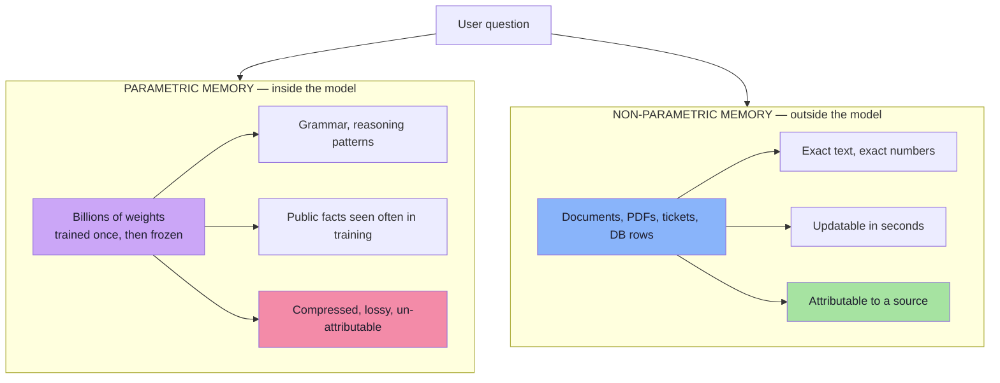
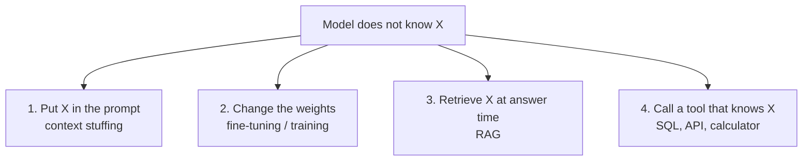
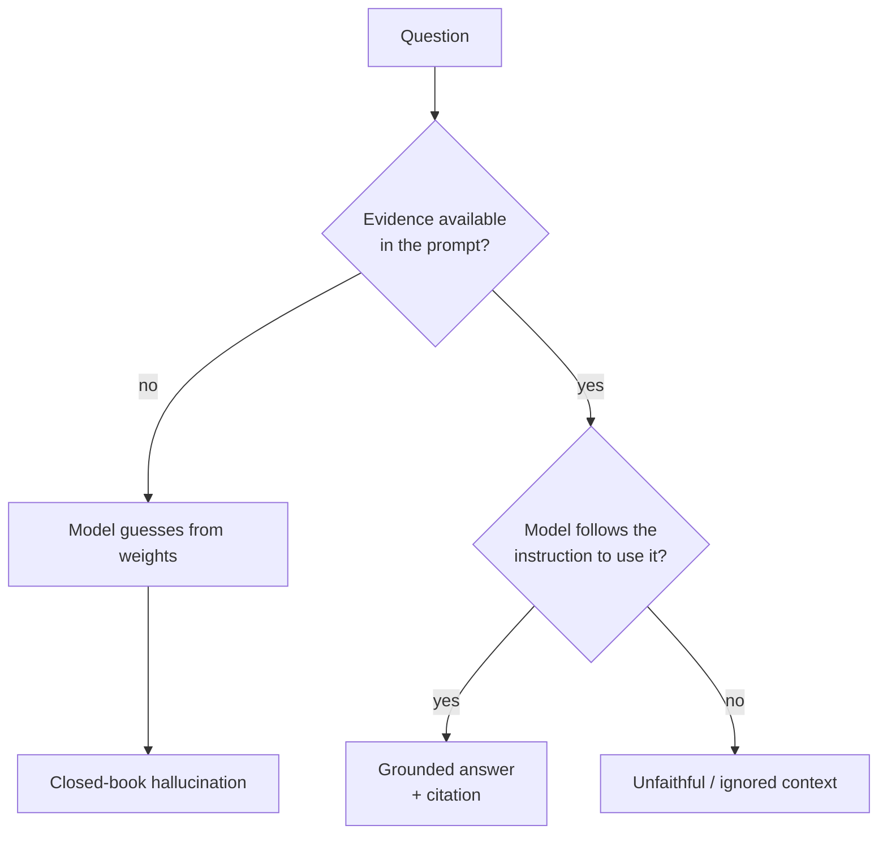
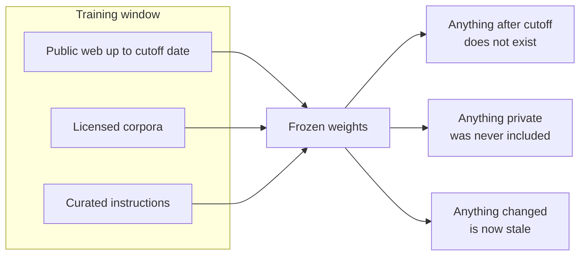
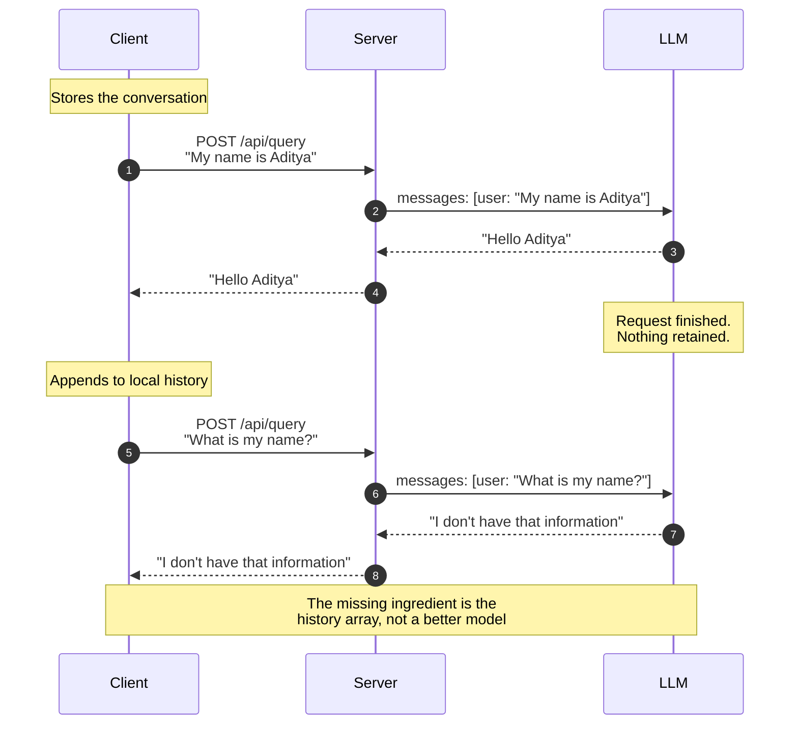
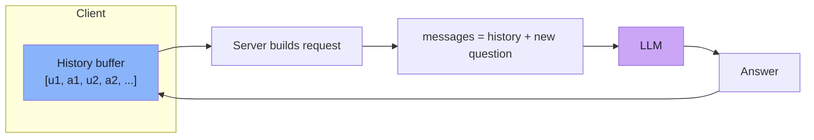
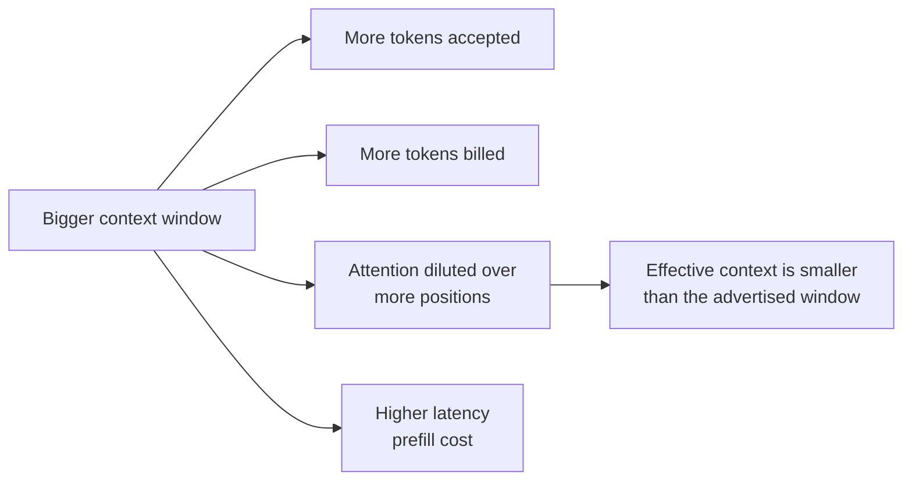

# Chapter 01: RAG Fundamentals — The Stateless Model and Why LLMs Alone Are Not Enough

> **Chapter Goal:** Understand precisely *what* an LLM knows, *where* that knowledge lives, and *why* it cannot answer questions about private, recent, or proprietary data. This chapter builds the motivation for everything that follows in this lecture — and for RAG as a whole.

---

## 1.1 Two Kinds of Memory: Parametric and Non-Parametric

An LLM has exactly one place to store what it "knows": **its weights**. Knowledge baked into weights is called **parametric memory**. Knowledge stored outside the model — documents, databases, APIs — is called **non-parametric memory**.



| Dimension | Parametric (weights) | Non-parametric (documents) |
|---|---|---|
| Where it lives | Model parameters | Files, DBs, object storage |
| Update cost | Full fine-tune or retrain | Edit one file, re-embed one chunk |
| Update latency | Days to weeks | Seconds to minutes |
| Fidelity | Compressed, paraphrased, lossy | Byte-exact |
| Attribution | Impossible ("the model just knows") | Trivial (cite the chunk) |
| Access control | None — once trained, everyone gets it | Enforced at retrieval |
| Deletion | Practically impossible | Delete the record |
| Cost to add knowledge | Very high | Near zero |
| Best for | Style, format, task behaviour | Large, changing, private corpora |

### Why parametric memory is lossy

Training compresses a huge corpus into a fixed number of weights. A trillion-token corpus cannot be stored losslessly in a few hundred billion parameters; the model necessarily learns **patterns, associations and gist**, not records.

```text
Training corpus        →  model weights        →  generation
(millions of pages)       (compressed gist)       (reconstruction)

"Section 4.2(b): refunds for apparel within 3 days of delivery"
                ↓ compression
        "refunds are usually possible for clothing"
                ↓ reconstruction
        "You can return clothing within 30 days."   ← plausible, wrong
```

> **Key idea:** an LLM does not *retrieve* a fact from a database of facts. It *reconstructs* a plausible string conditioned on the prompt. When the exact detail is not in the weights, the most probable continuation is a *reasonable-sounding* answer, not an admission of ignorance.

### Non-parametric memory: exact and fresh

Knowledge outside the model is stored as documents, databases, or object storage. It has four advantages:

- **Exact text** — chunk boundaries preserve clause numbers, dates, percentages
- **Updatable in seconds** — edit a policy PDF, re-embed affected chunks, and the index is fresh in minutes
- **Attributable** — every answer can cite `source:page:clause`
- **Filterable** — ACLs, tenant filters, date ranges can be applied at retrieval time

### The uncomfortable part

The model gives you no reliable signal that separates a correct recall from a fabricated one. Fluency is not evidence. Confidence in the *style* of the answer says nothing about the *truth* of the content. This single observation is the reason **Retrieval-Augmented Generation** exists.

---

## 1.2 The Four Escapes (and What Each One Costs)

There are only four ways to get new knowledge into a model-based product. Every real system is a mix.



| Approach | How knowledge enters | Freshness | Cost to add data | Attribution | Best for |
|---|---|---|---|---|---|
| **Context stuffing** | Paste everything into the prompt | Per request | Prompt tokens every call | Possible | A single short document |
| **Fine-tuning** | Gradient updates on examples | Retrain cycle | High, per run | Weak / none | Tone, format, task behaviour |
| **RAG** | Retrieved chunks in the prompt | Minutes | Near zero (re-embed) | Strong, per chunk | Large, changing, private corpora |
| **Tools / APIs** | Live call at answer time | Real time | Per call | Native (the API) | Balances, inventory, order status |

### Why not just paste everything (context stuffing)?

The naive answer to "the model doesn't know our docs" is "put the docs in the prompt". This fails at modest scale:

```text
One 200-page policy PDF        ≈ 100,000 tokens
Twenty such documents          ≈ 2,000,000 tokens   ← exceeds any context window
1,000 documents                ≈ 100,000,000 tokens ← 100x over, at every request
```

And even when it fits, three costs appear:

| Cost | Effect |
|---|---|
| **Money** | You pay for every stuffed token on every request, forever |
| **Latency** | Prefill time grows roughly linearly with input tokens |
| **Accuracy** | Long, mostly-irrelevant context degrades attention (see §1.8) |

> **Rule of thumb:** context stuffing is a *demo* technique. It stops working the moment the corpus is bigger than a few hundred pages, changes often, or must be filtered per user.

### Why not just fine-tuning?

Fine-tuning is excellent at changing **how** a model responds and poor at storing **facts**:

| Goal | Fine-tuning works? | Why |
|---|---|---|
| "Answer in our brand voice" | ✅ Yes | Style is a distributional pattern |
| "Always reply in this JSON shape" | ✅ Yes | Format is a pattern |
| "Classify these tickets" | ✅ Yes | Task behaviour |
| "Know our 400 SKUs with prices" | ❌ No | Facts get memorised unreliably, and go stale |
| "Cite the clause that supports the answer" | ❌ No | Weights carry no source pointers |
| "Forget a customer's data on request" | ❌ No | Unlearning from weights is unsolved in practice |
| "Add yesterday's policy" | ❌ No | Needs a new training run |

Fine-tuning can also *increase* hallucination: a model trained to always produce an answer becomes more confident, not more correct.

> **Key idea:** fine-tuning changes *style and format*; RAG changes *knowledge and freshness*.

---

## 1.3 What the Model Is Actually Doing at Inference

At inference time an LLM is a function:

```text
logits = model(tokens_so_far)
P(next_token) = softmax(logits / temperature)
```

It produces a **probability distribution over the next token**, samples from it, appends that token, and repeats. There is no lookup step, no fact-check step and no separate "knowledge base" the model consults.

```mermaid
sequenceDiagram
    autonumber
    participant P as Prompt tokens
    participant F as Transformer forward pass
    participant L as Logits over vocabulary (~100k numbers)
    participant S as Sample one token
    participant A as Append token
    participant T2 as End of answer?
    participant O as Answer text

    P->>F
    F->>L
    L->>S
    S->>A
    A->>T2
    T2-->"no"->F
    T2--"yes"->O
```

Three consequences follow directly from this loop:

1. **Truth is not a term in the objective.** The objective is next-token likelihood on text humans wrote. Text that is fluent and well-formed scores well even when false.
2. **Every token is committed.** Once "within 30 days" is generated, the model conditions on it and will rationalise it further. Errors compound rather than self-correct.
3. **The model cannot know what it does not know.** Nothing in the forward pass compares its claim against a source of truth. It has no calibrated "I have not seen this" signal unless it was explicitly trained to refuse.

> **Interview-ready phrasing:** hallucination is not a bug layered on top of the model; it is the *expected behaviour* of a next-token predictor asked a question outside its evidence.

---

## 1.4 Hallucination, Precisely Defined

A **hallucination** is output that is fluent and confident but not supported by any evidence available to the model. It is useful to separate three species, because each has a different fix:

| Species | Example | Root cause | Primary fix |
|---|---|---|---|
| **Factual (closed-book)** | "Tomato refunds within 30 days" | The fact was never in training | Retrieval — supply the evidence |
| **Fabricated detail** | Correct policy, wrong clause number | Compression lost precision | Retrieval with exact text + citations |
| **Unfaithful to context** | Context says 3 days, answer says 7 | Instruction-following failure | Prompt contract, grounding checks, smaller context, better model |



The right-hand branch matters: **retrieval alone does not guarantee grounding.** Handing a model the correct paragraph and watching it answer from memory anyway is a real, common failure. Chapter 06 is devoted to closing that gap.

---

## 1.5 The Knowledge Cutoff: A Model Frozen in Time

Every model is trained on a snapshot of the world. The date after which it saw nothing is the **knowledge cutoff**. Two independent problems follow:



| Gap | Example | What the model does | Consequence |
|---|---|---|---|
| **Temporal** | "What is our price today?" | Answers from the last price it saw | Stale, confidently wrong |
| **Private** | Internal SOP, customer tickets | Invents a plausible one | Policy violation, legal risk |
| **Long tail** | A niche product SKU | Guesses the format | Wrong ID, wrong URL |

> **Freshness is an architectural property, not a model property.** There is no "update the model with today's data" button. Even a fresh model is frozen the day its training run ended.

---

## 1.6 Statelessness: The "What Is My Name?" Demo

This is the second half of the lecture board, and it is the part engineers underestimate.

```text
Turn 1
  User:  My name is Aditya
  LLM:   Hello Aditya

Turn 2
  User:  What is my name?
  LLM:   I'm sorry, I don't have that information.
```

Nothing broke. The model simply has **no memory between API calls**. Each request is evaluated independently against the weights.



### The history illusion

The board shows a **History** box next to the LLM. That box is not inside the model — it is a data structure that the **client or server resends on every call**:



| Layer | Who owns it | Lifetime | Cost |
|---|---|---|---|
| Weights | Model provider | Training run | Fixed |
| **Context window** | You (the caller) | One request | Per token, every call |
| Conversation store | Your server or client | Session / TTL | Storage + re-sending |
| Vector memory | Your infrastructure | Until deleted | Embedding + retrieval |

> **Key idea:** "memory" in a chat product is an application feature. The model contributes only the *ability to condition on whatever you send*. If you do not send the history, it does not exist.

This has three engineering consequences, expanded in Chapter 07:

1. **History consumes context budget on every turn** — cost grows quadratically in a long conversation.
2. **History must be stored and authorised by you** — a session token is not an identity proof.
3. **History is **input the model will trust**, so it is an injection surface.

---

## 1.7 The Knowledge Cutoff: A Model Frozen in Time

Every model is trained on a snapshot of the world. The date after which it saw nothing is the **knowledge cutoff**. Two independent problems follow:


| Gap | Example | What the model does | Consequence |
|---|---|---|---|
| **Temporal** | "What is our price today?" | Answers from the last price it saw | Stale, confidently wrong |
| **Private** | Internal SOP, customer tickets | Invents a plausible one | Policy violation, legal risk |
| **Long tail** | A niche product SKU | Guesses the format | Wrong ID, wrong URL |

> **Freshness is an architectural property, not a model property.** There is no "update the model with today's data" button.

---

## 1.8 The Context Window Is Not Memory

A large context window feels like a solution: "just give the model 200k tokens". It helps, but it is a **capacity** limit, not a **memory** or **attention** guarantee.



### The lost-in-the-middle effect

Retrieval quality inside the context is **position-dependent**. Models attend most reliably to the beginning and the end of a long prompt; material buried in the middle is used less often.

```text
┌───────────────────────────────┐
│  START   → high attention     │  ← best chunks here
│  ...                          │
│  MIDDLE  → lowest attention   │  ← important fact here = often missed
│  ...                          │
│  END     → high attention     │  ← and here
└───────────────────────────────┘
```> **Practical consequences, used later in Chapter 06:**
> 1. **Fewer, better chunks beat many mediocre ones.** Top-K = 4 good chunks usually beats Top-K = 40.
> 2. **Order deliberately.** Put the highest-scoring passage first (or immediately before the question).
> 3. **Never rely on "it's in there somewhere".** If the fact is in position 60 of 80, assume it may be ignored.
> 4. **Long context is not free.** Every extra chunk is money, latency and noise.
> 
> Recent independent studies (for example, Chroma's 2025 "Context Rot" report) show accuracy degrading as input length grows even on trivial tasks — the window is a maximum, not a usable budget.

---

## 1.9 Pseudo-code: Closed-Book vs Open-Book

TypeScript-shaped pseudo-code for the JS/TS runtime. It describes the *contract*, not production code.

### Closed book — what fails

```ts
// pseudo-code: a stateless chat endpoint with no context
type Message = { role: "user" | "assistant"; content: string };

async function closedBookAnswer(question: string): Promise<string> {
  const messages: Message[] = [
    { role: "user", content: question },   // no history, no documents
  ];

  const reply = await llm.chat({ messages });
  return reply.text;                       // plausible, ungrounded
}
```

Two independent defects, visible in three lines:

1. `messages` contains **no history** → the model cannot answer follow-ups.
2. `messages` contains **no evidence** → the model can only answer from weights.

### Open book — the shape of the fix

```ts
// pseudo-code: same endpoint, two additions
async function openBookAnswer(question: string, session: Session) {
  // 1) Give the model a memory: resend the conversation so far
  const history: Message[] = await sessionStore.recent(session.id, {
    maxTurns: 6,
  });

  // 2) Give the model evidence: retrieve chunks for the question
  const chunks: Chunk[] = await retrieve(question, { topK: 4 });

  const messages: Message[] = [
    { role: "system", content: SUPPORT_PROMPT },      // rules + "answer only from context"
    ...history,                                        // what was said before
    { role: "system", content: renderContext(chunks) },// what the documents say
    { role: "user", content: question },
  ];

  const reply = await llm.chat({ messages, temperature: 0.2 });
  await sessionStore.append(session.id, question, reply.text);

  return reply.text;   // grounded, attributable, repeatable
}
```

| Addition | Solves | Introduced in |
|---|---|---|
| `history` | Statelessness / follow-ups | Chapter 07 |
| `chunks` | Missing / private / stale knowledge | Chapters 03–05 |
| `SUPPORT_PROMPT` | Unfaithful answers, no refusal path | Chapter 06 |
| `sessionStore` | Memory ownership and TTL | Chapter 07 |

> **Note the asymmetry:** adding memory is cheap (resend text), adding *knowledge* is the expensive part (parse, chunk, embed, index, retrieve). That is why the next eight chapters spend most of their time on the knowledge path.

---

## 1.10 Common Mistakes

| Mistake | Why it hurts | Correct approach |
|---|---|---|
| "The model knows our product, we launched last year" | Training data is not your release notes | Assume private facts are unknown until retrieved |
| Treating fluent output as verified output | Fluency is a style signal, not a truth signal | Ground every factual claim and cite it |
| Fine-tuning to add a knowledge base | Facts decay and cannot be cited or deleted | Use retrieval; fine-tune for tone/format |
| Stuffing the entire policy PDF into the prompt | Cost, latency, lost-in-the-middle | Retrieve 3–5 relevant chunks |
| "We set a 200k context, so context is solved" | Capacity ≠ attention ≠ memory | Budget context deliberately; measure |
| Expecting the model to remember the last message | The API is stateless | Send history or persist it yourself |
| Blaming the model for wrong answers | Most failures are missing evidence | Debug retrieval first (Chapter 08) |
| Assuming a refusal means the answer is absent | The chunk may not have been retrieved | Compare against a gold chunk set |

---

## 1.11 Chapter Summary

| Concept | Takeaway |
|---|---|
| **Parametric memory** | Knowledge lives in weights: compressed, lossy, frozen, unattributable |
| **Non-parametric memory** | Documents and APIs: exact, fresh, filterable, citable |
| **Inference** | Next-token prediction; truth is not in the objective |
| **Hallucination** | Expected behaviour outside evidence, not an exotic bug |
| **Cutoff** | Freshness is architectural; models cannot be "updated" casually |
| **Statelessness** | Every request is independent; history is application state |
| **Four escapes** | Context stuffing, fine-tuning, RAG, tools — each with a different job |
| **Context window** | A capacity limit, not a memory guarantee; position matters |

> **Final mental model:** the model is a *reasoning engine with a frozen, compressed, private-less memory*. RAG does not make it smarter — it **changes the input** so that the reasoning operates on evidence instead of recollection.

---

## 1.12 Where This Goes Next

- **Chapter 02** turns this motivation into an architecture: the two pipelines, the query path and the running "Tomato" example from the board.
- **Lecture 08** rebuilds the semantic-search foundation used here (`[Lecture 08 notes](../../Lecture%2008/notes/Lecture_08_Complete_Notes.md)`).
- **Lecture 10** covers the index and retrieval layer in depth (`[Lecture 10 notes](../../Lecture%2010/notes/Lecture_10_Complete_Notes.md)`).

---