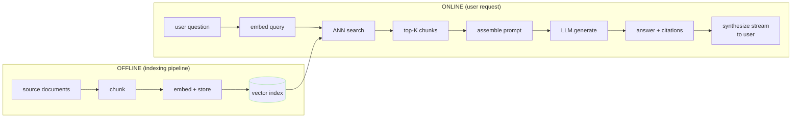
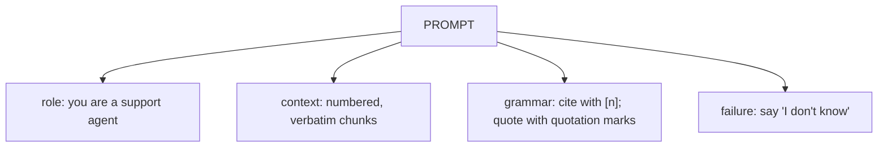
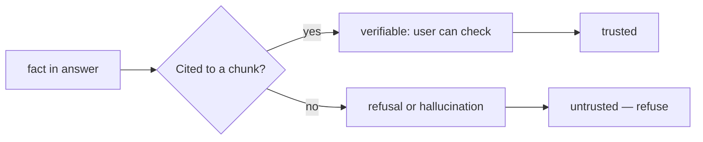
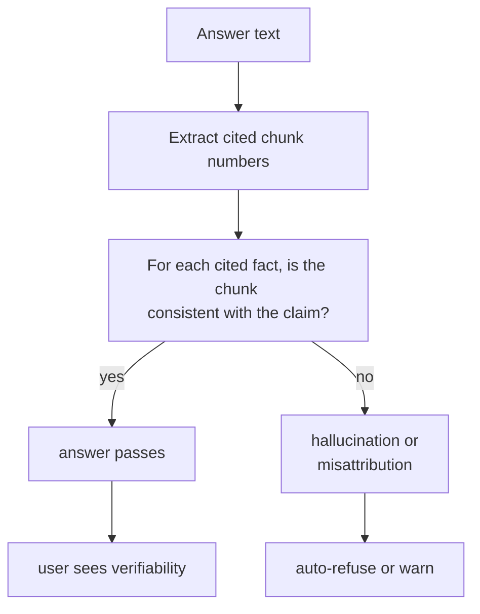
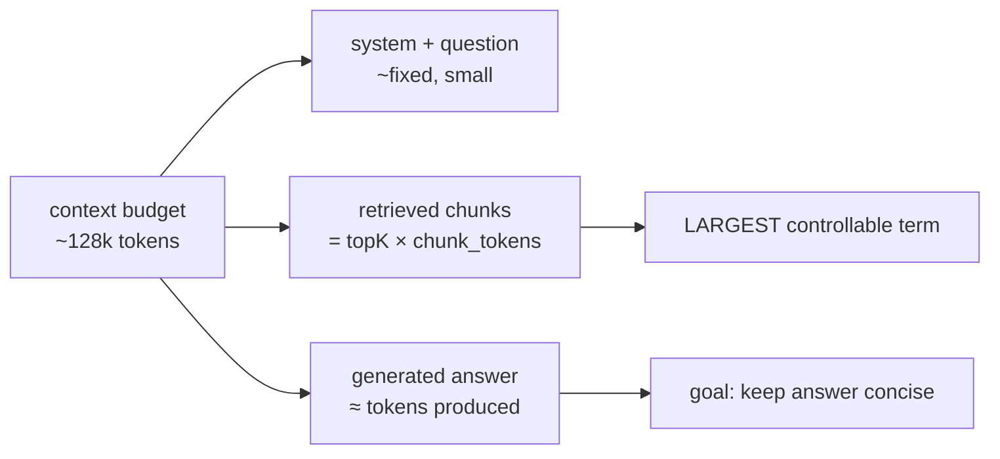
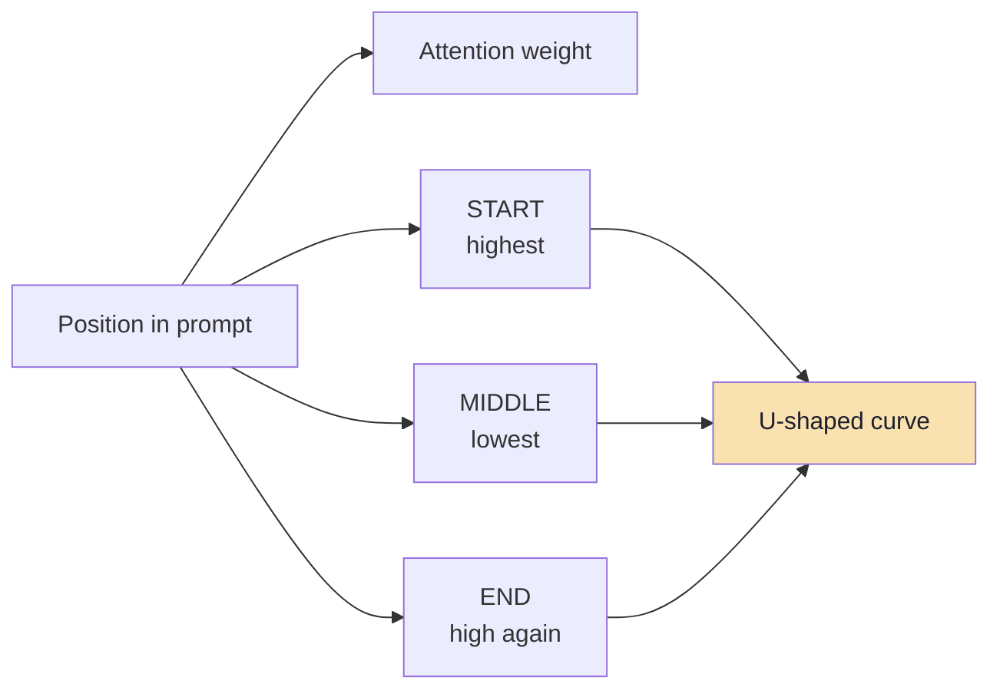
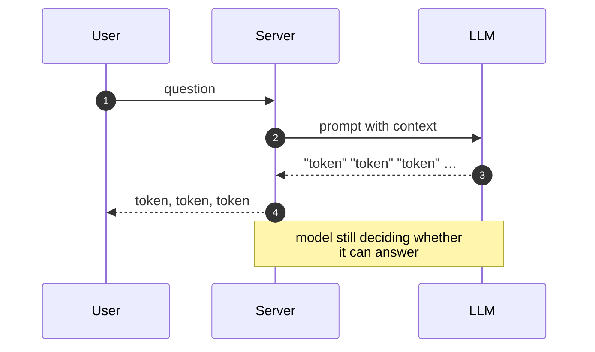
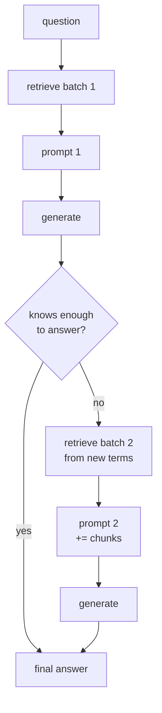
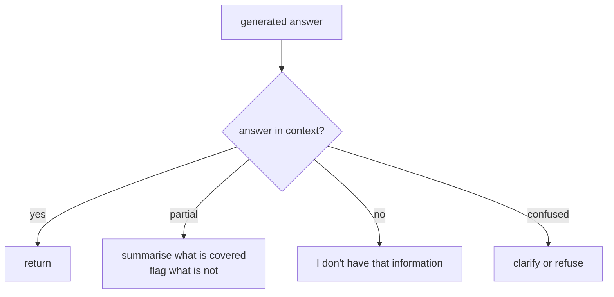
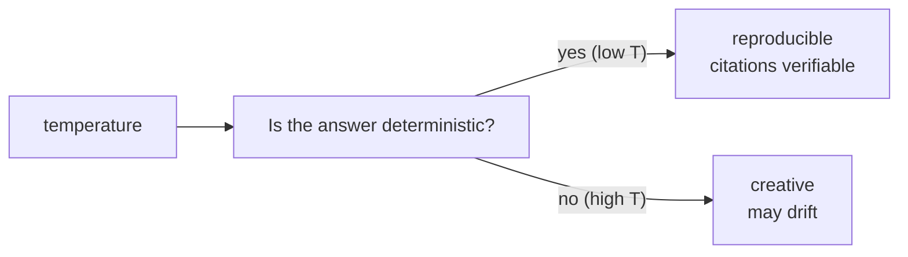

# Chapter 06: Grounded Generation and the Prompt Contract

> **Chapter Goal:** Own the *generation* half of the online path: how to turn retrieved chunks into a prompt that the model can trust, how to ask for citations, how to detect and refuse hallucinated answers, and how to measure and constrain cost. The principle is simple: **the model sees the context, and the user sees the contract.**

> **Grounded generation means: *the answer is either supported by the provided context, or it says so clearly — never the other way around.***

---

## 6.1 The Two-Stage Pipeline, Again

The board draws the open-book architecture with two parallel pipelines. The **indexing** pipeline (Chapter 03) is offline and invisible to the user. The **retrieval-and-generation** pipeline is online and user-facing.



**The join point** is the prompt: at this point the model *must* be able to see every source it is expected to cite. If a chunk is in the index but not in the prompt, the model cannot cite it — and that is fine, as long as the answer says so.

> **The prompt contract:** *If you are asked "where did you get that?" a truthful, verbatim answer must exist in the context you were given.*

---

## 6.2 The Prompt That Does Not Hallucinate

The structure of the prompt is a contract between you (the engineer) and the model. It does three things:

1. **Define the role** (concise, no fluff).
2. **Provide the context** (verbatim chunks with identifiers).
3. **Give an explicit citation grammar** (how to point at a source).
4. **Define the failure mode** (what to do when context is insufficient).



### A template

```text
You are an internal support assistant for Acme Corp.

Answer the user's question using ONLY the context below. If the answer is not in the context, say "I don't have that information" and stop. Do not invent.

When you cite a fact, reference the context chunk in square brackets — for example [3]. Quote exact text only when the wording matters; otherwise paraphrase. Never cite a chunk you did not use.

=== CONTEXT ===
[1] (refund-policy.pdf, page 2, section "Apparel")
Refunds are allowed within 3 days of delivery…

[2] (refund-policy.pdf, page 4, section "Electronics")
Electronics returns must include…

=== QUESTION ===
{question}

=== ANSWER ===
```

### Why each rule exists

| Rule | Defends against |
|---|---|
| "Answer using ONLY the context" | In-context hallucination ("I recall that…") |
| "Say I don't have that information" | Fabricating an answer to save face |
| Square-bracket citations `[n]` | Uncitable, untraceable claims |
| "Never cite a chunk you did not use" | Phantom citations to irrelevant context |

> **Rule:** the prompt must be *explicitly* anti-hallucination, not implicitly polite. "Please be accurate" is noise. "I don't have that information" is an instruction the model can follow.

---

## 6.3 Citations: The Verifiability Layer

A citation is a promise: *this claim came from this chunk.* The prompt defines the grammar; the generation step must honour it.



### Two-level citing

| Level | Form | When to use |
|---|---|---|
| **Reference** `[3]` | Points to a chunk | Default; concise and verifiable |
| **Quotation** `"…"` | Word-for-word text | Critical wording (legal, exact figures) |

```text
Answer: Apparel can be returned within 3 days of delivery [1].
          Electronics require the original packaging [2].
```



> **Post-generation discipline:** every cited number must map back to content in the prompt. A citation to a chunk that was *retrieved but omitted* from the prompt is a bug — either include the chunk or refuse the citation.

### What breaks citations

| Breakage | Cause | Test |
|---|---|---|
| Phantom `[n]` | Model cites a chunk it did not read | Verify every cited n is in the prompt |
| Misattribution `[3]` for content from `[1]` | Index off-by-one or chunk merging | Spot check citations against chunk boundaries |
| "As stated above" with no number | Grammar not enforced | Regex for bare references |
| Quotation marks around paraphrase | Quote flag missing | Compare against chunk text |

> **Automation aid:** a citation checker that re-reads the prompt chunks and confirms each cited fact is substantiated is the cheapest hallucination defence — and it pays for itself immediately.

---

## 6.4 Token Budgeting: The Hard Constraint

Generation cost is dominated by **context size**, and the biggest risk is running up against the model's context window.



| Component | Size | Control lever |
|---|---|---|
| System + question | ~50–200 | Write concise prompts |
| **Retrieved chunks** | `topK × chunkTokens` | **Reduce topK, shorten chunks, compress** |
| Generated answer | 100–2,000 | Instruction: "answer in 2–3 sentences" |

### Worked example

```text
chunk size:     300 tokens
topK:           4
retrieval cost: 4 × 300 = 1,200 tokens
window budget:  128,000 tokens
headroom:       ~126,800 tokens (generous)
```

```text
But if:
  chunk size:    1,000 tokens
  topK:          10
  retrieval:    10,000 tokens  ← still fine

If:
  chunk size:    1,000 tokens
  topK:          50
  retrieval:    50,000 tokens  ← dangerous
```

> **Rule of thumb:** keep retrieved context under 5–15% of the window for headroom. If you need more, invest in **context compression** (summaries) or a smaller topK with better reranking, rather than widening the window.

---

## 6.4.1 The U-Shaped Attention Curve

Context ordering is not cosmetic. Models attend most reliably to the beginning and the end of a long prompt; material buried in the middle is used least often. This is the **U-shaped attention curve**.



```text
┌───────────────────────────────┐
│  START   → high attention     │  ← best chunks here
│  ...                          │
│  MIDDLE  → lowest attention   │  ← important fact here = often missed
│  ...                          │
│  END     → high attention     │  ← and here
└───────────────────────────────┘
```

### Practical consequences for the prompt contract

| Rule | Why |
|---|---|
| **Put the highest-scoring passage first** (or immediately before the question) | It lands in a high-attention zone |
| **Never rely on "it's in there somewhere"** | If the fact is in position 60 of 80, assume it may be ignored |
| **Fewer, better chunks beat many mediocre ones** | Top-K = 4 good chunks usually beats Top-K = 40 |
| **Order deliberately, not by score alone** | Score ≠ position; the most important fact goes first |
| **Long context is not free** | Every extra chunk is money, latency and noise |

Recent independent studies (for example, Chroma's 2025 "Context Rot" report) show accuracy degrading as input length grows even on trivial tasks — the window is a maximum, not a usable budget.

---

### Strategies for tight budgets

| Strategy | When to use |
|---|---|
| Shorter chunks | General default (Chapter 03 sizing) |
| Smaller topK | Default 3–5 into the prompt |
| Rerank to 3–5 | After retrieving 50 |
| Summarize chunks | Long policy sections |
| Query-focused summarization | Extract only the sentences relevant to the question |
| Multi-shot compression | Trim boilerplate at ingestion |

---

## 6.5 Streaming and the User Experience

A RAG answer is usually streamed token-by-token so the user sees it appear. This is good UX, but it has a contract implication: **the refusal to answer happens at the end, after the model has already started emitting plausible text.**



### The streaming problem

If the context is insufficient, a streaming answer *often starts confidently* and only "corrects" itself at the end — by which point the user has read fiction.

| Mitigation | Effect |
|---|---|
| Non-streaming refusal probe | Ask the model first: "Is the answer in the context? Y/N" |
| Post-stream verification | Run the citation checker; if it fails, flag retroactively |
| "Possibly hallucinated" badge | Transparent but costly in trust |
| Lower temperature (0–0.2) | Less divergence, more predictable refusal |
| Structured output (JSON) | Easier to validate citations, but worse UX |

> **Good balance:** stream for UX, but run a lightweight **post-hoc check** (citations valid + answer non-refusal when context suffices) and surface a warning badge when it fails.

---

## 6.6 The Retrieval-Augmented Generation Loop

Some questions need *more than one pass*. The model, seeing the first set of chunks, may realize it needs a different chunk — and the system should listen.



| Name | When it helps |
|---|---|
| **Corrective/RAG** | Model emits a query refinement when it cannot answer |
| **Iterative retrieval** | Follow-up questions that narrow the topic |
| **Tool-calling RAG** | Model calls a `retrieve()` tool with a rephrased query |

> **Warning:** naive iteration re-embeds the *same* question each round and loops forever. The model must emit a *new search query*, and there must be a hard cap on iterations (≤ 3).

---

## 6.7 Guarding the Output

Grounded generation is as much about saying "no" as about answering "yes."



### The four response types

| Response | When |
|---|---|
| **Full answer with citations** | Context fully covers the question |
| **Partial answer + gap** | Some sub-questions covered, others not |
| **Refusal** | Nothing in context; say so |
| **Clarification** | Question is ambiguous |

> **Refuse faster than you answer.** It is always better to return a safe "I don't know" than a plausible lie. This is the single most user-visible design choice in a RAG system.

### Detecting the refusal automatically

```ts
// pseudo-code: classify the generated text
const REFUSAL_PATTERNS = [
  "i don't have that information",
  "i don't know",
  "not in the provided context",
  "i'm not sure",
  "cannot answer",
];

function classify(response: string): "answer" | "refusal" | "partial" {
  if (REFUSAL_PATTERNS.some((p) => response.toLowerCase().includes(p))) {
    return "refusal";
  }
  if (response.includes("however") || response.includes("partial")) {
    return "partial";
  }
  return "answer";
}
```

---

## 6.8 Temperature and Sampling Settings

Generation settings interact with the groundedness contract in two ways.



| Setting | Good for | Risk |
|---|---|---|
| **temperature = 0** | Factual Q&A, support | Repetitive, blunt |
| **temperature = 0.2–0.7** | Conversational tone | May elaborate beyond sources |
| **top_p = 0.95** | Diversity control | Can still drift |
| **presence/frequency penalty** | Avoid repetition | Tension with citation clarity |

> **Default for grounded generation:** `temperature = 0` or `0.2`. Correctness is non-negotiable; personality is secondary. Raise temperature only when the *task* is summarisation, not retrieval-augmented factuality.

---

## 6.9 Logging the Prompt (and Why It Matters)

Every production RAG system must log **the exact prompt that went into the model**, because that is the only thing you can debug against later.

```text
log entry:
  requestId:   "abc-123"
  question:    "What is the refund window for shoes?"
  model:       "gpt-4o-mini"
  prompt:      "You are an internal support..."   // full rendered prompt
  contextIds:  ["chunk-1", "chunk-3"]
  citations:   [1, 3]
  answer:      "Apparel can be returned within 3 days[1]..."
  scores:      { chunk1: 0.88, chunk3: 0.81 }
  latencyMs:   412
  usage:       { promptTokens: 1200, completionTokens: 42 }
```

> **Rule:** log the prompt **verbatim before truncation**. If a chunk was dropped to fit the window, log that fact explicitly — a shortened prompt is an incomplete contract.

---

## 6.10 Pseudo-code: The Generation Function

```ts
// pseudo-code: assemble the prompt, call the model, return a guarded answer

const SYSTEM_PROMPT = `
You are an internal support assistant. Answer using ONLY the context.
If the answer is not in the context, say "I don't have that information."
Cite chunks with [n]. Never cite a chunk you did not use.
`;

function buildPrompt(
  question: string,
  chunks: { id: string; text: string }[],
): string {
  const context = chunks
    .map((c, i) => `[${i + 1}] (${c.id})\n${c.text}`)
    .join("\n\n");

  return [
    SYSTEM_PROMPT,
    "=== CONTEXT ===",
    context,
    "=== QUESTION ===",
    question,
    "=== ANSWER ===",
  ].join("\n");
}

async function answer(
  question: string,
  chunks: { id: string; text: string }[],
  ctx: RequestContext,
): Promise<string> {
  const prompt = buildPrompt(question, chunks);

  ctx.logger.info("generation.start", {
    requestId: ctx.requestId,
    question,
    chunkIds: chunks.map((c) => c.id),
    promptTokens: estimateTokens(prompt),
  });

  const stream = await llm.chat({
    messages: [{ role: "user", content: prompt }],
    temperature: 0.2,
    max_tokens: 512,
    stream: true,
  });

  let full = "";
  for await (const delta of stream) {
    full += delta;
    yield delta; // stream to user
  }

  const classified = classify(full);
  if (classified === "refusal") {
    ctx.logger.warn("generation.refused", { question });
  } else if (!verifyCitations(full, chunks)) {
    ctx.logger.warn("generation.hallucinated", { question });
    // surface a trust flag to the user without discarding the answer
  }

  yield `[DONE]` as const;
}
```

---

## 6.11 Common Mistakes

| Mistake | Fix |
|---|---|
| No explicit refusal instruction | Add "say I don't have that information" |
| No citation grammar | Define and enforce `[n]` format |
| Chunks in prompt but not cited | Citation checker post-generation |
| topK too large for the window | Compress or reduce chunks |
| Streaming starts confidently then backtracks | Refusal probe or post-check |
| No prompt logging | Log the full rendered prompt |
| High temperature on factual QA | Use 0–0.2 |
| Model sees sources it cannot cite | Keep prompt context == cited sources |
| "Please be accurate" instruction | Replace with concrete, testable rules |
| Citations to omitted chunks | Verify cited indices exist in prompt |

---

## 6.12 Chapter Summary

| Concern | Contract |
|---|---|
| **Purpose** | Answer from context or refuse |
| **Prompt shape** | Role + context + grammar + failure mode |
| **Citations** | Verifiable `[n]` references; quote only when exact |
| **Budget** | Keep context < 15% of window; compress over widen |
| **Streaming** | Acceptable, with post-hoc verification |
| **Iterations** | Allowed only if the model proposes a new query |
| **Temperature** | 0–0.2 for factuality |
| **Logging** | Full prompt + usage + latency, every request |
| **Guardrails** | Refuse fast; verify citations; flag hallucination |

> **Final mental model:** generation is the *accountable* stage. Retrieval is the quiet librarian; generation is the spokesperson who says, *"according to these three documents…"* and, when the documents are silent, *"I don't have that information."* The prompt is the contract that makes that accountability enforceable.

---