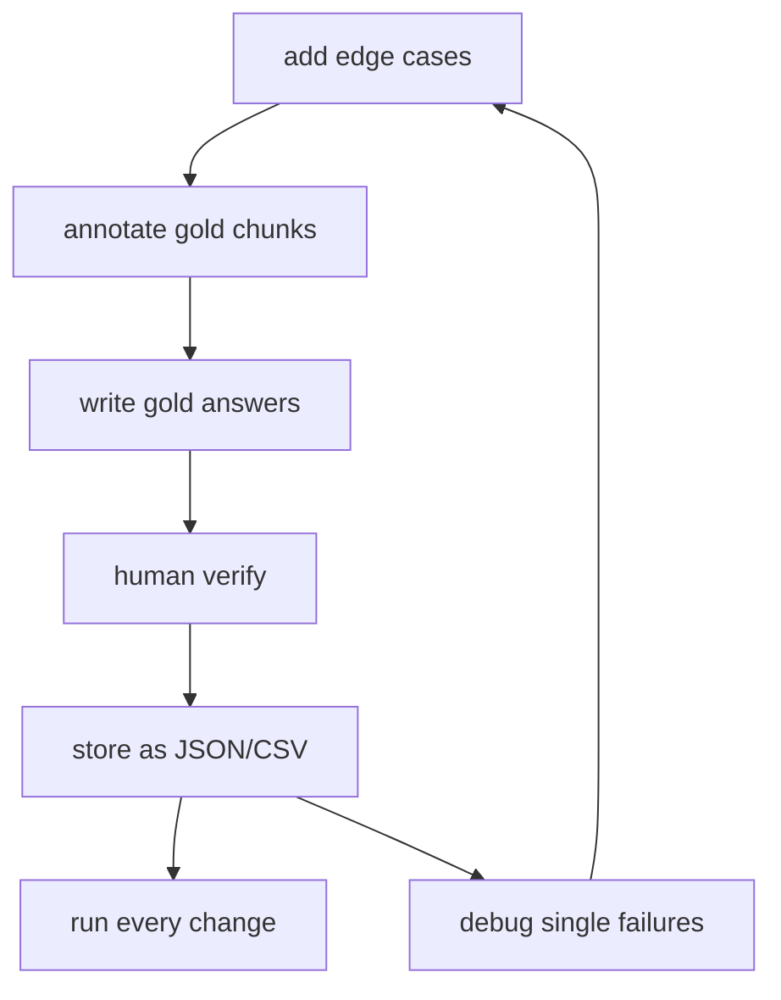
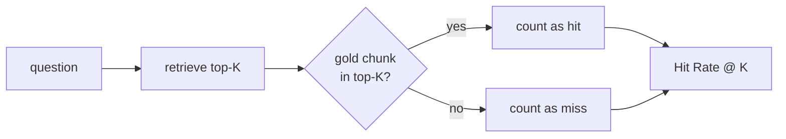
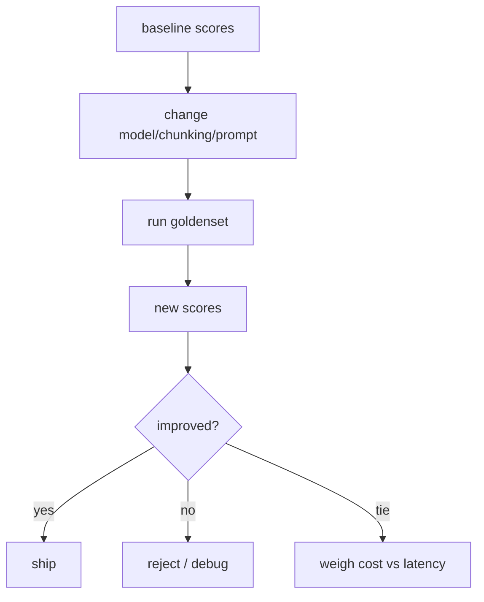
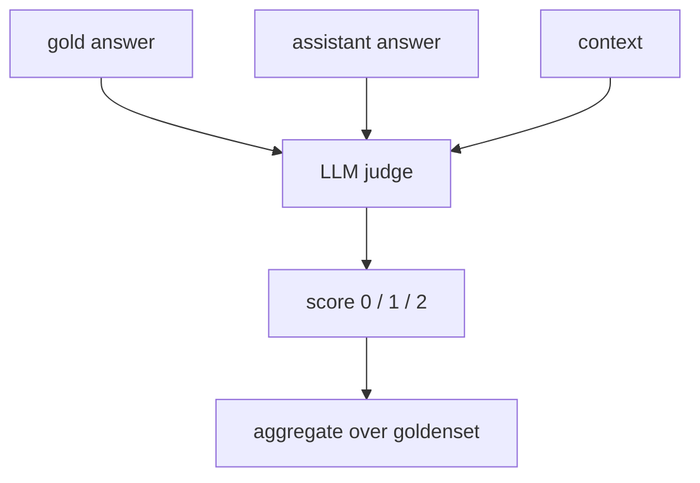
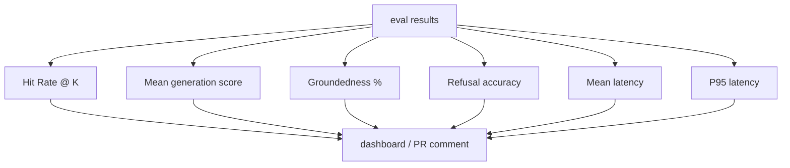
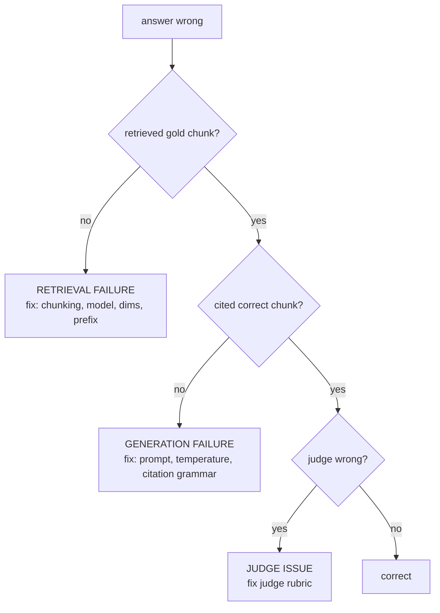
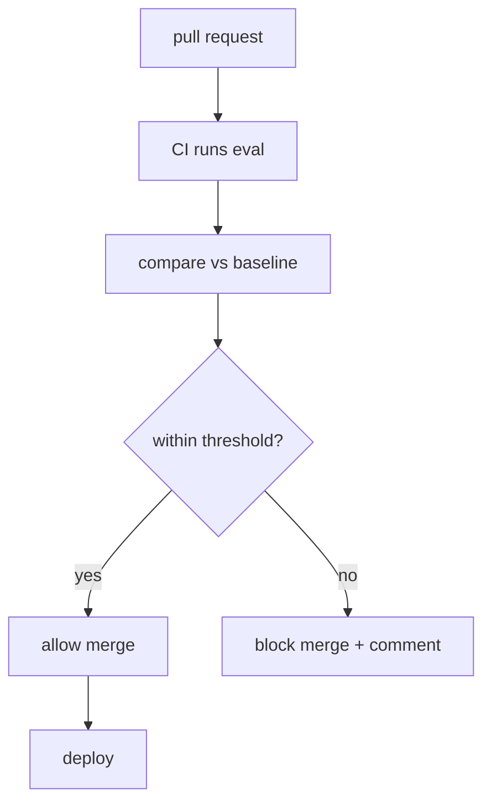
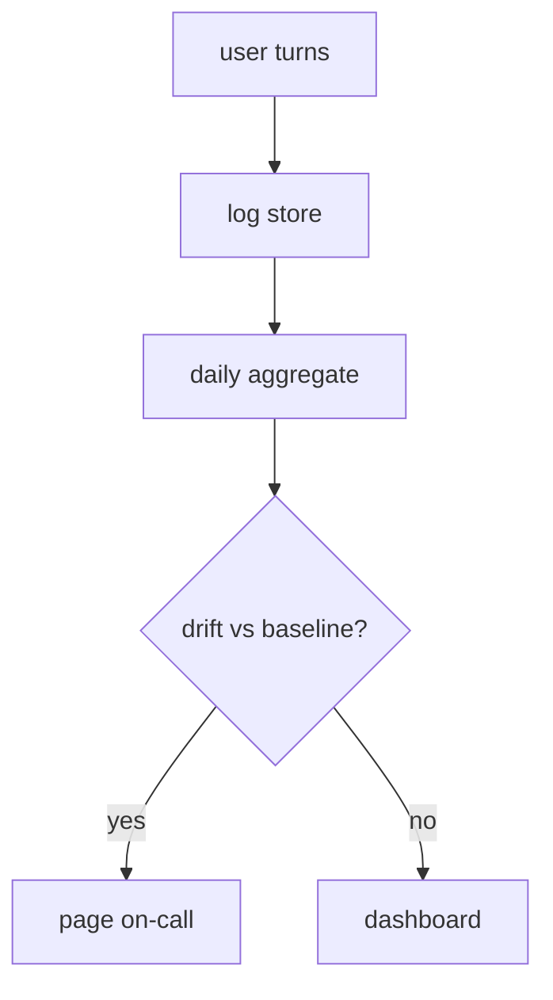

# Chapter 08: Evaluation and Debugging

> **Chapter Goal:** Stop shipping RAG by vibes. You will build a goldenset, measure retrieval and generation separately, catch regressions in CI, and have a reproducible way to diagnose every "the answer was wrong" report. This chapter draws directly on FDE L11 Chapter 08 ("Measurements") and Chapter 09 ("Hooking into CI/CD / Production deployment").

> **Core principle: *if you cannot measure it, you cannot fix it — and if you measure it wrong, you will fix the wrong thing.***

---

## 8.1 Why Evaluation Is Separate from Testing

Software tests check that code runs. RAG evaluation checks that answers are correct.

| Question | Software test | RAG evaluation |
|---|---|---|
| Does the endpoint return 200? | ✓ | ✓ |
| Is the retrieved chunk the right one? | ✗ | ✓ |
| Is the answer grounded? | ✗ | ✓ |
| Is the answer helpful? | ✗ | ✓ |
| Did model choice change results? | ✗ | ✓ |

A system that passes all unit tests can still answer every question wrongly. Evaluation is the *correctness layer* above testing.

---

## 8.2 The Goldenset: Your Source of Truth

A goldenset is a collection of real-world question → gold chunk pairs, with human-graded answers. It is your north star.

### Structure of one row

| Field | Example |
|---|---|
| question | "What is the refund policy for shoes?" |
| goldChunkIds | ["chunk-44", "chunk-45"] |
| goldAnswer | "Apparel refunds within 3 days; shoes follow same policy." |
| sourceDoc | "refund-policy.pdf" |
| page | 4 |
| difficulty | easy |

### How to build one



1. **Collect 30–100 real questions** from support tickets, user logs, or the product team. Real questions beat hypothetical ones.
2. **Annotate gold chunk(s)** — which chunk(s) contain the answer. Use the original documents; do not trust the current index.
3. **Write gold answers** — one per question, ideally with citations.
4. **Human verify** — a second person checks each row.
5. **Store** — JSONL or CSV in version control alongside your code.
6. **Grow it** — every incorrect answer report becomes a new goldenset row.

> **Starting small beats being comprehensive.** 40 well-chosen questions are more useful than 400 synthetic ones.

---

## 8.3 Metrics: Retrieval vs Generation

Measure retrieval **and** generation separately. A bad generation can hide great retrieval, and vice versa.

### Retrieval metrics

| Metric | Meaning | Good target |
|---|---|---|
| **Hit Rate @ K** | % of questions where at least one gold chunk appears in top-K | ≥ 0.8 at K=10 |
| **Recall @ K** | % of gold chunks recovered in top-K | ≥ 0.7 at K=5 |
| **MRR** | Reciprocal rank of first correct chunk | Higher is better |



### Generation metrics

| Metric | Meaning | Measurement |
|---|---|---|
| **Answer correctness** | Does the gold answer appear (with citations)? | LLM-as-judge or exact match |
| **Groundedness** | Every claim supported by context | Citation checker + LLM judge |
| **Refusal accuracy** | Refused when context insufficient | Human or LLM judge |
| **Hallucination rate** | Answers with unsupported claims | Post-hoc citation verification |

> **Hit Rate is your primary retrieval metric.** It is simple, interpretable, and directly actionable. Recall tells you how much you miss; Hit Rate tells you whether the answer exists in your candidates.

### Combined end-to-end

| Metric | What it tells you |
|---|---|
| End-to-end correctness | Does the user get a right answer? |
| Latency per turn | Is it fast enough? |
| Cost per turn | Is it cheap enough? |
| Refusal rate | Is it too conservative? |

---

## 8.4 The Evaluation Loop

Run evaluation on every change. Goldenset → retrieve → generate → score → compare to baseline.



### The regression trap

Changing *one* thing changes everything downstream.

| Change | Direct effect | Ripple |
|---|---|---|
| Smaller chunks | More chunks, finer granularity | Retrieval scores shift; prompt budget changes |
| New embedding model | Entire index re-computed | All retrieval results change |
| New topK | More context | Generation cost and quality shift |
| New system prompt | Generation style changes | Citations may appear/disappear |

**Rule:** never change more than one variable per evaluation run, and always compare against a stored baseline.

---

## 8.5 Writing Goldenset Rows

Bad goldensets produce false confidence. Follow these rules.

| Do | Don't |
|---|---|
| Use real user questions | Ask your own hypotheticals |
| One gold chunk per question (usually) | Annotate chunks you retrieved |
| Store the question exactly as asked | Paraphrase "for cleanliness" |
| Include refusal cases (answerable vs not) | Only test questions you know are answerable |
| Tag difficulty (easy / medium / hard) | Treat all rows as equal |
| Version control the file | Keep it only in a spreadsheet |

### Example row

```json
{
  "id": "gs-001",
  "question": "Can I return shoes after wearing them once?",
  "goldChunkIds": ["chunk-44", "chunk-45"],
  "goldAnswer": "Yes, shoes can be returned within 3 days if unworn…",
  "sourceDoc": "refund-policy.pdf",
  "page": 4,
  "difficulty": "medium",
  "expectedRefusal": false
}
```

### Example refusal row

```json
{
  "id": "gs-017",
  "question": "Do you ship to Antarctica?",
  "goldChunkIds": [],
  "goldAnswer": "I don't have that information.",
  "sourceDoc": null,
  "difficulty": "easy",
  "expectedRefusal": true
}
```

> **Refusal rows are as important as answer rows.** They test that your system knows what it doesn't know.

---

## 8.6 LLM-as-a-Judge

For generation quality, exact string matching is brittle. Use an LLM judge with a strict rubric.

### Judge prompt (pseudo-code)

```ts
const JUDGE_PROMPT = `
You are a strict evaluator. Score the assistant's answer against the gold answer using only the provided context.

Scoring:
- 2 = correct, fully grounded in context, cites sources
- 1 = partially correct or missing citations
- 0 = wrong, hallucinated, or refuses when answerable

Context:
{{context}}

Gold answer:
{{goldAnswer}}

Assistant answer:
{{assistantAnswer}}

Output ONLY a JSON object: {"score": 0|1|2, "reason": "..."}
`;
```



### Judge hygiene

| Rule | Why |
|---|---|
| One judge prompt, version-controlled | Reproducible scores |
| Judge does not see other model outputs | No bias |
| Human audit a sample | Catch judge drift |
| Record judge model + temperature | Traceability |

> **LLM-as-judge is a proxy, not truth.** Correlate judge scores with human scores regularly. A judge that always gives 2 is useless.

---

## 8.7 Evaluation Harness: Pseudo-code

```ts
// pseudo-code: the full evaluation run

type GoldRow = {
  id: string;
  question: string;
  goldChunkIds: string[];
  goldAnswer: string;
  expectedRefusal: boolean;
};

type EvalResult = {
  rowId: string;
  retrievedIds: string[];
  hitRate: number;        // goldChunkIds ⊆ retrievedIds ? 1 : 0 (or overlap ratio)
  generationScore: number; // 0 / 1 / 2 from LLM judge
  grounded: boolean;       // citation checker passed
  refusalCorrect: boolean; // expectedRefusal matched
  latencyMs: number;
};

async function runEvaluation(
  rows: GoldRow[],
  opts: { k: number; judge: boolean },
): Promise<EvalResult[]> {
  const results: EvalResult[] = [];

  for (const row of rows) {
    const start = Date.now();

    const matches = await retrieve(row.question, { topK: opts.k });
    const retrievedIds = matches.map((m) => m.id);

    const hit = row.goldChunkIds.some((id) => retrievedIds.includes(id));

    let generationScore = 0;
    let grounded = false;

    if (!opts.judge) {
      const answer = await generate(row.question, matches);
      const judgeRes = await llmJudge(row.goldAnswer, answer, matches);
      generationScore = judgeRes.score;
      grounded = verifyCitations(answer, matches);
    }

    results.push({
      rowId: row.id,
      retrievedIds,
      hitRate: hit ? 1 : 0,
      generationScore,
      grounded,
      refusalCorrect: checkRefusalCorrectness(row, matches, generationScore),
      latencyMs: Date.now() - start,
    });
  }

  return results;
}
```

### Aggregate report



| Aggregate | What it means |
|---|---|
| Hit Rate @ 5 | Retrieval reliability |
| Mean score | Generation correctness |
| Groundedness % | Citation discipline |
| Refusal accuracy | Knowing when to say no |

---

## 8.8 Debugging a Single Failure

When one question fails, trace through the pipeline step by step. Each stage has a clear failure mode.



### Diagnostic checklist per stage

| Stage | Check |
|---|---|
| Retrieval | Was the gold chunk in top-K? If not, try topK=50. Still missing → chunking/model issue. |
| Ranking | Was it retrieved but ranked below noise? → reranker, dedupe, metadata filters. |
| Prompt | Was the chunk in the prompt? If dropped → budget issue. |
| Generation | Did the model cite it correctly? → prompt grammar, temperature. |
| Judge | Did the judge score fairly? → audit judge on this row. |

> **The fastest way to debug is to print the full prompt and all retrieved chunks.** Most "model is broken" bugs are actually "wrong chunk in the prompt" bugs.

---

## 8.9 Hooking Evaluation into CI/CD

Evaluation belongs in CI, not just a local notebook. Every PR that touches retrieval or generation must show scores.



### CI configuration (pseudo-code)

```yaml
# pseudo-code: CI step
- name: Run RAG evaluation
  run: |
    npm run eval -- --goldenset notes/goldenset.jsonl --baseline scores/baseline.json
    npm run eval:compare -- --max-hit-drop 0.02 --max-score-drop 0.05
```

### Regression thresholds

| Metric | Allowed drop | Action |
|---|---|---|
| Hit Rate @ 5 | 0.02 (2 points) | Block PR |
| Mean generation score | 0.05 | Block PR |
| Groundedness | 0.03 | Block PR |
| Mean latency | +50 ms | Warning only |

> **Always store a baseline** (`scores/baseline.json`) from the last shipped version. CI compares against it, not against an abstract ideal.

### Baseline storage

```json
{
  "commit": "a1b2c3d",
  "hitRate@5": 0.86,
  "meanScore": 1.74,
  "groundedness": 0.91,
  "refusalAccuracy": 0.98,
  "meanLatencyMs": 412
}
```

---

## 8.10 Production Monitoring and Alerts

Evaluation continues after deploy. Log every turn and alert on drift.



### What to log per turn

| Field | Why |
|---|---|
| question | Reproduce failures |
| retrievedChunkIds | Audit retrieval |
| citations | Verify groundedness |
| generation score (if judge runs) | Production quality |
| latency | SLO tracking |
| cost | Budget tracking |
| sessionId | Multi-turn debugging |

### Alert conditions

| Condition | Severity |
|---|---|
| Hit Rate @ 5 drops > 5% over 24h | Critical |
| Refusal rate spikes > 10% | Critical |
| Latency P95 > 2s | Warning |
| Cost per 1k turns > budget | Warning |

> **Logs are your production goldenset.** Every user question is a potential goldenset row — review a sample weekly and add real failures to the goldenset.

---

## 8.11 Common Mistakes

| Mistake | Fix |
|---|---|
| No goldenset | Start with 30 real questions |
| Only measuring generation | Measure retrieval separately |
| Synthetic questions only | Mix real + synthetic |
| No refusal test rows | Add rows where answer is not in corpus |
| Changing 3 variables at once | One variable per eval run |
| No CI gate | Evaluate on every PR |
| No baseline | Store baseline.json from last ship |
| Trusting judge blindly | Human audit 10% of judge scores |
| Not logging production turns | You cannot debug what you do not record |
| Goldenset not version-controlled | Store with code; review changes |

---

## 8.12 Chapter Summary

| Layer | Decision | Default |
|---|---|---|
| **Goldenset** | 30–100 real Q→chunk rows | JSONL, version-controlled |
| **Primary metric** | Hit Rate @ K | K = 5 |
| **Generation metric** | LLM-as-judge 0/1/2 | Strict rubric |
| **Refusal testing** | Rows with expected refusal | Mandatory |
| **CI gate** | Block on score drop | Hit Rate -2 pts, Score -0.05 |
| **Baseline** | scores/baseline.json | Commit-tagged |
| **Production logging** | Every turn, chunk IDs, citations | Alert on drift |
| **Debug** | Print prompt + retrieved chunks | Stage-by-stage trace |

> **Final mental model:** evaluation is not a final check — it is the *engine* of improvement. Every change is measured against the goldenset; every failure becomes a new row; every deploy is gated by scores. Without this loop, you are guessing with extra steps.

---