# Chapter 09: Production System Design

> **Chapter Goal:** Assemble the whole system for real use. How the pieces fit, how traffic reaches them, how you deploy and roll back, how you stay up, how you do not leak data, and how you keep improving with user feedback. This chapter closes the loop from "RAG works locally" to "RAG runs in production."

> **Core principle: *correctness is a system property, not a model property.*** The embedding model does not know about tenants; the index does not know about auth; the prompt does not know about token budgets. Correctness emerges from the integration of all chapters.

---

## 9.1 The Four Layers

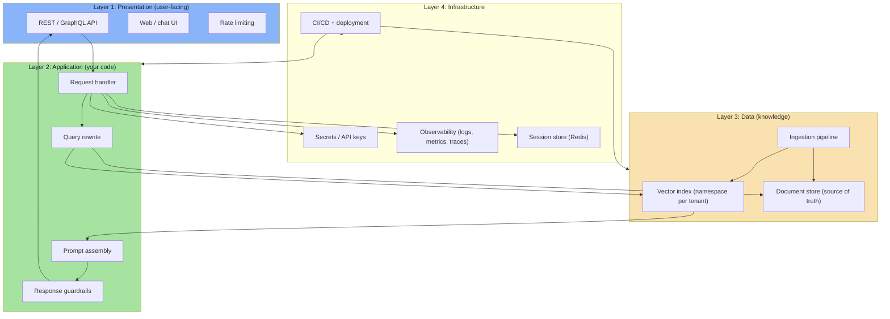

| Layer | Owner | Failure mode |
|---|---|---|
| Presentation | Frontend + Gateway | DDoS, auth bypass |
| Application | Backend engineer | Logic bugs, token overflow |
| Data | ML / Data engineer | Stale docs, missing chunks |
| Infrastructure | DevOps | Secrets leak, no observability |

Each layer has a distinct failure mode, and most production incidents cross layer boundaries silently.

---

## 9.2 The Online Path: Request Flow

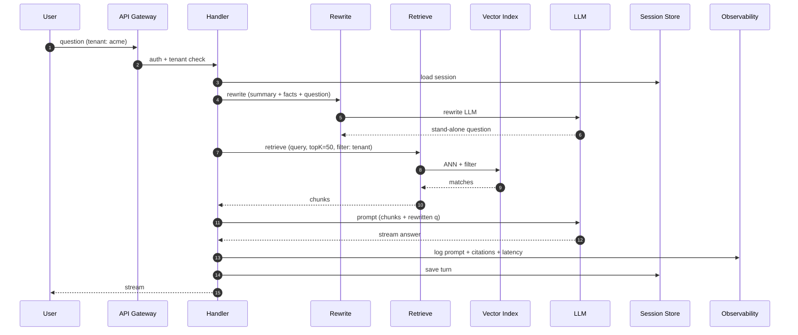

### Latency budget

| Stage | Target | Risk |
|---|---|---|
| Auth + session load | 5 ms | Redis hit |
| Query rewrite | 50–200 ms | LLM latency |
| Embedding query | 50–200 ms | API latency |
| Vector search | 10–50 ms | Index size, topK |
| Generation | 100–1000 ms | Output length, model speed |
| Logging + save | 5 ms | DB write |

> **Target: P95 under 2 seconds.** If rewrite alone is 500 ms, the whole experience feels broken. Measure each stage independently.

---

## 9.3 Tenancy and Security

Multi-tenancy is not optional. One request touching another tenant's data is a breach.

### Defence in depth

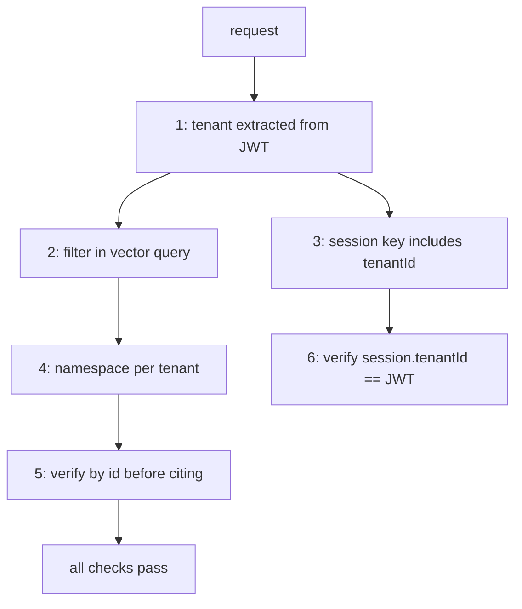

| Layer | Mechanism |
|---|---|
| Query | Vector query includes `tenantId` filter |
| Index | Namespace per tenant (or hybrid: namespace + filter) |
| Prompt | Never include chunks from the wrong tenant |
| Session | Session key = `session:{tenantId}:{sessionId}` |
| Citations | Verify cited chunk's tenant matches request |

> **The filter must live in the vector query itself.** Filtering *after* retrieval means the chunks entered your process and your prompt — even if they are later discarded.

---

## 9.4 Deployment and Rollout

Production RAG is a **service**, not a script. It has environments, releases, and rollbacks.

### Environments

| Environment | Purpose | Isolation |
|---|---|---|
| dev | Experiment, local testing | Shared index, loose auth |
| staging | Pre-prod validation | Dedicated tenant, real data copy |
| prod | Live traffic | Full isolation, full auth |

### Blue/green for index changes

When you change the embedding model or chunking, you cannot "update in place" — you need a new index.

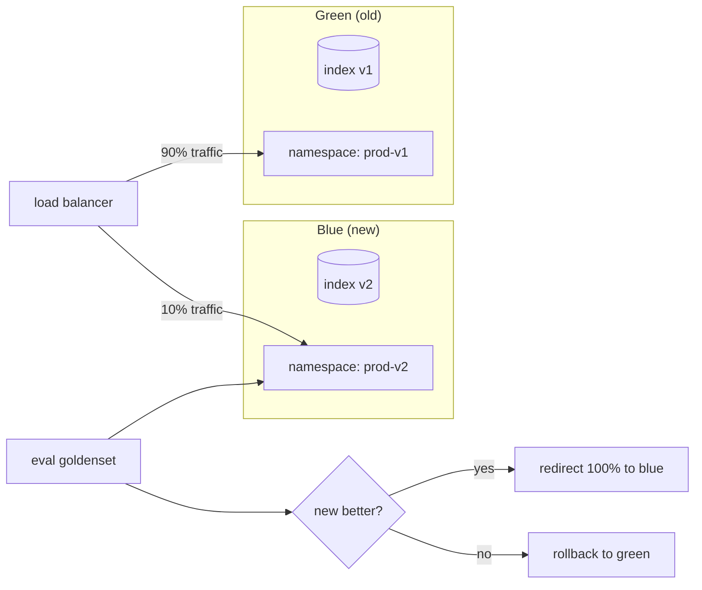

| Operation | Risk |
|---|---|
| Re-embed all docs | Cost + downtime |
| Switch model | Entire retrieval result shift |
| Change prompt | Generation quality shift |
| Change namespace | Traffic routing mistake → 100% error |

> **Always shadow traffic** to the new index: send real queries to both, compare results, before cutting over.

---

## 9.5 Caching and Latency Reduction

The cheapest millisecond is the one you never spend.

### Cache tiers

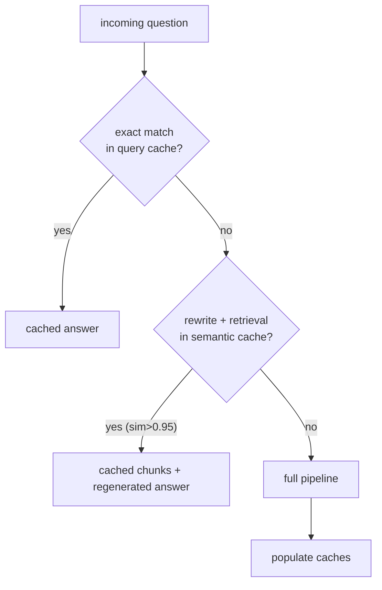

| Cache | Key | TTL | Risk |
|---|---|---|---|
| Exact query | sha256(question + tenant) | 1 day | Misses typos/paraphrases |
| Semantic | vector-similarity to cached queries | 1 hour | Stale answers if corpus changes |
| Prompt prefix | system + few-shot | provider-level | Prompt drift |
| Session | sessionId | until expiry | No staleness |

```ts
// pseudo-code: cache key includes model + namespace to prevent cross-contamination
const cacheKey = sha256({
  question,
  tenantId,
  model: EMBED_MODEL,
  namespace: VECTOR_NAMESPACE,
  corpusVersion: CORPUS_HASH,
});
```

> **The cache key must include the model and namespace.** A cached answer from the wrong index is a correctness bug.

### CDN for static responses

Some answers (FAQ, policy) change rarely and repeat often. Serve cached full responses behind a CDN for the hottest queries, but only when the corpus has not changed.

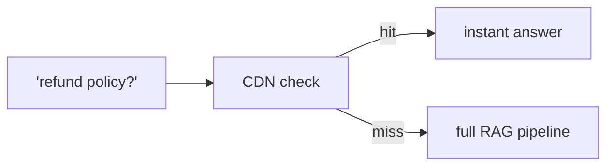

---

## 9.6 Observability: Knowing What Breaks

> **You cannot fix what you cannot see.** Production RAG has three visibility requirements: logs (debug), metrics (alert), traces (latency).

### Logging (Chapter 06 + 08)

Log the full prompt and output on **every** request in staging, and on a **sample** (1%) in production for compliance.

```json
{
  "requestId": "req_abc123",
  "tenantId": "acme",
  "question": "refund for shoes?",
  "rewrittenQuestion": "What is the refund policy for shoes?",
  "retrievedChunkIds": ["chunk-44", "chunk-45", "chunk-46"],
  "scores": [0.88, 0.81, 0.76],
  "citationCheck": "PASS",
  "classified": "answer",
  "promptTokens": 1350,
  "completionTokens": 42,
  "latencyMs": 412,
  "model": "gpt-4o-mini"
}
```

### Metrics (Chapter 08)

| Metric | Alert threshold |
|---|---|
| Hit Rate @ 5 (24h) | < 0.80 → page |
| Mean generation score | < 1.5 → warning |
| Request latency P95 | > 2000 ms → page |
| Error rate | > 1% → page |
| Cost per 1000 turns | > budget → warning |

### Traces

Trace spans must cover each RAG stage:

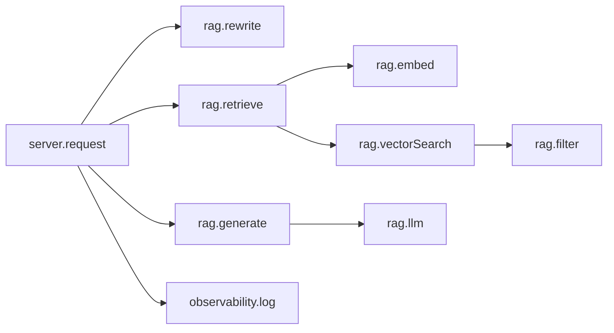

> **If a user reports "the answer was wrong," you must be able to replay their exact prompt and retrieved chunks.** This is non-negotiable for support systems.

---

## 9.7 Failure Recovery and Circuit Breakers

### Vector index down

```tsmaid
flowchart TD
    Q["query"] --> C{"index healthy?"}
    C -- "no" --> FB["fallback to BM25 only"]
    FB --> G1["generate from keyword results"]
    C -- "yes" --> IDX["vector search"]
    IDX --> G2["generate"]
```

If the vector index is unavailable, fall back to keyword/BM25 retrieval. Degrade gracefully rather than 500.

### LLM API down / rate limited

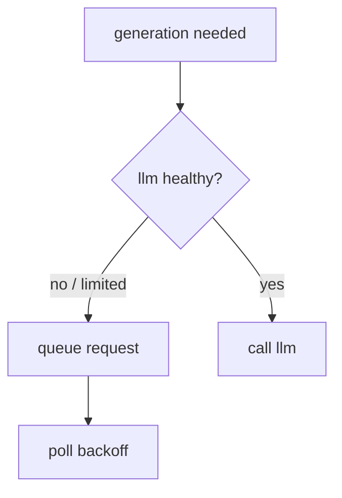

| Failure | Response |
|---|---|
| Index unavailable | BM25 fallback; inform user of degraded quality |
| LLM rate-limited | Queue + backpressure + user-facing "still working…" |
| LLM unavailable | Return "I'm temporarily unavailable" (not a hallucination) |
| Embedding service down | Cache recent query vectors; fail closed (refuse) |
| Session store down | Stateless fallback (no history); warn about limited context |

> **Never return a hallucinated answer as a "fallback."** If you cannot answer truthfully, refuse truthfully.

---

## 9.8 Cost Management

RAG cost is dominated by the **generation** call, not the embedding call — but it scales with users and context size.

### Cost breakdown (illustrative)

| Component | Unit cost | Driver |
|---|---|---|
| Embedding query | ~$0.0000004 / question | Negligible |
| Generation (GPT-4o-mini) | ~$0.15 / 1M input tokens | Context size × output length |
| Session storage (Redis) | ~$0.01 / 1000 active sessions | Negligible |
| Vector index (managed) | $50–500 / month | Chunks × dimensions |
| Observability logging | ~$0.001 / 1000 logs | Volume |

### Cost-containment rules

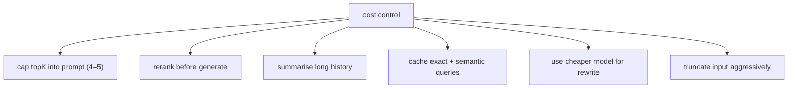

| Rule | Saves |
|---|---|
| Prompt ≤ 2,000 tokens (chunks + history) | Generation input cost |
| Rewrite with cheaper model | 30–50% of rewrite cost |
| Cache top 20% repeat questions | 20% of generation cost |
| Rerank 50→5 before prompting | Keeps prompt small |
| Short answers (max_tokens ≤ 200) | Output token cost |

> **Measure cost per turn and cost per correct answer.** If you reduce cost but also reduce Hit Rate, you have not saved money — you have shifted the cost to bad answers.

---

## 9.9 Feedback Loop: Closing the Gap

The last stage of any production system is learning from it.

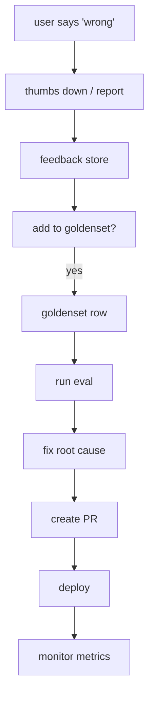

### Feedback types

| Type | Action |
|---|---|
| "Wrong answer" | Add as goldenset row; find retrieval or generation bug |
| "Too slow" | Reduce topK; check tracing spans |
| "Too expensive" | Enable caching; shorten prompt |
| "Hallucinated citation" | Strengthen citation grammar; add post-check |
| "Refused when answerable" | Lower refusal threshold; check chunking |

### The feedback-to-goldenset rule

> **Every "this was wrong" report that is reproducible must become a goldenset row.** Without this, the same bug returns forever.

```ts
// pseudo-code: feedback handler
async function handleFeedback(report: FeedbackReport): Promise<void> {
  if (!(await isRepro(report))) {
    logger.warn("non-reproducible feedback ignored", { report });
    return;
  }

  const goldRow: GoldRow = {
    id: `fb-${report.requestId}`,
    question: report.originalQuestion,
    goldChunkIds: report.correctChunkIds ?? [],
    goldAnswer: report.correctAnswer,
    difficulty: "hard",           // user-flagged = usually hard
    expectedRefusal: report.expectedRefusal ?? false,
  };

  await goldenset.add(goldRow);
  await triggerEval();
}
```

---

## 9.10 The Four Escapes (Systematic Failure Handling)

Every RAG system must answer four escape questions — and have code for each.

| Escape | Question | System response |
|---|---|---|
| **No context** | "Is the answer in the context?" | Refuse: "I don't have that information" |
| **Wrong context** | "Did retrieval fail?" | Log + escalate to human for review |
| **Model confused** | "Did generation fail?" | Regenerate with lower temp / explicit instruction |
| **System overloaded** | "Can the system serve this?" | Return 429 / 503 with honest message |

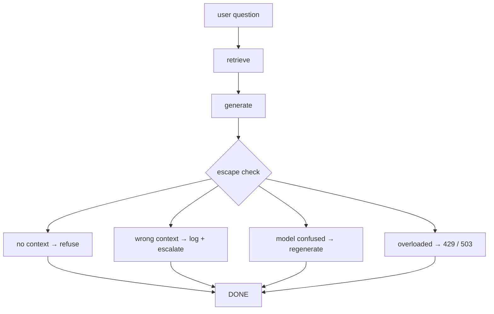

> **Each escape must be explicit in code**, not left to the model to "figure out."

---

## 9.11 Common Mistakes

| Mistake | Fix |
|---|---|
| No tenant isolation | Namespace + filter + verify by id |
| No CI evaluation | Eval on every PR with baseline check |
| No production logging | Log full prompt + output on sample |
| No circuit breaker | BM25 fallback; refuse on LLM down |
| No cost control | Cap topK, prompt, output tokens |
| No feedback loop | Every bug report → goldenset row |
| No blue/green for index | Shadow traffic before cutover |
| No observability | Spans per stage; alert on drift |
| Caching across models | Include model + namespace in cache key |
| Treating RAG as a script | Build it as a service with envs + rollbacks |

---

## 9.12 Chapter Summary

| Concern | Rule |
|---|---|
| **Architecture** | Four layers: presentation, application, data, infrastructure |
| **Security** | Tenant in query filter, namespace, session key, citation check |
| **Deployment** | Blue/green for index changes; shadow traffic; staging env |
| **Caching** | Exact + semantic + CDN; keys include model and namespace |
| **Observability** | Logs (debug), metrics (alert), traces (latency) per stage |
| **Reliability** | BM25 fallback; backpressure; honest 503 on overload |
| **Cost** | Cap topK, prompt, output; cache hot queries; cheaper rewrite |
| **Feedback** | Every reproducible bug → goldenset row → eval → fix |
| **Escapes** | Four explicit escapes: refuse, escalate, regenerate, degrade |

> **Final mental model:** production RAG is a **distributed system of contracts**. The embedding contract (same space), the index contract (filter by tenant), the prompt contract (cite only what you used), and the operational contract (log everything, alert on drift). When all contracts hold, the system is trustworthy. When one breaks silently, it is not.

---