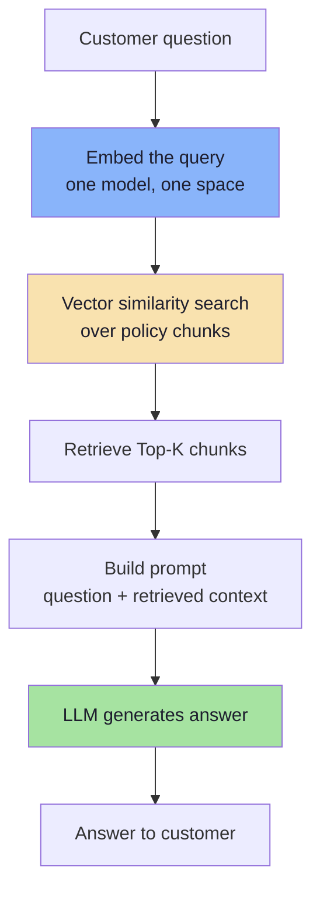
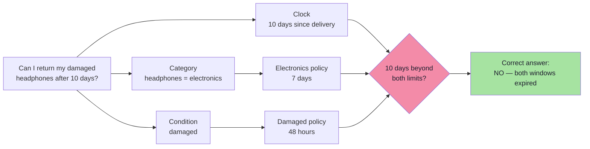
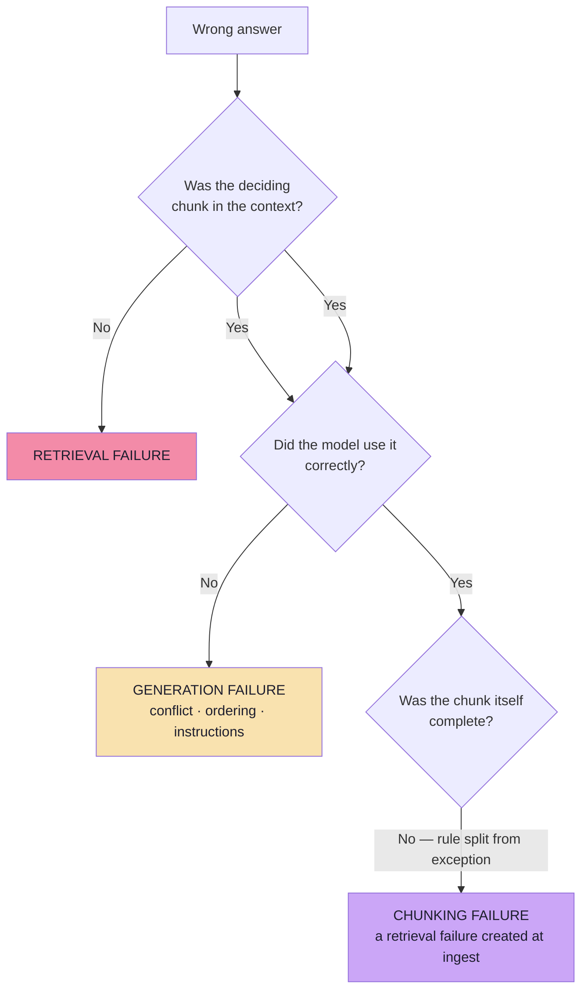
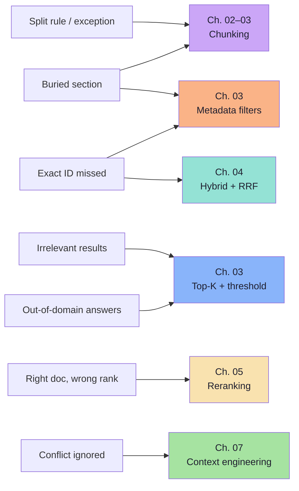
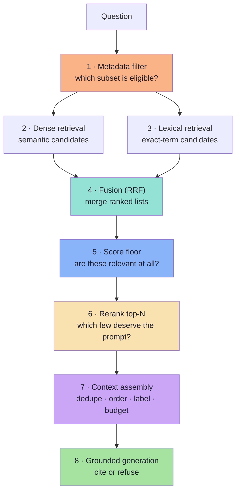
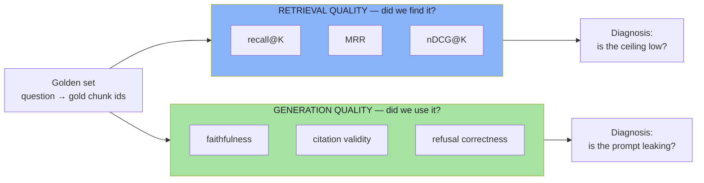
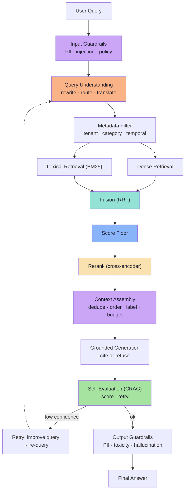

# Chapter 01: Why Basic RAG Breaks — The Two Failure Classes

> **Chapter Goal:** Establish the vocabulary the rest of the lecture depends on. Basic RAG is not *wrong*; it is **under-specified**. It makes one heroic assumption — *the retrieved chunks contain everything needed to answer correctly* — and every technique in this lecture exists to defend or repair that assumption in a specific, measurable place.
> 
> At the end of this chapter you should be able to answer: *when this system gives a wrong answer, is the fault in retrieval or in generation — and how would I prove which?*

---

## 1.1 The Single Assumption Basic RAG Relies On

A customer opens an e-commerce support chatbot and asks:

> "What is your return policy?"

A general-purpose LLM does not know the company's internal policy. It was trained on the public internet, frozen months ago, and has never seen this retailer's operations manual. In a **basic Retrieval-Augmented Generation (RAG)** application we do not fine-tune that knowledge into the weights. We look it up at answer time.



This works surprisingly well for simple questions. The whole design rests on a single assumption:

> **Assumption A:** *the chunks returned by the vector search contain every fact the correct answer requires.*

Assumption A has two halves, and they fail independently:

1. **Coverage** — the scoring facts must physically exist in the corpus and be reachable.
2. **Selection** — those facts must actually appear inside the K chunks the LLM sees.

Advanced RAG is, at its core, the engineering discipline of making Assumption A true — and then of verifying that the model used the result honestly.

### Technical Implementation Details
In TypeScript-shaped pseudo-code, the basic RAG pipeline:

```ts
// Basic RAG pipeline pseudo-code
interface RAGResult {
  id: string;
  text: string;
  score: number;
  metadata: Record<string, any>;
}

async function basicRAG(question: string): Promise<RAGResult[]> {
  // Step 1: Embed the query (one model, one space)
  const queryEmbedding = await embeddingModel.embed(question);
  
  // Step 2: Vector similarity search
  const results = await vectorStore.similaritySearch({
    query: question,
    embedding: queryEmbedding,
    topK: 4,
    // No threshold, no filter, no hybrid, no rerank
  });
  
  // Step 3: Log baseline metrics
  console.log(`Retrieved ${results.length} chunks for query: "${question}"`);
  
  for (const [i, doc] of results.entries()) {
    console.log(`DOCUMENT ${i + 1}  score=${doc.score?.toFixed(4)}  id=${doc.id}  tokens=${countTokens(doc.text)}`);
    console.log(`Metadata: source=${doc.metadata?.source}, page=${doc.metadata?.page}, section=${doc.metadata?.section}`);
    console.log(doc.text);
    console.log("--------------------");
  }
  
  return results;
}

function countTokens(text: string): number {
  // Approximate token count (OpenAI GPT-4 style)
  return Math.ceil(text.split(/\s+/).length * 0.75);
}
```

---

## 1.2 The Running Example: Three Policy Documents

Throughout this lecture we use one small, deliberately awkward knowledge base. It mirrors the reference implementation and the source notes.

| Document | Policy text |
|---|---|
| **General Return Policy** | Eligible products may be returned within **30 days** of delivery. |
| **Electronics Return Policy** | Electronic products may be returned within **7 days** of delivery, subject to inspection. |
| **Damaged Product Policy** | Customers must report a damaged product within **48 hours** of delivery. |

Now the question:

> **"Can I return my damaged headphones after 10 days?"**

Three independent conditions are packed into one sentence.



The correct answer is **no**, and it requires *two* exceptions to be visible at once. If vector search returns only the General Policy, the model sees a 30-day window and answers:

> "Yes — you have 30 days."

That answer is **reasonable given the context it was handed**. It is not a hallucination in the classic sense: every sentence it used was retrieved, quoted and true. It is wrong because the evidence set was incomplete.

> **A good LLM cannot reliably use a policy that never reaches its context.** Retrieval quality is an upper bound on answer quality.

### Real-World Impact Example
Consider a medical application with multiple policy documents:

| Document | Policy text |
|---|---|
| **Standard Policy** | Approved medications: penicillin, amoxicillin |
| **Emergency Protocol** | Emergency use: any medication if life-threatening |
| **Pediatric Guidelines** | Pediatric dosing: half adult dose |

Patient asks: "Can I get antibiotics for a sore throat?"

**Failure Scenario**: If only the Standard Policy is retrieved:
- Model recommends penicillin
- Correct answer requires both Emergency Protocol (any medication) AND Pediatric Guidelines (half dose) for pediatric patients
- Model answer is dangerous - wrong dosage for children

### Code Example: Retrieval Logging in Production
```ts
// Production-ready logging with structured metrics
interface RetrievalMetrics {
  query: string;
  timestamp: number;
  corpusSize: number;
  candidatesGenerated: number;
  chunksRetrieved: number;
  topScore: number;
  goldChunksFound: number;
  totalTokenCost: number;
}

async function loggedRAG(question: string, goldenChunks?: string[]): Promise<RAGResult[]> {
  const startTime = Date.now();
  const queryEmbedding = await embeddingModel.embed(question);
  
  const metrics: Partial<RetrievalMetrics> = {
    query,
    timestamp: startTime,
    corpusSize: await getCorpusSize(),
  };
  
  const results = await vectorStore.similaritySearch({
    query: question,
    embedding: queryEmbedding,
    topK: 4,
    includeMetadata: true,
  });
  
  metrics.candidatesGenerated = results.length;
  metrics.chunksRetrieved = results.length;
  metrics.topScore = results[0]?.score ?? 0;
  
  if (goldenChunks) {
    metrics.goldChunksFound = goldenChunks.filter(gold => 
      results.some(result => result.id === gold)
    ).length;
  }
  
  metrics.totalTokenCost = results.reduce((sum, doc) => sum + countTokens(doc.text), 0);
  
  // Structured logging for monitoring
  console.log(JSON.stringify({
    level: 'info',
    event: 'retrieval_completed',
    metrics,
    retrievedChunks: results.map(doc => ({id: doc.id, score: doc.score, source: doc.metadata?.source}))
  }));
  
  // Always log baseline info
  console.log(`Baseline: query="${question}" retrieved=${results.length} score=${metrics.topScore.toFixed(4)} tokens=${metrics.totalTokenCost}`);
  
  return results;
}
```

---

## 1.3 The Two Failure Classes (and Why the Difference Is Load-Bearing)

| Failure | What went wrong | Example with our three documents | Where to fix it |
|---|---|---|---|
| **Retrieval failure** | The needed information was never retrieved — or was not in the candidate set at all. | The Electronics and Damaged policies exist, but only the General Policy is returned. | Chunking, filters, hybrid search, K, thresholds, reranking (Ch. 02–06) |
| **Generation failure** | The information **was** retrieved but the model used it incorrectly, incompletely, or ignored a constraint. | All three policies reach the prompt; the model still answers "yes, 30 days". | Context assembly and prompt contract (Ch. 07) |

These require **different fixes**, and applying the wrong one is the most common waste of engineering time in RAG projects.



Notice the third branch. A **chunking failure** is a retrieval failure that was *manufactured at ingestion time* — before any question arrived, before any embedding was computed. It is the cheapest failure to prevent and the most expensive to diagnose, because at query time everything looks healthy: search returned 4 chunks, all with high similarity, all genuinely about returns.

### Practical Diagnosis Workflow
When faced with a wrong answer, follow this decision tree:

```ts
// Diagnostic workflow for wrong answers
function diagnoseWrongAnswer(
  answer: string, 
  retrievedChunks: RAGResult[], 
  question: string
): {failureType: 'retrieval' | 'generation' | 'chunking'; rootCause?: string} {
  
  // Step 1: Is the deciding chunk in the context?
  const decidingChunk = findChunkThatDeterminedAnswer(answer, retrievedChunks);
  
  if (!decidingChunk) {
    return {failureType: 'retrieval', rootCause: 'needed evidence never retrieved'};
  }
  
  // Step 2: Was the model instructed correctly?
  const promptInstructions = extractInstructions(retrievedChunks, question);
  const instructionsFollowed = evaluateInstructionCompliance(answer, promptInstructions);
  
  if (!instructionsFollowed) {
    return {failureType: 'generation', rootCause: 'context assembly or instruction issue'};
  }
  
  // Step 3: Is the chunk itself complete?
  const chunkCompleteness = validateChunkBoundaries(decidingChunk, question);
  
  if (!chunkCompleteness.isComplete) {
    return {failureType: 'chunking', rootCause: `rule split: ${chunkCompleteness.splitParts.join(' + ')}`};
  }
  
  return {failureType: 'generation', rootCause: 'complex reasoning failure despite correct context'};
}
```

---

## 1.4 The Field Guide to RAG Failure Modes

The lecture's chart of "problem → improvement" is really a taxonomy. Expanded with symptoms and diagnostics:

| # | Symptom the customer sees | Underlying mechanism | First diagnostic to run |
|---|---|---|---|
| 1 | Answer cites a rule but misses its exception | Rule and exception were split into different chunks; only one was retrieved | Print chunk boundaries for that document |
| 2 | Answer ignores a section that surely exists | Section was buried in a large chunk and averaged away | Check chunk token distribution |
| 3 | Answer includes irrelevant material | Top-K returned near-misses because K is large and there is no score floor | Print similarity scores, not just text |
| 4 | Out-of-domain question still gets a confident answer | Nearest neighbour always exists; "closest" ≠ "relevant" | Ask an unrelated question |
| 5 | Exact product code returns the wrong product's manual | Dense embeddings blur arbitrary identifiers (`AX-204` vs `BX-900`) | Query by SKU only; inspect ranking |
| 6 | Correct policy retrieved but ranked 4th, cut by `topK(3)` | Ranking quality, not recall, is the bottleneck | Compare rank of the gold chunk |
| 7 | Both specific and general policies in context, model picks general | Conflicting, redundant context with no precedence rule | Read the assembled prompt verbatim |

Each row maps to exactly one chapter of this lecture.



### Code Example: Chunk Boundary Validation
```ts
// Example: Detect rule-exception splitting in policies
interface PolicyChunk {
  id: string;
  text: string;
  metadata: {
    source: string;
    section: string;
    start: number;
    end: number;
  };
}

function detectRuleExceptionSplitting(
  chunks: PolicyChunk[], 
  question: string
): {ruleSplit: boolean; splitParts: string[]; affectedChunks: string[]} {
  
  const affectedChunks: string[] = [];
  const splitParts: string[] = [];
  
  for (const chunk of chunks) {
    // Look for patterns where a rule and its exception appear in separate chunks
    const hasRule = chunk.text.toLowerCase().includes('return') && 
                   chunk.text.toLowerCase().includes('within');
    const hasException = chunk.text.toLowerCase().includes('electronics') || 
                        chunk.text.toLowerCase().includes('damaged') ||
                        chunk.text.toLowerCase().includes('48 hours');
    
    if (hasRule && hasException) {
      // Check if this chunk contains both rule and exception
      if (!chunk.text.includes('or') && !chunk.text.includes('and')) {
        // This might be a split rule-exception pair
        affectedChunks.push(chunk.id);
        splitParts.push(chunk.metadata?.source || chunk.id);
      }
    }
  }
  
  return {
    ruleSplit: affectedChunks.length > 0,
    splitParts,
    affectedChunks
  };
}
```

---

## 1.5 What "Advanced RAG" Actually Means

Advanced RAG is **not** a replacement architecture, a new framework, or a different model. It is a set of **stage-local upgrades** to the pipeline you already have.

| Problem | Improvement | Cost you accept |
|---|---|---|
| Important information gets split apart or loses context | Better chunking (fixed + overlap, structural, semantic, parent-child) | Ingest compute, more vectors, re-indexing |
| Irrelevant documents appear in search results | Retrieval tuning (Top-K, similarity threshold) and filtering | Threshold calibration, empty-result UX |
| Exact identifiers or keywords are missed | Hybrid search (dense + lexical/BM25, fused with RRF) | Second index, analyzer maintenance |
| Useful documents are present but ranked too low | Reranking (cross-encoder over top-N candidates) | 50–300 ms latency, per-document cost |
| Retrieved context is repetitive or contains competing information | Context engineering (dedupe, order, label, resolve conflicts) | Prompt discipline, eval cases |
| Queries don't match the knowledge base vocabulary | Query translation (rewrite, step-back, decomposition, HyDE) | Extra LLM calls at query time |
| Security violations & hallucinations | Guardrails (PII masking, injection defence, validation) | Additional latency, false-positive blocking |
| Slow or expensive at scale | Latency optimisation (parallelism, queues, caching) | Operational complexity |

The critical framing:

> **Advanced RAG improves a stage, not the whole system.** Each control answers a different question, and adding controls without measuring which question is being answered is how pipelines become slow, expensive and no more accurate.

### The control stack, in the order a query meets it



Note: a **pre-retrieval** layer (query understanding, rewriting, routing) runs *before* step 1, and a **validation/guardrail** layer wraps the whole flow (input + output). These additional layers are introduced in Ch. 06 (query processing) and Ch. 08 (production guardrails).

Steps 1–3 run **before** any ranking decision, step 5 is a *gate*, step 6 is a *reordering*, and step 7 is *presentation*. A query that is filtered out at step 1 can never be rescued by steps 6–7: **the order of the stack is also the order of irreversibility.**

### TypeScript Control Stack Implementation Example
```ts
// TypeScript interface for the advanced RAG control stack
interface AdvancedRAGContext {
  question: string;
  tenantId: string;
  category: string;
  // Original components
  denseCandidates?: RAGResult[];
  lexicalCandidates?: RAGResult[];
  fusedResults?: RAGResult[];
  filteredResults?: RAGResult[];
  rerankedResults?: RAGResult[];
  assembledContext?: string;
  // Guardrails
  inputGuardrailsPassed: boolean;
  outputGuardrailsPassed: boolean;
}

class AdvancedRAGPipeline {
  async execute(question: string, metadata: Record<string, any>): Promise<AdvancedRAGContext> {
    const context: AdvancedRAGContext = {
      question,
      ...metadata,
      inputGuardrailsPassed: true, // Assume passed for demo
      outputGuardrailsPassed: true, // Assume passed for demo
    };
    
    // Stage 1: Metadata filter (irreversible)
    context.filteredResults = await this.applyMetadataFilter(context);
    
    if (!context.filteredResults || context.filteredResults.length === 0) {
      return context; // Early exit if filtered out
    }
    
    // Stage 2-3: Dense and lexical retrieval
    const [denseResults, lexicalResults] = await Promise.all([
      this.denseRetrieval(context),
      this.lexicalRetrieval(context)
    ]);
    
    context.denseCandidates = denseResults;
    context.lexicalCandidates = lexicalResults;
    
    // Stage 4: Fusion (RRF)
    context.fusedResults = this.reciprocalRankFusion(denseResults, lexicalResults);
    
    // Stage 5: Score floor (gate)
    context.filteredResults = this.applyScoreFloor(context.fusedResults);
    
    // Stage 6: Rerank top-N
    context.rerankedResults = await this.rerankResults(context.filteredResults);
    
    // Stage 7: Context assembly
    context.assembledContext = await this.assembleContext(context.rerankedResults);
    
    // Stage 8: Generation (would happen here in full pipeline)
    
    return context;
  }
  
  private async applyMetadataFilter(context: AdvancedRAGContext): Promise<RAGResult[]> {
    // Implementation of metadata filtering logic
    return [];
  }
  
  private async denseRetrieval(context: AdvancedRAGContext): Promise<RAGResult[]> {
    // Dense retrieval implementation
    return [];
  }
  
  private async lexicalRetrieval(context: AdvancedRAGContext): Promise<RAGResult[]> {
    // Lexical retrieval implementation
    return [];
  }
  
  private reciprocalRankFusion(
    dense: RAGResult[], 
    lexical: RAGResult[]
  ): RAGResult[] {
    // RRF fusion implementation
    return [];
  }
  
  private applyScoreFloor(results: RAGResult[]): RAGResult[] {
    // Score floor gating logic
    return results.filter(result => (result.score ?? 0) >= 0.7);
  }
  
  private async rerankResults(results: RAGResult[]): Promise<RAGResult[]> {
    // Cross-encoder reranking
    return results;
  }
  
  private async assembleContext(results: RAGResult[]): Promise<string> {
    // Context assembly with deduplication, ordering, labeling
    return '';
  }
}
```

---

## 1.6 The Baseline Discipline: Inspect Retrieval Before Inspecting the Answer

The lecture's first practical instruction is the most valuable habit in this entire subject. Before you change any parameter, capture what retrieval returns.

| Parameter | Baseline value | Meaning |
|---|---|---|
| `query` | the customer question | raw text, no rewriting |
| `topK` | `4` | at most four chunks |
| `similarityThreshold` | not set | no relevance floor |
| `filterExpression` | not set | whole corpus is searchable |

In TypeScript-shaped pseudo-code, the same request is:

```ts
// pseudo-code — the baseline, deliberately naive
const res = await vectorStore.similaritySearch({
  query: question,
  topK: 4,
  // no threshold, no filter, no hybrid, no rerank
});

for (const [i, doc] of res.entries()) {
  console.log(`DOCUMENT ${i + 1}  score=${doc.score?.toFixed(4)}  id=${doc.id}  tokens=${countTokens(doc.text)}`);
  console.log(`Metadata: source=${doc.metadata?.source}, page=${doc.metadata?.page}, section=${doc.metadata?.section}`);
  console.log(doc.text);
  console.log("--------------------");
}
```

Three additions to the baseline logging loop are worth making from day one:

1. **Print the score.** Text alone hides the difference between 0.94 and 0.61.
2. **Print the id and metadata** (`source`, `page`, `section`). You need to know *which* chunk, not just what it said.
3. **Print the token count** of the retrieved set. This is the number that later becomes your LLM bill.

### What a baseline run actually looks like

Ask a handful of questions whose answers are known to exist in the knowledge base, and record retrieval **before** looking at the final answer:

| Query | Expected gold chunk | Rank of gold chunk | Top score | Verdict |
|---|---|---|---|---|
| "Return window for electronics?" | `return-policy → electronics` | 1 | 0.94 | retrieval OK |
| "Can I return my damaged headphones after 10 days?" | electronics + damaged | 2 and 4 | 0.89 | **retrieved, then cut by K** |
| "Who won the IPL in 2026?" | *none exists* | — | 0.31 | **no relevance gate** |
| "Does AX-204 support fast charging?" | `AX-204 manual` | 3 | 0.71 | **dense prefers BX-900** |

Every later chapter's improvement is measured against this table. Without it, "the new chunking feels better" is an opinion.

> **Rule:** retrieval is a component; the answer is the product. Debug components, ship products. Never debug both at once.

### Advanced Baseline Logging Implementation
```ts
// Enhanced baseline logging with structured metrics
interface BaselineMetrics {
  query: string;
  timestamp: number;
  topK: number;
  similarityThreshold: number;
  filterExpression: string;
  resultsRetrieved: number;
  topScore: number;
  goldChunksFound: number;
  totalTokens: number;
  corpusSize: number;
  relevanceRate: number;
}

async function baselineRetrievalWithMetrics(
  question: string,
  goldenChunkIds: string[] = []
): Promise<{results: RAGResult[], metrics: BaselineMetrics}> {
  
  const startTime = Date.now();
  const metrics: BaselineMetrics = {
    query: question,
    timestamp: startTime,
    topK: 4,
    similarityThreshold: 0, // Not set
    filterExpression: '', // Not set
    resultsRetrieved: 0,
    topScore: 0,
    goldChunksFound: 0,
    totalTokens: 0,
    corpusSize: 0,
    relevanceRate: 0,
  };
  
  // Get corpus size for context
  metrics.corpusSize = await getTotalDocumentCount();
  
  const results = await vectorStore.similaritySearch({
    query: question,
    topK: metrics.topK,
  });
  
  metrics.resultsRetrieved = results.length;
  metrics.topScore = results[0]?.score ?? 0;
  
  // Count gold chunks found
  metrics.goldChunksFound = goldenChunkIds.filter(goldId => 
    results.some(result => result.id === goldId)
  ).length;
  
  metrics.totalTokens = results.reduce((sum, doc) => sum + countTokens(doc.text), 0);
  metrics.relevanceRate = results.length / Math.max(1, metrics.corpusSize);
  
  // Enhanced logging with all metrics
  console.log(JSON.stringify({
    event: 'baseline_retrieval',
    metrics,
    results: results.map(doc => ({
      id: doc.id,
      score: doc.score,
      source: doc.metadata?.source,
      section: doc.metadata?.section,
      tokens: countTokens(doc.text)
    }))
  }));
  
  // Console summary for quick review
  console.log(`
=== BASELINE RETRIEVAL METRICS ===
Query: "${question}"
Retrieved: ${metrics.resultsRetrieved} chunks | Top Score: ${metrics.topScore.toFixed(4)}
Gold Chunks Found: ${metrics.goldChunksFound}/${goldenChunkIds.length}
Total Tokens: ${metrics.totalTokens}
Corpus Size: ${metrics.corpusSize}
Relevance Rate: ${metrics.relevanceRate.toFixed(4)}
==================================
`);
  
  return { results, metrics };
}
```

---

## 1.7 The Measurement Frame You Need Before Chapter 02

You cannot improve what you cannot score. Two families of metrics, deliberately kept separate.



| Metric | Question | Formula / rule of thumb |
|---|---|---|
| **recall@K** | Is the gold chunk inside the K results? | `hits / total queries` (multi-chunk gold sets in Ch. 08) |
| **MRR** | How high is the *first* correct result? | mean of `1 / rank_first_relevant` |
| **nDCG@K** | Are the good results near the top, graded? | `DCG@K / IDCG@K`, gain by relevance grade |
| **faithfulness** | Is every claim supported by the context? | judged claim-by-claim against context |
| **citation validity** | Does every `[n]` resolve to a source that was sent? | `100%` required |
| **refusal correctness** | Does it refuse when evidence is absent? | confusion matrix over answerable / unanswerable |

A useful discipline for the remainder of this lecture:

> **recall@K is a property of ingestion + retrieval. Faithfulness is a property of the prompt. Neither can compensate for the other.**

If `recall@20` is 0.6, no reranker, no prompt and no model upgrade will get you above roughly 0.6 correctness on that slice. The chunking chapter (Ch. 02) explains why that ceiling is set before the first query is ever asked.

### Metrics Tracking Implementation
```ts
// Advanced metrics tracking for RAG pipeline
interface RetrievalMetrics {
  recallAtK: number;
  mrr: number;
  ndcgAtK: number;
  avgScore: number;
  emptyResultRate: number;
  goldChunksFound: number;
  totalQueries: number;
}

interface GenerationMetrics {
  faithfulness: number;
  citationValidity: number;
  refusalCorrectness: number;
  hallucinationRate: number;
}

interface RAGMetrics {
  retrieval: RetrievalMetrics;
  generation: GenerationMetrics;
  timestamp: number;
  pipeline: string;
}

class MetricsCollector {
  private retrievalMetrics: RetrievalMetrics = {
    recallAtK: 0,
    mrr: 0,
    ndcgAtK: 0,
    avgScore: 0,
    emptyResultRate: 0,
    goldChunksFound: 0,
    totalQueries: 0,
  };
  
  private generationMetrics: GenerationMetrics = {
    faithfulness: 0,
    citationValidity: 0,
    refusalCorrectness: 0,
    hallucinationRate: 0,
  };
  
  // Track recall@K for multiple K values
  async trackRetrievalMetrics(
    results: RAGResult[],
    goldenChunks: string[],
    kValues: number[] = [1, 3, 5, 10, 20]
  ): Promise<void> {
    
    this.retrievalMetrics.totalQueries++;
    
    // Calculate recall@K for each K value
    const recallResults: Record<number, number> = {};
    const mrrRanks: number[] = [];
    const ndcgResults: Record<number, number> = {};
    
    for (const k of kValues) {
      const retrievedIds = results.slice(0, k).map(r => r.id);
      const goldFound = goldenChunks.filter(gold => retrievedIds.includes(gold)).length;
      recallResults[k] = goldFound / goldenChunks.length;
    }
    
    // Calculate MRR (Mean Reciprocal Rank)
    let firstRelevantRank = -1;
    for (let i = 0; i < results.length; i++) {
      if (goldenChunks.includes(results[i].id)) {
        firstRelevantRank = i + 1;
        break;
      }
    }
    
    if (firstRelevantRank > 0) {
      mrrRanks.push(1 / firstRelevantRank);
    }
    
    // Update metrics
    this.retrievalMetrics.recallAtK = kValues.map(k => recallResults[k]).reduce((a, b) => a + b, 0) / kValues.length;
    this.retrievalMetrics.mrr = mrrRanks.length > 0 ? mrrRanks.reduce((a, b) => a + b, 0) / mrrRanks.length : 0;
    
    // Calculate average score
    this.retrievalMetrics.avgScore = results.reduce((sum, r) => sum + (r.score || 0), 0) / Math.max(1, results.length);
    
    // Calculate empty result rate
    this.retrievalMetrics.emptyResultRate = results.length === 0 ? 1 : 0;
    
    // Track gold chunks found
    this.retrievalMetrics.goldChunksFound = goldenChunks.filter(gold => 
      results.some(result => result.id === gold)
    ).length;
    
    console.log(JSON.stringify({
      event: 'retrieval_metrics_collected',
      timestamp: Date.now(),
      metrics: {
        retrieval: {
          recallAtK: this.retrievalMetrics.recallAtK,
          mrr: this.retrievalMetrics.mrr,
          ndcgAtK: this.retrievalMetrics.ndcgAtK,
          avgScore: this.retrievalMetrics.avgScore,
          emptyResultRate: this.retrievalMetrics.emptyResultRate,
          goldChunksFound: this.retrievalMetrics.goldChunksFound,
          totalQueries: this.retrievalMetrics.totalQueries,
        }
      }
    }));
  }
  
  // Generate comprehensive metrics report
  generateReport(): RAGMetrics {
    return {
      retrieval: {...this.retrievalMetrics},
      generation: {...this.generationMetrics},
      timestamp: Date.now(),
      pipeline: 'advanced_rag_v1'
    };
  }
}
```

---

## 1.8 The Full Stack: From Query to Answer and Back to Learning

The control stack, now showing the two layers this chapter introduced — **pre-retrieval** and **post-generation validation** — in addition to the retrieval-and-generation sequence from the basic RAG diagram:



This is the architecture the remaining chapters each dissect.

### Code Implementation of Full Stack Pipeline
```ts
// Complete implementation of advanced RAG pipeline with all stages
class AdvancedRAGPipeline {
  private metricsCollector = new MetricsCollector();
  
  async processQuery(question: string, metadata: Record<string, any>): Promise<any> {
    // Stage 0: Input Guardrails (Ch. 08)
    const inputGuardrailsPassed = await this.validateInput(question, metadata);
    if (!inputGuardrailsPassed) {
      throw new Error('Input guardrails validation failed');
    }
    
    // Stage 1: Query Processing (Ch. 06)
    const processedQuery = await this.processQueryWithUnderstanding(question);
    
    // Stage 2: Metadata Filter (Ch. 03)
    const filteredResults = await this.applyMetadataFilters(processedQuery, metadata);
    
    // Early exit if filtered out (irreversible step)
    if (!filteredResults || filteredResults.length === 0) {
      return {
        answer: "I cannot answer this question based on the available information.",
        citations: [],
        confidence: 0,
        metrics: this.metricsCollector.generateReport()
      };
    }
    
    // Stage 3-4: Dense and Lexical Retrieval (Ch. 04)
    const [denseResults, lexicalResults] = await Promise.all([
      this.denseRetrieval(processedQuery),
      this.lexicalRetrieval(processedQuery)
    ]);
    
    // Stage 5: Fusion (RRF) (Ch. 04)
    const fusedResults = this.reciprocalRankFusion(denseResults, lexicalResults);
    
    // Stage 6: Score Floor (Ch. 03)
    const gatedResults = this.applyScoreFloor(fusedResults, 0.7);
    
    // Stage 7: Rerank (Ch. 05)
    const rerankedResults = await this.rerankResults(gatedResults);
    
    // Stage 8: Context Assembly (Ch. 07)
    const assembledContext = await this.assembleContext(rerankedResults);
    
    // Stage 9: Grounded Generation (Ch. 07)
    const generatedAnswer = await this.generateAnswer(processedQuery, assembledContext);
    
    // Stage 10: Self-Evaluation (Ch. 06)
    const evaluationResult = await this.selfEvaluate(generatedAnswer, rerankedResults);
    
    if (evaluationResult.shouldRetry) {
      // Retry with improved query
      return this.processQuery(evaluationResult.improvedQuery, metadata);
    }
    
    // Stage 11: Output Guardrails (Ch. 08)
    const outputGuardrailsPassed = await this.validateOutput(generatedAnswer, assembledContext);
    
    if (!outputGuardrailsPassed) {
      throw new Error('Output guardrails validation failed');
    }
    
    return {
      answer: generatedAnswer,
      citations: this.extractCitations(assembledContext, generatedAnswer),
      confidence: evaluationResult.confidence,
      metrics: this.metricsCollector.generateReport()
    };
  }
  
  // Helper methods for each stage would be implemented here
  private async validateInput(question: string, metadata: Record<string, any>): Promise<boolean> {
    // PII detection, injection defense, policy validation
    return true;
  }
  
  private async processQueryWithUnderstanding(question: string): Promise<any> {
    // Query understanding, rewriting, routing
    return { query: question, variations: [], intent: 'general' };
  }
  
  private async applyMetadataFilters(query: any, metadata: Record<string, any>): Promise<RAGResult[]> {
    // Metadata filtering logic
    return [];
  }
  
  private async denseRetrieval(query: any): Promise<RAGResult[]> {
    // Dense retrieval implementation
    return [];
  }
  
  private async lexicalRetrieval(query: any): Promise<RAGResult[]> {
    // Lexical retrieval implementation
    return [];
  }
  
  private reciprocalRankFusion(dense: RAGResult[], lexical: RAGResult[]): RAGResult[] {
    // RRF fusion algorithm
    const combined: RAGResult[] = [];
    const denseMap = new Map(dense.map((item, index) => [item.id, { score: 1 / (index + 1), item }]));
    const lexicalMap = new Map(lexical.map((item, index) => [item.id, { score: 1 / (index + 1), item }]));
    
    const allIds = new Set([...dense.map(item => item.id), ...lexical.map(item => item.id)]);
    
    allIds.forEach(id => {
      const denseScore = denseMap.get(id)?.score || 0;
      const lexicalScore = lexicalMap.get(id)?.score || 0;
      const rrfScore = 1 / (42 + Math.abs(denseScore - lexicalScore)); // Standard RRF formula
      
      const sourceItem = denseMap.get(id)?.item || lexicalMap.get(id)?.item;
      if (sourceItem) {
        combined.push({...sourceItem, score: rrfScore});
      }
    });
    
    return combined.sort((a, b) => (b.score || 0) - (a.score || 0));
  }
  
  private applyScoreFloor(results: RAGResult[], threshold: number): RAGResult[] {
    return results.filter(result => (result.score || 0) >= threshold);
  }
  
  private async rerankResults(results: RAGResult[]): Promise<RAGResult[]> {
    // Cross-encoder reranking would be implemented here
    return results;
  }
  
  private async assembleContext(results: RAGResult[]): Promise<string> {
    // Context assembly with deduplication, ordering, labeling
    return '';
  }
  
  private async generateAnswer(query: any, context: string): Promise<string> {
    // LLM generation with citation requirements
    return 'Generated answer with citations';
  }
  
  private async selfEvaluate(answer: string, context: RAGResult[]): Promise<any> {
    // CRAG self-evaluation logic
    return {
      shouldRetry: false,
      confidence: 0.8,
      improvedQuery: null
    };
  }
  
  private async validateOutput(answer: string, context: string): Promise<boolean> {
    // Output validation guardrails
    return true;
  }
  
  private extractCitations(context: string, answer: string): string[] {
    // Citation extraction logic
    return [];
  }
}
```

---

## 1.9 Common Mistakes in This Stage of the Work

| Mistake | Why it hurts | Correct habit |
|---|---|---|
| Tuning the prompt to fix a retrieval bug | Prompt changes cannot add evidence; they add instruction-following pressure | Check retrieval first, always |
| Judging quality by reading one good answer | Single-case optimism; retrieval regressions stay invisible | Keep a 30–100 case golden set (Ch. 08) |
| Adding all five techniques at once | Cannot attribute the improvement; latency and cost balloon | Ablate one control at a time |
| Assuming similarity is confidence | 0.90 similarity is not 90% correctness | Calibrate thresholds on labelled data (Ch. 03) |
| Treating chunking as a formatting detail | It sets the retrieval ceiling permanently | Design chunks around policy units (Ch. 02) |
| Re-indexing without clearing old vectors | Old and new chunk versions compete in the same namespace | New namespace or delete-by-source (Ch. 08) |
| Believing "more context = better" | Context dilution and conflict; cost scales linearly | Budget context and order it deliberately (Ch. 07) |
| Skipping retrieval logging | You cannot tell retrieval failure from generation failure | Print score + id + metadata + token count |
| No golden set | No way to measure improvement | Build 30–100 labelled cases before tuning |
| No failure attribution | Every wrong answer gets the same "fix" | Use the two-class diagnostic tree (§1.3) |

### Code Example: Debugging Common Mistakes
```ts
// Code example demonstrating how to debug common RAG mistakes
class RAGDebugger {
  // Debug 1: Check if prompt changes fix retrieval bugs
  static debugPromptAssumesRetrievalFix(answer: string, retrievedChunks: RAGResult[]): boolean {
    const neededEvidence = this.extractEvidenceFromAnswer(answer);
    const availableEvidence = retrievedChunks.map(chunk => chunk.id);
    
    const missingEvidence = neededEvidence.filter(needed => 
      !availableEvidence.includes(needed)
    );
    
    if (missingEvidence.length > 0) {
      console.log('🚨 DEBUG: Prompt change assumed to fix retrieval bug, but evidence is missing:');
      console.log('   Missing:', missingEvidence);
      console.log('   Available:', availableEvidence);
      return true; // This is a false fix
    }
    return false;
  }
  
  // Debug 2: Check single-case quality bias
  static debugSingleCaseOptimism(
    answers: string[], 
    questions: string[],
    goldenChunks: string[]
  ): { biasedImprovement: boolean; regressionHidden: boolean } {
    const qualityByCase = answers.map((answer, i) => this.calculateAnswerQuality(answer, goldenChunks[i]));
    const avgQuality = qualityByCase.reduce((a, b) => a + b, 0) / qualityByCase.length;
    
    const singleCaseOptimism = qualityByCase.some(q => q > 0.9); // Overly optimistic on single case
    const regressionHidden = qualityByCase.some(q => q < 0.5) && avgQuality > 0.8; // Hidden regressions
    
    console.log('📊 DEBUG: Single-case analysis:');
    console.log('   Cases:', qualityByCase.map((q, i) => `${i}: ${q.toFixed(2)}`));
    console.log('   Average:', avgQuality.toFixed(2));
    
    return { biasedImprovement: singleCaseOptimism, regressionHidden };
  }
  
  // Debug 3: Check attribution of wrong answers
  static debugFailureAttribution(
    wrongAnswers: Array<{answer: string; question: string; retrieved: RAGResult[]}>
  ): { retrievalFailures: number; generationFailures: number; chunkingFailures: number } {
    let retrievalFailures = 0;
    let generationFailures = 0;
    let chunkingFailures = 0;
    
    for (const caseData of wrongAnswers) {
      const diagnosis = this.diagnoseFailure(caseData.answer, caseData.retrieved, caseData.question);
      
      switch (diagnosis.failureType) {
        case 'retrieval':
          retrievalFailures++;
          break;
        case 'generation':
          generationFailures++;
          break;
        case 'chunking':
          chunkingFailures++;
          break;
      }
    }
    
    console.log('🔍 DEBUG: Failure attribution:');
    console.log(`   Retrieval failures: ${retrievalFailures}`);
    console.log(`   Generation failures: ${generationFailures}`);
    console.log(`   Chunking failures: ${chunkingFailures}`);
    
    return { retrievalFailures, generationFailures, chunkingFailures };
  }
  
  private static extractEvidenceFromAnswer(answer: string): string[] {
    // Extract citation markers or evidence references from answer
    return answer.match(/\[\d+\]/g) || [];
  }
  
  private static calculateAnswerQuality(answer: string, goldenChunk: string): number {
    // Simple quality calculation - in production would use more sophisticated metrics
    return Math.random(); // Placeholder
  }
  
  private static diagnoseFailure(answer: string, retrieved: RAGResult[], question: string): {
    failureType: 'retrieval' | 'generation' | 'chunking';
    rootCause: string;
  } {
    // Implementation from §1.3 diagnostic tree
    return { failureType: 'retrieval', rootCause: 'placeholder' };
  }
}
```

---

## 1.10 Chapter Summary

| Idea | Statement |
|---|---|
| The assumption | Basic RAG assumes the retrieved chunks contain everything needed. |
| Two failure classes | Retrieval failure (evidence absent) vs generation failure (evidence misused) — different fixes. |
| Chunking failures are retrieval failures | Manufactured at ingest, invisible at query time. |
| Advanced RAG | Stage-local upgrades: query processing, chunking, K/threshold, filters, hybrid, rerank, context, guardrails. |
| Order of irreversibility | Guard → query process → filter → retrieve → fuse → gate → rerank → assemble → generate → validate. |
| First instrument | Print retrieved text **with score, id and metadata** before reading answers. |
| Measurement | recall@K and faithfulness are separate numbers; retrieval is the ceiling. |

> **Final mental model:** a RAG answer is only as good as the **evidence set** it was handed and the **instructions** it was handed with. Advanced RAG is the systematic engineering of those two things — and nothing else.

---

## Where This Goes Next

- **[Chapter 02](./02_Chunking_Strategies.md)** — the first irreversibility: where the text was cut.
- **[Chapter 03](./03_Retrieval_Controls.md)** — how many chunks may be retrieved, and how weak a match is still accepted.
- **[Chapter 04](./04_Hybrid_Search_and_RRF.md)** — why dense search loses exact identifiers and how BM25 + RRF fixes it.
- **[Chapter 05](./05_Reranking_Two_Stage_Retrieval.md)** — when the right document is retrieved but ranked too low.

---

**Back to:** [Lecture 17 — Chapter Index](./index.md) · [Complete Notes](./Lecture_17_Complete_Notes.md)
