# Chapter 02: Chunking Strategies — Fixed, Structural, Semantic, Parent-Child

> **Chapter Goal:** Learn the first and most irreversible decision in the pipeline. Before any embedding exists, before any index is built, someone chooses **where the text is cut**. That choice fixes the maximum achievable recall for the rest of the system's life.
>
> At the end of this chapter you should be able to answer: *given a document and a question style, what chunk size, what overlap, and what split boundaries — and how do I prove the choice is right?*

---

## 2.1 Why Chunk at All

Suppose the company has a single 100-page document covering returns, refunds, shipping, warranties, exchanges and cancellations. A tempting simplification is to embed the whole document once and search it.

That fails for three compounding reasons:

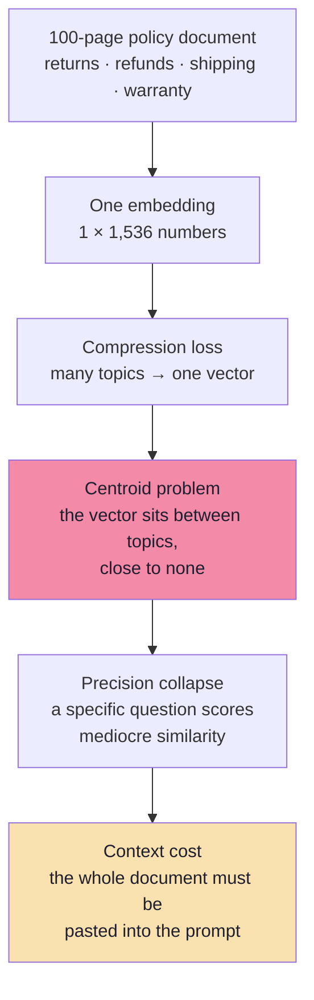

An embedding is a **fixed-width summary**. Averaging returns, shipping and warranty language produces a vector that is *about policy in general* and therefore weakly similar to *every* specific policy question. You lose the ability to say "this passage, not that one".

Chunking divides the document into smaller searchable units. Each chunk then plays **three roles simultaneously**:

| Role | Consequence of getting it wrong |
|---|---|
| **Retrieval unit** — what gets one vector | The fact is not findable, or is diluted by unrelated neighbours |
| **Context unit** — what gets pasted into the prompt | The model receives too little to answer, or too much to focus |
| **Citation unit** — what a source marker points at | You cannot show the customer *where* the rule came from |

> **The only real design question is where to split without losing meaning.** Size is a proxy; meaning is the objective.

### Units: tokens, not characters

Chunk sizes are usually specified in **tokens**, because that is what the embedding model and the LLM actually consume. For English prose, a widely used planning approximation is:

```text
1 token  ≈ 4 characters  ≈ 0.75 words
400 tokens ≈ 1,600 characters ≈ 300 words
```

| Unit | Why people use it | Why it misleads |
|---|---|---|
| **Characters** | Trivial to compute, no tokenizer needed | Character density varies wildly (tables, code, URLs) |
| **Words** | Human-intuitive | Tokenizers split words into subwords unpredictably |
| **Tokens** | Matches model billing and limits | Requires the model's tokenizer at ingest time |

> **Practical rule:** store chunk length in tokens in metadata at ingest. It lets you audit "which chunks are oversized?" without re-tokenizing the corpus later.

---

## 2.2 Fixed-Size Chunking: The Mechanism

A fixed-size strategy splits text after a chosen number of characters or tokens. It is simple and produces predictable chunk lengths — and its central weakness is that **a token boundary has no obligation to coincide with a sentence, let alone a policy rule**.

The lecture's original policy text:

```text
Electronics Return Policy

Electronic products can be returned within 7 days of delivery.
Products must be in their original packaging. Items showing signs
of physical damage caused by the customer are not eligible for
return. Customers must provide the original purchase invoice.
```

An illustrative fixed-size split:

| Chunk | Content |
|---|---|
| **Chunk 1** | Electronic products can be returned within 7 days of delivery. Products must be in their original packaging. |
| **Chunk 2** | Items showing signs of physical damage caused by the customer are not eligible for return. Customers must provide the original purchase invoice. |

Now ask the board's question: **"Can I return a physically damaged electronic product?"**

The answer requires **both** chunks: one states the window, the other states the exception. Retrieving only one produces a confidently incomplete answer. Note what has happened:

- Nothing is *wrong* in either chunk.
- Both embed cleanly.
- Both score highly for the question.
- And yet the *policy unit* was destroyed by an arbitrary cut.

This is the canonical chunking failure: **a rule and its exception were separated by a boundary that had no semantic justification.**

### The sliding window, precisely

Fixed-size chunking with overlap is a sliding window over the token sequence:

```text
step        = S − O                 (S = chunk size, O = overlap)
chunk i     covers tokens  [i·step,  i·step + S)
chunk count = ceil( (N − O) / (S − O) )     for N > S
```

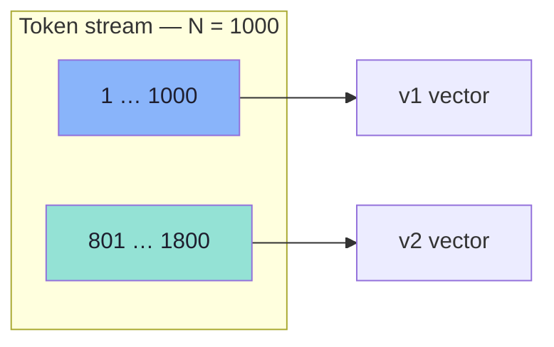

The board draws exactly this: **1000 words → chunk → `v1`**, then **801–1800 → `v2`**. A 1,000-unit window advancing by 200 units is a **20% overlap** — the top of the range the lecture recommends.

### Overlap changes cost, not just quality

Because neighbouring chunks share `O` tokens, the corpus is stored `S / (S − O)` times over:

| Chunk size `S` | Overlap `O` | Overlap % | Step | ≈ Chunks for N = 4,000 | Storage multiplier |
|---|---|---|---|---|---|
| 400 | 0 | 0% | 400 | 10 | 1.00× |
| 400 | 40 | 10% | 360 | 11 | 1.11× |
| 400 | 80 | 20% | 320 | 13 | 1.25× |
| 400 | 200 | 50% | 200 | 19 | 2.00× |
| 1,000 | 200 | 20% | 800 | 5 | 1.25× |

Two things follow immediately:

1. **Overlap is a tax on every future query** — more vectors to store, embed, index, search and pay for.
2. **Overlap cannot repair a bad boundary.** It duplicates text across the cut; it does not restore the heading, the table header, or the logical unit.

---

## 2.3 What Overlap Buys — and What It Costs

Overlap repeats a small amount of text between neighbouring chunks so that a sentence, condition or cross-reference spanning a boundary is preserved on at least one side.

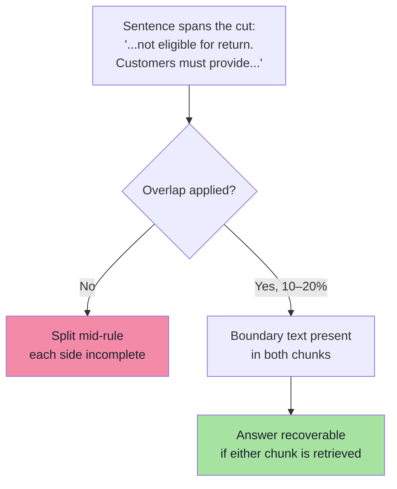

### The four costs

| Cost | Mechanism | Mitigation |
|---|---|---|
| **More vectors** | `1 / (1 − overlap%)` storage and embedding spend | Keep overlap ≤ 20% unless evidence demands more |
| **Duplicate top-K slots** | Both copies of the boundary text can be retrieved, wasting K | Dedupe by `(source, chunkIndex)` adjacency before prompt assembly |
| **Repetitive context** | The LLM sees the same paragraph twice and may over-weight it | Same dedupe step; strip repeated overlap spans when merging adjacent chunks |
| **Score inflation** | Duplicated text creates clusters of near-identical vectors | Diversity step (MMR) or dedupe by content hash |

> **Overlap is a bandage, not a fix.** It protects *boundary context*. It cannot protect *logical structure*. If a policy's exception belongs with its rule, the correct answer is to cut on the section boundary (§2.4), not to add 30% overlap and hope.

### The dedupe rule that saves your K budget

After retrieval, adjacent chunks from the same source that overlap should be **merged, not cited twice**:

```ts
// pseudo-code — collapse overlap duplicates before the prompt
type Hit = { id: string; source: string; chunkIndex: number; text: string; score: number };

function collapseAdjacent(hits: Hit[], maxGap = 1): Hit[] {
  const sorted = [...hits].sort((a, b) => a.chunkIndex - b.chunkIndex);
  const out: Hit[] = [];
  for (const hit of sorted) {
    const prev = out.at(-1);
    const adjacent =
      prev &&
      prev.source === hit.source &&
      hit.chunkIndex - prev.chunkIndex <= maxGap;
    if (adjacent) {
      prev.text = mergeOverlappingText(prev.text, hit.text); // longest-suffix/prefix join
      prev.score = Math.max(prev.score, hit.score);
    } else {
      out.push({ ...hit });
    }
  }
  return out;
}
```

This one function typically recovers one or two wasted K slots in a 400-token / 20%-overlap configuration.

---

## 2.4 Splitter Parameters: What Each Knob Really Means

The reference implementation uses a token-based recursive splitter. Its settings are widely misread, so we map them to concepts:

| Setting | Value | What it actually controls | What it does **not** control |
|---|---|---|---|
| Target chunk size | `withChunkSize(400)` | Approximate token budget per chunk | A hard guarantee; a chunk may end earlier at a boundary |
| Minimum chunk size in **characters** | `withMinChunkSizeChars(150)` | The **minimum character length considered while seeking a suitable split boundary** | ❌ It is **not** an overlap setting. ❌ It is **not** a strict minimum applied to every output chunk |
| Keep separator | `withKeepSeparator(true)` | Whether the separator (e.g. newline) is retained in the emitted chunk | Content fidelity beyond the separator itself |

The middle row is the trap. A reader sees `minChunkSize` and assumes "chunks are at least this long" or "this is the overlap". It is neither: it constrains the **search for a legal break point**, so that the splitter does not emit tiny fragments when a separator happens to appear very early.

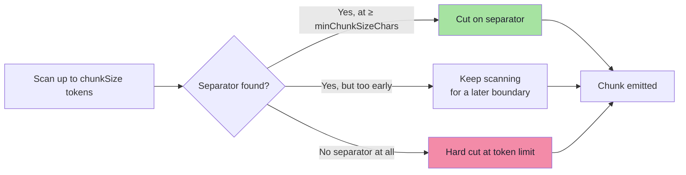

> **Naming discipline:** when you build your own chunker, name fields for their behaviour (`targetTokens`, `overlapTokens`, `minCharsBeforeBreak`) rather than borrowing ambiguous names from a framework.

### The demo caution

> **Delete the previous vectors — or index the new chunks into a separate namespace — before comparing results.**

Otherwise old and new chunk versions coexist, and your "improvement" measurement is actually a mixture of two corpora. Chapter 08 turns this into a formal blue/green re-index procedure.

---

## 2.5 Separator-Aware Splitting: The Pragmatic Middle Ground

Pure token cutting ignores the text's own punctuation. A better default keeps the fixed budget but prefers **natural boundaries inside it** — the recursive, priority-ordered split.

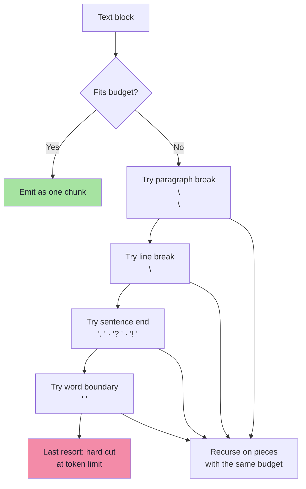

The priority list is a statement about **what humans consider a unit of meaning**, ordered from strongest to weakest:

| Priority | Separator | Preserves |
|---|---|---|
| 1 | `\n\n` (blank line) | Paragraph = one idea |
| 2 | `\n` | Line / list item / table row |
| 3 | `. ` `? ` `! ` | Sentence = one claim |
| 4 | `, ` `; ` `: ` | Clause (last resort before words) |
| 5 | ` ` | Word integrity |
| 6 | — | Nothing; characters only |

```ts
// pseudo-code — recursive boundary-aware splitting
const SEPARATORS = ["\n\n", "\n", ". ", "? ", "! ", "; ", ", ", " "];

function split(text: string, budget: number, overlap: number, level = 0): string[] {
  const tokens = countTokens(text);
  if (tokens <= budget) return [text];
  if (level >= SEPARATORS.length) return hardCut(text, budget, overlap);

  const sep = SEPARATORS[level];
  const pieces = text.split(sep).filter(Boolean);
  if (pieces.length === 1) return split(text, budget, overlap, level + 1);

  // greedy re-pack pieces into chunks of ≤ budget, then recurse on oversized pieces
  const packed = packGreedily(pieces, sep, budget);
  return packed.flatMap((p) =>
    countTokens(p) > budget ? split(p, budget, overlap, level + 1) : [p],
  );
}
```

Two implementation notes that save real bugs:

1. **Re-attach the separator.** `text.split(". ")` deletes the period. If you do not put it back, every sentence ends without punctuation and the chunker looks broken to the model and to the reranker.
2. **Overlap is applied to the emitted chunks, not the separators.** Apply a sliding window of `overlap` tokens across *finished* chunks; do not overlap raw pieces before packing, or the packing math stops matching the budget.

---

## 2.6 Deterministic Ids: The Unsexy Requirement That Makes Re-Ingestion Safe

A chunk id is not a database detail. It determines whether re-running ingestion **updates** a chunk, **duplicates** it, or **orphans** the old copy.

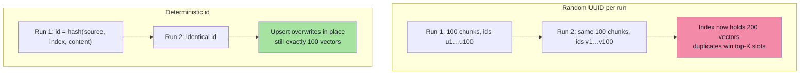

```ts
// pseudo-code — stable, content-aware chunk identity
import { createHash } from "node:crypto";

function chunkId(source: string, index: number, text: string): string {
  const contentHash = createHash("sha256").update(text).digest("hex");
  // 24 hex chars is ample collision resistance for a per-source namespace
  return `${shortHash(source)}-${String(index).padStart(4, "0")}-${contentHash.slice(0, 16)}`;
}
```

| Id design | Re-ingest behaviour | When to use |
|---|---|---|
| `source + index` only | Overwrites, but an edited policy silently reuses the old id | Corpus where positions are stable and you always full-reindex |
| `source + index + contentHash` | Same text → same id; edited text → new id (old must be deleted by source) | **Default recommendation** |
| Random UUID | Duplicates on every run | Never, except ephemeral demos |

Deterministic ids also make **deletion** possible: "delete every vector where `source = 'return-policy.pdf'`" is only reliable if the id scheme makes provenance queryable.

> **Rule:** choose the id scheme before the first ingest. Migrating ids later means re-embedding and re-indexing the entire corpus.

---

## 2.7 Metadata Must Be Attached *Before* the Split

A chunk carries structured fields alongside its text. If they are attached after splitting, every chunk needs a second pass; if they are attached before, the splitter propagates them automatically.

| Field | Example | Used later for |
|---|---|---|
| `source` | `return-policy.pdf` | Citation display, delete-by-source |
| `docId` | `policy-returns-v3` | Grouping, versioning |
| `chunkIndex` | `7` | Adjacency merge, citation precision |
| `page` | `4` | User-facing reference |
| `section` | `electronics-returns` | Narrow section filters |
| `category` | `electronics` | Metadata filter (Ch. 03) |
| `docType` | `policy` | Answer style control |
| `language` | `en` / `bn` | Multilingual routing |
| `effectiveFrom` / `effectiveTo` | `2026-01-01` / `null` | Temporal correctness |
| `tokenCount` | `382` | Budgeting, oversized-chunk audit |
| `contentHash` | `9f2c…` | Idempotency, duplicate detection |


The lecture's own demo derives `category` and `policyType` from **filename substrings** (`"electronics"` in the name → `category=electronics`). This is honest for a demo and fragile in production:

| Filename-rule weakness | Real failure |
|---|---|
| Naming inconsistency | `Electronics-Policy.pdf` vs `electronic_policy.pdf` |
| Missing domain in name | `returns_v2.pdf` covering twelve categories |
| Silent default | Everything unmatched becomes `general` — and `general` is then *included* in most filters |
| No temporal information | Superseded policy carries no `effectiveTo` |

Chapter 03 covers the production replacement: deterministic rules first, an **ingest-time classifier** second, and never an LLM call at query time just to guess a category the UI already knows.

---

## 2.8 Choosing the Numbers: A Defensible Protocol

The lecture recommends, as a starting experiment, **roughly 400–600 tokens with 10–20% overlap**, compared against a non-overlapping baseline. These are starting points, not universal settings.

| Content shape | Chunk size | Overlap | Why |
|---|---|---|---|
| FAQ / short policies | 200–400 | 0–10% | Each Q&A is already a unit; overlap only adds noise |
| Support policies with exceptions | 400–600 | 10–15% | Window and exception usually live within one section |
| Long legal / contractual prose | 600–800 | 15–20% | Clauses cross-reference each other; boundary risk is high |
| Tables, pricing grids | **Never split** | — | A split table is worse than a large chunk |
| Code / API docs | 300–500, AST-aligned | 0–5% | Function boundaries are semantic boundaries |
| Narrative / transcripts | 500–800 | 15–20% | Topic drift is gradual; larger windows keep coherence |

### The constraint everyone forgets: the reranker's limit

Cross-encoder rerankers (Chapter 05) typically accept **512 tokens** per pair. A chunk of 1,200 tokens is therefore **silently truncated** before it is scored — the exception clause at the end never influences the relevance score.

> **Rule of thumb:** `chunkSize ≤ reranker max length`. If you need long chunks for context, retrieve long and *score* short (parent-child retrieval, §2.10).

### A five-step selection procedure

```text
1. Build a boundary probe set: 20 questions whose answers require TWO adjacent
   parts of one policy.
2. Ingest at 400 / 600 tokens with 0 / 10 / 20% overlap (six configurations).
3. For each, measure recall@1 and recall@4 on the probes (Ch. 08 harness).
4. Pick the cheapest configuration whose recall@4 is within 2 points of the best.
5. Freeze it. Re-run the harness only when the corpus or the embedder changes.
```

**Why recall@1 matters here:** if a policy unit was split, the two halves land at ranks 1 and 2 at best, so `recall@1` collapses while `recall@4` still looks fine. The gap between those two numbers *is* your boundary damage, expressed as a number.

---

## 2.9 Failure Modes You Can See in the Data

| Symptom in the index | Root cause | Repair |
|---|---|---|
| Many chunks < 80 tokens | Aggressive splitter, dense separators | Raise `minCharsBeforeBreak`, or pre-clean whitespace |
| Chunks beginning with "It…", "This…", "They…" | Pronoun orphaned from its antecedent | Prepend section heading; widen overlap |
| Repeated identical prefixes across chunks | Overlap applied to headings | Strip heading before overlap; re-prepend once |
| Token length histogram with a long tail | Hard cuts where separators are absent (URLs, tables) | Special-case tables/code; allow larger max for those types |
| Two vectors with cosine ≈ 1.0 for the same text | Random ids / duplicate ingest | Deterministic ids + delete-by-source |
| Gold chunk retrieved at rank 2 *and* 3 | Overlap duplicates | `collapseAdjacent` before the prompt |

### A quick orphan-chunk audit

```ts
// pseudo-code — corpus hygiene check, run after every ingest
type Chunk = { id: string; text: string; tokenCount: number; metadata: Record<string, unknown> };

function auditChunks(chunks: Chunk[]) {
  const low = chunks.filter((c) => c.tokenCount < 80);
  const noHeading = chunks.filter((c) => !c.metadata.section);
  const pronounStart = chunks.filter((c) => /^(it|this|they|these|such)\b/i.test(c.text));
  const dupes = findNearDuplicates(chunks, { threshold: 0.98 });

  return {
    underSized: low.length / chunks.length,
    missingSection: noHeading.length / chunks.length,
    orphanedPronouns: pronounStart.length / chunks.length,
    nearDuplicates: dupes.length,
  };
}
```

Any number above ~5% is a signal that the chunking, not the retrieval, is the problem.

---

## 2.10 Beyond Fixed Chunking: Structural, Semantic, Parent-Child

### Structural (document-aware) chunking

Many documents already contain useful boundaries: titles, headings, subheadings, paragraphs, sections, tables. Structural chunking respects them instead of splitting blindly.

#### The heading is not decoration — it is disambiguating context

```text
Return Policy → Electronics

Electronic products can be returned within 7 days of delivery.
```

Without the heading, `"within seven days"` is ambiguous. It could refer to a return, cancellation, warranty registration, refund, or exchange. The sentence is identical in all five cases; only the heading tells you which policy is being stated.

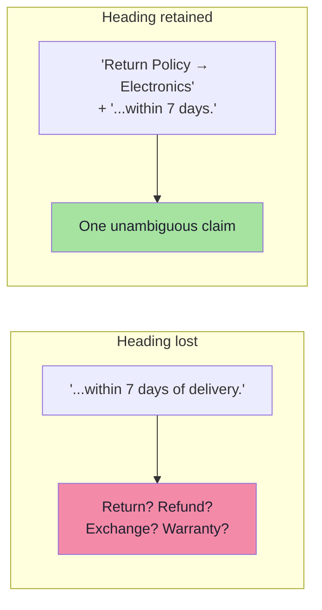

**Rule:** every chunk carries its **breadcrumb** — the ordered path of headings from the document root to its own section:

```text
document:    Return Policy
section:     Electronics
subsection:  Damaged items

text: ...
```

Store the breadcrumb **both** in the embedded text (so it influences the vector) **and** in metadata (so it can be displayed, filtered and cited). These are different jobs: the vector needs it to be *retrievable*; the UI needs it to be *readable*.

> **Overlap is unnecessary across structural boundaries.** Two sections are already distinct units; duplicating their edges only creates near-duplicate vectors.

### Long sections and tables: the two-pass rule

> **Preserve meaningful boundaries first; enforce size limits second.**

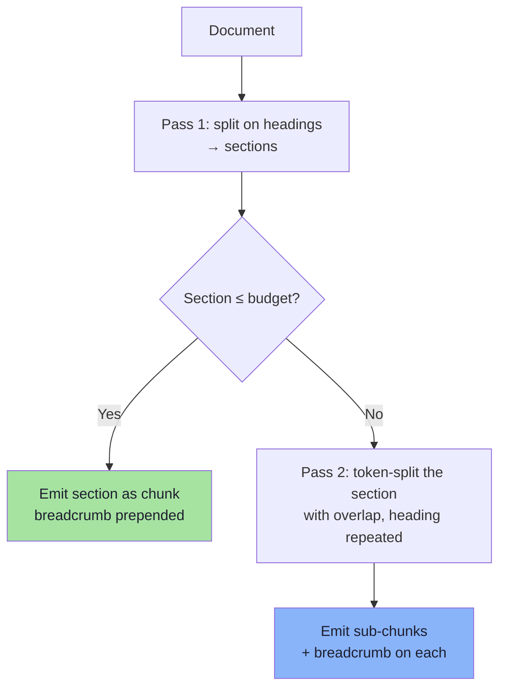

```ts
// pseudo-code — structure first, size second
type Chunk = { text: string; metadata: Record<string, unknown>; index: number };

function chunkDocument(doc: ParsedDoc, budget = 500, overlap = 60): Chunk[] {
  const out: Chunk[] = [];

  for (const section of doc.sections) {
    const breadcrumb = [...section.headingPath].join(" → ");
    const body = `${breadcrumb}\n\n${section.text}`;

    if (countTokens(body) <= budget) {
      out.push(makeChunk(body, section, 0));
      continue;
    }
    const parts = splitTokens(section.text, { budget, overlap });
    parts.forEach((part, i) => {
      // the heading is re-attached to EVERY sub-chunk, not just the first
      out.push(makeChunk(`${breadcrumb} (part ${i + 1})\n\n${part}`, section, i));
    });
  }
  return out;
}
```

The `(part 2)` marker matters more than it looks: it tells the reranker and the model that this is a fragment, which reduces over-confident answers that treat a partial clause as the whole rule.

#### Tables must not be split

A pricing table cut in half produces two chunks that are each *wrong* rather than merely incomplete:

| Naive split | Result |
|---|---|
| Header row in chunk A, data rows in chunk B | Orphaned numbers with no column meaning |
| Data rows split mid-category | Partial price list that looks authoritative |

| Strategy | How | When |
|---|---|---|
| **Keep whole** | One chunk per table, even if over budget | Tables < ~800 tokens (most) |
| **Repeat the header** | Convert to Markdown and re-emit the header on every fragment | Long tables |
| **Summarise + link** | Embed an LLM-generated natural-language summary; keep the table in a payload field | Very large tables, numeric questions |
| **Row-as-record** | One chunk per row, with header names inlined | Product catalogs, lookups |

For numeric or aggregate questions ("what is the price of X?"), row-as-record or a structured tool call beats vector search entirely. Do not force a table through a text pipeline if the question is really a database query.

#### Code and configuration

Same principle, different parser: split on **AST node boundaries** (function, class, method), never on line count. A function cut between its signature and its body is a retrieval hazard *and* a security hazard — the model may confidently explain the wrong function's behaviour.

### Semantic chunking

Structural chunking needs headings. Semantic chunking is for the long, unstructured document that **changes topic without visible markers** — a transcript, a scraped FAQ, a vendor's rambling policy page.

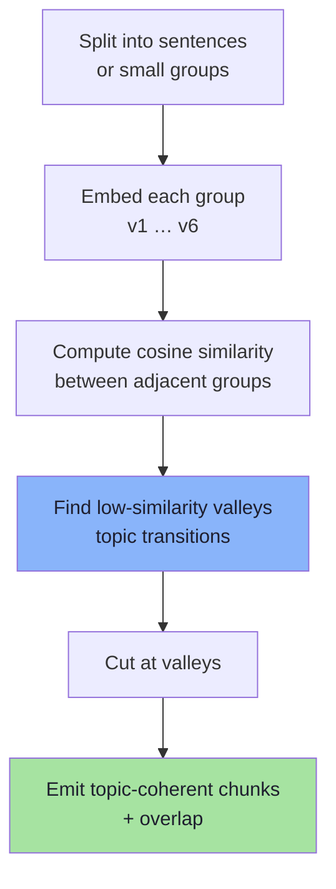

The board's illustrative adjacency scores:

| Pair | Similarity | Interpretation |
|---|---|---|
| `v1 ↔ v2` | 0.92 | same topic (returns) |
| `v2 ↔ v3` | 0.87 | same topic (returns) |
| **`v3 ↔ v4`** | **0.31** | **topic transition: returns → shipping** |
| `v4 ↔ v5` | 0.94 | same topic (shipping) |
| `v5 ↔ v6` | 0.88 | same topic (shipping) |

The drop at `v3 → v4` is the boundary. Everything else is noise.

```ts
// pseudo-code — similarity-valley segmentation
async function semanticChunks(
  text: string,
  { percentile = 95, minChunkTokens = 150, overlap = 40 } = {},
): Promise<string[]> {
  const sentences = splitSentences(text);
  const embeds = await embedBatch(sentences);              // 1 call, N inputs

  const dist = embeds.slice(1).map((e, i) => 1 - cosine(e, embeds[i]));

  // cut where the *distance* is unusually large for THIS document
  const cutoffs = [...dist].sort((a, b) => a - b);
  const threshold = cutoffs[Math.floor((percentile / 100) * cutoffs.length)];

  const groups: string[] = [];
  let current = [sentences[0]];
  dist.forEach((d, i) => {
    if (d >= threshold) {
      groups.push(current.join(" "));
      current = [sentences[i + 1]];
    } else {
      current.push(sentences[i + 1]);
    }
  });
  groups.push(current.join(" "));

  return enforceMinSizeAndOverlap(groups, { minChunkTokens, overlap });
}
```

#### Why a percentile, not a fixed number

0.31 feels like an obvious boundary — but only because these six sentences were chosen to make it obvious. On real text:

| Fixed threshold | Failure |
|---|---|
| `cut if sim < 0.5` | For a tightly-written legal document, *everything* is above 0.7 → one giant chunk |
| `cut if sim < 0.8` | For a chat transcript, everything is below 0.8 → one chunk per sentence |

A percentile adapts to the document's own distribution: "cut at the 5% largest drops" always produces a bounded number of boundaries, whether the text is dense or diffuse.

#### What semantic chunking cannot do

| Limitation | Why | Consequence |
|---|---|---|
| Ignores tables and figures | No notion of structure | A table split mid-way is still split |
| Cross-references break | "as described in §2" carries no semantics | Answer references a section that is not in context |
| Cost scales with sentences | N embeddings per document | Ingest cost; slow for large corpora |
| Boundary stability | Tiny text edits move the percentile | Re-ingest produces different chunks; ids churn |
| Domain-tuned embeddings needed | A legal embedder is not a chat embedder | Boundaries land in odd places on jargon |

> **Stability is an underrated criterion.** If a one-word edit reshuffles every chunk boundary, your ids change, your evaluation set silently invalidates, and your "before/after" comparisons are meaningless. Structural boundaries are stable; statistical boundaries are not.

---

## 2.11 Choosing a Strategy: The Decision Table

| Document type | Strategy | Overlap | Reason |
|---|---|---|---|
| Policy manual with headings | Structural, per section | 0% | Author-defined units |
| Product catalogue | Structural + row-as-record | 0% | Lookup questions, not prose |
| FAQ page | Structural (one Q&A per chunk) | 0–10% | Each item is already atomic |
| Contract / ToS | Structural, then token split | 10–15% | Clause integrity, dense cross-refs |
| Support transcripts | Semantic + fixed cap | 15% | Topic drift, no markup |
| Wiki export | Heading AST | 0–10% | Deep hierarchy available |
| Scanned PDF | OCR → structural → audit | 10% | Extraction quality is the risk |
| Code / API docs | AST nodes (functions, classes) | 0% | Syntax gives exact boundaries |

### The hybrid most teams converge on

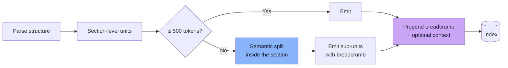

Structure first (stable, cheap, semantically correct), semantics second (only where the author left no boundaries), enrichment last (restores context).

---

## 2.12 Contextual Enrichment — Restoring What the Cut Removed

Everything so far decides **where** to cut. This section answers a different question: *now that the text is cut, how does the chunk know what it was part of?*

A chunk that says *"within 7 days of delivery"* is not wrong. It is **underspecified**. Enrichment adds the missing frame at ingest time, once, instead of hoping retrieval reconstructs it at query time.

### Parent-child retrieval (small-to-big)

**Problem:** small chunks retrieve precisely but answer poorly; large chunks answer richly but retrieve poorly.

**Solution:** decouple the two. Index small **child** chunks for search; return their larger **parent** section into the prompt.

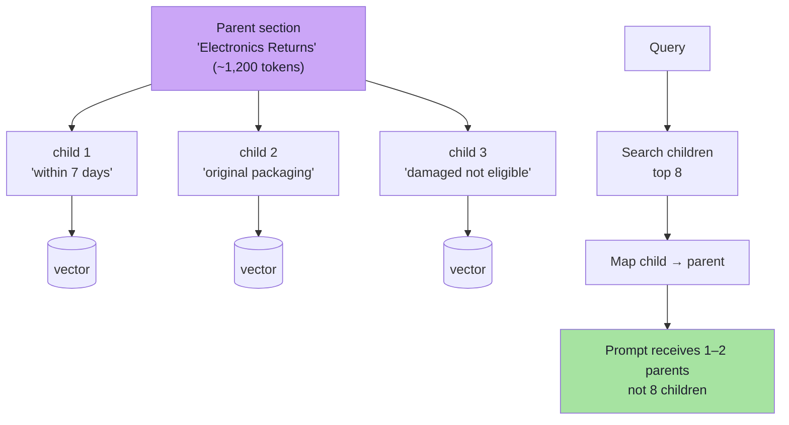

| Property | Value |
|---|---|
| Retrieval granularity | 200–300 tokens (precise) |
| Generation granularity | 800–1,500 tokens (complete) |
| Storage | Children embedded; parents stored as payload |
| Failure mode | Parents are huge → context blow-up; cap parent size or auto-merge only adjacent siblings |
| Variant | **Auto-merging**: if ≥ N children of the same parent are retrieved, return the parent instead |

This is the single highest-value technique for the "rule and exception" problem, because the exception almost always lives in the same *section* as the rule even when it does not live in the same 400-token window.

### Contextual retrieval (LLM-generated chunk context)

Before embedding a chunk, ask a fast model to write **one or two sentences situating this chunk in the document**, and prepend it.

```text
[context] This chunk is from ACME's Return Policy, section "Electronics",
effective 2026, and states the return window that applies to electronic
items specifically (as opposed to the 30-day general policy).

[chunk] Electronic products can be returned within 7 days of delivery.
```

```ts
// pseudo-code — contextualise once at ingest, never at query time
async function contextualize(chunk: Chunk, doc: ParsedDoc): Promise<string> {
  const prompt = `
Document: ${doc.title}
Chunk: ${chunk.text}

Write 1–2 sentences describing what this chunk is about and where it sits
in the document. Do not add facts that are not in the chunk or the title.
Answer with the sentences only.`;
  const context = await fastModel.complete(prompt, { maxTokens: 120 });
  return `${context.trim()}\n\n${chunk.text}`;
}
```

| Reported effect (Anthropic, 2024) | Retrieval failure reduction |
|---|---|
| Contextual embeddings alone | ~35% |
| Contextual embeddings + contextual BM25 | ~49% |
| …plus reranking | ~67% |

> These are **vendor-reported** figures on their own corpora. Treat them as *"this technique is worth testing"*, not as a guarantee. Your own golden set (Ch. 08) is the only number that matters.

**The economics:** one LLM call per chunk, once. With prompt caching of the shared document prefix, cost per chunk drops to near nothing. For a 5,000-chunk corpus, this is a one-off ingest cost, not a per-query cost — a very favourable trade if it removes a class of failures.

### Late chunking

Instead of embedding each chunk in isolation, embed the **whole document once** with a long-context embedder, then *pool the token embeddings* belonging to each chunk.

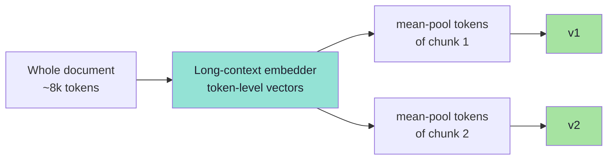

| Property | Detail |
|---|---|
| Context | Every chunk vector already "knows" its document (attention saw the whole text) |
| Cost | One long forward pass per document instead of N short ones |
| Constraint | The document must fit the embedder's context window |
| Constraint | You must be able to map tokens → chunk boundaries |
| Availability | Requires a long-context, token-level embedding model (e.g. Jina v2/v3 late chunking) |

Late chunking solves the pronoun/reference problem structurally rather than by prompt engineering — "it" in chunk 4 is resolved using the antecedent in chunk 2, because the attention mechanism saw both.

---

## 2.13 Evaluating a Chunking Strategy

Chunking quality is measurable before retrieval tuning begins. Four cheap tests:

### Test 1 — Boundary probes

Write 20 questions whose answers span a boundary you *suspect* is fragile. For each, the gold evidence is two adjacent units.

| Probe | Gold units | Pass condition |
|---|---|---|
| "Can I return a physically damaged electronic item?" | `electronics` + `damaged` | Both in top-4 |
| "Is the packaging condition relevant to the 7-day window?" | `electronics` + `packaging` | Both in top-4 |

If `recall@1` is low but `recall@4` is healthy, you have boundary damage — the answer exists, spread across neighbours.

### Test 2 — The self-containment test

Sample 30 chunks and ask, for each: *"could a competent human answer a question from this chunk alone, without the rest of the document?"*

| Verdict | Meaning | Action |
|---|---|---|
| Yes, fully | Chunk is self-contained | — |
| Only with the heading | Needs breadcrumb prefix | Prepend section path |
| Only with the previous chunk | Needs overlap or parent | Widen overlap / parent-child |
| No — needs the whole section | Chunk is too small or too fragmented | Merge siblings |

### Test 3 — The orphan audit

Run the audit from §2.9 (`tokenCount < 80`, missing `section`, pronoun-initial, near-duplicates). These are objective, cheap and catch most structural regressions.

### Test 4 — The "does the query even land" check

Take your ten most common real customer questions. For each, inspect the **top-1 chunk** and ask whether a human would accept it as the right passage. No metrics needed; a single "no" is a bug report.

```ts
// pseudo-code — a four-test chunking report card
type ChunkingReport = {
  boundaryRecall1: number;
  boundaryRecall4: number;
  selfContainedRate: number;
  orphanRate: number;
  nearDuplicateRate: number;
  topOneAccepted: number; // out of 10 hand-checked questions
};
```

Ship a chunking change only if `boundaryRecall4` and `selfContainedRate` improve **without** raising `orphanRate` or `contextTokens`.

---

## 2.14 Common Mistakes

| Mistake | Consequence | Fix |
|---|---|---|
| Splitting on a fixed length when headings exist | Rule/exception separation; ambiguous pronoun references | Structural parsing (§2.10) |
| Forgetting the breadcrumb | "within 7 days" matches five different policies | Prepend heading path to every chunk |
| Adding overlap to structural chunks | Near-duplicate vectors, wasted K | Overlap = 0 at section boundaries |
| Splitting tables | Numbers lose their column meaning | Keep whole / repeat header / row-as-record |
| Using semantic chunking on well-structured docs | Expensive, unstable, worse | Use structure; semantics only for flat text |
| Re-embedding without re-indexing parents | Child vectors point at stale parent text | Version the whole corpus together |
| Enrichment without evaluation | Every chunk looks like every question → precision collapse | A/B on the golden set |
| Ignoring extraction quality | Garbage heading tree → garbage chunks | Inspect the parsed structure first |

---

## 2.15 Chapter Summary

| Situation | Strategy | Enrichment |
|---|---|---|
| Clear headings | Structural, one section per chunk, 0% overlap | Breadcrumb in text + metadata |
| Section too long | Two-pass: headings, then token split | Breadcrumb + `(part n)` marker |
| Long flat text | Semantic (percentile breakpoints) | Contextual summary sentence |
| Tables | Never split | Header repetition or row-as-record |
| Code | AST nodes | File path + symbol name |
| Rule + exception problem | Structural first, then **parent-child** | Return parent section to the prompt |
| A few dozen long docs | **Late chunking** if the embedder supports it | Free document context |
| Unclear what is wrong | Probe set + orphan audit | Measure before enriching |

> **Final mental model:** structure gives you *correct units*; enrichment gives those units their *missing frame*. A chunk should be understandable **on its own, out of context** — because at query time, that is exactly how the model will see it.

---

## Where This Goes Next

- **[Chapter 03](./03_Retrieval_Controls.md)** — once chunks are right, decide how many of them may reach the model.
- The breadcrumb becomes a **filter field** in [Chapter 03](./03_Retrieval_Controls.md).
- Parent-child changes the token budget in [Chapter 07](./07_Context_Engineering.md).
- The storage multiplier becomes a line item in [Chapter 08](./08_Production_RAG.md).

---

**Back to:** [Lecture 17 — Chapter Index](./index.md) · [Complete Notes](./Lecture_17_Complete_Notes.md)
