# Chapter 06: Query Processing — Translation, Routing, Decomposition, HyDE

> **Chapter Goal:** Fix the failure mode where the user's own question is wrong for retrieval. A raw query may be misspelled, ambiguous, too short, semantically mismatched to documents, or simply several questions at once. Query processing transforms the question *before* the retriever sees it — rewriting it, abstracting it, decomposing it, or generating a hypothetical document from it — and routes it to the right data source.
>
> At the end of this chapter you should be able to answer: *which query-translation technique fixes which retrieval failure, and when do I route the question away from the vector store entirely?*

---

## 6.1 The Retriever's Input Is Not Enough

A naive RAG system sends the user's query straight to the retriever:

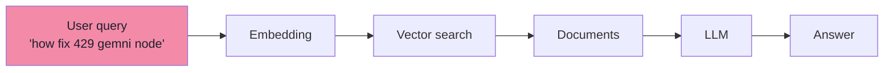

This works for well-formed, single-intent questions. It fails when the query is:

| Query flaw | Why retrieval fails | Example |
|---|---|---|
| Ambiguous or incomplete | Too little signal for the embedding | "how fix 429 gemni node" |
| Missing high-level concepts | Specific numbers win over principles | "What happens to pressure when T ×2, V ×8?" |
| Multi-part | One vector cannot match all sub-intents | "What is TDZ, why does it happen, and how does `let` cause it?" |
| Lexical mismatch | Query terms differ from document terms | "causes Node.js process termination?" vs document about "uncaught exceptions" |

> **Query translation = transforming one raw user query into one or more retrieval-friendly representations before embedding or retrieval.**

---

## 6.2 Query Translation: The Four Techniques

The production pipeline offers four techniques, each solving a different problem:

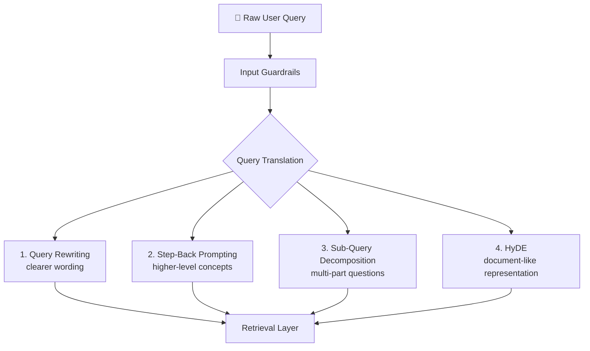

| Technique | Main problem solved | Example use case |
|---|---|---|
| Query rewriting | Bad / unclear wording | "how fix 429 gemni node" → "Gemini API 429 rate-limit errors in Node.js" |
| Step-back prompting | Missing high-level concepts | "Pressure when T×2 V×8?" → "Ideal gas law principle" |
| Sub-query decomposition | Complex multi-part questions | "TDZ + `let` + `const`?" → four independent sub-queries |
| HyDE | Query ↔ document mismatch | "Process termination" → hypothetical passage about uncaught exceptions |

---

## 6.3 Query Rewriting

Query rewriting takes the original user query and converts it into a clearer, more retrieval-friendly query.

| Before | After |
|---|---|
| `how fix error 429 gemni node` | `How to handle Google Gemini API 429 rate-limit or quota errors in Node.js?` |

The rewritten query adds expansion terms (`Gemini`, `API`, `rate limit`, `quota`, `Node.js`) that make semantic matching far more reliable.

### When to use query rewriting

Users frequently:
- Make spelling mistakes (`gemni`)
- Use abbreviations (`429`)
- Write incomplete sentences
- Omit technical context
- Refer to something indirectly

### Production flow

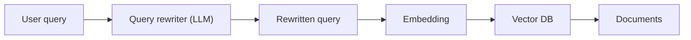

> Query rewriting never replaces the original — it is an additional retrieval representation. You can retrieve with both and merge.

---

## 6.4 Step-Back Prompting

Step-back prompting takes a specific question and asks:

> **"What broader concept or principle do I need to understand to solve this?"**

Introduced in *Take a Step Back: Evoking Reasoning via Abstraction in Large Language Models* (2023), it improves STEM and multi-hop reasoning by abstracting before retrieving.

### Normal vs step-back approach

| Normal approach | Step-back approach |
|---|---|
| Specific question → vector search → answer | Specific question → abstraction → general question → retrieve principles → combine → answer |

### Physics example

**Original:** *"What happens to the pressure of an ideal gas if temperature increases by 2× and volume increases by 8×?"*

A model may directly manipulate numbers and make an algebraic mistake.

**Step-back question:** *"What fundamental physics principle determines the pressure of an ideal gas?"*

**Retrieved:** `PV = nRT` (ideal gas law)

**Applied:** `P' = nR(2T)/(8V) = (2/8)P = P/4` → pressure decreases by a factor of 4.

### Knowledge example

**Original:** *"Estella Leopold went to which school between Aug 1954 and Nov 1954?"*

**Step-back:** *"What was Estella Leopold's education history?"*

Retrieve the broader education timeline, then use it to answer the date-specific question.

> **The step-back result does not replace the original question.** Both go into reasoning: the general principle guides interpretation, the original constraints bound the answer.

---

## 6.5 Sub-Query Decomposition

Some user questions are several questions combined. A single vector search may not retrieve everything.

**Example:** *"What is Temporal Dead Zone in Node.js, why does it happen, and how is it related to `let` and `const`?"*

Decompose into:

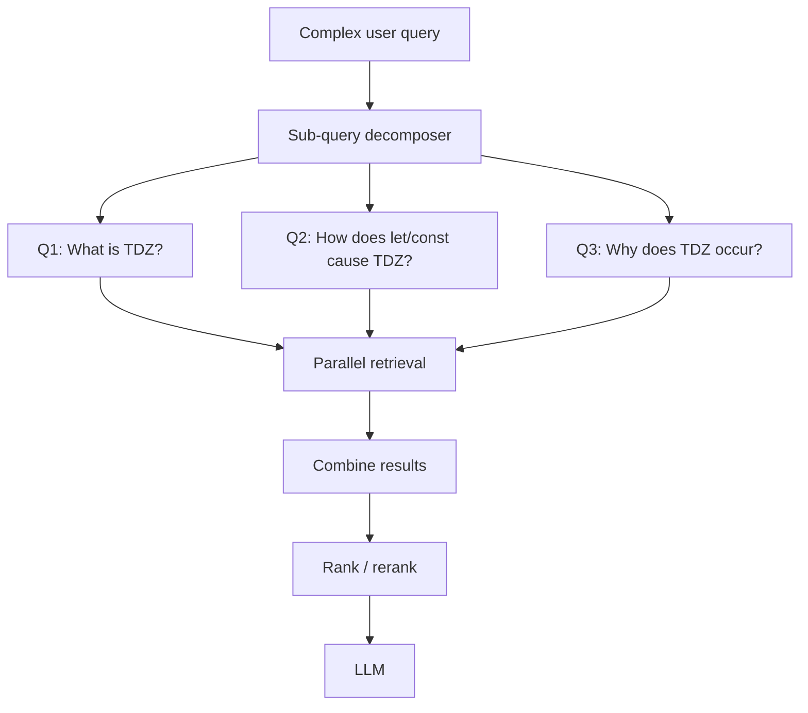

Each sub-query targets a different retrieval intent: concept, cause, language mechanics.

### Why sub-queries work

| Original intents | Sub-query mapping |
|---|---|
| "What is TDZ?" | Concept definition |
| "Why does it happen?" | Causal explanation |
| "How does `let` cause TDZ?" | Language mechanics |

This gives the retrieval system more opportunities to find required evidence. Four focused searches usually beat one diffuse search.

### Parallel execution

Because searches are independent, execute them concurrently:

```ts
// pseudo-code — parallel sub-query retrieval
const subQueries = [
  "What is Temporal Dead Zone in JavaScript?",
  "How do let and const cause TDZ?",
  "Why does TDZ occur?",
];

const results = await Promise.all(
  subQueries.map((q) => vectorSearch(q))
);
```

Do not run them sequentially — that multiplies latency by the number of sub-queries.

---

## 6.6 HyDE — Hypothetical Document Embeddings

### The problem

A user query and a document containing the answer can have different linguistic structures:

| User query | Answer document |
|---|---|
| *"What causes a Node.js process to terminate?"* | *"Unhandled exceptions that propagate to the event loop can cause the Node.js process to exit."* |

They express related concepts but different wording. Embedding the query directly may miss the document.

### HyDE changes the query representation

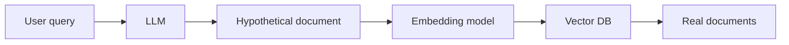

**Example:**

User: *"What causes a Node.js process to terminate?"*

LLM generates a hypothetical passage:

> *"Node.js processes can terminate because of uncaught exceptions, explicit process.exit calls, fatal errors, or certain runtime failures."*

The hypothetical passage — not the original query — is embedded:

```
Hypothetical passage → embedding → vector search → real documents
```

### Why HyDE can help

| Approach | Match |
|---|---|
| Question ↔ Document | Different linguistic structures |
| Hypothetical Document ↔ Real Document | Document-like vocabulary on both sides |

The generated passage may contain terms (`uncaught exception`, `event loop`, `fatal error`) that match indexed documents better than the terse query does.

### Important caveat

The hypothetical document **does not need to be factually correct**. The goal is a useful semantic representation for search — never treat it as authoritative evidence:

```
HyDE document ≠ ground truth
```

Use HyDE only as a retrieval signal; always ground the final answer in real retrieved documents.

---

## 6.7 Complete Query Translation Architecture

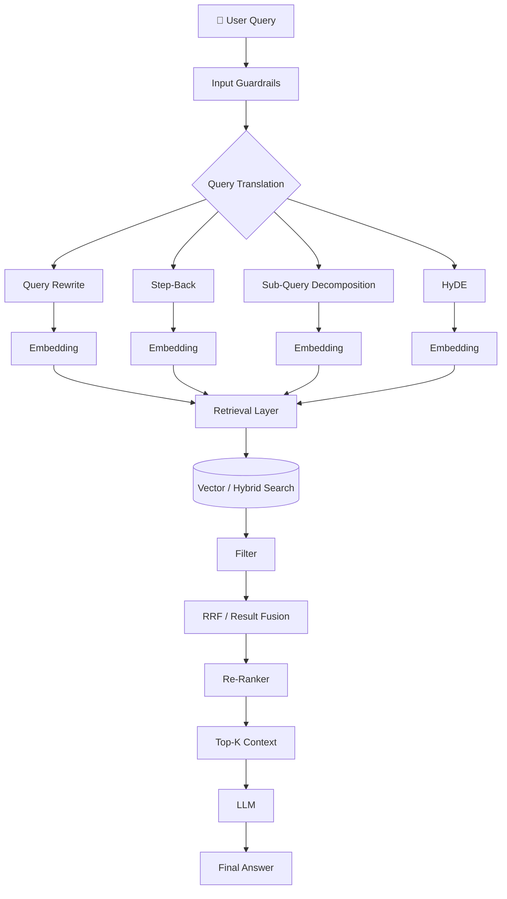

Query translation and retrieval are distinct:

```text
Query Translation: "what is tdz node?" → "What is the Temporal Dead Zone in JavaScript and Node.js?"
Retrieval:         Better query → embedding → vector search → documents
```

```
Query Translation
     ↓
Better Retrieval
     ↓
Better Context
     ↓
Better Generation
```

---

## 6.8 When to Use Which Technique

| User query | Technique | Reason |
|---|---|---|
| `"how fix 429 gemni node"` | Query rewriting | Poorly written; needs expansion |
| `"What happens to pressure when temperature doubles?"` | Step-back | Benefits from underlying principle (ideal gas law) |
| `"What is TDZ, why does it happen, and how does `let` differ?"` | Sub-query decomposition | Multiple related questions |
| `"What causes Node.js process termination?"` | HyDE | Query-to-document representation mismatch |

### Advanced combination

A production system often does not choose one technique. It classifies the query first, then applies the matching transform:

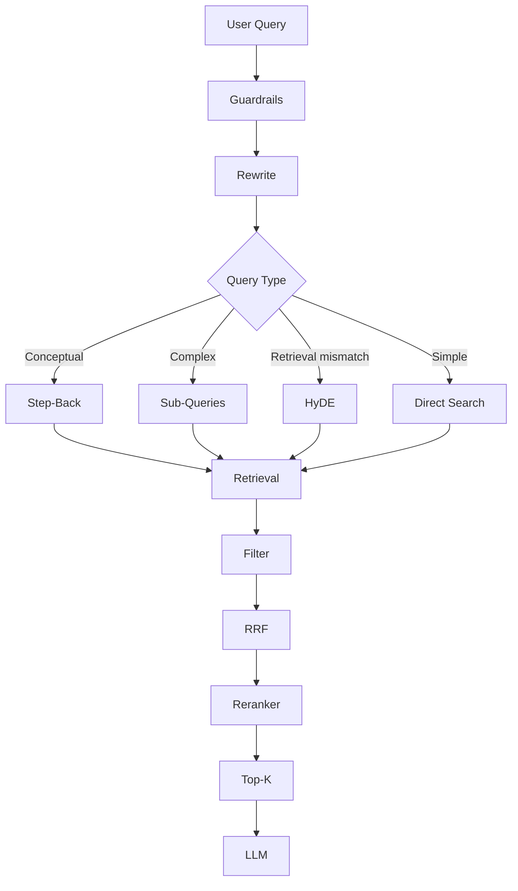

---

## 6.9 Query Routing: Where Does the Answer Live?

Not every question belongs in the vector database. Enterprise data spans multiple sources:

| User question | Best source |
|---|---|
| "What is my account email?" | SQL / Auth DB |
| "How does our refund policy work?" | Vector DB |
| "Show me invoice March.pdf" | Object storage (S3/GCS) |
| "Am I eligible for a refund based on my subscription?" | Multiple sources |

The first question production RAG must answer:

> **"Where does the answer live?"**

That is the job of the **query router**.

### Multi-source architecture

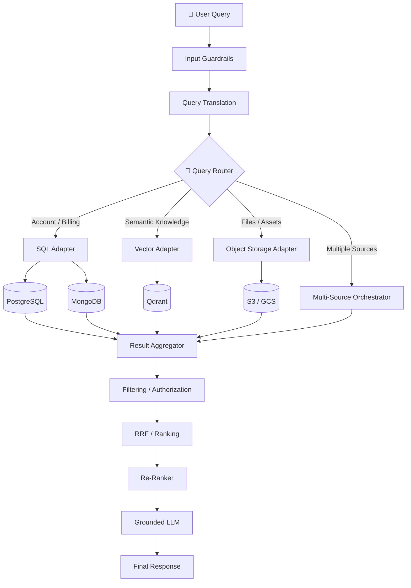

### Router decision

A router classifies queries into target stores:

```text
AUTH_DB    → account / billing / subscription questions
VECTOR_DB  → semantic knowledge, policies, docs
S3_STORAGE → files, invoices, PDFs, images
MULTI_STORE → questions needing two or more sources
```

| Query | Route |
|---|---|
| *"What is my registered email?"* | `AUTH_DB` |
| *"Explain our refund policy."* | `VECTOR_DB` |
| *"Download my March invoice."* | `S3_STORAGE` |
| *"What refund am I eligible for based on my subscription?"* | `MULTI_STORE` |

### Structured router output

Do not let the router return free-form text:

```json
// bad — hard to validate
"I think this should probably go to the SQL database because..."
```

```json
// better — structured, validateable
{
  "targetStore": "AUTH_DB",
  "intent": "ACCOUNT_PROFILE",
  "confidence": 0.96,
  "reason": "The query requests account information."
}
```

### Router separation principle

The router decides **where to go**, never **what to execute**:

```ts
// pseudo-code — router returns intent only
async function routeQuery(query: string) {
  const result = await routerLLM(query);
  return {
    targetStore: result.targetStore,
    intent: result.intent,
    confidence: result.confidence,
  };
}
```

The application then dispatches to the correct adapter.

---

## 6.10 Adapter Layer

Different databases speak different languages:

| Source | Query language | Result shape |
|---|---|---|
| PostgreSQL | SQL | Rows |
| MongoDB | Mongo query | Documents |
| Qdrant | Embedding + vector search | Chunks with scores |
| S3 | Object key / metadata | Signed URLs / files |

The adapter hides those details and converts every result into a common application-level format:

```ts
{
  source: "VECTOR_DB",
  content: "...",
  score: 0.91,
  metadata: { documentId: "doc_123" },
}

// or
{
  source: "AUTH_DB",
  content: "subscription: premium",
  metadata: { userId: "user_123" },
}
```

Now the downstream pipeline does not need to know how data was retrieved.

### Adapter dispatch example

```ts
// pseudo-code — execute the routed query
async function executeRoute(route: Route, query: string) {
  switch (route.targetStore) {
    case "AUTH_DB": return sqlAdapter.search(query);
    case "VECTOR_DB": return vectorAdapter.search(query);
    case "S3_STORAGE": return s3Adapter.search(query);
    case "MULTI_STORE": return multiStoreAdapter.search(query);
    default: throw new Error("Unsupported route");
  }
}
```

### SQL adapter: never blindly execute LLM-generated SQL

For structured data, the flow must be:

```
LLM → structured query / restricted SQL → validation → authorization → parameterized query → database
```

Never allow arbitrary LLM-generated SQL to execute directly. The database must also enforce permissions.

### Vector adapter

Hides Qdrant-specific implementation:

```ts
// pseudo-code — vector adapter
async function vectorSearch(query: string) {
  const vector = await embedText(query);
  return qdrant.search({ vector, limit: 20 });
}
```

Retrieval can return more candidates than the final Top-K — 20 candidates → rerank → 5 is better than asking the vector DB for 3–5 directly.

### S3 / object storage adapter

S3 is not normally a semantic database. The adapter resolves file metadata, checks authorization, and generates a signed URL. For semantic search over PDFs, index extracted text separately into a search/vector system while keeping the original file in S3.

---

## 6.11 Multi-Store Queries

**Example:** *"Am I eligible for a refund based on my subscription?"*

This needs two sources:

| Source | What it answers |
|---|---|
| Account DB (SQL) | User's subscription tier |
| Policy docs (vector DB) | Refund rules per tier |

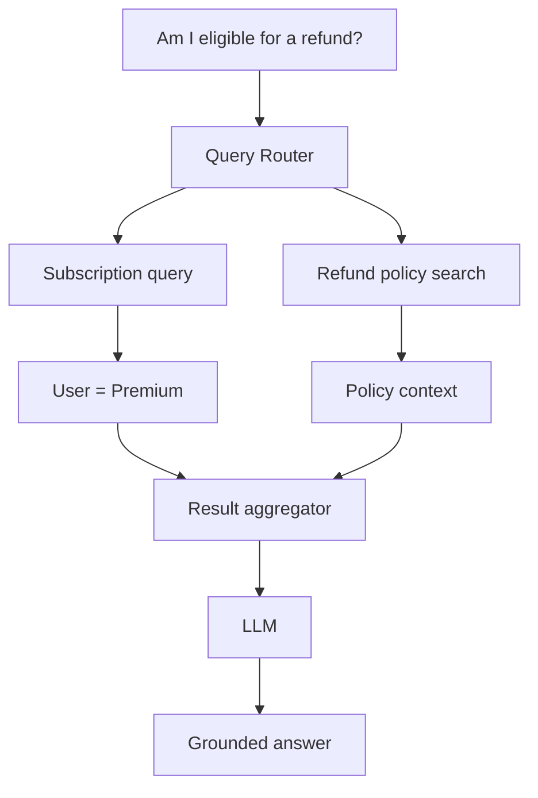

### Parallel execution

Independent sources run concurrently:

```ts
// pseudo-code — parallel multi-source retrieval
const [account, policy] = await Promise.all([
  accountAdapter.getSubscription(userId),
  vectorAdapter.search("refund policy eligibility"),
]);
```

### Result aggregation

Different stores return different formats; normalize them before RRF or reranking. RRF is primarily useful for combining **ranked result lists** (e.g., two vector searches), not arbitrary SQL/S3 results.

For heterogeneous sources (SQL + S3 + Vector DB), use source-specific normalization, not blind RRF on everything.

---

## 6.12 Corrective RAG (CRAG)

RRF improves retrieval. But retrieval can still fail:

```
User Query → Retrieval → Wrong/incomplete docs → LLM → Confident but incorrect answer
```

CRAG adds an evaluation-and-correction loop after generation:

> **CRAG = evaluate whether retrieved evidence is sufficient, and take corrective retrieval action when it is not.**

### CRAG architecture

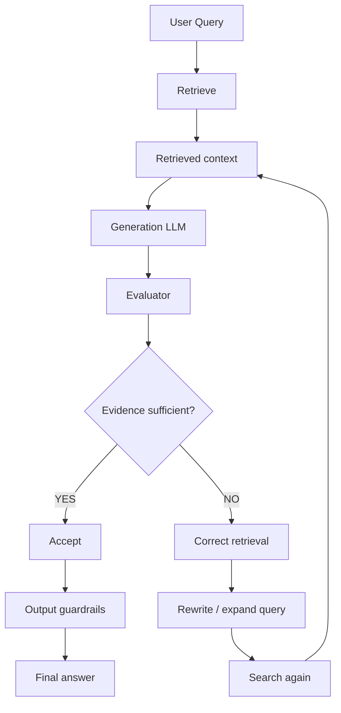

### What the evaluator checks

| Check | Question |
|---|---|
| Relevance | Are retrieved documents actually relevant? |
| Groundedness | Is the answer supported by retrieved evidence? |
| Completeness | Does evidence contain enough to answer? |
| Contradiction | Do sources contradict each other? |

### Structured evaluator output

```json
{
  "relevance": 8,
  "groundedness": 9,
  "completeness": 6,
  "needsRetry": true,
  "missingInformation": ["refund eligibility period"],
  "suggestedQueries": ["refund policy eligibility period", "refund eligibility after 30 days"]
}
```

### Correction loop example

User asks: *"Can I get a refund after 45 days?"* Retrieved docs say only: *"Refunds are available according to the refund policy."*

The evaluator detects missing `"refund eligibility period"`, then:

```
Missing information → query expansion → "refund policy eligibility period 45 days"
→ retrieve again → new evidence → generate
```

### Retry architecture

Never allow unlimited retries:

```ts
// pseudo-code — bounded correction loop
const MAX_RETRIES = 3;

for (let attempt = 0; attempt < MAX_RETRIES; attempt++) {
  const context = await retrieve(query);
  const answer = await generate(query, context);
  const evaluation = await evaluate({ query, context, answer });

  if (evaluation.grounded && evaluation.score >= 7) {
    return answer;
  }

  query = improveQuery(query, evaluation.missingInformation);
}

return "I don't have enough reliable information to answer that.";
```

### Threshold discipline

Do not treat `6/10` as a universal CRAG threshold. Determine it through an evaluation dataset, offline testing, precision/recall analysis, and false-accept/false-reject rates. High-risk domains need stricter conditions.

---

## 6.13 RRF + CRAG Together

The production pipeline combines all stages:

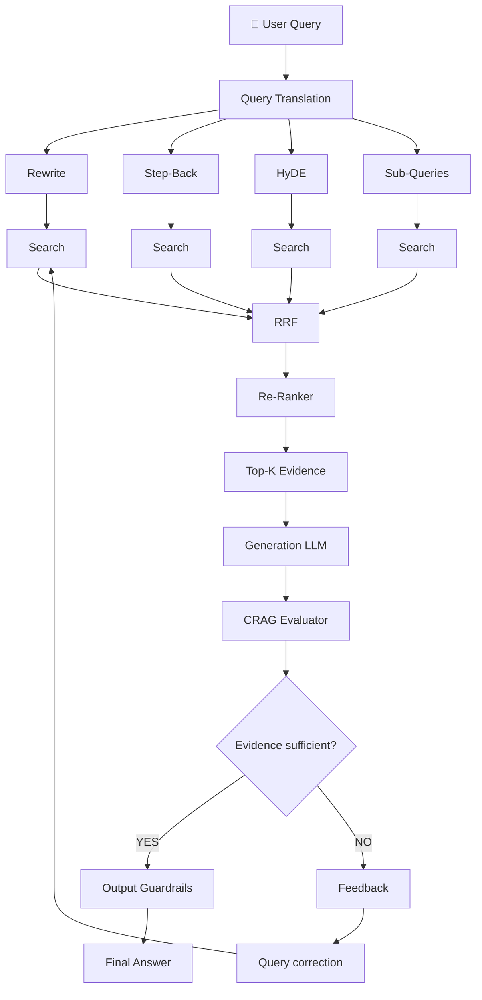

### Key differences to remember

| Component | Asks |
|---|---|
| RRF | *"Which retrieved documents should rank highest when multiple retrieval strategies are combined?"* |
| Re-ranker | *"Which candidate documents are most relevant to this query?"* |
| CRAG | *"Do we have enough reliable evidence to produce this answer, and if not, how should retrieval be corrected?"* |

```
Multiple retrieval → RRF → Re-ranking → Top-K → Generation → CRAG → Pass / Correct
```

---

## 6.14 Common Mistakes

| Mistake | Consequence | Fix |
|---|---|---|
| No query translation at all | Misspelled, ambiguous, terse queries fail | Add rewrite or HyDE |
| Replacing the original query | Abstraction loses date/SKU constraints | Keep both original and transformed |
| Sequential sub-queries | Latency multiplied by N | `Promise.all` |
| Routing every query to the vector DB | SKU/account lookups return semantic noise | Router + SQL adapter |
| Blind LLM SQL execution | Injection risk | Validation + authorization + parameterized |
| RRF on arbitrary SQL/S3 results | Meaningless fusion | Normalize first; RRF only on ranked lists |
| Unlimited CRAG retries | Slow responses, infinite cost | Cap at 2–3 retries |
| Treating HyDE output as fact | Hallucinated evidence in answer | HyDE is retrieval signal only |
| Router returns free-form text | Unparseable routing decision | Structured JSON output |

---

## 6.15 Key Takeaways

1. **The raw user query is often a bad retrieval query.** Translate it before embedding.
2. **Four techniques, four problems:** rewrite for unclear wording, step-back for missing principles, sub-query for multi-part questions, HyDE for query-to-document mismatch.
3. **Run translations and sub-query searches in parallel.** Sequential execution kills latency.
4. **HyDE output is not evidence.** Use it only to find real documents.
5. **Not every question goes to the vector DB.** Route account/billing questions to SQL; route files to object storage; route semantic knowledge to vectors.
6. **The router outputs intent, not SQL.** Validation and authorization live in the application, never in the model.
7. **CRAG adds a correction loop.** Bounded retries prevent infinite loops; thresholds are per-corpus, not universal.

---

## Where This Goes Next

- **[Chapter 07](./07_Context_Engineering.md)** — once the best chunks are retrieved, how they are ordered, labelled, and framed decides whether the model follows the specific policy or the general one.
- **[Chapter 08](./08_Production_RAG.md)** — guardrails, latency optimisation, evaluation, and the production playbook.

---

**Back to:** [Lecture 17 — Chapter Index](./index.md) · [Complete Notes](./Lecture_17_Complete_Notes.md)
