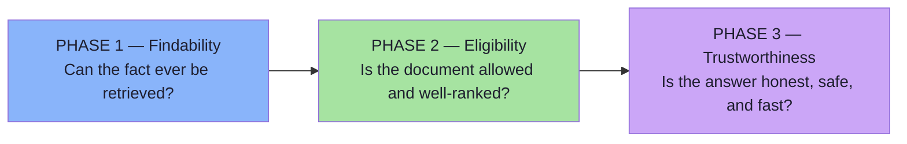
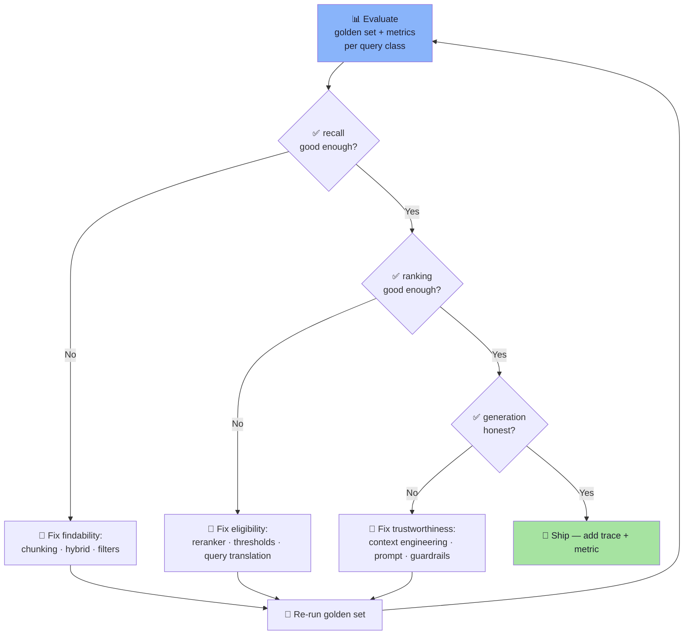

# Lecture 17 — Advanced RAG: Complete Consolidated Notes

> **This is the one-page map.** For detail, read the corresponding chapter in `notes/`. Total chapters: **8** (within the 5–10 range).

---

## The Three-Phase Model



| Phase | Control layers | Metric |
|---|---|---|
| **Findability** | Chunking · metadata attachment | `recall@20` ≥ 0.95 |
| **Eligibility** | Filters · hybrid search · RRF · reranking · query translation | `nDCG@5` ≥ 0.75, MRR ≥ 0.80 |
| **Trustworthiness** | Context engineering · guardrails · CRAG · observability · runbook | Faithfulness ≥ 0.98, refusal correctness ≥ 0.95 |

---

## Executive Summary

**Advanced RAG fixes the failure modes that survive a correct basic RAG architecture.** Basic RAG assumes the retrieved chunks contain everything needed, but real policy corpora have *competing policies* (7-day vs 30-day return windows), *exact identifiers* (SKUs like `AX-204`), and *out-of-domain* questions that should return nothing.

The advanced pipeline adds layers of **narrow guarantees**, each with a metric that proves it earned its place. The architecture separates concerns across three phases:

1. **Findability** — make facts retrievable through structural chunking and metadata-aware indexing.
2. **Eligibility** — ensure only admissible documents compete via filters, hybrid search (dense + BM25 + RRF), cross-encoder reranking, and pre-retrieval query translation.
3. **Trustworthiness** — guarantee the answer is honest, safe, and fast through context engineering (ordering, precedence, citation validation), security guardrails (PII masking, injection defense), CRAG self-correction, and a production playbook with traces, golden sets, and latency budgets.

The core design principle is **cheap and approximate over everything, expensive and accurate over a little** — bi-encoder for candidate generation, cross-encoder for reordering, HyDE/step-back for query translation, adapters for routing, and CRAG for self-correction. Every stage is backed by a feedback loop: golden-set evaluation → failure attribution → targeted fix → re-baseline.

> **Feedback loop:** The golden set is the single source of truth. When a query fails, you trace it back to a stage, change one control, re-run the golden set, and compare per-class metrics. Every incident becomes a golden-set case. This closes the loop between user pain and engineering action.

---

## Cheat Sheet

| Decision | Default | Evidence |
|---|---|---|
| Chunking | Structural 400+60 tokens | Boundary-aware splitting |
| Filters | Category, tenant, temporal; identical on both retrievers | Cross-tenant refusal test |
| Retrieval candidates | Dense + BM25 + RRF, K=20 per retriever | Per-class `recall@20` |
| Reranker | Cross-encoder (hosted), N=20, top-N=4 | `nDCG@5` delta |
| Query translation | Rewrite → Step-back → HyDE → Sub-query | Per-query-class evaluation |
| Query routing | SQL / Vector / S3 adapters, structured intent output | Correctness vs single source |
| Context engineering | Specific-first, general-last, [n] labels, precedence | Conflict probe; order-swap test |
| Guardrails | PII masking, input/output defences, capacity limits | Security operations metric |
| Latency | Async queues, caching, timeouts, streaming | p95, degraded rate, budget |
| Budget | ~2–4k prompt tokens, ≤ 5 chunks | Token efficiency |
| Refusal | Exact sentence, `mustRefuse` cases | Refusal correctness ≥ 0.95 |

---

## Decision Table: Which Technique Where

| Failure | Where you fix | Technique |
|---|---|---|
| Gold doc never retrieved | Candidate generation | Chunking, hybrid, filters |
| Doc retrieved but ranked wrong | Reordering | Cross-encoder reranking |
| Wrong doc retrieved | Exact identifiers | Hybrid search + BM25 |
| Raw query misses docs | Pre-retrieval | Query rewriting / step-back / HyDE |
| Wrong policy applied | Generation | Precedence rules, ordering |
| 30 days reads instead of 7 days | Interpretation | Context engineering (specific first) |
| No citation / hallucinated proof | Verification | Citation resolution |
| Long context loses mid-evidence | Position | Lost-in-the-middle mitigation |
| Same chunk repeated | Cleanup | Deduplication, merge adjacent |
| Out-of-domain never returns | Threshold | Calibrated floor |
| Query doesn't match source | Routing | Intent-based router + adapter layer |
| Evidence insufficient silently | Self-correction | CRAG retry loop |
| PII leaks into system / output | Security boundary | Bidirectional PII masking, guardrails |
| Model performs destructive actions | Capability limit | Answer model has no write tools |
| Traffic / cost scales 10× at load | Cost architecture | K budgeted, cached, batched, async queues |
| Slow p95 under advanced pipeline | Latency | Streaming, parallelism, async queues, fallback |

---

## The Chain of Guarantees

```
Ingestion    → recall@K  → "Can this fact ever be found?"
Filters     → empty rate → "Was the document even allowed?"
Hybrid       → identifier class → "Is it exact?"
Rerank       → nDCG@5   → "Is it near the top?"
Context      → context precision → "Did it reach the prompt?"
Generation   → faithfulness → "Was it used honestly?"
Operations   → p95 < 3s, <1% degrade → "Is it reliable?"
```

Every stage fails silently if no trace is recorded. A system without traces is a system without operability.

---

## Feedback Loop: Evaluation → Attribution → Fix → Re-baseline



**The rule:** change one control at a time, measure with the fingerprint, and only ship when per-class metrics are stable or improving.

---

## Misconceptions

| # | Misconception | Reality |
|---|---|---|
| 1 | More retrieved chunks = better answer | Dilution, cost, lost-in-the-middle |
| 2 | Reranking always helps | Only if recall@N is good enough first |
| 3 | Reranker scores are probabilities | They are query-relative, never shown as confidence |
| 4 | HyDE outputs are facts | They are retrieval signals only |
| 5 | CRAG makes evidence "trustworthy" | CRAG checks; trust must come from other guarantees |
| 6 | Prompt injection defence = XML tags alone | Tags are needed but insufficient; defense is layered |
| 7 | One aggregate score suffices | Per-class metrics expose regressions hidden in averages |
| 8 | Latency must always decrease at the cost of quality | QoE = accuracy × speed; optimize correctly |
| 9 | Versioning is cosmetic | Without fingerprints, you cannot tell what changed |
| 10 | Context engineering matters once retrieval works | If wrong doc is retrieved first, all of this is moot |

---

## Glossary

| Term | Meaning |
|---|---|
| **Bi-encoder** | Model that encodes query and documents independently; fast approximate retrieval |
| **Cross-encoder** | Model that jointly processes (query, document); accurate reordering |
| **HyDE** | Hypothetical Document Embeddings — generate a doc-like passage, embed it, retrieve |
| **RRF** | Reciprocal Rank Fusion — combines ranked lists by position, not score |
| **CRAG** | Corrective RAG — evaluate and retry when evidence is insufficient |
| **Context engineering** | Deciding what goes in the prompt, how to order it, label it, frame it |
| **Lost-in-the-middle** | Models use early/late context less than middle context |
| **Precedence rules** | Explicit instructions about which rule wins when they conflict |
| **Query translation** | Transforming a raw query into retrieval-friendly representations before embedding |
| **Query router** | Determines which data source a question belongs to |
| **Adapter** | Normalizes results from different data sources into a common format |
| **Golden set** | Held-out labelled cases for measuring retrieval and generation |
| **Fingerprint** | Version tuple (corpus, chunking, embedder, retrieval, reranker, prompt, llm) |
| **Refusal correctness** | System refuses unanswerable queries correctly |
| **Token efficiency** | Correct answers per 1k prompt tokens |

---

## 20 Self-Check Questions

1. What two failure classes does Chapter 01 identify?
2. Why can dense retrieval blur SKU `AX-204` to `BX-900`?
3. How do overlap windows create duplicates, and how are they deduplicated?
4. Why must metadata filters apply identically to both dense and lexical retrievers?
5. How does RRF avoid the problem raw scores cannot solve?
6. When is a reranker's value biggest — and when does it help nothing?
7. Why do rerank scores differ from embedding scores?
8. What happens when chunks exceed the cross-encoder's max sequence length?
9. In which order should rerank, RRF, and re-ranking occur?
10. How does HyDE change the query representation, and what is the caveat?
11. Under what condition should the vector DB never receive a query?
12. Why must CRAG bounded retries exist?
13. What is the recovered inference cost of reranking 20 candidates?
14. Why must policy rules go in the *system* prompt, not the *context*?
15. What is the U-shaped attention pattern, and where should context end?
16. Why should you drop whole chunks instead of truncating the last one?
17. What trace fields make every incident diagnosable after the fact?
18. Which control does L0→L5 stop at for a 50-page internal tool corpus?
19. What produces an invalid citation marker, and what is fixed by validation?
20. If reducing K_ctx halves generation cost and improves accuracy, is the cost decision correct?

---

## Chapter Reference

For full detail, see the chapter files in `notes/`:

| File | Title | Key takeaway |
|---|---|---|
| `01_Why_Basic_RAG_Breaks.md` | Two failure classes | First line of defence: don't assume coverage |
| `02_Chunking_Strategies.md` | Fixed, structural, semantic, parent-child | Make the corpus findable |
| `03_Retrieval_Controls.md` | Top-K, thresholds, filters | Ensure only admissible documents compete |
| `04_Hybrid_Search_and_RRF.md` | Dense + BM25 fusion | Bridge exact terms and semantics |
| `05_Reranking_Two_Stage_Retrieval.md` | Cross-encoder reordering | Separate finding from ranking |
| `06_Query_Processing.md` | Translation, decomposition, HyDE, routing | Clean up the question before retrieval |
| `07_Context_Engineering.md` | Ordering, labels, precedence, budget | Make the right fact the most salient |
| `08_Production_RAG.md` | Guardrails, latency, golden set, runbook | Operate a defendable system |