# Chapter 01 — Limitations of Vector RAG & the Abrupt Chunking Problem

## 1.1 What Is Traditional Vector RAG?

**Retrieval-Augmented Generation (RAG)** improves an LLM by retrieving relevant information from an external knowledge base before generating an answer.

In traditional **Vector RAG**, documents are converted into embeddings (dense numerical vectors) and stored in a vector database such as Qdrant, Pinecone, Chroma, or Milvus. When a user asks a question, the query is also converted into an embedding, and the system searches for the chunks with the highest similarity scores.

### Traditional Vector RAG Pipeline

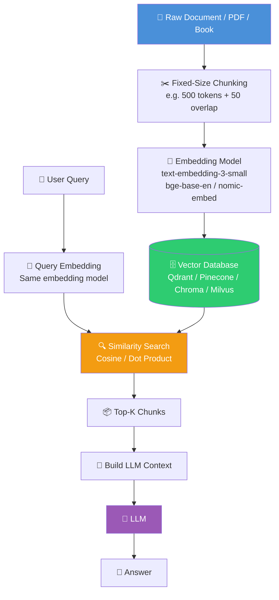

### The Basic Idea

```text
Document
   ↓
Split into chunks
   ↓
Create embeddings
   ↓
Store in Vector DB

User Query
   ↓
Create query embedding
   ↓
Find similar chunks
   ↓
Send chunks to LLM
   ↓
Generate answer
```

### Pseudo-Code: Traditional Vector RAG Pipeline

```typescript
// Traditional Vector RAG Pipeline — Pseudo Code (TypeScript/JS)
// This shows the logical flow; actual implementations use SDKs and vector DB clients.

type Document = { id: string; content: string; metadata?: Record<string, unknown> };
type Chunk = { id: string; text: string; documentId: string; startOffset: number; endOffset: number };
type Embedding = number[];
type Answer = string;

interface EmbeddingModel {
  embed(text: string): Promise<Embedding>;
}

interface VectorDB {
  upsert(chunks: Array<{ id: string; vector: Embedding; payload: Chunk }>): Promise<void>;
  similaritySearch(queryVector: Embedding, k: number): Promise<Chunk[]>;
}

interface LLM {
  generate(prompt: string): Promise<string>;
}

async function traditionalVectorRAG(
  documents: Document[],
  query: string,
  embeddingModel: EmbeddingModel,
  vectorDB: VectorDB,
  llm: LLM,
  k: number = 5
): Promise<Answer> {
  // ── Ingestion Phase ──
  const chunks: Chunk[] = documents.flatMap(doc =>
    fixedSizeChunk(doc.content, { size: 500, overlap: 50 })
  );

  const embeddedChunks = await Promise.all(
    chunks.map(async (chunk) => ({
      id: chunk.id,
      vector: await embeddingModel.embed(chunk.text),
      payload: chunk,
    }))
  );

  await vectorDB.upsert(embeddedChunks);

  // ── Retrieval Phase ──
  const queryEmbedding = await embeddingModel.embed(query);
  const topKChunks = await vectorDB.similaritySearch(queryEmbedding, k);

  // ── Generation Phase ──
  const context = topKChunks.map((c) => c.text).join("\n\n");
  const prompt = `Answer the question using only this context:\n\nContext:\n${context}\n\nQuestion:\n${query}`;
  return llm.generate(prompt);
}

function fixedSizeChunk(content: string, opts: { size: number; overlap: number }): Chunk[] {
  const chunks: Chunk[] = [];
  let start = 0;
  let id = 0;
  while (start < content.length) {
    const end = Math.min(start + opts.size, content.length);
    chunks.push({
      id: `chunk_${id++}`,
      text: content.slice(start, end),
      documentId: "unknown",
      startOffset: start,
      endOffset: end,
    });
    start = end - opts.overlap;
  }
  return chunks;
}
```

This works well for **simple questions over relatively simple documents**.

However, problems become more obvious when working with large, structured documents such as:

* 📊 Financial reports and 10-K filings
* ⚖️ Legal contracts and terms of service
* 🏗️ Engineering manuals and technical specifications
* 🏥 Medical literature and clinical guidelines
* 📚 Textbooks and academic papers
* 🏢 Enterprise documentation and internal wikis

The biggest problem starts with **how we split the document**.

---

## 1.2 The Abrupt Chunking Problem

Traditional Vector RAG commonly uses **fixed-size chunking**.

For example:

```text
Chunk size: 500 tokens
Overlap:    50 tokens
```

The system does not necessarily care where a paragraph, section, table, or logical argument ends. It simply cuts the document into windows of a fixed token size.

### Example: ALB Session Persistence

Suppose the original document says:

```text
Section 3.2: Load Balancing Architectures

The system utilizes two distinct distribution tiers:
Content Delivery Networks (CDNs) and Application Load
Balancers (ALBs).

High-volume static assets are served directly via the
CDN edge nodes.

--------------- CHUNK BOUNDARY ---------------

For dynamic user session state preservation, the ALB
employs sticky sessions based on an encrypted browser
cookie.

If session persistence fails, requests fallback to
round-robin routing across downstream application servers.
```

The chunk boundary has separated two pieces of the same idea.

The second chunk may now look like:

```text
For dynamic user session state preservation, the ALB
employs sticky sessions based on an encrypted browser
cookie.

If session persistence fails, requests fallback to
round-robin routing across downstream application servers.
```

But the model may no longer know that this belongs to:

```text
Section 3.2
   ↓
Load Balancing Architectures
   ↓
Application Load Balancers
   ↓
Session Persistence
```

### Why This Matters

Without the structural heading chain, the LLM cannot answer:

* What document is this from?
* Which section?
* What architecture is being discussed?
* What problem are sticky sessions solving?
* What came before this statement?

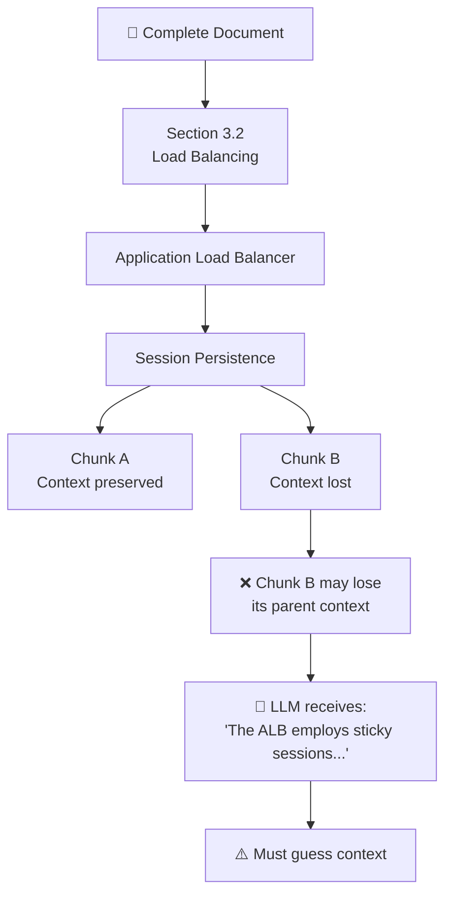

---

## 1.3 Why Abrupt Chunking Is a Problem

There are three major problems caused by fixed-size chunking.

### 1.3.1 Loss of Global & Chapter Context

Each chunk becomes an almost independent piece of text. The system loses knowledge of the surrounding document structure.

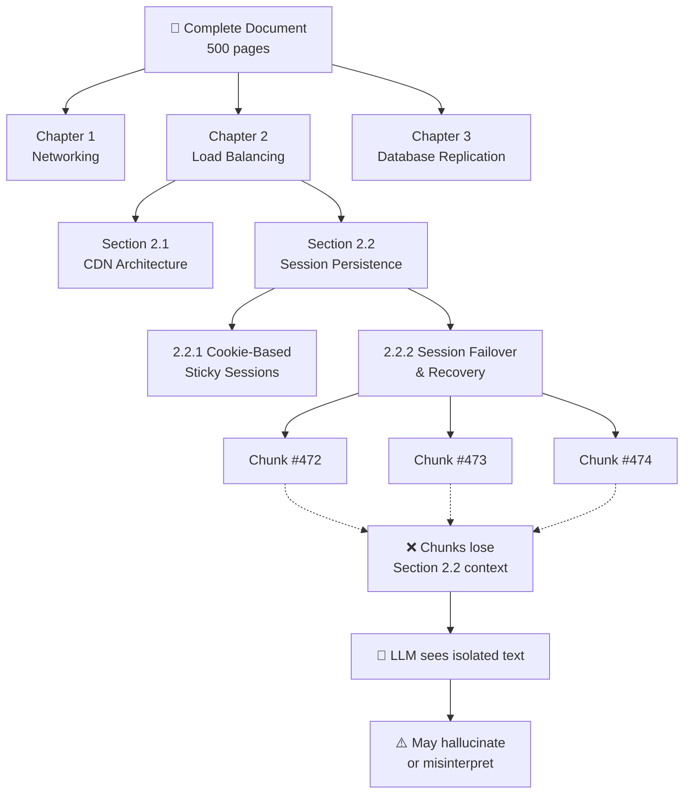

**Key Idea:**

> **A chunk contains text, but not necessarily the full meaning of that text.**

### 1.3.2 Semantic Boundary Fragmentation

Real documents do not naturally follow fixed token boundaries. A logical unit might be:

```text
Heading
   ↓
Paragraph
   ↓
Example
   ↓
Table
   ↓
Explanation
```

But fixed chunking might produce:

```text
Heading + half paragraph
        ↓
-----------------
Chunk Boundary
-----------------
half paragraph + table
        ↓
-----------------
Chunk Boundary
-----------------
table + explanation
```

This can break the relationship between different pieces of information.

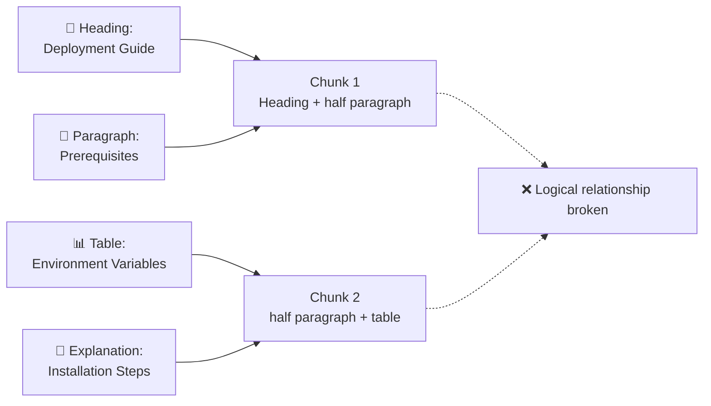

The result can be **incomplete or misleading retrieval**.

### 1.3.3 Dangling References & Anaphora Problems

Documents frequently use references such as:

* "This mechanism..."
* "As discussed above..."
* "It requires..."
* "The previous method..."
* "This approach..."
* "The following configuration..."

These statements depend on previous context.

### Example: Anaphora Break

```text
Paragraph 1:
The ALB uses encrypted cookies to maintain session state
across multiple backend instances.

Paragraph 2:
This mechanism prevents users from being redirected
between different backend servers during failover.
```

If the second paragraph is retrieved alone:

```text
"This mechanism prevents users from being redirected
between different backend servers during failover."
```

What does **"this mechanism"** refer to?

The LLM has to guess.

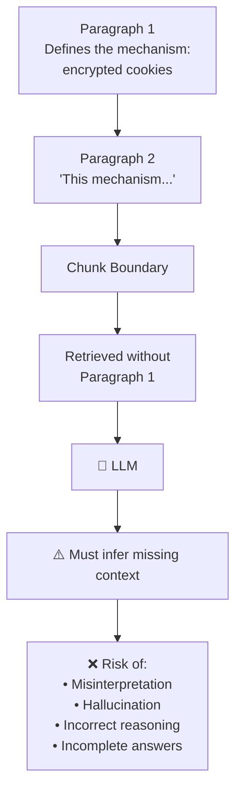

---

## 1.4 Embedding Model Limitations

Vector RAG depends on embedding models to convert text into vectors. These models introduce their own limitations:

### Limitations of Embedding Models

| Limitation | Description | Impact on Retrieval |
|------------|-------------|---------------------|
| **Dimension collapse** | Similar meanings can collapse to nearby points | Loss of fine-grained distinction |
| **Training data bias** | Model reflects biases in its training corpus | Skewed relevance for domain-specific content |
| **Domain mismatch** | General embedding model vs. specialized domain | Poor semantic match for technical/legal/medical text |
| **Token truncation** | Models truncate at fixed token limits (e.g., 512 tokens) | Long paragraphs lose tail information |
| **No structural awareness** | Embeddings capture meaning, not document position | Section hierarchy is completely lost |

### Example: Domain Mismatch

A general-purpose embedding model may encode "ALB" as semantically close to "album" (music) rather than "Application Load Balancer" (infrastructure), because "album" is more common in general training data.

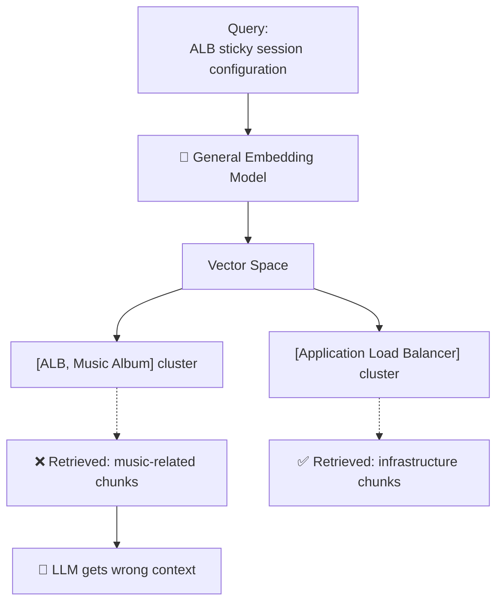

---

## 1.5 Similarity ≠ Relevance

This is one of the most important concepts in Vector RAG.

Traditional vector search assumes that:

```text
Semantic Similarity ≈ Relevance
```

But in real-world retrieval:

```text
Similarity ≠ Contextual Relevance
```

### Semantic Similarity vs. Contextual Relevance — The Nuanced Difference

**Semantic Similarity** measures how closely the *meaning* of two text pieces aligns in vector space. It captures:

* Shared vocabulary and terminology
* Related concepts and topics
* Syntactic and semantic patterns

**Contextual Relevance** measures whether a piece of text *actually answers the user's specific question* within the correct context. It requires:

* Understanding the user's intent and question type
* Knowing the document's logical structure
* Verifying that retrieved content addresses the specific query
* Ensuring completeness (not just a fragment of the answer)

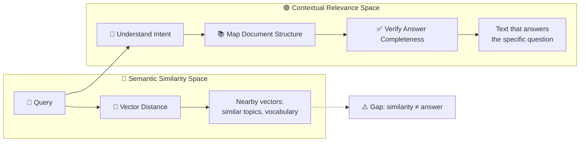

A chunk can be **semantically similar to the query** without being **contextually relevant** to the specific question.

### Example

User asks:

> "How does ALB sticky-session failure recovery work?"

Vector search might retrieve:

```text
CDN traffic distribution
Load balancing
Static asset caching
HTTP traffic routing
```

These topics are semantically related to the query (they share "load balancing", "traffic", "routing" vocabulary).

But the actual answer may exist in a section titled:

```text
Fault Tolerance & Recovery
```

which may not contain the exact words **"sticky session failure recovery."**

---

## 1.6 Common Similarity Search Failure Modes

| Failure Mode | What Happens | Example |
|--------------|--------------|---------|
| **Similar but Irrelevant** | Retrieved text is related but doesn't answer the question | CDN caching retrieved for an ALB session question |
| **Relevant but Not Similar** | Correct information uses different terminology | "Fault Tolerance" contains the answer to a "session recovery" query |
| **Contextual Inversion** | Retrieved chunk contains the right keywords but the wrong meaning | "Feature is deprecated and disabled" retrieved for "How to enable feature?" |

### 1.6.1 Similar but Irrelevant

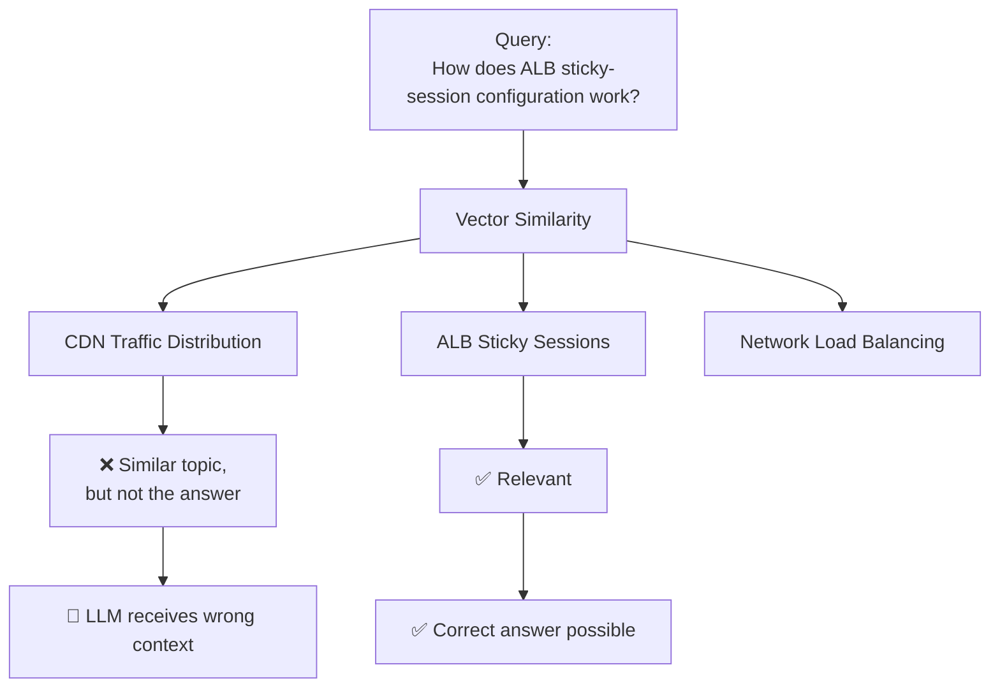

The vector database doesn't inherently understand:

> "This chunk discusses the same general topic, but it doesn't answer the user's actual question."

### 1.6.2 Relevant but Not Similar

Sometimes the correct information doesn't use the same terminology as the query.

#### User Query

> "How is session persistence recovered after failure?"

#### Relevant Section

```text
Section 4: Fault Tolerance
```

The section might explain retry mechanisms and recovery policies without ever mentioning **"session persistence"**.

A pure similarity search can rank it too low.

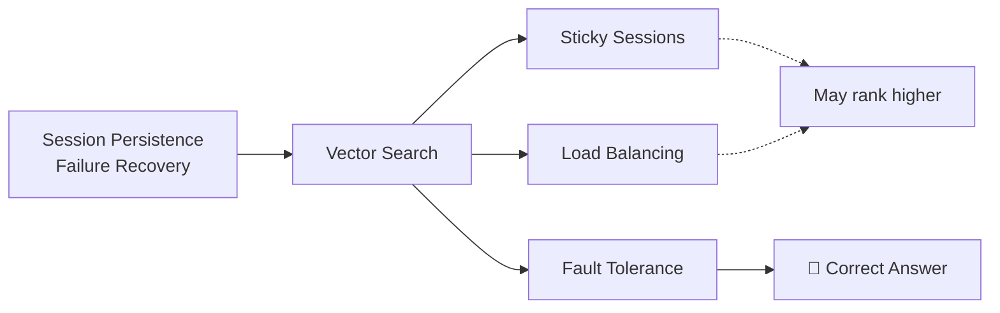

### 1.6.3 Contextual Inversion

This happens when a chunk contains exactly the words we're searching for but gives the **opposite meaning**.

#### Document

```text
The feature was previously available.

However, this feature is deprecated
and disabled in version 2.
```

#### Query

> "How do I enable the feature in version 2?"

The chunk contains:

```text
feature
version 2
```

So it may rank highly.

But the actual answer is:

> The feature is disabled in version 2.

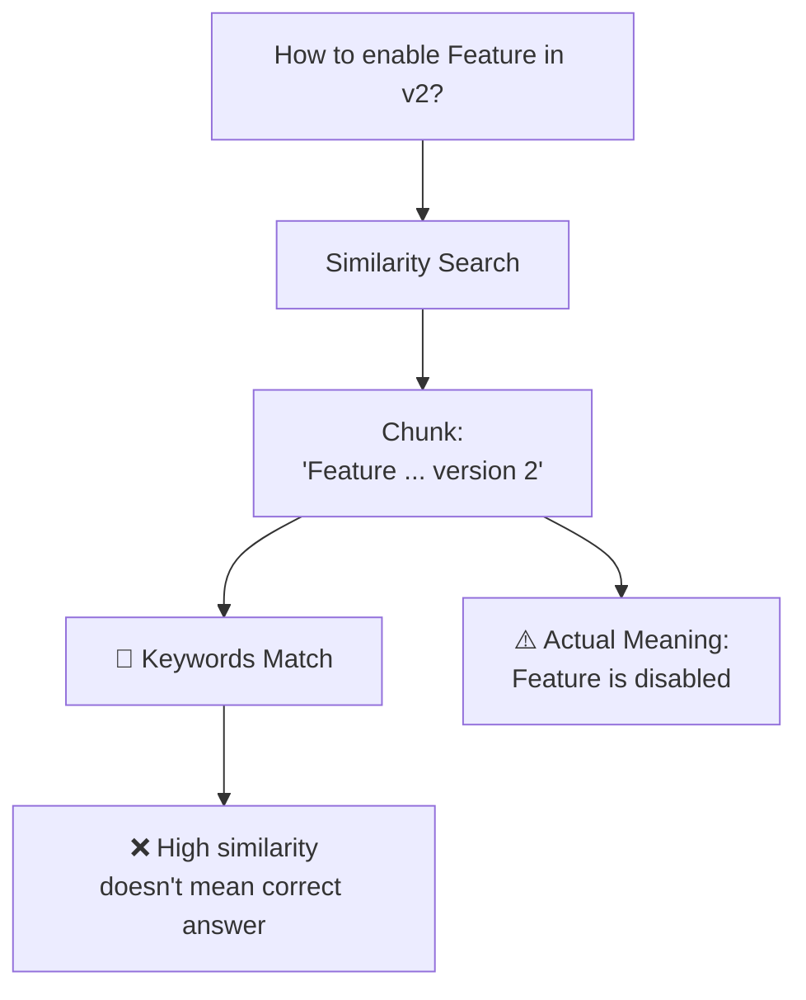

---

## 1.7 Vibe Retrieval & Opaque Scoring

Vector databases commonly use mathematical distance metrics such as:

* Cosine similarity
* Euclidean distance
* Dot product

For example, cosine similarity is:

```text
Cosine Similarity(u,v) = (u · v) / (|u||v|)
```

The important problem isn't the mathematics itself. The problem is **what the score actually tells us**.

### Example

Suppose the database returns:

```text
Chunk #47 → 0.82
Chunk #12 → 0.79
Chunk #31 → 0.75
```

We know that Chunk #47 is mathematically closer.

But we don't automatically know:

* Why is it more relevant?
* Does it actually answer the question?
* Is important context missing?
* Is the information complete?
* Does the chunk contradict another section?
* Is the chunk from the correct section?

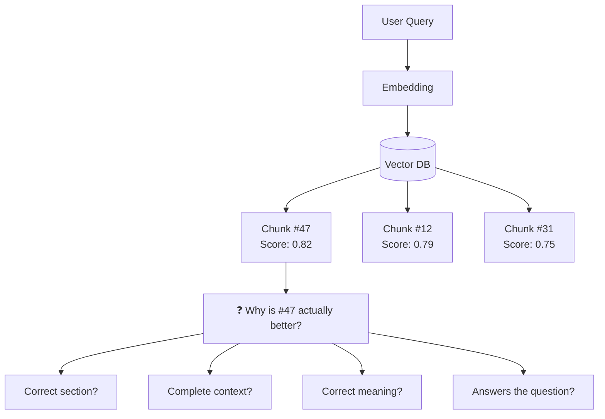

---

## 1.8 What Is "Vibe Retrieval"?

**Vibe Retrieval** is a useful way to describe retrieval where the system effectively says:

> "This text looks similar to what you're asking about, so I'll retrieve it."

The vector model is excellent at representing semantic relationships, but the similarity score itself does not provide a complete explanation of **logical relevance**.

### The Problem

```text
Similarity Score
       ↓
"Looks related"
       ↓
Retrieved
       ↓
LLM assumes relevance
```

But what we really want is:

```text
User Query
     ↓
Understand intent
     ↓
Understand document structure
     ↓
Identify relevant section
     ↓
Verify relevance
     ↓
Retrieve complete context
```

---

## 1.9 Why Vector Retrieval Is Difficult to Audit

When debugging a retrieval system, engineers may ask:

> "Why did this chunk get retrieved?"

With vector similarity, the direct answer is often:

> "Because its embedding was closer."

That doesn't explain the **business or logical reason**.


This makes retrieval failures harder to debug and audit.

---

## 1.10 Why This Matters in Professional Documents

These problems become much more serious when the source material is mission-critical.

### 📊 Financial Documents

A financial table could be split in the middle of a row:

```text
Revenue | 2024 | 2025
--------|------|------
Product | 100  | 120
Services| 80   |
--------- CHUNK ---------
         | 90
```

The retrieved context may no longer represent the complete table.

### ⚖️ Legal Documents

A contract clause may depend on definitions introduced earlier:

```text
Definitions
    ↓
"Liability"
    ↓
"Covered Loss"
    ↓
Liability Cap
```

Retrieving only the liability-cap clause without its definitions can change its interpretation.

### 🏗️ Technical Documentation

A setup instruction might depend on prerequisites:

```text
Prerequisites
    ↓
Environment Variables
    ↓
Installation
    ↓
Configuration
    ↓
Deployment
```

If retrieval returns only:

```text
Deployment Configuration
```

without the prerequisites, the generated recommendation may be incorrect.

### 🏥 Medical Literature

A clinical guideline may reference a dosage table on a previous page:

```text
Section 2: Drug Interactions
    ↓
See Table 3.1 for contraindications
```

Retrieving Section 2 without Table 3.1 may lead to incorrect medical advice.

---

## 1.11 The Bigger Problem

The two major weaknesses can be summarized as:

### Problem 1 — Fragmented Context

Fixed-size chunking can destroy the original document's structure.

### Problem 2 — Opaque Retrieval

Vector similarity can retrieve text that is mathematically similar but not logically relevant.

Together:

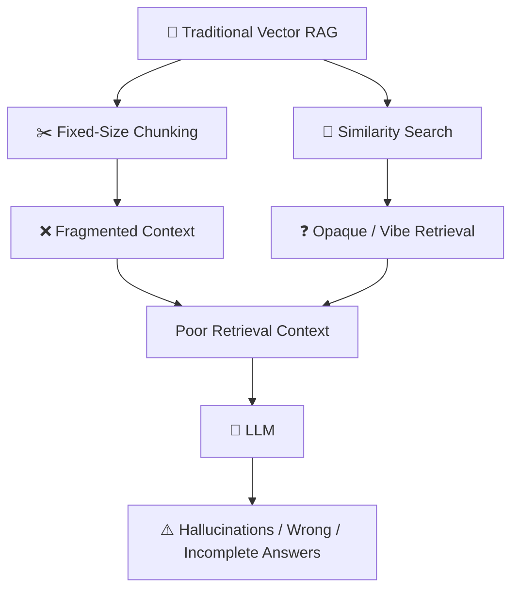

---

## 1.12 Why Vectorless RAG?

The limitations above lead to a different question:

> **What if we preserve the document's structure instead of destroying it during chunking?**

Instead of:

```text
Document
   ↓
Fixed Chunks
   ↓
Embeddings
   ↓
Similarity Search
```

we can build:

```text
Document
   ↓
Understand Structure
   ↓
Build Hierarchical Tree
   ↓
Navigate Relevant Branch
   ↓
Retrieve Complete Context
```

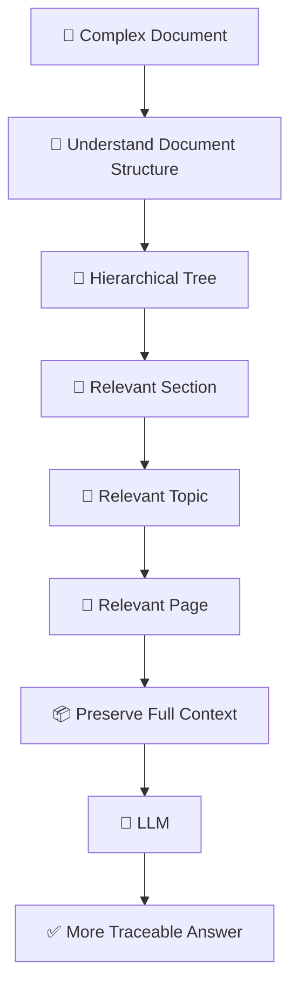

This is the foundation for the next topic:

> **Vectorless RAG & Hierarchical Tree-Based Indexing.**

---

## 1.13 Zero-Vector Relevance Reasoning

The core insight from the failure modes above is that **similarity scoring alone cannot determine relevance**. What if we could determine relevance *without* computing any vector similarity at all?

**Zero-vector relevance reasoning** replaces embedding-based similarity with structural and semantic understanding:

1. **Parse the document structure** (headings, sections, pages, tables)
2. **Understand the query intent** using the LLM itself
3. **Navigate to the relevant structural region** based on topic alignment
4. **Retrieve complete context** from that region, not isolated chunks

This means:

* No vector database required
* No embedding model needed at inference time
* Relevance determined by logical position in document structure, not distance in vector space
* Full traceability: you know *why* a section was retrieved (because its heading matches the query intent)

### Pseudo-Code: Zero-Vector Relevance Reasoning

```typescript
// Zero-vector relevance reasoning — no embeddings, no similarity math
type DocumentTree = {
  root: TreeNode;
  nodes: Map<string, TreeNode>;
};

type TreeNode = {
  nodeId: string;
  title: string;
  level: number;              // 0=doc, 1=chapter, 2=section, 3=subsection
  pageRange: [number, number];
  parentId: string | null;
  childrenIds: string[];
  summary: string;
  keywords: string[];
  entities: string[];
  sourceFile: string;
};

type QueryIntent = {
  originalQuery: string;
  parsedIntent: string;
  topics: string[];
  entities: string[];
};

type RelevantRegion = {
  node: TreeNode;
  score: number;
  navigationPath: string[];
};

async function zeroVectorRelevance(
  docTree: DocumentTree,
  query: string,
  llm: { generate(prompt: string): Promise<string> }
): Promise<RelevantRegion> {
  // 1. Extract intent from query using LLM
  const intent: QueryIntent = await llm.generate(
    `Extract the intent, topics, and entities from this query:\n"${query}"\n` +
    `Return JSON with fields: parsedIntent, topics, entities`
  );

  // 2. Find candidate nodes by topic keyword match on summaries
  const candidateNodes = Array.from(docTree.nodes.values()).filter((node) =>
    intent.topics.some((topic) =>
      node.summary.toLowerCase().includes(topic.toLowerCase()) ||
      node.keywords.some((k) => k.toLowerCase().includes(topic.toLowerCase()))
    )
  );

  // 3. Score each candidate using LLM-based relevance judgment (zero-vector)
  const scored = await Promise.all(
    candidateNodes.map(async (node) => {
      const score = await llmScoreRelevance(node, intent, llm);
      return { node, score };
    })
  );

  // 4. Return the highest-scored node
  const best = scored.sort((a, b) => b.score - a.score)[0];

  // 5. Build navigation path from root to this node
  const navigationPath = buildNavigationPath(docTree, best.node);

  return {
    node: best.node,
    score: best.score,
    navigationPath,
  };
}

async function llmScoreRelevance(
  node: TreeNode,
  intent: QueryIntent,
  llm: { generate(prompt: string): Promise<string> }
): Promise<number> {
  const prompt = `
    Node Title: ${node.title}
    Node Summary: ${node.summary}
    Node Keywords: ${node.keywords.join(", ")}
    Node Entities: ${node.entities.join(", ")}
    Node Page Range: ${node.pageRange.join("–")}

    User Query: "${intent.originalQuery}"
    Extracted Intent: ${intent.parsedIntent}
    Required Topics: ${intent.topics.join(", ")}
    Required Entities: ${intent.entities.join(", ")}

    On a scale of 0 to 100, how likely does this node contain
    the information needed to answer the query?
    Output only a number.
  `;

  const score = parseInt(await llm.generate(prompt));
  return isNaN(score) ? 0 : score;
}

function buildNavigationPath(
  docTree: DocumentTree,
  node: TreeNode
): string[] {
  const path: string[] = [];
  let current: TreeNode | null = node;

  while (current) {
    path.unshift(current.title);
    current = current.parentId ? docTree.nodes.get(current.parentId) ?? null : null;
  }

  return path;
}
```

This reasoning approach forms the foundation for **Vectorless RAG**, where document structure replaces vector similarity as the primary retrieval mechanism.

---

## 1.14 Common Mistakes

| # | Mistake | Why It's Wrong |
|---|---------|----------------|
| 1 | Assuming higher cosine similarity always means a better answer | Similarity measures mathematical distance, not logical relevance |
| 2 | Using fixed-size chunking without regard to document structure | Breaks headings, tables, and logical paragraphs |
| 3 | Retrieving chunks without parent context | Leaves dangling references and anaphora unresolved |
| 4 | Treating similarity scores as explanations | A score of 0.82 does not tell you why a chunk is relevant |
| 5 | Ignoring document type when choosing a RAG strategy | Financial tables and legal clauses need structural preservation |
| 6 | Using a general embedding model for domain-specific text | Poor semantic match for technical, legal, or medical content |

---

## 1.15 Key Takeaways

1. **Vector RAG converts documents to embeddings and retrieves via similarity search.**
2. **Fixed-size chunking destroys document structure by cutting at token boundaries, not logical ones.**
3. **Chunking causes loss of global context, semantic fragmentation, and dangling references.**
4. **Similarity does not equal relevance — a chunk can be similar without answering the question.**
5. **Common failure modes: similar-but-irrelevant, relevant-but-not-similar, contextual inversion.**
6. **Vibe retrieval means retrieving chunks that "look related" without verifying logical relevance.**
7. **Opaque scoring makes vector retrieval difficult to audit and debug.**
8. **Professional documents (financial, legal, technical, medical) are especially harmed by fragmented context.**
9. **Semantic similarity and contextual relevance are different concepts — similarity measures vector distance, relevance measures answer quality.**
10. **Embedding models have limitations: dimension collapse, training bias, domain mismatch, token truncation, no structural awareness.**
11. **Zero-vector relevance reasoning replaces similarity scoring with structural navigation + LLM-based relevance judgment.**
12. **The alternative is to preserve document structure through hierarchical tree indexing.**
13. **Vectorless RAG replaces similarity-first retrieval with structure-first retrieval.**

> **Mental Model:** Vector RAG asks, "Which chunks are similar?" Vectorless RAG asks, "Where in the document structure should I look?"

---
