# Chapter 02 — Vectorless RAG & Tree-Structured Indexing

## 2.1 What Is Vectorless RAG?

**Vectorless RAG** is a retrieval approach that does not depend primarily on:

* ❌ Vector embeddings
* ❌ Vector databases
* ❌ Fixed-size token chunks
* ❌ Pure similarity search

Instead, it builds a **hierarchical tree representation of the document** and uses an LLM to navigate that tree. Systems such as **PageIndex** follow this general tree-based approach.

### Core Idea

> **Instead of searching through random chunks, understand the document's structure and navigate to the relevant section.**

This is a fundamental shift from similarity-first retrieval to structure-first retrieval.

### Traditional Vector RAG vs Vectorless RAG

**Traditional Vector RAG:**

```text
Document
   ↓
Fixed-size chunks
   ↓
Embeddings
   ↓
Vector Database
   ↓
Similarity Search
   ↓
Top-K Chunks
   ↓
LLM
   ↓
Answer
```

**Vectorless RAG:**

```text
Document
   ↓
Understand structure
   ↓
Build hierarchical tree
   ↓
Navigate relevant branches
   ↓
Retrieve exact section/page
   ↓
Full context
   ↓
LLM
   ↓
Answer
```

### Architecture Comparison

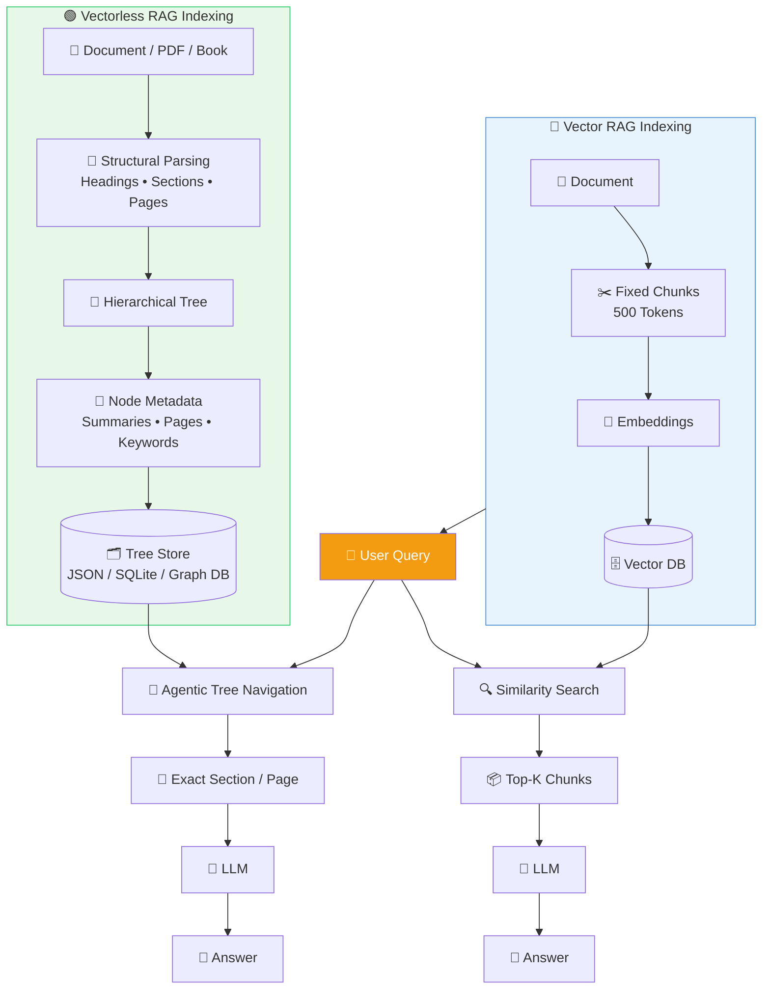

The key difference is **how the system thinks about a document**.

---

## 2.2 The Core Paradigm Shift

The biggest difference is how the system thinks about a document.

### Human Expert Model

Imagine a lawyer working with a 500-page contract. They don't:

```text
Cut document into 5,000 random pieces
       ↓
Shuffle them
       ↓
Find pieces that look similar
```

Instead, they naturally navigate:

```text
Contract
   ↓
Table of Contents
   ↓
Relevant Chapter
   ↓
Relevant Section
   ↓
Specific Clause
   ↓
Read surrounding context
```

### Human Expert vs Vectorless RAG

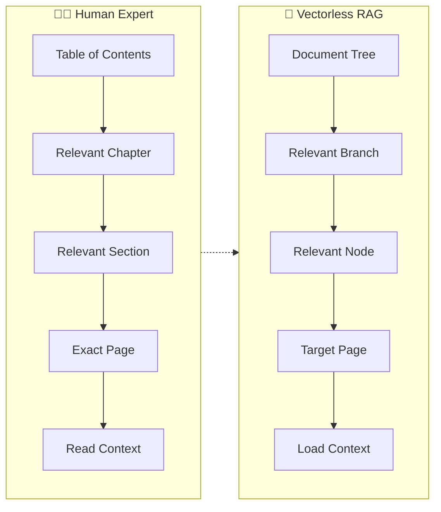

The key idea is:

> **Search the structure first, then retrieve the content.**

---

## 2.3 Vector RAG vs Vectorless RAG — Detailed Comparison

| Feature | 🔵 Vector RAG | 🟢 Vectorless RAG |
|---------|---------------|-------------------|
| **Index** | Flat vector space | Hierarchical tree |
| **Representation** | Dense embeddings | Structural metadata |
| **Chunking** | Fixed token windows | Natural document units |
| **Indexing** | Embedding model | Structural parsing + LLM |
| **Retrieval** | k-NN similarity search | LLM tree navigation |
| **Database** | Vector DB | JSON / SQLite / Graph DB |
| **Explainability** | Similarity score | Explicit navigation path |
| **Context** | Often isolated chunks | Hierarchical context |
| **Page tracing** | Not always natural | Built into tree structure |
| **Multi-hop queries** | Can struggle | Better suited |
| **Document scope** | Best for simple/unstructured | Best for long/structured |
| **Auditability** | Opaque | High |

### Example Comparison

Vector RAG might tell you:

```text
Result #1
Similarity: 0.814
Chunk: #472
```

Vectorless RAG can tell you:

```text
Root
 ↓
Chapter 2
 ↓
Section 2.2
 ↓
Subsection 2.2.2
 ↓
Pages 181–200
```

The second approach provides a much more understandable retrieval path.

---

## 2.4 Structural Document Parsing — The Root → Chapter → Section → Page Hierarchy

The heart of Vectorless RAG is the **document tree**. Instead of treating a 500-page document as thousands of independent chunks, we preserve its natural hierarchy.

### Example: Distributed Systems Architecture Handbook

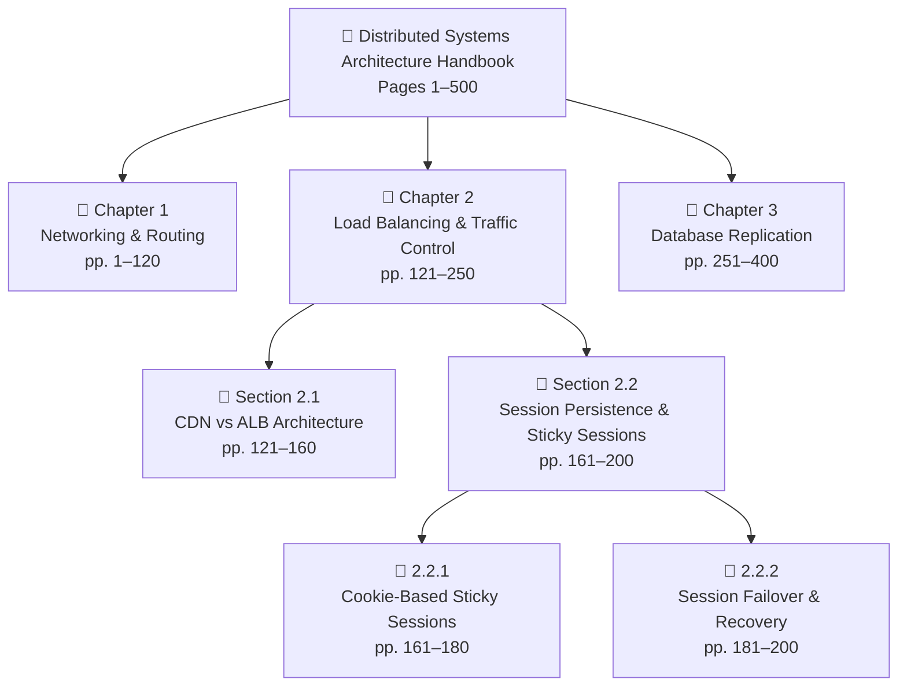

This structure gives every piece of information a **place inside the document**.

### Generic Tree Pattern

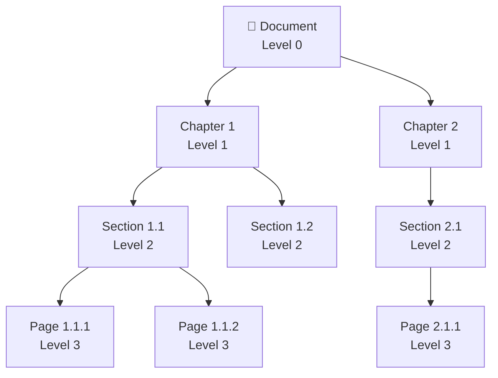

**Key Insight:** Every piece of information has an explicit address in this hierarchy.

---

## 2.5 Why Hierarchy Matters — Structural Reasoning

Consider this question:

> **"How does session failover work when an ALB server crashes?"**

A vector search might look for:

```text
session
failover
ALB
server
crash
```

But Vectorless RAG can reason through the document's **explicit structure**:

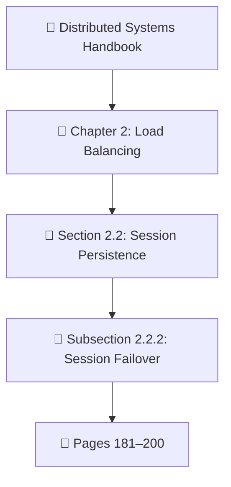

The retrieval path itself provides useful context. The hierarchy ensures that we look at the **correct logical context** — failover within the realm of load balancing — not just any document mentioning "session" and "failover".

### Structural Navigation vs. Vector Similarity

| Question | Vector Search Looks For | Vectorless RAG Navigates |
|----------|------------------------|--------------------------|
| "How does session failover work when an ALB crashes?" | Keywords: session, failover, ALB | Chapter 2 → Section 2.2 → Subsection 2.2.2 → Pages 181–200 |
| "What are the retry policies?" | Keywords: retry, policy | Chapter 3 → Section 3.4 → Subsection 3.4.1 |

---

## 2.6 Anatomy of a Tree Node

A tree node isn't just a title. It contains metadata that helps the LLM understand what exists at that location.

### Example Node

```json
{
  "node_id": "sec_2_2",
  "title": "Session Persistence & Sticky Sessions",
  "level": 2,
  "page_range": [161, 200],
  "parent_id": "ch_2",
  "children_ids": [
    "sub_2_2_1",
    "sub_2_2_2"
  ],
  "summary": "Covers session state management across distributed load balancers, including cookie-based sticky sessions, timeout thresholds, and failover behavior.",
  "keywords": [
    "sticky sessions",
    "ALB",
    "session persistence",
    "cookie routing",
    "failover"
  ],
  "entities": [
    "Application Load Balancer",
    "Browser Cookies",
    "Memcached"
  ],
  "source_file": "distributed_systems_v2.pdf",
  "last_updated": "2024-06-15",
  "relevance_score": null
}
```

Think of the node as a **map marker**, not necessarily the complete content.

### Node Metadata Fields

| Field | Purpose |
|-------|---------|
| **node_id** | Unique identifier for lookup |
| **title** | Human-readable section name |
| **level** | Depth in hierarchy (0=doc, 1=chapter, 2=section, 3=subsection) |
| **page_range** | [start, end] page numbers in original document |
| **parent_id** | Link to parent node (lineage) |
| **children_ids** | List of child node IDs |
| **summary** | LLM-generated compressed overview (~50–100 tokens) |
| **keywords** | Topic keywords for matching |
| **entities** | Named entities extracted from content |
| **source_file** | Original document file path |
| **last_updated** | Timestamp for cache invalidation |

---

## 2.7 Explicit Lineage — Traceable Retrieval

One of the biggest advantages of a tree index is **lineage**. Every node knows where it belongs.

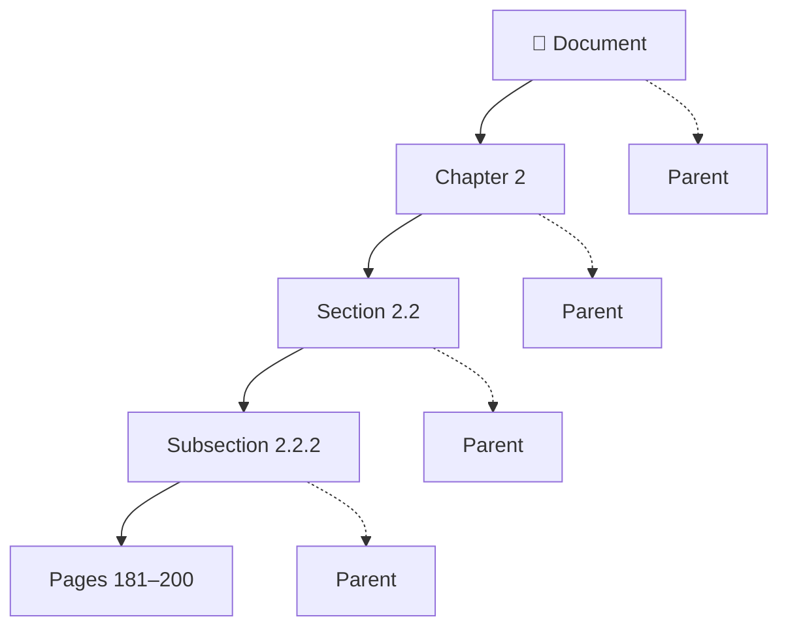

So when the system retrieves:

```text
Subsection 2.2.2
```

it also knows:

```text
Document
 → Chapter 2
 → Section 2.2
 → Subsection 2.2.2
```

This makes the retrieval path **traceable**.

### Pseudo-Code: Building Lineage Path

```typescript
type TreeNode = {
  nodeId: string;
  title: string;
  parentId: string | null;
  pageRange: [number, number];
};

type NavigationPath = {
  nodes: TreeNode[];
  pathString: string;
};

function buildLineagePath(
  tree: Map<string, TreeNode>,
  node: TreeNode
): NavigationPath {
  const nodes: TreeNode[] = [];
  let current: TreeNode | null = node;

  while (current) {
    nodes.unshift(current);
    current = current.parentId ? tree.get(current.parentId) ?? null : null;
  }

  const pathString = nodes.map((n) => n.title).join(" → ");

  return { nodes, pathString };
}
```

---

## 2.8 Lazy Loading — Content Stays in the Source Document

A very important concept is **lazy loading**. The active tree doesn't necessarily need to contain every page of raw document text.

Instead:

```text
Tree Node
 ├── Title
 ├── Summary
 ├── Keywords
 ├── Page Range
 └── Relationships
```

The actual content can remain in the original document.

### Lazy Loading Flow

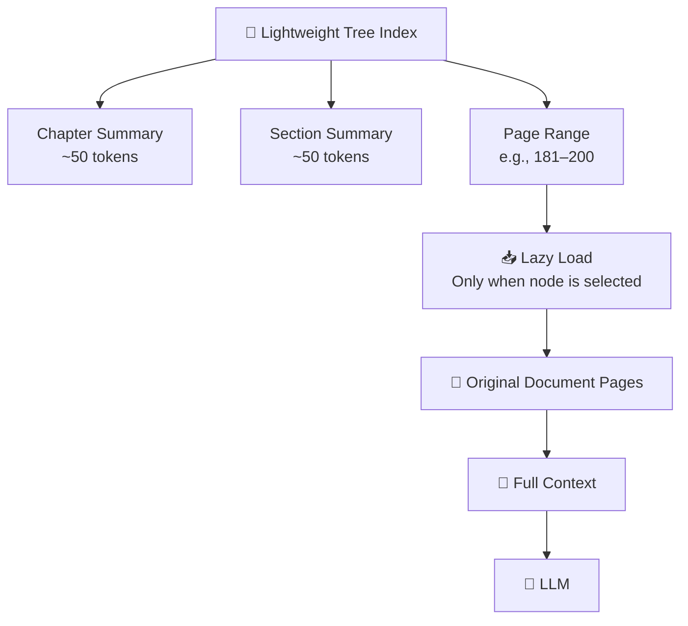

### Why Lazy Loading?

Because the system doesn't need to load the entire 500-page document into the active retrieval context.

| Approach | Tokens Loaded | Use Case |
|----------|---------------|----------|
| Load entire document | All pages | Tiny documents only |
| Vector RAG Top-K | K chunks | Simple semantic queries |
| Vectorless + Lazy Load | Tree metadata + target pages | Long structured documents |

---

## 2.9 Zero-Vector Storage

Vectorless RAG does not require embeddings for its primary index. The tree can be stored using ordinary data structures.

### Storage Options

```text
JSON
SQLite
PostgreSQL
Graph Database
Document Database (MongoDB, etc.)
```

### Simplified Structure

```text
Root
├── Chapter 1
│   ├── Section 1.1
│   └── Section 1.2
├── Chapter 2
│   ├── Section 2.1
│   └── Section 2.2
│       ├── Subsection 2.2.1
│       └── Subsection 2.2.2
└── Chapter 3
    ├── Section 3.1
    └── Section 3.2
```

### Storage Comparison

| Storage | Pros | Cons | Best For |
|---------|------|------|----------|
| **JSON** | Simple, human-readable, portable | No concurrent access, no querying | Small knowledge bases |
| **SQLite** | Single file, ACID, SQL queries | Single-writer limitation | Single-node apps |
| **PostgreSQL** | Concurrent access, rich queries, JSONB support | More operational overhead | Multi-user enterprise |
| **Graph DB** | Native graph traversal, relationship queries | Specialized expertise needed | Complex knowledge graphs |

---

## 2.10 Step-by-Step Indexing Workflow

Before the system can search the tree, it first needs to **build the tree**.

### Indexing Pipeline

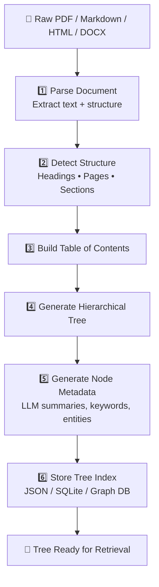

### Step 1 — Document Ingestion

First, the system reads the original document.

Possible sources include:

* PDF
* Markdown
* HTML
* DOCX
* Books
* Technical manuals

The parser tries to identify structural information such as:

```text
# Chapter
## Section
### Subsection
Page breaks
PDF bookmarks
Tables
Headings
```

### Step 2 — Structure Detection

The system identifies the natural hierarchy:

```text
Chapter 2
   ↓
Section 2.2
   ↓
Subsection 2.2.1
   ↓
Subsection 2.2.2
```

Instead of asking:

> "Where should I cut every 500 tokens?"

we ask:

> **"How is this document naturally organized?"**

### Step 3 — Build the Table of Contents

The detected structure becomes a **Table of Contents tree**.

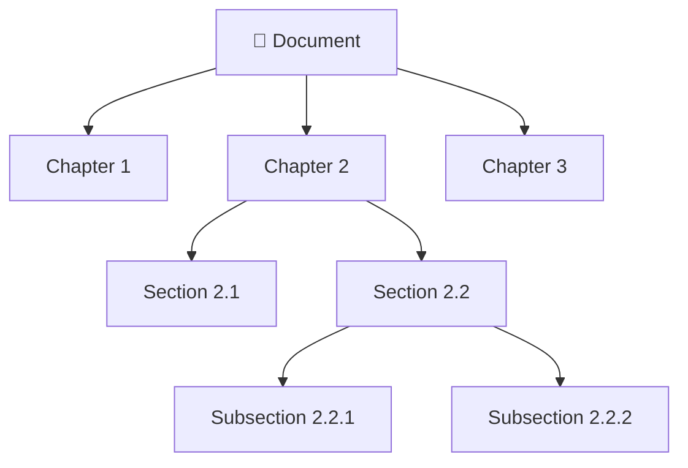

This becomes the skeleton of the knowledge index.

### Step 4 — Generate Node Summaries

The LLM then creates a short summary for each important node.

```text
Section:
Session Persistence & Sticky Sessions

Summary:
Explains how distributed load balancers maintain
user session state using cookie-based routing,
timeouts, and failover mechanisms.
```

The summary allows the retrieval agent to understand the section **without loading all of its raw content**.

### Step 5 — Add Metadata

The system enriches each node with information such as:

```text
Title
Summary
Keywords
Entities
Page Range
Parent
Children
Source File
Last Updated
```

### Step 6 — Store the Tree

Finally, the hierarchical index is persisted.

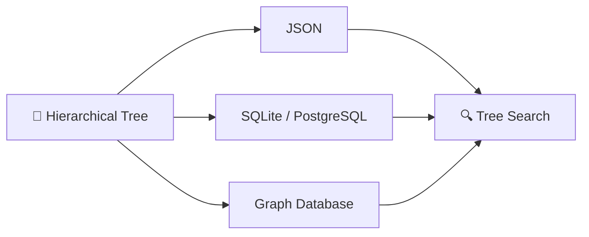

---

## 2.11 Complete Indexing Architecture

Putting everything together:

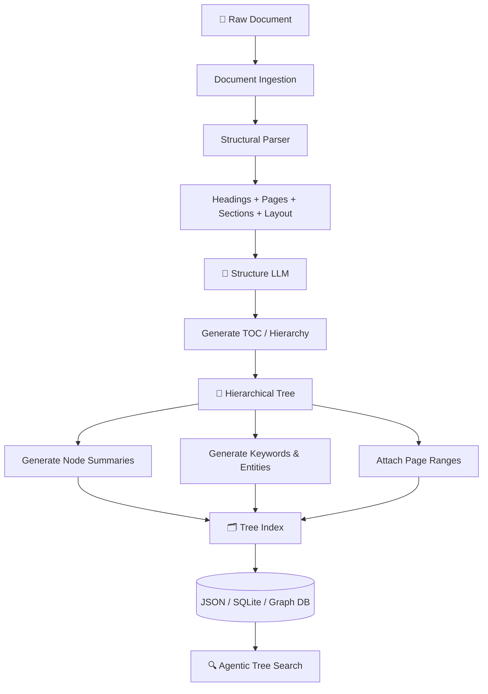

### Indexing Sequence Diagram

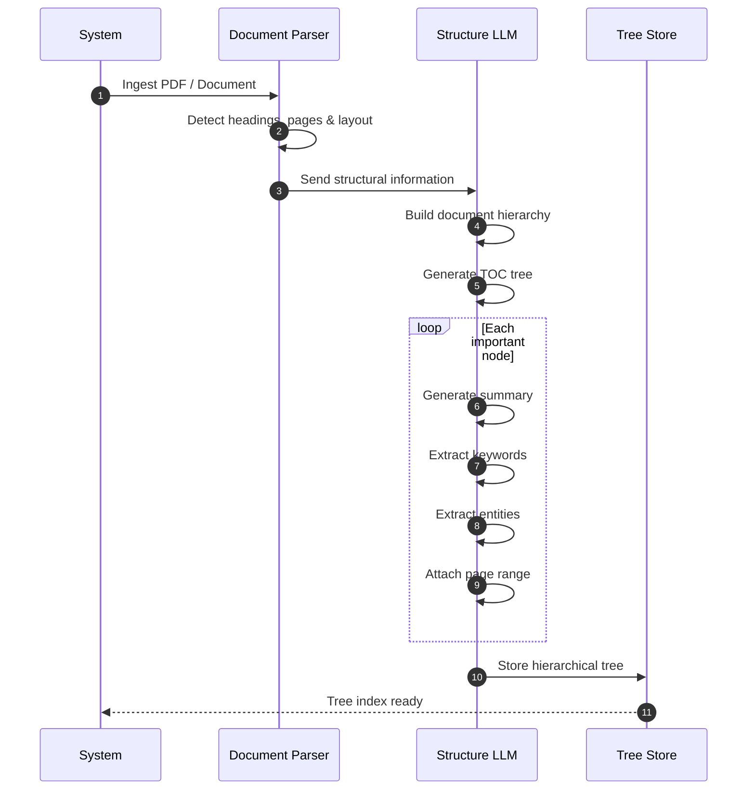

---

## 2.12 Pseudo-Code: Tree Node & Index Building (TypeScript)

```typescript
// ── Types ──
type TreeNode = {
  nodeId: string;
  title: string;
  level: number;              // 0=doc, 1=chapter, 2=section, 3=subsection
  pageRange: [number, number]; // [startPage, endPage]
  parentId: string | null;
  childrenIds: string[];
  summary: string;
  keywords: string[];
  entities: string[];
  sourceFile: string;
  lastUpdated: number;        // Unix timestamp
};

type TreeIndex = Map<string, TreeNode>;

type DocumentTree = {
  rootId: string;
  nodes: TreeIndex;
};

// ── Build tree index from raw document ──
async function buildTreeIndex(
  documentPath: string,
  llm: { generate(prompt: string): Promise<string> }
): Promise<DocumentTree> {
  // 1. Parse document structure
  const structure = await parseDocumentStructure(documentPath);

  // 2. Generate TOC hierarchy
  const toc = await buildTableOfContents(structure);

  // 3. Create nodes with metadata
  const nodes: TreeNode[] = [];

  for (const section of toc.sections) {
    const node = await createNode(section, documentPath, llm);
    nodes.push(node);
  }

  // 4. Build index map
  const index: TreeIndex = new Map<string, TreeNode>();
  for (const node of nodes) {
    index.set(node.nodeId, node);
  }

  // 5. Determine root
  const rootId = nodes.find((n) => n.level === 0)?.nodeId ?? nodes[0]?.nodeId ?? "";

  // 6. Persist to storage (JSON, SQLite, etc.)
  await persistTreeIndex(index);

  return {
    rootId,
    nodes: index,
  };
}

// ── Create a single tree node with LLM-generated metadata ──
async function createNode(
  section: ParsedSection,
  sourceFile: string,
  llm: { generate(prompt: string): Promise<string> }
): Promise<TreeNode> {
  const summary = await llmSummarize(section.content, llm);
  const keywords = await llmExtractKeywords(section.content, llm);
  const entities = await llmExtractEntities(section.content, llm);

  return {
    nodeId: generateNodeId(section.path),
    title: section.title,
    level: section.depth,
    pageRange: [section.startPage, section.endPage],
    parentId: section.parentPath ? generateNodeId(section.parentPath) : null,
    childrenIds: section.children.map((c) => generateNodeId(c.path)),
    summary,
    keywords,
    entities,
    sourceFile,
    lastUpdated: Date.now(),
  };
}

// ── Lazy-load full content for a node ──
async function lazyLoadNodeContent(node: TreeNode): Promise<string> {
  const pages = await loadPagesFromDocument(node.sourceFile, node.pageRange);
  return pages.join("\n\n");
}

// ── Helpers ──
async function llmSummarize(content: string, llm: { generate(prompt: string): Promise<string> }): Promise<string> {
  const prompt = `Summarize this section in 50–100 tokens:\n\n${content}`;
  return llm.generate(prompt);
}

async function llmExtractKeywords(content: string, llm: { generate(prompt: string): Promise<string> }): Promise<string[]> {
  const prompt = `Extract 5–10 keywords from this section:\n\n${content}\n\nReturn as comma-separated list.`;
  const result = await llm.generate(prompt);
  return result.split(",").map((k) => k.trim());
}

async function llmExtractEntities(content: string, llm: { generate(prompt: string): Promise<string> }): Promise<string[]> {
  const prompt = `Extract named entities (people, orgs, products, technologies) from:\n\n${content}\n\nReturn as comma-separated list.`;
  const result = await llm.generate(prompt);
  return result.split(",").map((e) => e.trim());
}

function generateNodeId(path: string[]): string {
  return path.join("_").toLowerCase().replace(/\s+/g, "_");
}

async function persistTreeIndex(index: TreeIndex): Promise<void> {
  const serializable = Object.fromEntries(index);
  // Write to JSON file, SQLite, etc.
  // await writeFile("tree_index.json", JSON.stringify(serializable, null, 2));
}
```

---

## 2.13 Traditional Index vs Tree Index

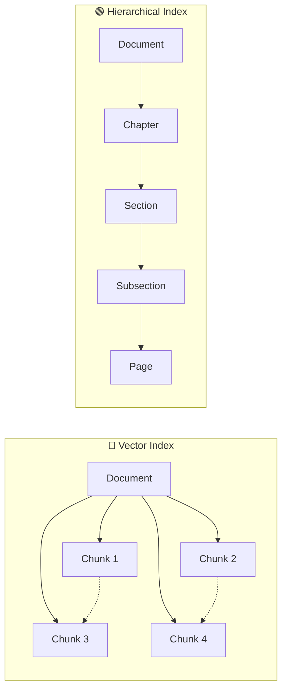

### Mental Model

**Vector RAG:**

> "Find something that looks similar."

**Vectorless RAG:**

> "Navigate to the part of the document where the answer should exist."

---

## 2.14 Key Advantages of the Tree Index

### 🌳 1. Preserves Structure

The relationship between:

```text
Document → Chapter → Section → Page
```

remains intact.

### 🔗 2. Explicit Lineage

Every node knows its parent and children.

### 📄 3. Precise Page Tracing

The system can identify the exact page range containing the information.

### 🧠 4. Better Context

The LLM can understand the surrounding hierarchy before reading the actual content.

### 🔍 5. More Explainable Retrieval

Instead of:

```text
Similarity = 0.814
```

we can explain:

```text
Document
 → Chapter 2
 → Section 2.2
 → Subsection 2.2.2
 → Pages 181–200
```

### 📦 6. Efficient Context Loading

Only the required content needs to be loaded after the relevant branch is identified.

---

## 2.15 Pseudo-Code: Zero-Vector Relevance Scoring

```typescript
// Zero-vector relevance scoring — no embeddings, no similarity math
type QueryIntent = {
  originalQuery: string;
  parsedIntent: string;
  topics: string[];
  entities: string[];
};

async function zeroVectorRelevance(
  node: TreeNode,
  queryIntent: QueryIntent,
  llm: { generate(prompt: string): Promise<string> }
): Promise<number> {
  const prompt = `
    Node Title: ${node.title}
    Node Summary: ${node.summary}
    Node Keywords: ${node.keywords.join(", ")}
    Node Entities: ${node.entities.join(", ")}
    Node Page Range: ${node.pageRange.join("–")}

    User Query: "${queryIntent.originalQuery}"
    Extracted Intent: ${queryIntent.parsedIntent}
    Required Topics: ${queryIntent.topics.join(", ")}
    Required Entities: ${queryIntent.entities.join(", ")}

    On a scale of 0 to 100, how likely does this node contain
    the information needed to answer the query?
    Only output a number.
  `;

  const score = parseInt(await llm.generate(prompt));
  return isNaN(score) ? 0 : score;
}
```

The key advantage: **traceability**. When a node is scored 85, you can read the LLM's prompt and see exactly why it was deemed relevant — no opaque vector math.

---

## 2.16 The Big Picture

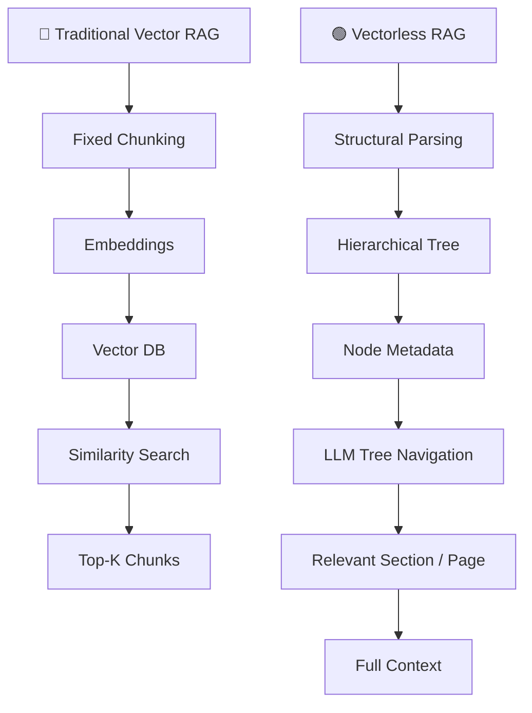

---

## 🎯 Key Takeaways

1. **Vectorless RAG replaces similarity-first retrieval with structure-first retrieval.**
2. **Documents are represented as hierarchical trees instead of flat chunks.**
3. **Natural units such as chapters, sections, subsections, and pages are preserved (Root → Chapter → Section → Page).**
4. **Each tree node can contain summaries, keywords, entities, page ranges, and parent/child relationships.**
5. **Raw content can be lazy-loaded only after the relevant branch is identified.**
6. **Retrieval becomes more explainable because the system can show the exact navigation path.**
7. **The tree is the map; the original document is the source of truth.**
8. **Node metadata summaries allow relevance scoring without loading full content.**
9. **Zero-vector reasoning uses LLM-based structural traversal, not embedding similarity, to determine relevance.**
10. **Tree storage uses ordinary data structures (JSON, SQLite, Graph DB) — no vector database required.**

> **Mental Model:**
> **Vector RAG searches the embedding space. Vectorless RAG navigates the document tree.**

---
