# Chapter 02 — Vectorless RAG & Tree-Structured Indexing

## 2.1 What Is Vectorless RAG?

**Vectorless RAG** is a retrieval approach that does not depend primarily on:
- ❌ Vector embeddings
- ❌ Vector databases
- ❌ Fixed-size token chunks
- ❌ Pure similarity search

Instead, it builds a **hierarchical tree representation of the document** and uses an LLM to navigate that tree.

The main idea is simple:

> **Instead of searching through random chunks, understand the document's structure and navigate to the relevant section.**

Systems such as **PageIndex** follow this general tree-based approach.

### Architecture Comparison

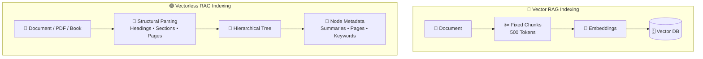

---

## 2.2 The Core Paradigm Shift

The biggest difference is **how the system thinks about a document**.

Imagine a lawyer working with a 500-page contract. They don't:

```text
Cut document into 5,000 random pieces
       ↓
Shuffle them
       ↓
Find pieces that look similar
```

Instead, they naturally navigate:

```text
Contract
   ↓
Table of Contents
   ↓
Relevant Chapter
   ↓
Relevant Section
   ↓
Specific Clause
   ↓
Read surrounding context
```

Vectorless RAG tries to reproduce this **structured navigation process**.

### Human Expert vs Vectorless RAG

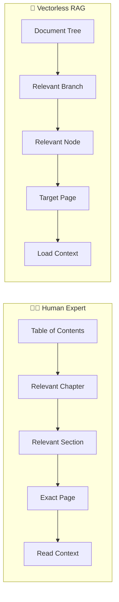

The key idea is:

> **Search the structure first, then retrieve the content.**

---

## 2.3 Vector RAG vs Vectorless RAG

| Feature            | 🔵 Vector RAG          | 🟢 Vectorless RAG         |
| ------------------ | ---------------------- | ------------------------- |
| **Index**          | Flat vector space      | Hierarchical tree         |
| **Representation** | Dense embeddings       | Structural metadata       |
| **Chunking**       | Fixed token windows    | Natural document units    |
| **Indexing**       | Embedding model        | Structural parsing + LLM  |
| **Retrieval**      | k-NN similarity search | LLM tree navigation       |
| **Database**       | Vector DB              | JSON / SQLite / Graph DB  |
| **Explainability** | Similarity score       | Explicit navigation path  |
| **Context**        | Often isolated chunks  | Hierarchical context      |
| **Page tracing**   | Not always natural     | Built into tree structure |

### Example

Vector RAG might tell you:

```text
Result #1
Similarity: 0.814
Chunk: #472
```

Vectorless RAG can tell you:

```text
Root
 ↓
Chapter 2
 ↓
Section 2.2
 ↓
Subsection 2.2.2
 ↓
Pages 181–200
```

The second approach provides a much more understandable retrieval path.

---

## 2.4 Hierarchical Document Tree

The heart of Vectorless RAG is the **document tree**. Instead of treating a 500-page document as thousands of independent chunks, we preserve its natural hierarchy.

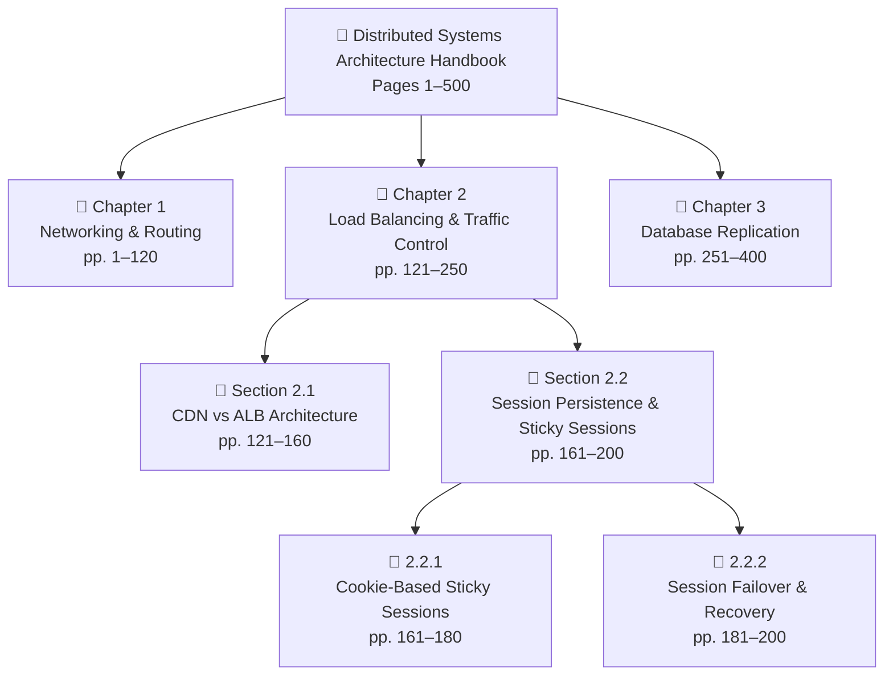

This structure gives every piece of information a **place inside the document**.

---

## 2.5 Why Hierarchy Matters

Consider this question:

> **"How does session failover work when an ALB server crashes?"**

A vector search might look for:
```text
session
failover
ALB
server
crash
```

But Vectorless RAG can reason through the document:

```text
Distributed Systems Handbook
        ↓
Chapter 2: Load Balancing
        ↓
Section 2.2: Session Persistence
        ↓
Subsection 2.2.2: Session Failover
        ↓
Pages 181–200
```

The retrieval path itself provides useful context.

---

## 2.6 Anatomy of a Tree Node

A tree node isn't just a title. It contains metadata that helps the LLM understand what exists at that location.

```json
{
  "node_id": "sec_2_2",
  "title": "Session Persistence & Sticky Sessions",
  "level": 2,
  "page_range": [161, 200],
  "parent_id": "ch_2",
  "children_ids": [
    "sub_2_2_1",
    "sub_2_2_2"
  ],
  "summary": "Covers session state management across distributed load balancers, including cookie-based sticky sessions, timeout thresholds, and failover behavior.",
  "keywords": [
    "sticky sessions",
    "ALB",
    "session persistence",
    "cookie routing",
    "failover"
  ],
  "entities": [
    "Application Load Balancer",
    "Browser Cookies",
    "Memcached"
  ],
  "source_file": "distributed_systems_v2.pdf"
}
```

Think of the node as a **map marker**, not necessarily the complete content.

---

## 2.7 What Information Does a Node Contain?

A useful node can contain:

### 1. Node ID
Uniquely identifies the node.
```text
sec_2_2
```

### 2. Title
Tells the LLM what the node represents.
```text
Session Persistence & Sticky Sessions
```

### 3. Level
Shows where the node exists in the hierarchy.
```text
Level 0 → Document
Level 1 → Chapter
Level 2 → Section
Level 3 → Subsection
```

### 4. Page Range
Connects the node to the original document.
```text
Pages 161–200
```

### 5. Parent & Children
Defines the node's lineage.
```text
Parent → Chapter 2
Children → 2.2.1, 2.2.2
```

### 6. Summary
Provides a compressed understanding of the section.

### 7. Keywords / Entities
Help the LLM identify what the section is about.

---

## 2.8 Explicit Lineage

One of the biggest advantages of a tree index is **lineage**. Every node knows where it belongs.

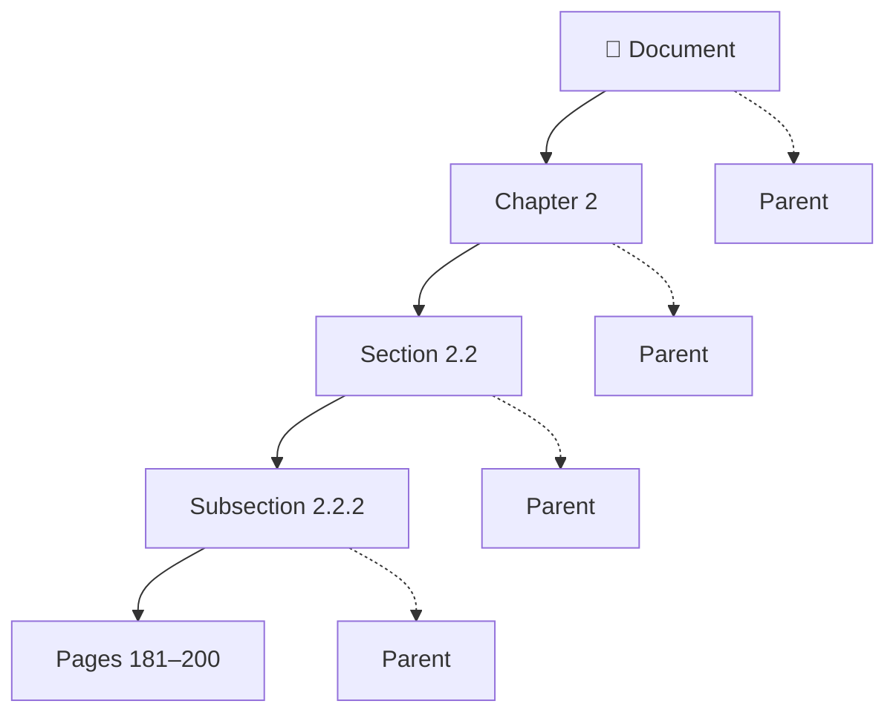

So when the system retrieves:
```text
Subsection 2.2.2
```
it also knows:
```text
Document
 → Chapter 2
 → Section 2.2
 → Subsection 2.2.2
```

This makes the retrieval path **traceable**.

---

## 2.9 Lazy Loading

A very important concept is **lazy loading**. The active tree doesn't necessarily need to contain every page of raw document text.

```text
Tree Node
 ├── Title
 ├── Summary
 ├── Keywords
 ├── Page Range
 └── Relationships
```

The actual content can remain in the original document.

When the system finds the correct node:
```text
Tree Node
     ↓
Page Range
     ↓
Load Original Pages
     ↓
Full Context
```

### Why?

Because the system doesn't need to load the entire 500-page document into the active retrieval context.

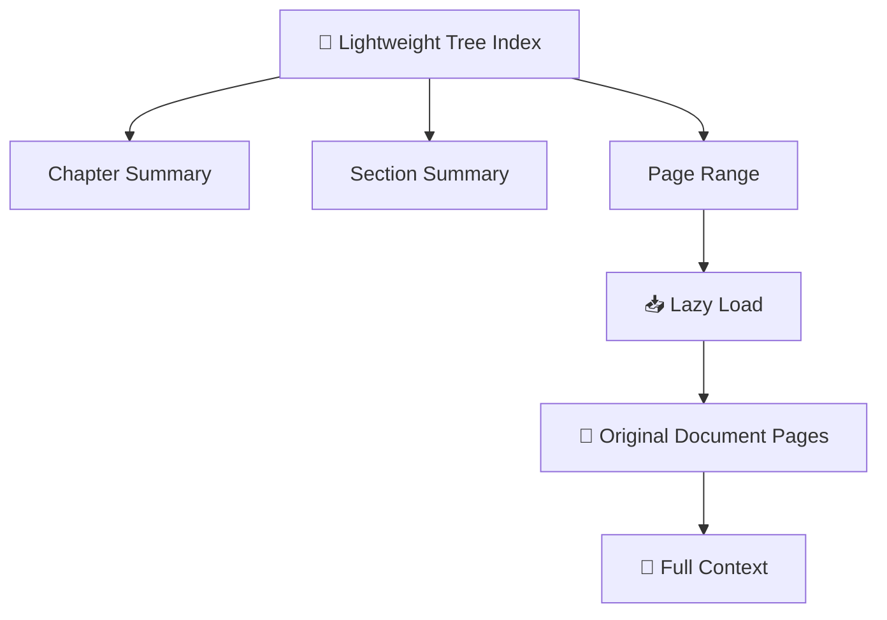

This makes the tree act like a **map** to the actual knowledge.

---

## 2.10 Zero Vector Storage

Vectorless RAG does not require embeddings for its primary index. The tree can be stored using ordinary data structures:

```text
JSON
SQLite
PostgreSQL
Graph Database
Document Database
```

A simplified structure could look like:
```text
Root
├── Chapter 1
│   ├── Section 1.1
│   └── Section 1.2
│
├── Chapter 2
│   ├── Section 2.1
│   └── Section 2.2
│       ├── Subsection 2.2.1
│       └── Subsection 2.2.2
│
└── Chapter 3
    ├── Section 3.1
    └── Section 3.2
```

The important point is:
> **The index is based on document structure rather than vector distance.**

---

## 2.11 Step-by-Step Indexing Workflow

Before the system can search the tree, it first needs to **build the tree**.

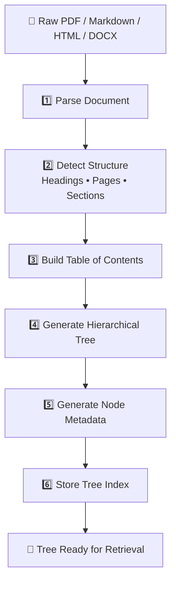

---

## 2.12 Step 1 — Document Ingestion

First, the system reads the original document. Possible sources include:
* PDF
* Markdown
* HTML
* DOCX
* Books
* Technical manuals

The parser tries to identify structural information such as:
```text
# Chapter
## Section
### Subsection
Page breaks
PDF bookmarks
Tables
Headings
```

---

## 2.13 Step 2 — Structure Detection

The system identifies the natural hierarchy:
```text
Chapter 2
   ↓
Section 2.2
   ↓
Subsection 2.2.1
   ↓
Subsection 2.2.2
```

Instead of asking:
> "Where should I cut every 500 tokens?"

We ask:
> **"How is this document naturally organized?"**

---

## 2.14 Step 3 — Build the Table of Contents

The detected structure becomes a **Table of Contents tree**.

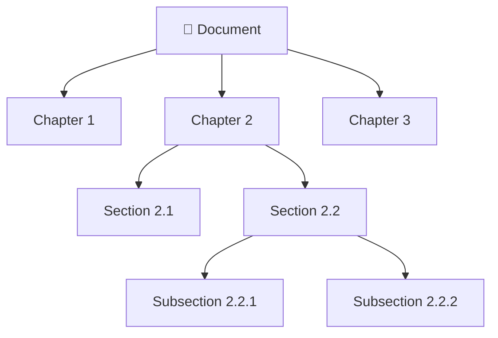

This becomes the skeleton of the knowledge index.

---

## 2.15 Step 4 — Generate Node Summaries

The LLM then creates a short summary for each important node.

```text
Section:
Session Persistence & Sticky Sessions

Summary:
Explains how distributed load balancers maintain
user session state using cookie-based routing,
timeouts, and failover mechanisms.
```

The summary allows the retrieval agent to understand the section **without loading all of its raw content**.

---

## 2.16 Step 5 — Add Metadata

The system enriches each node with information such as:
```text
Title
Summary
Keywords
Entities
Page Range
Parent
Children
Source File
```

This gives the tree enough information for intelligent navigation.

---

## 2.17 Step 6 — Store the Tree

Finally, the hierarchical index is persisted.

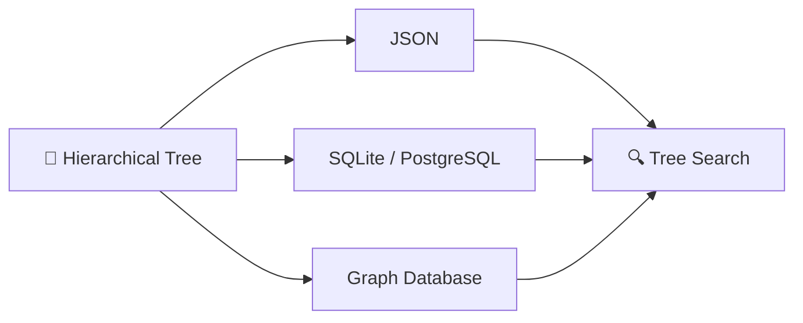

The important point is that you don't need a specialized vector database just to represent the hierarchy.

---

## 2.18 Complete Indexing Architecture

Putting everything together:

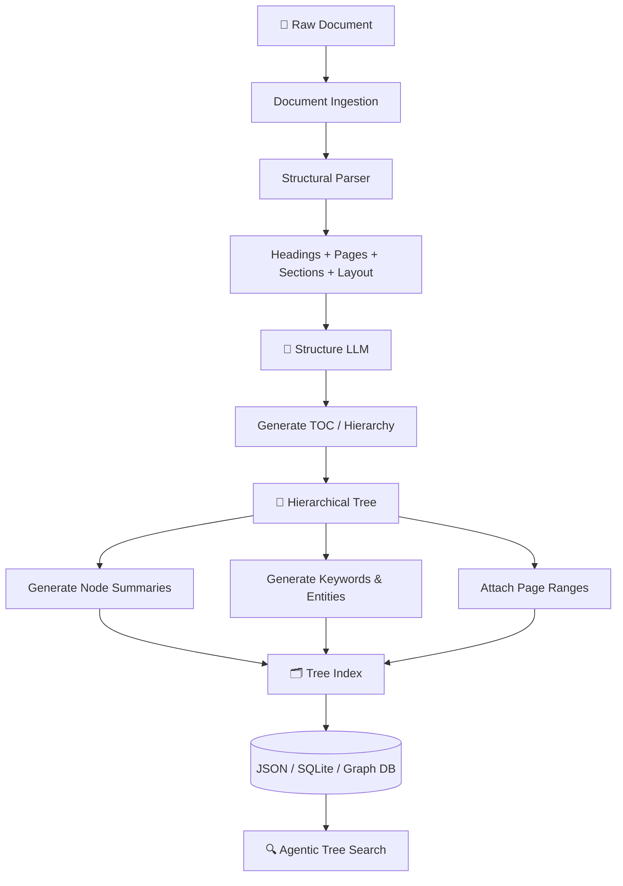

---

## 2.19 Indexing Sequence

The entire process can also be represented as a sequence:

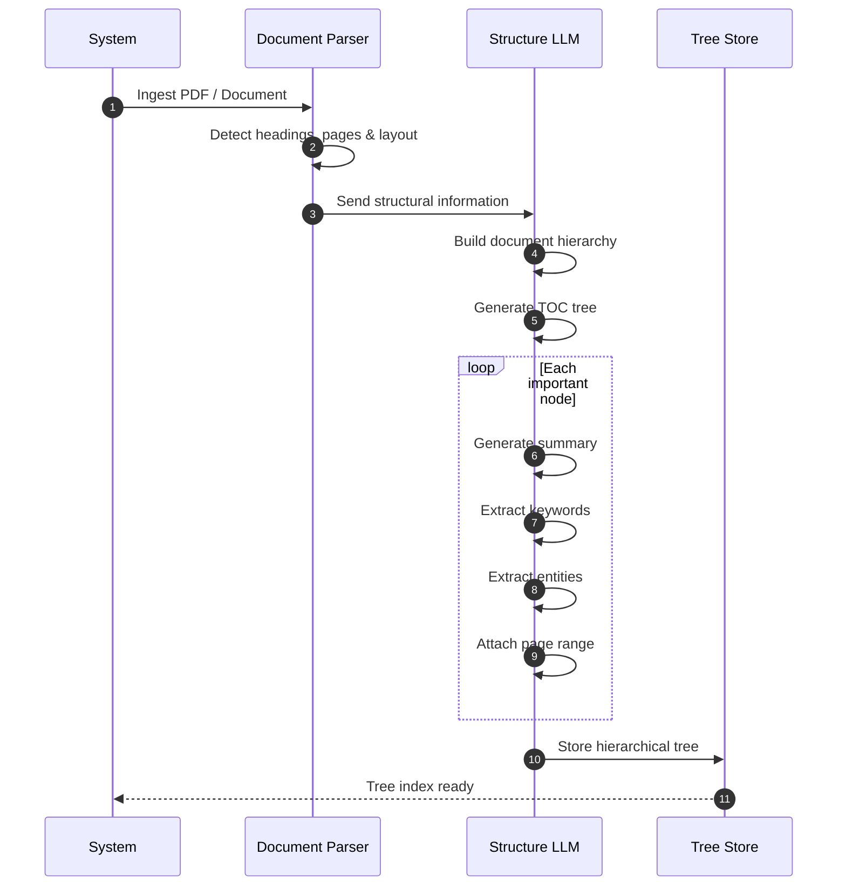

---

## 2.20 Traditional Index vs Tree Index

The difference becomes very clear here:

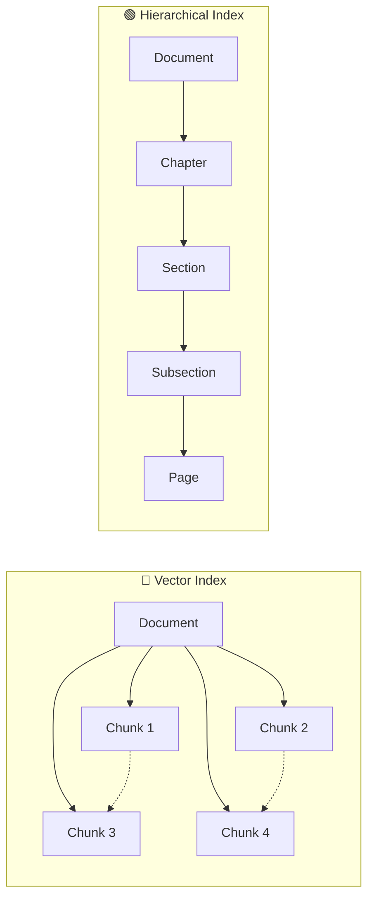

### Mental Model

**Vector RAG:**
> "Find something that looks similar."

**Vectorless RAG:**
> "Navigate to the part of the document where the answer should exist."

---

## 2.21 Key Advantages of the Tree Index

### 🌳 1. Preserves Structure

The relationship between:
```text
Document → Chapter → Section → Page
```
remains intact.

### 🔗 2. Explicit Lineage

Every node knows its parent and children.

### 📄 3. Precise Page Tracing

The system can identify the exact page range containing the information.

### 🧠 4. Better Context

The LLM can understand the surrounding hierarchy before reading the actual content.

### 🔍 5. More Explainable Retrieval

Instead of:
```text
Similarity = 0.814
```
we can explain:
```text
Document
 → Chapter 2
 → Section 2.2
 → Subsection 2.2.2
 → Pages 181–200
```

### 📦 6. Efficient Context Loading

Only the required content needs to be loaded after the relevant branch is identified.

---

## 2.22 Pseudo Code: Tree Node & Index Building (TypeScript)

```typescript
// Tree node representation
interface TreeNode {
  nodeId: string;
  title: string;
  level: number;              // 0=doc, 1=chapter, 2=section, 3=subsection
  pageRange: [number, number]; // [startPage, endPage]
  parentId: string | null;
  childrenIds: string[];
  summary: string;
  keywords: string[];
  entities: string[];
  sourceFile: string;
}

// Tree index stored as a flat map for O(1) lookup
type TreeIndex = Map<string, TreeNode>;

// Build tree index from raw document
async function buildTreeIndex(documentPath: string): Promise<TreeIndex> {
  // 1. Parse document structure
  const structure = await parseDocumentStructure(documentPath);
  
  // 2. Generate TOC hierarchy
  const toc = await buildTableOfContents(structure);
  
  // 3. Create nodes with metadata
  const nodes: TreeNode[] = [];
  
  for (const section of toc.sections) {
    const node = await createNode(section, documentPath);
    nodes.push(node);
  }
  
  // 4. Build index map
  const index = new Map<string, TreeNode>();
  for (const node of nodes) {
    index.set(node.nodeId, node);
  }
  
  // 5. Persist to storage (JSON, SQLite, etc.)
  await persistTreeIndex(index);
  
  return index;
}

// Create a single tree node with LLM-generated metadata
async function createNode(section: ParsedSection, sourceFile: string): Promise<TreeNode> {
  const summary = await llmSummarize(section.content);
  const keywords = await llmExtractKeywords(section.content);
  const entities = await llmExtractEntities(section.content);
  
  return {
    nodeId: generateNodeId(section.path),
    title: section.title,
    level: section.depth,
    pageRange: [section.startPage, section.endPage],
    parentId: section.parentPath ? generateNodeId(section.parentPath) : null,
    childrenIds: section.children.map(c => generateNodeId(c.path)),
    summary,
    keywords,
    entities,
    sourceFile
  };
}

// Lazy-load full content for a node
async function loadNodeContent(node: TreeNode): Promise<string> {
  const pages = await loadPagesFromDocument(node.sourceFile, node.pageRange);
  return pages.join('\n\n');
}
```

---

## 2.23 The Big Picture

The fundamental architecture shift is:

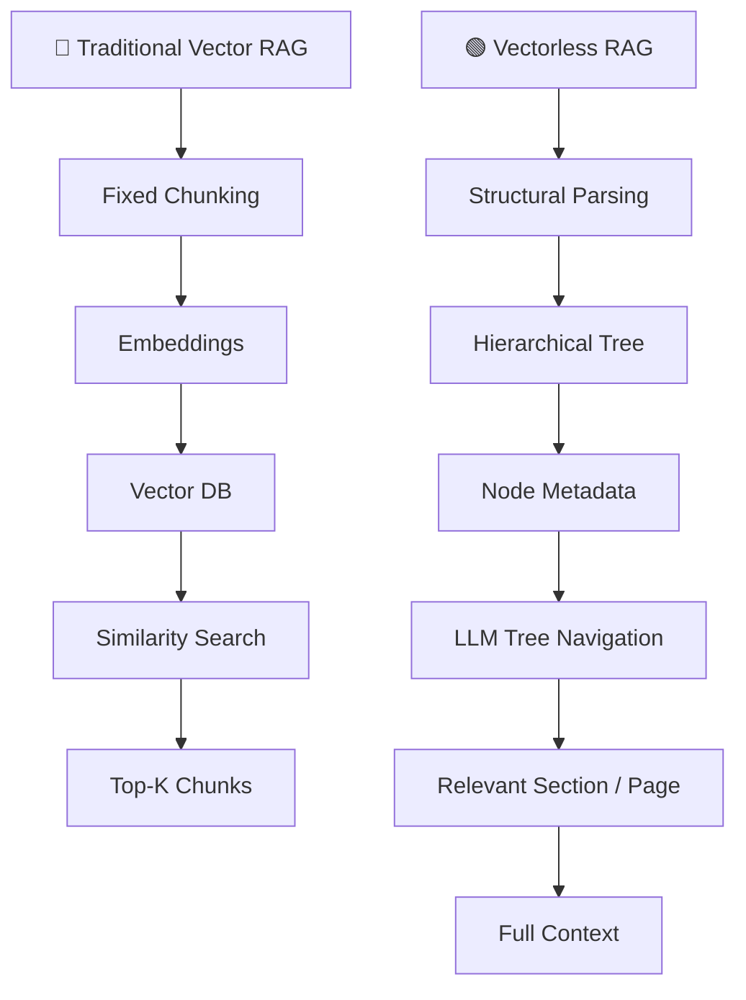

## 🎯 Key Takeaways

Remember these **7 points**:

1. **Vectorless RAG replaces similarity-first retrieval with structure-first retrieval.**
2. **Documents are represented as hierarchical trees instead of flat chunks.**
3. **Natural units such as chapters, sections, subsections, and pages are preserved.**
4. **Each tree node can contain summaries, keywords, entities, page ranges, and parent/child relationships.**
5. **Raw content can be lazy-loaded only after the relevant branch is identified.**
6. **Retrieval becomes more explainable because the system can show the exact navigation path.**
7. **The tree is the map; the original document is the source of truth.**

> **Mental Model:**
> **Vector RAG searches the embedding space. Vectorless RAG navigates the document tree.**

---