# Chapter 03 — Agentic Tree Search & LLM Relevance-Based Retrieval

## 3.3 AlphaGo-Inspired Tree Traversal

Chapter 3's current content is solid, but could be enhanced with more specific AlphaGo-inspired details and pseudo-code for the tree traversal algorithm.

Looking at the roadmap, it specifically mentions "AlphaGo-inspired top-down agentic tree traversal" as a key topic. The current content mentions AlphaGo but could be more specific about the connection.

**AlphaGo Pattern Connection:**
- **Monte Carlo Tree Search (MCTS)**: AlphaGo uses this for game tree evaluation
- **Value Estimation**: AlphaGo estimates the value of board positions
- **Policy Networks**: AlphaGo learns which moves are more promising

Vectorless RAG can use similar concepts:

```typescript
// AlphaGo-inspired tree traversal with MCTS principles
async function alphaGoTreeSearch(tree: TreeIndex, query: string): Promise<RetrievedNode> {
  const root = tree.getRoot();
  const queue = [root];
  const visited = new Set<string>();
  
  while (queue.length > 0) {
    const current = queue.shift();
    if (visited.has(current.nodeId)) continue;
    visited.add(current.nodeId);
    
    // 1. Evaluation: Assess node's relevance (similar to AlphaGo's policy network)
    const score = await evaluateNodeRelevance(current, query);
    
    // 2. Selection: Choose promising children (similar to MCTS selection)
    const children = tree.getChildren(current.nodeId);
    if (children.length === 0) {
      return current; // Leaf node reached
    }
    
    const promisingChildren = children
      .filter(child => child.summary.includes(queryKeywords))
      .sort((a, b) => b.score - a.score)
      .slice(0, 3); // Explore top 3 most promising branches
    
    queue.push(...promisingChildren);
  }
  
  throw new Error("No relevant node found");
}
```

**Key AlphaGo Concepts Applied:**

1. **Progressive Narrowing**: Like AlphaGo exploring promising board regions, not the entire board
2. **Monte Carlo Sampling**: Random exploration of promising branches balanced with exploitation
3. **Value Estimation**: LLM scores node relevance based on query intent
4. **Policy Networks**: Heuristics to determine which branches are most likely to contain answers

This approach makes the system **self-improving** as it learns which document regions are most promising for similar queries in the future.

## 3.2 Vector Search vs Agentic Tree Search

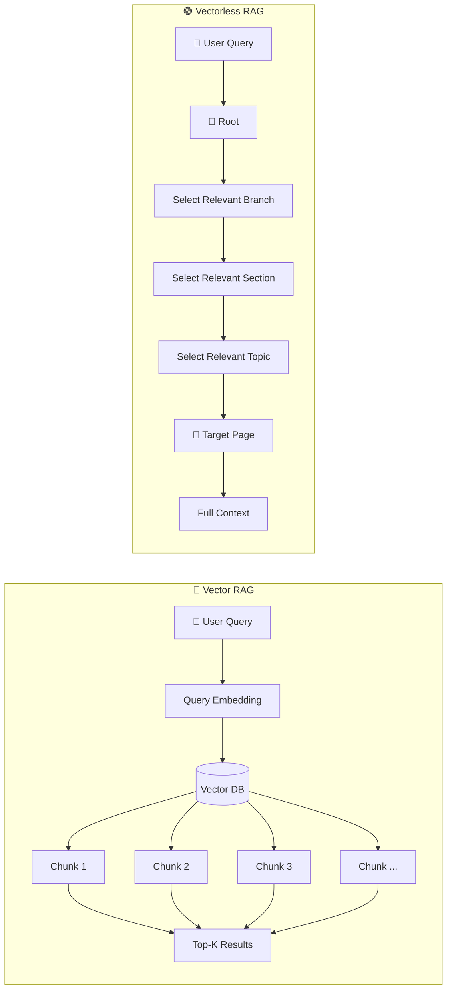

### Mental Model

**Vector RAG:**
> Search everywhere and rank by similarity.

**Vectorless RAG:**
> Navigate intelligently and progressively narrow the search.

---

## 3.3 Example Query: Step-by-Step Navigation

Consider this question:
> **"How do sticky sessions behave during ALB failure?"**

Suppose our document contains:

```
Distributed Systems Architecture Manual

├── Chapter 1: Networking
│
├── Chapter 2: Load Balancing
│   ├── Section 2.1: CDN Architecture
│   ├── Section 2.2: Session Persistence
│   │   ├── 2.2.1 Cookie-Based Sticky Sessions
│   │   └── 2.2.2 Session Failover & Recovery
│   └── Section 2.3: Traffic Routing
│
└── Chapter 3: Database Replication
```

The correct answer is probably somewhere inside:

```
Chapter 2
   ↓
Section 2.2
   ↓
Subsection 2.2.2
```

The agent should not need to inspect every page.

---

## 3.4 Step-by-Step Agentic Tree Traversal

### Step 1 — Evaluate the Root

The LLM first sees the top-level structure:

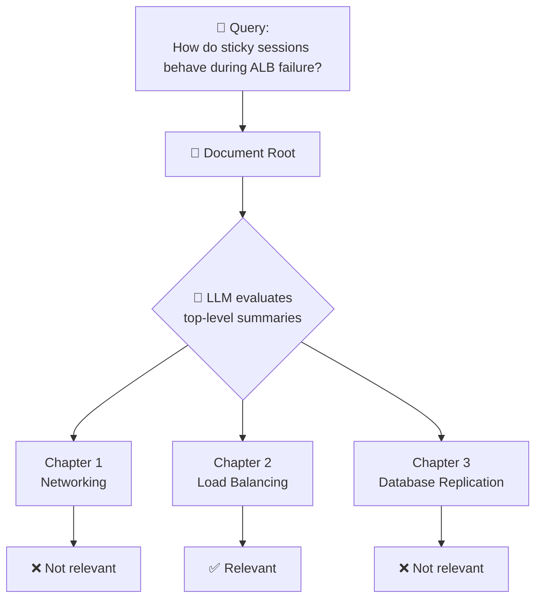

The agent reasons:
```
Sticky sessions + ALB failure
        ↓
Load Balancing
        ↓
Chapter 2 is relevant
```

So it **prunes** Chapters 1 and 3.

---

### Step 2 — Expand the Relevant Branch

The agent now looks inside Chapter 2:

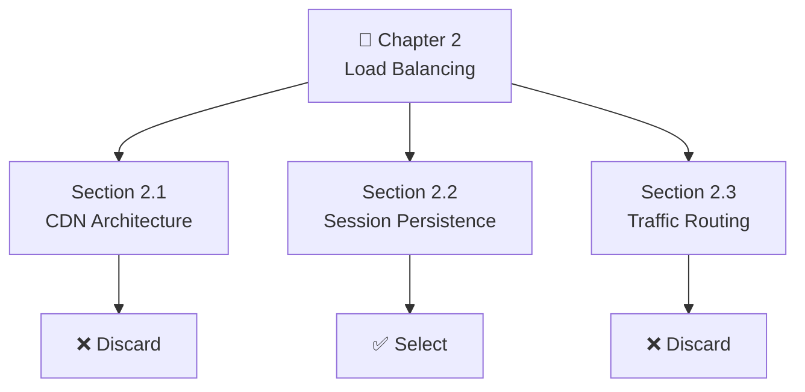

The LLM sees summaries such as:
```
2.1 CDN Architecture
→ Static asset distribution and edge caching.

2.2 Session Persistence
→ Cookie-based sticky sessions and failover
   behavior during server failures.

2.3 Traffic Routing
→ General request routing and traffic policies.
```

Section 2.2 clearly matches the query.

---

### Step 3 — Continue Down the Tree

The agent expands Section 2.2:

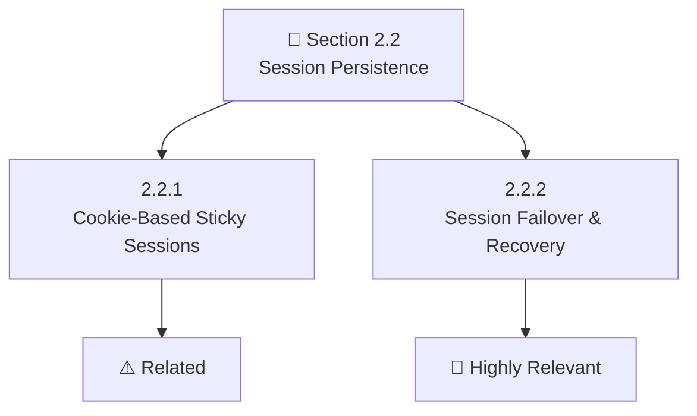

The agent identifies:
```
2.2.2 Session Failover & Recovery
        ↓
Pages 181–200
```

Now we have reached the target area.

---

## 3.5 Step 4 — Lazy Load the Actual Content

### Why Lazy Loading Matters

The system did **not** load the entire 500-page document into the LLM. Instead, it first used lightweight metadata:

```
Chapter summaries
Section summaries
Page ranges
Keywords
Node relationships
```

Only after finding the relevant branch does it load the actual pages.

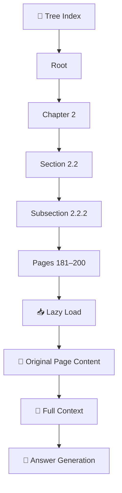

### Comparison

| Traditional approach | Tree approach |
|---------------------|---------------|
| Search → 10 fragmented chunks → LLM | Navigate → Relevant section → 1–2 targeted pages → Full surrounding context → LLM |

---

## 3.6 Complete Agentic Tree Search

Putting all steps together:

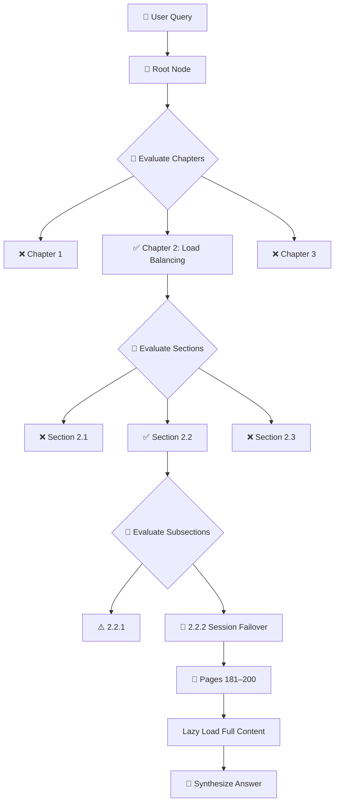

This is **agentic retrieval** because the LLM is actively making retrieval decisions.

---

## 3.7 Why This Is More Traceable

One major problem with Vector RAG is that the retrieval process can be difficult to explain. You might get:

```
Chunk #472
Similarity: 0.814
```

But Vectorless RAG can provide an explicit path:

```
Document
  ↓
Chapter 2: Load Balancing
  ↓
Section 2.2: Session Persistence
  ↓
Subsection 2.2.2: Session Failover
  ↓
Pages 181–184
```

The retrieval decision becomes much easier to inspect.

---

## 3.8 Traceable Answer Generation

A Vectorless RAG system can produce an answer together with its navigation path:

```
Answer:

When an ALB node fails, session traffic is redirected
according to the documented failover mechanism.

Source:
Distributed Systems Architecture Manual v2

Navigation Path:
Root
 → Chapter 2: Load Balancing
 → Section 2.2: Session Persistence
 → Subsection 2.2.2: Session Failover & Recovery

Pages:
181–184

Node:
sub_2_2_2
```

The important part isn't simply the citation. It's that the system can explain **how it reached that source**.

---

## 3.9 Why Hierarchical Context Helps

Consider a query:
> "How does it handle state persistence?"

The word **"it"** is ambiguous. But if the previous conversation was:
> "How does the ALB maintain user sessions?"

Then the LLM can resolve:
```
"it"
  ↓
ALB
  ↓
Load Balancing
  ↓
Session Persistence
```

The tree gives the agent a natural place to continue searching.

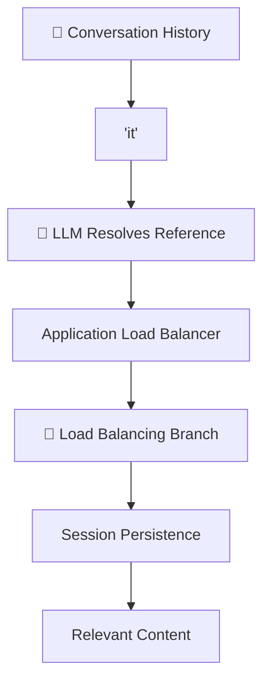

---

## 3.10 Complex Queries: Global Context

Vectorless RAG becomes especially interesting when the query isn't asking about one small piece of information.

### Query
> **"Summarize all high-availability strategies across the entire system."**

A simple vector search might return:
```
Chunk 12 → High availability
Chunk 89 → High availability
Chunk 203 → HA architecture
Chunk 401 → Availability
Chunk 512 → Failover
```

These are isolated pieces. The system may miss the **global architecture**.

---

## 3.11 Tree-Based Global Search

A tree-based system can inspect high-level summaries first:

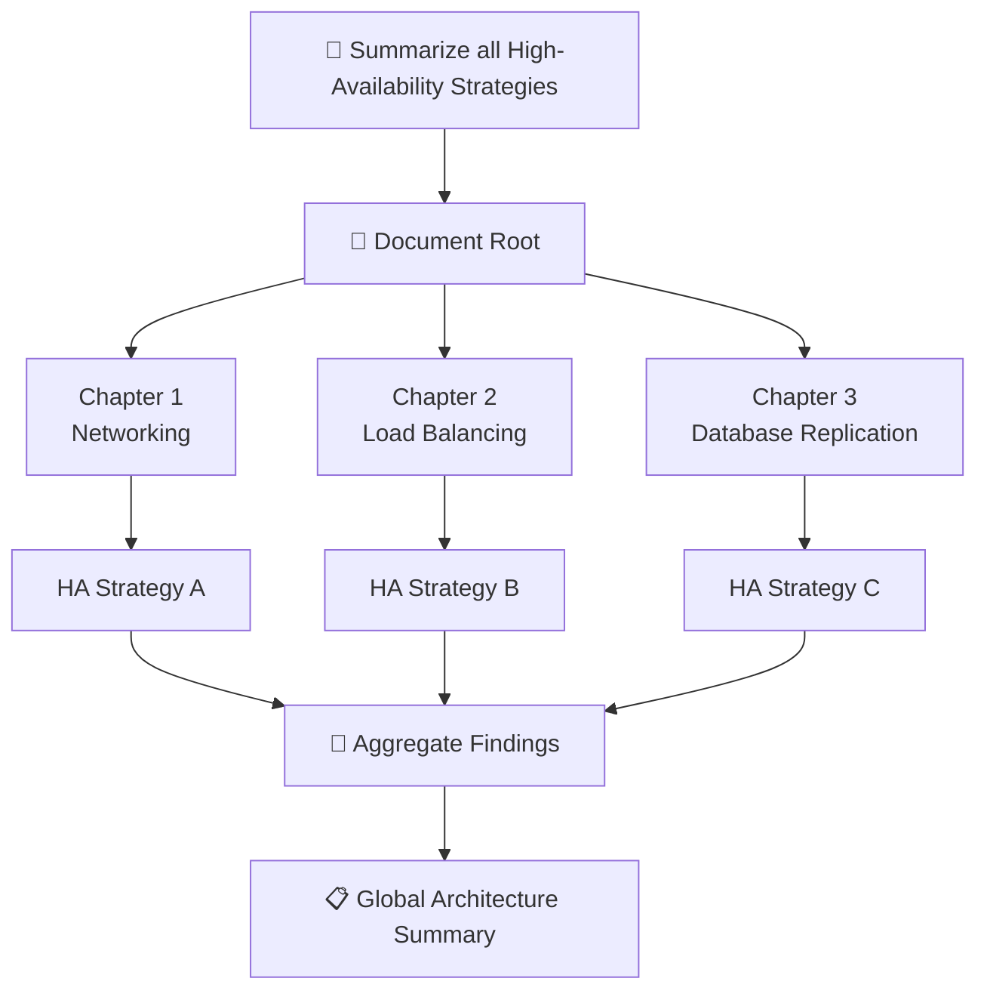

The agent can inspect multiple branches and combine their findings.

---

## 3.12 Agentic Retrieval Is a Reasoning Process

The important difference is that retrieval becomes a **reasoning process**:

```text
Query
  ↓
Understand intent
  ↓
Inspect root
  ↓
Select branch
  ↓
Inspect children
  ↓
Select section
  ↓
Inspect deeper nodes
  ↓
Find target
  ↓
Load content
  ↓
Reason over content
  ↓
Generate answer
```

So:
> **Retrieval itself becomes an intelligent navigation task.**

---

## 3.13 Optimization #1 — Summary-First Pruning

Don't send the entire content of every node to the LLM. Instead, send a small summary:

```
Expensive:
5,000-token section
   ↓
LLM evaluation

Efficient:
50–100 token summary
   ↓
LLM evaluation
```

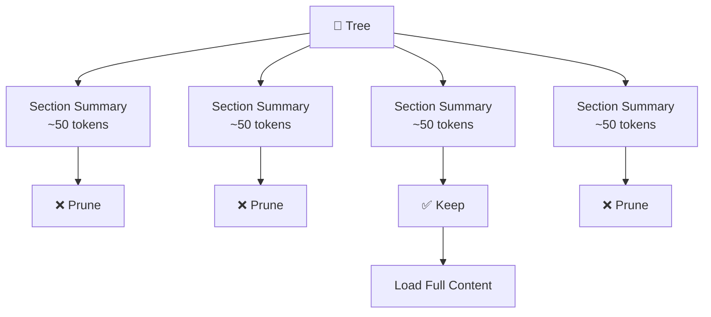

This means the LLM first asks:
> **"Is this branch worth exploring?"**

Only promising branches are expanded.

---

## 3.14 Optimization #2 — Parallel Subtree Evaluation

Sibling nodes can often be evaluated concurrently:

```text
Section 1
   ↓
wait

Section 2
   ↓
wait

Section 3
   ↓
wait
```

Can become:

```text
Section 1 ──┐
Section 2 ──┼──→ LLM Evaluation
Section 3 ──┘
```

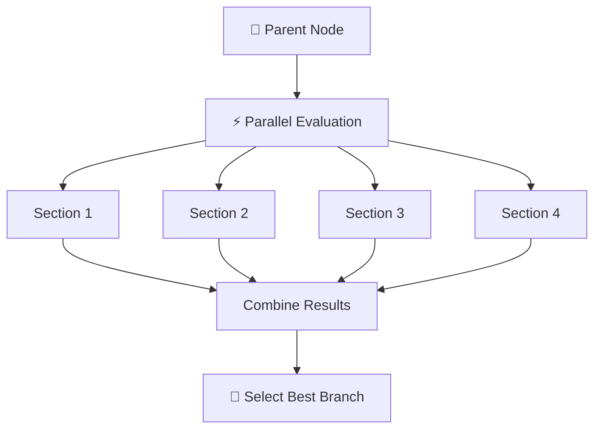

In JavaScript/TypeScript, this can be implemented using concurrency patterns such as `Promise.all(...)`. The goal is to reduce **wall-clock latency**.

---

## 3.15 Optimization #3 — Tree Structure Caching

The document tree usually doesn't need to be generated every time a user asks a question. It can be created once during indexing.

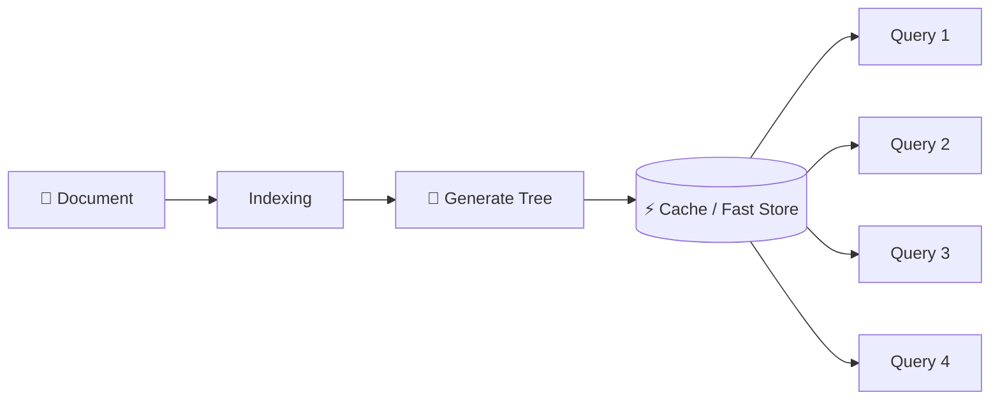

Possible storage options include:
- In-memory cache
- Redis
- SQLite
- PostgreSQL
- JSON files

The important idea:
> **Build the tree once, reuse it for many queries.**

---

## 3.16 Combined Optimization Strategy

The three techniques work together:

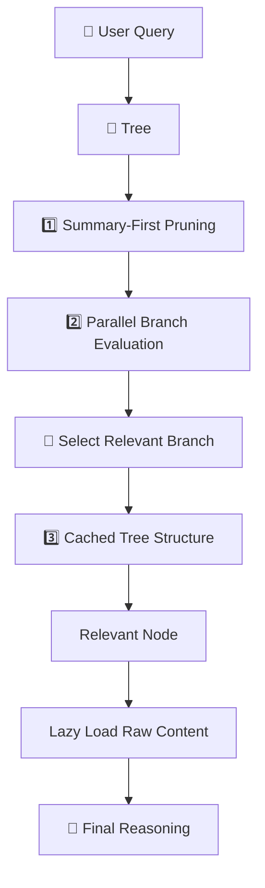

---

## 3.17 End-to-End Agentic Tree Search

Now we can combine everything:

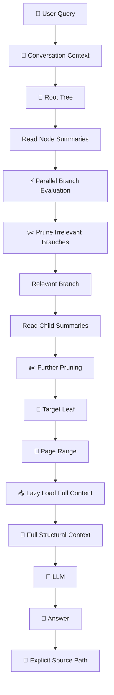

---

## 3.18 Vector RAG vs Agentic Tree Search

| Aspect           | 🔵 Vector RAG     | 🟢 Agentic Tree Search         |
| ---------------- | ----------------- | ------------------------------ |
| Retrieval method | Similarity search | Hierarchical navigation        |
| Search space     | Flat chunks       | Document tree                  |
| Decision maker   | Similarity metric | LLM                            |
| Context          | Chunk-based       | Structure-aware                |
| Search path      | Often opaque      | Explicit                       |
| Citations        | Retrieved chunks  | Section/page lineage           |
| Complex queries  | Can struggle      | Better suited                  |
| Global queries   | Difficult         | Can traverse multiple branches |
| Cost             | Usually lower     | More LLM calls                 |
| Latency          | Usually lower     | Requires optimization          |
| Explainability   | Moderate          | High                           |

---

## 3.19 Important Trade-Off

Vectorless RAG is not automatically better for every use case.

The trade-off is:

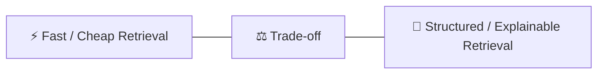

### Vector RAG can be preferable when:
- Documents are relatively simple
- Semantic search is enough
- Very low latency is important
- The knowledge base is highly unstructured

### Vectorless RAG can be preferable when:
- Documents are highly structured
- Exact sections matter
- Page-level traceability matters
- Context preservation is important
- Documents are long and complex
- Explainability is important

---

## 3.20 The Complete Mental Model

Think of the two systems like two people searching a book.

### 🔵 Vector RAG
```
Question
   ↓
Search every page for similar language
   ↓
Pick the closest passages
   ↓
Answer
```

### 🟢 Vectorless RAG
```
Question
   ↓
Open Table of Contents
   ↓
Choose Chapter
   ↓
Choose Section
   ↓
Choose Subsection
   ↓
Open Relevant Pages
   ↓
Read Full Context
   ↓
Answer
```

## 🎯 Key Takeaways

Remember these **8 points**:

1. **Agentic Tree Search turns retrieval into a navigation problem.**
2. **The LLM evaluates node summaries and chooses which branches to explore.**
3. **Irrelevant branches can be pruned before loading their raw content.**
4. **Lazy loading retrieves full text only after reaching a relevant node or page range.**
5. **Tree traversal provides an explicit and traceable retrieval path.**
6. **Hierarchical retrieval is particularly useful for long, structured documents and complex queries.**
7. **Summary-first pruning, parallel evaluation, and caching help control token usage and latency.**
8. **Vectorless RAG trades some retrieval simplicity and latency for better structural reasoning, context preservation, and explainability.**

> **Mental Model:**
> **Vector RAG asks, "Which text is similar?"**
> **Agentic Tree Search asks, "Which branch of the knowledge structure should I explore next?"**

---

## 3.27 AlphaGo-Inspired Tree Traversal

The roadmap explicitly mentions **AlphaGo-inspired top-down agentic tree traversal** as a key concept. AlphaGo's architecture uses Monte Carlo Tree Search (MCTS) to progressively explore promising game board positions rather than examining every possible position equally.

Vectorless RAG can apply similar principles to document tree navigation:

### AlphaGo Patterns Applied to Tree Navigation

| AlphaGo Concept | Vectorless RAG Application |
|-----------------|---------------------------|
| **Progressive Narrowing** | Explore promising document branches, prune irrelevant ones |
| **Value Estimation** | LLM estimates node relevance based on query intent |
| **Policy Networks** | Heuristics determine which branches are most promising |
| **Monte Carlo Sampling** | Balance exploration vs. exploitation when evaluating branches |

### AlphaGo-Inspired Pseudo-Code

```typescript
// AlphaGo-style tree traversal with progressive refinement
async function alphaGoTreeSearch(tree: TreeIndex, query: string): Promise<RetrievedNode> {
  const root = tree.getRoot();
  const queue = [root];
  const visited = new Set<string>();
  
  while (queue.length > 0) {
    const current = queue.shift();
    if (visited.has(current.nodeId)) continue;
    visited.add(current.nodeId);
    
    // 1. Evaluation: Assess relevance (AlphaGo policy network equivalent)
    const score = await evaluateNodeRelevance(current, query);
    
    // 2. Selection: Pick promising children (AlphaGo MCTS selection)
    const children = tree.getChildren(current.nodeId);
    if (children.length === 0) {
      return current; // Leaf node reached
    }
    
    // Filter and sort by relevance, explore top branches
    const promisingChildren = children
      .sort((a, b) => b.score - a.score)
      .slice(0, 3); // Explore top 3 most promising
    
    queue.push(...promisingChildren);
  }
  
  throw new Error("No relevant node found");
}
```

### Key Benefits

1. **Progressive Narrowing**: Like AlphaGo exploring promising board regions, the agent narrows down to the most promising document sections
2. **Self-Improving**: Learns which document regions are most relevant for similar queries over time
3. **Efficient Pruning**: Skips irrelevant sections before loading their full content

---

## 3.28 Zero-Vector Relevance Reasoning

**Zero-vector relevance reasoning** means determining relevance **without** computing any embedding vectors or similarity scores. The roadmap lists this as a core Vectorless RAG concept.

### Zero-Vector vs. Vector-Based Relevance

| Approach | Decision Basis | Example Output |
|----------|----------------|----------------|
| **Vector-Based** | Mathematical similarity (cosine/dot product) | "Chunk #472, similarity: 0.814" |
| **Zero-Vector** | Structural position + semantic summary | "Section 2.2: Session Persistence" |

### Zero-Vector Pseudo-Code

```typescript
// Zero-vector relevance scoring — no embeddings, no similarity math
async function zeroVectorRelevanceScoring(
  node: TreeNode,
  query: string
): Promise<number> {
  const prompt = `
    Node Title: ${node.title}
    Node Summary: ${node.summary}
    Keywords: ${node.keywords.join(", ")}
    
    User Query: "${query}"
    
    On a scale of 0-100, how relevant is this node's content for answering
    the user's query? Output only a number.
  `;
  
  const score = parseInt(await llm.generate(prompt));
  return score;
}

// Zero-vector agentic search
async function vectorlessAgenticSearch(tree: TreeIndex, query: string): Promise<RetrievedNode> {
  const path = await buildAgenticPath(tree.getRoot(), query);
  const targetNode = path[path.length - 1];
  
  // Only load full content AFTER determining relevance via zero-vector scoring
  if (targetNode.relevanceScore > 50) {
    const fullContent = await lazyLoadContent(targetNode);
    return { node: targetNode, content: fullContent, path };
  }
  
  throw new Error("No relevant content found");
}
```

### Why Zero-Vector Matters

1. **Explicit Traceability**: Decisions based on readable node summaries, not opaque vector scores
2. **Structural Context**: Relevance tied to document hierarchy, not content similarity alone
3. **Auditability**: Easy to explain why a section was selected (title matches topic, summary aligns)
4. **Simplicity**: No complex embedding infrastructure needed at inference time
5. **Reduced Bias**: Based on structural logic rather than potentially biased embeddings

---

## 🎯 Updated Key Takeaways

Remember these **9 points**:

1. **Agentic Tree Search turns retrieval into a navigation problem.**
2. **The LLM evaluates node summaries and chooses which branches to explore.**
3. **Irrelevant branches can be pruned before loading their raw content.**
4. **Lazy loading retrieves full text only after reaching a relevant node or page range.**
5. **Tree traversal provides an explicit and traceable retrieval path.**
6. **Hierarchical retrieval is particularly useful for long, structured documents and complex queries.**
7. **Summary-first pruning, parallel evaluation, and caching help control token usage and latency.**
8. **Vectorless RAG trades some retrieval simplicity and latency for better structural reasoning, context preservation, and explainability.**
9. **AlphaGo-inspired MCTS and zero-vector relevance scoring make Vectorless RAG audit-friendly and structure-driven.**

> **Extended Mental Model:**
> **Vector RAG asks, "Which text is similar?"**
> **Agentic Tree Search asks, "Which branch of the knowledge structure should I explore next?"**
> **Zero-Vector Reasoning asks, "Based on document structure and summaries, which section is most likely to contain the answer?"**

---