# Chapter 03 — Agentic Tree Search & LLM Relevance-Based Retrieval

## 3.1 What Is Agentic Tree Search?

**Agentic Tree Search** is a retrieval technique where an LLM acts as an **agent** that actively navigates a hierarchical document tree to find the most relevant content.

Instead of relying on similarity matching between vectors, the agent:

* 🧭 Evaluates node summaries and metadata
* 🎯 Selects which branches to explore
* ✂️ Prunes branches deemed irrelevant
* 📄 Lazy-loads full content only when needed
* 🧠 Synthesizes answers with full structural context

### Key Components

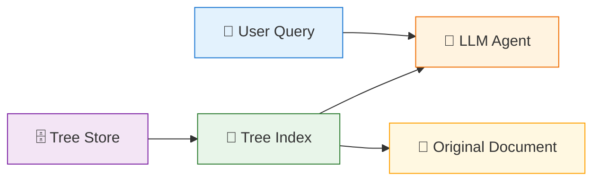

### Agentic Retrieval vs. Traditional Retrieval

| Aspect | Traditional Vector Search | Agentic Tree Search |
|--------|--------------------------|---------------------|
| Search Space | Flat vector space | Document hierarchy |
| Retrieval Method | Similarity matching | Structural navigation |
| Decision Maker | Metric (cosine, dot) | LLM reasoning |
| Context | Chunk-level | Hierarchical |
| Explainability | Low (score = 0.814) | High (path = Chapter → Section → Page) |

---

## 3.2 AlphaGo-Inspired Tree Traversal

The roadmap specifies **AlphaGo-inspired top-down agentic tree traversal** as a core technique. AlphaGo uses Monte Carlo Tree Search (MCTS) to progressively explore promising game positions rather than examining every possible position equally.

### AlphaGo Patterns Applied to Tree Navigation

| AlphaGo Concept | Vectorless RAG Application |
|-----------------|---------------------------|
| **Progressive Narrowing** | Explore promising document branches; prune irrelevant ones |
| **Value Estimation** | LLM estimates node relevance based on query intent |
| **Policy Networks** | Heuristics determine which branches are most promising |
| **Monte Carlo Sampling** | Balance exploration vs. exploitation during evaluation |

### Progressive Narrowing

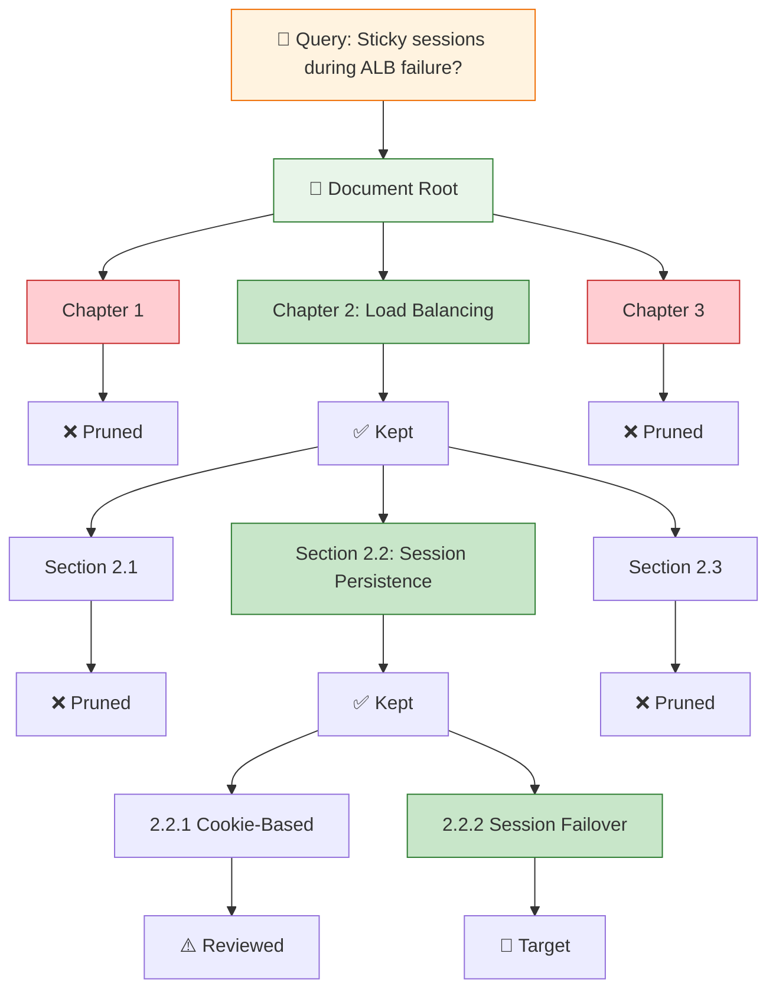

### AlphaGo-Inspired Pseudo-Code (TypeScript)

```typescript
type TreeNode = {
  nodeId: string;
  title: string;
  level: number;
  pageRange: [number, number];
  parentId: string | null;
  childrenIds: string[];
  summary: string;
  keywords: string[];
  entities: string[];
};

type RetrievedNode = {
  node: TreeNode;
  content: string;
  path: TreeNode[];
  relevanceScore: number;
};

// AlphaGo-style MCTS-inspired tree traversal with progressive refinement
async function alphaGoTreeSearch(
  tree: Map<string, TreeNode>,
  query: string,
  rootId: string,
  llm: { generate(prompt: string): Promise<string> },
  maxIterations = 20,
  topK = 3
): Promise<RetrievedNode> {
  const root = tree.get(rootId)!;
  const visited = new Set<string>();
  const path: TreeNode[] = [];

  let current = root;
  path.push(current);

  // Progressive narrowing — top-down
  for (let i = 0; i < maxIterations; i++) {
    if (visited.has(current.nodeId)) break;
    visited.add(current.nodeId);

    // 1. Policy Evaluation (AlphaGo policy network equivalent)
    const score = await evaluateNodeRelevance(current, query, llm);

    // 2. Selection — get children
    const children = current.childrenIds
      .map((id) => tree.get(id))
      .filter((n): n is TreeNode => n !== undefined);

    // 3. Check if leaf node
    if (children.length === 0) {
      const content = await lazyLoadContent(current);
      return { node: current, content, path, relevanceScore: score };
    }

    // 4. MCTS Selection — sort by score, explore top-K branches
    const scoredChildren = await Promise.all(
      children.map(async (child) => ({
        node: child,
        score: await evaluateNodeRelevance(child, query, llm),
      }))
    );

    const promising = scoredChildren
      .sort((a, b) => b.score - a.score)
      .slice(0, topK);

    // 5. UCB-like exploration bonus for under-visited branches
    const finalScores = promising.map((p) => {
      const explorationBonus = visited.has(p.node.nodeId) ? -Infinity : 5;
      return { ...p, adjustedScore: p.score + explorationBonus };
    });

    // 6. Exploit the best branch (descend)
    const best = finalScores.reduce((max, cur) =>
      cur.adjustedScore > max.adjustedScore ? cur : max
    );

    current = best.node;
    path.push(current);
  }

  const content = await lazyLoadContent(current);
  const score = await evaluateNodeRelevance(current, query, llm);
  return { node: current, content, path, relevanceScore: score };
}
```

### Key Benefits

1. **Progressive Narrowing** — Like AlphaGo exploring promising board regions, the agent narrows to the most promising document sections.
2. **Self-Improving** — Learns which document regions are most relevant for similar queries over time.
3. **Efficient Pruning** — Skips irrelevant sections before loading their full content.
4. **Explicit Path** — Every retrieval decision is traceable.

---

## 3.3 Vector Search vs Agentic Tree Search

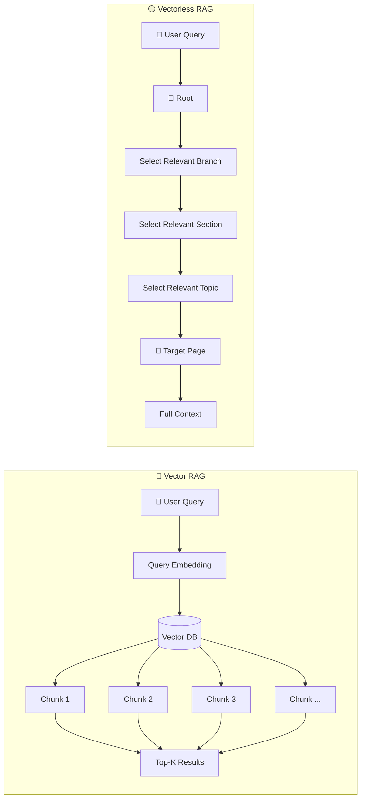

### Mental Model

**Vector RAG:**
> "Search everywhere and rank by similarity."

**Vectorless RAG:**
> "Navigate intelligently and progressively narrow the search."

---

## 3.4 Example Query: Step-by-Step Navigation

Consider this question:

> **"How do sticky sessions behave during ALB failure?"**

Suppose our document contains:

```text
Distributed Systems Architecture Manual

├── Chapter 1: Networking

├── Chapter 2: Load Balancing
│   ├── Section 2.1: CDN Architecture
│   ├── Section 2.2: Session Persistence
│   │   ├── 2.2.1 Cookie-Based Sticky Sessions
│   │   └── 2.2.2 Session Failover & Recovery
│   └── Section 2.3: Traffic Routing
│
└── Chapter 3: Database Replication
```

The correct answer is inside:

```text
Chapter 2
   ↓
Section 2.2
   ↓
Subsection 2.2.2
```

### Step 1 — Evaluate the Root

The LLM first sees the top-level structure:

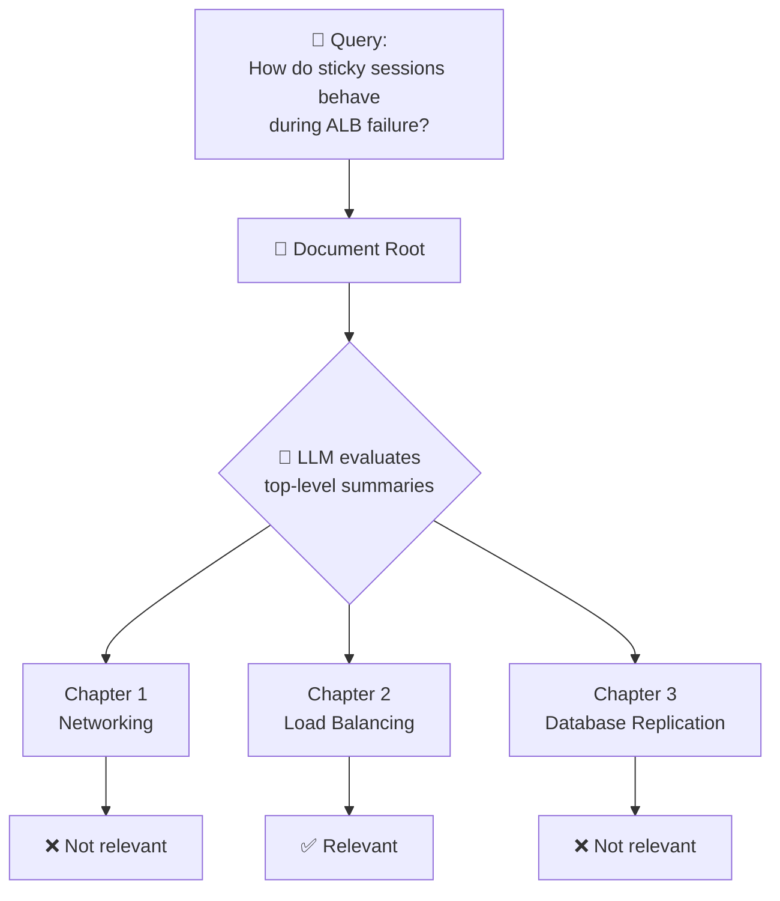

The agent reasons:

```text
Sticky sessions + ALB failure
        ↓
Load Balancing
        ↓
Chapter 2 is relevant
```

It **prunes** Chapters 1 and 3.

### Step 2 — Expand the Relevant Branch

The agent looks inside Chapter 2:

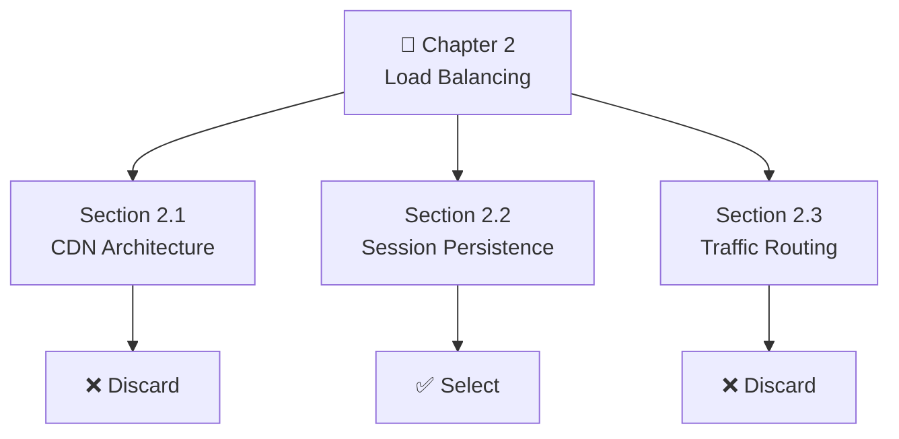

LLM sees summaries like:

```text
2.1 CDN Architecture
→ Static asset distribution and edge caching.

2.2 Session Persistence
→ Cookie-based sticky sessions and failover
   behavior during server failures.

2.3 Traffic Routing
→ General request routing and traffic policies.
```

Section 2.2 matches the query.

### Step 3 — Continue Down the Tree

The agent expands Section 2.2:

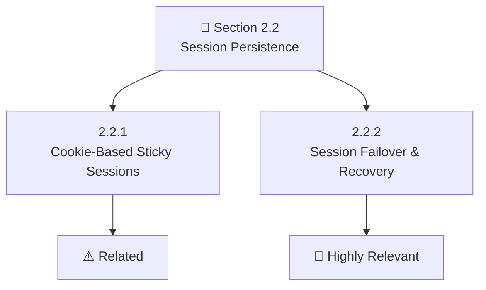

The agent identifies:

```text
2.2.2 Session Failover & Recovery
        ↓
Pages 181–200
```

We have reached the target area.

### Step 4 — Lazy Load the Actual Content

#### Why Lazy Loading Matters

The system did **not** load the entire 500-page document. Instead, it used lightweight metadata:

```text
Chapter summaries
Section summaries
Page ranges
Keywords
Node relationships
```

Only after finding the relevant branch does it load the actual pages.

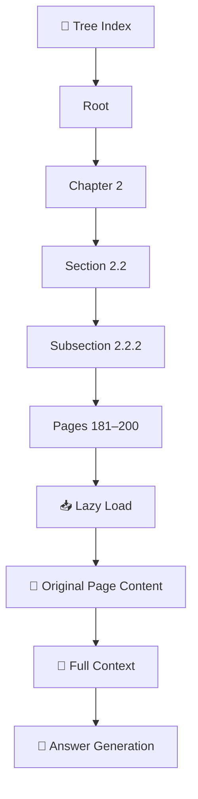

#### Comparison

| Traditional Approach | Tree Approach |
|----------------------|---------------|
| Search → 10 fragmented chunks → LLM | Navigate → Relevant section → 1–2 targeted pages → Full surrounding context → LLM |

---

## 3.5 Complete Agentic Tree Search Flow

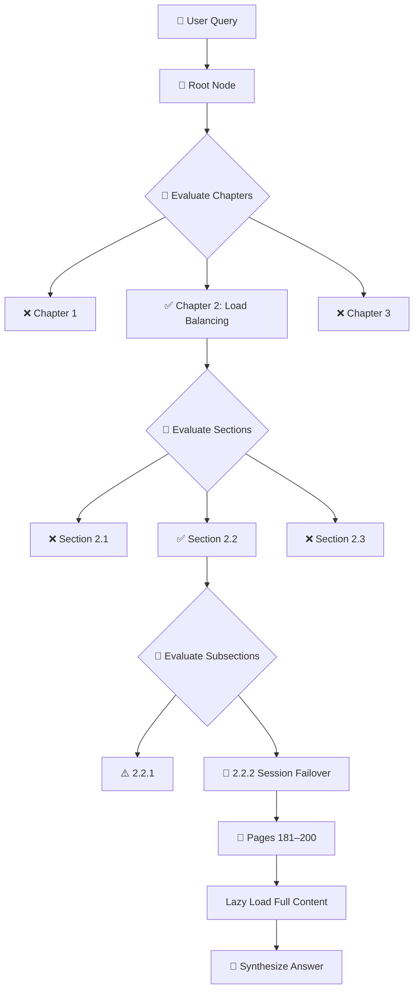

This is **agentic retrieval** because the LLM actively decides which branches to explore.

---

## 3.6 Why This Is More Traceable

A Vector RAG retrieval might look like:

```text
Chunk #472
Similarity: 0.814
```

Vectorless RAG provides an explicit path:

```text
Document
  ↓
Chapter 2: Load Balancing
  ↓
Section 2.2: Session Persistence
  ↓
Subsection 2.2.2: Session Failover
  ↓
Pages 181–184
```

### Traceable Answer Template

```text
Answer:
When an ALB node fails, session traffic is redirected
according to the documented failover mechanism.

Source:
Distributed Systems Architecture Manual v2

Navigation Path:
Root
 → Chapter 2: Load Balancing
 → Section 2.2: Session Persistence
 → Subsection 2.2.2: Session Failover & Recovery

Pages:
181–184

Node:
sub_2_2_2
```

The important part isn't just the citation — it's that the system can explain **how it reached that source**.

---

## 3.7 Why Hierarchical Context Helps

Consider a query:

> "How does it handle state persistence?"

The word **"it"** is ambiguous. But if the previous conversation was:

> "How does the ALB maintain user sessions?"

Then the LLM can resolve:

```text
"it"
  ↓
ALB
  ↓
Load Balancing
  ↓
Session Persistence
```

### Reference Resolution via Tree

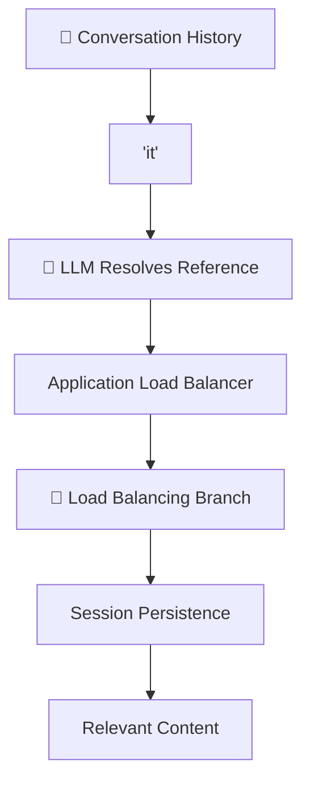

The tree gives the agent a natural place to continue searching.

---

## 3.8 Complex Queries: Global Context

### Query

> **"Summarize all high-availability strategies across the entire system."**

A vector search might return:

```text
Chunk 12 → High availability
Chunk 89 → High availability
Chunk 203 → HA architecture
Chunk 401 → Availability
Chunk 512 → Failover
```

These are isolated pieces. The system may miss the **global architecture**.

### Tree-Based Global Search

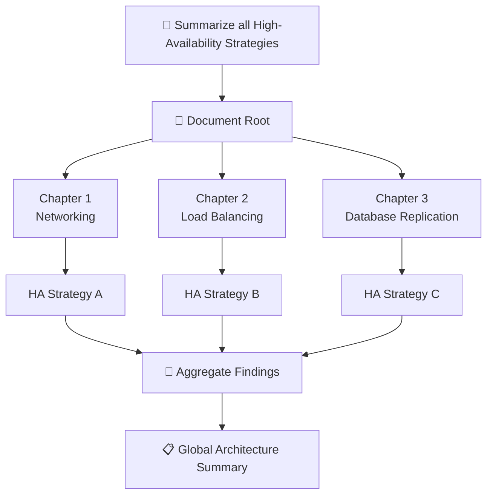

The agent inspects multiple branches and combines findings.

---

## 3.9 Agentic Retrieval Is a Reasoning Process

> Retrieval becomes a **reasoning process**:

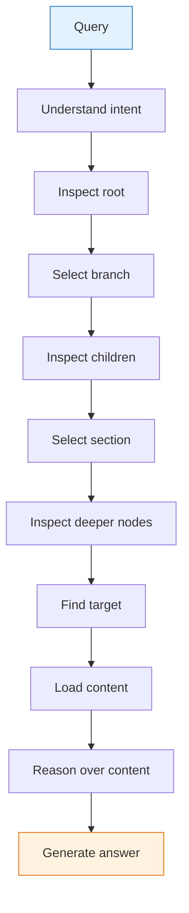

> **Retrieval itself becomes an intelligent navigation task.**

---

## 3.10 Optimization #1 — Summary-First Pruning

Don't send entire content of every node. Instead, send a summary:

```text
Expensive:
5,000-token section
   ↓
LLM evaluation

Efficient:
50–100 token summary
   ↓
LLM evaluation
```

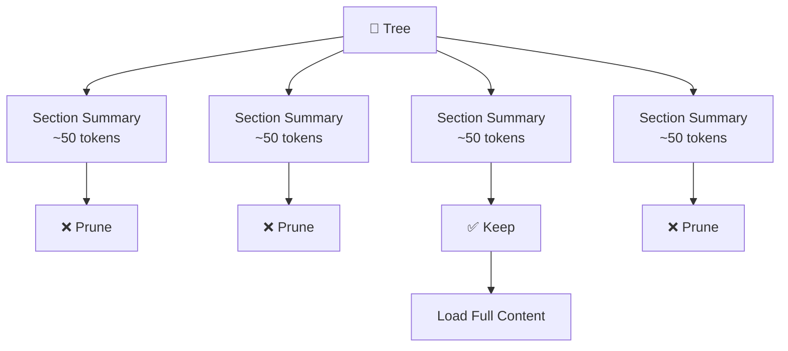

The LLM first asks:

> **"Is this branch worth exploring?"**

Only promising branches are expanded.

### Summary-First Pruning Pseudo-Code

```typescript
async function shouldPruneNode(
  node: TreeNode,
  query: string,
  llm: { generate(prompt: string): Promise<string> }
): Promise<boolean> {
  const prompt = `
    Node Title: ${node.title}
    Summary: ${node.summary}
    Keywords: ${node.keywords.join(", ")}
    Page Range: ${node.pageRange.join("–")}

    User Query: "${query}"

    Does this section appear relevant?
    Answer ONLY "yes" or "no".
  `;

  const response = await llm.generate(prompt);
  return response.trim().toLowerCase() !== "yes";
}
```

---

## 3.11 Optimization #2 — Parallel Subtree Evaluation

Sibling nodes can be evaluated concurrently:

```text
Sequential:
Section 1 → wait
Section 2 → wait
Section 3 → wait

Parallel:
Section 1 ──┐
Section 2 ──┼──→ LLM Evaluation
Section 3 ──┘
```

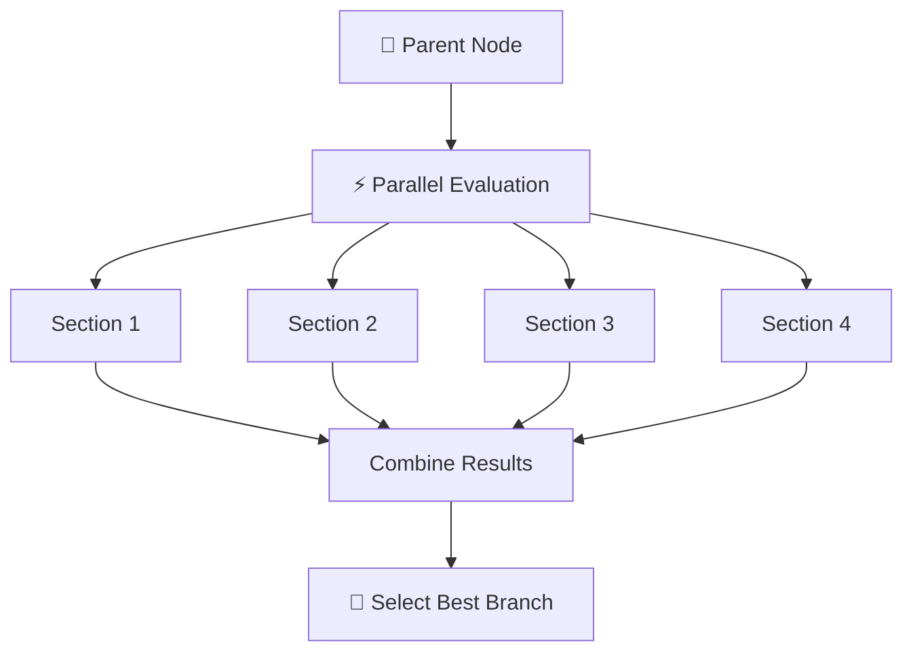

In TypeScript, this uses `Promise.all(...)`:

```typescript
async function parallelBranchEvaluation(
  children: TreeNode[],
  query: string,
  llm: { generate(prompt: string): Promise<string> }
): Promise<{ node: TreeNode; score: number }[]> {
  const evaluations = await Promise.all(
    children.map(async (child) => ({
      node: child,
      score: await evaluateNodeRelevance(child, query, llm),
    }))
  );

  return evaluations.sort((a, b) => b.score - a.score);
}
```

The goal is to reduce **wall-clock latency**.

---

## 3.12 Optimization #3 — Tree Structure Caching

The document tree is usually generated once during indexing and reused.

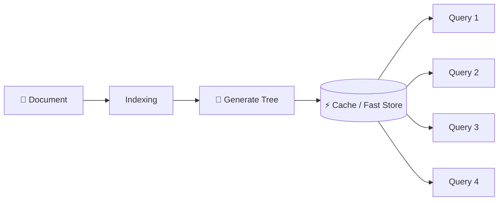

### Storage Options

| Storage | Use Case | Notes |
|---------|----------|-------|
| **In-memory** | Small KBs | Fastest, no persistence |
| **Redis** | Medium KBs | Fast, shared across instances |
| **SQLite** | Local apps | ACID, single file |
| **PostgreSQL** | Enterprise | JSON + full-text search |
| **JSON files** | Portable | Simple, human-readable |

> **Build the tree once, reuse it for many queries.**

---

## 3.13 Combined Optimization Strategy

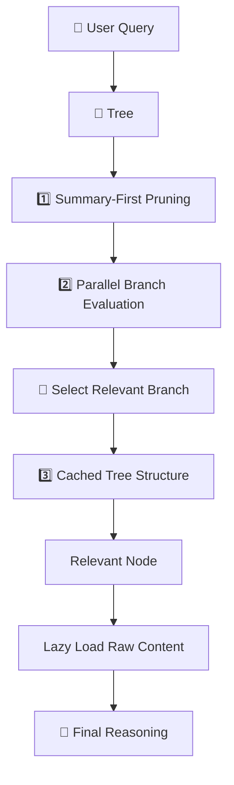

---

## 3.14 Zero-Vector Relevance Reasoning

**Zero-vector relevance reasoning** determines relevance **without** embedding vectors or similarity scores.

### Zero-Vector vs. Vector-Based Relevance

| Approach | Decision Basis | Example Output |
|----------|----------------|----------------|
| **Vector-Based** | Math: cosine / dot product | "Chunk #472, similarity: 0.814" |
| **Zero-Vector** | Structural summary + LLM | "Section 2.2: Session Persistence" |

### Zero-Vector Pseudo-Code (TypeScript)

```typescript
/**
 * Zero-vector relevance scoring — no embeddings, no similarity math.
 * The LLM judges relevance purely from structural metadata.
 */
async function zeroVectorRelevanceScoring(
  node: TreeNode,
  query: string,
  llm: { generate(prompt: string): Promise<string> }
): Promise<number> {
  const prompt = `
    Node Title: ${node.title}
    Node Summary: ${node.summary}
    Keywords: ${node.keywords.join(", ")}
    Entities: ${node.entities.join(", ")}
    Page Range: ${node.pageRange.join("–")}

    User Query: "${query}"

    On a scale of 0–100, how likely is this node to contain
    the information needed to answer the query?
    Output ONLY a number.
  `;

  const score = parseInt(await llm.generate(prompt));
  return isNaN(score) ? 0 : score;
}

/**
 * Zero-vector agentic search over a document tree.
 */
async function vectorlessAgenticSearch(
  tree: Map<string, TreeNode>,
  query: string,
  rootId: string,
  llm: { generate(prompt: string): Promise<string> }
): Promise<RetrievedNode> {
  const path: TreeNode[] = [];
  let current = tree.get(rootId)!;

  while (true) {
    path.push(current);

    const score = await zeroVectorRelevanceScoring(current, query, llm);

    const children = current.childrenIds
      .map((id) => tree.get(id))
      .filter((n): n is TreeNode => n !== undefined);

    if (children.length === 0 || score < 30) {
      break;
    }

    const childScores = await Promise.all(
      children.map(async (child) => ({
        node: child,
        score: await zeroVectorRelevanceScoring(child, query, llm),
      }))
    );

    const best = childScores.reduce((max, cur) =>
      cur.score > max.score ? cur : max
    );

    current = best.node;
  }

  const content = await lazyLoadContent(current);
  const score = await zeroVectorRelevanceScoring(current, query, llm);

  return {
    node: current,
    content,
    path,
    relevanceScore: score,
  };
}

// Lazy load the full content of a node only after it is selected
async function lazyLoadContent(node: TreeNode): Promise<string> {
  return `[Lazy loaded content for node: ${node.title}\nPage range: ${node.pageRange.join("–")}]`;
}
```

### Why Zero-Vector Matters

| Benefit | Explanation |
|---------|-------------|
| **Explicit Traceability** | Decisions based on readable node summaries, not opaque vector scores |
| **Structural Context** | Relevance tied to document hierarchy, not content similarity alone |
| **Auditability** | Easy to explain why a section was selected (title matches topic, summary aligns) |
| **Simplicity** | No embedding infrastructure needed at inference time |
| **Reduced Bias** | Based on structural logic rather than potentially biased embeddings |

---

## 3.15 Vector RAG vs Agentic Tree Search — Detailed Comparison

| Aspect | 🔵 Vector RAG | 🟢 Agentic Tree Search |
|--------|---------------|------------------------|
| Retrieval Method | Similarity search | Hierarchical navigation |
| Search Space | Flat chunks | Document tree |
| Decision Maker | Similarity metric | LLM |
| Context | Chunk-based | Structure-aware |
| Search Path | Often opaque | Explicit |
| Citations | Retrieved chunks | Section/page lineage |
| Complex Queries | Can struggle | Better suited |
| Global Queries | Difficult | Can traverse multiple branches |
| Cost | Usually lower | More LLM calls |
| Latency | Usually lower | Requires optimization |
| Explainability | Moderate | High |

---

## 3.16 Trade-Off Considerations

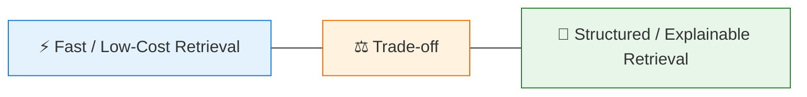

### Vector RAG Is Preferable When

* Documents are relatively simple / unstructured
* Semantic search is sufficient
* Very low latency is critical
* Knowledge base is flat or short

### Vectorless RAG Is Preferable When

* Documents are highly structured (manuals, textbooks, wikis)
* Exact sections and page-level traceability matter
* Context preservation is important
* Documents are long and complex
* Explainability is a priority
* Multi-hop or global queries are common

---

## 3.17 Complete Mental Model

### 🔵 Vector RAG

```text
Question
   ↓
Search every page for similar language
   ↓
Pick the closest passages
   ↓
Answer
```

### 🟢 Vectorless RAG

```text
Question
   ↓
Open Table of Contents
   ↓
Choose Chapter
   ↓
Choose Section
   ↓
Choose Subsection
   ↓
Open Relevant Pages
   ↓
Read Full Context
   ↓
Answer
```

### The Agentic Reasoning Loop

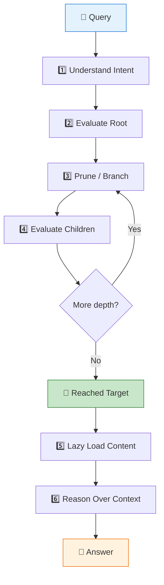

---

## 🎯 Key Takeaways

1. **Agentic Tree Search turns retrieval into a navigation problem** — the LLM actively decides which branches to explore.
2. **The LLM evaluates node summaries** and chooses which branches are most relevant to descend into.
3. **Irrelevant branches are pruned** before any raw content is loaded.
4. **Lazy loading** retrieves full text only after reaching a relevant node or page range.
5. **Tree traversal provides an explicit, traceable retrieval path** (Chapter → Section → Page).
6. **Hierarchical retrieval excels for long, structured documents** and complex or global queries.
7. **Summary-first pruning, parallel evaluation, and caching** help control tokens and latency.
8. **Vectorless RAG trades some simplicity and latency for better structural reasoning, context preservation, and explainability**.
9. **AlphaGo-inspired MCTS and zero-vector relevance scoring** make the system audit-friendly and structure-driven.

> **Mental Model:**
> **Vector RAG asks, "Which text is similar?"**
> **Agentic Tree Search asks, "Which branch of the knowledge structure should I explore next?"**
> **Zero-Vector Reasoning asks, "Based on document structure and summaries, which section contains the answer?"**

---
