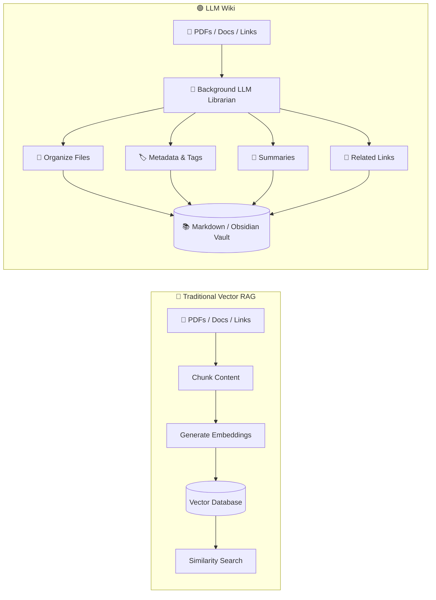
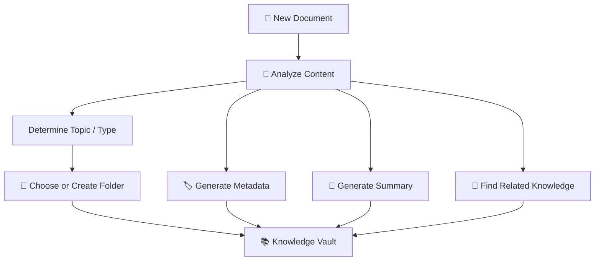
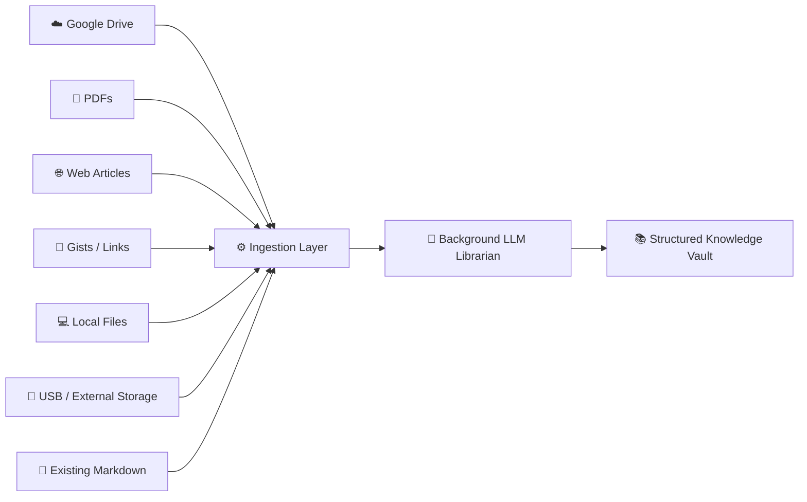
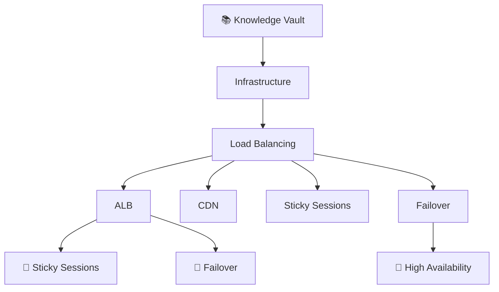
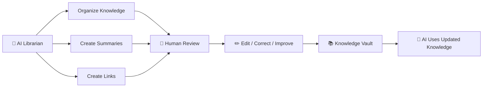
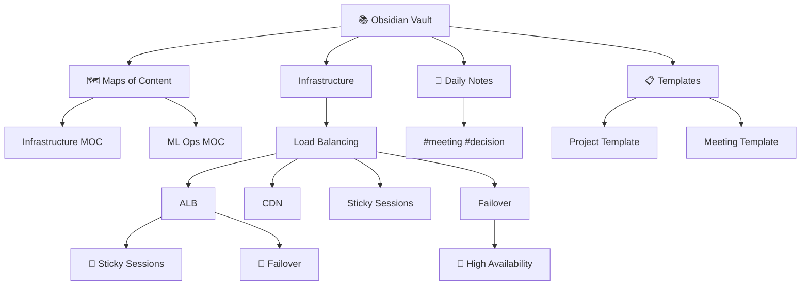
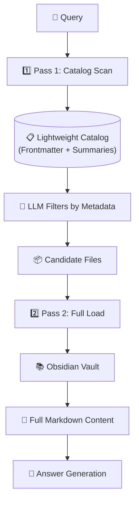

# Chapter 04 — LLM Wiki Architecture (Andrej Karpathy)

## 4.1 What Is an LLM Wiki?

The **LLM Wiki** concept, discussed by **Andrej Karpathy**, rethinks how we store and retrieve personal or organizational knowledge. Instead of simply taking documents, converting them into embeddings, and putting those embeddings into a vector database, an **LLM acts like a background librarian**.

Its job is to:
- 📖 Read incoming information
- 📁 Organize it
- 📝 Create summaries
- 🏷️ Add metadata and tags
- 🔗 Connect related documents
- 🧠 Maintain a human-readable knowledge base

The result is a collection of **Markdown files, folders, metadata, and links** that both humans and LLMs can understand.

### Simple Mental Model

> **Vector RAG:** Store content for search.
> **LLM Wiki:** Organize knowledge so it can be understood and maintained.

---

## 4.2 Vector RAG vs LLM Wiki



The key difference is **what happens after the content arrives**.

---

## 4.3 Push Content vs Update Knowledge

### 🔵 Vector RAG — Push Content

The typical workflow is:
```text
Document
   ↓
Chunk
   ↓
Embedding
   ↓
Vector Database
```

The system mainly asks:
> **"How can I store this content so I can retrieve similar content later?"**

### 🟢 LLM Wiki — Update Knowledge

The workflow becomes:
```text
Document
   ↓
Understand
   ↓
Organize
   ↓
Summarize
   ↓
Tag
   ↓
Link with existing knowledge
   ↓
Update Wiki
```

The system asks:
> **"Where does this information belong in my existing knowledge?"**

---

## 4.4 A Simple Example

Imagine you download a PDF about **Load Balancing**.

#### Traditional Vector System

```text
PDF
 ↓
500-token chunks
 ↓
Embeddings
 ↓
Vector DB
```

You might end up with:
```text
[0.124, -0.821, 0.442, ...]
[0.731,  0.112, -0.391, ...]
[0.218, -0.552, 0.891, ...]
```

The stored representation is useful for machines but difficult for humans to inspect.

#### LLM Wiki Approach

```
vault/
│
├── infrastructure/
│   │
│   ├── load-balancing/
│   │   ├── alb.md
│   │   ├── cdn.md
│   │   ├── sticky-sessions.md
│   │   └── failover.md
│   │
│   └── networking/
│       ├── routing.md
│       └── dns.md
│
└── index.md
```

Now the knowledge is:
- ✅ Human-readable
- ✅ Editable
- ✅ Searchable
- ✅ Version-controllable
- ✅ Easy to inspect

---

## 4.5 LLM as a Background Librarian

Think of the LLM as a **digital librarian**. When a new document arrives, the librarian performs several tasks:



### Example

```text
New file:
load-balancing-guide.pdf

        ↓

Topic:
Infrastructure / Load Balancing

        ↓

Target folder:
vault/infrastructure/load-balancing/

        ↓

Generated:
- Title
- Summary
- Tags
- Metadata
- Related documents
```

---

## 4.6 Heterogeneous Data Ingestion

An LLM Wiki doesn't have to depend on one source. It can collect knowledge from many places:



This makes the system more like a **personal knowledge operating system** rather than simply a search database.

---

## 4.7 What Happens When a New File Arrives?

Suppose you add:

```text
alb-failover.pdf
```

The background LLM might process it like this:

### Step 1 — Understand
```text
Topic:
Application Load Balancing
```

### Step 2 — Organize
```text
vault/
└── infrastructure/
    └── load-balancing/
        └── alb-failover.md
```

### Step 3 — Generate Metadata

```yaml
---
title: ALB Failover
category: infrastructure
tags:
  - load-balancing
  - alb
  - failover
  - high-availability
---
```

### Step 4 — Generate Summary

```text
Describes ALB failure detection,
traffic redistribution, session persistence,
and recovery mechanisms.
```

### Step 5 — Create Relationships

```text
Related:
→ sticky-sessions.md
→ high-availability.md
→ traffic-routing.md
```

---

## 4.8 The Knowledge Vault

The resulting structure could look like:



Notice that the structure itself contains useful information. The **folder hierarchy + metadata + links** become part of the retrieval system.

### Example Markdown Node

```markdown
---
title: ALB Sticky Sessions
tags:
  - load-balancing
  - alb
  - sessions
---

# ALB Sticky Sessions

Sticky sessions allow requests from the same
client to be routed to the same backend instance.

## Related Knowledge

- [[ALB Failover]]
- [[Session Persistence]]
- [[High Availability]]
```

---

## 4.9 Human + AI Collaboration

This creates an interesting workflow:



The human isn't locked out of the system. You can manually fix:

```text
Wrong summary
Wrong tag
Wrong folder
Missing relationship
Incorrect information
```

And the LLM can use the corrected version later.

---

## 4.10 Major Benefits

### 1. 💰 Token & Cost Efficiency

The system doesn't repeatedly load every document. Instead:
```text
Metadata → Filter → Full Content
```

Only relevant information reaches the final LLM context.

### 2. 👀 Human Readability

Unlike raw embeddings:
```text
[0.124, -0.82, 0.31, ...]
```

You get:
```text
infrastructure/
└── load-balancing/
    ├── alb.md
    ├── failover.md
    └── sticky-sessions.md
```

Humans can understand and modify the system.

### 3. ✏️ Easy Maintenance

Need to correct one fact? With Markdown:

```text
Open file
   ↓
Edit text
   ↓
Save
```

No need to think about a proprietary vector-store schema.

### 4. 🔓 No Vendor Lock-In

The knowledge can live in standard formats:
```text
Markdown
YAML
JSON
Folders
Git
```

You can move the vault between tools without rebuilding your entire knowledge base from scratch.

### 5. 🔗 Knowledge Relationships

Because documents can contain explicit links:
```text
ALB
 ↓
Sticky Sessions
 ↓
Session Persistence
 ↓
Failover
 ↓
High Availability
```

The system can build a much richer knowledge structure.

---

## 4.11 LLM Wiki vs Vector RAG — Comparison Table

| Feature          | 🔵 Vector RAG               | 🟢 LLM Wiki                              |
| ---------------- | --------------------------- | ---------------------------------------- |
| Main idea        | Search stored embeddings    | Maintain organized knowledge             |
| Storage          | Vector DB                   | Markdown / Files / Wiki                  |
| Representation   | Embeddings                  | Human-readable documents                 |
| Organization     | Usually external to vectors | Built into folders + metadata            |
| Retrieval        | Similarity search           | Catalog → selective loading              |
| Maintenance      | Re-index / re-embed often   | Edit files directly                      |
| Human-readable   | ❌                           | ✅                                        |
| Cross-links      | Usually additional logic    | Native Markdown links                    |
| Vendor lock-in   | Potentially higher          | Low                                      |
| Token efficiency | Depends on retrieval        | Strong with two-pass retrieval           |
| Best suited for  | Semantic search             | Structured personal/enterprise knowledge |

---

## 4.12 The Bigger Idea

The LLM Wiki isn't simply another RAG implementation. It's a different philosophy:

```text
Traditional RAG
      ↓
Store information
      ↓
Search information
      ↓
Generate answer
```

Whereas:

```text
LLM Wiki
      ↓
Understand information
      ↓
Organize information
      ↓
Connect information
      ↓
Maintain knowledge
      ↓
Retrieve relevant knowledge
      ↓
Generate answer
```

The LLM becomes more than a **retrieval component**. It becomes a **knowledge librarian**.

---

## 4.14 Karpathy's Obsidian Vault Architecture

Andrej Karpathy's vision specifically uses **Obsidian** — a Markdown-based knowledge base that supports bidirectional linking, graph visualization, and plugins. The vault structure is designed for both human and LLM consumption.

### Vault Directory Structure

```
vault/
│
├── .obsidian/              # Obsidian config & plugins
├── templates/              # Note templates
├── daily-notes/            # Daily journal entries
├── MOC/                    # Maps of Content (index pages)
│   ├── infrastructure.md
│   ├── ml-ops.md
│   └── system-design.md
│
├── infrastructure/
│   ├── load-balancing/
│   │   ├── alb.md
│   │   ├── cdn.md
│   │   ├── sticky-sessions.md
│   │   └── failover.md
│   ├── networking/
│   │   ├── routing.md
│   │   └── dns.md
│   └── databases/
│       ├── replication.md
│       └── sharding.md
│
├── ml/
│   ├── training/
│   ├── evaluation/
│   └── deployment/
│
└── index.md                # Root navigation page
```

### Obsidian-Specific Features

| Feature | Description | Benefit for LLM Wiki |
|---------|-------------|---------------------|
| **Bidirectional Links** | `[[Note Name]]` creates backlinks | Automatic relationship discovery |
| **Graph View** | Visualizes note connections | Human + LLM can see knowledge topology |
| **Dataview Plugin** | Query vault like a database | LLM can run structured queries |
| **Templates** | Consistent note structure | Easier LLM ingestion & formatting |
| **Frontmatter (YAML)** | Structured metadata | Lightweight catalog for two-pass retrieval |
| **Canvas** | Visual workspace | LLM can generate diagrams |

### Vault Graph Visualization



### Why Obsidian?

1. **Local-First**: Plain Markdown files on disk, no cloud dependency
2. **Human-Editable**: Open any file in any text editor
3. **Extensible**: Plugin ecosystem for custom workflows
4. **Graph-Native**: Bidirectional links create natural knowledge graphs
5. **LLM-Friendly**: Structured Markdown + YAML frontmatter = easy parsing

---

## 4.15 Two-Pass Retrieval Integration with LLM Wiki

The LLM Wiki naturally enables **two-pass retrieval** (covered in Chapter 5):



### Catalog Structure for Two-Pass Retrieval

```yaml
# Lightweight catalog entry (frontmatter only)
- file: "infrastructure/load-balancing/alb.md"
  title: "ALB Sticky Sessions"
  tags: [load-balancing, alb, sessions]
  summary: "Sticky sessions route same-client requests to same backend"
  keywords: ["sticky sessions", "cookie routing", "session persistence"]
  related: ["failover.md", "high-availability.md"]
  updated: "2024-01-15"
```

**Pass 1** (Fast): Filter catalog entries by tags/keywords/summary using LLM
**Pass 2** (Complete): Load full Markdown content only for selected candidates

---

## 4.16 Pseudo Code: LLM Wiki Ingestion Agent (TypeScript)

```typescript
// Metadata frontmatter structure
interface DocumentMetadata {
  title: string;
  category: string;
  tags: string[];
  keywords: string[];
  relatedFiles: string[];
}

// Processed document entry
interface WikiDocument {
  filePath: string;
  metadata: DocumentMetadata;
  summary: string;
  content: string;
  relatedLinks: string[];
}

// Ingest a new file into the LLM Wiki
async function ingestFile(sourcePath: string): Promise<void> {
  const content = await readFile(sourcePath);
  
  // 1. Analyze content with LLM
  const analysis = await llmAnalyze(content);
  
  const metadata: DocumentMetadata = {
    title: analysis.title,
    category: analysis.category,
    tags: analysis.tags,
    keywords: analysis.keywords,
    relatedFiles: await findRelatedDocuments(analysis.keywords),
  };
  
  // 2. Organize into the correct folder
  const vaultPath = buildVaultPath(metadata.category, metadata.title);
  
  // 3. Generate summary
  const summary = await llmSummarize(content);
  
  // 4. Find related knowledge
  const relatedLinks = metadata.relatedFiles;
  
  // 5. Assemble the wiki document
  const wikiDoc: WikiDocument = {
    filePath: vaultPath,
    metadata,
    summary,
    content,
    relatedLinks,
  };
  
  // 6. Write to vault
  await writeWikiDocument(wikiDoc);
  
  // 7. Update the lightweight catalog
  await updateCatalog(wikiDoc);
}

// Pass 1: Scan catalog to find candidates
async function scanCatalog(query: string): Promise<WikiDocument[]> {
  const catalog = await loadCatalog();
  
  return catalog.filter(doc => 
    llmRelevanceCheck(query, doc.metadata, doc.summary)
  );
}

// Pass 2: Load full content for selected candidates
async function loadFullContent(candidates: WikiDocument[]): Promise<string> {
  const contents = await Promise.all(
    candidates.map(c => readFile(c.filePath))
  );
  return contents.join('\n\n');
}
```

---

## 🎯 Key Takeaways

Remember these **7 points**:

1. **LLM Wiki treats the LLM as a background librarian that organizes knowledge.**
2. **Instead of only pushing content into a vector database, the system continuously updates a structured knowledge base.**
3. **Markdown, folders, metadata, and links make the knowledge human-readable and editable.**
4. **Heterogeneous sources (PDFs, Drive, web pages, local files) can be unified into one vault.**
5. **Two-Pass Retrieval first scans lightweight metadata and summaries, then loads only relevant full documents.**
6. **This significantly reduces unnecessary context, token usage, and retrieval overhead.**
7. **The biggest advantage is that knowledge remains understandable and maintainable by both humans and AI.**

> **Mental Model:**
> 📦 **Vector RAG:** *Store content → Search similar chunks → Answer*
>
> 📚 **LLM Wiki:** *Understand → Organize → Connect → Maintain → Retrieve → Answer*

---