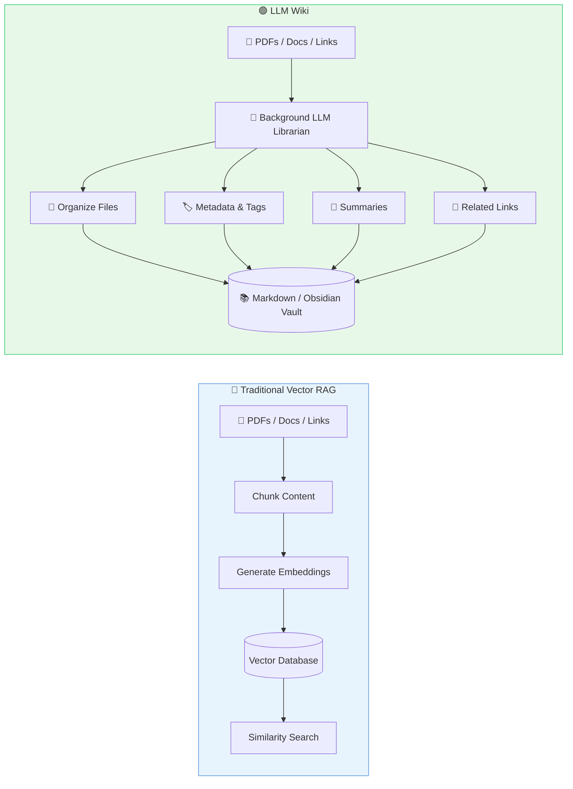
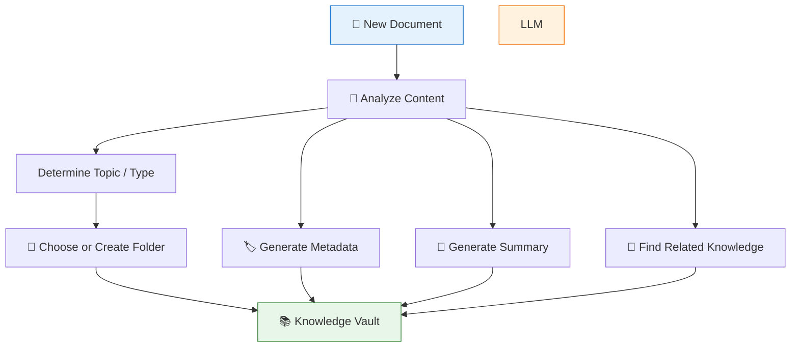
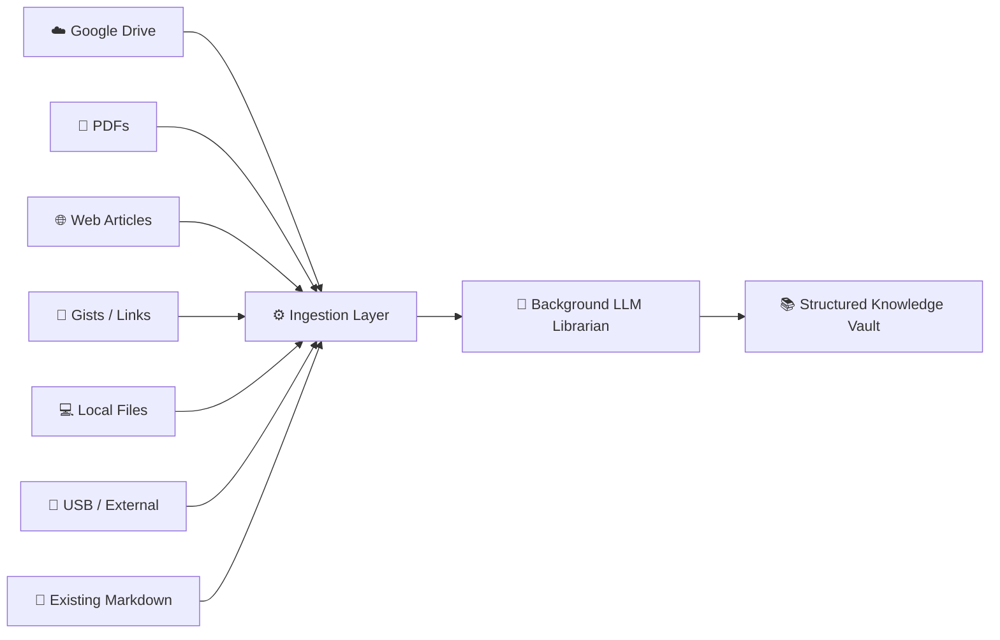
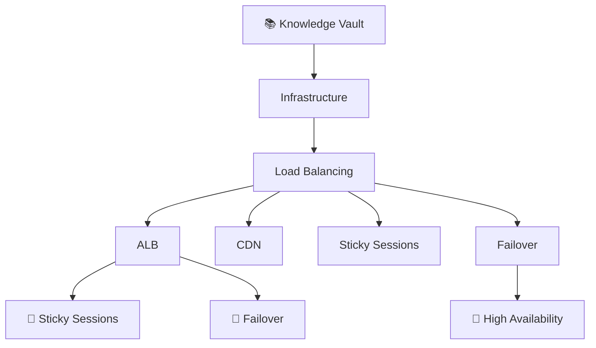
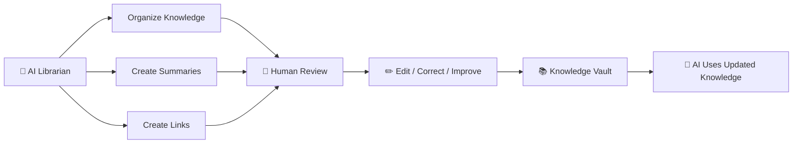
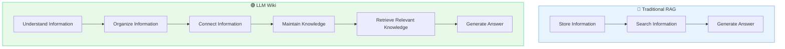
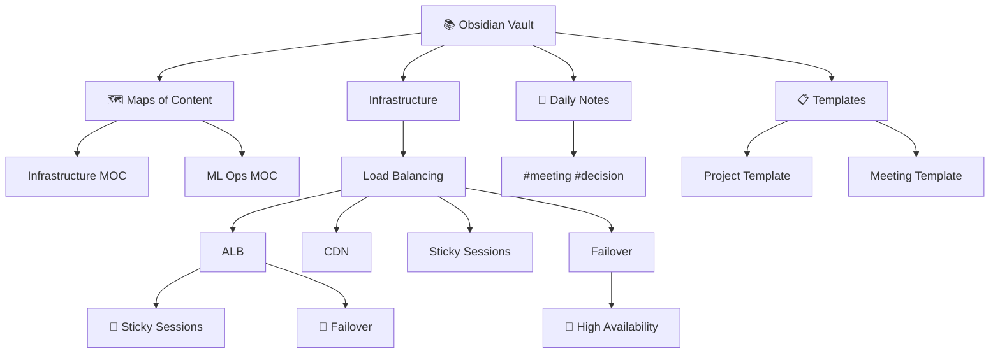
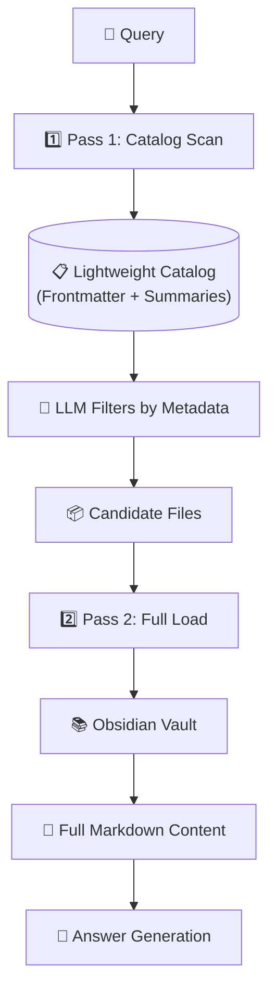
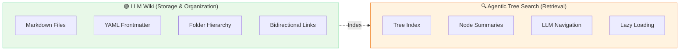

# Chapter 04 — LLM Wiki Architecture (Andrej Karpathy)

## 4.1 What Is an LLM Wiki?

The **LLM Wiki** concept, popularized by **Andrej Karpathy**, rethinks how we store and retrieve personal or organizational knowledge.

Instead of simply taking documents, converting them into embeddings, and putting those embeddings into a vector database, an **LLM acts like a background librarian**.

### The Librarian's Job

* 📖 Read incoming information
* 📁 Organize it into a logical structure
* 📝 Create summaries
* 🏷️ Add metadata and tags
* 🔗 Connect related documents
* 🧠 Maintain a human-readable knowledge base

### The Result

A collection of **Markdown files, folders, metadata, and links** that both humans and LLMs can understand.

### Simple Mental Model

> **Vector RAG:** Store content for search.  
> **LLM Wiki:** Organize knowledge so it can be understood and maintained.

---

## 4.2 Vector RAG vs LLM Wiki — Architecture Comparison



The key difference is **what happens after the content arrives**.

---

## 4.3 Push Content vs Update Knowledge

### 🔵 Vector RAG — Push Content

```text
Document
   ↓
Chunk
   ↓
Embedding
   ↓
Vector Database
```

The system mainly asks:
> **"How can I store this content so I can retrieve similar content later?"**

### 🟢 LLM Wiki — Update Knowledge

```text
Document
   ↓
Understand
   ↓
Organize
   ↓
Summarize
   ↓
Tag
   ↓
Link with existing knowledge
   ↓
Update Wiki
```

The system asks:
> **"Where does this information belong in my existing knowledge?"**

---

## 4.4 A Simple Example

Imagine you download a PDF about **Load Balancing**.

### Traditional Vector System

```text
PDF
 ↓
500-token chunks
 ↓
Embeddings
 ↓
Vector DB
```

You might end up with:

```text
[0.124, -0.821, 0.442, ...]
[0.731,  0.112, -0.391, ...]
[0.218, -0.552, 0.891, ...]
```

The stored representation is useful for machines but difficult for humans to inspect.

### LLM Wiki Approach

```
vault/
│
├── infrastructure/
│   │
│   ├── load-balancing/
│   │   ├── alb.md
│   │   ├── cdn.md
│   │   ├── sticky-sessions.md
│   │   └── failover.md
│   │
│   └── networking/
│       ├── routing.md
│       └── dns.md
│
└── index.md
```

Now the knowledge is:

| Property | ✅ Available |
|----------|--------------|
| Human-readable | Yes |
| Editable | Yes |
| Searchable | Yes |
| Version-controllable | Yes |
| Easy to inspect | Yes |

---

## 4.5 LLM as a Background Librarian



### Example Processing

```text
New file:
load-balancing-guide.pdf

        ↓

Topic:
Infrastructure / Load Balancing

        ↓

Target folder:
vault/infrastructure/load-balancing/

        ↓

Generated:
- Title
- Summary
- Tags
- Metadata
- Related documents
```

---

## 4.6 Heterogeneous Data Ingestion

An LLM Wiki doesn't depend on one source. It can collect knowledge from many places:



This makes the system more like a **personal knowledge operating system** rather than simply a search database.

---

## 4.7 What Happens When a New File Arrives?

Suppose you add:

```text
alb-failover.pdf
```

### Step 1 — Understand

```text
Topic:
Application Load Balancing
```

### Step 2 — Organize

```text
vault/
└── infrastructure/
    └── load-balancing/
        └── alb-failover.md
```

### Step 3 — Generate Metadata (YAML Frontmatter)

```yaml
---
title: ALB Failover
category: infrastructure
tags:
  - load-balancing
  - alb
  - failover
  - high-availability
---
```

### Step 4 — Generate Summary

```text
Describes ALB failure detection,
traffic redistribution, session persistence,
and recovery mechanisms.
```

### Step 5 — Create Relationships

```text
Related:
→ sticky-sessions.md
→ high-availability.md
→ traffic-routing.md
```

---

## 4.8 The Knowledge Vault

The resulting structure:



The structure itself contains useful information. The **folder hierarchy + metadata + links** become part of the retrieval system.

### Example Markdown Node

```markdown
---
title: ALB Sticky Sessions
tags:
  - load-balancing
  - alb
  - sessions
---

# ALB Sticky Sessions

Sticky sessions allow requests from the same
client to be routed to the same backend instance.

## Related Knowledge

- [[ALB Failover]]
- [[Session Persistence]]
- [[High Availability]]
```

---

## 4.9 Human + AI Collaboration

This creates an interesting workflow:



The human isn't locked out. You can manually fix:

```text
Wrong summary
Wrong tag
Wrong folder
Missing relationship
Incorrect information
```

And the LLM uses the corrected version later.

---

## 4.10 Major Benefits

### 1. 💰 Token & Cost Efficiency

The system doesn't repeatedly load every document:

```text
Metadata → Filter → Full Content
```

Only relevant information reaches the final LLM context.

### 2. 👀 Human Readability

Unlike raw embeddings:

```text
[0.124, -0.82, 0.31, ...]
```

You get:

```text
infrastructure/
└── load-balancing/
    ├── alb.md
    ├── failover.md
    └── sticky-sessions.md
```

Humans can understand and modify the system.

### 3. ✏️ Easy Maintenance

Need to correct one fact?

```text
Open file
   ↓
Edit text
   ↓
Save
```

No need to think about a proprietary vector-store schema.

### 4. 🔓 No Vendor Lock-In

The knowledge lives in standard formats:

```text
Markdown
YAML
JSON
Folders
Git
```

You can move the vault between tools without rebuilding from scratch.

### 5. 🔗 Knowledge Relationships

Documents contain explicit links:

```text
ALB
 ↓
Sticky Sessions
 ↓
Session Persistence
 ↓
Failover
 ↓
High Availability
```

The system builds a much richer knowledge structure.

---

## 4.11 LLM Wiki vs Vector RAG — Detailed Comparison

| Feature | 🔵 Vector RAG | 🟢 LLM Wiki |
|---------|---------------|-------------|
| Main idea | Search stored embeddings | Maintain organized knowledge |
| Storage | Vector DB | Markdown / Files / Wiki |
| Representation | Embeddings | Human-readable documents |
| Organization | External to vectors | Built into folders + metadata |
| Retrieval | Similarity search | Catalog → selective loading |
| Maintenance | Re-index / re-embed often | Edit files directly |
| Human-readable | ❌ | ✅ |
| Cross-links | Usually additional logic | Native Markdown links |
| Vendor lock-in | Potentially higher | Low |
| Token efficiency | Depends on retrieval | Strong with two-pass retrieval |
| Best suited for | Semantic search | Structured personal/enterprise knowledge |

---

## 4.12 The Bigger Idea

The LLM Wiki isn't simply another RAG implementation. It's a different philosophy:



The LLM becomes more than a **retrieval component**. It becomes a **knowledge librarian**.

---

## 4.13 Karpathy's Obsidian Vault Architecture

Andrej Karpathy's vision specifically uses **Obsidian** — a Markdown-based knowledge base that supports bidirectional linking, graph visualization, and plugins. The vault structure is designed for both human and LLM consumption.

### Vault Directory Structure

```
vault/
│
├── .obsidian/              # Obsidian config & plugins
├── templates/              # Note templates
├── daily-notes/            # Daily journal entries
├── MOC/                    # Maps of Content (index pages)
│   ├── infrastructure.md
│   ├── ml-ops.md
│   └── system-design.md
│
├── infrastructure/
│   ├── load-balancing/
│   │   ├── alb.md
│   │   ├── cdn.md
│   │   ├── sticky-sessions.md
│   │   └── failover.md
│   ├── networking/
│   │   ├── routing.md
│   │   └── dns.md
│   └── databases/
│       ├── replication.md
│       └── sharding.md
│
├── ml/
│   ├── training/
│   ├── evaluation/
│   └── deployment/
│
└── index.md                # Root navigation page
```

### Obsidian-Specific Features

| Feature | Description | Benefit for LLM Wiki |
|---------|-------------|---------------------|
| **Bidirectional Links** | `[[Note Name]]` creates backlinks | Automatic relationship discovery |
| **Graph View** | Visualizes note connections | Human + LLM can see knowledge topology |
| **Dataview Plugin** | Query vault like a database | LLM can run structured queries |
| **Templates** | Consistent note structure | Easier LLM ingestion & formatting |
| **Frontmatter (YAML)** | Structured metadata | Lightweight catalog for two-pass retrieval |
| **Canvas** | Visual workspace | LLM can generate diagrams |

### Vault Graph Visualization



### Why Obsidian?

1. **Local-First**: Plain Markdown files on disk, no cloud dependency
2. **Human-Editable**: Open any file in any text editor
3. **Extensible**: Plugin ecosystem for custom workflows
4. **Graph-Native**: Bidirectional links create natural knowledge graphs
5. **LLM-Friendly**: Structured Markdown + YAML frontmatter = easy parsing

---

## 4.14 Two-Pass Retrieval Integration with LLM Wiki

The LLM Wiki naturally enables **two-pass retrieval** (covered in detail in Chapter 5):



### Catalog Structure for Two-Pass Retrieval

```yaml
# Lightweight catalog entry (frontmatter only)
- file: "infrastructure/load-balancing/alb.md"
  title: "ALB Sticky Sessions"
  tags: [load-balancing, alb, sessions]
  summary: "Sticky sessions route same-client requests to same backend"
  keywords: ["sticky sessions", "cookie routing", "session persistence"]
  related: ["failover.md", "high-availability.md"]
  updated: "2024-01-15"
```

* **Pass 1 (Fast)**: Filter catalog entries by tags/keywords/summary using LLM
* **Pass 2 (Complete)**: Load full Markdown content only for selected candidates

---

## 4.15 Pseudo Code: LLM Wiki Ingestion Agent (TypeScript)

```typescript
// Metadata frontmatter structure
interface DocumentMetadata {
  title: string;
  category: string;
  tags: string[];
  keywords: string[];
  relatedFiles: string[];
  updated: string;
}

// Processed document entry
interface WikiDocument {
  filePath: string;
  metadata: DocumentMetadata;
  summary: string;
  content: string;
  relatedLinks: string[];
}

// Lightweight catalog entry for two-pass retrieval
interface CatalogEntry {
  file: string;
  title: string;
  tags: string[];
  summary: string;
  keywords: string[];
  related: string[];
  updated: string;
}

// LLM client interface
interface LLMClient {
  generate(prompt: string): Promise<string>;
  generateJSON<T>(prompt: string): Promise<T>;
}

// Ingest a new file into the LLM Wiki
async function ingestFile(
  sourcePath: string,
  llm: LLMClient,
  vaultRoot: string
): Promise<void> {
  // 1. Read raw content
  const rawContent = await readFile(sourcePath);

  // 2. Analyze content with LLM
  const analysis = await analyzeDocument(rawContent, llm);

  // 3. Build metadata
  const metadata: DocumentMetadata = {
    title: analysis.title,
    category: analysis.category,
    tags: analysis.tags,
    keywords: analysis.keywords,
    relatedFiles: await findRelatedDocuments(analysis.keywords, vaultRoot),
    updated: new Date().toISOString(),
  };

  // 4. Determine vault path
  const vaultPath = buildVaultPath(vaultRoot, metadata.category, metadata.title);

  // 5. Generate summary
  const summary = await llmSummarize(rawContent, llm);

  // 6. Find related knowledge
  const relatedLinks = metadata.relatedFiles;

  // 7. Assemble the wiki document with frontmatter
  const wikiDoc: WikiDocument = {
    filePath: vaultPath,
    metadata,
    summary,
    content: rawContent,
    relatedLinks,
  };

  // 8. Write to vault (with YAML frontmatter)
  await writeWikiDocument(wikiDoc);

  // 9. Update the lightweight catalog
  await updateCatalog(wikiDoc);
}

// Analyze document using LLM
async function analyzeDocument(
  content: string,
  llm: LLMClient
): Promise<{
  title: string;
  category: string;
  tags: string[];
  keywords: string[];
}> {
  const prompt = `
    Analyze this document and extract:
    1. A concise title
    2. Category (e.g., infrastructure, ml, system-design)
    3. 5-10 tags
    4. 5-10 keywords

    Document:
    ${content.slice(0, 8000)}

    Return as JSON.
  `;

  return llm.generateJSON(prompt);
}

// Generate summary using LLM
async function llmSummarize(content: string, llm: LLMClient): Promise<string> {
  const prompt = `
    Summarize this document in 2-3 sentences:

    ${content.slice(0, 8000)}
  `;
  return llm.generate(prompt);
}

// Find related documents by keyword overlap
async function findRelatedDocuments(
  keywords: string[],
  vaultRoot: string
): Promise<string[]> {
  const catalog = await loadCatalog(vaultRoot);
  const keywordSet = new Set(keywords.map((k) => k.toLowerCase()));

  return catalog
    .map((entry) => ({
      file: entry.file,
      overlap: entry.keywords.filter((k) => keywordSet.has(k.toLowerCase())).length,
    }))
    .filter((e) => e.overlap > 0)
    .sort((a, b) => b.overlap - a.overlap)
    .slice(0, 5)
    .map((e) => e.file);
}

// Build vault path from category and title
function buildVaultPath(
  vaultRoot: string,
  category: string,
  title: string
): string {
  const safeTitle = title.toLowerCase().replace(/\s+/g, "-").replace(/[^a-z0-9-]/g, "");
  return `${vaultRoot}/${category}/${safeTitle}.md`;
}

// Write wiki document with YAML frontmatter
async function writeWikiDocument(doc: WikiDocument): Promise<void> {
  const frontmatter = `---
title: ${doc.metadata.title}
category: ${doc.metadata.category}
tags: ${JSON.stringify(doc.metadata.tags)}
keywords: ${JSON.stringify(doc.metadata.keywords)}
related: ${JSON.stringify(doc.relatedLinks)}
updated: ${doc.metadata.updated}
---`;

  const fullContent = `${frontmatter}\n\n# ${doc.metadata.title}\n\n${doc.summary}\n\n## Related Knowledge\n\n${doc.relatedLinks.map((r) => `- [[${r.replace(/\.md$/, "")}]]`).join("\n")}\n\n${doc.content}`;

  await writeFile(doc.filePath, fullContent);
}

// Load lightweight catalog
async function loadCatalog(vaultRoot: string): Promise<CatalogEntry[]> {
  const catalogPath = `${vaultRoot}/.catalog.json`;
  try {
    const data = await readFile(catalogPath);
    return JSON.parse(data);
  } catch {
    return [];
  }
}

// Update catalog with new document
async function updateCatalog(doc: WikiDocument): Promise<void> {
  const catalog = await loadCatalog(doc.filePath.split("/").slice(0, -2).join("/"));
  const entry: CatalogEntry = {
    file: doc.filePath,
    title: doc.metadata.title,
    tags: doc.metadata.tags,
    summary: doc.summary,
    keywords: doc.metadata.keywords,
    related: doc.relatedLinks,
    updated: doc.metadata.updated,
  };
  catalog.push(entry);
  await writeFile(`${doc.filePath.split("/").slice(0, -2).join("/")}/.catalog.json`, JSON.stringify(catalog, null, 2));
}

// Pass 1: Scan catalog to find candidates
async function scanCatalog(
  query: string,
  vaultRoot: string,
  llm: LLMClient
): Promise<CatalogEntry[]> {
  const catalog = await loadCatalog(vaultRoot);

  // LLM-based relevance check on lightweight catalog
  return catalog.filter((doc) => llmRelevanceCheck(query, doc, llm));
}

// LLM relevance check on catalog entry
async function llmRelevanceCheck(
  query: string,
  entry: CatalogEntry,
  llm: LLMClient
): Promise<boolean> {
  const prompt = `
    User Query: "${query}"

    Document:
    Title: ${entry.title}
    Tags: ${entry.tags.join(", ")}
    Summary: ${entry.summary}
    Keywords: ${entry.keywords.join(", ")}

    Is this document likely to contain information relevant to the query?
    Answer ONLY "yes" or "no".
  `;

  const response = await llm.generate(prompt);
  return response.trim().toLowerCase() === "yes";
}

// Pass 2: Load full content for selected candidates
async function loadFullContent(candidates: CatalogEntry[]): Promise<string> {
  const contents = await Promise.all(
    candidates.map((c) => readFile(c.file))
  );
  return contents.join("\n\n---\n\n");
}
```

---

## 4.16 Pseudo Code: Two-Pass Retrieval Engine (TypeScript)

```typescript
interface RetrievalResult {
  answer: string;
  sources: CatalogEntry[];
  context: string;
}

interface TwoPassRetriever {
  vaultRoot: string;
  llm: LLMClient;
}

// Complete two-pass retrieval pipeline
async function twoPassRetrieval(
  query: string,
  retriever: TwoPassRetriever
): Promise<RetrievalResult> {
  // Pass 1: Fast catalog scan
  const candidates = await scanCatalog(query, retriever.vaultRoot, retriever.llm);

  // Limit to top N candidates
  const topCandidates = candidates.slice(0, 5);

  // Pass 2: Load full content
  const fullContext = await loadFullContent(topCandidates);

  // Generate answer with citations
  const answer = await generateAnswer(query, fullContext, retriever.llm);

  return {
    answer,
    sources: topCandidates,
    context: fullContext,
  };
}

async function generateAnswer(
  query: string,
  context: string,
  llm: LLMClient
): Promise<string> {
  const prompt = `
    Answer the user's question using ONLY the provided context.
    Cite sources using [[filename]] format.

    Question: ${query}

    Context:
    ${context}

    Answer:
  `;
  return llm.generate(prompt);
}
```

---

## 4.17 LLM Wiki vs Agentic Tree Search — Relationship

The LLM Wiki and Agentic Tree Search are **complementary**:



* The **LLM Wiki** handles **storage, organization, and maintenance**.
* The **Agentic Tree Search** handles **retrieval and navigation**.
* Together they form a complete knowledge system.

---

## 🎯 Key Takeaways

1. **LLM Wiki treats the LLM as a background librarian that organizes knowledge** — not just retrieves it.
2. **Instead of only pushing content into a vector database, the system continuously updates a structured knowledge base.**
3. **Markdown, folders, metadata (YAML frontmatter), and links make the knowledge human-readable and editable.**
4. **Heterogeneous sources (PDFs, Drive, web pages, local files) can be unified into one vault.**
5. **Two-Pass Retrieval first scans lightweight metadata and summaries, then loads only relevant full documents.**
6. **This significantly reduces unnecessary context, token usage, and retrieval overhead.**
7. **The biggest advantage is that knowledge remains understandable and maintainable by both humans and AI.**
8. **Obsidian's bidirectional links, graph view, and Dataview plugin make it an ideal substrate for LLM Wikis.**

> **Mental Model:**
> 📦 **Vector RAG:** *Store content → Search similar chunks → Answer*  
> 📚 **LLM Wiki:** *Understand → Organize → Connect → Maintain → Retrieve → Answer*

---