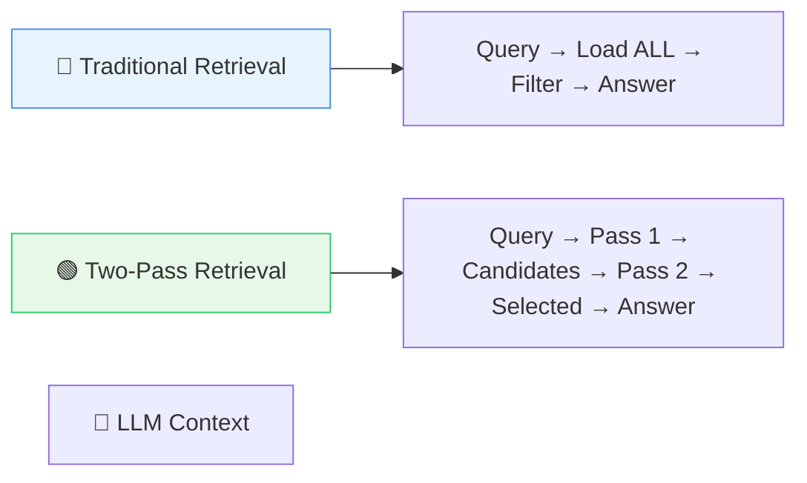
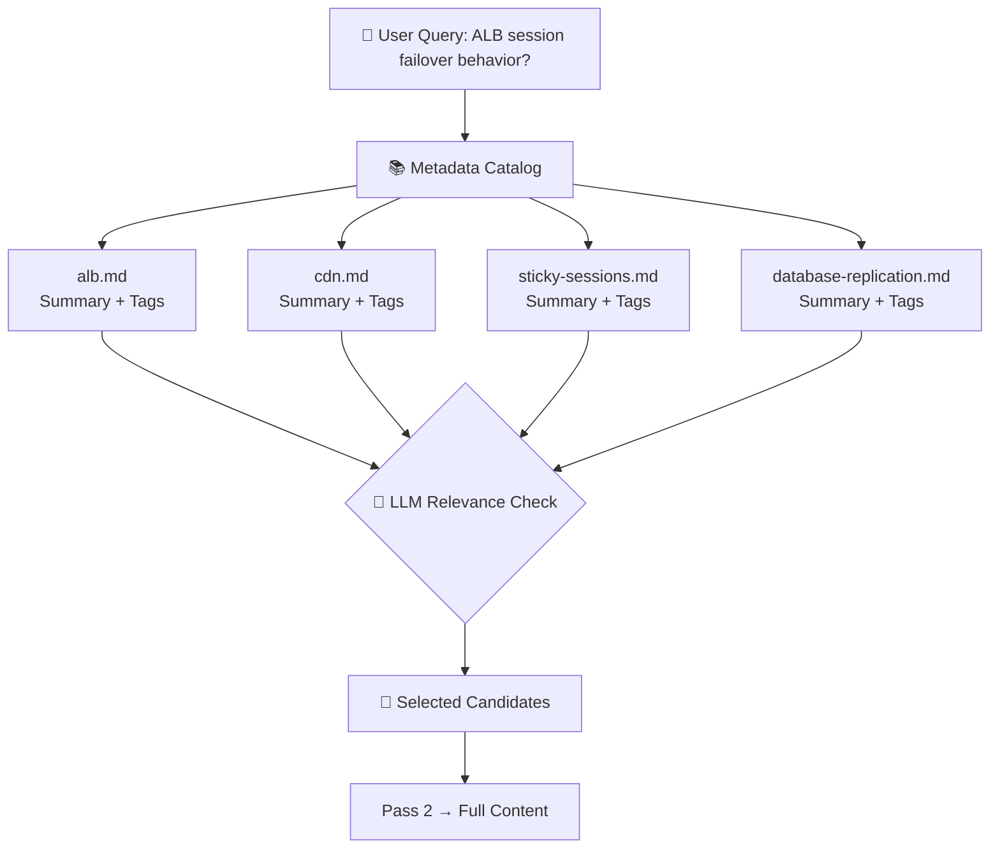
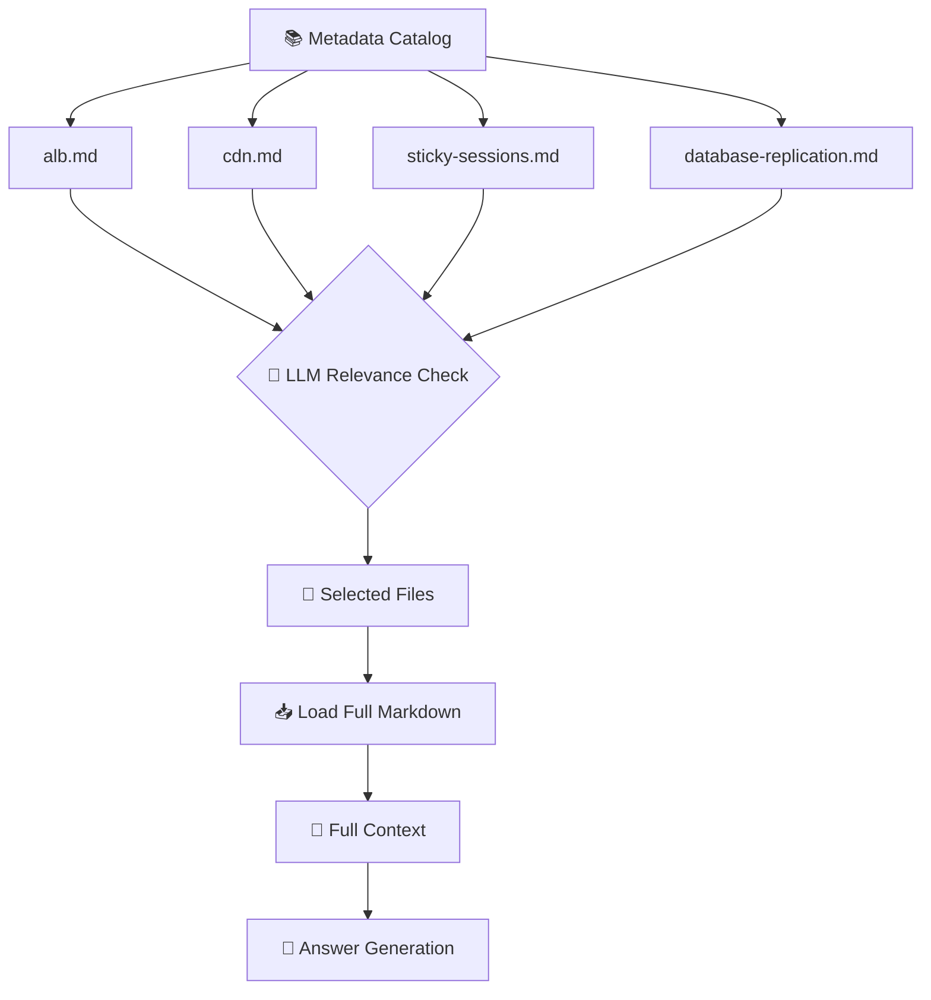
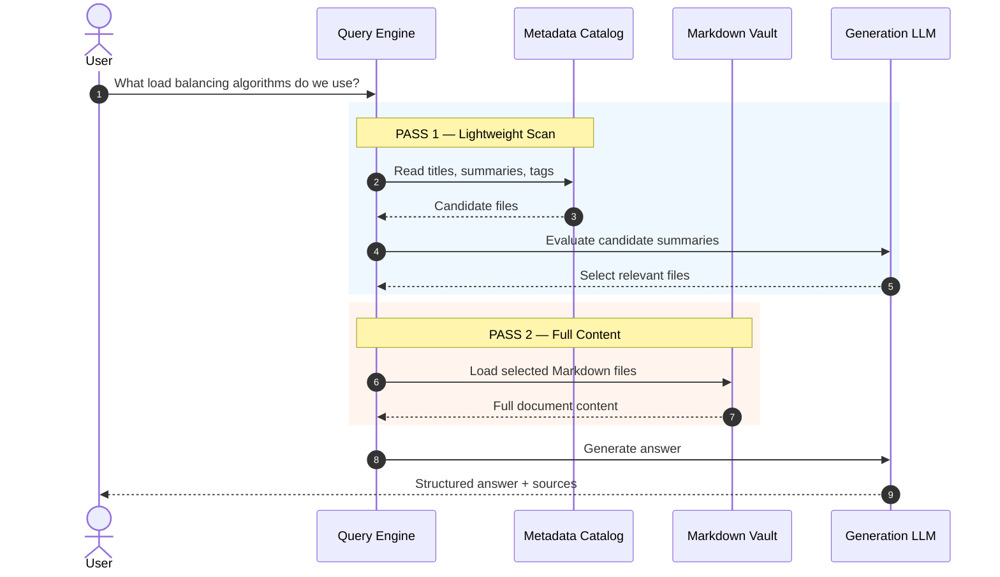
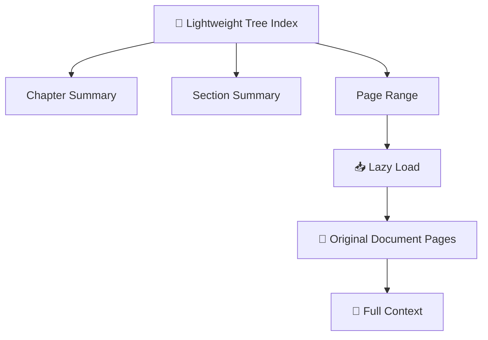
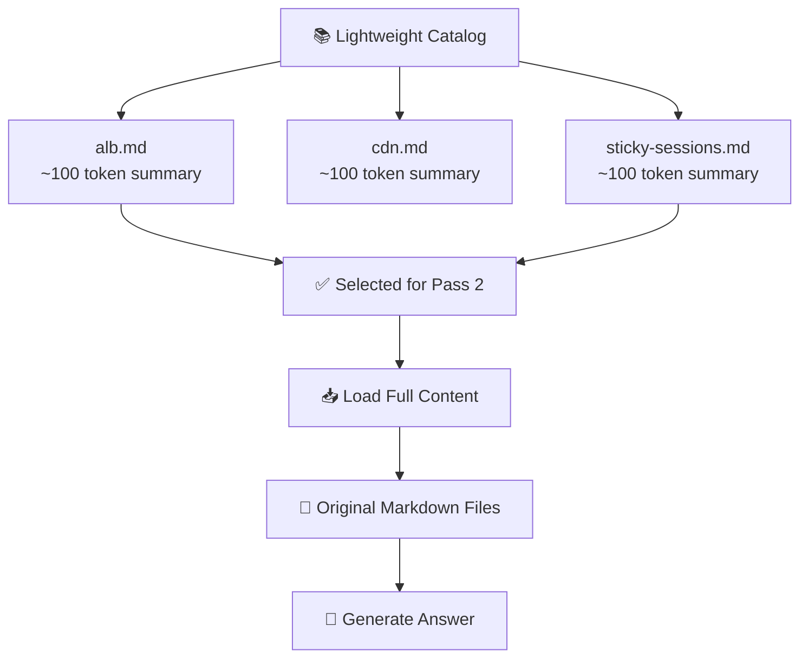
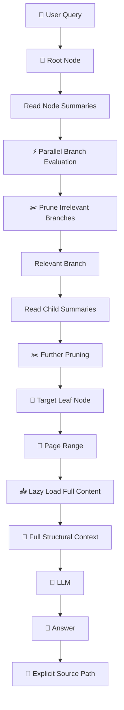
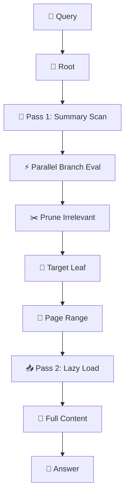

# Chapter 05 — Two-Pass Retrieval & Lazy Loading

## 5.1 The Core Problem

Modern knowledge systems often contain thousands of documents, each potentially holding thousands of tokens. Loading everything into the LLM context at once creates three fundamental problems:

```text
| Problem            | Consequence                        |
|--------------------|------------------------------------|
| Token budget exceeded | Model context window overflows      |
| Noise              | Irrelevant content dilutes signal  |
| Cost               | Processing every document per query is expensive |
```

> **The solution is not to load everything, but to load only what you need.**

---

## 5.2 What Is Two-Pass Retrieval?

**Two-Pass Retrieval** is a retrieval strategy where retrieval happens in two distinct stages:

| Pass | Purpose | What's Loaded |
|------|---------|---------------|
| **Pass 1** | Lightweight scan of metadata | Titles, summaries, tags, page ranges, categories |
| **Pass 2** | Selective full-content loading | Only the documents selected by Pass 1 |

### Mental Model



---

## 5.3 Pass 1 — Lightweight Catalog Scan

### Why It's Cheap

Pass 1 reads **metadata only**, not full document content. This includes:

| Metadata Type | Example |
|---------------|---------|
| File names | `alb.md` |
| Titles | `ALB Sticky Sessions` |
| Summaries | `Describes ALB architecture, routing, health checks` |
| Tags | `alb, load-balancing, routing` |
| Categories | `infrastructure` |
| YAML frontmatter metadata | `title`, `tags`, `category` |
| Folder paths | `infrastructure/load-balancing/` |
| Page ranges | `[181, 200]` |
| Relationships / links | `[[ALB Failover]]` |

### How It Works

The LLM evaluates these lightweight summaries against the user query:



### Example Catalog Scan

```text
📄 alb.md
Summary: Application Load Balancer architecture, routing, health checks
Tags: alb, load-balancing, routing

📄 cdn.md
Summary: CDN edge caching, static asset distribution
Tags: cdn, caching

📄 sticky-sessions.md
Summary: Session persistence using cookies, ALB sticky behavior
Tags: sessions, alb, persistence

📄 database-replication.md
Summary: Primary-replica database replication
Tags: database, replication
```

For a query about ALB session failover:

```text
alb.md   → ✅ Relevant
sticky-sessions.md → ✅ Relevant
cdn.md → ❌ Pruned
database-replication.md → ❌ Pruned
```

Without loading any full content.

---

## 5.4 Pass 2 — Selective Full-Content Loading

### Only Selected Files

After Pass 1 identifies candidates, Pass 2 loads their complete contents:



### Why This Matters

Imagine you have:

```text
1,000 Markdown files
```

Each containing:

```text
5,000 tokens
```

Loading everything would require:

```text
1,000 × 5,000 = 5,000,000 tokens
```

Instead:

#### Pass 1

Read:

```text
1,000 summaries ≈ small amount of text
```

Then identify:

```text
3 relevant files
```

#### Pass 2

Load:

```text
3 × full documents ≈ 15,000 tokens
```

> **The LLM doesn't need to process the entire knowledge base for every query.**

---

## 5.5 Sequence Diagram: End-to-End Two-Pass Retrieval



---

## 5.6 Lazy Loading

### Definition

**Lazy Loading** means loading content only when it is actually needed, rather than loading everything upfront.

### In Vectorless RAG

The tree index itself acts as a lightweight map:

```text
Tree Node
 ├── Title
 ├── Summary
 ├── Keywords
 ├── Page Range
 └── Relationships
```

The actual document content remains in the original file (PDF, Markdown, etc.) until needed.



### In LLM Wiki

The metadata catalog contains only summaries, while full Markdown files are loaded selectively:



### Key Insight

> **The tree or catalog is the map; the original document is the source of truth.**

---

## 5.7 Combined Two-Pass + Lazy Loading Architecture

Here's how both concepts work together in a Vectorless RAG system:



---

## 5.8 Pseudo Code: Two-Pass Retrieval with Lazy Loading (TypeScript)

```typescript
// Catalog entry — lightweight metadata
interface CatalogEntry {
  filePath: string;
  title: string;
  summary: string;
  tags: string[];
  pageRange?: [number, number];
  keywords?: string[];
  relevanceHeuristic?: string; // For faster filtering
}

// Full document after Pass 2
interface FullDocument {
  filePath: string;
  content: string;
  metadata: CatalogEntry;
}

// Lightweight metadata catalog stored once after indexing
type MetadataCatalog = Map<string, CatalogEntry>;

// Zero-vector relevance scoring — no embeddings needed
async function zeroVectorScore(
  query: string,
  entry: CatalogEntry
): Promise<number> {
  const prompt = `
    User Query: "${query}"
    Document Title: ${entry.title}
    Summary: ${entry.summary}
    Tags: ${entry.tags.join(", ")}
    Keywords: ${entry.keywords?.join(", ") || "N/A"}

    Rate relevance 0-100. Output only a number.
  `;

  return parseInt(await llmGenerate(prompt));
}

// Pass 1 — Scan lightweight catalog with LLM-based relevance scoring
async function pass1Scan(
  query: string,
  catalog: MetadataCatalog
): Promise<CatalogEntry[]> {
  const candidates: CatalogEntry[] = [];

  for (const entry of catalog.values()) {
    const score = await zeroVectorScore(query, entry);
    if (score > 50) { // Threshold for "potentially relevant"
      entry.relevanceScore = score;
      candidates.push(entry);
    }
  }

  // Sort by relevance score, take top K
  return candidates
    .sort((a, b) => (b.relevanceScore || 0) - (a.relevanceScore || 0))
    .slice(0, 5); // Limit candidates for Pass 2
}

// Pass 2 — Load full content only for selected candidates
async function pass2Load(
  candidates: CatalogEntry[]
): Promise<FullDocument[]> {
  const documents: FullDocument[] = [];

  for (const candidate of candidates) {
    const content = await loadFileContent(candidate.filePath);
    documents.push({
      filePath: candidate.filePath,
      content,
      metadata: candidate,
    });
  }

  return documents;
}

// End-to-end two-pass retrieval pipeline
async function retrieve(
  query: string,
  catalog: MetadataCatalog
): Promise<{ answer: string; sources: FullDocument[]; context: string }> {
  // Pass 1: cheap scan
  const candidates = await pass1Scan(query, catalog);

  // Pass 2: expensive but targeted
  const documents = await pass2Load(candidates);

  // Combine full content into context
  const context = documents.map((d) => d.content).join("\n\n");

  // Generate answer with citations
  const answer = await llmGenerate(query, context);

  return {
    answer,
    sources: documents,
    context,
  };
}

// Lazy loading for tree-based systems
async function lazyLoadNodeContent(
  node: TreeNode
): Promise<string> {
  const pages = await loadPagesFromDocument(
    node.sourceFile,
    node.pageRange
  );
  return pages.join("\n\n");
}
```

---

## 5.9 Enhanced Two-Pass with Tree Traversal

In Vectorless RAG, tree traversal naturally performs **Pass 1** (traversing summaries), and lazy loading performs **Pass 2**:



---

## 5.10 Cost Comparison

| Approach | Tokens Loaded | Cost per Query | Best For |
|----------|---------------|----------------|----------|
| **Load everything** | All documents × all tokens | Very High | Tiny knowledge bases only |
| **Vector RAG (Top-K)** | K × chunk size | Medium | Simple semantic search |
| **Two-Pass Retrieval** | Summaries + selected full docs | Low–Medium | Structured knowledge bases |
| **Vectorless RAG + Lazy Load** | Tree metadata + target pages | Low | Complex documents |

### Token Savings Example

```text
Without Two-Pass:
  1,000 files × 5,000 tokens = 5,000,000 tokens

With Two-Pass (1% selected):
  10 summaries + 3 × 5,000 = ~15,010 tokens

Reduction: ~99.7%
```

---

## 5.11 Key Takeaways

1. **Two-Pass Retrieval separates lightweight scanning from expensive full-content loading.**
2. **Pass 1 reads metadata only: titles, summaries, tags, page ranges.**
3. **Pass 2 loads only the full documents that Pass 1 selected.**
4. **Lazy Loading keeps raw content in the original file until the relevant node or page range is identified.**
5. **Together they reduce token usage, cost, and noise while preserving relevant context.**
6. **The tree index or catalog acts as a lightweight map to the source-of-truth documents.**
7. **Zero-vector relevance scoring in Pass 1 enables semantic filtering without embeddings.**
8. **The key mental model:** *"Without Two-Pass: Load the whole library to read one page. With Two-Pass: Read the card catalog first, then go directly to the right book."*

> **Mental Model:**
> *Without Two-Pass:* Load the whole library to read one page.  
> *With Two-Pass:* Read the card catalog first, then go directly to the right book.

---