# Lecture 18 — Complete Notes: Vectorless RAG & Hierarchical Knowledge Engines

> **Core Philosophy:**
> * **Traditional Vector RAG** asks: *"Which chunks are similar to my query?"*
> * **Vectorless RAG** asks: *"Where in the document structure should I look?"*
> * **LLM Wiki** asks: *"How can I organize my knowledge so it is easier to find and maintain?"*

---

## 📑 Table of Contents

1. [Problems with Vector RAG & Abrupt Chunking](#1-problems-with-vector-rag--abrupt-chunking)
2. [Vectorless RAG & Tree Indexing](#2-vectorless-rag--tree-indexing)
3. [Agentic Tree Search & Zero-Vector Reasoning](#3-agentic-tree-search--zero-vector-reasoning)
4. [LLM Wiki Architecture (Karpathy's Obsidian Vault)](#4-llm-wiki-architecture-karphys-obsidian-vault)
5. [Two-Pass Retrieval & Lazy Loading](#5-two-pass-retrieval--lazy-loading)
6. [System Comparison & Hybrid RAG](#6-system-comparison--hybrid-rag)
7. [Decision Framework & Production Architecture](#7-decision-framework--production-architecture)

---

## 🎯 Executive Summary

This lecture explores a paradigm shift in Retrieval-Augmented Generation (RAG). Instead of relying on vector embeddings and similarity search, **Vectorless RAG** and **LLM Wiki** architectures use **structural understanding, hierarchical navigation, and zero-vector reasoning** to achieve more explainable, traceable, and context-aware retrieval.

| Architecture | Search Strategy | Best For | Key Benefit |
|--------------|-----------------|----------|-------------|
| 🔵 **Vector RAG** | Embedding similarity | Simple, unstructured docs | Fast, cheap retrieval |
| 🟢 **Vectorless RAG** | Tree navigation | Long, structured docs | Precise, traceable citations |
| 🟣 **LLM Wiki** | Two-pass catalog scan | Personal/team knowledge | Human-maintainable |
| 🔵+🟢 **Hybrid** | Vector filter + tree nav | Enterprise scale | Balanced speed + precision |

---

## 1. Problems with Vector RAG & Abrupt Chunking

Detailed notes: `notes/01_limitations_vector_rag_chunking.md`

### 1.1 What Is Vector RAG?

Traditional RAG converts documents into embeddings and stores them in a vector database (Qdrant, Pinecone, Chroma, Milvus). When a user asks a question, the query is also embedded, and similarity search finds the top-K most semantically similar chunks.

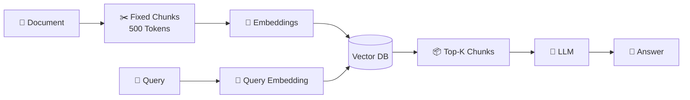

### 1.2 The Abrupt Chunking Problem

**Fixed-size chunking** cuts documents at arbitrary token boundaries, not at logical boundaries.

**Three major problems:**

| Problem | Impact | Example |
|---------|--------|---------|
| **Loss of Global & Chapter Context** | Chunks lose parent document hierarchy; dangling references & anaphora emerge | A clause in Section 3.2 refers to "the mechanism defined in Section 2.1" but that section is in a different chunk |
| **Semantic Boundary Fragmentation** | Logical units (paragraphs, tables) get split across chunks | A 3-row table header is in chunk N, rows in chunk N+1 |
| **Dangling References & Anaphora** | Pronouns lose their referent when context is cut | "This mechanism" in chunk N+1 refers to something in chunk N |

```mermaid
flowchart TD
    SUBGRAPH1["Chunk N: Setup Context"]
        A["Section 3.2: Failover behavior<br/>The mechanism described below..."]
    end

    SUBGRAPH2["Chunk N+1: Body Content"]
        B["This mechanism works by..."]
    end

    A --> X{"❌ Context broken —<br/>'this mechanism' unclear"}
    B --> X
```

### 1.3 Semantic Similarity ≠ Contextual Relevance

Vector similarity measures mathematical distance in embedding space, not whether the text actually answers the query.

| Failure Mode | Description | Example |
|--------------|-------------|---------|
| **Similar but Irrelevant** | Retrieved text is related but doesn't answer | CDN caching retrieved for an ALB session question |
| **Relevant but Not Similar** | Correct info uses different terminology | "Fault Tolerance" contains answer to a "session recovery" query |
| **Contextual Inversion** | Keywords match but meaning is opposite | "Feature is deprecated in v2" retrieved for "How to enable feature?" |

### 1.4 Vibe Retrieval & Opaque Scoring

A score like `0.814` doesn't explain **why** a chunk is relevant.

> **Why vector retrieval is hard to audit:** It returns "Because its embedding was closer" — not a business or logical justification.

### 1.5 Why This Matters

These problems are especially acute for:

* **Financial reports** (tables split mid-row)
* **Legal contracts** (clauses without definitions)
* **Technical documentation** (setup without prerequisites)

> **Key Insight:** Vector RAG asks *"Which chunks are similar?"* but what we want is *"Where in the document structure should I look?"*

---

## 2. Vectorless RAG & Tree Indexing

Detailed notes: `notes/02_vectorless_rag_tree_indexing.md`

### 2.1 What Is Vectorless RAG?

Vectorless RAG does not depend on embeddings, vector databases, fixed-size chunks, or pure similarity search. Instead, it builds a **hierarchical tree representation** of the document and uses an LLM to navigate that tree.

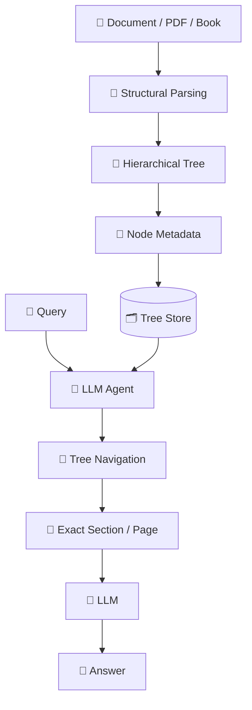

### 2.2 Natural Structural Document Parsing — Root → Chapter → Section → Page

Vectorless RAG parses documents to preserve their natural hierarchy:

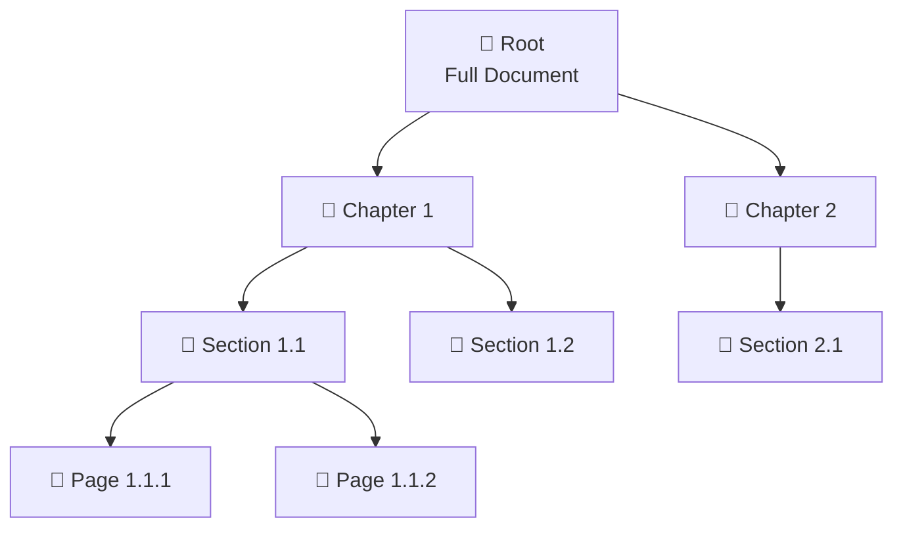

### 2.3 Anatomy of a Tree Node

Each node contains rich metadata for intelligent navigation:

```json
{
  "node_id": "sec_2_2",
  "title": "Session Persistence & Sticky Sessions",
  "level": 2,
  "page_range": [161, 200],
  "parent_id": "ch_2",
  "children_ids": ["sub_2_2_1", "sub_2_2_2"],
  "summary": "Covers session state management across distributed load balancers...",
  "keywords": ["sticky sessions", "ALB", "session persistence", "cookie routing", "failover"],
  "entities": ["Application Load Balancer", "Browser Cookies", "Memcached"],
  "source_file": "distributed_systems_v2.pdf"
}
```

### 2.4 Lazy Loading & Zero-Vector Storage

The tree index is lightweight. Full content loads **only after** the relevant node is identified:

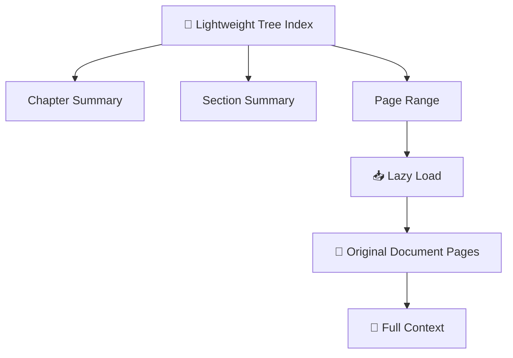

The tree can be stored using **ordinary data structures** — no vector database required:

| Storage | Best For |
|---------|----------|
| **JSON** | Small knowledge bases |
| **SQLite** | Single-node apps |
| **PostgreSQL** | Multi-user enterprise |

### 2.5 Zero-Vector Relevance Reasoning

Vectorless RAG determines relevance **without** embedding vectors:

```typescript
// Zero-vector relevance scoring — no embeddings, no similarity math
async function zeroVectorRelevanceScoring(
  node: TreeNode,
  query: string
): Promise<number> {
  const prompt = `
    Node Title: ${node.title}
    Node Summary: ${node.summary}
    Keywords: ${node.keywords.join(", ")}
    User Query: "${query}"
    Rate relevance 0-100. Output only a number.
  `;
  return parseInt(await llm.generate(prompt));
}
```

**Advantages:** Traceability, structural context, auditability, no embedding infrastructure.

---

## 3. Agentic Tree Search & Zero-Vector Reasoning

Detailed notes: `notes/03_agentic_tree_search_llm_relevance.md`

### 3.1 The Retrieval Philosophy

| Approach | Philosophy |
|----------|------------|
| **Vector RAG** | Search everywhere and rank by similarity |
| **Vectorless RAG** | Navigate intelligently and progressively narrow |

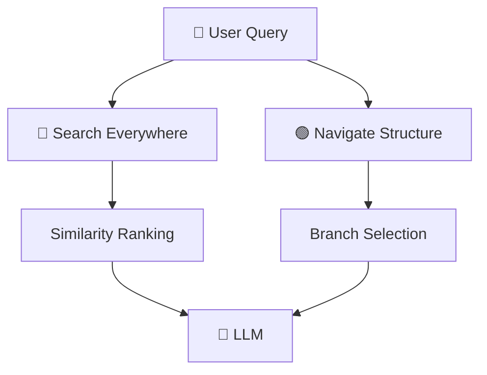

### 3.2 AlphaGo-Inspired Tree Traversal

AlphaGo's Monte Carlo Tree Search (MCTS) principles applied to document navigation:

| AlphaGo Concept | Vectorless RAG Application |
|-----------------|---------------------------|
| **Progressive Narrowing** | Explore promising branches, prune irrelevant ones |
| **Value Estimation** | LLM estimates node relevance based on query intent |
| **Policy Networks** | Heuristics determine most promising branches |
| **Monte Carlo Sampling** | Balance exploration vs. exploitation |

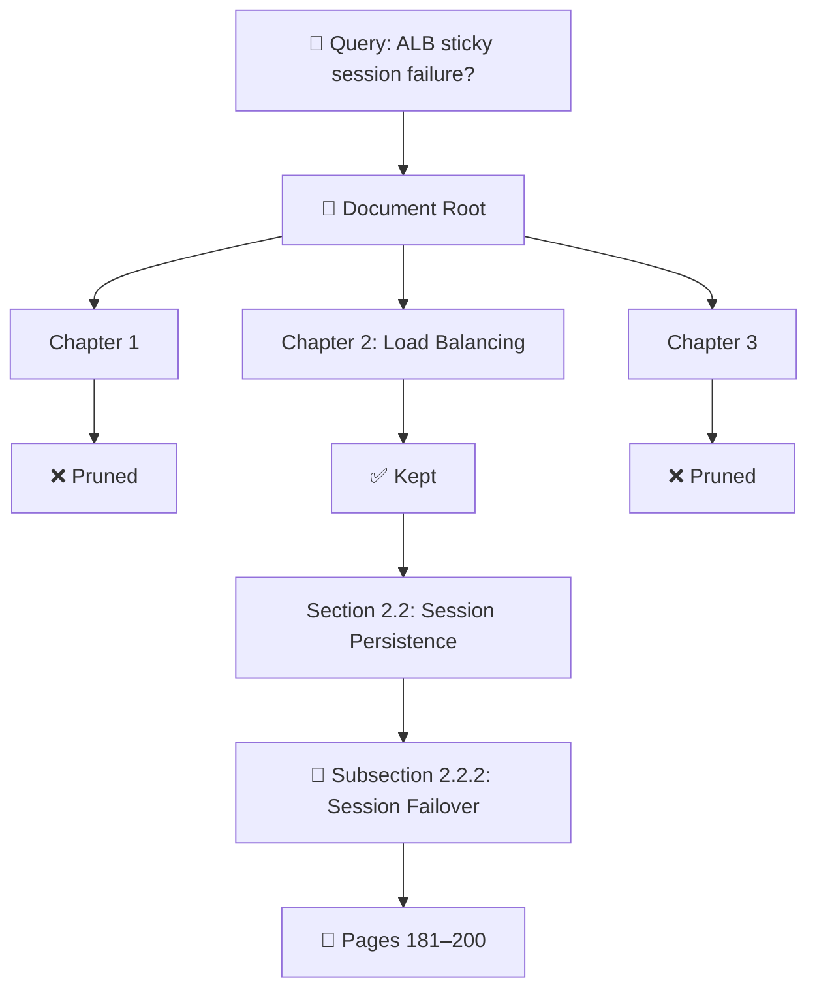

### 3.3 Step-by-Step Agentic Tree Traversal

For query: **"How do sticky sessions behave during ALB failure?"**

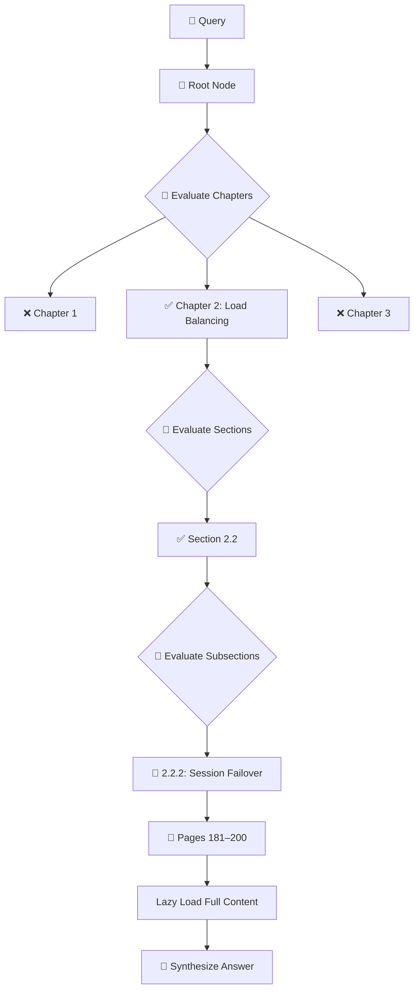

### 3.4 Optimizations

| # | Technique | Benefit |
|---|-----------|---------|
| 1 | **Summary-First Pruning** | Send ~50 token summaries, not full content |
| 2 | **Parallel Branch Evaluation** | Evaluate siblings concurrently (`Promise.all`) |
| 3 | **Tree Structure Caching** | Build tree once, reuse for many queries |

### 3.5 Traceable Answer Template

```text
Answer:
When an ALB node fails, session traffic follows
the documented failover mechanism (Page 181-184).

Navigation Path:
Root
 → Chapter 2: Load Balancing
 → Section 2.2: Session Persistence
 → Subsection 2.2.2: Session Failover

Pages: 181–184
Node: sub_2_2_2
```

---

## 4. LLM Wiki Architecture (Karpathy's Obsidian Vault)

Detailed notes: `notes/04_llm_wiki_librarian_architecture.md`

### 4.1 The LLM Wiki Concept

Instead of storing embeddings, an **LLM acts as a background librarian** that:

* 📖 Reads incoming information
* 📁 Organizes it into folders
* 📝 Creates summaries
* 🏷️ Adds metadata and tags
* 🔗 Links related documents

Result: a **Markdown/Obsidian vault** — human-readable and editable.

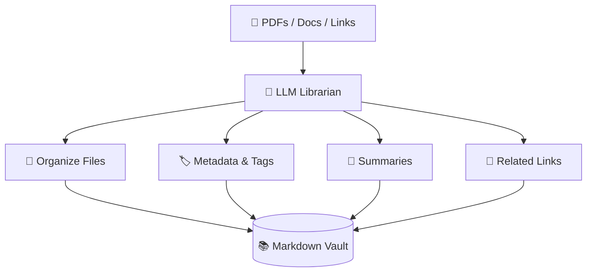

### 4.2 Karpathy's Obsidian Vault Structure

```
vault/
├── .obsidian/              # Obsidian config & plugins
├── templates/              # Note templates
├── daily-notes/            # Daily journal entries
├── MOC/                    # Maps of Content
│   ├── infrastructure.md
│   ├── ml-ops.md
│   └── system-design.md
├── infrastructure/
│   ├── load-balancing/
│   │   ├── alb.md
│   │   ├── cdn.md
│   │   ├── sticky-sessions.md
│   │   └── failover.md
│   ├── networking/
│   │   ├── routing.md
│   │   └── dns.md
│   └── databases/
│       ├── replication.md
│       └── sharding.md
├── ml/
│   ├── training/
│   ├── evaluation/
│   └── deployment/
└── index.md                # Root navigation page
```

### 4.3 Obsidian-Specific Features

| Feature | Benefit for LLM Wiki |
|---------|---------------------|
| **Bidirectional Links** | Automatic relationship discovery |
| **Graph View** | Knowledge topology visualization |
| **Dataview Plugin** | Query vault like a database |
| **Templates** | Consistent note structure |
| **Frontmatter (YAML)** | Lightweight catalog for two-pass retrieval |

### 4.4 Two-Pass Retrieval Integration

The LLM Wiki naturally enables **two-pass retrieval**:

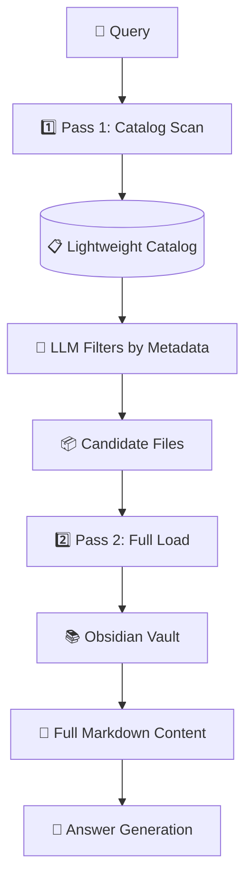

**Catalog entry:**
```yaml
- file: "infrastructure/load-balancing/alb.md"
  title: "ALB Sticky Sessions"
  tags: [load-balancing, alb, sessions]
  summary: "Sticky sessions route same-client requests to same backend"
  keywords: ["sticky sessions", "cookie routing", "session persistence"]
  related: ["failover.md", "high-availability.md"]
  updated: "2024-01-15"
```

---

## 5. Two-Pass Retrieval & Lazy Loading

Detailed notes: `notes/05_two_pass_retrieval_lazy_loading.md`

### 5.1 The Core Problem

Loading everything into LLM context causes:

* **Token budget exceeded** — Context window overflow
* **Noise** — Irrelevant content dilutes signal
* **Cost** — Processing every document per query is expensive

### 5.2 Two-Pass Retrieval

| Pass | Purpose | What's Loaded |
|------|---------|---------------|
| **Pass 1** | Lightweight scan of metadata | Titles, summaries, tags, page ranges |
| **Pass 2** | Selective full-content loading | Only documents selected by Pass 1 |

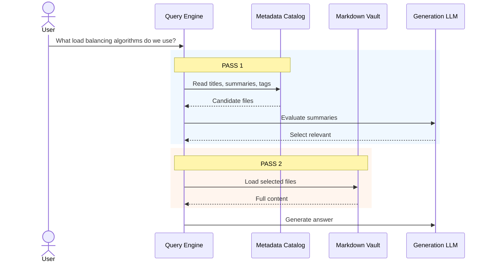

### 5.3 Token Savings

```text
1,000 files × 5,000 tokens = 5,000,000 tokens (naive approach)

Two-Pass:
  Pass 1: 1,000 summaries ≈ ~100,000 tokens
  Pass 2: 3 files × 5,000 = 15,000 tokens
  Total: ~115,000 tokens (98% reduction)
```

### 5.4 Pseudo Code: Two-Pass with Zero-Vector Scoring

```typescript
interface CatalogEntry {
  filePath: string;
  title: string;
  summary: string;
  tags: string[];
  keywords?: string[];
  relevanceScore?: number;
}

// Pass 1 — Scan lightweight catalog with zero-vector scoring
async function pass1Scan(
  query: string,
  catalog: Map<string, CatalogEntry>
): Promise<CatalogEntry[]> {
  const candidates: CatalogEntry[] = [];

  for (const entry of catalog.values()) {
    const score = await zeroVectorScore(query, entry);
    if (score > 50) {
      entry.relevanceScore = score;
      candidates.push(entry);
    }
  }

  return candidates
    .sort((a, b) => (b.relevanceScore || 0) - (a.relevanceScore || 0))
    .slice(0, 5);
}

async function zeroVectorScore(query: string, entry: CatalogEntry): Promise<number> {
  const prompt = `
    User Query: "${query}"
    Document Title: ${entry.title}
    Summary: ${entry.summary}
    Tags: ${entry.tags.join(", ")}
    Rate relevance 0-100. Output only a number.
  `;
  return parseInt(await llmGenerate(prompt));
}

// Pass 2 — Load full content only for selected candidates
async function pass2Load(candidates: CatalogEntry[]): Promise<string[]> {
  return Promise.all(
    candidates.map((c) => loadFileContent(c.filePath))
  );
}
```

---

## 6. System Comparison & Hybrid RAG

Detailed notes: `notes/06_system_comparison_hybrid_rag.md`

### 6.1 Detailed Comparison Matrix

| Evaluation Axis | 🔵 Vector RAG | 🟢 Vectorless RAG | 🟣 LLM Wiki |
|-----------------|---------------|-------------------|-------------|
| Data Structure | Flat vector space | Hierarchical tree | Files + folders + metadata |
| Retrieval | Vector similarity | LLM tree navigation | Metadata → selective loading |
| Search Logic | Mathematical similarity | Reasoning-based navigation | Catalog-based filtering |
| Explainability | Similarity score | Tree path | File path / links |
| Query Cost | Low | Medium–High | Low–Medium |
| Maintenance | Re-embedding | Update tree metadata | Edit Markdown directly |
| Best For | Simple / unstructured | Long structured docs | Personal / team knowledge |

### 6.2 When Each Architecture Wins

| Benchmark Type | Vector RAG | Vectorless RAG | LLM Wiki | Hybrid |
|----------------|------------|----------------|----------|--------|
| **Exact Page Citation** | ❌ Poor | ✅ Excellent | ⚠️ Good | ✅ Excellent |
| **Multi-Hop Reasoning** | ⚠️ Moderate | ✅ Excellent | ⚠️ Moderate | ✅ Excellent |
| **Semantic Similarity** | ✅ Excellent | ⚠️ Good | ⚠️ Good | ✅ Excellent |
| **Simple Fact Lookup** | ✅ Excellent | ⚠️ Moderate | ✅ Good | ✅ Excellent |
| **Structural Context** | ⚠️ Moderate | ✅ Excellent | ⚠️ Good | ✅ Excellent |
| **Cross-Document Aggregation** | ⚠️ Moderate | ⚠️ Moderate | ✅ Excellent | ✅ Excellent |

### 6.3 Hybrid RAG Architecture

For enterprise scale (10,000+ documents), combine approaches:

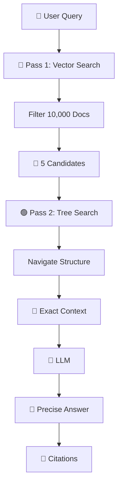

### 6.4 Production Architecture with Query Router

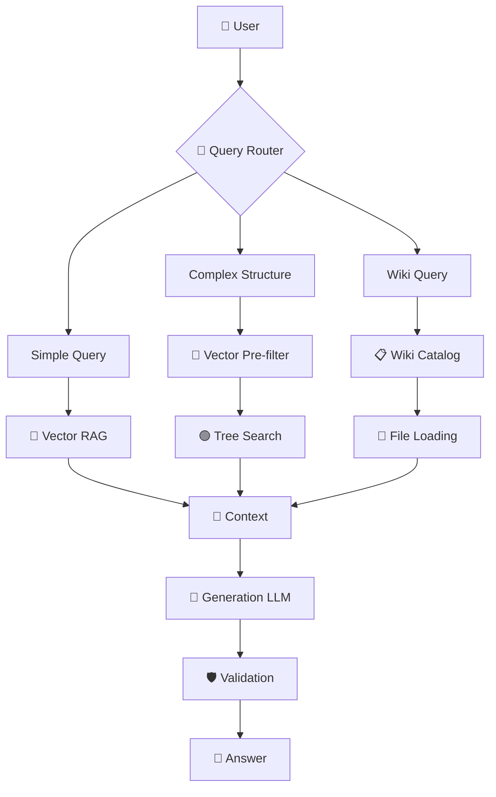

---

## 7. Decision Framework & Production Architecture

Detailed notes: `notes/07_decision_framework_production_architecture.md`

### 7.1 Architecture Selection Flow

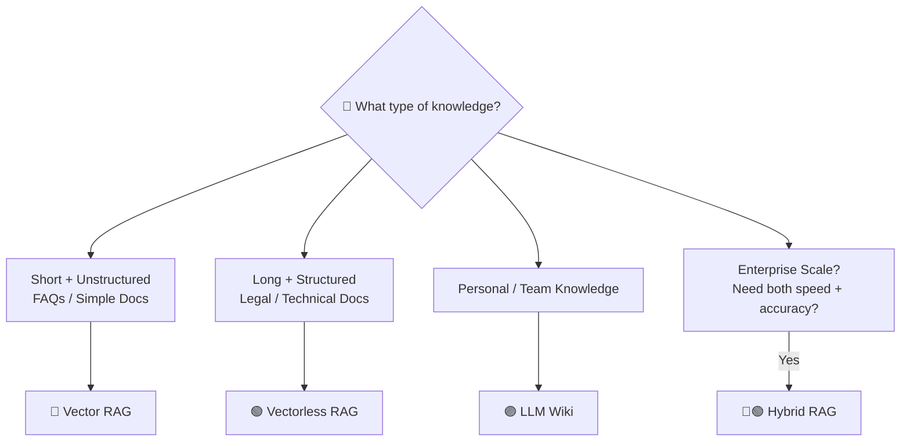

### 7.2 Quick Decision Guide

| Your Requirement | Recommended Architecture |
|------------------|--------------------------|
| Simple semantic search | 🔵 Vector RAG |
| Very low latency | 🔵 Vector RAG |
| Huge query volume | 🔵 Vector RAG |
| Long structured manuals | 🟢 Vectorless RAG |
| Legal / financial documents | 🟢 Vectorless RAG |
| Exact page/section citations | 🟢 Vectorless RAG |
| Personal knowledge base | 🟣 LLM Wiki |
| Team documentation | 🟣 LLM Wiki |
| Mixed Drive/PDF/Markdown | 🟣 LLM Wiki |
| Large enterprise + precision | 🔵🟢 Hybrid RAG |

### 7.3 Production Readiness Checklist

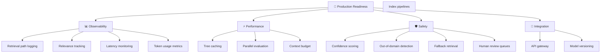

### 7.4 Important Correction: Better Retrieval ≠ Zero Hallucination

```text
Perfect Retrieval → LLM → Possible Hallucination
```

Production systems must combine good retrieval with:

* ✅ Source citations
* ✅ Grounded generation
* ✅ Output validation
* ✅ Confidence checks
* ✅ Guardrails
* ✅ Human review for high-risk domains

> **Goal:** Better retrieval reduces hallucination risk, but better retrieval ≠ guaranteed truthful generation.

---

## 🧠 The Ultimate Mental Model

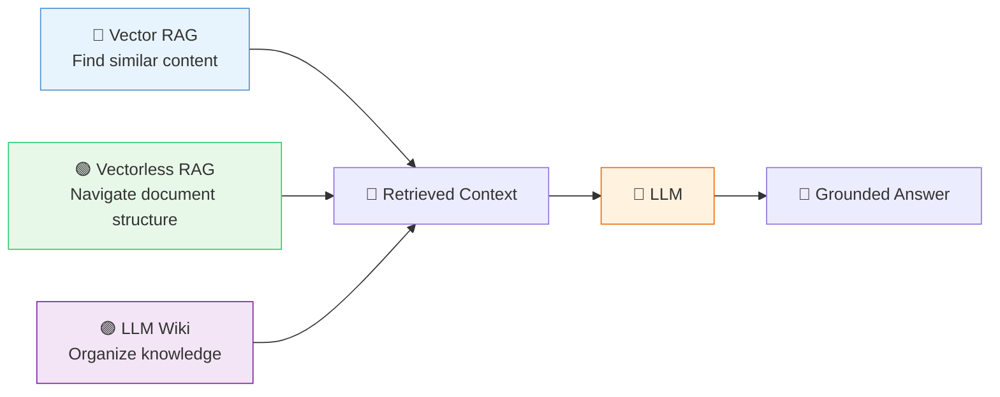

> **Remember:**
> * **Better retrieval reduces hallucination risk** but **doesn't eliminate it**
> * **Production systems need grounding, validation, and guardrails**
> * **Choose architecture based on the actual workload, not assumptions**

---

## 📚 Chapter References

For detailed deep-dives, see individual chapter notes:

| Chapter | File | Focus |
|---------|------|-------|
| 1 | `notes/01_limitations_vector_rag_chunking.md` | Vector RAG limitations, abrupt chunking |
| 2 | `notes/02_vectorless_rag_tree_indexing.md` | Tree indexing, zero-vector reasoning |
| 3 | `notes/03_agentic_tree_search_llm_relevance.md` | AlphaGo-inspired traversal, agentic search |
| 4 | `notes/04_llm_wiki_librarian_architecture.md` | Karpathy's vault, LLM librarian |
| 5 | `notes/05_two_pass_retrieval_lazy_loading.md` | Two-pass architecture, lazy loading |
| 6 | `notes/06_system_comparison_hybrid_rag.md` | Comparison matrix, hybrid patterns |
| 7 | `notes/07_decision_framework_production_architecture.md` | Decision framework, production checklist |

---

*This lecture covers the evolution from **Vector RAG → Vectorless RAG → LLM Wiki → Hybrid RAG**, emphasizing structural reasoning, traceability, zero-vector scoring, and human-AI collaboration in knowledge systems.*

---