# Lecture 18 — Complete Notes: Vectorless RAG & Hierarchical Knowledge Engines

> **Core idea:** Traditional Vector RAG asks **"Which chunks are similar to my query?"**
> Vectorless RAG asks **"Where in the document structure should I look?"**
> LLM Wiki asks **"How can I organize my knowledge so it is easier to find and maintain?"**

---

## 📑 Table of Contents

1. [Problems with Vector RAG & Abrupt Chunking](#1-problems-with-vector-rag--abrupt-chunking)
2. [Vectorless RAG & Tree Indexing](#2-vectorless-rag--tree-indexing)
3. [Agentic Tree Search & Zero-Vector Reasoning](#3-agentic-tree-search--zero-vector-reasoning)
4. [LLM Wiki Architecture (Karpathy's Obsidian Vault)](#4-llm-wiki-architecture-karphys-obsidian-vault)
5. [Two-Pass Retrieval & Lazy Loading](#5-two-pass-retrieval--lazy-loading)
6. [System Comparison & Hybrid RAG](#6-system-comparison--hybrid-rag)
7. [Decision Framework & Production Architecture](#7-decision-framework--production-architecture)

---

## 1. Problems with Vector RAG & Abrupt Chunking

Detailed notes: `notes/01_limitations_vector_rag_chunking.md`

### 1.1 What Is Vector RAG?

Traditional RAG converts documents into embeddings and stores them in a vector database (Qdrant, Pinecone, Chroma, Milvus). When a user asks a question, the query is also embedded, and similarity search finds the top-K most semantically similar chunks.

```text
Document → Split into chunks → Create embeddings → Store in Vector DB
Query → Create query embedding → Find similar chunks → Send chunks to LLM → Answer
```

### 1.2 The Abrupt Chunking Problem

**Fixed-size chunking** cuts documents at token boundaries (e.g., 500 tokens + 50 overlap), not at logical boundaries (paragraphs, sections, tables).

**Three major problems:**

| Problem | Impact |
|---------|--------|
| **Loss of Global & Chapter Context** | Chunks lose their parent document hierarchy; dangling references and anaphora emerge |
| **Semantic Boundary Fragmentation** | Logical units (paragraphs, tables) get split across chunks |
| **Dangling References & Anaphora** | Pronouns like "this mechanism" lose their referent when context is cut |

### 1.3 Semantic Similarity ≠ Contextual Relevance

Vector similarity measures mathematical distance in embedding space, not whether the text actually answers the query.

| Failure Mode | Description | Example |
|--------------|-------------|---------|
| **Similar but Irrelevant** | Retrieved text is related but doesn't answer the question | CDN caching retrieved for an ALB session question |
| **Relevant but Not Similar** | Correct info uses different terminology | "Fault Tolerance" contains answer to a "session recovery" query |
| **Contextual Inversion** | Keywords match but meaning is opposite | "Feature is deprecated in v2" retrieved for "How to enable feature?" |

### 1.4 Vibe Retrieval & Opaque Scoring

A similarity score like `0.814` doesn't explain **why** a chunk is relevant. The system retrieves chunks that "look similar" without verifying logical answerability.

**Why vector retrieval is hard to audit:** Vector search returns "Because its embedding was closer" — not a business or logical justification.

### 1.5 Why This Matters

These problems are especially acute for:
- Financial reports (tables split mid-row)
- Legal contracts (clauses without definitions)
- Technical documentation (setup without prerequisites)

> **Key Insight:** Vector RAG asks "Which chunks are similar?" but what we want is "Where in the document structure should I look?"

---

## 2. Vectorless RAG & Tree Indexing

Detailed notes: `notes/02_vectorless_rag_tree_indexing.md`

### 2.1 What Is Vectorless RAG?

**Vectorless RAG** does not depend on embeddings, vector databases, fixed-size chunks, or pure similarity search. Instead, it builds a **hierarchical tree representation** of the document and uses an LLM to navigate that tree.

```text
Document → Understand structure → Build hierarchical tree → Navigate relevant branches → Retrieve exact section/page
```

### 2.2 Architecture Comparison

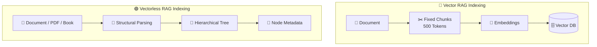

### 2.3 Natural Structural Document Parsing — Root → Chapter → Section → Page

Vectorless RAG parses documents to preserve their natural hierarchy:

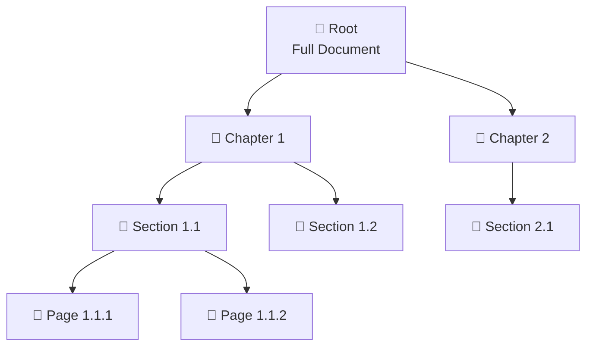

### 2.4 Node Metadata

Each tree node contains rich metadata for intelligent navigation:

```json
{
  "node_id": "sec_2_2",
  "title": "Session Persistence & Sticky Sessions",
  "level": 2,
  "page_range": [161, 200],
  "parent_id": "ch_2",
  "children_ids": ["sub_2_2_1", "sub_2_2_2"],
  "summary": "Covers session state management across distributed load balancers...",
  "keywords": ["sticky sessions", "ALB", "session persistence", "cookie routing", "failover"],
  "entities": ["Application Load Balancer", "Browser Cookies", "Memcached"],
  "source_file": "distributed_systems_v2.pdf"
}
```

### 2.5 Lazy Loading

The tree index is lightweight. Full content loads **only after** the relevant node is identified:

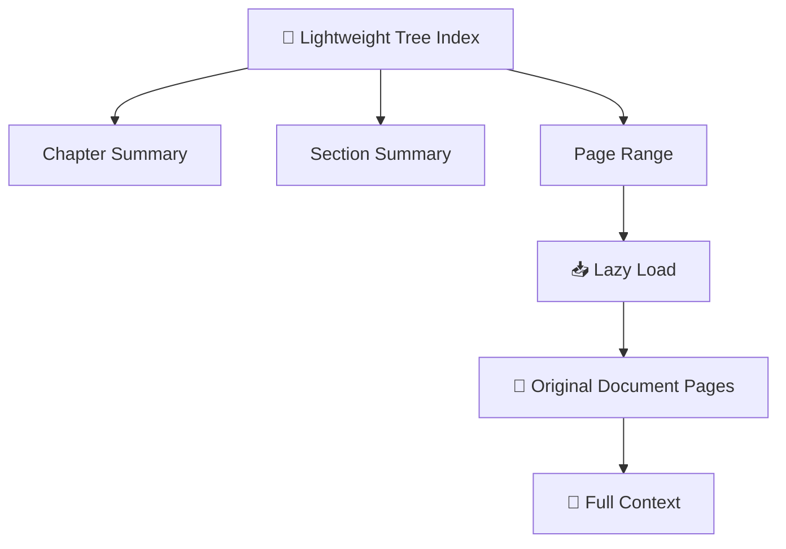

### 2.6 Zero-Vector Relevance Reasoning

Vectorless RAG determines relevance **without** computing embeddings or similarity scores:

```typescript
// Zero-vector relevance scoring — no embeddings, no similarity math
async function zeroVectorRelevanceScoring(
  node: TreeNode,
  query: string
): Promise<number> {
  const prompt = `
    Node Title: ${node.title}
    Node Summary: ${node.summary}
    Keywords: ${node.keywords.join(", ")}
    
    User Query: "${query}"
    
    On a scale of 0-100, how relevant is this node's content for answering
    the user's query? Output only a number.
  `;
  return parseInt(await llm.generate(prompt));
}
```

**Advantages:** Explicit traceability, structural context, auditability, no embedding infrastructure needed.

---

## 3. Agentic Tree Search & Zero-Vector Reasoning

Detailed notes: `notes/03_agentic_tree_search_llm_relevance.md`

### 3.1 The Retrieval Philosophy

| Approach | Philosophy |
|----------|------------|
| **Vector RAG** | Search everywhere and rank by similarity |
| **Vectorless RAG** | Navigate intelligently and progressively narrow the search |

### 3.2 Step-by-Step Agentic Tree Traversal

For query: *"How do sticky sessions behave during ALB failure?"*

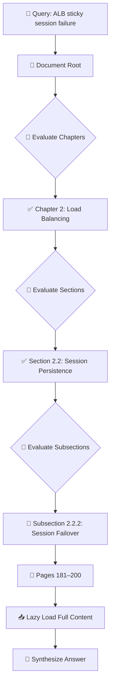

**Key optimizations:**
1. **Summary-First Pruning** — Only send ~50 token summaries to LLM, not full content
2. **Parallel Branch Evaluation** — Evaluate sibling nodes concurrently
3. **Tree Structure Caching** — Build tree once during indexing, reuse for many queries

### 3.3 AlphaGo-Inspired Tree Traversal

AlphaGo's Monte Carlo Tree Search (MCTS) principles applied to document navigation:

| AlphaGo Concept | Vectorless RAG Application |
|-----------------|---------------------------|
| Progressive Narrowing | Explore promising document branches, prune irrelevant ones |
| Value Estimation | LLM estimates node relevance based on query intent |
| Policy Networks | Heuristics determine which branches are most promising |

```typescript
// AlphaGo-style tree traversal with progressive refinement
async function alphaGoTreeSearch(tree: TreeIndex, query: string): Promise<RetrievedNode> {
  const root = tree.getRoot();
  const queue = [root];
  const visited = new Set<string>();
  
  while (queue.length > 0) {
    const current = queue.shift();
    if (visited.has(current.nodeId)) continue;
    visited.add(current.nodeId);
    
    const score = await evaluateNodeRelevance(current, query);
    const children = tree.getChildren(current.nodeId);
    if (children.length === 0) return current;
    
    const promisingChildren = children
      .sort((a, b) => b.score - a.score)
      .slice(0, 3);
    
    queue.push(...promisingChildren);
  }
  
  throw new Error("No relevant node found");
}
```

### 3.4 Traceable Answer Generation

Vectorless RAG provides an explicit navigation path:

```
Answer:
When an ALB node fails, session traffic is redirected
according to the documented failover mechanism.

Source: Distributed Systems Architecture Manual v2

Navigation Path:
Root → Chapter 2: Load Balancing → Section 2.2: Session Persistence 
→ Subsection 2.2.2: Session Failover & Recovery

Pages: 181–184
Node: sub_2_2_2
```

---

## 4. LLM Wiki Architecture (Karpathy's Obsidian Vault)

Detailed notes: `notes/04_llm_wiki_librarian_architecture.md`

### 4.1 The LLM Wiki Concept

Instead of storing embeddings, an **LLM acts as a background librarian** that:
- Reads incoming information
- Organizes it into folders
- Creates summaries
- Adds metadata and tags
- Links related documents

Result: a **Markdown/Obsidian vault** human-readable and editable.

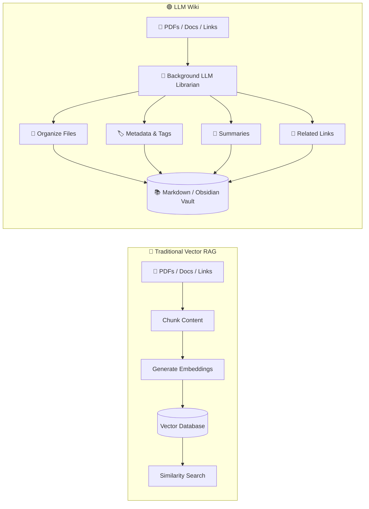

### 4.2 Push Content vs Update Knowledge

**Vector RAG — Push Content:**
```text
Document → Chunk → Embedding → Vector Database
```

**LLM Wiki — Update Knowledge:**
```text
Document → Understand → Organize → Summarize → Tag → Link with existing knowledge → Update Wiki
```

### 4.3 Karpathy's Obsidian Vault Structure

```
vault/
│
├── .obsidian/              # Obsidian config & plugins
├── templates/              # Note templates
├── daily-notes/            # Daily journal entries
├── MOC/                    # Maps of Content (index pages)
│   ├── infrastructure.md
│   ├── ml-ops.md
│   └── system-design.md
│
├── infrastructure/
│   ├── load-balancing/
│   │   ├── alb.md
│   │   ├── cdn.md
│   │   ├── sticky-sessions.md
│   │   └── failover.md
│   ├── networking/
│   │   ├── routing.md
│   │   └── dns.md
│   └── databases/
│       ├── replication.md
│       └── sharding.md
│
├── ml/
│   ├── training/
│   ├── evaluation/
│   └── deployment/
│
└── index.md                # Root navigation page
```

### 4.4 Obsidian-Specific Features

| Feature | Description | Benefit for LLM Wiki |
|---------|-------------|---------------------|
| **Bidirectional Links** | `[[Note Name]]` creates backlinks | Automatic relationship discovery |
| **Graph View** | Visualizes note connections | Human + LLM see knowledge topology |
| **Dataview Plugin** | Query vault like a database | LLM can run structured queries |
| **Templates** | Consistent note structure | Easier LLM ingestion & formatting |
| **Frontmatter (YAML)** | Structured metadata | Lightweight catalog for two-pass retrieval |

### 4.5 Two-Pass Retrieval Integration

The LLM Wiki naturally enables two-pass retrieval:

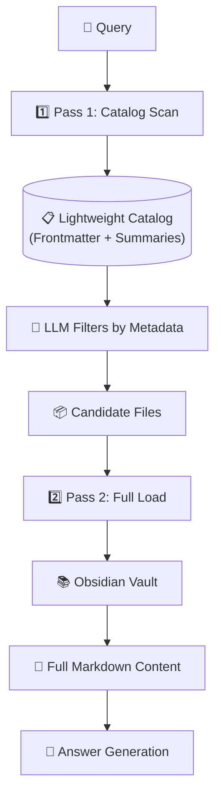

**Catalog entry for Pass 1:**
```yaml
- file: "infrastructure/load-balancing/alb.md"
  title: "ALB Sticky Sessions"
  tags: [load-balancing, alb, sessions]
  summary: "Sticky sessions route same-client requests to same backend"
  keywords: ["sticky sessions", "cookie routing", "session persistence"]
  related: ["failover.md", "high-availability.md"]
  updated: "2024-01-15"
```

---

## 5. Two-Pass Retrieval & Lazy Loading

Detailed notes: `notes/05_two_pass_retrieval_lazy_loading.md`

### 5.1 The Core Problem

Modern knowledge systems contain thousands of documents. Loading everything into LLM context causes:
- **Token budget exceeded** — Model context window overflows
- **Noise** — Irrelevant content dilutes the signal
- **Cost** — Processing every document per query is expensive

### 5.2 What Is Two-Pass Retrieval?

| Pass | Purpose | What's Loaded |
|------|---------|---------------|
| **Pass 1** | Lightweight scan of metadata | Titles, summaries, tags, page ranges, categories |
| **Pass 2** | Selective full-content loading | Only documents/files selected by Pass 1 |

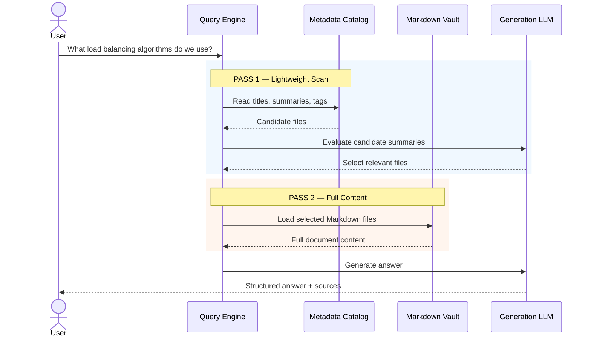

### 5.3 Cost Comparison

```text
1,000 Markdown files × 5,000 tokens = 5,000,000 tokens (naive)

Two-Pass:
Pass 1: 1,000 summaries ≈ small amount
Pass 2: 3 relevant files × 5,000 = 15,000 tokens
```

### 5.4 Pseudo Code: Two-Pass with Zero-Vector Scoring

```typescript
interface CatalogEntry {
  filePath: string;
  title: string;
  summary: string;
  tags: string[];
  keywords?: string[];
  relevanceHeuristic?: string;
}

type MetadataCatalog = Map<string, CatalogEntry>;

// Pass 1 — Scan lightweight catalog with zero-vector scoring
async function pass1Scan(
  query: string,
  catalog: MetadataCatalog
): Promise<CatalogEntry[]> {
  const candidates: CatalogEntry[] = [];

  for (const entry of catalog.values()) {
    const score = await zeroVectorScore(query, entry);
    if (score > 50) {
      entry.relevanceScore = score;
      candidates.push(entry);
    }
  }

  return candidates
    .sort((a, b) => (b.relevanceScore || 0) - (a.relevanceScore || 0))
    .slice(0, 5);
}

async function zeroVectorScore(query: string, entry: CatalogEntry): Promise<number> {
  const prompt = `
    User Query: "${query}"
    Document Title: ${entry.title}
    Summary: ${entry.summary}
    Tags: ${entry.tags.join(", ")}
    Keywords: ${entry.keywords?.join(", ") || "N/A"}
    Rate relevance 0-100. Output only a number.
  `;
  return parseInt(await llmGenerate(prompt));
}

// Pass 2 — Load full content only for selected candidates
async function pass2Load(candidates: CatalogEntry[]): Promise<FullDocument[]> {
  const documents: FullDocument[] = [];
  for (const candidate of candidates) {
    const content = await loadFileContent(candidate.filePath);
    documents.push({ filePath: candidate.filePath, content, metadata: candidate });
  }
  return documents;
}
```

---

## 6. System Comparison & Hybrid RAG

Detailed notes: `notes/06_system_comparison_hybrid_rag.md`

### 6.1 Detailed Comparison Matrix

| Evaluation Axis | 🔵 Vector RAG | 🟢 Vectorless RAG | 🟣 LLM Wiki |
|-----------------|---------------|-------------------|-------------|
| **Data Structure** | Flat vector space | Hierarchical tree | Files + folders + metadata |
| **Indexing Unit** | Fixed token chunks | Sections, chapters, pages | Files & knowledge nodes |
| **Retrieval** | Vector similarity | LLM tree navigation | Metadata → selective loading |
| **Search Logic** | Mathematical similarity | Reasoning-based navigation | Catalog-based filtering |
| **Context** | Chunk-level | Hierarchical | Full selected file |
| **Explainability** | Similarity score | Tree path | File path / links |
| **Indexing Cost** | Low | Medium | Medium |
| **Query Cost** | Low | Medium–High | Low–Medium |
| **Maintenance** | Re-embedding may be needed | Update tree metadata | Edit Markdown directly |
| **Best For** | Simple / unstructured data | Long structured documents | Personal / team knowledge |

### 6.2 Cost vs. Accuracy Trade-Off

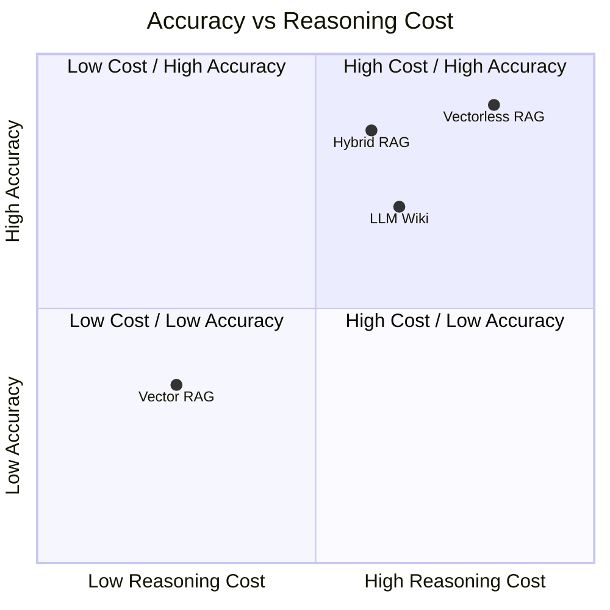

> **More reasoning can improve retrieval quality, but reasoning costs tokens and latency.**

### 6.3 When Each Architecture Wins

| Benchmark Type | Vector RAG | Vectorless RAG | LLM Wiki | Hybrid |
|----------------|------------|----------------|----------|--------|
| **Exact Page Citation** | ❌ Poor | ✅ Excellent | ⚠️ Good | ✅ Excellent |
| **Multi-Hop Reasoning** | ⚠️ Moderate | ✅ Excellent | ⚠️ Moderate | ✅ Excellent |
| **Semantic Similarity** | ✅ Excellent | ⚠️ Good | ⚠️ Good | ✅ Excellent |
| **Simple Fact Lookup** | ✅ Excellent | ⚠️ Moderate | ✅ Good | ✅ Excellent |
| **Structural Context** | ⚠️ Moderate | ✅ Excellent | ⚠️ Good | ✅ Excellent |
| **Cross-Document Aggregation** | ⚠️ Moderate | ⚠️ Moderate | ✅ Excellent | ✅ Excellent |

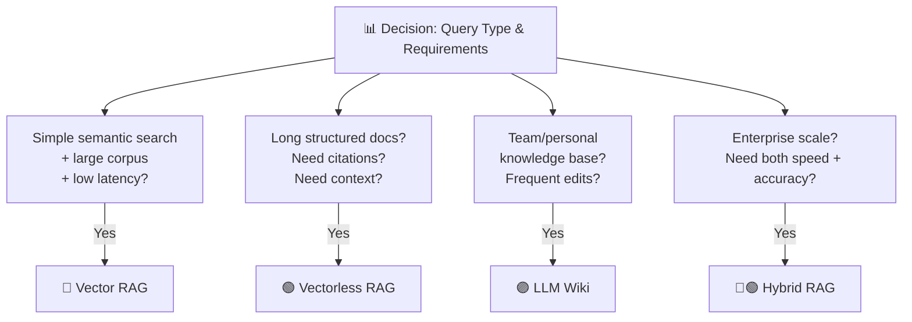

### 6.4 Hybrid RAG Architecture

For enterprise scale (10,000+ documents), combine approaches:

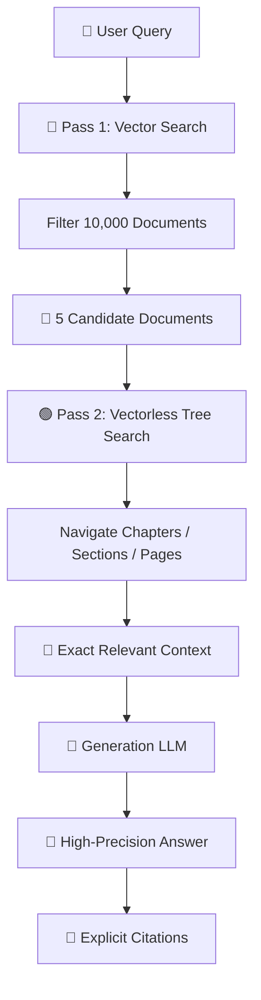

**Why Hybrid Works:**
- **Vector RAG:** Fast broad filtering (10,000 → 5 docs)
- **Vectorless RAG:** Deep structural reasoning in top candidates

### 6.5 Production Architecture with Query Router

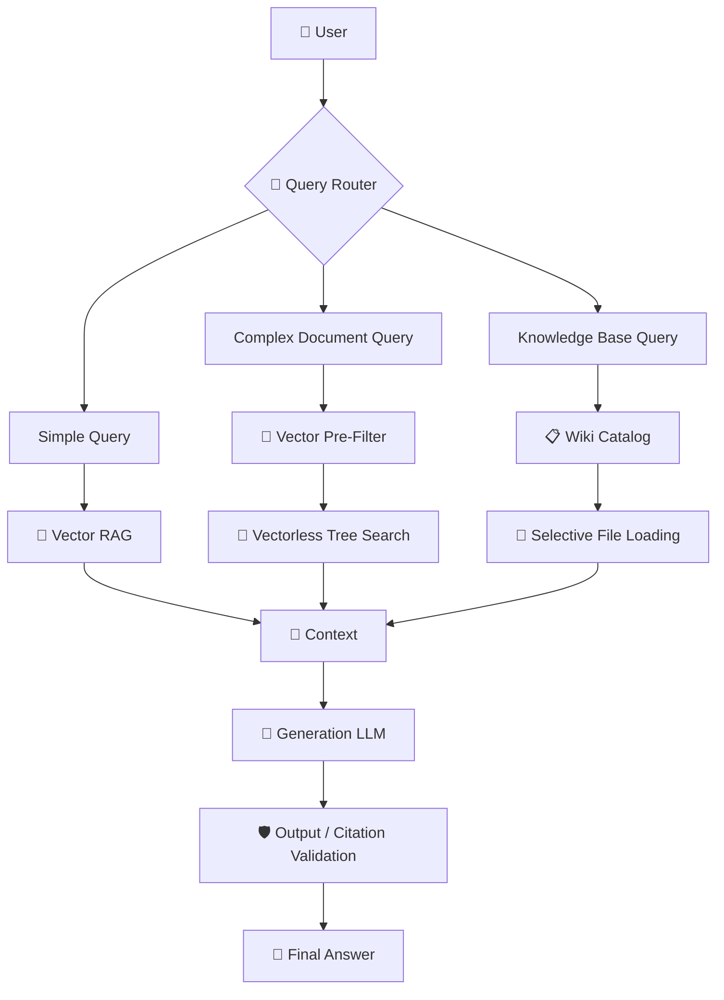

---

## 7. Decision Framework & Production Architecture

Detailed notes: `notes/07_decision_framework_production_architecture.md`

### 7.1 Quick Decision Guide

| Your Requirement | Recommended Architecture |
|------------------|--------------------------|
| Simple semantic search | 🔵 Vector RAG |
| Very low latency | 🔵 Vector RAG |
| Huge query volume | 🔵 Vector RAG |
| Long structured manuals | 🟢 Vectorless RAG |
| Legal / financial documents | 🟢 Vectorless RAG |
| Exact page/section citations | 🟢 Vectorless RAG |
| Personal knowledge base | 🟣 LLM Wiki |
| Team documentation | 🟣 LLM Wiki |
| Mixed Drive/PDF/Markdown knowledge | 🟣 LLM Wiki |
| Large enterprise + high accuracy | 🔵🟢 Hybrid RAG |

### 7.2 Architecture Selection Flow

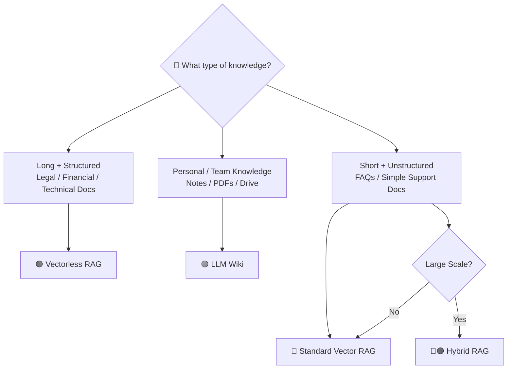

### 7.3 Production Readiness Checklist

```mermaid
flowchart TD
    A["🚀 Production Readiness"]
    A --> B["📊 Observability"]
    A --> C["⚡ Performance"]
    A --> D["🛡️ Safety"]
    A --> E["🧩 Integration"]
    B --> B1["Retrieval path logging"]
    B --> B2["Relevance score tracking"]
    B --> B3["Latency monitoring"]
    B --> B4["Token usage metrics"]
    C --> C1["Tree caching strategy"]
    C --> C2["Parallel evaluation"]
    C --> C3["Context window budget"]
    C --> C4["Lazy loading thresholds"]
    D --> D1["Answer confidence scoring"]
    D --> D2["Out-of-domain detection"]
    D --> D3["Fallback to vector search"]
    D --> D4["Human review queues"]
    E --> E1["API gateway integration"]
    E --> E2["Model version management"]
    E --> E3["Index update pipelines"]
    E --> E4["Multi-tenant support"]
```

**Key production considerations:**
- Cache tree structures with TTL-based invalidation
- Implement circuit breakers for LLM-based tree traversal
- Log entire navigation paths for auditability
- Use hybrid retrieval as a safety net when tree search returns low confidence

### 7.4 Important Correction: Better Retrieval ≠ Zero Hallucination

Even with perfect retrieval:
```text
Perfect Retrieval → LLM → Possible Hallucination
```

Production systems must combine good retrieval with:
- Source citations
- Grounded generation
- Output validation
- Confidence checks
- Guardrails
- Human review for high-risk domains

---

## 🧠 The Ultimate Mental Model

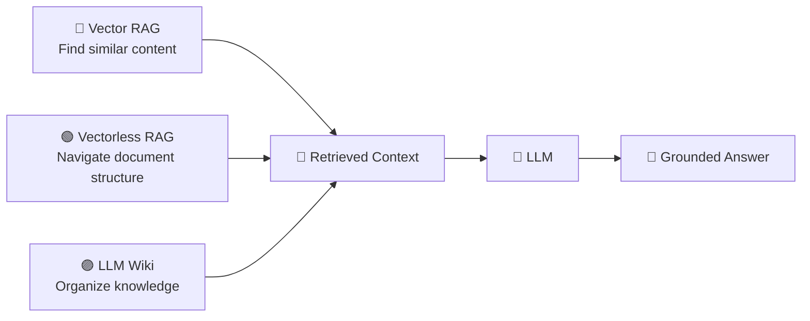

> **Remember:**
> - **Better retrieval reduces hallucination risk** but **doesn't eliminate it**
> - **Production systems need grounding, validation, and guardrails**
> - **Choose architecture based on actual workload, not assumptions**

---

## 📚 Chapter References

For detailed deep-dives, see individual chapter notes:

1. `notes/01_limitations_vector_rag_chunking.md` — Vector RAG limitations, abrupt chunking, similarity vs relevance
2. `notes/02_vectorless_rag_tree_indexing.md` — Tree indexing, Root→Chapter→Section→Page, zero-vector reasoning
3. `notes/03_agentic_tree_search_llm_relevance.md` — AlphaGo-inspired traversal, agentic search, traceability
4. `notes/04_llm_wiki_librarian_architecture.md` — Karpathy's Obsidian vault, LLM librarian, two-pass retrieval
5. `notes/05_two_pass_retrieval_lazy_loading.md` — Two-pass architecture, lazy loading, zero-vector scoring
6. `notes/06_system_comparison_hybrid_rag.md` — Comparison matrix, benchmarks, hybrid RAG patterns
7. `notes/07_decision_framework_production_architecture.md` — Decision framework, production checklist, architecture selection

---

*This consolidated note references 7 detailed chapters. Each chapter contains complete mermaid diagrams, TypeScript pseudo-code, and expanded explanations beyond this summary.*