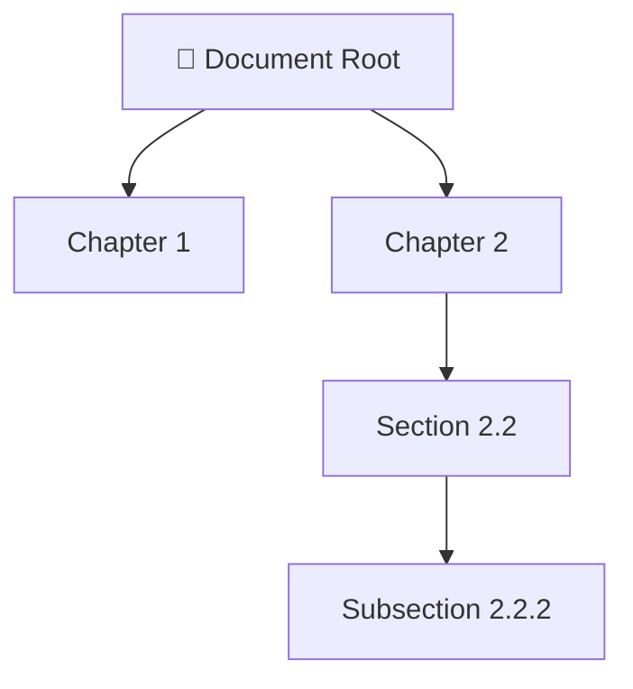
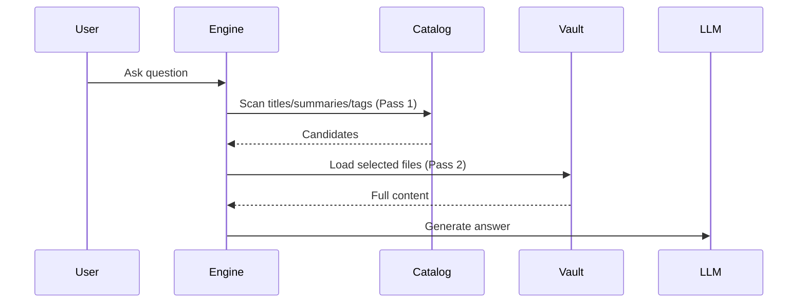
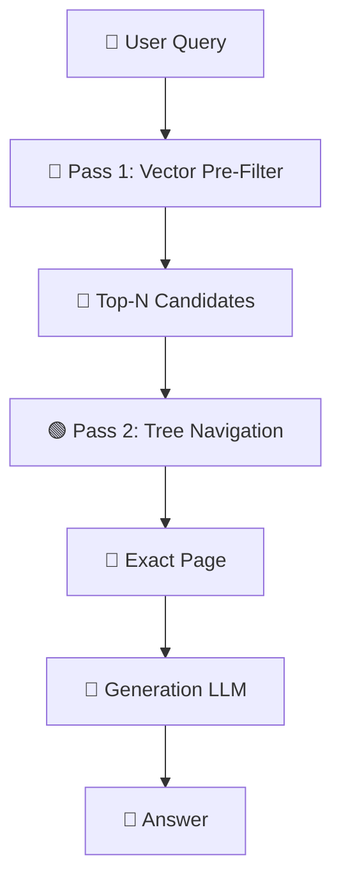
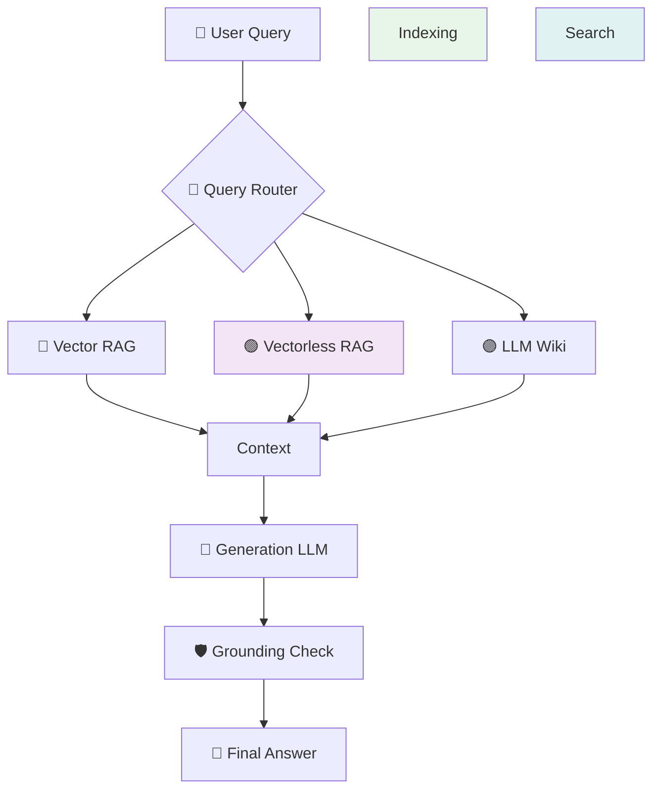
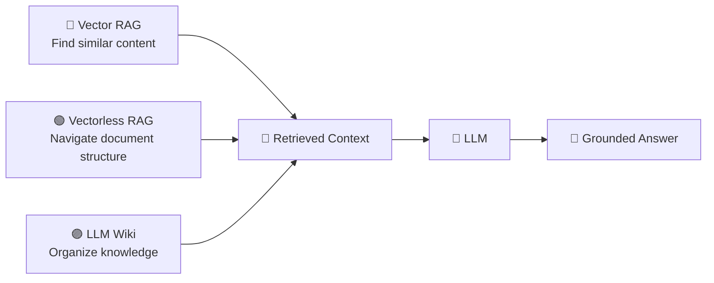

# Lecture 18 — Complete Notes: Vectorless RAG & Hierarchical Knowledge Engines

> **Core idea:** Traditional Vector RAG asks **“Which chunks are similar to my query?”**  
> Vectorless RAG asks **“Where in the document structure should I look?”**  
> LLM Wiki asks **“How can I organize my knowledge so it is easier to find and maintain?”**

---

## 📑 Table of Contents

1. [Problems with Vector RAG & Abrupt Chunking](#1-problems-with-vector-rag--abrupt-chunking)
2. [Vectorless RAG & Tree Indexing](#2-vectorless-rag--tree-indexing)
3. [Agentic Tree Search](#3-agentic-tree-search)
4. [LLM Wiki Architecture](#4-llm-wiki-architecture)
5. [Two-Pass Retrieval vs Vector RAG](#5-two-pass-retrieval-vs-vector-rag)
6. [Vector RAG vs Vectorless RAG vs LLM Wiki](#6-vector-rag-vs-vectorless-rag-vs-llm-wiki)
7. [Production Hybrid RAG Architecture](#7-production-hybrid-rag-architecture)

---

## 1. Problems with Vector RAG & Abrupt Chunking

### 1.1 What is Vector RAG?

Traditional RAG converts documents into embeddings and stores them in a vector database. The query is also embedded and similarity search finds the top-K most semantically similar chunks.

### 1.2 The Abrupt Chunking Problem

**Fixed-size chunking** cuts documents at token boundaries, not logical ones (paragraphs, sections, tables). This causes:

| Problem | Impact |
|---------|--------|
| **Loss of Global Context** | Chunks lose their parent document hierarchy |
| **Semantic Boundary Fragmentation** | Logical units (paragraphs, tables) get split |
| **Dangling References** | Pronouns like "it" or "this mechanism" become ambiguous |

### 1.3 Similarity ≠ Relevance

Vector similarity doesn't guarantee contextual relevance:

| Failure Mode | Description |
|--------------|-------------|
| Similar but Irrelevant | Retrieved text is related but doesn't answer the question |
| Relevant but Not Similar | Correct information uses different terminology |
| Contextual Inversion | Keywords match but meaning is opposite |

### 1.4 The "Vibe Retrieval" Problem

A similarity score like `0.814` doesn't explain **why** a chunk is relevant. The system retrieves chunks that "look similar" without verifying logical answerability.

---

## 2. Vectorless RAG & Tree Indexing

### 2.1 What is Vectorless RAG?

**Vectorless RAG** replaces similarity-first retrieval with structure-first retrieval. Instead of embeddings, it builds a **hierarchical tree** of the document:

```text
Document
   ↓
Understand structure
   ↓
Build hierarchical tree
   ↓
Navigate relevant branches
   ↓
Retrieve exact section/page
```

### 2.2 The Hierarchical Document Tree



Each node contains:
- Title & level
- Page range
- Parent/children relationships
- Summary
- Keywords & entities

### 2.3 Lazy Loading

The tree index is lightweight. Full content loads **only after** the relevant node is identified:

```text
Tree Node
   ↓
Page Range
   ↓
Load Original Pages
   ↓
Full Context
```

---

## 3. Agentic Tree Search

### 3.1 The Retrieval Philosophy

Traditional:
```text
Query → Embedding → Similarity Search → Top-K Chunks
```

Agentic Tree Search:
```text
Query → Understand → Root → Branch → Section → Page → Content
```

The LLM acts as a **navigation agent** that progressively narrows the search.

### 3.2 Step-by-Step Navigation

1. **Evaluate Root** → Prune irrelevant top-level branches
2. **Expand Branch** → Evaluate summaries at next level
3. **Continue Down** → Keep navigating until reaching leaves
4. **Lazy Load** → Fetch full content only for relevant nodes

### 3.3 Why It's Better

| Aspect | Vector RAG | Agentic Tree Search |
|--------|------------|---------------------|
| Search Space | Flat chunks | Document tree |
| Explanation | Similarity score | Explicit navigation path |
| Traceability | Opaque | "Root → Ch2 → Sec2.2 → Page 181" |

---

## 4. LLM Wiki Architecture

### 4.1 The LLM Wiki Concept

Instead of storing embeddings, an **LLM acts as a background librarian** that:
- Reads incoming information
- Organizes it into folders
- Creates summaries
- Adds metadata and tags
- Links related documents

The result: a **Markdown/Obsidian vault** human-readable and editable.

### 4.2 Push Content vs Update Knowledge

**Vector RAG:**
```text
Document → Chunk → Embed → Vector DB
```

**LLM Wiki:**
```text
Document → Understand → Organize → Summarize → Tag → Link → Wiki
```

### 4.3 Two-Pass Retrieval



---

## 5. Two-Pass Retrieval vs Vector RAG

| Approach | Load Pattern | Token Usage |
|----------|--------------|-------------|
| Vector RAG | All chunks at once | High |
| Two-Pass | Summaries → Selected full docs | Low–Medium |

**Example:**
- 1,000 files × 5,000 tokens = 5M tokens (naive)
- Two-pass: 1,000 summaries + 3 full files = ~15,000 tokens

---

## 6. Vector RAG vs Vectorless RAG vs LLM Wiki

| Feature | 🔵 Vector RAG | 🟢 Vectorless RAG | 🟣 LLM Wiki |
|---------|---------------|---------------------|-------------|
| Index | Flat vector space | Hierarchical tree | Files + folders |
| Unit | Token chunks | Sections/pages | Documents |
| Retrieval | Similarity search | LLM tree navigation | Metadata scan |
| Context | Chunk-level | Hierarchical | Selected file |
| Explainability | Similarity score | Tree path | File path |
| Best For | Simple semantic search | Complex structured docs | Knowledge management |

### When to Choose Each

| Requirement | Recommendation |
|-------------|----------------|
| Fast, low-latency, simple docs | 🔵 Vector RAG |
| Long structured manuals, legal, financial | 🟢 Vectorless RAG |
| Personal/team knowledge base | 🟣 LLM Wiki |
| Enterprise scale + high accuracy | 🔵🟢 Hybrid RAG |

---

## 7. Production Hybrid RAG Architecture

For large knowledge bases, combine approaches:



**Why Hybrid Works:**
- Vector RAG: Fast broad filtering (10,000 → 5 docs)
- Vectorless RAG: Deep structural reasoning in top candidates

### Complete Production Architecture



---

## 🧠 The Ultimate Mental Model



> **Remember:**
> - **Better retrieval reduces hallucination risk** but **doesn't eliminate it**
> - **Production systems need grounding, validation, and guardrails**
> - **Choose architecture based on actual workload, not assumptions**

---