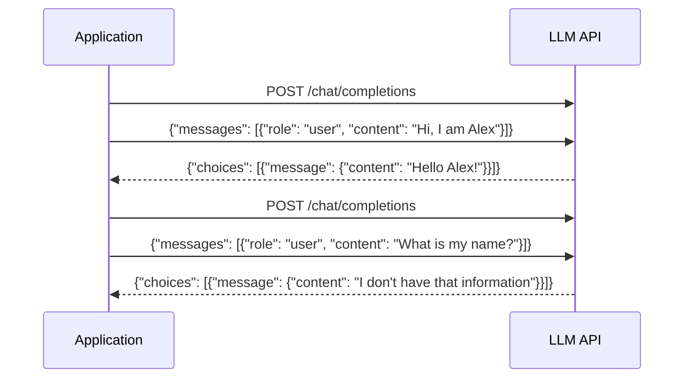
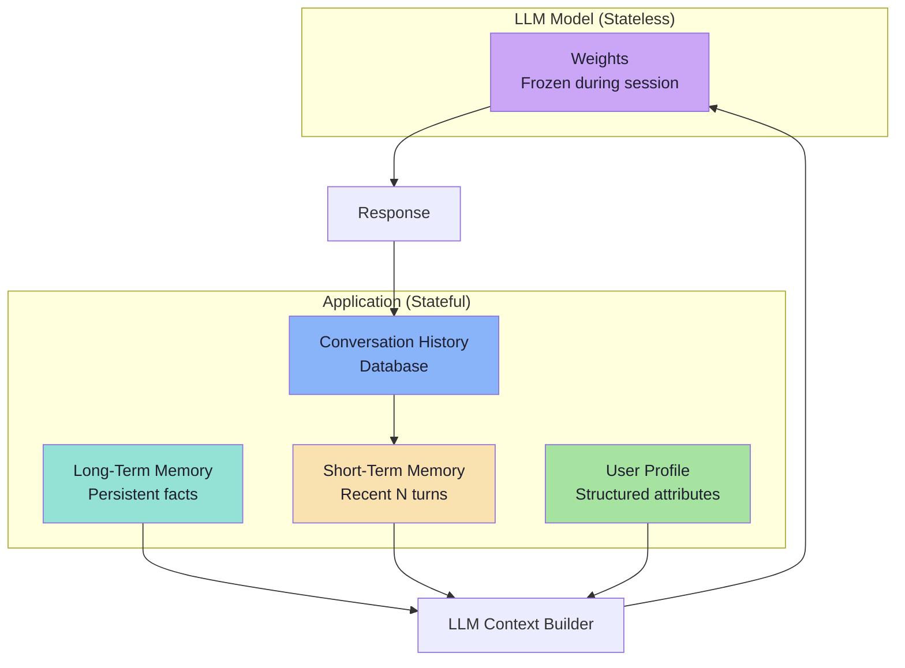
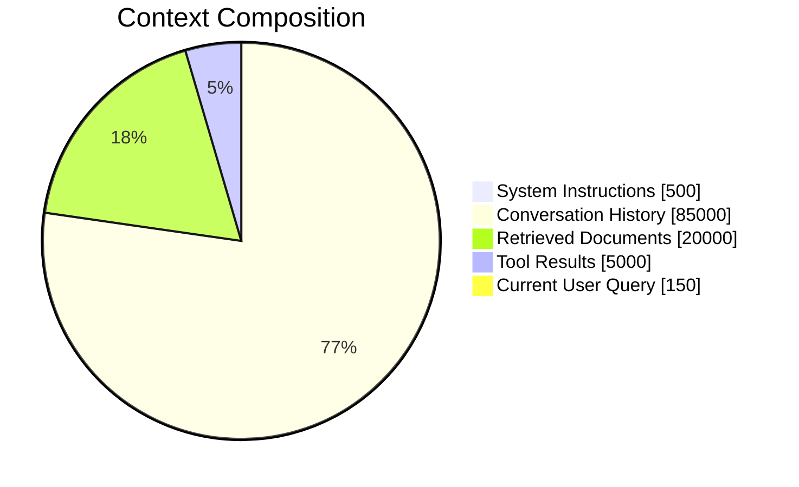
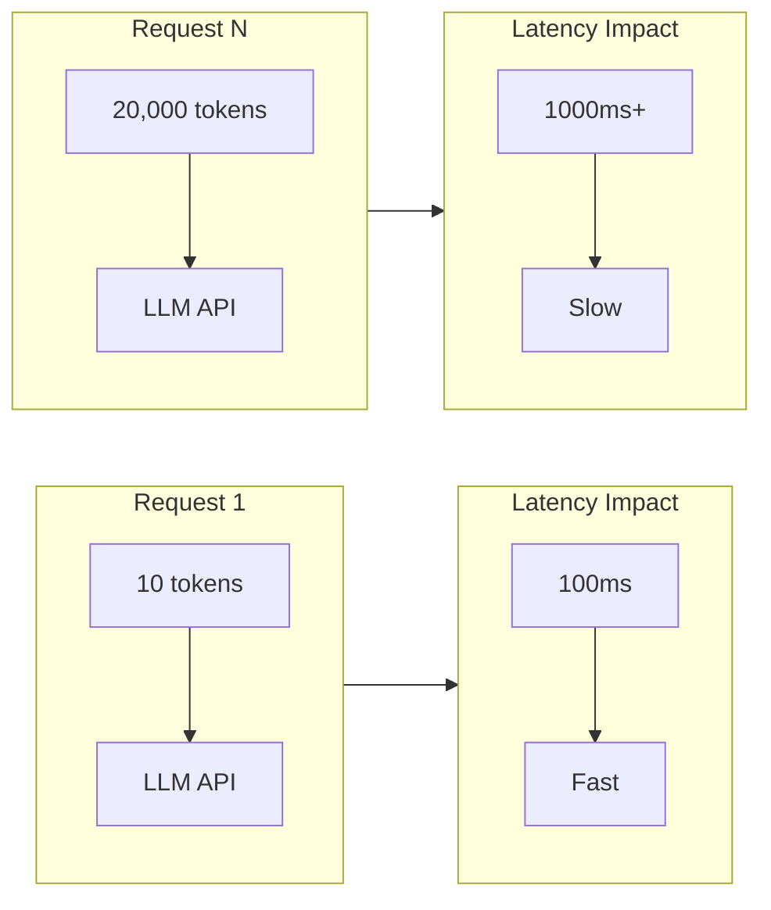
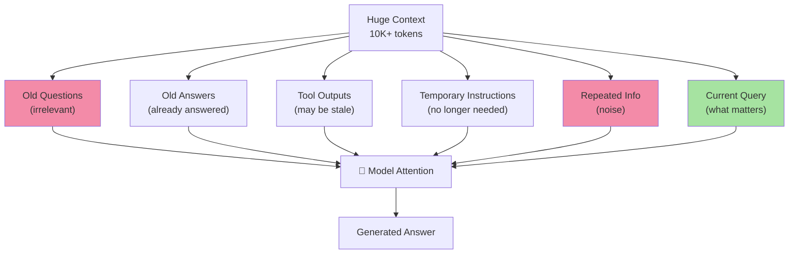
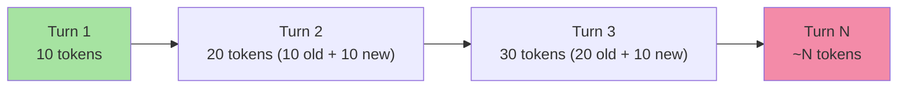
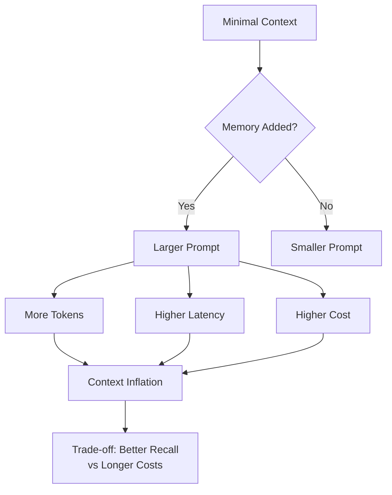

# Chapter 1: Stateless LLM APIs & Context-Window Limitations

## Core Concept

LLM APIs are **stateless**: the model does not automatically retain information from previous requests. Each API call is independent. The application must explicitly store, manage, and selectively send conversation context with every request.

## 1. The Stateless Nature of LLM APIs

### How a Stateless API Works



**Key insight**: Request 1 → LLM → Response ≠ Request 2 → LLM → Response
The second request to the LLM does not automatically contain the context from Request 1.

## 2. Why Application-Level Memory is Necessary

### The Conversation Memory Problem

Without explicit memory management, a stateless LLM cannot:
- Remember user names or preferences established in earlier turns
- Recall facts extracted from previous messages
- Maintain coherent long-running conversations
- Provide personalized responses across sessions

### The Memory Hierarchy



## 3. The Four Core Production Failure Points

When naive history management is used, four critical issues emerge:

### 3.1 Context Window Exhaustion

Every LLM has a maximum context length (e.g., 128K tokens for Claude 3.7, 1M for some models).



**Problem**: As conversation grows, `Conversation History` eventually exceeds the model's context window.

### 3.2 Network Bandwidth & Latency

Sending growing context with every request creates unnecessary network overhead.



**Cost**: 20x increase in payload size = 20x increase in network transmission time.

### 3.3 Increasing Token Costs

LLM APIs charge per token processed. Resending historical context means paying for the same tokens repeatedly.

| Request | New Tokens | Historical Tokens | Total Input | Cost Multiplier |
|---------|-----------|-------------------|-------------|-----------------|
| 1       | 10        | 0                 | 10          | 1x              |
| 2       | 10        | 10                | 20          | 2x              |
| 3       | 10        | 20                | 30          | 3x              |
| N       | 10        | ~N*10             | ~N×10       | N×              |

**Formula**: Total Input Tokens = Σ(System + History + Query) for all requests

### 3.4 Attention Degradation

Large context with irrelevant historical information can cause "lost in the middle" behavior.



**Result**: Model struggles to identify what actually matters; performance degrades.

## 4. Quadratic Token Growth in Chatbots

In a sliding window scenario, tokens are billed multiple times:



**Cumulative cost**: For 30 turns averaging 80 tokens each:
`30²/2 × 80 = 36,000 tokens cumulatively`

vs. `30 × 80 = 2,400 tokens` if each message were sent only once.

## 5. The Cost of Context Inflation

As memory is added to provide context, the prompt size grows.



**This is the fundamental tension**: memory improves quality but inflates context.

## 6. Memory as a Budget Problem

The production solution reframes memory as a budget allocation problem:

```mermaid
flowchart LR
    Budget[Context Budget<br/>100K tokens] --> Rules[System Rules<br/>400 tokens"]
    Budget --> Profile[User Profile<br/>150 tokens"]
    Budget --> Summary[Conversation Summary<br/>300 tokens"]
    Budget --> Recent[Recent Turns<br/>800 tokens"]
    Budget --> Retrieved[Retrieved Docs<br/>1,500 tokens"]
    Budget --> Query[Current Query<br/>100 tokens"]

    Rules --> Total[TOTAL: ~3kW tokens"]
    Profile --> Total
    Summary --> Total
    Recent --> Total
    Retrieved --> Total
    Query --> Total
```

## Common Mistakes

| Mistake | Effect | Fix |
|---------|--------|-----|
| Resending all history every turn | Quadratic token growth, high costs | Implement STM with sliding window |
| Only keeping recent turns in DB | Lost information on restart | Persist complete history to database |
| Ignoring attention dilution | Poor answer quality | Selectively retrieve relevant LTM |
| No memory budget | Context overflow | Calculate and enforce token limits |
| Treating all history equally | Noise drowning signal | Prioritize by recency and relevance |

## Key Takeaways

1. **LLM APIs are stateless** — the model never remembers; you must build the memory layer
2. **Context is expensive** — every token has latency, bandwidth, and cost implications
3. **Attention dilutes** — large context can harm answer quality, not improve it
4. **Memory is a trade-off** — between recall (remembering everything) and efficiency (keeping context lean)
5. **Production requires budget management** — allocate tokens strategically across system prompt, profile, summary, recent turns, retrieved docs, and query
6. **The complete solution needs both STM and LTM** — sliding windows handle immediate context; long-term memory handles persistent facts