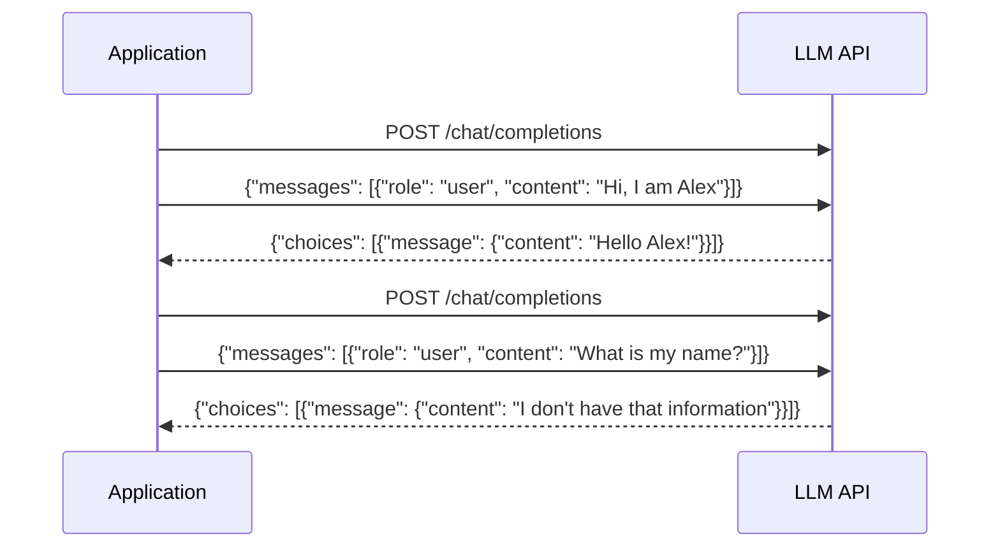
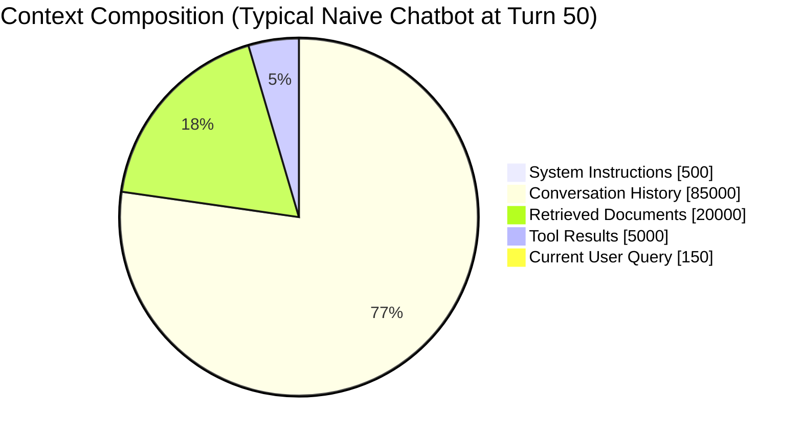
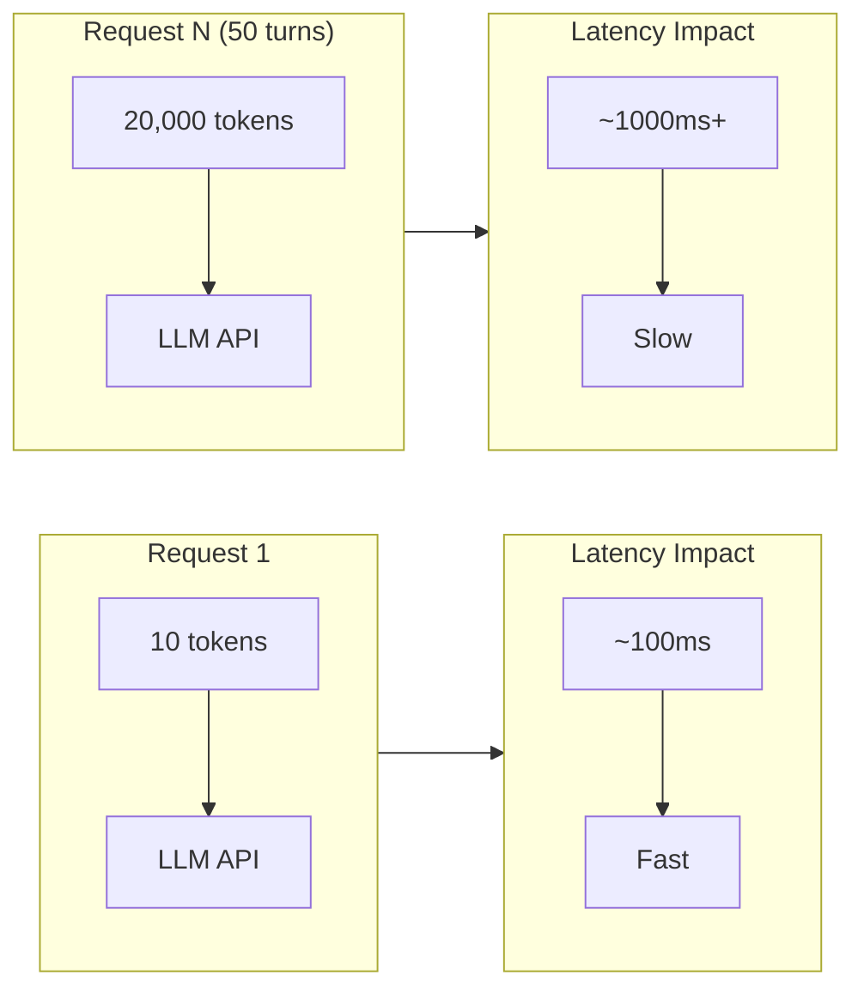
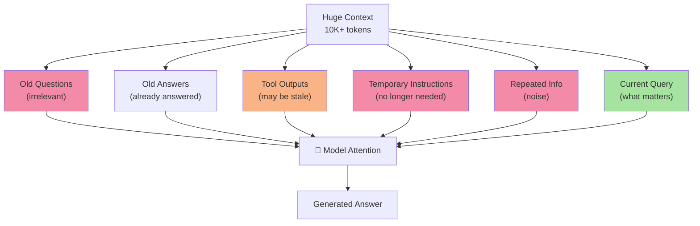
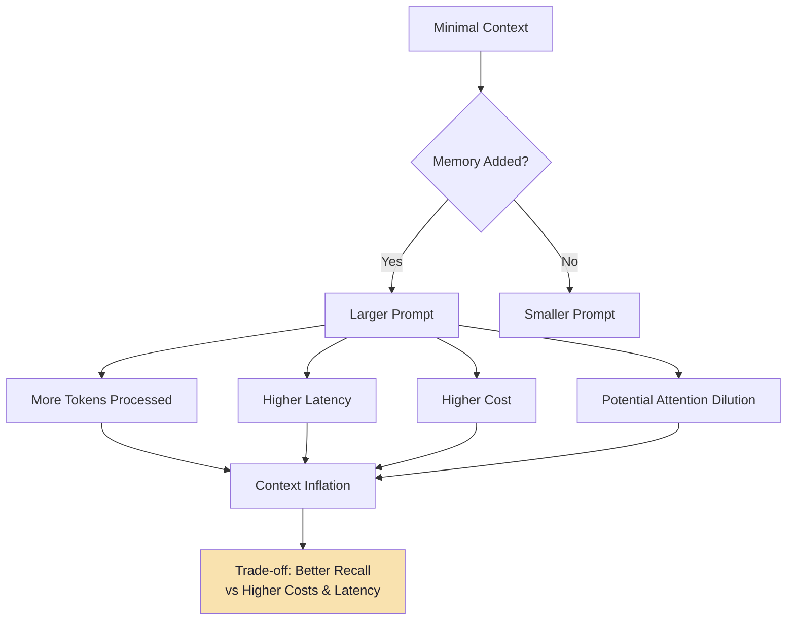

# Chapter 1: Stateless LLM APIs & Context-Window Limitations

## Core Concept

LLM APIs are **stateless**: the model does not automatically retain information from previous requests. Each API call is independent. The application must explicitly store, manage, and selectively send conversation context with every request.

---

## 1. The Stateless Nature of LLM APIs

### 1.1 How a Stateless API Works



**Key insight**: Request 1 → LLM → Response ≠ Request 2 → LLM → Response
The second request to the LLM does not automatically contain the context from Request 1.

### 1.2 Why Stateless Design?

| Reason | Explanation |
|--------|-------------|
| **Scalability** | Stateless APIs can be load-balanced horizontally across multiple instances |
| **Fault tolerance** | No session affinity needed; any instance can handle any request |
| **Model weights frozen** | During inference, model parameters never change — learning happens only during training |
| **Predictable compute** | Each request has bounded compute cost proportional to input + output tokens |

### 1.3 The Illusion of Memory

When users interact with ChatGPT or similar interfaces, it *feels* like the model remembers. In reality:

```mermaid
flowchart TD
    subgraph UI["User Interface (ChatGPT Web/App)"]
        U1[Turn 1: "Hi, I'm Alex"] --> U2[Turn 2: "What's my name?"]
        U2 --> U3[Turn 3: "Thanks!"]
    end
    
    subgraph Backend["Application Layer (Hidden)"]
        B1[Store message 1] --> B2[Send msg 1 + msg 2 to LLM]
        B2 --> B3[Store response 2]
        B3 --> B4[Send msg 1-3 to LLM]
    end
    
    U1 -.-> B1
    U2 -.-> B2
    U3 -.-> B4
    
    style UI fill:#cba6f7,color:#1e1e2e
    style Backend fill:#94e2d5,color:#1e1e2e
```

The **application layer** (not the model) maintains the conversation history and reconstructs it for each request.

---

## 2. Why Application-Level Memory is Necessary

### 2.1 The Conversation Memory Problem

Without explicit memory management, a stateless LLM cannot:

- Remember user names or preferences established in earlier turns
- Recall facts extracted from previous messages
- Maintain coherent long-running conversations
- Provide personalized responses across sessions
- Learn from user corrections or feedback

### 2.2 The Memory Hierarchy

```mermaid
flowchart TD
    subgraph MODEL["LLM Model (Stateless)"]
        W[Weights<br/>Frozen during session]
    end

    subgraph APP["Application (Stateful)"]
        H[Conversation History<br/>Database - Complete log]
        STM[Short-Term Memory<br/>Recent N turns (sliding window)]
        LTM[Long-Term Memory<br/>Persistent facts, preferences]
        PROFILE[User Profile<br/>Structured attributes, settings]
        SUMMARY[Conversation Summary<br/>Condensed history]
    end

    H --> STM
    H --> SUMMARY
    LTM --> LLMCTX[LLM Context Builder]
    STM --> LLMCTX
    SUMMARY --> LLMCTX
    PROFILE --> LLMCTX
    LLMCTX --> W
    W --> A[Response]
    A --> H

    style W fill:#cba6f7,color:#1e1e2e
    style H fill:#89b4fa,color:#1e1e2e
    style STM fill:#f9e2af,color:#1e1e2e
    style SUMMARY fill:#f9e2af,color:#1e1e2e
    style LTM fill:#94e2d5,color:#1e1e2e
    style PROFILE fill:#a6e3a1,color:#1e1e2e
```

### 2.3 Memory Layer Responsibilities

| Layer | Duration | Access Pattern | Storage |
|-------|----------|----------------|---------|
| **Conversation History** | Forever (or retention policy) | Append-only, full scan for export/audit | Relational DB |
| **Short-Term Memory (STM)** | Current session | Always loaded (last N turns) | In-memory + DB |
| **Summary** | Per session | Loaded when STM window full | DB |
| **Long-Term Memory (LTM)** | Cross-session | Selective retrieval (vector search) | Vector DB |
| **User Profile** | Cross-session | Always loaded (small) | Key-value / Relational DB |

---

## 3. The Four Core Production Failure Points

When naive history management is used (send all history every turn), four critical issues emerge:

### 3.1 Context Window Exhaustion

Every LLM has a maximum context length. Models in 2024-2025:

| Model | Context Window | Notes |
|-------|---------------|-------|
| GPT-4o / GPT-4o-mini | 128K tokens | ~96K usable for input |
| Claude 3.5 Sonnet / 3.7 Sonnet | 200K tokens | ~150K usable |
| Gemini 1.5 Pro | 2M tokens | Large but expensive |
| Llama 3.1 405B | 128K tokens | Open weights |
| Command R+ | 128K tokens | Optimized for RAG |



**Problem**: As conversation grows, `Conversation History` eventually exceeds the model's context window, causing truncation or API errors.

### 3.2 Network Bandwidth & Latency

Sending growing context with every request creates unnecessary network overhead.



**Cost**: 20x increase in payload size = ~20x increase in network transmission time, plus longer prefill time on the model server.

### 3.3 Increasing Token Costs (Quadratic Growth)

LLM APIs charge per token processed. Resending historical context means paying for the same tokens repeatedly.

| Request | New Tokens | Historical Tokens | Total Input | Cost Multiplier |
|---------|-----------|-------------------|-------------|-----------------|
| 1       | 10        | 0                 | 10          | 1x              |
| 2       | 10        | 10                | 20          | 2x              |
| 3       | 10        | 20                | 30          | 3x              |
| ...     | ...       | ...               | ...         | ...             |
| N       | 10        | ~N×10             | ~N×10       | N×              |

**Formula**: Total Input Tokens (cumulative) = Σᵢ₌₁ᴺ (System + Historyᵢ + Queryᵢ) ≈ O(N²)

**Example**: For 30 turns averaging 80 tokens each:
- Naive cumulative: `30²/2 × 80 = 36,000 tokens` total
- Per-turn with STM: `30 × 80 = 2,400 tokens` total
- **15x cost difference**

### 3.4 Attention Degradation ("Lost in the Middle")

Large context with irrelevant historical information causes the model's attention mechanism to lose focus on relevant information.



**Result**: Model struggles to identify what actually matters; performance degrades on complex reasoning tasks. Research shows attention weight distribution becomes flatter as context grows (Liu et al., "Lost in the Middle", 2023).

---

## 4. The Fundamental Tension: Context Inflation vs. Recall Quality

As memory is added to provide better context, the prompt size grows, creating a fundamental trade-off:



**This is the fundamental tension**: memory improves recall quality but inflates context, increasing cost, latency, and potentially degrading answer quality.

---

## 5. Memory as a Budget Problem

The production solution reframes memory as a **token budget allocation problem**. Instead of "how much can I fit?", the question becomes "how should I allocate my token budget?"

```mermaid
flowchart LR
    Budget[Context Budget<br/>e.g., 100K tokens] --> Rules[System Rules<br/>400 tokens (0.4%)]
    Budget --> Profile[User Profile<br/>150 tokens (0.15%)]
    Budget --> Summary[Conversation Summary<br/>300 tokens (0.3%)]
    Budget --> Recent[Recent Turns (STM)<br/>800 tokens (0.8%)]
    Budget --> Retrieved[Retrieved LTM + RAG<br/>1,500 tokens (1.5%)]
    Budget --> Query[Current Query<br/>100 tokens (0.1%)]
    Budget --> Buffer[Safety Buffer<br/>~500 tokens (0.5%)]

    Rules --> Total[TOTAL: ~3,750 tokens<br/>(3.75% of 100K)"]
    Profile --> Total
    Summary --> Total
    Recent --> Total
    Retrieved --> Total
    Query --> Total
    Buffer --> Total
```

### 5.1 Budget Allocation Strategy

```javascript
// Pseudo code: Budget allocation function
function allocateTokenBudget(totalBudget, components) {
    // Priority order (highest to lowest):
    // 1. Current query (must fit)
    // 2. System prompt (fixed)
    // 3. Recent STM (recency matters most)
    // 4. User profile (small, high value)
    // 5. Conversation summary (condensed history)
    // 6. Retrieved LTM/RAG (variable, trim if needed)
    // 7. Buffer for generation
    
    const allocation = {
        query: estimateTokens(components.query),
        system: Math.min(estimateTokens(components.system), 400),
        profile: Math.min(estimateTokens(components.profile), 150),
        stm: 0,
        summary: 0,
        ltm: 0,
        buffer: 500
    };
    
    const usedSoFar = allocation.query + allocation.system + 
                      allocation.profile + allocation.buffer;
    let remaining = totalBudget - usedSoFar;
    
    // STM gets priority (recency)
    allocation.stm = Math.min(estimateTokens(components.stm), 
                              Math.floor(remaining * 0.4));
    remaining -= allocation.stm;
    
    // Summary next
    allocation.summary = Math.min(estimateTokens(components.summary),
                                  Math.floor(remaining * 0.15));
    remaining -= allocation.summary;
    
    // LTM gets what's left
    allocation.ltm = Math.max(0, remaining);
    
    return allocation;
}
```

### 5.2 Budget Enforcement at Runtime

```mermaid
flowchart TD
    A[Incoming Request] --> B[Load STM (last N turns)]
    B --> C[Search LTM (vector similarity)]
    C --> D[Load Profile + Summary]
    D --> E[Build Context with Budget]
    E --> F{Total Tokens > Budget?}
    F -->|Yes| G[Trim LTM first<br/>then Summary<br/>then oldest STM]
    F -->|No| H[Call LLM]
    G --> H
    H --> I[Response]
    
    style G fill:#fab387,color:#1e1e2e
    style H fill:#a6e3a1,color:#1e1e2e
```

---

## 6. Why Both STM and LTM Are Required

```
┌─────────────────────────────────────────────────────────────┐
│                    STM + LTM HYBRID                         │
├─────────────────────────────────────────────────────────────┤
│  STM (Short-Term Memory)          LTM (Long-Term Memory)   │
│  ─────────────────────────        ───────────────────────── │
│  • Last 4-10 conversation turns  • User preferences          │
│  • Immediate context             • Facts across sessions     │
│  • Always loaded                 • Selectively retrieved     │
│  • Solves: "What just happened?" • Solves: "What do I know  │
│                                  about this user?"           │
└─────────────────────────────────────────────────────────────┘
```

**STM answers**: "What were we just talking about?"
**LTM answers**: "What important information should I remember about this user?"

The final context assembly combines both:

```javascript
// Pseudo code: Final context assembly
function buildLLMContext(stm, ltm, profile, summary, query) {
    const messages = [];
    
    // 1. System prompt (always first)
    messages.push({ role: "system", content: SYSTEM_PROMPT });
    
    // 2. User profile (high-value, small)
    if (profile) {
        messages.push({ 
            role: "system", 
            content: `User Profile: ${formatProfile(profile)}` 
        });
    }
    
    // 3. Conversation summary (condensed history)
    if (summary) {
        messages.push({ 
            role: "system", 
            content: `Previous Conversation Summary: ${summary}` 
        });
    }
    
    // 4. Relevant LTM memories (retrieved by similarity)
    for (const memory of ltm) {
        messages.push({ 
            role: "system", 
            content: `Memory: ${memory.content}` 
        });
    }
    
    // 5. Recent STM (chronological order)
    for (const msg of stm) {
        messages.push(msg);
    }
    
    // 6. Current query (always last)
    messages.push({ role: "user", content: query });
    
    return messages;
}
```

---

## 7. Context Window Management Strategies

| Strategy | Description | Pros | Cons |
|----------|-------------|------|------|
| **Truncation** | Drop oldest messages when limit reached | Simple | Loses information |
| **Summarization** | LLM summarizes old turns into compact form | Preserves gist | Loses detail, extra LLM call |
| **Sliding Window** | Keep only last N turns | Predictable size, fast | Information amnesia (see Ch 2) |
| **Hybrid (STM+Summary+LTM)** | Window + periodic summary + selective LTM | Best of all worlds | More complex |

---

## Common Mistakes

| Mistake | Effect | Fix |
|---------|--------|-----|
| Resending all history every turn | Quadratic token growth, high costs | Implement STM with sliding window |
| Only keeping recent turns in DB | Lost information on restart | Persist complete history to database |
| Ignoring attention dilution | Poor answer quality on long conversations | Selectively retrieve relevant LTM |
| No memory budget | Context overflow errors | Calculate and enforce token limits |
| Treating all history equally | Noise drowning signal | Prioritize by recency and relevance |
| Using full context for every query | Unnecessary cost/latency | Condense query, retrieve selectively |
| Not accounting for output tokens | Budget exceeded during generation | Reserve buffer for response tokens |

---

## Key Takeaways

1. **LLM APIs are stateless** — the model never remembers; you must build the memory layer in your application
2. **Context is expensive** — every token has latency, bandwidth, and cost implications (quadratic with naive approach)
3. **Attention dilutes** — large context can harm answer quality, not improve it ("lost in the middle")
4. **Memory is a trade-off** — between recall (remembering everything) and efficiency (keeping context lean)
5. **Production requires budget management** — allocate tokens strategically across system prompt, profile, summary, recent turns, retrieved docs, and query
6. **The complete solution needs both STM and LTM** — sliding windows handle immediate context; long-term memory handles persistent facts
7. **Conversation history ≠ STM** — keep full history in DB for audit/export, but only load recent N turns for LLM
8. **Context window is a shared resource** — system prompt, tools, RAG results, STM, LTM, and query all compete for the same budget

---

## Preview: Chapter 2

In the next chapter, we dive deep into **Short-Term Memory (STM)** and **Sliding Windows** — the mechanism that bounds context growth while preserving immediate conversational continuity.