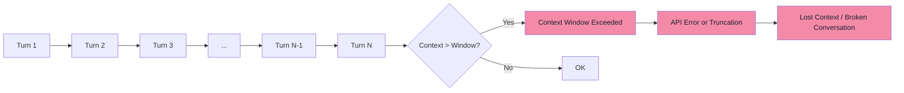
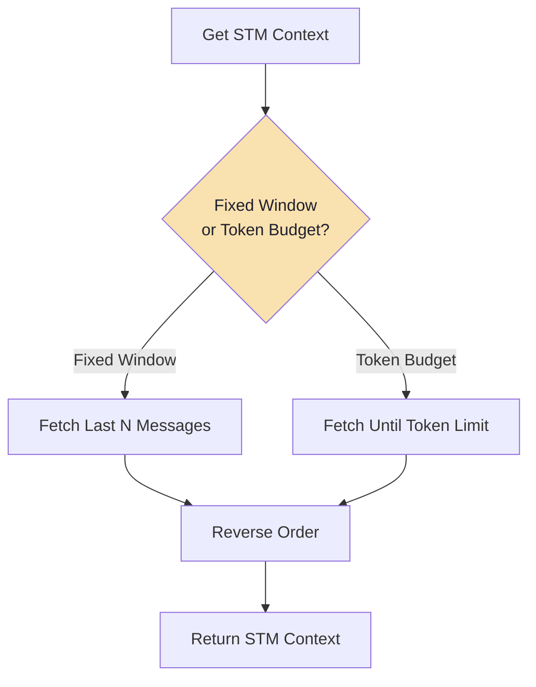
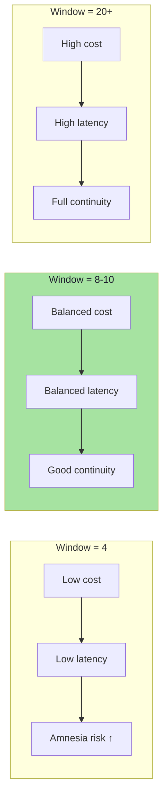
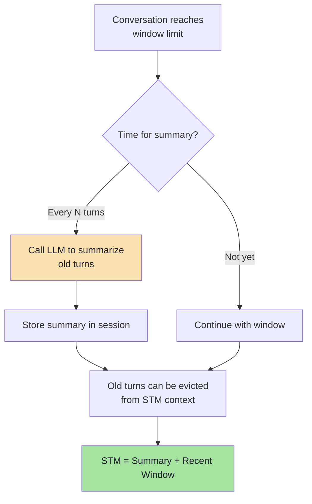

# Chapter 2: Short-Term Memory (STM) & Sliding Windows

## Core Concept

Short-Term Memory (STM) keeps only the **recent conversational context** needed for the current interaction, sending only the last N turns to the LLM instead of the entire conversation history. This solves the context growth problem while preserving immediate conversational continuity.

---

## 1. The Problem STM Solves

### 1.1 Quadratic Token Growth Without STM

```
Turn 1:  User → "Hi"                    → 10 tokens sent
Turn 2:  User → "My name is Alex"       → 20 tokens sent (10 old + 10 new)
Turn 3:  User → "I like TypeScript"     → 30 tokens sent (20 old + 10 new)
Turn 4:  User → "What's my name?"       → 40 tokens sent (30 old + 10 new)
...
Turn N:  User → "..."                   → N×10 tokens sent
```

**Cumulative cost for 30 turns (80 tokens avg)**:
- Naive: `30²/2 × 80 = 36,000 tokens` total billed
- With STM (window=10): `30 × 80 = 2,400 tokens` total billed
- **15x cost reduction**

### 1.2 The Context Window Ceiling



---

## 2. Basic STM Implementation

### 2.1 In-Memory Array-Based (Development Only)

```javascript
// Pseudo code: Simple in-memory STM
const messages = [];
const WINDOW_SIZE = 10;

function addMessage(role, content) {
    messages.push({ role, content, timestamp: Date.now() });
}

function getSTMContext() {
    // Return last N messages (sliding window)
    return messages.slice(-WINDOW_SIZE);
}

async function chat(userQuery) {
    addMessage("user", userQuery);
    const context = getSTMContext();
    const response = await callLLM(context);
    addMessage("assistant", response);
    return response;
}
```

**Limitation**: Data lost on server restart. Not suitable for production.

### 2.2 Production: Database-Backed STM

```mermaid
flowchart TD
    subgraph Client["Client"]
        U[User Query]
    end
    
    subgraph Server["API Server"]
        A[Receive Request]
        B[Save User Message]
        C[Fetch Last N Messages]
        D[Reverse to Chronological]
        E[Build Context]
        F[Call LLM]
        G[Save Assistant Response]
    end
    
    subgraph DB[("Chat Database")]
        H[(chat_messages table)]
    end
    
    U --> A
    A --> B
    B --> H
    A --> C
    C --> H
    H --> D
    D --> E
    E --> F
    F --> G
    G --> H
    F --> U
    
    style DB fill:#94e2d5,color:#1e1e2e
```

---

## 3. Database Schema Design

### 3.1 Core Message Table

```sql
-- Pseudo code: PostgreSQL schema
CREATE TABLE chat_messages (
    message_id     UUID PRIMARY KEY DEFAULT gen_random_uuid(),
    session_id     UUID NOT NULL,
    user_id        UUID NOT NULL,
    role           TEXT NOT NULL CHECK (role IN ('user', 'assistant', 'system', 'tool')),
    content        TEXT NOT NULL,
    token_count    INT,  -- For cost tracking
    metadata       JSONB DEFAULT '{}', -- Tool calls, citations, etc.
    created_at     TIMESTAMPTZ NOT NULL DEFAULT NOW()
);

-- Indexes for common queries
CREATE INDEX idx_chat_messages_session_created 
    ON chat_messages (session_id, created_at DESC);
CREATE INDEX idx_chat_messages_user_created 
    ON chat_messages (user_id, created_at DESC);
```

### 3.2 Session Table (for metadata)

```sql
CREATE TABLE chat_sessions (
    session_id    UUID PRIMARY KEY DEFAULT gen_random_uuid(),
    user_id       UUID NOT NULL,
    title         TEXT,  -- Auto-generated from first user message
    summary       TEXT,  -- Periodic LLM-generated summary
    message_count INT DEFAULT 0,
    token_count   INT DEFAULT 0,
    created_at    TIMESTAMPTZ NOT NULL DEFAULT NOW(),
    updated_at    TIMESTAMPTZ NOT NULL DEFAULT NOW(),
    archived_at   TIMESTAMPTZ
);

CREATE INDEX idx_chat_sessions_user_updated 
    ON chat_sessions (user_id, updated_at DESC);
```

### 3.3 Message Structure (TypeScript Types)

```typescript
// Pseudo code: TypeScript interfaces
interface ChatMessage {
    messageId: string;        // UUID
    sessionId: string;        // UUID
    userId: string;           // UUID
    role: 'user' | 'assistant' | 'system' | 'tool';
    content: string;
    tokenCount?: number;
    metadata?: {
        toolCalls?: ToolCall[];
        toolResults?: ToolResult[];
        citations?: Citation[];
        model?: string;
    };
    createdAt: Date;          // ISO 8601
}
```

---

## 4. Fetching STM Context (Production Patterns)

### 4.1 Basic Sliding Window Query

```javascript
// Pseudo code: Fetch last N messages for a session
async function getRecentMessages(sessionId, windowSize = 10) {
    // 1. Query database (newest first for efficient LIMIT)
    const rows = await db.query(`
        SELECT role, content, metadata, created_at
        FROM chat_messages
        WHERE session_id = $1
        ORDER BY created_at DESC
        LIMIT $2
    `, [sessionId, windowSize]);
    
    // 2. Reverse to restore chronological order (oldest first)
    const messages = rows.reverse().map(row => ({
        role: row.role,
        content: row.content,
        // Include metadata if needed for tool context
        ...(row.metadata && { metadata: row.metadata })
    }));
    
    return messages;
}
```

### 4.2 Token-Aware Window (Dynamic Sizing)

```javascript
// Pseudo code: Token-budget-aware STM fetching
async function getSTMByTokenBudget(sessionId, tokenBudget = 2000) {
    // Fetch messages newest-first with token counts
    const rows = await db.query(`
        SELECT role, content, token_count, created_at
        FROM chat_messages
        WHERE session_id = $1
        ORDER BY created_at DESC
    `, [sessionId]);
    
    const messages = [];
    let totalTokens = 0;
    
    for (const row of rows) {
        const msgTokens = row.token_count || estimateTokens(row.content);
        if (totalTokens + msgTokens > tokenBudget) break;
        
        messages.unshift({  // prepend to maintain chronological order
            role: row.role,
            content: row.content
        });
        totalTokens += msgTokens;
    }
    
    return { messages, totalTokens };
}
```

### 4.3 Hybrid: Window + Token Budget



---

## 5. Window Size Tuning

### 5.1 Recommended Window Sizes

| Use Case | Window Size | Rationale |
|----------|-------------|-----------|
| **General chat** | 6-10 turns | Balances context and cost |
| **Code assistance** | 8-12 turns | More context needed for code references |
| **Customer support** | 4-6 turns | Focused, task-oriented |
| **Creative writing** | 10-15 turns | Long-range coherence matters |
| **High-cost models** | 4-6 turns | Minimize token spend |

### 5.2 Window Size Impact



---

## 6. The Fundamental Limitation: Information Amnesia

### 6.1 The Amnesia Problem

STM solves context growth but creates **information amnesia** — important facts fall outside the window.

```mermaid
flowchart TD
    subgraph FullHistory["Complete Conversation (30 turns)"]
        T1[Turn 1: "I'm allergic to nuts"]
        T2[Turn 2-10: Various topics]
        T11[Turn 11-20: More topics]
        T21[Turn 21-30: Current discussion]
    end
    
    subgraph STMWindow["STM Window (Last 6 turns)"]
        W1[Turn 25]
        W2[Turn 26]
        W3[Turn 27]
        W4[Turn 28]
        W5[Turn 29]
        W6[Turn 30: "Recommend dessert"]
    end
    
    T1 -.->|Lost!| STMWindow
    T21 --> W1
    T21 --> W2
    T21 --> W3
    T21 --> W4
    T21 --> W5
    T21 --> W6
    
    style T1 fill:#f38ba8,color:#1e1e2e
    style W6 fill:#a6e3a1,color:#1e1e2e
```

**Result**: LLM recommends pecan pie despite user's nut allergy stated in Turn 1.

### 6.2 Types of Information Lost

| Information Type | Example | Risk if Lost |
|------------------|---------|--------------|
| **Safety-critical** | Allergies, medical conditions | Harm to user |
| **Preferences** | "I prefer concise answers", "Dark mode" | Poor UX |
| **Identity** | Name, role, company | Impersonal responses |
| **Constraints** | "Don't use jargon", "Budget under $100" | Violated constraints |
| **Active tasks** | "I'm debugging the login flow" | Lost context on task |

---

## 7. Mitigation Strategies Within STM Layer

### 7.1 Pinned / Priority Messages

```javascript
// Pseudo code: Priority messages that never evict
interface PriorityMessage {
    messageId: string;
    priority: 'critical' | 'high' | 'normal';
    reason: string;  // 'allergy', 'active_task', 'user_name', etc.
}

async function getSTMWithPriorities(sessionId, windowSize = 10) {
    // 1. Get priority messages (never evicted)
    const priority = await db.query(`
        SELECT * FROM chat_messages
        WHERE session_id = $1 AND metadata->>'priority' IS NOT NULL
        ORDER BY created_at ASC
    `, [sessionId]);
    
    // 2. Get recent normal messages
    const recent = await db.query(`
        SELECT * FROM chat_messages
        WHERE session_id = $1 AND (metadata->>'priority' IS NULL)
        ORDER BY created_at DESC
        LIMIT $2
    `, [sessionId, windowSize]);
    
    // 3. Merge: priority first (chronological), then recent (chronological)
    const merged = [
        ...priority.map(p => ({ role: p.role, content: p.content })),
        ...recent.reverse().map(r => ({ role: r.role, content: r.content }))
    ];
    
    return merged;
}
```

### 7.2 Conversation Summarization (Bridge to LTM)

When conversation exceeds window, periodically summarize:



```javascript
// Pseudo code: Periodic summarization
async function maybeSummarize(sessionId, windowSize = 10, summarizeEvery = 20) {
    const session = await getSession(sessionId);
    
    // Trigger summarization when message count hits threshold
    if (session.messageCount % summarizeEvery === 0) {
        // Get turns outside current window
        const oldTurns = await db.query(`
            SELECT role, content FROM chat_messages
            WHERE session_id = $1
            ORDER BY created_at ASC
            LIMIT $2
        `, [sessionId, session.messageCount - windowSize]);
        
        // LLM summarizes
        const summaryPrompt = `
            Summarize the following conversation turns concisely.
            Preserve: key facts, decisions, user preferences, open questions.
            Omit: pleasantries, repeated info, resolved tangents.
            
            Conversation:
            ${oldTurns.map(t => `${t.role}: ${t.content}`).join('\n')}
        `;
        
        const summary = await callLLM(summaryPrompt);
        
        // Store summary
        await db.query(`
            UPDATE chat_sessions 
            SET summary = $1, updated_at = NOW()
            WHERE session_id = $2
        `, [summary, sessionId]);
        
        return summary;
    }
}
```

---

## 8. STM + LTM: The Complete Picture

```mermaid
flowchart TD
    subgraph Request["Request Processing"]
        A[User Query] --> B[Load STM<br/>(Recent N turns)]
        A --> C[Search LTM<br/>(Vector similarity)]
        A --> D[Load Profile<br/>& Summary]
    end
    
    subgraph Assembly["Context Assembly"]
        B --> E[Budget-Aware<br/>Context Builder]
        C --> E
        D --> E
    end
    
    subgraph LLMCall["LLM Call"]
        E --> F[Token-bounded<br/>Prompt]
        F --> G[LLM]
        G --> H[Response]
    end
    
    subgraph Persistence["Post-Response"]
        H --> I[Save User + Assistant<br/>Messages to DB]
        I --> J[Extract & Store<br/>New LTM Facts]
        J --> K[Queue Dreaming Job]
    end
    
    style E fill:#f9e2af,color:#1e1e2e
    style J fill:#cba6f7,color:#1e1e2e
```

---

## 9. Advanced STM Patterns

### 9.1 Session Continuity Across Devices

```javascript
// Pseudo code: Multi-device session sync
async function syncSessionAcrossDevices(userId, sessionId, deviceId) {
    // 1. Get current STM from primary device
    const stm = await getRecentMessages(sessionId, WINDOW_SIZE);
    
    // 2. Push to device-specific cache (Redis)
    await redis.setex(
        `stm:${userId}:${sessionId}:${deviceId}`,
        3600,  // 1 hour TTL
        JSON.stringify(stm)
    );
    
    // 3. On new device, load from cache
    const cached = await redis.get(`stm:${userId}:${sessionId}:${newDeviceId}`);
    return cached ? JSON.parse(cached) : await getRecentMessages(sessionId, WINDOW_SIZE);
}
```

### 9.2 Streaming-Aware STM

During streaming, save partial assistant responses:

```javascript
// Pseudo code: Streaming with incremental persistence
async function streamChat(sessionId, userQuery) {
    // 1. Save user message immediately
    await saveMessage(sessionId, 'user', userQuery);
    
    // 2. Get STM context
    const context = await getRecentMessages(sessionId, WINDOW_SIZE);
    
    // 3. Stream response
    let fullResponse = '';
    for await (const chunk of streamLLM(context)) {
        fullResponse += chunk.content;
        yield chunk;  // Send to client immediately
    }
    
    // 4. Save complete assistant response
    await saveMessage(sessionId, 'assistant', fullResponse);
    
    // 5. Trigger memory extraction (async)
    queueMemoryExtraction(sessionId, userQuery, fullResponse);
}
```

---

## Common Mistakes

| Mistake | Effect | Fix |
|---------|--------|-----|
| Thinking STM means deleting old messages | Loss of conversation history on restarts | Keep complete history in database; STM is a *view* |
| Using STM for fact extraction | Forgetting important persistent facts | Add LTM layer for semantic memories |
| Setting window too small (≤3) | Losing conversational context, broken references | Choose appropriate window size (6-10 turns typical) |
| Not reversing chronological order | Sending messages in wrong order to LLM | Reverse after `ORDER BY DESC` database fetch |
| Using same `message_id` across sessions | Cross-session data mixing | Include `session_id` in message structure; use UUIDs |
| Ignoring token counts in window | Budget overflow on long messages | Use token-aware window sizing |
| No summarization for long conversations | Complete amnesia beyond window | Implement periodic summarization |
| Saving assistant response only at end | Lost response if stream interrupted | Save incrementally or use transactions |

---

## Key Takeaways

1. **STM is context selection** — keep everything in the database, but only load recent messages for LLM context
2. **Sliding window solves quadratic growth** — each request now has predictable size and cost (O(1) per turn)
3. **But creates information amnesia** — older information becomes inaccessible to the model
4. **Solution is STM + LTM hybrid** — STM handles immediate conversation; LTM stores persistent facts
5. **Database persistence is essential** — in-memory STM alone loses all history on restart
6. **Chronological ordering matters** — LLM expects messages in natural chronological order (oldest first)
7. **Window size is a trade-off** — larger windows preserve more context but increase costs
8. **Token-aware windows > fixed-count windows** — accounts for variable message lengths
9. **Periodic summarization bridges STM→LTM** — condenses old turns into compact form before they evict
10. **Priority/pinned messages protect critical info** — allergies, active tasks, identity never evicted

---

## Preview: Chapter 3

In the next chapter, we explore **Long-Term Memory (LTM) Taxonomy & Fact Extraction** — how to persistently store and retrieve important information across sessions using semantic, episodic, and graph memory types.