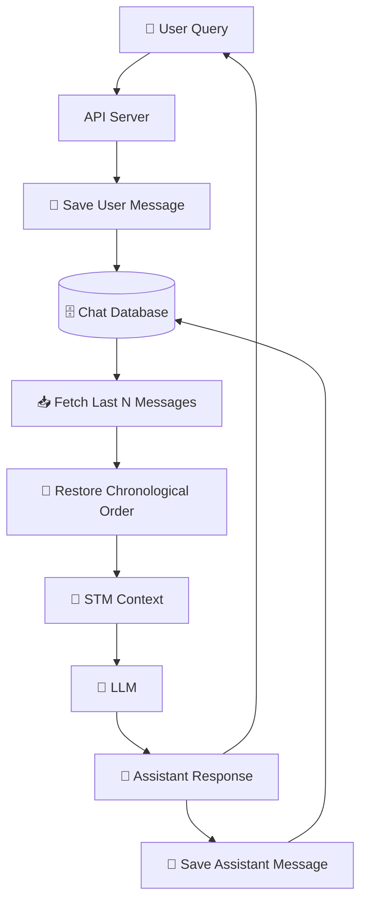

# Chapter 2: Short-Term Memory (STM) & Sliding Windows

## Core Concept

Short-Term Memory (STM) keeps only the **recent conversational context** needed for the current interaction, sending only the last N turns to the LLM instead of the entire conversation history. This solves the context growth problem while preserving immediate conversational continuity.

## 1. Basic STM Implementation

### 1.1 Array-Based Implementation

A simple STM uses an array to store conversation messages:

```javascript
const messages = [];

function addMessage(role, content) {
  messages.push({
    role,
    content,
  });
}
```

As the conversation grows, the array accumulates all historical messages:

```text
Turn 1  Turn 2  Turn 3  Turn 4  Turn 5  Turn 6  Turn 7  Turn 8  Turn 9
```

### 1.2 The Sliding Window Technique

To limit context size, we use a **window size**:

```javascript
const WINDOW_SIZE = 4;

function getRecentMessages() {
  return messages.slice(-WINDOW_SIZE);
}
```

`slice(-WINDOW_SIZE)` starts from the end of the array, returning the last N messages.

If WINDOW_SIZE = 4, the STM contains only the latest 4 messages:

```text
Turn 1  Turn 2  ❌      ❌
         ❌
Turn 3  Turn 4  Turn 5  Turn 6  ✅      ✅      ✅      ✅
```

### 1.3 Complete Basic STM Flow

A basic implementation combines storage, selection, and LLM calling:

```javascript
const messages = [];
const WINDOW_SIZE = 10;

async function chat(userQuery) {
  // 1. Store the new user message
  messages.push({
    role: "user",
    content: userQuery,
  });

  // 2. Get only recent messages using sliding window
  const recentMessages = messages.slice(-WINDOW_SIZE);

  // 3. Send the sliding window to the LLM
  const response = await callLLM(recentMessages);

  // 4. Store the assistant response
  messages.push({
    role: "assistant",
    content: response,
  });

  return response;
}
```

## 2. Database Persistence for Production

### 2.1 Why in-Memory Isn't Enough

Keeping messages only in memory causes data loss:

```javascript
const messages = [];
```

If the server restarts, all stored conversation history disappears.

### 2.2 Database Schema for STM

```sql
CREATE TABLE chat_messages (
    message_id TEXT PRIMARY KEY,
    session_id TEXT NOT NULL,
    role TEXT NOT NULL,
    content TEXT NOT NULL,
    created_at TIMESTAMP NOT NULL
);
```

Each conversation belongs to a session:

```text
session_id
    ├── message 1 (user)
    ├── message 2 (assistant)
    ├── message 3 (user)
    └── ...
```

### 2.3 Fetching Recent Messages from Database

To get the last N messages for a session:

```sql
SELECT
    role,
    content
FROM chat_messages
WHERE session_id = 'user_session_101'
ORDER BY created_at DESC
LIMIT 20;
```

Because `ORDER BY DESC` returns newest messages first:

```text
20    ← newest
19
18
17
... 
1     ← oldest
```

The application normally reverses them to restore chronological order:

```javascript
const rows = await db.query(`
  SELECT role, content
  FROM chat_messages
  WHERE session_id = $1
  ORDER BY created_at DESC
  LIMIT $2
`, [sessionId, WINDOW_SIZE]);

const recentMessages = rows.reverse();
```

Now the LLM receives messages in chronological order: `17 → 18 → 19 → 20`

## 3. Message Data Structure

A stored message can be represented as:

```json
{
  "message_id": "msg_9921",
  "session_id": "user_session_101",
  "role": "user",
  "content": "I prefer vegetarian food.",
  "created_at": "2026-08-24T18:20:00Z"
}
```

### Key Fields:

- **`message_id`**: Uniquely identifies the message
- **`session_id`**: Identifies the conversation (prevents mixing different chats)
- **`role`**: Identifies who produced the message ("user", "assistant", "system", "tool")
- **`content`**: Contains the actual message text
- **`created_at`**: Allows chronological ordering

## 4. Production STM Request Flow

A typical STM implementation:



### Key Separation:

- **Database**: Complete Conversation History (all messages permanently stored)
- **STM**: Recent Context Selected From That History (only N messages loaded for LLM)

## 5. Sliding Window Behavior

### Window Dynamics

Suppose:

```javascript
const WINDOW_SIZE = 4;
```

Database contains:

```text
Turn 1
Turn 2
Turn 3
Turn 4
Turn 5
Turn 6
Turn 7
Turn 8
```

Current STM contains:

```text
Turn 5
Turn 6
Turn 7
Turn 8
```

After Turn 9 arrives:

```text
Turn 1  Turn 2  Turn 3  Turn 4
        ❌ Outside STM

Turn 5  Turn 6  Turn 7  Turn 8  Turn 9
                ↓
             Window moves
```

New STM becomes:

```text
Turn 6
Turn 7
Turn 8
Turn 9
```

## 6. STM Solves the Context-Growth Problem

### Without STM

```text
Request 1 → 10 tokens
Request 2 → 20 tokens
Request 3 → 30 tokens
Request 4 → 40 tokens
...
Request N → Huge context
```

### With STM

```text
Request 1 → ≤ N messages
Request 2 → ≤ N messages
Request 3 → ≤ N messages
Request 4 → ≤ N messages
...
Request N → ≤ N messages
```

**Result**: Predictable prompt size, controlled costs.

## 7. The Fundamental Limitation: Information Amnesia

STM solves context growth but creates another problem:

```text
Turn 1:
"My name is Sarah and I am allergic to nuts."

Turn 2
... (many turns)
... (many turns)
... (many turns)
... (many turns)

Turn 30:
"Recommend a dessert for my dinner party."
```

If STM window contains only Turns 21-30:

```text
Turn 1
❌ Outside STM

Turn 21 → Turn 30
✅ Inside STM
```

The LLM doesn't receive Turn 1's important fact:

```text
"I am allergic to nuts."
```

**Result**: LLM might recommend:

```text
🥧 Pecan Pie
```

even though this is unsafe for the user's stated allergy.

## 8. STM vs Complete History Comparison

| Approach | Context | Cost | Access to Old Information |
|----------|---------|------|---------------------------|
| Full History | Everything | 🔴 High | ✅ Always available |
| Sliding Window | Last N turns | 🟢 Controlled | ❌ Usually unavailable |
| STM + LTM | Recent + relevant old information | 🟢 Controlled | ✅ Selectively available |

## 9. Transition to Long-Term Memory

STM answers:
> **"What were we just talking about?"**

Long-Term Memory answers:
> **"What important information should I remember about this user or previous interactions?"**

```text
STM
├── Last 10 conversation messages
│
LTM
├── User prefers vegetarian food
├── User works with React Native
├── User prefers concise answers
└── Important previous events
```

The final context assembly:

```javascript
const context = [
  ...shortTermMemory,
  ...relevantLongTermMemories,
  {
    role: "user",
    content: userQuery,
  },
];

const response = await callLLM(context);
```

## Common Mistakes

| Mistake | Effect | Fix |
|---------|--------|-----|
| Thinking STM means deleting old messages | Loss of conversation history on restarts | Keep complete history in database |
| Using STM for fact extraction | Forgetting important persistent facts | Add LTM layer for semantic memories |
| Setting window too small | Losing conversational context | Choose appropriate window size (4-8 turns) |
| Not reversing chronological order | Sending messages in wrong order to LLM | Reverse after database fetch |
| Using same message_id across sessions | Cross-session data mixing | Include session_id in message structure |

## Key Takeaways

1. **STM is context selection** — keep everything in the database, but only load recent messages for LLM context
2. **Sliding window solves quadratic growth** — each request now has predictable size and cost
3. **But creates information amnesia** — older information becomes inaccessible to the model
4. **Solution is STM + LTM hybrid** — STM handles immediate conversation; LTM stores persistent facts
5. **Database persistence is essential** — in-memory STM alone loses all history on restart
6. **Chronological ordering matters** — LLM expects messages in natural chronological order
7. **Window size is a trade-off** — larger windows preserve more context but increase costs

STM solves half the problem (context growth); LTM solves the other half (persistent information). Together they form the foundation of production agent memory systems.