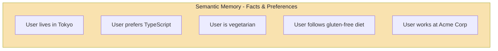
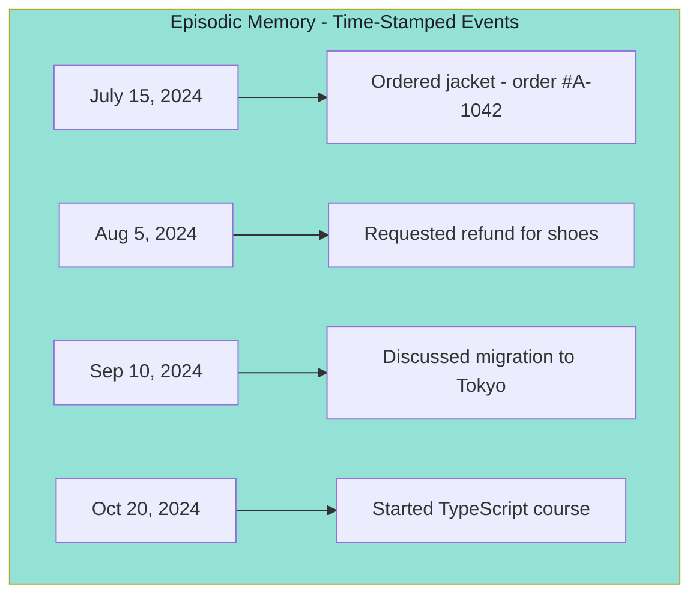
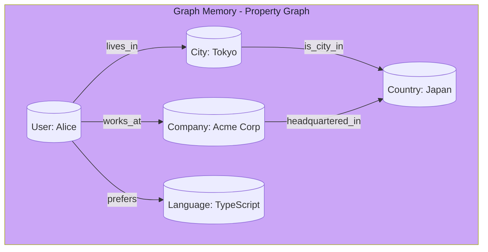
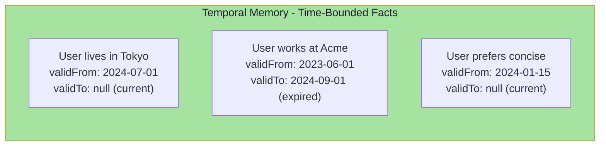
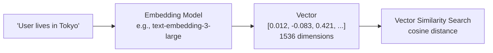
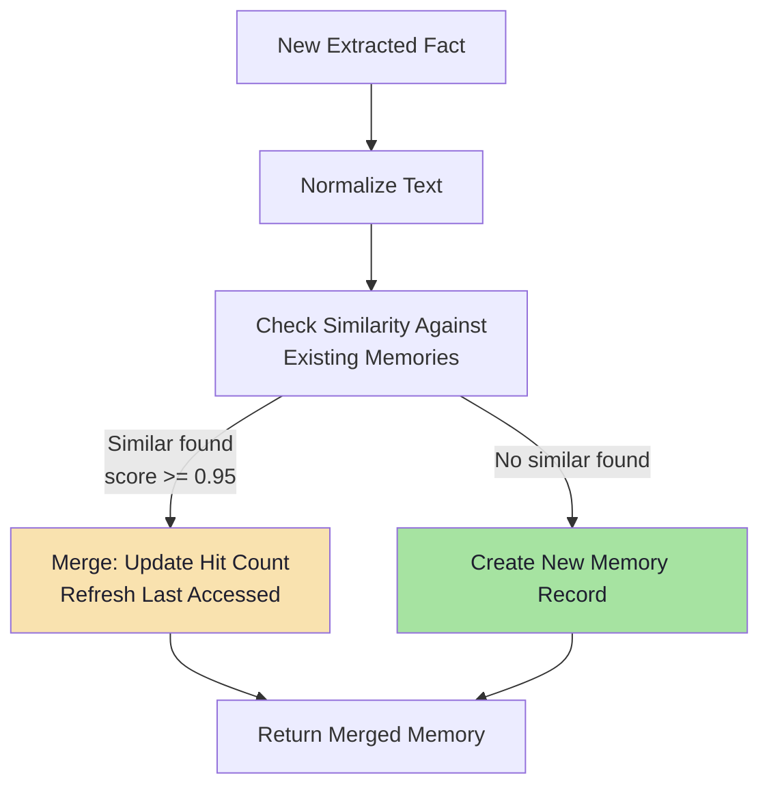

# Chapter 3: Long-Term Memory (LTM) Taxonomy & Fact Extraction

## Core Concept

Long-Term Memory (LTM) stores important facts, events, and knowledge persistently outside the short-term conversation window. Unlike STM which handles immediate context, LTM answers the question: **"What important information should I remember about this user across sessions?"**

---

## 1. LTM Taxonomy: Four Memory Types

The roadmap specifies three memory types (semantic, episodic, graph), plus temporal memory as an additional cross-cutting concern.

### 1.1 Semantic Memory (Facts)

Semantic memory stores declarative facts and user preferences that persist across sessions.



**Purpose**: Store declarative facts and user preferences that inform future interactions.

**Characteristics**:
- Structured, extractable facts
- Persistent across sessions (until evicted or superseded)
- Used to personalize responses
- Often converted to embeddings for semantic retrieval
- Can be updated when user preferences change

### 1.2 Episodic Memory (Events)

Episodic memory stores chronological sequences of events and actions.



**Purpose**: Store chronological sequences of events and actions.

**Characteristics**:
- Time-stamped (each event has a timestamp)
- Narrative in nature
- Useful for "what did I do before?" questions
- Can guide future policy decisions
- Often retrieved by recency filter

### 1.3 Graph Memory (Relationships)

Graph memory captures explicit relationships and connections between entities.



**Purpose**: Capture explicit relationships and connections between entities.

**Characteristics**:
- Node-based structure (entities with properties)
- Edge-based relationships (typed connections)
- Enables multi-hop queries (e.g., "What country does my user's company HQ city belong to?")
- Powers knowledge-graph style answers
- Typically stored in Neo4j or similar graph database

### 1.4 Temporal Memory (Time-Aware Facts)

Temporal memory adds validity windows to facts, recognizing that some facts expire or change over time.



**Purpose**: Track facts that are only valid during specific time periods.

**Characteristics**:
- `validFrom` / `validTo` timestamps
- Current-state queries filter by `validFrom <= NOW() AND (validTo IS NULL OR validTo > NOW())`
- Historical queries can retrieve facts as-of a specific date
- Prevents using outdated information (e.g., recommending a restaurant in a city the user no longer lives in)

---

## 2. When to Use Each Memory Type

| Memory Type | Store When | Example Fact | Typical Retrieval |
|-------------|-----------|--------------|-------------------|
| **Semantic** | User stated facts/preferences | "User prefers TypeScript" | Semantic/vector search |
| **Episodic** | Important events/actions | "User placed order #A-1042" | Time range / recency |
| **Graph** | Entity relationships | "User works at Acme Corp" | Graph traversal / Cypher |
| **Temporal** | Time-bounded facts | "User lives in Tokyo (until next month)" | Validity window filter |

---

## 3. The Memory Hierarchy: STM vs LTM

```mermaid
flowchart TD
    A[User Query] --> B[Load STM<br/>(Last N turns)]
    A --> C[Search LTM<br/>(Vector + Graph + Temporal)]
    B --> D[Context Builder]
    C --> D
    D --> E[LLM Context (Budget-Bounded)]
    E --> F[LLM]
    F --> G[Response]
    
    subgraph STM_Layer["Short-Term Memory<br/>Relational DB + In-Memory"]
        B
    end
    
    subgraph LTM_Layer["Long-Term Memory<br/>Vector DB + Graph DB + Metadata"]
        C
    end
    
    style STM_Layer fill:#f9e2af,color:#1e1e2e
    style LTM_Layer fill:#94e2d5,color:#1e1e2e
```

### Comparison Table

| Aspect | STM | LTM |
|--------|-----|-----|
| **Duration** | Current session | Persistent across sessions |
| **Content** | Recent messages | Extracted facts & events |
| **Size** | Fixed window (N turns) | Grows with useful memories |
| **Access Pattern** | Always loaded | Selectively retrieved |
| **Primary Storage** | Relational DB | Vector DB + Graph DB |
| **Retrieval** | Sequential (chronological) | Semantic (vector) + structural (graph) |
| **Cost Model** | Per-token in prompt | Per-embedding + retrieval + storage |
| **Typical Latency** | <50ms | 50-500ms |

---

## 4. The Fact Extraction Pipeline

### 4.1 Why Extract Facts?

Raw conversation contains more information than needed for long-term storage:

```
User: "I recently moved to Tokyo in July and I follow a gluten-free diet because I have celiac disease."

LLM needs to extract:
- Semantic: "User relocated to Tokyo"
- Semantic: "User follows a gluten-free diet due to celiac disease"
- Episodic: "User moved in July 2024"
- Temporal: "User lives in Tokyo (valid from July 2024)"
```

### 4.2 Extraction Prompt Structure

```javascript
// Pseudo code: Fact extraction prompt
const EXTRACTION_PROMPT = `
You are a memory extraction system. Extract important long-term facts from the user message.

Rules:
1. Extract ONLY verifiable facts, not opinions or conversational filler
2. Classify each fact as: "semantic" (preference/fact), "episodic" (event), or "relationship" (entity connection)
3. Assign a confidence score (0.0 to 1.0)
4. For time-bounded facts, include validity window
5. Do not extract PII unless explicitly consented

Message:
${userMessage}

Return JSON array:
[
  {
    "fact": "string",
    "type": "semantic | episodic | relationship",
    "confidence": 0.0-1.0,
    "validFrom": "ISO date or null",
    "validTo": "ISO date or null"
  }
]
`;
```

### 4.3 LLM Extraction Response

```json
[
  {
    "fact": "User relocated to Tokyo",
    "type": "semantic",
    "confidence": 0.95,
    "validFrom": "2024-07-01",
    "validTo": null
  },
  {
    "fact": "User follows a gluten-free diet due to celiac disease",
    "type": "semantic",
    "confidence": 0.98,
    "validFrom": null,
    "validTo": null
  },
  {
    "fact": "User moved in July 2024",
    "type": "episodic",
    "confidence": 0.85,
    "validFrom": "2024-07-01",
    "validTo": null
  }
]
```

### 4.4 Memory Record Creation

```javascript
// Pseudo code: Creating a memory record from extracted fact
const memoryRecord = {
  id: "memory_001",
  userId: "user_123",
  sessionId: "session_456",
  content: "User relocated to Tokyo",
  type: "semantic",
  validity: {
    validFrom: "2024-07-01",
    validTo: null
  },
  createdAt: "2024-09-15T10:30:00Z",
  updatedAt: "2024-09-15T10:30:00Z",
  lastAccessedAt: null,
  accessCount: 0,
  confidence: 0.95,
  source: "conversation_2024-09-15_turn_3",
  immutableLogId: "log_msg_abc123",
  embedding: [0.012, -0.083, 0.421, ...] // 1536 dimensions
};
```

---

## 5. Embeddings for Semantic Retrieval

### 5.1 Why Embeddings?

Text must be converted to vectors for semantic search — finding facts by meaning rather than keyword matching.



### 5.2 Memory Record with Embedding

```javascript
{
  id: "memory_042",
  userId: "user_123",
  content: "User prefers TypeScript for development",
  type: "semantic",
  createdAt: 1724500000000,
  lastAccessedAt: 1725000000000,
  accessCount: 15,
  confidence: 0.95,
  validity: {
    validFrom: null,
    validTo: null
  },
  embedding: [
    0.012, -0.083, 0.421, 0.067,
    -0.234, 0.512, -0.001, 0.891,
    // ... 1536 dimensions total for text-embedding-3-large
  ]
}
```

### 5.3 Vector Similarity Search Flow

```mermaid
flowchart TD
    A[User Query:<br/>"What language do I prefer?"] --> B[Embed Query]
    B --> C[Vector DB Search]
    C --> D[Filter by userId]
    C --> E[Filter by validity window]
    C --> F[Return Top-K by cosine similarity]
    F --> G[Top-K Memories]
    G --> H[Context Builder]
    
    style F fill:#a6e3a1,color:#1e1e2e
```

### 5.4 Similarity Search Pseudo Code

```javascript
// Pseudo code: Semantic memory retrieval
async function searchMemories(userId, query, options = {}) {
    const { topK = 5, threshold = 0.7, includeExpired = false } = options;
    
    // 1. Embed the query
    const queryEmbedding = await embed(query);
    
    // 2. Vector search with filters
    const results = await vectorDb.query({
        vector: queryEmbedding,
        topK: topK * 3,  // Fetch extra for filtering
        filter: {
            userId: userId,
            ...(includeExpired ? {} : {
                $or: [
                    { "validity.validTo": null },
                    { "validity.validTo": { $gt: new Date() } }
                ]
            })
        },
        includeMetadata: true,
        includeVectors: false
    });
    
    // 3. Apply similarity threshold
    const filtered = results.filter(r => r.score >= threshold);
    
    // 4. Sort by score, return topK
    return filtered
        .sort((a, b) => b.score - a.score)
        .slice(0, topK);
}
```

---

## 6. Memory Write Policy

### 6.1 Confidence Thresholds

Not every extracted fact should be stored. Low-confidence extractions create noise.

```javascript
// Pseudo code: Confidence-based write policy
const WRITE_POLICY = {
    minConfidence: 0.8,       // Below this, discard
    autoConfirmConfidence: 0.95,  // Above this, auto-store without review
    requiresReviewConfidence: [0.6, 0.95],  // Queue for human/AI review
};

async function shouldStoreFact(extractedFact) {
    if (extractedFact.confidence < WRITE_POLICY.minConfidence) {
        return { store: false, reason: 'low_confidence' };
    }
    
    if (extractedFact.confidence >= WRITE_POLICY.autoConfirmConfidence) {
        return { store: true, reason: 'high_confidence' };
    }
    
    return { store: true, reason: 'pending_review' };
}
```

### 6.2 Deduplication on Write

Before storing, check if a similar memory already exists to prevent accumulation.



```javascript
// Pseudo code: Deduplication before storage
async function storeMemoryWithDedup(userId, content, type, confidence) {
    // 1. Normalize for comparison
    const normalizedKey = normalizeFactKey(content);
    
    // 2. Check for existing similar memories
    const existing = await memoryStore.findByKey(userId, normalizedKey);
    
    if (existing) {
        // Merge: increment hit count, refresh access time
        await memoryStore.merge(existing.id, {
            hitCount: (existing.hitCount || 0) + 1,
            lastAccessedAt: new Date().toISOString(),
            confidence: Math.max(existing.confidence, confidence)
        });
        return { type: "merged", memoryId: existing.id };
    }
    
    // 3. No duplicate found, create new
    const newMemory = await memoryStore.create({
        userId,
        content,
        type,
        hitCount: 1,
        lastAccessedAt: new Date().toISOString(),
        confidence,
        embedding: await embed(content)
    });
    
    return { type: "created", memoryId: newMemory.id };
}

function normalizeFactKey(content) {
    return content
        .toLowerCase()
        .trim()
        .replace(/\s+/g, " ")
        .replace(/[^\w\s]/g, "");
}
```

### 6.3 Immutable Input Logs & Auditability

The memory store is derived data — the original conversation remains the source of truth.

```mermaid
flowchart LR
    subgraph Source["Source of Truth"]
        O1[Original Conversation Messages<br/>(Immutable)]
        O2[Immutable Log<br/>(Append-only)]
    end
    
    subgraph Derived["Derived Data"]
        M1[Memory Store<br/>(Extracted facts, can be updated/evicted)]
    end
    
    O1 -->|Fact Extraction| M1
    O1 -->|Log| O2
    M1 -.->|Derived from| O1
    
    style Source fill:#94e2d5,color:#1e1e2e
    style Derived fill:#a6e3a1,color:#1e1e2e
```

**Audit Log Structure:**

```javascript
{
    logId: "log_abc123",
    userId: "user_123",
    sessionId: "session_456",
    event: "fact_extraction",
    originalMessage: "I prefer TypeScript over JavaScript",
    extractedFact: "User prefers TypeScript",
    timestamp: "2024-09-15T10:30:00Z",
    embeddingModel: "text-embedding-3-large",
    metadata: {
        confidence: 0.95,
        tokenCount: 12,
        extractionPromptVersion: "v2"
    }
}
```

**Audit Log Benefits**:
1. **Audit trail**: Trace what facts were extracted and when
2. **Model improvement**: Analyze extraction accuracy over time
3. **Dispute resolution**: If user claims "you said X", check original log
4. **Extraction pipeline updates**: Rerun old conversations with new prompts
5. **Compliance**: Meet data retention and deletion requirements

### 6.4 Complete Fact Extraction & Storage Flow

```javascript
// Pseudo code: End-to-end fact extraction and storage
async function extractAndStoreFacts(userId, sessionId, message) {
    // 1. Immutable log: save original message first
    await immutableLog.save({
        userId,
        sessionId,
        role: "user",
        content: message,
        event: "conversation_message",
        timestamp: new Date().toISOString()
    });
    
    // 2. Extract facts using LLM
    const extractedFacts = await callLLM(EXTRACTION_PROMPT.replace("${userMessage}", message));
    
    // 3. Store each fact with deduplication
    const stored = [];
    for (const fact of extractedFacts) {
        const decision = await shouldStoreFact(fact);
        if (decision.store) {
            const result = await storeMemoryWithDedup(
                userId,
                fact.content,
                fact.type,
                fact.confidence
            );
            stored.push(result);
        }
    }
    
    // 4. Immutable log: save extraction results
    await immutableLog.save({
        userId,
        sessionId,
        role: "system",
        content: JSON.stringify(extractedFacts),
        event: "fact_extraction",
        timestamp: new Date().toISOString()
    });
    
    return stored;
}
```

---

## 7. Memory Metadata & Versioning

### 7.1 Full Memory Record Schema

```javascript
{
    id: "memory_123",
    userId: "user_123",
    sessionId: "session_456",
    content: "User prefers TypeScript",
    type: "semantic",
    validity: {
        validFrom: null,      // Always valid
        validTo: null
    },
    createdAt: 1724500000000,
    updatedAt: 1730000000000,  // Updated when re-affirmed
    version: 2,               // Incremented on each update
    lastAccessedAt: 1730500000000,
    accessCount: 42,          // For hit-score tracking
    confidence: 0.95,
    source: "conversation_2024-08-15_turn_3",
    immutableLogId: "log_msg_abc123",
    embedding: [...]           // 1536-dim vector
}
```

### 7.2 Temporal Validity Examples

```javascript
// Current state fact (no expiry)
{
    content: "User prefers TypeScript",
    validity: { validFrom: null, validTo: null }
}

// Time-bound fact (expires)
{
    content: "User works as Senior Engineer at Acme Corp",
    validity: {
        validFrom: "2023-06-01",
        validTo: "2024-09-01"  // Role changed
    },
    status: "archived"
}

// Future-dated fact
{
    content: "User will be on vacation",
    validity: {
        validFrom: "2024-12-20",
        validTo: "2024-12-27"
    }
}
```

---

## 8. Context Builder: STM + LTM + Query

### 8.1 Final Context Assembly

```javascript
// Pseudo code: Build LLM context from STM + LTM + Query
async function buildLLMContext(userId, sessionId, userQuery, tokenBudget = 2000) {
    // 1. Load recent STM (last N turns)
    const stm = await getRecentMessages(sessionId, { limit: 8 });
    
    // 2. Search relevant LTM (semantic + temporal filter)
    const ltm = await searchMemories(userId, userQuery, {
        topK: 5,
        threshold: 0.7,
        includeExpired: false
    });
    
    // 3. Load user profile + summary (if any)
    const profile = await getUserProfile(userId);
    const summary = await getConversationSummary(sessionId);
    
    // 4. Assemble within token budget
    const context = assembleWithinBudget({
        systemPrompt: SYSTEM_PROMPT,
        profile,
        summary,
        stm,
        ltm,
        query: userQuery,
        tokenBudget
    });
    
    return context;
}
```

### 8.2 Token Budget Allocation Formula

```javascript
// Pseudo code: Dynamic token budget allocation
function allocateTokenBudget(totalBudget, components) {
    const allocation = {};
    let remaining = totalBudget;
    
    // 1. System prompt (minimum, always included)
    allocation.system = Math.min(estimateTokens(components.systemPrompt), 400);
    remaining -= allocation.system;
    
    // 2. User profile (small, high value)
    allocation.profile = Math.min(estimateTokens(components.profile), 150);
    remaining -= allocation.profile;
    
    // 3. Conversation summary (condensed history)
    allocation.summary = Math.min(estimateTokens(components.summary), 300);
    remaining -= allocation.summary;
    
    // 4. Recent STM (priority over LTM - recency matters)
    allocation.stm = Math.min(estimateTokens(components.stm), Math.floor(remaining * 0.4));
    remaining -= allocation.stm;
    
    // 5. LTM memories (variable - trim if needed)
    allocation.ltm = Math.min(estimateTokens(components.ltm), Math.floor(remaining * 0.3));
    remaining -= allocation.ltm;
    
    // 6. Current query (must fit)
    allocation.query = Math.max(50, remaining);
    
    // 7. Buffer for generation tokens
    allocation.buffer = Math.min(500, Math.floor(totalBudget * 0.1));
    
    return allocation;
}
```

---

## Common Mistakes

| Mistake | Effect | Fix |
|---------|--------|-----|
| Storing raw conversation as LTM | Retrieval noise, incorrect facts | Use fact extraction pipeline; store only extracted facts |
| Not versioning memories | Stale facts persist indefinitely | Add timestamps, update policies, version numbers |
| Missing confidence scores | Low-quality memories stored | Set extraction confidence thresholds (min 0.8) |
| No deduplication on write | Redundant memories, storage bloat | Check similarity before storing; merge duplicates |
| Loading all LTM every request | Unnecessary cost, context inflation | Use vector search with topK limit |
| Ignoring temporal validity | Recommending outdated info | Filter by validFrom/validTo window |
| No immutable logs | Cannot audit or fact-check extractions | Store original conversation separately |
| Storing PII in memory | Privacy violations | Sanitize PII before fact extraction |
| No confidence weighting | All memories treated equally | Weight retrieval by confidence + recency |

---

## Key Takeaways

1. **LTM extends beyond conversation** — stores facts that survive session boundaries
2. **Four memory types** — semantic (facts), episodic (events), graph (relationships), temporal (time-bounded)
3. **Fact extraction is essential** — raw conversation is not directly usable as memory
4. **Embeddings enable semantic search** — retrieve relevant LTM by meaning, not keyword matching
5. **Memory write policy matters** — confidence thresholds, deduplication, and temporal awareness prevent memory decay
6. **Context is assembled, not accumulated** — carefully budget LLM tokens across STM, LTM, profile, summary, and query
7. **Immutable logs enable auditability** — always store original conversations separately from derived memories
8. **Temporal memory prevents stale facts** — validity windows ensure only current-state information is retrieved
9. **Deduplication on write prevents accumulation** — merge similar facts before storing
10. **Graph memory enables multi-hop reasoning** — traverse entity relationships for complex queries

---

## Preview: Chapter 4

In the next chapter, we explore **Dynamic Context Assembly** — how to combine STM, LTM retrieval, and the current query into a single token-bounded LLM prompt.