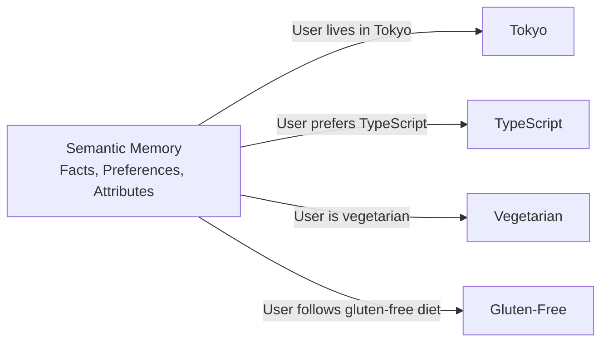
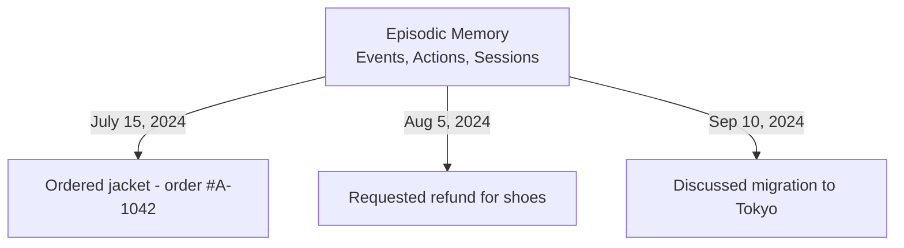
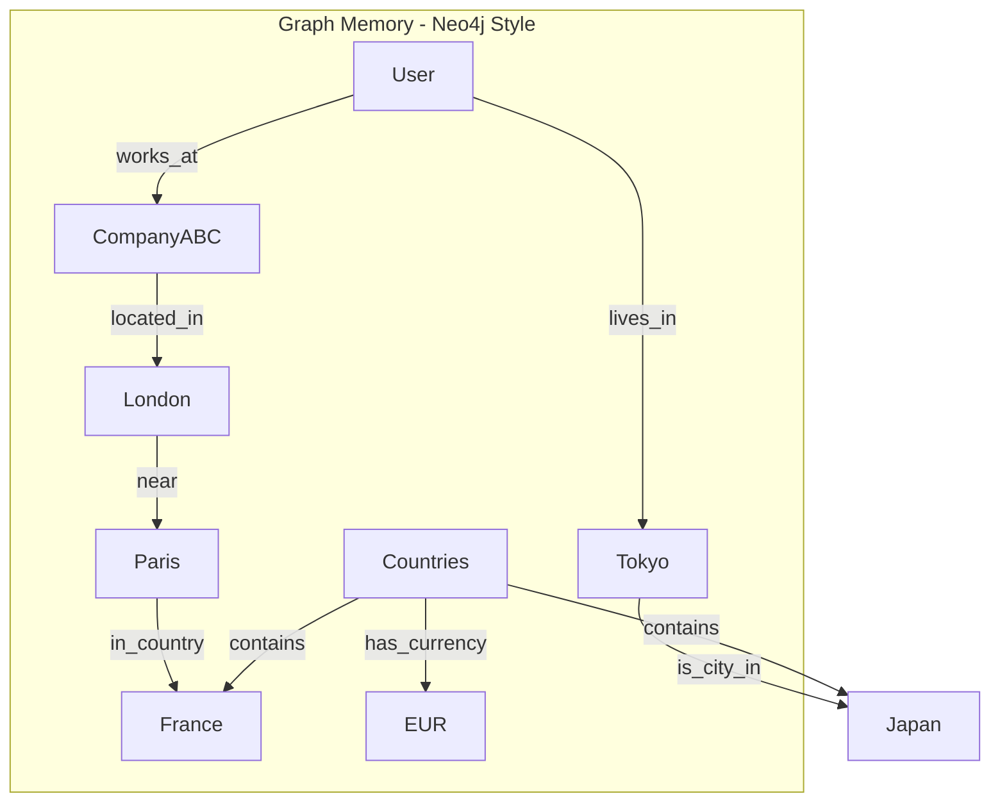
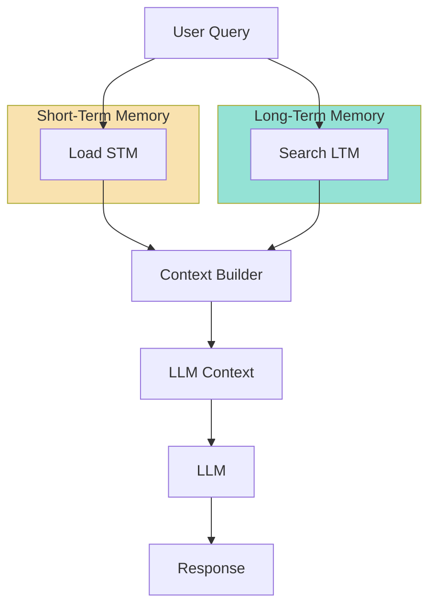
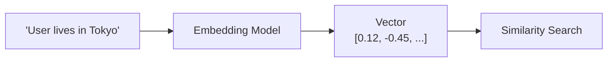

# Chapter 3: Long-Term Memory (LTM) Taxonomy & Fact Extraction

## Core Concept

Long-Term Memory (LTM) stores important facts, events, and knowledge persistently outside the short-term conversation window. Unlike STM which handles immediate context, LTM answers the question: "What important information should I remember about this user across sessions?"

## 1. LTM Taxonomy: Three Memory Types

### 1.1 Semantic Memory (Facts)



**Purpose**: Store declarative facts and user preferences that inform future interactions.

**Characteristics**:
- Structured, extractable facts
- Persistent across sessions
- Used to personalize responses
- Often converted to embeddings for retrieval

### 1.2 Episodic Memory (Events)



**Purpose**: Store chronological sequences of events and actions.

**Characteristics**:
- Time-stamped
- Narrative in nature
- Useful for "what did I do before?" questions
- Can guide future policy decisions

### 1.3 Graph Memory (Relationships)



**Purpose**: Capture explicit relationships and connections between entities.

**Characteristics**:
- Node-based structure (entities)
- Edge-based relationships
- Enables multi-hop queries
- Power "knowledge graph" style answers

## 2. The Memory Hierarchy: STM vs LTM

### 2.1 Memory Comparison Table

| Aspect | STM | LTM |
|--------|-----|:---|
| **Duration** | Current session | Persistent across sessions |
| **Content** | Recent messages | Extracted facts & events |
| **Size** | Fixed window (N turns) | Grows with useful memories |
| **Access Pattern** | Always loaded | Selectively retrieved |
| **Storage** | Database + memory | Vector DB + metadata |
| **Cost Model** | Per-token in prompt | Per-embedding + retrieval |

### 2.2 Memory Context Assembly



## 3. The Fact Extraction Pipeline

### 3.1 Why Extract Facts?

Raw conversation contains more information than needed:

```text
User: "I recently moved to Tokyo in July and I follow a gluten-free diet because I have celiac disease."

LLM needs to know:
- User relocated to Tokyo
- User has dietary restriction (gluten-free)
- Reason: celiac disease
```

### 3.2 Extraction Prompt Structure

```javascript
const extractionPrompt = `
Extract important long-term facts from the following message.

Message:
${userMessage}

Return the facts as JSON array with these fields:
- fact: The extracted fact statement
- type: "semantic" | "episodic" | "relationship"
- confidence: 0-1 score

Only extract verifiable facts, not opinions or preferences.
`;
```

### 3.3 LLM Extraction Response

```json
[
  {
    "fact": "User relocated to Tokyo",
    "type": "semantic",
    "confidence": 0.95
  },
  {
    "fact": "User follows a gluten-free diet due to celiac disease",
    "type": "semantic",
    "confidence": 0.98
  },
  {
    "fact": "User moved in July 2024",
    "type": "episodic",
    "confidence": 0.85
  }
]
```

### 3.4 Memory Record Creation

Each extracted fact becomes a memory record:

```javascript
const memory = {
  id: "memory_001",
  userId: "user_123",
  sessionId: "session_456",
  content: "User relocated to Tokyo",
  type: "semantic",
  createdAt: "2024-09-15T10:30:00Z",
  embedding: [0.012, -0.083, 0.421, ...]
};
```

## 4. Embeddings for Semantic Retrieval

### 4.1 Why Embeddings?

Text must be converted to vectors for semantic search:



### 4.2 Memory Record with Embedding

```javascript
{
  id: "memory_042",
  userId: "user_123",
  content: "User prefers TypeScript for development",
  type: "semantic",
  createdAt: 1724500000000,
  lastAccessedAt: 1725000000000,
  accessCount: 15,
  embedding: [
    0.012, -0.083, 0.421, 0.067,
    -0.234, 0.512, -0.001, 0.891,
    ... // 1536 dimensions for text-embedding-3-large
  ]
}
```

### 4.3 Vector Similarity Search

When a query arrives:

1. Embed the query
2. Compare with stored embeddings
3. Return top-k most similar memories

```javascript
const queryEmbedding = await embed("What programming language do I prefer?");

const results = await vectorDb.query({
  vector: queryEmbedding,
  topK: 5,
  filter: { userId: "user_123" }
});

// Results include similarity scores
[
  { content: "User prefers TypeScript", score: 0.92 },
  { content: "User writes JavaScript daily", score: 0.78 },
  { content: "User uses Python for data", score: 0.45 }
]
```

## 5. Memory Taxonomy in Practice

### 5.1 When to Use Each Type

| Memory Type | When to Store | Example |
|-------------|---------------|---------|
| **Semantic** | User stated facts/preferences | "User prefers summary answers" |
| **Episodic** | Important events/actions | "User placed order #A-1042" |
| **Graph** | Entity relationships | "User works at CompanyABC" |

### 5.2 Temporal Memory Enhancement

Add time-aware facts alongside semantic memory:

```javascript
{
  content: "User's current location: Tokyo",
  validity: {
    type: "temporal",
    from: "2024-07-01",
    to: null,  // Still valid
    confidence: 0.9
  }
}
```

## 6. Memory Write Policy

### 6.1 Confidence Thresholds

```javascript
const MIN_CONFIDENCE = 0.8;

if (extractedFact.confidence >= MIN_CONFIDENCE) {
  await storeMemory(extractedFact);
} else {
  // Log for review or discard
}
```

### 6.2 Deduplication on Write

Before storing, check for existing similar memories:

```javascript
const existing = await findSimilarMemories(
  userId,
  newMemory.content,
  threshold: 0.95
);

if (!existing) {
  await storeMemory(newMemory);
}
```

## 7. Memory Decay and Versioning

### 7.1 Memory Metadata

```javascript
{
  id: "memory_123",
  content: "User's preferred contact: email",
  createdAt: 1724500000000,
  updatedAt: 1730000000000,  // Updated when re-affirmed
  version: 2,
  lastAccessedAt: 1730500000000,
  accessCount: 42,
  source: "conversation_2024-08-15_turn_3",
  immutableLogId: "log_msg_abc123"
}
```

### 7.2 Temporal Validity

```javascript
// Example: User said they work at CompanyX, but roles change
{
  content: "User works as Senior Engineer at CompanyX",
  validFrom: "2023-06-01",
  validTo: "2024-09-01",   // Expired
  status: "archived"
}
```

## 8. Context Builder: STM + LTM + Query

### 8.1 Final Context Assembly

```javascript
const buildContext = (stm, ltm, userQuery) => [
  // System prompt sets the stage
  { role: "system", content: "You are a helpful personal assistant." },

  // LTM memories provide persistent facts
  ...ltm.memories.map(m => ({
    role: "system",
    content: `Memory: ${m.content}`
  })),

  // STM provides immediate conversational context
  ...stm.messages,

  // Current query completes it
  { role: "user", content: userQuery }
];
```

### 8.2 Token Budget Management

```javascript
function assembleContext(options) {
  const { systemTokens, profileTokens, stmTokens, ltmTokens, queryTokens } = options.budget;

  // Allocate tokens strategically
  const allocation = {
    system: Math.min(systemTokens, 400),
    profile: Math.min(profileTokens, 150),
    stm: Math.min(stmTokens, 800),
    ltm: Math.min(ltmTokens, 1000),
    query: queryTokens
  };

  // Build context within budget
  return contextWithinBudget(allocation);
}
```

## Common Mistakes

| Mistake | Effect | Fix |
|---------|--------|-----|
| Storing raw conversation as LTM | Retrieval noise, incorrect facts | Use fact extraction pipeline |
| Not versioning memories | Stale facts persist | Add timestamps, update policies |
| Missing confidence scores | Low-quality memories stored | Set extraction confidence thresholds |
| No deduplication | Redundant memories | Check similarity before storing |
| Loading all LTM every request | Unnecessary cost, context inflation | Use vector search with limit |

## Key Takeaways

1. **LTM extends beyond conversation** — it stores facts that survive session boundaries
2. **Three memory types** — semantic (facts), episodic (events), graph (relationships) serve different purposes
3. **Fact extraction is essential** — raw conversation is not directly usable as memory
4. **Embeddings enable semantic search** — retrieve relevant memories by meaning, not keyword matching
5. **Memory synthesis requires curation** — deduplication, confidence thresholds, and temporal awareness prevent memory decay
6. **Context is assembled, not accumulated** — carefully budget LLM tokens across STM, LTM, and query
7. **Write policy matters** — store high-confidence facts only; maintain immutable logs for auditability