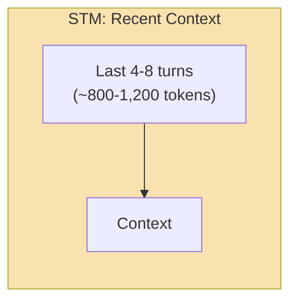
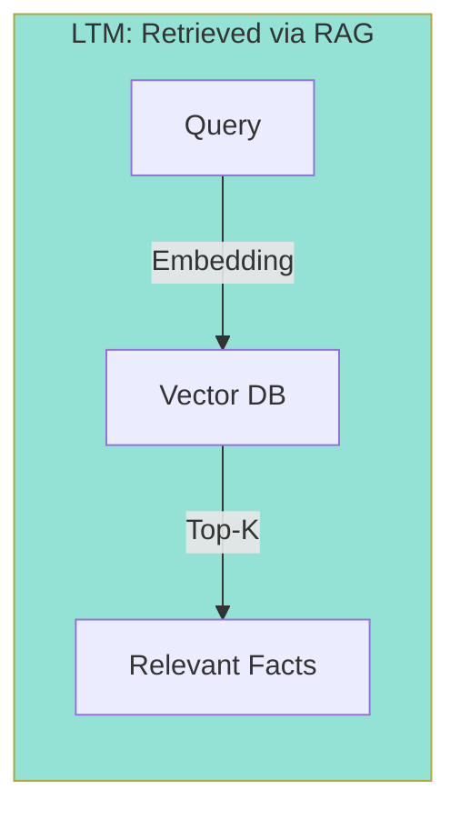
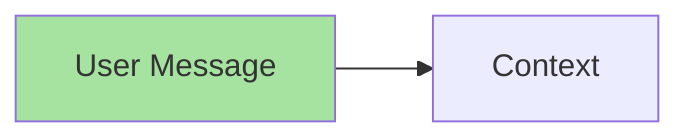
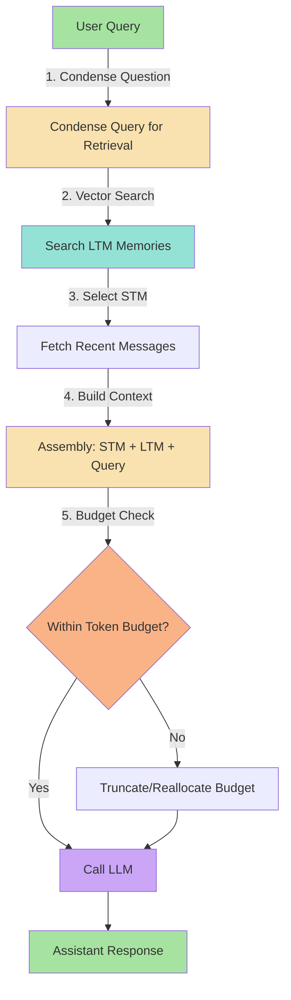
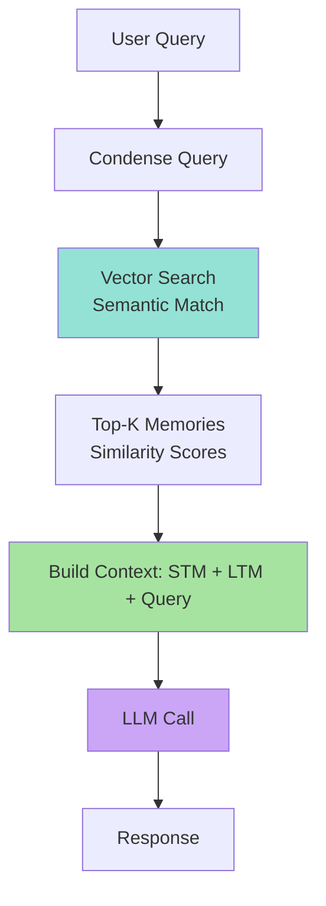
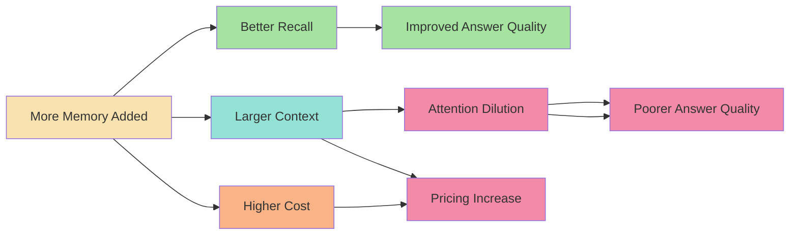

# Chapter 4: Dynamic Context Assembly (STM + LTM_RAG + Query)

## Core Concept

Dynamic context assembly combines **Short-Term Memory (STM)**, **Long-Term Memory (LTM) retrieval via RAG**, and the **current Query** into a single LLM prompt. Instead of loading all available information, it selectively retrieves only what's relevant for the current request while staying within token budget constraints.

---

## 1. The Three-Component Context Model

A production memory system assembles context from three distinct sources, each serving a specific purpose in the final LLM prompt.

### 1.1 STM: Recent Conversation (Last N Turns)



**What it contains**:
- Exact wording of what was just said
- Recency (model pays most attention to recent tokens)
- Context for resolving current references ("it", "that", "this")

**Size**: Typically 4-8 turns, 800-1,200 tokens
- Window size = 6 turns ≈ 800 tokens
- Window size = 10 turns ≈ 1,200 tokens

### 1.2 LTM: Retrieved Facts (via Vector RAG)



**What it contains**:
- User preferences from previous sessions
- Facts that are too old to be in STM
- Domain knowledge and constraints
- User entity information (company, role, etc.)

**Size**: Top-3 to Top-5 results, 300-600 tokens
- 3 memories × ~100 tokens each = 300 tokens
- 5 memories × ~120 tokens each = 600 tokens

### 1.3 Query: Current Request (User's Immediate Need)



**What it contains**:
- The immediate user request that triggers the LLM call
- Any constraints or requirements expressed
- Context for why the user is asking now

**Size**: 50-200 tokens (varies by question complexity)

---

## 2. Context Assembly Workflow

The complete pipeline transforms raw user input into a token-bounded LLM prompt.

### 2.1 Step-by-Step Pipeline



### 2.2 The Complete Context Builder (Pseudo Code)

```javascript
// Pseudo code: Complete context assembly pipeline
async function buildLLMContext(userId, userQuery, sessionId, auth) {
    // === Step 1: Condense the question for retrieval ===
    // Short/follow-up questions with pronouns need to be made standalone
    const searchQuery = await condenseQuestionIfNeeded(userQuery, sessionHistory);
    
    // === Step 2: Retrieve relevant LTM via vector search ===
    // Search for top-K relevant memories with user isolation
    const memories = await searchMemories(userId, searchQuery, {
        topK: 5,            // Top 5 results
        threshold: 0.7,     // Similarity threshold
        includeMetadata: true,
        filter: { userId }  // Multi-tenant isolation
    });
    
    // === Step 3: Get recent STM messages from database ===
    // Fetch last N turns (chronologically ordered)
    const recentMessages = await getRecentMessages(sessionId, { limit: 8 });
    
    // === Step 4: Assemble context within token budget ===
    const context = assembleContextWithinBudget({
        systemPrompt: SYSTEM_PROMPT,  // Role + instructions
        recentMessages,
        relevantMemories: memories,
        currentQuery: userQuery,
        tokenBudget: 2000,           // Model-specific (e.g., GPT-4o = 128K)
    });
    
    return context;
}
```

---

## 3. Assembling Context Within Budget

The budget enforcer ensures the final prompt never exceeds the model's context window.

### 3.1 Step-by-Step Budget Enforcement

```javascript
// Pseudo code: Assemble context within strict token budget
function assembleContextWithinBudget(options) {
    const {
        systemPrompt,
        recentMessages,      // Already in chronological order
        relevantMemories,    // From vector search (top-K with scores)
        currentQuery,        // User's immediate question
        tokenBudget = 2000   // Max tokens for input (pre-output)
    } = options;
    
    const messages = [];      // Final message array
    let currentTokens = 0;    // Tokens used so far
    
    // === Step 1: System prompt (always first) ===
    messages.push({
        role: "system",
        content: systemPrompt
    });
    currentTokens += countTokens(systemPrompt);
    
    // === Step 2: User profile (if tiny, typically ~50 tokens) ===
    if (options.profile && countTokens(options.profile) < 100) {
        messages.push({
            role: "system",
            content: `User Profile: ${options.profile}`
        });
        currentTokens += countTokens(options.profile);
    }
    
    // === Step 3: Recent STM messages (recency matters most) ===
    // Add in reverse chronological, then reverse to maintain order
    for (const msg of recentMessages.reverse()) {
        const msgTokens = countTokens(msg.content || "");
        // Leave room: ensure at least 200 tokens for query + buffer
        if (currentTokens + msgTokens + 200 > tokenBudget) break;
        messages.unshift(msg);  // prepend to maintain chronological order
        currentTokens += msgTokens;
    }
    
    // === Step 4: Relevant LTM memories (vector search results) ===
    for (const mem of relevantMemories) {
        const memContent = `Memory: ${mem.content}`;
        const memTokens = countTokens(memContent);
        // Leave room: at minimum, query tokens + 100 buffer
        if (currentTokens + memTokens + 100 > tokenBudget) break;
        messages.push({
            role: "system",
            content: memContent
        });
        currentTokens += memTokens;
    }
    
    // === Step 5: Current user query (must always fit) ===
    const queryTokens = countTokens(currentQuery || "");
    if (currentTokens + queryTokens <= tokenBudget) {
        messages.push({
            role: "user",
            content: currentQuery
        });
        currentTokens += queryTokens;
    } else {
        // Query must fit - condense if too large
        const condensed = condenseQuery(currentQuery, tokenBudget - currentTokens);
        messages.push({
            role: "user",
            content: condensed
        });
        currentTokens += countTokens(condensed);
    }
    
    // === Step 6: Return with metadata ===
    return {
        messages,
        currentTokens,
        budgetUsed: Math.round((currentTokens / tokenBudget) * 100) + "%",
        ltmCount: relevantMemories.length,
        stmCount: recentMessages.length
    };
}
```

### 3.2 Token Budget Example

| Component | Default Allocation | Reason |
|-----------|-------------------|--------|
| System prompt | 200 tokens | Role, instructions, formatting |
| User profile | 150 tokens | Preference, settings (small) |
| Recent STM | 600 tokens | Last 6-8 conversation turns |
| Retrieved LTM | 400 tokens | Top 3-4 semantic memories |
| Current Query | 200 tokens | User's immediate request |
| **Total** | **~1,550 tokens** | Well under typical 8K-128K limits |
| Buffer | 250 tokens | Safety margin for generation |

**Example**: GPT-4o with 128K context window - 1,550 tokens is only 1.2% of total capacity, leaving 126K for output generation.

### 3.3 Budget Enforcement Logic

```mermaid
flowchart TD
    A[Build Context Messages] --> B{Total Tokens > Budget?}
    B -->|Yes| C[Trim: Remove LTM memories (newest first removed)]
    B -->|No| D[Proceed to LLM Call]
    C --> D
    D --> E[Call LLM]
    
    style A fill:#f9e2af
    style B fill:#fab387
    style C fill:#f9e2af
    style E fill:#cba6f7
```

---

## 4. Retrieval-Augmented Generation (RAG) Integration

### 4.1 The Hybrid RAG Approach



### 4.2 When to Use Each Retrieval Strategy

| Strategy | Best For | Example |
|----------|----------|---------|
| **Vector (Semantic)** | Concept/meaning match | "What's my preference for framework X?" |
| **Keyword/Sparse** | Exact phrase match | "What was order #A-1042?" |
| **Hybrid** | Both concepts and keywords | "Tell me about my last order" |

### 4.3 Query Condensation (Critical for Retrieval Accuracy)

Follow-up questions often contain pronouns or assume context. Condensing makes search vectors more accurate.

```javascript
// Pseudo code: Heuristic-based condensation
function needsCondensation(message, history) {
    const short = message.trim().split(/\s+/).length <= 6;
    const hasReference = /\b(it|that|those|them|this|same|also|and)\b/i.test(message);
    
    // Also check if history has resolution for references
    const referenceResolvable = history.length > 0 && 
        history.some(h => 
            h.content.toLowerCase().includes(message.toLowerCase().split(/\s+/)[0])
        );
    
    return short || hasReference || !referenceResolvable;
}

// LLM-based condensation
async function condenseQuestion(history, message) {
    const prompt = `
Given the conversation and the latest user message, rewrite the latest message
as a standalone search query.

Rules:
- Keep the user's intent and all constraints
- Resolve pronouns and ellipsis using the conversation
- Do not answer the question
- If the message is already standalone, return it unchanged
- Output only the rewritten query

Conversation:
${history.map((m, i) => `${m.role}: ${m.content}`).join("\n")}

Latest message: "${message}"

Standalone query:`;
    
    return await callLLM(prompt);
}
```

**Example**: 
- Input: "What about that one I mentioned last week?"
- Without condensation: Vector search for "that one" → low relevance
- With condensation: "What about the weather app I mentioned last week?" → high relevance

### 4.4 RAG Result Processing

```javascript
// Pseudo code: Process and rank RAG results
async function processRAGResults(matches) {
    // 1. Deduplicate results
    const uniqueMemories = dedupMemories(matches);
    
    // 2. Score and rank by relevance (combine similarity + recency + boost)
    const ranked = sortByRelevance(uniqueMemories);
    
    // 3. Return top-K with scores
    return ranked.slice(0, 5);
}

function sortByRelevance(memories) {
    return memories.sort((a, b) => {
        // Primary: similarity score
        if (a.score !== b.score) return b.score - a.score;
        
        // Secondary: recency (more recent = higher)
        const aDate = new Date(a.lastAccessedAt || a.createdAt);
        const bDate = new Date(b.lastAccessedAt || b.createdAt);
        return bDate - aDate;
    });
}

function dedupMemories(memories, similarityThreshold = 0.95) {
    const unique = [];
    const seenKeys = new Set();
    
    for (const mem of memories) {
        const key = normalizeFactKey(mem.content);
        if (!seenKeys.has(key)) {
            seenKeys.add(key);
            unique.push(mem);
        }
    }
    
    return unique;
}
```

### 4.5 Multi-Tier Retrieval Strategies

```mermaid
flowchart LR
    A["Current Query"] --> B{What type of info?}
    B -->|User preference| C[Vector Search]
    B |→|Recent fact| D[Recency Filter (STM)]
    B |→|Entity lookup| E[Keyword Search]
    
    C --> F[LTM Memories]
    D --> G[STM Messages]
    E --> H[Specific Facts]
    
    F --> I[Build Context]
    G --> I
    H --> I
    
    style C fill:#94e2d5
    style G fill:#f9e2af
    style I fill:#a6e3a1
```

```javascript
// Pseudo code: Multi-tier retrieval combining multiple strategies
async function multiTierRetrieve(userId, query) {
    // 1. Vector search for semantic memories
    const semantic = await vectorSearch(userId, query, { topK: 3 });
    
    // 2. Recency filter for recently accessed STM
    const recency = await recencyFilter(userId, { limit: 5 });
    
    // 3. Keyword search for specific facts (exact phrase matching)
    const keyword = await keywordSearch(userId, query);
    
    // 4. Merge and deduplicate
    const merged = mergeAndDedup([...semantic, ...recency, ...keyword]);
    
    return merged.slice(0, 5);  // Top 5 unique memories
}
```

---

## 5. Multi-Source Retrieval Strategies

### 5.1 Three-Tier Retrieval Pipeline

The system can combine three retrieval approaches for comprehensive context:

1. **Vector search** - Semantic meaning match
2. **Recency filter** - Recently accessed/modified memories
3. **Keyword search** - Exact phrase or entity lookup

```javascript
// Pseudo code: Full multi-tier retrieval
async function fullRetrieve(userId, query) {
    // Tier 1: Semantic (vector)
    const semantic = await vectorSearch(userId, query, { topK: 5 });
    
    // Tier 2: Recency (recently accessed)
    const recency = await recencyFilter(userId, { limit: 5 });
    
    // Tier 3: Keyword (exact match)
    const keyword = await keywordSearch(userId, query, { topK: 3 });
    
    // Merge with priority and deduplication
    const merged = mergeAndDedup([...semantic, ...recency, ...keyword]);
    
    // Return top 5 with diversity
    return ensureDiverseResults(merged.slice(0, 7));
}

function ensureDiverseResults(memories) {
    // Group by semantic similarity
    const groups = [];
    const used = new Set();
    
    for (let i = 0; i < memories.length; i++) {
        if (used.has(i)) continue;
        
        const group = [i];
        used.add(i);
        
        for (let j = i + 1; j < memories.length; j++) {
            if (used.has(j)) continue;
            
            const similarity = computeSemanticSimilarity(memories[i], memories[j]);
            if (similarity > 0.8) {
                group.push(j);
                used.add(j);
            }
        }
        
        groups.push(group);
    }
    
    // Take 1 from each group + recency-weighted
    const result = [];
    for (const group of groups) {
        result.push(memories[group[0]]);
        if (result.length >= 5) break;
    }
    
    return result;
}
```

### 5.2 Keyword Search Implementation

```javascript
// Pseudo code: Keyword/sparse retrieval for exact phrase matching
async function keywordSearch(userId, query) {
    // Use PostgreSQL full-text search or BM25
    const results = await db.query(`
        SELECT *, 
               ts_rank_cd(search_vector, plainto_tsquery($1)) as rank
        FROM chat_messages
        WHERE session_id IN (
            SELECT session_id FROM chat_sessions WHERE user_id = $2
        )
        AND search_vector @@ plainto_tsquery($1)
        ORDER BY rank DESC
        LIMIT 5
    `, [query, userId]);
    
    // Convert to memory format
    return results.rows.map(row => ({
        content: row.content,
        type: "keyword",
        score: row.rank,
        metadata: {
            sessionId: row.session_id,
            createdAt: row.created_at
        }
    }));
}
```

### 5.3 Recency Filter (Recently Active Memories)

```javascript
// Pseudo code: Filter memories by recent access/activity
async function recencyFilter(userId, options = {}) {
    const { limit = 5, days = 30 } = options;
    
    const cutoff = new Date();
    cutoff.setDate(cutoff.getDate() - days);
    
    const results = await db.query(`
        SELECT *, 
               last_accessed_at,
               (access_count * 1.0 / greatest(extract(epoch from (now - created_at)) / 86400, 1)) as activity_score
        FROM memory_store
        WHERE user_id = $1
        AND last_accessed_at > $2
        ORDER BY activity_score DESC, last_accessed_at DESC
        LIMIT $3
    `, [userId, cutoff, limit]);
    
    return results.rows.map(row => ({
        content: row.content,
        type: "recency",
        score: row.activity_score,
        metadata: {
            lastAccessedAt: row.last_accessed_at,
            accessCount: row.access_count
        }
    }));
}
```

---

## 6. Context Inflation: The Price of Memory

Memory always has a cost. Understanding and managing this cost is critical for production systems.

### 6.1 The Tension: More Memory vs. Quality vs. Cost



### 6.2 Managing Context Inflation

| Strategy | Effect | Trade-off |
|----------|--------|-----------|
| **Reduce LTM results** | Lower cost | Might miss relevant facts |
| **Smaller STM window** | Lower token usage | Lose recent context |
| **More aggressive query condensation** | Simpler queries | Risk losing constraints |
| **Prompt compression** | Fewer tokens | Lose some nuance |
| **Selective retrieval** | Targeted context | Might miss edge cases |

### 6.3 Budget Allocation Formula (Dynamic)

```javascript
// Pseudo code: Dynamic token budget allocation based on priorities
function allocateBudget(totalTokens, priorities = {}) {
    const allocation = {};
    let remaining = totalTokens;
    
    // System always gets minimum (15% or 100 tokens, whichever is more)
    allocation.system = Math.max(100, Math.min(400, Math.floor(remaining * 0.15)));
    remaining -= allocation.system;
    
    // Profile gets fixed small allocation
    allocation.profile = Math.min(150, Math.floor(remaining * 0.1));
    remaining -= allocation.profile;
    
    // Recent STM gets priority (40% of remaining)
    allocation.stm = Math.min(800, Math.floor(remaining * 0.4));
    remaining -= allocation.stm;
    
    // LTM gets moderate share (30% of remaining)
    allocation.ltm = Math.min(1000, Math.floor(remaining * 0.3));
    remaining -= allocation.ltm;
    
    // Query is what's left (minimum 50 tokens)
    allocation.query = Math.max(50, remaining);
    
    return allocation;
}

// Example with 2000 total tokens:
/*
allocation.system = Math.max(100, Math.min(400, 2000 * 0.15)) = 300
remaining = 2000 - 300 = 1700

allocation.profile = Math.min(150, Math.floor(1700 * 0.1)) = 150
remaining = 1700 - 150 = 1550

allocation.stm = Math.min(800, Math.floor(1550 * 0.4)) = 620
remaining = 1550 - 620 = 930

allocation.ltm = Math.min(1000, Math.floor(930 * 0.3)) = 279
remaining = 930 - 279 = 651

allocation.query = Math.max(50, 651) = 651

Result: { system: 300, profile: 150, stm: 620, ltm: 279, query: 651 }
Total: 1999 (1 token buffer)
*/
```

### 6.4 Graceful Degradation When Budget Exceeded

```javascript
// Pseudo code: Graceful degradation when context budget is exceeded
function buildContextWithDegradation(options) {
    const { systemPrompt, stm, ltm, query, maxTokens } = options;
    
    // Try full context first
    let messages = buildFullContext({ systemPrompt, stm, ltm, query });
    let tokenCount = countTokensInMessages(messages);
    
    if (tokenCount <= maxTokens) {
        return { messages, degradation: "none" };
    }
    
    // Degradation 1: Remove oldest LTM memories first
    messages = removeOldestLTM(messages, ltm);
    tokenCount = countTokensInMessages(messages);
    
    if (tokenCount <= maxTokens) {
        return { messages, degradation: "reduced_ltm" };
    }
    
    // Degradation 2: Trim STM to only last 2 turns
    messages = trimSTMtoLastN(messages, stm, 2);
    tokenCount = countTokensInMessages(messages);
    
    if (tokenCount <= maxTokens) {
        return { messages, degradation: "trimmed_stm" };
    }
    
    // Degradation 3: Condense/query reduce
    messages = condenseQueryInContext(messages, maxTokens);
    tokenCount = countTokensInMessages(messages);
    
    return { messages, degradation: "significant_trim" };
}
```

---

## Common Mistakes

| Mistake | Effect | Fix |
|---------|--------|-----|
| Loading ALL LTM memories | Context overflow, high costs | Use vector search with topK limit |
| No query condensation | Wrong retrieval results for follow-up questions | Always condense follow-up questions before embedding |
| Ignoring token budget | Context overflow, truncated responses | Enforce budget before LLM call |
| Mixing STM and LTM ordering confusion | LLM confusion about what's recent vs. persistent | STM first (recent), then LTM (persistent), then query current |
| Stale memories in context | Outdated information used | Add recency filtering/age checks (validFrom/validTo) |
| No fallback when budget exceeded | Errors or truncated responses | Gracefully degrade by removing oldest items first |
| Using same retrieval strategy always | Miss relevant facts in different contexts | Combine vector + keyword + recency tier retrieval |
| Not tracking budget per component | Can't optimize or diagnose cost | Log token usage per component (STM, LTM, profile, query) |

---

## Key Takeaways

1. **Context assembly is a budget problem** — every token has latency and cost implications
2. **STM + LTM + Query hybrid** — each component serves a distinct purpose in the final prompt
3. **Condense queries before retrieval** — makes search vectors more accurate for follow-up questions
4. **Vector search enables semantic retrieval** — find relevant LTM without loading everything
5. **Order matters in context** — STM recent → LTM persistent → Query current
6. **Always enforce budget** — truncate oldest content first when approaching limits
7. **Hybrid retrieval strategies** — combine vector, keyword, and recency filters for best results
8. **Context inflation is the price** — adding memory always costs more; manage the trade-off deliberately
9. **Budget allocation follows priority order** — system > profile > STM > LTM > query
10. **Graceful degradation is essential** — have fallbacks when budget is exceeded

---

## The Complete Pipeline (Summary)

```mermaid
flowchart TD
    A[User Query] --> B[Condense Question]
    B --> C[Multi-Tier Retrieval<br/>(Vector + Recency + Keyword)]
    C --> D[Select STM<br/>(Last N turns)]
    D --> E[Assemble Context<br/>(Budget-Aware)]
    E --> F{Within Budget?}
    F -->|Yes| G[Call LLM]
    F -->|No| H[Graceful Degradation]
    H --> G
    G --> Response["Assistant Response"]
    
    style A fill:#a6e3a1
    style B fill:#f9e2af
    style C fill:#94e2d5
    style D fill:#f9e2af
    style E fill:#f9e2af
    style F fill:#fab387
    style G fill:#cba6f7
    style H fill:#f9e2af
```

---

## Preview: Chapter 5

In the next chapter, we explore **Memory Eviction, Contradiction Resolution & Decay** — how to actively maintain the memory store as it grows, including eviction policies, contradiction resolution, and memory decay modeling.