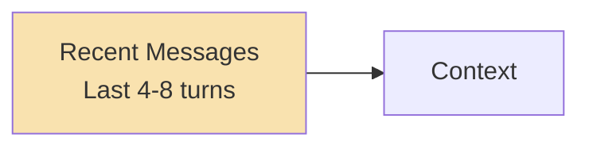
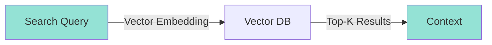
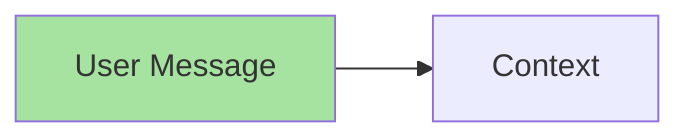
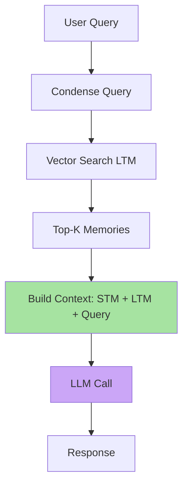
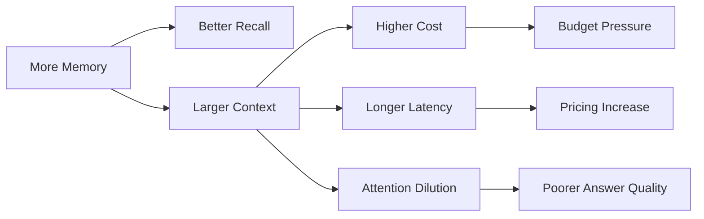

# Chapter 4: Dynamic Context Assembly (STM + LTM_RAG + Query)

## Core Concept

Dynamic context assembly combines **Short-Term Memory (STM)**, **Long-Term Memory (LTM) retrieval**, and the **current Query** into a single LLM prompt. Instead of loading all available information, it selectively retrieves only what's relevant for the current request while staying within token budget constraints.

## 1. The Three-Component Context Model

### 1.1 STM: Recent Conversation



**What it contains**: Chronologically recent messages from the current conversation session. Provides:
- Exact wording of what was just said
- Recency (model pays most attention to recent tokens)
- Context for resolving current references

**Size**: Typically 4-8 turns, 800-1,200 tokens

### 1.2 LTM: Retrieved Facts



**What it contains**: Semantic facts retrieved from long-term storage. Provides:
- User preferences from previous sessions
- Facts that are too old to be in STM
- Domain knowledge and constraints
- User entity information

**Size**: Top-3 to Top-5 results, 300-600 tokens

### 1.3 Query: Current Request



**What it contains**: The immediate user request that triggers the LLM call.

## 2. Context Assembly Workflow

### 2.1 Step-by-Step Pipeline

```text
User Query
    ↓
Make question retrievable (Condense)
    ↓
Search relevant LTM memories (Vector retrieval)
    ↓
Select recent STM messages
    ↓
Build combined context (STM + LTM + Query)
    ↓
Within token budget
    ↓
Call LLM
    ↓
Assistant Response
```

### 2.2 The Complete Context Builder

```javascript
async function buildLLMContext(userId, userQuery, auth) {
  // 1. Condense the question for retrieval
  const searchQuery = await condenseQuestionIfNeeded(userQuery, sessionHistory);

  // 2. Retrieve relevant LTM via vector search
  const memories = await searchMemories(userId, searchQuery, { topK: 5 });

  // 3. Get recent STM messages from database
  const recentMessages = await getRecentMessages(userId, { limit: 6 });

  // 4. Assemble context within budget
  const context = assembleContext({
    systemPrompt: "You are a helpful personal assistant.",
    recentMessages,
    relevantMemories: memories,
    currentQuery: userQuery,
    maxTokens: 2000  // Model-specific budget
  });

  return context;
}
```

### 2.3 Assembling Context Within Budget

```javascript
function assembleContext(options) {
  const {
    systemPrompt,
    recentMessages,
    relevantMemories,
    currentQuery,
    maxTokens
  } = options;

  // Start with system prompt
  const messages = [{ role: "system", content: systemPrompt }];
  let currentTokens = countTokens(systemPrompt);

  // 1. Add user profile if present (usually tiny)
  // 2. Add recent messages (recency matters most)
  for (const msg of recentMessages.reverse()) {
    const msgTokens = countTokens(msg.content);
    if (currentTokens + msgTokens > maxTokens * 0.6) break;  // Leave room for rest
    messages.unshift(msg);  // Reverse to maintain chronological order
    currentTokens += msgTokens;
  }

  // 3. Add relevant LTM memories
  for (const mem of relevantMemories) {
    const memTokens = countTokens(`Memory: ${mem.content}`);
    if (currentTokens + memTokens > maxTokens * 0.85) break;  // Leave room for query
    messages.push({
      role: "system",
      content: `Memory: ${mem.content}`
    });
    currentTokens += memTokens;
  }

  // 4. Add current query
  const queryTokens = countTokens(currentQuery);
  if (currentTokens + queryTokens <= maxTokens) {
    messages.push({
      role: "user",
      content: currentQuery
    });
  }

  return { messages, currentTokens };
}
```

### 2.4 Token Budget Example

| Component | Allocation | Reason |
|-----------|-----------|--------|
| System prompt | 200 tokens | Role, instructions |
| Recent STM | 600 tokens | Last 6 turns of conversation |
| Retrieved LTM | 400 tokens | Top 3-4 semantic memories |
| Query | 200 tokens | Current user request |
| **Total** | **~1,400 tokens** | Well under typical 8K-128K limits |

## 3. Retrieval-Augmented Generation (RAG) Integration

### 3.1 The Hybrid Approach



### 3.2 When to Use Each Retrieval Strategy

| Strategy | When to Use | Example |
|----------|-------------|---------|
| **Vector (Semantic)** | Need concept/meaning match | "What's my preference for framework X?" |
| **Keyword/Sparse** | Need exact phrase match | "What was order #A-1042?" |
| **Hybrid** | Both concepts and keywords matter | "Tell me about my last order" |

### 3.3 Condensing the Query for Retrieval

```javascript
// Heuristic-based condensation before embedding
function needsCondensation(message, history) {
  // Short messages with pronouns need condensation
  const short = message.trim().split(/\s+/).length <= 6;
  const hasReference = /\b(it|that|those|them|this|same|also|and)\b/i.test(message);
  
  return short || hasReference;
}

// LLM-based condensation
async function condenseQuestion(history, message) {
  const prompt = `
    Given the conversation and the latest user message, rewrite the latest message
    as a standalone search query.

    Rules:
    - Keep the user's intent and all constraints
    - Resolve pronouns and ellipsis using the conversation
    - Do not answer the question
    - If the message is already standalone, return it unchanged
    - Output only the rewritten query

    Conversation:
    ${history.map((m, i) => `${m.role}: ${m.content}`).join("\n")}

    Latest message: "${message}"

    Standalone query:
  `;
  
  return await callLLM(prompt);
}
```

### 3.4 RAG Result Processing

```javascript
async function processRAGResults(matches) {
  // Deduplicate results
  const uniqueMemories = dedupMemories(matches);
  
  // Score and rank by relevance
  const ranked = sortByRelevance(uniqueMemories);
  
  // Return top-K with scores
  return ranked.slice(0, 5);
}
```

## 4. STM + LTM Hybrid Context Assembly

### 4.1 The Complete Context Object

```javascript
const context = {
  systemPrompt: "You are a helpful personal assistant with long-term memory.",
  
  // STM: Recent turns, 4-8 most recent
  stm: [
    { role: "user", content: "I'm learning React Native" },
    { role: "assistant", content: "That's great! What specifically are you working on?" },
    { role: "user", content: "I'm building a weather app" }
  ],
  
  // LTM: Relevant persistent facts (3-5 retrieved)
  ltm: [
    { role: "system", content: "Memory: User prefers TypeScript for development" },
    { role: "system", content: "Memory: User works with React Native framework" },
    { role: "system", content: "Memory: User is allergic to peanuts" }
  ],
  
  // Query: Current user request
  query: "What should I call my weather component?"
};
```

### 4.2 Final Message Array

```javascript
function buildMessageArray(context) {
  const messages = [];
  
  // System prompt
  messages.push({
    role: "system",
    content: context.systemPrompt
  });
  
  // LTM memories
  context.ltm.forEach(mem => {
    messages.push(mem);
  });
  
  // STM messages (recent turns)
  context.stm.forEach(msg => {
    messages.push(msg);
  });
  
  // Current user query
  messages.push({
    role: "user",
    content: context.query
  });
  
  return messages;
}
```

### 4.3 Budget Enforcement

```javascript
function enforceBudget(messages, maxTokens) {
  let used = 0;
  const result = [];
  
  for (const msg of messages) {
    const tokens = countTokens(msg.content || "");
    if (used + tokens > maxTokens) break;
    result.push(msg);
    used += tokens;
  }
  
  return { messages: result, usedTokens: used };
}
```

## 5. Multi-Source Retrieval Strategies

### 5.1 Three-Tier Retrieval

```mermaid
flowchart LR
    A["Current Query"] --> B{What type of info?}
    B -->|User preference| C[Vector Search]
    B |→|Recent fact| D[Recency Filter]
    B |→|Entity lookup| E[Keyword Search]
    
    C --> F[LTM Memories]
    D --> G[STM Messages]
    E --> H[Specific Facts]
    
    F --> I[Build Context]
    G --> I
    H --> I
    
    style C fill:#94e2d5
    style G fill:#f9e2af
    style I fill:#a6e3a1
```

### 5.2 Implementing Multi-Tier Retrieval

```javascript
async function multiTierRetrieve(userId, query) {
  // 1. Vector search for semantic memories
  const semantic = await vectorSearch(userId, query, { topK: 3 });
  
  // 2. Recency filter for recent STM
  const recency = await recencyFilter(userId, { limit: 5 });
  
  // 3. Keyword search for specific facts
  const keyword = await keywordSearch(userId, query);
  
  // 4. Merge and deduplicate
  const merged = mergeAndDedup([...semantic, ...recency, ...keyword]);
  
  return merged.slice(0, 5);  // Top 5 unique memories
}
```

## 6. Context Inflation as the Price of Memory

### 6.1 The Tension



### 6.2 Managing Context Inflation

| Strategy | Effect | Trade-off |
|----------|--------|-----------|
| **Reduce LTM results** | Lower cost | Might miss relevant facts |
| **Smaller STM window** | Lower token usage | Lose recent context |
| **More aggressive condensation** | Simpler queries | Risk losing constraints |
| **Prompt compression** | Fewer tokens | Lose some nuance |
| **Selective retrieval** | Targeted context | Might miss edge cases |

### 6.3 Budget Allocation Formula

```javascript
function allocateBudget(totalTokens, priorities) {
  const allocation = {};
  let remaining = totalTokens;
  
  // System always gets minimum
  allocation.system = Math.max(100, Math.min(400, remaining * 0.15));
  remaining -= allocation.system;
  
  // Profile gets fixed small allocation
  allocation.profile = Math.min(150, remaining * 0.1);
  remaining -= allocation.profile;
  
  // Recent STM gets priority
  allocation.stm = Math.min(800, remaining * 0.5);
  remaining -= allocation.stm;
  
  // LTM gets moderate share
  allocation.ltm = Math.min(1000, remaining * 0.3);
  remaining -= allocation.ltm;
  
  // Query is what's left
  allocation.query = Math.max(50, remaining);
  
  return allocation;
}
```

## Common Mistakes

| Mistake | Effect | Fix |
|---------|--------|-----|
| Loading ALL LTM memories | Context overflow, high costs | Use vector search with topK limit |
| No query condensation | Wrong retrieval results | Always condense follow-up questions |
| Ignoring token budget | Context overflow, truncated responses | Enforce budget before LLM call |
| Mixing STM and LTM ordering confusion | LLM confusion | STM first (recent), then LTM (persistent), then query |
| Stale memories in context | Outdated information used | Add recency filtering/age checks |
| No fallback when budget exceeded | Errors or truncation | Gracefully degrade by removing oldest items |

## Key Takeaways

1. **Context assembly is a budget problem** — every token has latency and cost implications
2. **STM + LTM + Query hybrid** — each component serves a distinct purpose in the final prompt
3. **Condense queries before retrieval** — makes search vectors more accurate for follow-up questions
4. **Vector search enables semantic retrieval** — find relevant LTM without loading everything
5. **Order matters in context** — STM recent → LTM persistent → Query current
6. **Always enforce budget** — truncate oldest content first when approaching limits
7. **Hybrid retrieval strategies** — combine vector, keyword, and recency filters for best results
8. **Context inflation is the price** — adding memory always costs more; manage the trade-off deliberately

The dynamic context assembler transforms a stateless LLM API into a stateful agent memory system by selectively and efficiently combining the right information at the right time.