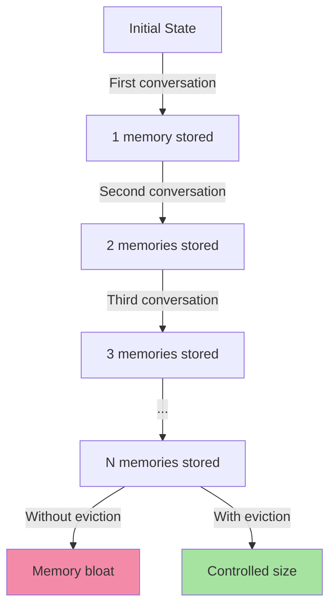
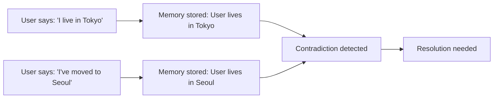
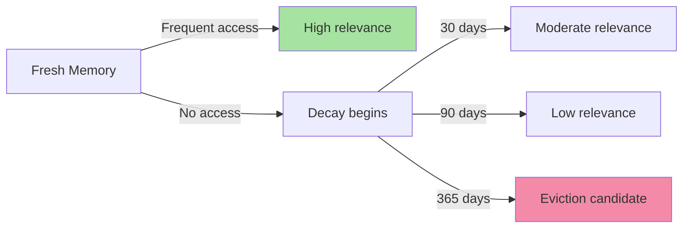
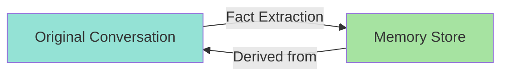
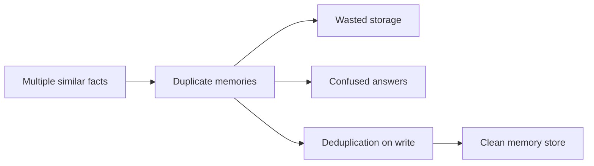
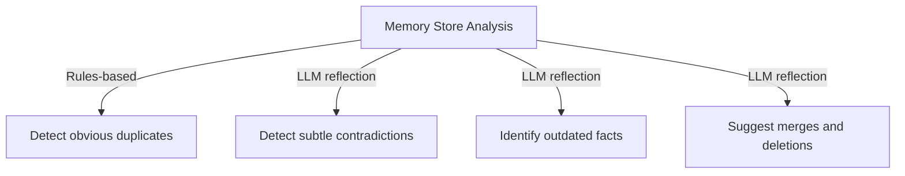

# Chapter 5: Memory Eviction, Contradiction Resolution & Decay

## Core Concept

As memories accumulate over time, the memory store requires active maintenance. Memories can become duplicates, contradictory, or stale. Eviction policies remove low-value memories, while contradiction resolution determines which facts represent current state. This chapter covers the implementation of these critical maintenance operations.

## 1. Memory Eviction Strategies

### 1.1 Why Eviction is Necessary

Memory stores grow indefinitely unless actively managed:



**Problem**: After 100 conversations, memory store may contain hundreds or thousands of entries, most of which are never used.

### 1.2 Memory Scoring for Eviction

Each memory is assigned a score based on usefulness and recency:

```javascript
function calculateMemoryScore(memory) {
  const hits = memory.hitCount || 0;
  
  const lastAccess =
    new Date(memory.lastAccessedAt).getTime();
  
  const ageDays =
    (Date.now() - lastAccess) /
    (1000 * 60 * 60 * 24);
  
  const recencyScore =
    Math.max(0, 30 - ageDays);  // Decays to 0 after 30 days
  
  return hits + recencyScore;
}
```

### 1.3 Eviction Candidate Selection

```javascript
function findEvictionCandidates(memories, threshold = 5) {
  return memories.filter(
    memory => calculateMemoryScore(memory) < threshold
  );
}
```

### 1.4 Eviction Process

```javascript
async function evictLowValueMemories(userId) {
  // 1. Load all memories
  const memories = await memoryStore.getMemories(userId);
  
  // 2. Score and identify candidates
  const candidates = findEvictionCandidates(memories);
  
  // 3. Verify no active references
  for (const memory of candidates) {
    const hasReferences = await checkMemoryReferences(memory.id);
    if (!hasReferences) {
      await memoryStore.delete(memory.id);
    }
  }
  
  return candidates.length;
}
```

### 1.5 Memory Score Examples

| Memory | Hit Count | Last Access | Age (days) | Score | Verdict |
|--------|-----------|-------------|------------|-------|---------|
| A | 20 | 2 days ago | 2 | 20 + 28 = 48 | Keep |
| B | 3 | 10 days ago | 10 | 3 + 20 = 23 | Keep |
| C | 0 | 90 days ago | 90 | 0 + 0 = 0 | Evict |
| D | 1 | 180 days ago | 180 | 1 + max(0, 30-180) = 1 | Evict |

### 1.6 Graceful Eviction

```text
Eviction is not immediate deletion:
1. Archive memory first (move to cold storage)
2. Monitor for references over N days
3. Delete only if no references found
4. Maintain audit log of evicted memories
```

## 2. Contradiction Resolution

### 2.1 Why Contradictions Occur



**Common scenarios**:
- User relocates but old memory not updated/removed
- User provides conflicting preferences over time
- Multiple sources update same attribute differently
- Model hallucination during fact extraction

### 2.2 Timestamp-Based Resolution

```javascript
function resolveByTimestamps(memories) {
  return memories.reduce((latest, current) => {
    const latestDate = new Date(latest.createdAt);
    const currentDate = new Date(current.createdAt);
    
    return currentDate > latestDate ? current : latest;
  });
}
```

**Example**:
```text
m1 → User lives in New York → August 10, 2024
m2 → User lives in Tokyo → August 20, 2024

Result: m2 → Tokyo (newer memory wins)
```

### 2.3 Confidence-Weighted Resolution

When timestamps are equal, use confidence scores:

```javascript
function resolveByConfidence(memories) {
  return memories.reduce((best, current) => {
    if (current.confidence > best.confidence) {
      return current;
    }
    if (current.confidence < best.confidence) {
      return best;
    }
    // Equal confidence: newer wins
    return new Date(current.createdAt) > new Date(best.createdAt)
      ? current
      : best;
  });
}
```

### 2.4 User-Confirmed Override

Allow explicit user updates to override stored memories:

```javascript
async function updateMemoryWithUserConfirmation(
  memoryId,
  newContent,
  userId
) {
  // Verify user owns this memory
  const memory = await memoryStore.get(memoryId);
  if (memory.userId !== userId) {
    throw new Error("Unauthorized");
  }
  
  // Update with new content and mark as user-confirmed
  await memoryStore.update(memoryId, {
    content: newContent,
    updatedAt: new Date().toISOString(),
    confidence: 1.0,  // User-confirmed
    version: (memory.version || 0) + 1
  });
}
```

### 2.5 Conflict Detection Algorithm

```javascript
function detectConflicts(memories) {
  const conflicts = [];
  const factGroups = {};
  
  // Group memories by semantic similarity
  for (const memory of memories) {
    const key = normalizeFactKey(memory.content);
    
    if (!factGroups[key]) {
      factGroups[key] = [];
    }
    factGroups[key].push(memory);
  }
  
  // Check each group for contradictions
  for (const [key, group] of Object.entries(factGroups)) {
    if (group.length < 2) continue;
    
    // Check if any pair has contradictory content
    for (let i = 0; i < group.length; i++) {
      for (let j = i + 1; j < group.length; j++) {
        if (areContradictory(group[i], group[j])) {
          conflicts.push({
            factKey: key,
            memories: [group[i], group[j]],
            severity: calculateSeverity(group[i], group[j])
          });
        }
      }
    }
  }
  
  return conflicts;
}
```

## 3. Memory Decay and Aging

### 3.1 Why Memories Decay

Information loses relevance over time:



### 3.2 Age-Based Decay Calculation

```javascript
function isStale(memory, maxAgeDays = 90) {
  const lastAccess =
    new Date(memory.lastAccessedAt);
  
  const ageMs =
    Date.now() - lastAccess.getTime();
  
  const ageDays =
    ageMs / (1000 * 60 * 60 * 24);
  
  return ageDays > maxAgeDays;
}
```

### 3.3 Recency-Aware Scoring

```javascript
function calculateUpdatedScore(memory) {
  const frequencyScore =
    Math.log1p(memory.hitCount || 0);
  
  const lastAccess =
    new Date(memory.lastAccessedAt).getTime();
  
  const ageDays =
    (Date.now() - lastAccess) /
    (1000 * 60 * 60 * 24);
  
  // Exponential decay: half-life of 30 days
  const recencyScore =
    Math.exp(-ageDays / 30);
  
  return frequencyScore + recencyScore;
}
```

**Score interpretation**:
- **> 10**: Fresh, frequently accessed - keep
- **1-10**: Moderate relevance - monitor
- **< 1**: Stale - candidate for eviction

### 3.4 Periodic Decay Evaluation

```javascript
async function runDecayEvaluation(userId) {
  const memories = await memoryStore.getMemories(userId);
  
  const stale = memories.filter(memory =>
    isStale(memory, 90)  // 90-day threshold
  );
  
  const lowScore = memories.filter(memory =>
    calculateUpdatedScore(memory) < 1
  );
  
  return {
    stale: stale.length,
    lowScore: lowScore.length,
    candidates: [...new Set([...stale, ...lowScore])]
  };
}
```

## 4. Immutable Input Logs & Auditability

### 4.1 The Immutability Principle

```text
"The memory store should not be treated as the original source of truth.
The original conversation should remain stored separately."
```

### 4.2 Two-Store Architecture



### 4.3 Audit Log Structure

```javascript
{
  logId: "log_abc123",
  userId: "user_123",
  sessionId: "session_456",
  event: "fact_extraction",
  originalMessage: "I prefer TypeScript over JavaScript",
  extractedFact: "User prefers TypeScript",
  timestamp: "2024-09-15T10:30:00Z",
  embeddingModel: "text-embedding-3-large",
  metadata: {
    confidence: 0.95,
    tokenCount: 12
  }
}
```

### 4.4 Immutable Log Benefits

1. **Audit trail**: Trace what facts were extracted and when
2. **Model improvement**: Analyze extraction accuracy over time
3. **Dispute resolution**: If user claims "you said X", check original log
4. **Extraction pipeline updates**: Rerun old conversations with new prompts
5. **Compliance**: Meet data retention and deletion requirements

### 4.5 Implementation Pattern

```javascript
async function extractAndStoreFact(userId, message, sessionId) {
  // 1. Immutable log first
  await immutableLog.save({
    userId,
    sessionId,
    role: "user",
    content: message,
    event: "conversation_message"
  });
  
  // 2. Extract fact
  const extracted = await llmExtractFacts(message);
  
  // 3. Store as memory
  for (const fact of extracted) {
    await memoryStore.create({
      userId,
      content: fact,
      type: "semantic",
      sourceLogId: fact.extractedFrom,
      confidence: fact.confidence
    });
  }
  
  // 4. Immutable log of extraction
  await immutableLog.save({
    userId,
    sessionId,
    role: "system",
    content: JSON.stringify(extracted),
    event: "fact_extraction"
  });
  
  return extracted;
}
```

## 5. Deduplication on Write

### 5.1 Why Deduplicate



### 5.2 Normalized Comparison

```javascript
function normalizeText(text) {
  return text
    .toLowerCase()
    .trim()
    .replace(/\s+/g, " ");
}

function normalizeFactKey(content) {
  return normalizeText(content)
    .replace(/[^\w\s]/g, "")  // Remove punctuation
    .replace(/\s+/g, " ")      // Normalize spaces
    .trim();
}
```

### 5.3 Duplicate Detection Before Storage

```javascript
async function storeMemoryWithDedup(userId, content, type) {
  // 1. Normalize the new content
  const newKey = normalizeFactKey(content);
  
  // 2. Check for existing similar memories
  const existing = await memoryStore.findByKey(userId, newKey);
  
  if (existing) {
    // 3. Merge rather than create duplicate
    await memoryStore.merge(existing.id, {
      hitCount: (existing.hitCount || 0) + 1,
      lastAccessedAt: new Date().toISOString()
    });
    
    return { type: "merged", memoryId: existing.id };
  }
  
  // 4. No duplicate found, create new memory
  const newMemory = await memoryStore.create({
    userId,
    content,
    type,
    hitCount: 1,
    lastAccessedAt: new Date().toISOString()
  });
  
  return { type: "created", memoryId: newMemory.id };
}
```

### 5.4 Merge Logic

```javascript
async function mergeMemories(primaryId, secondaryId) {
  const primary = await memoryStore.get(primaryId);
  const secondary = await memoryStore.get(secondaryId);
  
  // Combine hit counts
  const mergedHitCount =
    (primary.hitCount || 0) +
    (secondary.hitCount || 0);
  
  // Keep the more recent access time
  const latestAccess =
    new Date(primary.lastAccessedAt) > new Date(secondary.lastAccessedAt)
      ? primary.lastAccessedAt
      : secondary.lastAccessedAt;
  
  // Update primary memory with merged data
  await memoryStore.update(primaryId, {
    hitCount: mergedHitCount,
    lastAccessedAt: latestAccess
  });
  
  // Delete secondary (duplicate)
  await memoryStore.delete(secondaryId);
}
```

## 6. LLM-Based Reflection for Memory Quality

### 6.1 Why Use LLM for Analysis

Human-written rules cannot catch all memory quality issues:



### 6.2 LLM Reflection Prompt

```javascript
const reflectionPrompt = `
Review the following stored memories and identify issues.

Identify:
1. Duplicates (same fact stated multiple ways)
2. Contradictions (conflicting facts)
3. Stale memories (no longer relevant)
4. Memories that should be merged
5. Memories that should be deleted

Return JSON only:

{
  "merge": [["memory_id_1", "memory_id_2"], ...],
  "replace": [
    {"old": "memory_id_3", "new": "updated_content"}
  ],
  "delete": ["memory_id_4", "memory_id_5"],
  "retain": ["memory_id_1", "memory_id_2", ...]
}

Memories:
${JSON.stringify(memories, null, 2)}
`;
```

### 6.3 Example LLM Response

```json
{
  "merge": [["m1", "m2"]],
  "replace": [
    {"old": "m3", "new": "User's favorite color is now teal, not blue"}
  ],
  "delete": ["m5", "m8"],
  "retain": ["m1", "m2", "m3", "m4", "m6", "m7", "m9", "m10"]
}
```

### 6.4 Applying Reflection Results

```javascript
async function applyReflection(result, memoryStore) {
  // 1. Merge memories
  for (const [primary, secondary] of result.merge) {
    await mergeMemories(primary, secondary);
  }
  
  // 2. Replace old memories with new content
  for (const replacement of result.replace) {
    await memoryStore.update(replacement.old, {
      content: replacement.new,
      updatedAt: new Date().toISOString()
    });
  }
  
  // 3. Delete marked memories
  for (const memoryId of result.delete) {
    await memoryStore.delete(memoryId);
  }
  
  // Note: retained memories stay unchanged
}
```

## 7. Complete Reflection Workflow

### 7.1 Background Execution

```javascript
async function runMemoryReflection(userId) {
  // 1. Load all memories
  const memories = await memoryStore.getMemories(userId);
  
  if (!memories.length) {
    return { total: 0, actions: [] };
  }
  
  // 2. Score and identify candidates
  const stale = memories.filter(memory =>
    isStale(memory, 90)
  );
  
  const lowScore = memories.filter(memory =>
    calculateUpdatedScore(memory) < 1
  );
  
  // 3. Send to LLM for analysis
  const reflection = await callLLM(reflectionPrompt(memories));
  const result = JSON.parse(reflection);
  
  // 4. Apply approved operations
  const applied = [];
  
  for (const [primary, secondary] of result.merge) {
    await mergeMemories(primary, secondary);
    applied.push(`merged ${primary} + ${secondary}`);
  }
  
  for (const replacement of result.replace) {
    await memoryStore.update(replacement.old, {
      content: replacement.new,
      updatedAt: new Date().toISOString()
    });
    applied.push(`replaced ${replacement.old}`);
  }
  
  for (const memoryId of result.delete) {
    await memoryStore.delete(memoryId);
    applied.push(`deleted ${memoryId}`);
  }
  
  return {
    total: memories.length,
    stale: stale.length,
    lowScore: lowScore.length,
    actions: applied
  };
}
```

### 7.2 Scheduling Reflection

```javascript
// Run reflection every 24 hours
setInterval(
  () => runMemoryReflection("user_123"),
  24 * 60 * 60 * 1000
);

// Or use a job queue for production
await jobQueue.add("memory-reflection", { userId: "user_123" });
```

## Common Mistakes

| Mistake | Effect | Fix |
|---------|--------|-----|
| No eviction policy | Memory bloat, high costs | Implement scoring + threshold eviction |
| Ignoring contradictions | Confused LLM responses | Add contradiction detection + resolution |
| Keeping all memories forever | Storage waste, noise | Implement age-based decay + eviction |
| No immutable logs | Inability to audit/fact-check | Store original conversation separately |
| No deduplication on write | Redundant memories | Check similarity before storing |
| LTM loaded without filtering | Context overflow | Always use vector search with limit |
| Forgetting to update timestamps | Poor recency tracking | Increment lastAccessedAt on every use |

## Key Takeaways

1. **Memory requires active maintenance** — don't set-and-forget; implement eviction policies
2. **Eviction scoring combines frequency + recency** — memories with low hits and old access are candidates
3. **Contradiction resolution needs timestamps + confidence** — newer/high-confidence facts win
4. **Immutable logs enable auditability** — always store original conversations separately from derived memories
5. **LLM reflection catches what rules miss** — use background analysis for subtle quality issues
6. **Deduplication on write prevents accumulation** — merge similar facts before storing
7. **Memory decay is natural** — age-based scoring determines when facts become stale
8. **Background reflection is essential** — don't block user requests; schedule cleanup asynchronously

A well-maintained memory system balances recall against storage costs, ensures factual consistency, and provides reliable context across sessions.