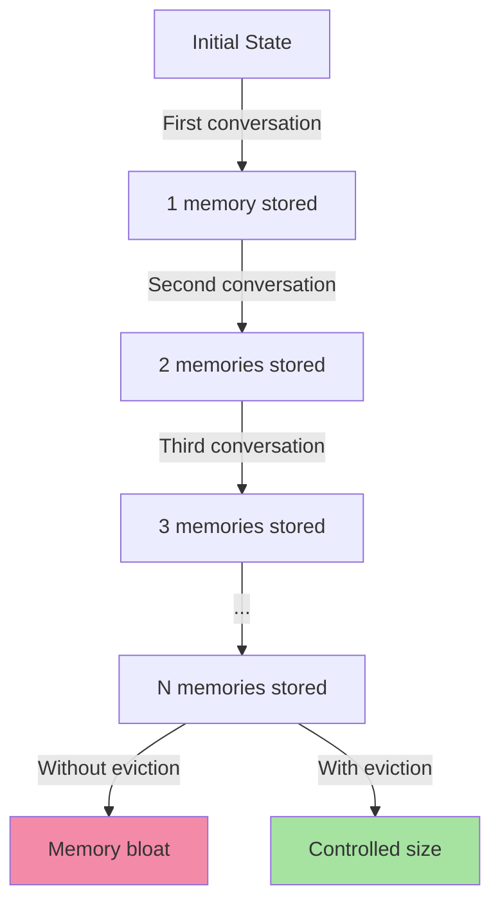
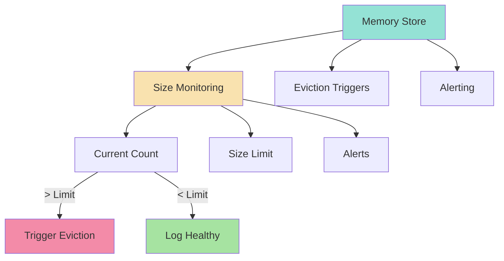
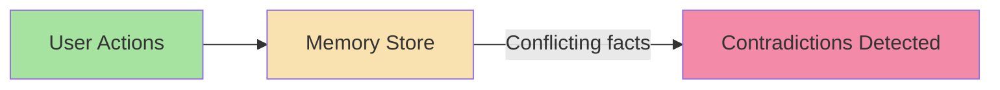
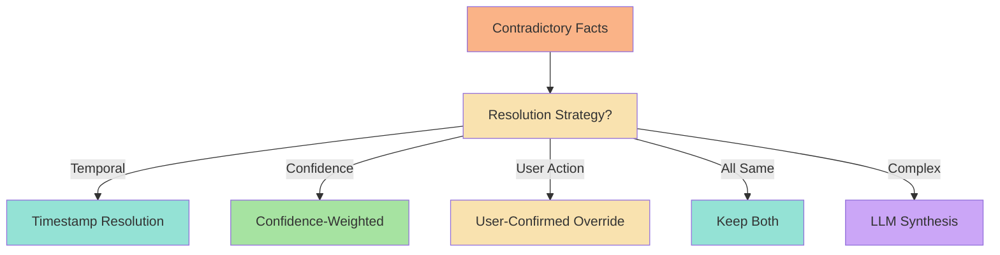
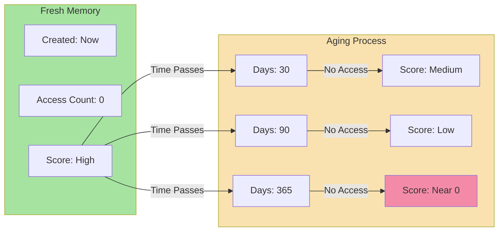
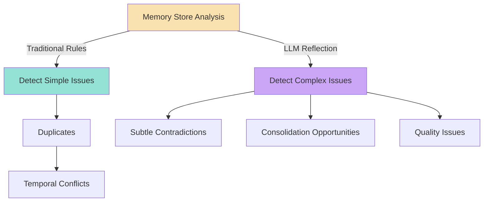
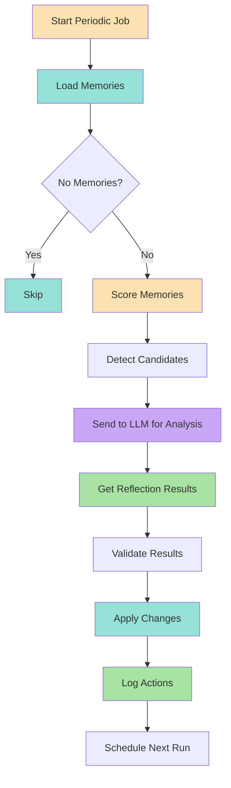

# Chapter 5: Memory Eviction, Contradiction Resolution & Decay

## Core Concept

As memories accumulate over time, the memory store requires active maintenance. Memories can become duplicates, contradictory, or stale. Eviction policies remove low-value memories, while contradiction resolution determines which facts represent the current state. This chapter covers the implementation of these critical maintenance operations.

---

## 1. Memory Eviction Strategies

### 1.1 Why Eviction is Necessary

Memory stores grow indefinitely unless actively managed:



**Problem**: After 100 conversations, memory store may contain hundreds or thousands of entries, most of which are never used.

**Impact**:
- Storage costs (vector embeddings cost money to store)
- Retrieval costs (slower searches with larger datasets)
- LLM context inflation (more tokens in prompts)
- Memory search quality (more noise drowning signal)

### 1.2 Memory Scoring System: Frequency + Recency

Modern memory systems use **dual scoring** to identify memories worth keeping:

```mermaid
flowchart LR
    subgraph Scoring["Scoring Algorithm"]
        A[Access Count] -->|Log(1 + hits)| B[Frequency Score]
        C[Last Access] -->|Recency Decay| D[Recency Score]
    end
    
    B -->|Sum| E[Total Score]
    D --> E
    
    style Scoring fill:#f9e2af
    style E fill:#a6e3a1
```

**Formula**: `Score = log₁₊(hits) + recency_score`

Where:
- `hits = access_count || 0`
- `recency_score = max(0, 30 - days_since_access)`

**Recency Decay Function**:
```javascript
// Pseudo code: Exponential recency decay
function calculateRecencyScore(lastAccessAt, halfLife = 30) {
    const lastAccess = new Date(lastAccessAt).getTime();
    const ageDays = (Date.now() - lastAccess) / (1000 * 60 * 60 * 24);
    
    // Exponential decay: half-life of 30 days
    // Score halves every 30 days, reaching 0 asymptotically
    return Math.exp(-ageDays / halfLife);
}
```

**Example Scoring Table**:

| Memory | Hits | Last Access | Age | Frequency | Recency | **Total Score** |
|--------|------|-------------|-----|-----------|----------|----------------|
| A | 20 | 2 days ago | 2 | log(21) ≈ 3.0 | 28 | **31.0** |
| B | 3 | 10 days ago | 10 | log(4) ≈ 1.4 | 20 | **21.4** |
| C | 0 | 90 days ago | 90 | log(1) = 0.0 | 0.001 | **0.001** |
| D | 1 | 180 days ago | 180 | log(2) ≈ 0.7 | 0.0 | **0.7** |

### 1.3 Eviction Threshold Configuration

```javascript
// Pseudo code: Configurable eviction thresholds
const EVICTION_CONFIG = {
    // Low threshold: aggressive eviction
    low: {
        maxScore: 5,
        maxAgeDays: 60,
        minHits: 0
    },
    
    // Medium threshold: balanced eviction  
    medium: {
        maxScore: 15,
        maxAgeDays: 180,
        minHits: 1
    },
    
    // High threshold: conservative eviction
    high: {
        maxScore: 50,
        maxAgeDays: 365,
        minHits: 3
    }
};
```

**Default production settings**:
```javascript
const DEFAULT_CONFIG = {
    threshold: "medium",  // "low" | "medium" | "high"
    checkInterval: "daily",  // "hourly" | "daily" | "weekly"
    gracePeriodDays: 7,     // Wait before deleting
    batchSize: 100,         // Process in batches
    maxMemorySize: 10000    // Absolute upper limit
};
```

### 1.4 Eviction Implementation

```javascript
// Pseudo code: Complete eviction pipeline
async function evictMemory(userId, config = DEFAULT_CONFIG) {
    // 1. Load all memories with metadata
    const memories = await memoryStore.getMemoriesWithMetadata(userId);
    
    // 2. Calculate scores for all memories
    const scoredMemories = memories.map(memory => ({
        ...memory,
        score: calculateMemoryScore(memory),
        isStale: isMemoryStale(memory, config.maxAgeDays || 180)
    }));
    
    // 3. Filter candidates
    const candidates = scoredMemories.filter(memory => {
        const meetsScoreThreshold = memory.score < config.maxScore;
        const meetsAgeThreshold = memory.isStale;
        const meetsMinHits = (memory.hitCount || 0) < (config.minHits || 0);
        return meetsScoreThreshold && meetsAgeThreshold && meetsMinHits;
    });
    
    // 4. Apply grace period check
    const toDelete = [];
    for (const memory of candidates) {
        const shouldDelete = await checkGracePeriod(memory.id, config.gracePeriodDays);
        if (shouldDelete) {
            toDelete.push(memory.id);
        }
    }
    
    // 5. Batch delete
    if (toDelete.length > 0) {
        await memoryStore.deleteBatch(userId, toDelete);
        await logEvictions(userId, toDelete, "automatic");
    }
    
    return {
        processed: scoredMemories.length,
        candidates: candidates.length,
        deleted: toDelete.length,
        scoreThreshold: config.maxScore
    };
}

async function checkGracePeriod(memoryId, gracePeriodDays) {
    const references = await checkMemoryReferences(memoryId);
    if (references.length > 0) {
        return false; // Don't delete memories with recent references
    }
    
    const lastEviction = await getLastEvictionDate(memoryId);
    if (!lastEviction) {
        return true; // First-time deletion allowed
    }
    
    const daysSinceEviction = (Date.now() - lastEviction) / (1000 * 60 * 60 * 24);
    return daysSinceEviction >= gracePeriodDays;
}
```

### 1.5 Memory Size Limits and Monitoring



```javascript
// Pseudo code: Size monitoring and alerting
async function monitorMemoryStore(userId) {
    const stats = await getMemoryStats(userId);
    const config = await getMemoryConfig(userId);
    
    // Check soft limits (warnings)
    if (stats.count > config.warningThreshold * 0.9) {
        await logWarning(userId, {
            type: "size_warning",
            message: `Memory store approaching size limit: ${stats.count}/${config.warningThreshold}`
        });
    }
    
    // Check hard limits (actions)
    if (stats.count > config.hardLimit) {
        await triggerEmergencyEviction(userId, stats.count - config.hardLimit);
    }
    
    // Log healthy metrics
    if (stats.count < config.warningThreshold * 0.5) {
        await logHealth(userId, {
            type: "healthy",
            message: `Memory store within normal bounds: ${stats.count} memories"
        });
    }
    
    return stats;
}
```

### 1.6 Production Eviction Scheduling

```javascript
// Pseudo code: Eviction scheduling strategies
const evictionScheduler = {
    // Hourly: High-traffic users
    async hourly(userId) {
        return await evictMemory(userId, { ...DEFAULT_CONFIG, mode: "hourly" });
    },
    
    // Daily: Medium-traffic users
    async daily(userId) {
        return await evictMemory(userId, { ...DEFAULT_CONFIG, mode: "daily" });
    },
    
    // Weekly: Low-traffic users
    async weekly(userId) {
        return await evictMemory(userId, { ...DEFAULT_CONFIG, mode: "weekly" });
    },
    
    // On-demand: Triggered by size thresholds
    async onDemand(userId, excess) {
        return await evictMemory(userId, {
            ...DEFAULT_CONFIG,
            mode: "emergency",
            aggressive: true,
            maxDelete: excess
        });
    }
};

// Schedule eviction jobs
function scheduleEviction(userId, frequency = "daily") {
    const job = evictionScheduler[frequency];
    if (!job) {
        throw new Error(`Unknown eviction frequency: ${frequency}`);
    }
    
    // Schedule next run
    const nextRun = getNextRunTime(frequency);
    setTimeout(() => {
        job(userId).finally(() => {
            scheduleEviction(userId, frequency);
        });
    }, nextRun);
}
```

---

## 2. Contradiction Resolution

### 2.1 Why Contradictions Occur

Memory systems naturally accumulate contradictions:



**Common contradiction sources**:
1. **User preference changes** - "I prefer TypeScript" → "I prefer JavaScript"
2. **Information updates** - "User lives in Tokyo" → "User moved to Seoul"
3. **Multiple sources** - Different fact extraction models disagree
4. **Temporal drift** - Facts expire or become outdated
5. **Contextual dependencies** - Same fact applies in different contexts

### 2.2 Conflict Detection Algorithm

```javascript
// Pseudo code: Advanced conflict detection
async function detectAllConflicts(userId) {
    // 1. Get all memories with similarity metrics
    const memories = await memoryStore.getMemoriesWithSimilarity(userId);
    
    // 2. Group by semantic content similarity
    const groups = groupBySemanticSimilarity(memories, 0.9);
    
    // 3. Analyze each group for contradictions
    const conflicts = [];
    for (const group of groups) {
        const groupConflicts = analyzeGroupForContradictions(group);
        conflicts.push(...groupConflicts);
    }
    
    // 4. Also check temporal contradictions (conflicting validity windows)
    const temporalConflicts = detectTemporalConflicts(memories);
    conflicts.push(...temporalConflicts);
    
    return conflicts;
}

function analyzeGroupForContradictions(memories) {
    const conflicts = [];
    
    for (let i = 0; i < memories.length; i++) {
        for (let j = i + 1; j < memories.length; j++) {
            const mem1 = memories[i];
            const mem2 = memories[j];
            
            if (areFactsContradictory(mem1.content, mem2.content)) {
                conflicts.push({
                    type: "content_contradiction",
                    memories: [mem1, mem2],
                    severity: calculateSeverity(mem1, mem2),
                    resolution: resolveContradiction(mem1, mem2)
                });
            }
        }
    }
    
    return conflicts;
}
```

### 2.3 Contradiction Resolution Strategies



#### 2.3.1 Timestamp Resolution (Temporal Priority)

```javascript
// Pseudo code: Newest fact wins
function resolveByTimestamps(memories) {
    return memories.reduce((latest, current) => {
        const latestDate = new Date(latest.createdAt);
        const currentDate = new Date(current.createdAt);
        
        return currentDate > latestDate ? current : latest;
    });
}

// Example:
/*
Fact A: "User lives in Tokyo"    → August 10, 2024
Fact B: "User lives in Seoul"    → August 20, 2024

Result: Fact B (Seoul) → August 20
*/
```

#### 2.3.2 Confidence-Weighted Resolution

```javascript
// Pseudo code: Higher confidence wins, then timestamp
function resolveByConfidence(memories) {
    return memories.reduce((best, current) => {
        if (current.confidence > best.confidence) {
            return current;
        }
        if (current.confidence < best.confidence) {
            return best;
        }
        // Equal confidence: newer wins
        return new Date(current.createdAt) > new Date(best.createdAt)
            ? current
            : best;
    });
}
```

#### 2.3.3 User-Confirmed Override

```javascript
// Pseudo code: Users can explicitly update facts
async function updateMemoryWithUserConfirmation(
    memoryId,
    newContent,
    userId,
    reason = "user_update"
) {
    // Verify ownership
    const memory = await memoryStore.get(memoryId);
    if (memory.userId !== userId) {
        throw new Error("Unauthorized memory update");
    }
    
    // Check if user has permission to override
    if (!await userHasMemoryOverridePermission(userId, memoryId)) {
        throw new Error("User does not have permission to update this memory");
    }
    
    // Create audit log before update
    await immutableLog.save({
        userId,
        sessionId: memory.sessionId,
        event: "memory_override",
        oldContent: memory.content,
        newContent,
        reason,
        timestamp: new Date().toISOString()
    });
    
    // Update the memory
    await memoryStore.update(memoryId, {
        content: newContent,
        updatedAt: new Date().toISOString(),
        confidence: 1.0,  // User-confirmed = 100% confidence
        version: (memory.version || 0) + 1,
        overrideReason: reason,
        overriddenBy: userId
    });
    
    return memory;
}
```

#### 2.3.4 LLM-Based Synthesis for Complex Conflicts

When simple rules can't resolve the contradiction, use LLM to make an intelligent decision.

```javascript
// Pseudo code: LLM-based contradiction resolution
async function resolveConflictWithLLM(memories) {
    const prompt = `
Analyze the following contradictory memories and decide which should be kept and why.

Rules:
1. Newer facts typically win unless there's strong reason to keep the older one
2. Higher confidence facts are more reliable
3. User preferences should be respected
4. Facts with temporal validity should be checked
5. Pick ONE fact to keep, discarding the contradictory ones

Conflicting Memories:
${memories.map(m => `-	${m.content}
   Created: ${m.createdAt}
   Confidence: ${m.confidence}
   Type: ${m.type}`).join('\n')}

Decision:
1. Keep: "..." (reasoning)
2. Delete: "..." (reasoning)

Return JSON:
{
  "keep": {
    "content": "selected fact content",
    "memoryId": "id_to_keep",
    "reason": "explanation of why this one wins"
  },
  "delete": ["ids_to_delete"],
  "synthesis": "brief explanation of the resolution logic"
}
`;
    
    const response = await callLLM(prompt);
    return JSON.parse(response);
}
```

### 2.4 Conflict Detection Helper Functions

```javascript
// Pseudo code: Helper functions for conflict detection

function normalizeFactKey(content) {
    return content
        .toLowerCase()
        .trim()
        .replace(/[\s\W]+/g, " ");  // Replace non-word chars with spaces
}

function areFactsContradictory(fact1, fact2) {
    // Simple negation pairs
    const negations = {
        "live": "live", "move": "move",
        "prefer": "prefer", "dislike": "dislike",
        "work": "work", "quit": "quit",
        "yes": "no", "true": "false"
    };
    
    // Check for exact opposites
    const words1 = fact1.toLowerCase().split(" ");
    const words2 = fact2.toLowerCase().split(" ");
    
    if (words1.length === 1 && words2.length === 1) {
        const w1 = words1[0];
        const w2 = words2[0];
        if (w1 === "not " + w2 || w2 === "not " + w1) return true;
    }
    
    // Check for contradictory verb-object pairs
    const verbObjectPairs = [
        { verb: "lives", object: "Tokyo" },
        { verb: "lives", object: "Seoul" },
        { verb: "prefers", object: "JavaScript" },
        { verb: "prefers", object: "TypeScript" }
    ];
    
    for (const pair of verbObjectPairs) {
        const has1 = words1.includes(pair.verb) && words1.includes(pair.object);
        const has2 = words2.includes(pair.verb) && words2.includes(pair.object);
        if (has1 && has2) return true;
    }
    
    // Fallback: high semantic similarity with different meanings
    const similarity = calculateSemanticSimilarity(fact1, fact2);
    return similarity > 0.9 && !areSemanticallySimilar(fact1, fact2);
}

function calculateSemanticSimilarity(fact1, fact2) {
    // Simplified: count common words
    const words1 = new Set(fact1.toLowerCase().split(/\s+/));
    const words2 = new Set(fact2.toLowerCase().split(/\s+/));
    const intersection = new Set([...words1].filter(word => words2.has(word)));
    return intersection.size / Math.max(words1.size, words2.size);
}
```

---

## 3. Memory Decay and Aging

### 3.1 Why Memories Decay



**The natural decay curve**:
- **Day 0**: Score = 100% (fresh, zero hits)
- **Day 30**: Score = ~70% (halved, logarithmically)
- **Day 90**: Score = ~37% (halved again)
- **Day 365**: Score = ~6% (near zero)

### 3.2 Decay Scoring Formula

```javascript
// Pseudo code: Decay scoring with multiple factors
function calculateUpdatedScore(memory, currentTime = Date.now()) {
    const frequencyScore = calculateFrequencyScore(memory);
    const recencyScore = calculateRecencyScore(memory, currentTime);
    const temporalScore = calculateTemporalScore(memory);
    const confidenceScore = calculateConfidenceScore(memory);
    
    // Weighted combination
    const finalScore =
        0.5 * frequencyScore +  // 50% weight
        0.3 * recencyScore +     // 30% weight  
        0.1 * temporalScore +   // 10% weight
        0.1 * confidenceScore;  // 10% weight
    
    return Math.max(0, finalScore);
}

function calculateFrequencyScore(memory) {
    // Logarithmic growth: more hits, but diminishing returns
    const hits = memory.hitCount || 0;
    return Math.log1p(hits) * 20;  // Max ~73 for 1000 hits
}

function calculateRecencyScore(memory, currentTime) {
    const lastAccess = new Date(memory.lastAccessedAt).getTime();
    const ageDays = (currentTime - lastAccess) / (1000 * 60 * 60 * 24);
    
    // Exponential decay with half-life of 30 days
    return Math.exp(-ageDays / 30);
}

function calculateTemporalScore(memory) {
    if (!memory.validity) return 1.0;  // Always valid
    
    const now = new Date().getTime();
    const validity = memory.validity;
    
    if (validity.validTo) {
        const expiry = new Date(validity.validTo).getTime();
        if (now > expiry) {
            return 0.0;  // Already expired
        }
        // Score based on remaining validity
        const daysRemaining = (expiry - now) / (1000 * 60 * 60 * 24);
        return Math.min(1.0, daysRemaining / 365);
    }
    
    return 1.0;  // Always valid, full score
}

function calculateConfidenceScore(memory) {
    return memory.confidence || 0.5;  // Default middle ground
}
```

### 3.3 Memory Lifecycle Events

```javascript
// Pseudo code: Track memory lifecycle events
const LIFECYCLE_EVENTS = {
    CREATED: "memory.created",
    UPDATED: "memory.updated",
    ACCESSED: "memory.accessed",
    MERGED: "memory.merged",
    OVERRIDDEN: "memory.overridden",
    EXPIRED: "memory.expired",
    EVICTED: "memory.evicted",
    CONFLICT_RESOLVED: "memory.conflict_resolved"
};

class MemoryLifecycleTracker {
    constructor() {
        this.events = [];
    }
    
    recordEvent(eventType, memoryId, details = {}) {
        const event = {
            event: eventType,
            memoryId,
            timestamp: new Date().toISOString(),
            details
        };
        
        this.events.push(event);
        this.persistEvent(event);
    }
    
    async getEventsForMemory(memoryId, eventTypes = []) {
        let filtered = this.events.filter(e => e.memoryId === memoryId);
        
        if (eventTypes.length > 0) {
            filtered = filtered.filter(e => eventTypes.includes(e.event));
        }
        
        return filtered.sort((a, b) => 
            new Date(a.timestamp) - new Date(b.timestamp)
        );
    }
    
    async getMemoryAgeInDays(memoryId) {
        const created = this.events.find(e => 
            e.memoryId === memoryId && e.event === LIFECYCLE_EVENTS.CREATED
        );
        
        if (!created) return 0;
        
        return (new Date().getTime() - new Date(created.timestamp).getTime()) / 
               (1000 * 60 * 60 * 24);
    }
}
```

### 3.4 Automated Decay Evaluation

```javascript
// Pseudo code: Scheduled decay evaluation
class DecayEvaluator {
    constructor(memoryStore, lifecycleTracker) {
        this.memoryStore = memoryStore;
        this.lifecycleTracker = lifecycleTracker;
        this.isRunning = false;
    }
    
    async evaluateDecay(userId) {
        if (this.isRunning) {
            return { message: "Decay evaluation already in progress" };
        }
        
        this.isRunning = true;
        
        try {
            const memories = await this.memoryStore.getMemories(userId);
            const currentTime = Date.now();
            
            const evaluation = {
                userId,
                timestamp: new Date().toISOString(),
                totalMemories: memories.length,
                actionCounts: { expired: 0, lowScore: 0, references: 0 },
                affectedMemories: []
            };
            
            for (const memory of memories) {
                const result = await this.evaluateSingleMemory(memory, currentTime);
                evaluation.actionCounts[result.action]++;
                if (result.action !== "keep") {
                    evaluation.affectedMemories.push({
                        memoryId: memory.id,
                        action: result.action,
                        reason: result.reason
                    });
                }
            }
            
            // Apply the approved actions
            await this.applyDecayActions(evaluation);
            
            return evaluation;
        } finally {
            this.isRunning = false;
        }
    }
    
    async evaluateSingleMemory(memory, currentTime) {
        const ageInDays = (currentTime - new Date(memory.createdAt).getTime()) / 
                         (1000 * 60 * 60 * 24);
        
        // Check if expired by validity window
        if (this.isExpired(memory, currentTime)) {
            return { action: "expired", reason: `Expired on ${memory.validity.validTo}` };
        }
        
        // Calculate current score
        const score = calculateMemoryScore(memory);
        
        // Check if score is too low
        if (score < 1) {
            const hasRecentAccess = await this.checkRecentAccess(memory.id, 30); // 30 days
            if (hasRecentAccess) {
                return { action: "low_score_but_active", reason: `Low score ${score.toFixed(2)} but recently accessed` };
            }
            return { action: "evict", reason: `Low score ${score.toFixed(2)}, not recently accessed` };
        }
        
        // Check for contradictions that need resolution
        const hasConflicts = await this.checkForConflicts(memory.id);
        if (hasConflicts > 0) {
            return { action: "conflict", reason: `Has ${hasConflicts} unresolved contradictions` };
        }
        
        // Keep the memory
        return { action: "keep", reason: `Score ${score.toFixed(2)} above threshold, no issues` };
    }
    
    async applyDecayActions(evaluation) {
        // Group actions by type for batch processing
        const toExpire = evaluation.affectedMemories
            .filter(m => m.action === "expired")
            .map(m => m.memoryId);
        
        const toEvict = evaluation.affectedMemories
            .filter(m => m.action === "evict")
            .map(m => m.memoryId);
        
        const toResolve = evaluation.affectedMemories
            .filter(m => m.action === "conflict")
            .map(m => m.memoryId);
        
        // Expire temporal memories
        if (toExpire.length > 0) {
            await this.memoryStore.updateBatch(toExpire, {
                status: "archived",
                updatedAt: new Date().toISOString()
            });
        }
        
        // Evict low-value memories
        if (toEvict.length > 0) {
            await this.memoryStore.deleteBatch(evaluation.userId, toEvict);
            await this.logEvictions(evaluation.userId, toEvict, "decay");
        }
        
        // Schedule conflict resolution
        if (toResolve.length > 0) {
            await this.scheduleConflictResolution(evaluation.userId, toResolve);
        }
        
        // Record the decay evaluation
        await this.lifecycleTracker.recordEvent(
            "decay_evaluation",
            evaluation.userId,
            {
                timestamp: evaluation.timestamp,
                processed: evaluation.totalMemories,
                actions: evaluation.actionCounts
            }
        );
    }
}
```

---

## 4. LLM-Based Reflection for Memory Quality

### 4.1 Why Use LLM for Memory Quality Analysis



**Rule-based limitations**:
- Simple duplicates: easy to detect
- Exact contradictions: rule-based detection works
- Complex patterns: hard-coded rules miss many cases
- Consolidation opportunities: require reasoning
- Subtle quality issues: need LLM understanding

### 4.2 LLM Reflection Prompt

```javascript
// Pseudo code: Comprehensive memory reflection prompt
async function generateReflectionPrompt(memories, userId) {
    return `
Review the following stored memories and identify issues that require human-level reasoning.

Your analysis should cover:

1. DUPLICATES (same fact stated multiple ways):
   - Look for semantic similarity > 90%
   - Different phrasings of the same fact

2. CONTRADICTIONS (conflicting facts):
   - Direct opposites (live in Tokyo vs live in Seoul)
   - Mutually exclusive states (prefers JavaScript vs prefers TypeScript)
   - Temporal conflicts (expired but still active)

3. STALE MEMORIES (no longer relevant):
   - Low access counts (0-1 hits)
   - Very old creation dates
   - Expired validity windows
   - Low confidence scores

4. CONSOLIDATION OPPORTUNITIES:
   - Memories that can be merged for clarity
   - Hierarchical relationships (umbrella facts)
   - Redundant information that could be unified

5. QUALITY ISSUES:
   - Low confidence (< 0.7)
   - Unclear or ambiguous statements
   - PII that should be masked
   - Inconsistent formatting

Return ONLY valid JSON with these exact keys:
{
  "merge": [["memory_id_1", "memory_id_2"], ...],
  "replace": [{"old": "memory_id_3", "new": "updated_content"}],
  "delete": ["memory_id_4", "memory_id_5"],
  "retain": ["memory_id_1", "memory_id_2", ...]
}

All memory IDs must be from the provided list exactly as shown.

Memories to analyze:
${JSON.stringify(memories, null, 2)}

User: ${userId}
`;
}
```

### 4.3 Example LLM Response

```json
{
  "merge": [["m1", "m3"], ["m5", "m7"]],
  "replace": [
    {"old": "m2", "new": "User's favorite color is now teal, not blue"},
    {"old": "m4", "new": "User has been vegetarian since 2023"}
  ],
  "delete": ["m6", "m8", "m9"],
  "retain": ["m1", "m2", "m4", "m5", "m7", "m10"]
}
```

### 4.4 Applying Reflection Results

```javascript
// Pseudo code: Safe application of LLM reflection results
async function applyLLMReflection(reflection, userId) {
    // Validate all memory IDs exist and belong to user
    await validateReflectionIDs(reflection, userId);
    
    // Start transaction
    const transactionId = await beginMemoryTransaction(userId);
    
    try {
        // 1. Merge memories first (creates dependencies)
        for (const [primary, secondary] of reflection.merge) {
            await mergeMemories(primary, secondary, transactionId);
        }
        
        // 2. Replace old memories with new content
        for (const replacement of reflection.replace) {
            await replaceMemory(replacement.old, replacement.new, transactionId);
        }
        
        // 3. Delete marked memories
        for (const memoryId of reflection.delete) {
            await deleteMemory(memoryId, transactionId);
        }
        
        // 4. Commit transaction
        await commitMemoryTransaction(transactionId);
        
        // 5. Log the reflection application
        await logMemoryReflection(userId, reflection, "applied");
        
        return { success: true, applied: reflection };
        
    } catch (error) {
        // Rollback transaction
        await rollbackMemoryTransaction(transactionId);
        
        // Log the failure
        await logMemoryReflection(userId, reflection, "failed", error);
        
        throw error;
    }
}
```

### 4.5 Reflection Quality Assurance

```javascript
// Pseudo code: Ensure LLM reflection produces valid results
async function validateReflectionResult(result, allMemoryIDs) {
    // 1. Check all arrays contain valid IDs
    const allIds = new Set(allMemoryIDs);
    
    for (const arrayName of ["merge", "retain", "delete"]) {
        if (result[arrayName]) {
            for (const id of result[arrayName]) {
                if (Array.isArray(id)) {
                    // For merge arrays of arrays
                    for (const innerId of id) {
                        if (!allIds.has(innerId)) {
                            throw new Error(`Invalid memory ID in ${arrayName}: ${innerId}`);
                        }
                    }
                } else {
                    if (!allIds.has(id)) {
                        throw new Error(`Invalid memory ID in ${arrayName}: ${id}`);
                    }
                }
            }
        }
    }
    
    // 2. Check logical consistency
    const allReferenced = new Set([
        ...result.merge.flat(),
        ...result.replace.map(r => [r.old, r.new]),
        ...result.delete,
        ...result.retain || []
    ].flat());
    
    const consistencyIssues = [];
    
    // Check for conflicts in replacement
    for (const replacement of result.replace || []) {
        if (result.delete && result.delete.includes(replacement.old)) {
            consistencyIssues.push(
                `Memory ${replacement.old} both replaced and deleted`
            );
        }
    }
    
    // Check for duplicates in merge that also exist in retain
    for (const [primary, secondary] of result.merge || []) {
        if ((result.retain || []).includes(primary) && (result.retain || []).includes(secondary)) {
            consistencyIssues.push(
                `Both memories in merge (${primary}, ${secondary}) also in retain`
            );
        }
    }
    
    if (consistencyIssues.length > 0) {
        throw new Error(`Reflection validation failed: ${consistencyIssues.join(", ")}`);
    }
    
    return true;
}
```

---

## 5. Complete Reflection Workflow

### 5.1 End-to-End Reflection Process



### 5.2 Memory Reflection Job

```javascript
// Pseudo code: Complete memory reflection job
async function runMemoryReflection(userId, config = {}) {
    const {
        maxMemories = 5000,
        minConfidence = 0.5,
        gracePeriodDays = 7
    } = config;
    
    // 1. Load all memories with metadata
    const memories = await memoryStore.getMemoriesWithMetadata(userId);
    
    if (memories.length === 0) {
        return { status: "skipped", reason: "No memories to process" };
    }
    
    // 2. Filter by confidence threshold
    const qualifiedMemories = memories.filter(m => 
        (m.confidence || 0.5) >= minConfidence
    );
    
    if (qualifiedMemories.length === 0) {
        return { status: "skipped", reason: "No memories meet confidence threshold" };
    }
    
    // 3. Calculate scores and identify candidates
    const scoredMemories = qualifiedMemories.map(memory => ({
        ...memory,
        score: calculateMemoryScore(memory),
        isStale: isMemoryStale(memory),
        ageDays: calculateAgeInDays(memory.createdAt)
    }));
    
    const candidates = scoredMemories.filter(memory =>
        memory.score < 5 && memory.isStale
    );
    
    if (candidates.length === 0) {
        return { status: "completed", processed: 0, message: "No candidates found" };
    }
    
    // 4. Send to LLM for analysis
    const reflectionPrompt = await generateReflectionPrompt(qualifiedMemories, userId);
    const reflection = await callLLM(reflectionPrompt);
    const parsedReflection = JSON.parse(reflection);
    
    // 5. Validate reflection
    await validateReflectionResult(parsedReflection, qualifiedMemories.map(m => m.id));
    
    // 6. Apply approved operations
    const result = await applyLLMReflection(parsedReflection, userId);
    
    // 7. Log the operation
    await logMemoryReflection(userId, {
        timestamp: new Date().toISOString(),
        processed: qualifiedMemories.length,
        candidates: candidates.length,
        applied: result.applied,
        status: "completed"
    });
    
    return {
        status: "completed",
        processed: qualifiedMemories.length,
        candidates: candidates.length,
        applied: result.applied,
        message: `Processed ${qualifiedMemories.length} memories, applied ${result.applied.merge.length + result.applied.replace.length + result.applied.delete.length} changes`
    };
}
```

### 5.3 Scheduling Reflection Jobs

```javascript
// Pseudo code: Schedule regular memory reflection
class MemoryReflectionScheduler {
    constructor(memoryStore, llmClient) {
        this.memoryStore = memoryStore;
        this.llmClient = llmClient;
        this.scheduledJobs = new Map(); // userId -> timeout id
    }
    
    // Schedule reflection for a user
    scheduleReflection(userId, interval = "daily") {
        // Clear any existing job
        if (this.scheduledJobs.has(userId)) {
            clearTimeout(this.scheduledJobs.get(userId));
        }
        
        // Schedule next run
        const delay = getIntervalDelay(interval);
        const timeout = setTimeout(async () => {
            await this.runReflection(userId, interval);
            // Schedule next run if still needed
            if (this.shouldContinue(userId)) {
                this.scheduleReflection(userId, interval);
            }
        }, delay);
        
        this.scheduledJobs.set(userId, timeout);
        return timeout;
    }
    
    // Run reflection immediately
    async runReflection(userId, interval = "daily") {
        try {
            const result = await this.runMemoryReflection(userId);
            await this.logResult(userId, result, interval);
            return result;
        } catch (error) {
            await this.logError(userId, error, interval);
            throw error;
        }
    }
    
    // Check if we should continue scheduling
    shouldContinue(userId) {
        const stats = this.memoryStore.getStats(userId);
        return stats.memoryCount > 10;  // Continue if user has some memories
    }
    
    // Cancel scheduled job
    cancel(userId) {
        if (this.scheduledJobs.has(userId)) {
            clearTimeout(this.scheduledJobs.get(userId));
            this.scheduledJobs.delete(userId);
        }
    }
    
    // Get all active jobs
    getActiveJobs() {
        return Array.from(this.scheduledJobs.keys());
    }
}

// Configuration
const REFLECTION_CONFIG = {
    // Scheduling
    intervals: {
        hourly: 60 * 60 * 1000,      // 1 hour
        daily: 24 * 60 * 60 * 1000,  // 24 hours
        weekly: 7 * 24 * 60 * 60 * 1000  // 1 week
    },
    
    // Quality control
    maxMemoriesPerRun: 3000,      // Prevent overwhelming LLM
    minConfidence: 0.5,           // Only analyze high-confidence memories
    gracePeriodDays: 7,           // Wait before deleting
    
    // Rate limiting
    maxConcurrentReflections: 10,
    reflectionTimeoutMs: 120000   // 2 minutes per reflection
};
```

---

## Common Mistakes

| Mistake | Effect | Fix |
|---------|--------|-----|
| No eviction policy | Memory bloat, high costs | Implement scoring + threshold eviction |
| Ignoring contradictions | Confused LLM responses | Add contradiction detection + resolution |
| Keeping all memories forever | Storage waste, noise | Implement age-based decay + eviction |
| No immutable logs | Inability to audit/fact-check | Store original conversation separately |
| No deduplication on write | Redundant memories | Check similarity before storing |
| LTM loaded without filtering | Context overflow | Always use vector search with limit |
| Forgetting to update timestamps | Poor recency tracking | Increment lastAccessedAt on every use |
| Running dreaming synchronously | Slows down chat response | Use background queue |
| No error handling in reflection | Dreaming silently fails | Add retries and validation |
| Applying LLM changes directly to DB | No validation | Separate analysis from database mutation |
| Dreaming on every single turn | Overlapping jobs, race conditions | Single scheduled job per user |

---

## Key Takeaways

1. **Memory requires active maintenance** — don't set-and-forget; implement eviction policies
2. **Eviction scoring combines frequency + recency** — memories with low hits and old access are candidates
3. **Contradiction resolution needs timestamps + confidence** — newer/high-confidence facts win
4. **Immutable logs enable auditability** — always store original conversations separately from derived memories
5. **LLM reflection catches what rules miss** — use background analysis for subtle quality issues
6. **Deduplication on write prevents accumulation** — merge similar facts before storing
7. **Memory decay is natural** — age-based scoring determines when facts become stale
8. **Background reflection is essential** — don't block user requests; schedule cleanup asynchronously

---

## Preview: Chapter 6

In the next chapter, we explore **Claude-Style Memory Dreaming & Background Reflection** — the background offline process that examines stored memories, identifies issues, and applies fixes without blocking the main user request path. This completes the memory quality assurance loop.

---

## Summary

Memory systems in production require sophisticated maintenance:

1. **STM** provides fast, predictable context (sliding windows)
2. **LTM** stores persistent facts (semantic, episodic, graph, temporal)
3. **Context assembly** combines STM + LTM + Query within token budgets
4. **Maintenance operations** keep memory stores healthy:
   - Eviction removes low-value memories
   - Contradiction resolution ensures consistency
   - Decay removes stale information
   - Reflection applies LLM insights

A well-maintained memory system balances recall against storage costs, ensures factual consistency, and provides reliable context across sessions.

---

## Additional Topics Not Covered (for future chapters)

- **GraphRAG**: Combining graph traversal with vector search
- **Temporal Memory**: Advanced time-aware fact handling
- **Multi-tenant memory**: Privacy and isolation across users
- **Memory APIs**: Standard interfaces for memory operations
- **Memory analytics**: Monitoring and metrics for memory systems