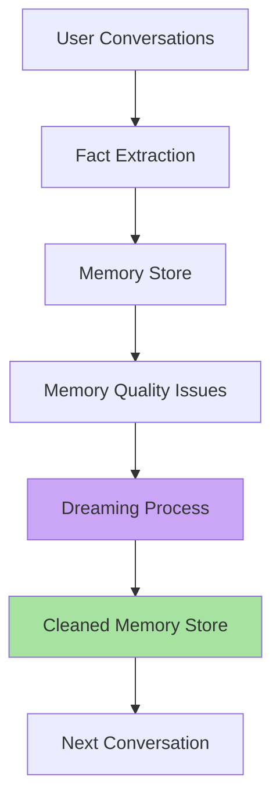
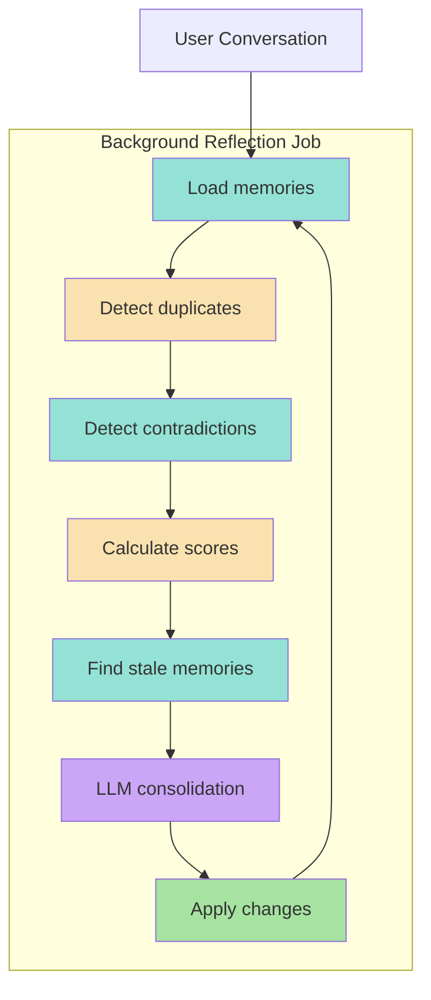
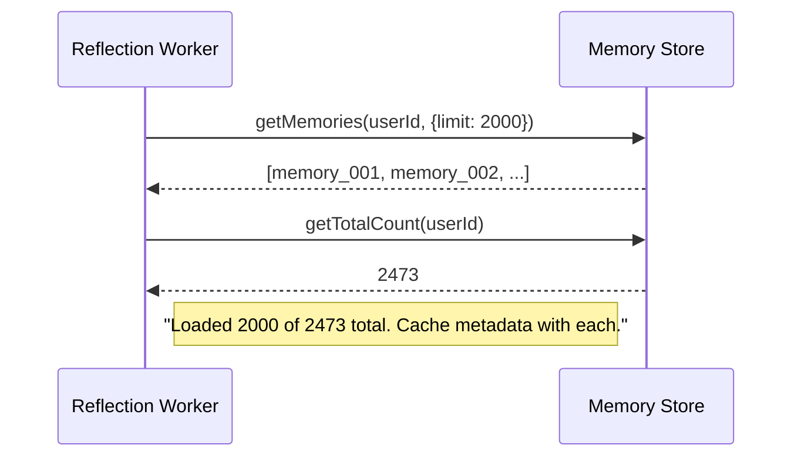
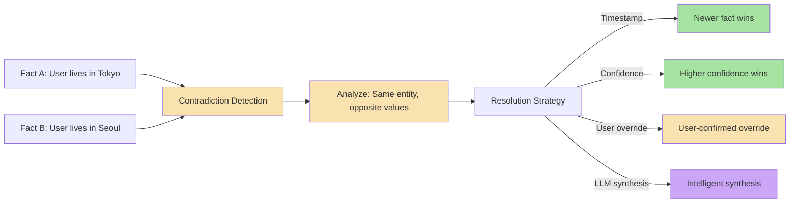
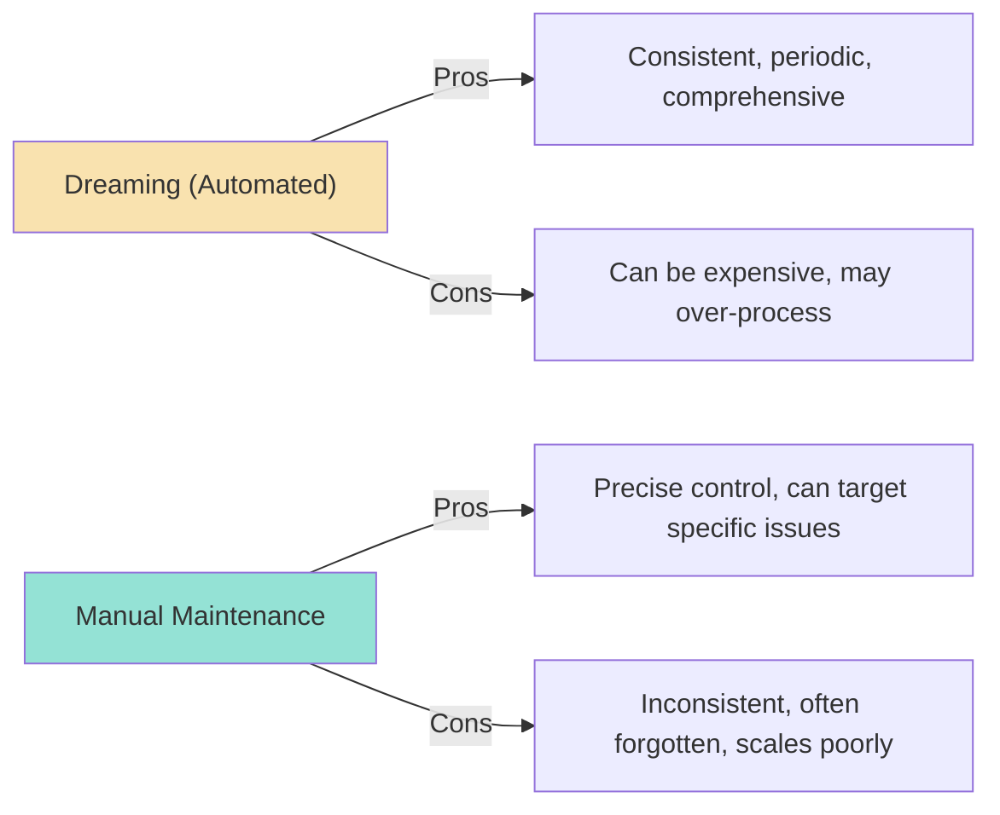
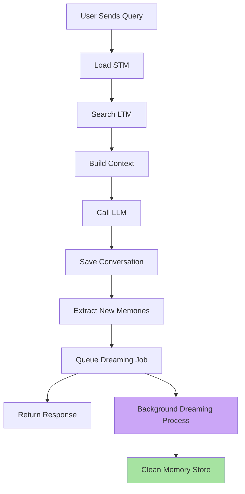
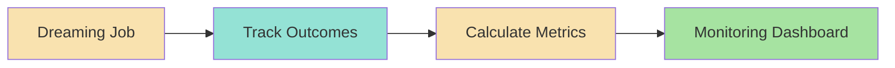

# Chapter 6: Claude-Style Memory Dreaming & Background Reflection

## Core Concept

Memory "Dreaming" (also called reflection) is a background offline process that examines stored memories, identifies issues (duplicates, contradictions, outdated facts, consolidation opportunities), and applies fixes without blocking the main user request path. This implements the Claude-style memory management pattern.

---

## 1. The Dreaming Architecture

### 1.1 Why Dreaming is Needed



**Why dreaming**: The main conversation flow should be fast and focused on answering the user. Memory cleanup happens asynchronously.

**Critical design decisions**:
- ✅ **Background execution**: Dreaming runs as a separate job, not in the request path
- ✅ **Non-blocking**: User requests return immediately after queuing the reflection job
- ✅ **Incremental**: Process only what's necessary, not a full scan every time
- ✅ **LLM-powered**: Use LLM for complex analysis that rules cannot catch

### 1.2 The Dreaming Flow



**Step-by-step breakdown**:

1. **B1 - Load memories**: Query the memory store for all memories belonging to the user. May limit to recent N months or token budget.

2. **B2 - Detect duplicates**: Group memories by normalized content and identify exact or near-duplicate entries.

3. **B3 - Detect contradictions**: Find memories with factually opposing content (same entity, different values).

4. **B4 - Calculate scores**: Re-evaluate each memory's relevance using frequency + recency + confidence scoring (Chapter 5).

5. **B5 - Find stale memories**: Identify memories beyond their validity window or with negligible access patterns.

6. **B6 - LLM consolidation**: Send the analyzed subset to an LLM for intelligent synthesis, merging, and deletion recommendations.

7. **B7 - Apply changes**: Execute the changes (merge, replace, delete) on the memory store.

8. **Cycle**: Results feed back into B1 for the next iteration.

### 1.3 Memory Data Structure (Complete Schema)

Each memory record should contain comprehensive metadata for dreaming analysis:

```javascript
const memory = {
    id: "memory_001",                        // Unique identifier
    userId: "user_123",                     // Multi-tenant isolation
    sessionId: "session_456",               // Source session context
    content: "User prefers TypeScript",      // The fact/content
    type: "semantic",                       // semantic | episodic | graph | temporal
    confidence: 0.95,                       // Extraction confidence (0-1)
    createdAt: "2024-09-15T10:30:00Z",     // When the memory was first extracted
    updatedAt: "2024-10-01T14:20:00Z",    // Last time the memory was modified
    lastAccessedAt: "2024-10-15T08:15:00Z", // When last used in a conversation
    version: 2,                              // Incremented on each update
    hitCount: 15,                            // How many times retrieved/accessed
    validity: {                              // Temporal validity window
        validFrom: "2024-07-01",
        validTo: null                         // null = currently valid
    },
    metadata: {
        source: "conversation_2024-08-15_turn_3",
        modelUsed: "gpt-4o-mini",
        extractionPromptVersion: "v3.2",
        tokenCount: 12
    }
};
```

### 1.4 Memory Lifecycle Fields (Full Schema)

```javascript
{
    id: "memory_123",
    userId: "user_123",
    content: "User prefers TypeScript",
    type: "semantic",
    createdAt: 1720000000000,              // Epoch milliseconds
    updatedAt: 1730000000000,
    lastAccessedAt: 1730500000000,
    accessCount: 15,
    source: "conversation_2024-08-15_turn_3",
    version: 2,
    confidence: 0.95,
    validity: {
        validFrom: null,
        validTo: null
    },
    embedding: [0.012, -0.083, 0.421, ...], // 1536-dim vector
    tags: ["preference", "language", "development"], // For filtering
    relevanceScore: 0.87                     // Cached relevance score
}
```

---

## 2. The Dreaming Process Steps

### 2.1 Step 1: Load Memories



**Implementation considerations**:
- **Paginate if total count > 2000** (configurable limit)
- **Cache metadata** to avoid N+1 queries
- **Respect user isolation** (filter by userId)
- **Include only qualified memories** (confidence >= minConfidence)

### 2.2 Step 2: Detect Duplicates

```javascript
// Pseudo code: Advanced duplicate detection
async function findDuplicates(memories) {
    const seen = new Map();          // Maps normalized key → memory
    const duplicates = [];           // Array of duplicate memories
    const conflicts = [];            // Array of conflicting memories
    
    for (const memory of memories) {
        // 1. Normalize content for comparison
        const normalizedKey = normalizeFactKey(memory.content);
        
        // 2. Check if key already seen
        if (seen.has(normalizedKey)) {
            const existing = seen.get(normalizedKey);
            
            // 3. Check for contradiction vs exact duplicate
            if (areFactsContradictory(existing.content, memory.content)) {
                conflicts.push({ memory1: existing, memory2: memory });
            } else {
                duplicates.push({ memory1: existing, memory2: memory });
            }
        } else {
            seen.set(normalizedKey, memory);
        }
    }
    
    return {
        duplicates,
        conflicts,
        totalMemories: memories.length,
        uniqueKeys: seen.size
    };
}

function normalizeFactKey(content) {
    return content
        .toLowerCase()
        .trim()
        .replace(/\s+/g, " ")
        .replace(/[^\w\s]/g, "")    // Remove punctuation
        .replace(/\s+/g, " ")       // Normalize spaces
        .trim();
}
```

**Duplicate vs Conflict Classification**:
```
Exact duplicate:      "I prefer TypeScript" + "I prefer TypeScript"
Similar duplicate:    "I love TypeScript" + "I prefer TypeScript"
Contradiction:        "I prefer TypeScript" + "I prefer JavaScript"
Contextual difference: "Prefers TypeScript at work" + "Prefers TypeScript for personal projects"
```

### 2.3 Step 3: Detect Contradictions



```javascript
// Pseudo code: Advanced contradiction detection
async function detectContradictions(memories) {
    const contradictions = [];
    
    for (let i = 0; i < memories.length; i++) {
        for (let j = i + 1; j < memories.length; j++) {
            const mem1 = memories[i];
            const mem2 = memories[j];
            
            if (areMemoriesContradictory(mem1, mem2)) {
                contradictions.push({
                    memory1: mem1,
                    memory2: mem2,
                    factKey: normalizeFactKey(mem1.content),
                    severity: calculateSeverity(mem1, mem2),
                    resolution: resolveContradiction(mem1, mem2)
                });
            }
        }
    }
    
    return contradictions;
}

function areMemoriesContradictory(mem1, mem2) {
    // Same type, opposite content in key areas
    const oppositeAreas = ["location", "preference", "role", "status"];
    
    for (const area of oppositeAreas) {
        const check1 = containsFactAbout(mem1.content, area);
        const check2 = containsFactAbout(mem2.content, area);
        
        if (check1 && check2) {
            // Check if values are opposite
            const values1 = extractValues(mem1.content, area);
            const values2 = extractValues(mem2.content, area);
            
            if (valuesHaveOpposite(values1, values2)) {
                return true;
            }
        }
    }
    
    // Fallback: high semantic similarity with different content
    const similarity = calculateSemanticSimilarity(mem1.content, mem2.content);
    return similarity > 0.9;
}
```

### 2.4 Step 4: LLM Consolidation

```javascript
// Pseudo code: Comprehensive LLM reflection prompt
async function generateReflectionPrompt(memories, userId) {
    return `
You are an expert memory consolidation system. Analyze the following stored memories and provide structured recommendations.

ANALYSIS CATEGORIES:

1. MERGES (same fact stated different ways):
   - Score semantic similarity > 90%
   - If fact content overlaps > 80%, merge into single entry
   - Combine hit counts, keep most recent access time
   - Example: "Prefers TypeScript" + "Loves TypeScript" → "Prefers TypeScript"

2. REPLACEMENTS (updated facts):
   - Newer timestamp OR higher confidence
   - User preference has changed
   - Fact is outdated or expired
   - Example: "Prefers JavaScript" → "Prefers TypeScript" (user changed mind)

3. DELETIONS (outdated/unnecessary):
   - Score < 1 (low frequency + old access)
   - Expired validity window
   - Confidence < 0.5
   - Low importance (not used in last 90 days)
   - Example: Old temporary preference no longer relevant

4. KEEP (retain as-is):
   - High score (> 10) or
   - Recently accessed or  
   - High confidence (> 0.9)
   - Critical facts (safety, identity)

5. CONTRADICTIONS (opposing facts):
   - Same entity, opposite values
   - Apply resolution strategy (timestamp/confidence/LLM)

RETURN EXACTLY THIS JSON STRUCTURE:
{
    "merge": [["memory_id_1", "memory_id_2"], ["memory_id_3", "memory_id_4"]],
    "replace": [
        {"old": "memory_id_5", "new": "updated fact content"},
        {"old": "memory_id_6", "new": "another updated fact"}
    ],
    "delete": ["memory_id_7", "memory_id_8"],
    "retain": ["memory_id_1", "memory_id_2", "memory_id_3"]
}

CRITICAL RULES:
- All IDs must exist in the provided memory list exactly as shown
- merge and retain arrays must be disjoint (no memory in both)
- delete should not include memories also in retain
- At least one memory from each group of similar duplicates must be retained
- If unsure about a memory, retain it rather than delete

MEMENTOS TO ANALYZE:
${JSON.stringify(memories, null, 2)}

User ID: ${userId}

Be precise and thorough. This directly impacts the quality of the agent's long-term memory.
`;
}

// Execute and parse
async function reflectOnMemories(memories) {
    const prompt = await generateReflectionPrompt(memories);
    const response = await callLLM({
        task: "memory_consolidation",
        temperature: 0.0,     // Deterministic output
        maxTokens: 2000,
        response_format: { type: "json_object" }
    });
    
    let parsed;
    try {
        parsed = JSON.parse(response);
    } catch {
        // Fallback: extract JSON from response
        parsed = extractJSONFromResponse(response);
    }
    
    // Validate structure
    if (!parsed.merge || !parsed.replace || !parsed.delete || !parsed.retain) {
        throw new Error("Invalid reflection response structure");
    }
    
    return parsed;
}
```

**Example LLM response**:
```json
{
    "merge": [["m1", "m3"], ["m5", "m7"]],
    "replace": [
        {"old": "m2", "new": "User's favorite color is now teal, not blue"},
        {"old": "m4", "new": "User has been vegetarian since 2023"}
    ],
    "delete": ["m6", "m8", "m9"],
    "retain": ["m1", "m2", "m4", "m5", "m7", "m10"]
}
```

### 2.5 Step 5: Apply Operations

```javascript
// Pseudo code: Safe application of reflection results
async function applyLLMReflection(reflection, userId) {
    // 1. Validate all referenced memory IDs exist and belong to user
    await validateReflectionIDs(reflection, userId);
    
    // 2. Process merges first (creates dependencies)
    const mergePromises = reflection.merge.map(async ([primaryId, secondaryId]) => {
        await mergeMemories(primaryId, secondaryId, userId);
    });
    
    // 3. Process replacements
    const replacePromises = reflection.replace.map(async (replacement) => {
        await replaceMemory(replacement.old, replacement.new, userId);
    });
    
    // 4. Process deletions
    const deletePromises = reflection.delete.map(async (memoryId) => {
        await deleteMemory(memoryId, userId);
    });
    
    // 5. Execute in parallel (with rate limiting)
    const results = await Promise.allSettle([
        ...mergePromises,
        ...replacePromises,
        ...deletePromises
    ]);
    
    // 6. Check for failures
    const failures = results.filter(r => r.status === "rejected");
    if (failures.length > 0) {
        await logReflectionFailures(userId, failures);
    }
    
    // 7. Return summary
    return {
        success: failures.length === 0,
        mergesApplied: reflection.merge.length,
        replacementsApplied: reflection.replace.length,
        deletionsApplied: reflection.delete.length,
        retained: reflection.retain.length,
        failures: failures.length
    };
}
```

---

## 3. Claude-Style Dreaming: Key Principles

### 3.1 Background Execution (Critical Design Pattern)

```javascript
// Pseudo code: Never await dreaming in the chat path
async function handleChat(userId, userQuery) {
    // 1. Process chat normally
    const messages = await loadContext(userId);  // STM + LTM retrieval
    const response = await callLLM(messages);     // LLM call
    
    // 2. Save conversation (fast, idempotent)
    await saveMessage(userId, userQuery, response);
    
    // 3. Extract new facts (if enabled)
    const newMemories = await extractAndStoreMemories(userId, userQuery);
    
    // 4. Queue reflection — do NOT await here
    // The response can return immediately
    await memoryQueue.add("reflection", { userId });
    
    // 5. Return response to user (fast path complete)
    return response;
}

// Worker processes later (completely independent)
// NOTE: This runs in a separate process/queue worker
memoryQueue.process("reflection", async job => {
    const startTime = Date.now();
    const result = await runMemoryReflection(job.data.userId);
    const duration = Date.now() - startTime;
    
    // Log for monitoring
    await auditLog.write({
        event: "memory_dream_completed",
        userId: job.data.userId,
        durationMs: duration,
        ...result
    });
});
```

### 3.2 Dreaming Output Example

```text
Reflection Results for user_123:
├─ Total memories: 23
├─ Duplicates found: 2
├─ Contradictions resolved: 1
├─ Stale memories: 5
├─ Merged: 2 pairs
├─ Deleted: 5
└─ Retained: 18
```

**Interpretation**:
- **Total memories**: 23 total memories across all categories
- **Duplicates found**: 2 pairs of similar memories identified
- **Contradictions resolved**: 1 conflict between opposing facts, resolved by timestamp/confidence
- **Stale memories**: 5 memories beyond validity window or with negligible access
- **Merged**: 2 merge operations performed (4 memories → 2 consolidated memories)
- **Deleted**: 5 memories removed from the store
- **Retained**: 18 memories kept (down from 23 after merges and deletions)

### 3.3 Dreaming Schedule

| Schedule | Strategy | Use Case |
|----------|----------|----------|
| **Every 24 hours** | Batch processing | Small user base (< 1K users) |
| **Hourly** | Incremental | High traffic users (> 10K users) |
| **On-demand** | Manual trigger | Critical users, admin-initiated |
| **Event-driven** | On large session | After major session with many new facts |

**Scheduling recommendations**:
```javascript
// Production scheduling configuration
const REFLECTION_SCHEDULER = {
    // Per-user scheduling
    schedulePerUser: {
        "hourly": {
            threshold: "high_traffic",      // > 100 requests/day
            jobFrequency: "hourly",
            maxMemoriesPerRun: 500
        },
        "daily": {
            threshold: "medium_traffic",    // 10-100 requests/day
            jobFrequency: "daily",
            maxMemoriesPerRun: 200
        },
        "weekly": {
            threshold: "low_traffic",       // < 10 requests/day
            jobFrequency: "weekly",
            maxMemoriesPerRun: 100
        }
    },
    
    // Global scheduling (runs once, processes all users)
    globalBatch: {
        frequency: "daily",          // Run once per day
        startTime: "02:00",          // Off-peak hours (2 AM)
        maxConcurrentUsers: 50,      // Limit to avoid DB contention
        maxTotalMemories: 50000      // Process up to 50K memories total
    }
};
```

### 3.4 Implementation Approaches

| Approach | Description | Pros | Cons |
|----------|-------------|------|------|
| **Full Dreaming** | LLM reviews all memories periodically | Comprehensive cleanup, catches everything | Expensive, slow, token-heavy for many users |
| **Incremental** | Process new memories only | Targeted, cheap, fast | May miss cascading issues (old duplicates) |
| **Hybrid** | Full periodic + incremental delta | Balanced approach | Complex scheduling logic |
| **On-demand** | Manual/admin trigger | Precise, quick, controlled | Not automatic, may be forgotten |

### 3.5 Full Dreaming Pattern

```javascript
// Pseudo code: Full memory dreaming for a single user
async function fullMemoryDream(userId) {
    // 1. Load all memories for this user
    const memories = await memoryStore.getMemories(userId);
    
    if (!memories || memories.length === 0) {
        return { status: "empty", processed: 0 };
    }
    
    // 2. Filter by minimum confidence
    const qualifiedMemories = memories.filter(m => 
        m.confidence >= 0.5
    );
    
    // 3. Send to LLM for analysis
    const reflection = await reflectOnMemories(qualifiedMemories, userId);
    
    // 4. Validate reflection results
    await validateReflectionResult(reflection, qualifiedMemories.map(m => m.id));
    
    // 5. Apply changes
    const applied = await applyLLMReflection(reflection, userId);
    
    return {
        status: "completed",
        total: memories.length,
        processed: qualifiedMemories.length,
        applied,
        summary: `Processed ${qualifiedMemories.length} memories: merged ${applied.mergesApplied}, replaced ${applied.replacementsApplied}, deleted ${applied.deletionsApplied}`
    };
}
```

### 3.6 Dreaming vs Manual Maintenance



**Hybrid approach recommendation**:
```javascript
// Recommended: Full dreaming weekly + incremental daily
async function runScheduledDreaming(userId) {
    // Daily: Only process NEW memories since last dreaming
    const incrementalResult = await incrementalDreaming(userId);
    
    // Weekly: Full dreaming (every Sunday, 2 AM)
    const dayOfWeek = new Date().getDay();
    if (dayOfWeek === 0) {  // Sunday
        const fullResult = await fullMemoryDream(userId);
        await logDreamingResult(userId, {
            type: "weekly_full",
            ...fullResult
        });
    }
    
    return { incremental: incrementalResult, weekly: dayOfWeek === 0 ? "full" : "skipped" };
}
```

---

## 4. Dreaming Integration with Chat Pipeline

### 4.1 Complete Request Flow



**Flow explanation**:
1. **A**: User sends a chat message
2. **B**: Load Short-Term Memory (recent N turns from database)
3. **C**: Search Long-Term Memory (vector retrieval + filters)
4. **D**: Build final LLM prompt within budget
5. **E**: Call the LLM and get response
6. **F**: Save user message + assistant response to database
7. **G**: Extract any new facts from the conversation
8. **H**: Queue a background reflection job (fire-and-forget)
9. **I**: Return response to user immediately

### 4.2 Response Timing Considerations

```javascript
// Pseudo code: Chat handler with async dreaming
async function handleChat(userId, userQuery) {
    const startTime = Date.now();
    
    // 1. Load context components
    const stm = await getRecentMessages(userId, { limit: 8 });
    const ltm = await searchMemories(userId, userQuery, { topK: 5 });
    const profile = await getUserProfile(userId);
    
    // 2. Build budget-bounded context
    const context = assembleContextWithinBudget({
        systemPrompt: SYSTEM_PROMPT,
        profile,
        summary: await getConversationSummary(userId),
        stm,
        ltm,
        query: userQuery,
        tokenBudget: 2000
    });
    
    // 3. Call LLM
    const response = await callLLM(context.messages);
    const retrievalTime = Date.now() - startTime;
    
    // 4. Save conversation (must succeed for data integrity)
    try {
        await saveMessage(userId, userQuery, response);
    } catch (e) {
        // Log but don't block - conversation can be recovered
        await logWarning(userId, { event: "save_message_failed", error: e.message });
    }
    
    // 5. Extract new memories (fast, synchronous)
    const newMemories = await extractMemories(userId, userQuery);
    
    // 6. Queue dreaming — response can return immediately
    // This is fire-and-forget; errors are logged separately
    await queueReflection(userId);
    
    // 7. Return comprehensive response
    return {
        response,
        retrievalTimeMs: retrievalTime,
        memoryExtracted: newMemories.length,
        dreamingQueued: true
    };
}
```

**Timing guarantees**:
- **User response time**: < 2 seconds (including LLM call)
- **Dreaming queue**: Returns immediately (< 50ms)
- **Dreaming processing**: Can take seconds to minutes (background)
- **Dreaming failures**: Logged, do not affect user experience

### 4.3 Graceful Degradation When Dreaming Fails

```javascript
// Pseudo code: Handle dreaming failures gracefully
async function handleChatWithDreamingFallback(userId, userQuery) {
    try {
        // Normal chat handling
        const result = await handleChat(userId, userQuery);
        
        // Dreaming should have queued successfully
        if (!result.dreamingQueued) {
            await logError(userId, { event: "dreaming_not_queued" });
        }
        
        return result;
        
    } catch (error) {
        // If dreaming queue is down, still serve the user
        const result = await basicChat(userId, userQuery);
        
        // Log the dreaming infrastructure issue
        await logError(userId, {
            event: "dreaming_system_down",
            error: error.message,
            fallback: "basic_chat_used"
        });
        
        return result;
    }
}
```

### 5. Dreaming Quality Metrics



### 5.1 Tracking Dream Outcomes

```javascript
// Pseudo code: Dream result tracking
function trackDreamResult(userId, dreamResult) {
    const {
        totalMemories,          // Total memories loaded
        duplicatesFound,        // Duplicates identified
        contradictionsResolved, // Conflicts resolved
        staleRemoved,           // Stale memories evicted
        mergesApplied,          // Merge operations performed
        deletionsApplied,       // Delete operations performed
        effectivenessScore      // Custom quality metric
    } = dreamResult;
    
    // Log structured outcome
    await auditLog.write({
        event: "memory_dream",
        userId,
        timestamp: new Date().toISOString(),
        totalMemories,
        duplicatesFound,
        contradictionsResolved,
        staleRemoved,
        mergesApplied,
        deletionsApplied,
        effectivenessScore
    });
    
    // Calculate effectiveness ratio
    const effectiveness =
        (mergesApplied + deletionsApplied) / totalMemories;
    
    return {
        effectiveness,
        dreamResult: {
            totalMemories,
            duplicatesFound,
            contradictionsResolved,
            staleRemoved,
            mergesApplied,
            deletionsApplied
        }
    };
}
```

### 5.2 Dreaming Effectiveness Metrics Dashboard

| Metric | Target | Measurement Period |
|--------|--------|-------------------|
| **Duplicate rate** | < 5% | Merges / Total memories |
| **Contradiction resolution** | 100% | Resolved / Detected |
| **Stale memory removal** | 10% / month | Removed / Total memories |
| **Memory accuracy** | 95%+ | User feedback / Eval sets |
| **Cost per dream** | < $X | LLM tokens used / job |
| **Dreaming success rate** | > 95% | Successful jobs / Total jobs |
| **Average processing time** | < 2 min | Job duration |

### 5.3 Monitoring and Alerting

```javascript
// Pseudo code: Dreaming monitoring alerts
async function monitorDreamingHealth() {
    const stats = await getDreamingStats();
    
    // Alert if success rate drops
    if (stats.successRate < 95) {
        await alertTeam({
            type: "dreaming_success_rate",
            message: `Dreaming success rate dropped to ${stats.successRate}%`,
            severity: "warning"
        });
    }
    
    // Alert if cost is too high
    if (stats.costPerDream > 0.10) {
        await alertTeam({
            type: "dreaming_cost_high",
            message: `Cost per dream ${stats.costPerDream}$ exceeds threshold $0.10`,
            severity: "warning"
        });
    }
    
    // Alert if job queue is backed up
    if (stats.queueDepth > 100) {
        await alertTeam({
            type: "dreaming_queue_backup",
            message: `Dreaming job queue depth: ${stats.queueDepth}`,
            severity: "critical"
        });
    }
    
    // Alert if processing time is too long
    if (stats.avgProcessingTime > 120) {
        await alertTeam({
            type: "dreaming_slow",
            message: `Average dreaming job time: ${stats.avgProcessingTime}s exceeds 2min threshold`,
            severity: "info"
        });
    }
}
```

### 5.4 Dreaming Failure Modes and Mitigations

| Failure | Impact | Mitigation |
|---------|--------|------------|
| **LLM produces invalid JSON** | Dreaming fails, no changes applied | Use JSON mode, validate on parse, retry with fallback prompt |
| **Reflection applied to deleted memories** | Runtime error, inconsistent state | Validate memory IDs exist before apply; check soft-deleted status |
| **Contradiction resolution fails** | Inconsistent state, both facts retained | Keep both until manual review; log for human decision |
| **Stale memories not removed** | Storage bloat over time | Periodic verification; add explicit eviction triggers |
| **Queue job fails** | Memory not cleaned, backlog grows | Retry with exponential backoff; alert on repeated failures |
| **Timeout during processing** | Partial changes applied | Use transactions; rollback on failure; log partial state |
| **Rate limiting** | Dreaming throttled, delayed cleanup | Implement token bucket; queue with priority; spread across time |

---

## 6. Common Mistakes

| Mistake | Effect | Fix |
|---------|--------|-----|
| Running dreaming synchronously | Slows down chat response times | Use background job queue; fire-and-forget |
| No error handling in reflection | Dreaming silently fails, memory quality degrades | Add retries with exponential backoff; validate results |
| Not tracking dream outcomes | Can't measure improvement or regressions | Log all outcomes; calculate effectiveness metrics |
| Applying LLM changes directly to DB | No validation, potential data corruption | Separate analysis from mutation; validate before apply |
| Dreaming on every single turn | Overlapping jobs, race conditions | Single scheduled job per user; throttle by frequency |
| No grace period before deletion | Accidental loss of relevent memories | Wait 7+ days before permanent deletion; log grace period |
| Dreaming on users without consent | Privacy compliance issues | Check consent before dreaming; allow opt-out |
| Ignoring cost of LLM calls | Unexpected expenses | Budget per dream; cap token usage; use cheaper models for analysis |
| Not respecting user opt-out | Violates privacy preferences | Allow users to disable dreaming; respect preferences |

---

## Key Takeaways

1. **Memory dreaming is a background process** — keep it out of the critical user request path
2. **Claude-style dreaming** — offline reflection to improve memory quality
3. **Dreaming handles duplicates, contradictions, staleness, merges** — comprehensive cleanup
4. **Use job queues** — decouple dreaming from request handling
5. **LLM returns structured operations** — merge, replace, delete, retain
6. **Apply with validation** — separate analysis from database mutation
7. **Track dreaming effectiveness** — measure merges, deletions, quality improvements
8. **Schedule appropriately** — batch processing with retry logic
9. **Background execution is critical** — never block user chat to run dreaming
10. **Monitor and alert** on dreaming health metrics (success rate, cost, queue depth)

---

## Dreaming Process Summary

```
┌─────────────────────────────────────────────────────────────────┐
│                    CLAUDE-STYLE MEMORY DREAMING                │
├─────────────────────────────────────────────────────────────────┤
│ 1. Chat handler:                                                   │
│    - Process user request                                         │
│    - Save conversation                                            │
│    - Extract new facts                                            │
│    - Queue reflection job (fire-and-forget)                       │
│    - Return response immediately                                  │
│                                                                   │
│ 2. Background worker:                                             │
│    - Load memories (paginated, filtered)                          │
│    - Score and identify candidates                                  │
│    - Send subset to LLM for analysis                               │
│    - Parse structured merge/replace/delete/retain JSON            │
│    - Validate all IDs exist and belong to user                    │
│    - Execute changes (merge/replace/delete)                       │
│    - Log results and effectiveness                                 │
│                                                                   │
│ 3. Cycle repeats per schedule (hourly/daily/weekly)              │
└─────────────────────────────────────────────────────────────────┘
```

---

## Preview: Chapter 7

In the next chapter, we explore **Managed Memory (mem0) + Multi-tenancy, Privacy & Compliance** — using managed frameworks like mem0 to abstract away the complexity of building memory systems from scratch, with built-in features for user isolation, encryption, and regulatory compliance.