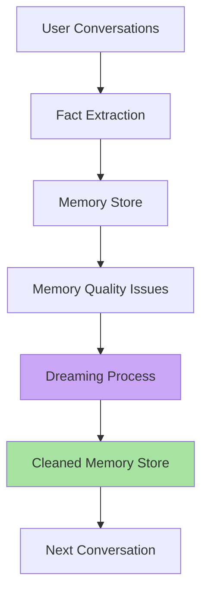
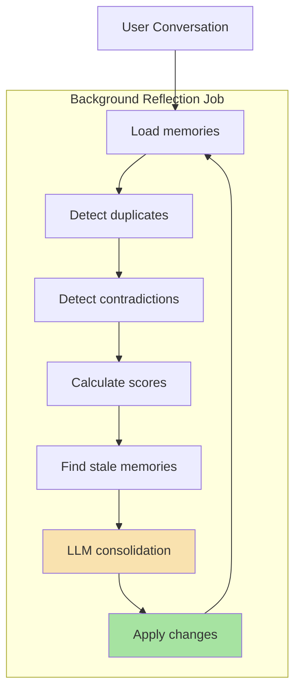
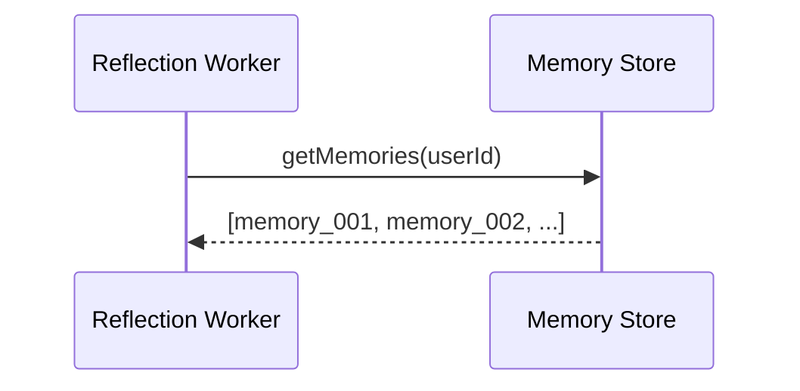
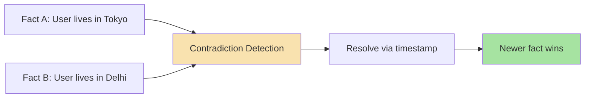
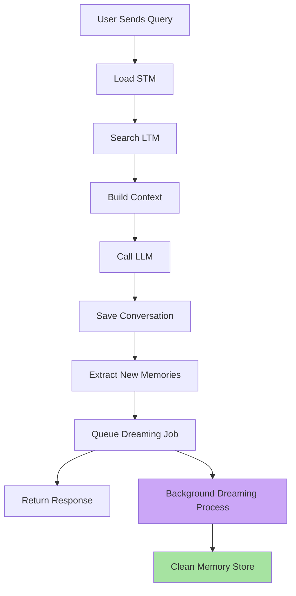

# Chapter 6: Claude-Style Memory Dreaming & Background Reflection

## Core Concept

Memory "Dreaming" (also called reflection) is a background offline process that examines stored memories, identifies issues (duplicates, contradictions, outdated facts, consolidation opportunities), and applies fixes without blocking the main user request path. This implements the Claude-style memory management pattern.

## 1. The Dreaming Architecture

### 1.1 Why Dreaming is Needed



**Why dreaming**: The main conversation flow should be fast and focused on answering the user. Memory cleanup happens asynchronously.

### 1.2 The Dreaming Flow



### 1.3 The Memory Data Structure

Each memory contains essential metadata:

```javascript
const memory = {
  id: "memory_001",
  userId: "user_123",
  content: "User likes C++",
  createdAt: "2026-08-20T10:00:00Z",
  lastAccessedAt: "2026-08-23T10:00:00Z",
  hitCount: 5
};
```

### 1.4 Memory Lifecycle Fields

```javascript
{
  id: "memory_123",
  userId: "user_123",
  content: "User prefers TypeScript",
  createdAt: 1720000000000,
  updatedAt: 1730000000000,
  lastAccessedAt: 1730500000000,
  accessCount: 15,
  source: "conversation_2024_08_15_turn_3",
  version: 2,
  confidence: 0.95
}
```

## 2. The Dreaming Process Steps

### 2.1 Step 1: Load Memories



### 2.2 Step 2: Detect Duplicates

```javascript
function findDuplicates(memories) {
  const seen = new Map();
  const duplicates = [];
  
  for (const memory of memories) {
    const key = normalizeText(memory.content);
    
    if (seen.has(key)) {
      duplicates.push(memory);
    } else {
      seen.set(key, memory);
  }
  
  return duplicates;
}
```

### 2.3 Step 3: Detect Contradictions



### 2.4 Step 4: LLM Consolidation

```javascript
async function reflectOnMemories(memories) {
  const prompt = `
    Review these stored memories.
    
    Identify:
    1. Duplicates
    2. Contradictions
    3. Outdated information
    4. Memories that should be merged
    5. Memories that should be removed
    
    Return JSON only:
    {
      "merge": [["m1", "m2"]],
      "replace": [{"old": "m3", "new": "updated"}],
      "delete": ["m5", "m8"]
    }
    
    Memories:
    ${JSON.stringify(memories)}
  `;
  
  const response = await callLLM(prompt);
  return JSON.parse(response);
}
```

### 2.5 Step 5: Apply Operations

```javascript
async function applyReflection(result) {
  for (const ids of result.merge) {
    await mergeMemoryRecords(ids);
  }
  
  for (const replacement of result.replace) {
    await replaceMemory(replacement.old, replacement.new);
  }
  
  for (const memoryId of result.delete) {
    await deleteMemory(memoryId);
  }
}
```

## 3. Claude-Style Dreaming: Key Principles

### 3.1 Background Execution

```javascript
// NOT in the main request path
async function handleChat(userId, userQuery) {
  const response = await callLLM(messages);
  
  // Save conversation
  await saveMessage(userId, userQuery, response);
  
  // Extract new facts
  await extractAndStoreMemories(userId, userQuery);
  
  // Queue background reflection — do NOT await here
  await memoryQueue.add("reflection", { userId });
  
  return response;
}

// Worker processes later
memoryQueue.process("reflection", async job => {
  await runMemoryReflection(job.data.userId);
});
```

### 3.2 Dreaming Output Example

```text
Reflection Results for user_123:
├─ Total memories: 23
├─ Duplicates found: 2
├─ Contradictions resolved: 1
├─ Stale memories: 5
├─ Merged: 2 pairs
├─ Deleted: 5
└─ Retained: 18
```

### 3.3 Dreaming Schedule

| Schedule | Strategy | Use Case |
|----------|----------|----------|
| **Every 24 hours** | Batch processing | Small user base |
| **Hourly** | Incremental | High traffic |
| **On-demand** | Manual trigger | Critical users |
| **Event-driven** | On large session | Nightly batch |

## 4. Dreaming vs Manual Maintenance

### 4.1 Implementation Approaches

| Approach | Description | Pros | Cons |
|----------|-------------|------|------|
| **Full Dreaming** | LLM reviews all memories periodically | Comprehensive cleanup | Expensive, slow |
| **Incremental** | Process new memories only | Targeted, cheap | May miss cascading issues |
| **Hybrid** | Full periodic + incremental delta | Balanced | Complex scheduling |
| **On-demand** | Manual/admin trigger | Precise, quick | Not automatic |

### 4.2 Full Dreaming Pattern

```javascript
async function fullMemoryDream(userId) {
  const memories = await memoryStore.getMemories(userId);
  
  // LLM analyzes all memories
  const analysis = await callLLM({
    task: "memory_consolidation",
    input: memories
  });
  
  // Apply changes
  await applyReflection(analysis);
}
```

## 5. Dreaming Integration with Chat Pipeline

### 5.1 Complete Request Flow



### 5.2 Response Timing Considerations

```javascript
async function handleChat(userId, userQuery) {
  const startTime = Date.now();
  
  // ... retrieval and generation ...
  
  const response = await callLLM(messages);
  const retrievalTime = Date.now() - startTime;
  
  // Save conversation
  await saveMessage(...);
  
  // Extract new memories
  const memories = await extractMemories(userId, userQuery);
  
  // Queue dreaming — response can return immediately
  await queueReflection(userId);
  
  return { response, retrievalTime, memoryExtracted: memories.length };
}
```

## 6. Dreaming Quality Metrics

### 6.1 Tracking Dream Outcomes

```javascript
function trackDreamResult(userId, dreamResult) {
  const {
    totalMemories,
    duplicatesFound,
    contradictionsResolved,
    staleRemoved,
    mergesApplied,
    deletionsApplied
  } = dreamResult;
  
  // Log for monitoring
  await auditLog.write({
    event: "memory_dream",
    userId,
    ...dreamResult
  });
  
  // Calculate effectiveness
  const effectiveness =
    (mergesApplied + deletionsApplied) / totalMemories;
  
  return { effectiveness, dreamResult };
}
```

### 6.2 Dreaming Effectiveness Metrics

| Metric | Target | Measurement |
|--------|--------|-------------|
| Duplicate rate | < 5% | Merges / Total |
| Contradiction resolution | 100% | Resolved / Detected |
| Stale memory removal | 10% / month | Removed / Total |
| Memory accuracy | 95%+ | User feedback / Eval |
| Cost per dream | < $X | LLM tokens used |

## 7. Dreaming Failure Modes

| Failure | Impact | Mitigation |
|---------|--------|------------|
| **LLM produces invalid JSON** | Dreaming fails | Use JSON mode, retry with fallback |
| **Reflection applied to deleted memories** | Runtime error | Validate before apply |
| **Contradiction resolution fails** | Inconsistent state | Keep both until manual review |
| **Stale memories not removed** | Storage bloat | Periodic verification |
| **Queue job fails** | Memory not cleaned | Retry with exponential backoff |

## Common Mistakes

| Mistake | Effect | Fix |
|---------|--------|-----|
| Running dreaming synchronously | Slows down chat response | Use background queue |
| No error handling in reflection | Dreaming silently fails | Add retries and validation |
| Not tracking dream outcomes | Can't measure improvement | Log results and effectiveness |
| Applying LLM changes directly to DB | No validation | Separate analysis from mutation |
| Dreaming on every single turn | Overlapping jobs, race conditions | Single scheduled job per user |

## Key Takeaways

1. **Memory dreaming is a background process** — keep it out of the critical user request path
2. **Claude-style dreaming** — offline reflection to improve memory quality
3. **Dreaming handles duplicates, contradictions, staleness, merges** — comprehensive cleanup
4. **Use job queues** — decouple dreaming from request handling
5. **LLM returns structured operations** — merge, replace, delete, retain
6. **Apply with validation** — separate analysis from database mutation
7. **Track dreaming effectiveness** — measure merges, deletions, quality improvements
8. **Schedule appropriately** — batch processing with retry logic

Dreaming turns memory from a passive accumulator into an actively maintained, self-improving system that stays clean and relevant over time.