# Chapter 7: Managed Memory (mem0) + Multi-tenancy, Privacy & Compliance

## Core Concept

Instead of building every memory operation from scratch, managed memory frameworks like **mem0** provide an abstraction layer that handles memory storage, retrieval, extraction, deduplication, and user isolation. This chapter covers mem0 integration patterns, multi-tenant memory isolation, privacy compliance, and data deletion requirements.

---

## 1. The mem0 Managed Memory Framework

### 1.1 What is mem0?

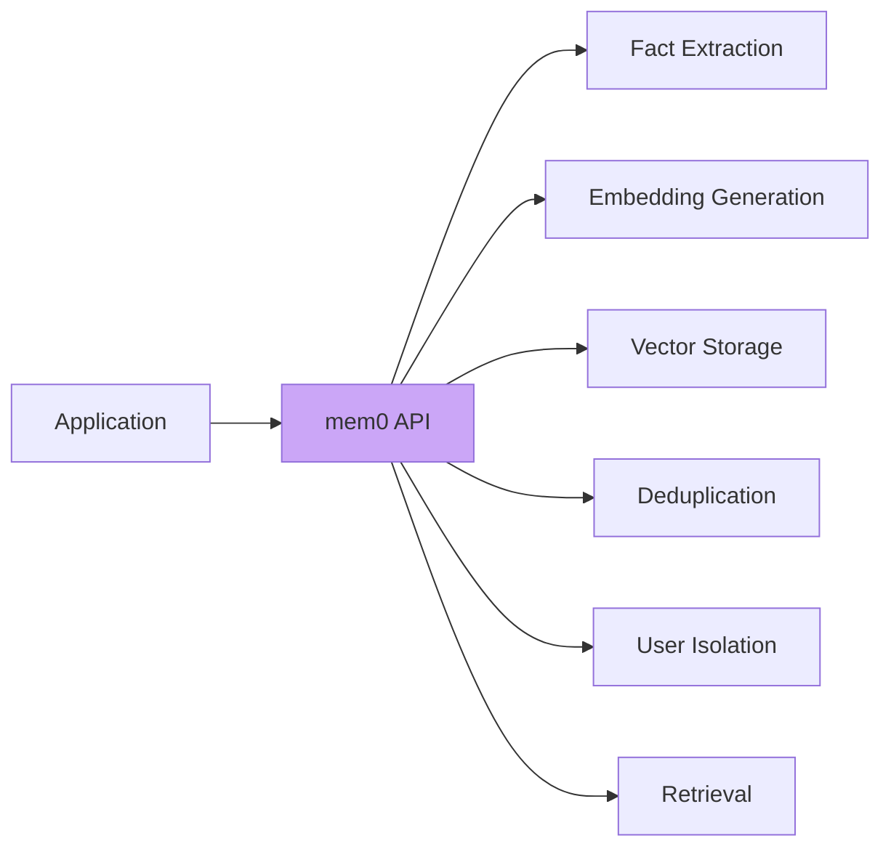

**mem0** is a managed memory layer that sits between your application and the underlying memory stores. It abstracts away:
- Fact extraction from conversations
- Embedding generation and storage
- Vector database operations
- Memory deduplication
- User/session isolation
- Semantic retrieval

### 1.2 mem0 API Patterns

```javascript
// Initialize mem0 client
const memory = new Memory({
  apiKey: process.env.MEM0_API_KEY,
  // Or use local mode with custom config
});

// Add a conversation and let mem0 extract facts
await memory.add([
  { role: "user", content: "I prefer TypeScript for development" }
], {
  userId: "user_123",
  sessionId: "session_456"
});

// Search relevant memories
const results = await memory.search(
  "What programming language do I prefer?",
  { userId: "user_123" }
);

// Update memories when user changes preferences
await memory.add([
  { role: "user", content: "I switched from JavaScript to TypeScript" }
], {
  userId: "user_123"
});
```

### 1.3 How mem0 Works Internally

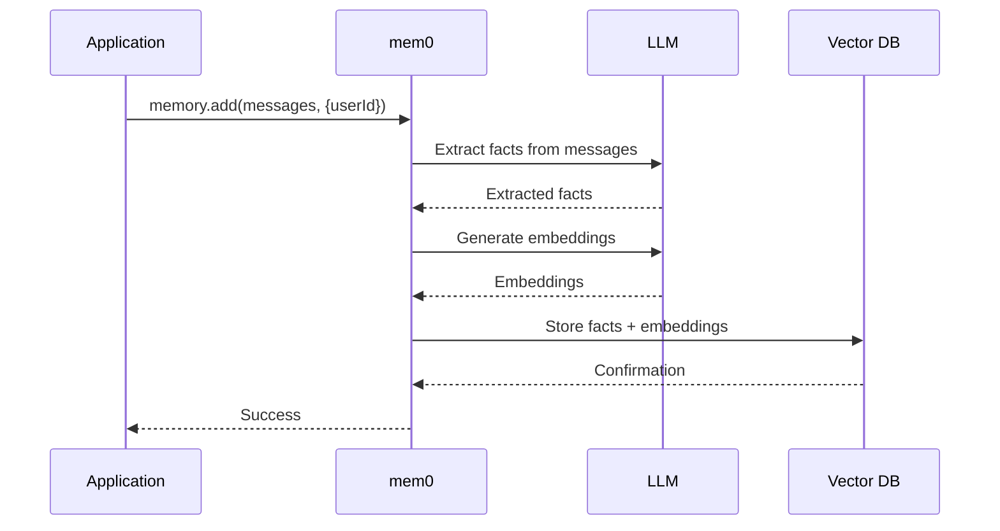

### 1.4 mem0 Search Process

```javascript
// Search with various options
const results = await memory.search(query, {
  userId: "user_123",           // Required: user isolation
  sessionId: "session_456",     // Optional: session-specific
  limit: 10,                    // Number of results
  threshold: 0.7,               // Similarity threshold
  includeMetadata: true         // Get scores and metadata
});

// Results format
[
  {
    memory: "User prefers TypeScript",
    score: 0.92,
    metadata: {
      createdAt: "2024-09-15T10:30:00Z",
      sessionId: "session_456",
      userId: "user_123"
    }
  }
]
```

### 1.5 mem0 vs Custom Implementation

| Feature | Custom | mem0 |
|---------|--------|------|
| Fact extraction | Build yourself | Built-in |
| Embeddings | Manual | Built-in |
| Vector DB | Choose/manage | Built-in or BYO |
| Deduplication | Implement | Built-in |
| User isolation | Manual | Built-in |
| Graph memory | Custom | Optional |
| Cost | Infrastructure only | API + infrastructure |

---

## 2. Multi-tenant Memory Isolation

### 2.1 Why Isolation Matters

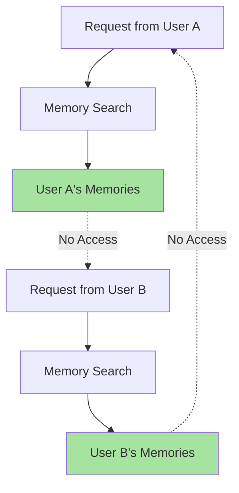

**Core Principle**: Every memory operation must be scoped to a specific user. No cross-user leakage is acceptable.

### 2.2 User-Level Isolation

```javascript
// Every memory operation must include userId
async function searchMemories(userId, query) {
  // Verify user is authenticated
  const auth = await verifyAuth();
  if (auth.userId !== userId) {
    throw new ForbiddenError("Cannot access other user's memories");
  }
  
  // Search with userId filter
  const results = await memory.search(query, { userId });
  return results;
}
```

### 2.3 Session-Level Memory

```javascript
// Separate user memory from session memory
await memory.add(
  [{ role: "user", content: "In this session, I'm debugging TypeScript errors" }],
  {
    userId: "user_123",
    sessionId: "debug_session_789"
  }
);

// Search session-specific memories
const sessionMemories = await memory.search(query, {
  userId: "user_123",
  sessionId: "debug_session_789"
});

// Or search user-wide memories
const userMemories = await memory.search(query, {
  userId: "user_123"
  // No sessionId = user-wide
});
```

### 2.4 Isolation Enforcement

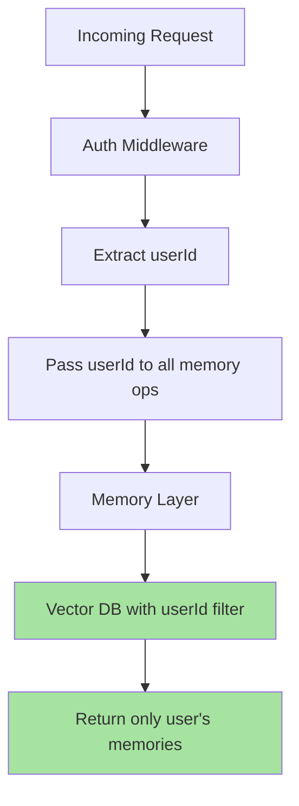

### 2.5 Multi-Tenant Architecture Patterns

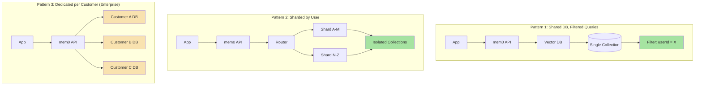

---

## 3. Privacy & Compliance

### 3.1 Data Types in Memory

| Data Type | Sensitivity | Example |
|-----------|-------------|---------|
| **PII** | High | Name, email, address, phone |
| **Health** | Critical | Medical conditions, allergies |
| **Financial** | Critical | Payment info, income |
| **Preferences** | Low | Language, theme, notification settings |
| **Behavioral** | Medium | Usage patterns, feature usage |

### 3.2 PII Minimization

```javascript
// Extract and store PII separately or not at all
function sanitizeForMemory(content) {
  // Remove or mask sensitive information
  return content
    .replace(/\b\d{3}-\d{2}-\d{4}\b/g, "[SSN]")  // SSN
    .replace(/\b\d{4}[\s-]?\d{4}[\s-]?\d{4}[\s-]?\d{4}\b/g, "[CARD]")  // Credit card
    .replace(/[a-zA-Z0-9._%+-]+@[a-zA-Z0-9.-]+\.[a-zA-Z]{2,}/g, "[EMAIL]")  // Email
    .replace(/\b\d{3}[-.]?\d{3}[-.]?\d{4}\b/g, "[PHONE]");  // Phone
}

// Apply before fact extraction
const sanitized = sanitizeForMemory(userMessage);
const facts = await extractFacts(sanitized);
```

### 3.3 Advanced PII Detection and Handling

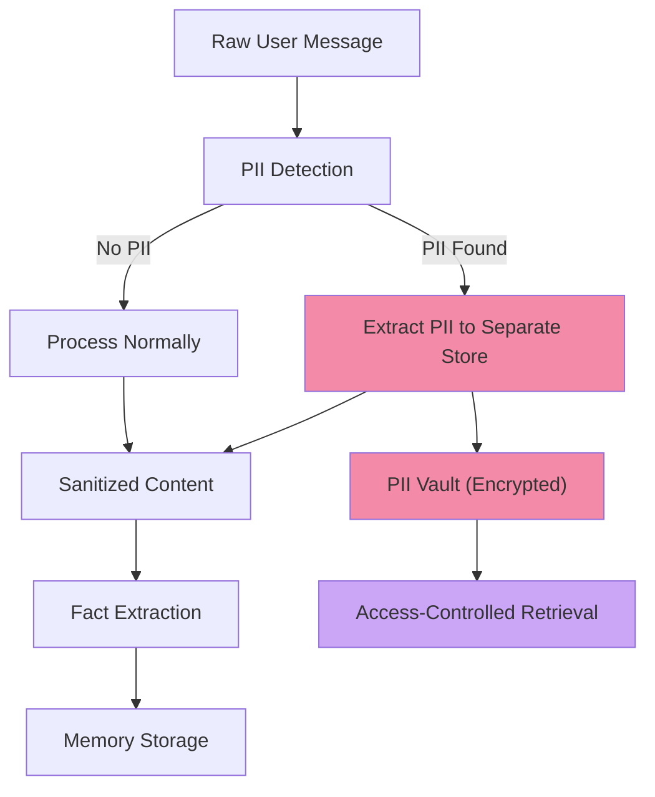

```javascript
// Advanced PII handling with separate vault
class PIIManager {
  constructor() {
    this.piiVault = new PIIVault();
  }
  
  async processMessage(userId, message) {
    // 1. Detect PII
    const piiEntities = await this.detectPII(message);
    
    // 2. Store PII in secure vault
    if (piiEntities.length > 0) {
      await this.piiVault.store(userId, piiEntities);
    }
    
    // 3. Sanitize message
    const sanitized = this.sanitize(message, piiEntities);
    
    return {
      sanitized,
      hasPII: piiEntities.length > 0,
      piiReferences: piiEntities.map(e => e.referenceId)
    };
  }
  
  async retrievePII(userId, referenceIds) {
    // Verify user owns these PII references
    const auth = await verifyOwnership(userId, referenceIds);
    if (!auth) throw new ForbiddenError();
    
    return this.piiVault.retrieve(referenceIds);
  }
}
```

### 3.4 Data Deletion (Right to be Forgotten)

```javascript
// Complete user memory deletion
async function deleteUserMemory(userId) {
  // 1. Delete from vector DB
  await vectorDb.delete({
    filter: { userId }
  });
  
  // 2. Delete from conversation store
  await conversationStore.delete({
    filter: { userId }
  });
  
  // 3. Delete from mem0
  await memory.deleteUser(userId);
  
  // 4. Delete PII vault
  await piiVault.deleteUser(userId);
  
  // 5. Log for compliance
  await auditLog.write({
    event: "user_memory_deletion",
    userId,
    timestamp: new Date().toISOString(),
    reason: "user_request"
  });
  
  return { deleted: true };
}
```

### 3.5 Retention Policies

```javascript
const RETENTION_POLICIES = {
  // Conversation logs: 90 days
  conversation: { days: 90 },
  
  // Extracted memories: 1 year unless deleted
  memories: { days: 365 },
  
  // Audit logs: 7 years (compliance)
  audit: { days: 2555 },
  
  // Session data: 30 days after last activity
  session: { days: 30 }
};

// Automated cleanup job
async function runRetentionCleanup() {
  const cutoff = new Date();
  cutoff.setDate(cutoff.getDate() - 365);  // 1 year
  
  // Find and delete expired memories
  const expired = await memoryStore.find({
    createdAt: { $lt: cutoff },
    status: { $ne: "archived" }
  });
  
  for (const memory of expired) {
    await memoryStore.delete(memory.id);
  }
}
```

### 3.6 Consent & Opt-Out

```javascript
// Check user consent before storing memories
async function handleChat(userId, userQuery) {
  // 1. Check consent
  const user = await userStore.get(userId);
  if (!user.consent.memoryEnabled) {
    // Skip memory operations, just use STM
    return await chatWithoutMemory(userQuery);
  }
  
  // 2. Proceed with memory operations
  return await chatWithMemory(userId, userQuery);
}

// Allow users to disable memory
app.post("/api/privacy/memory", async (req, res) => {
  const { enabled } = req.body;
  await userStore.update(req.user.id, { "consent.memoryEnabled": enabled });
  res.json({ success: true });
});

// Granular consent options
const CONSENT_OPTIONS = {
  memoryEnabled: true,           // Allow memory storage
  factExtraction: true,          // Allow fact extraction
  crossSessionMemory: true,      // Share memories across sessions
  analytics: false,              // Use data for product analytics
  thirdPartySharing: false       // Share with partners
};
```

### 3.7 Compliance Frameworks

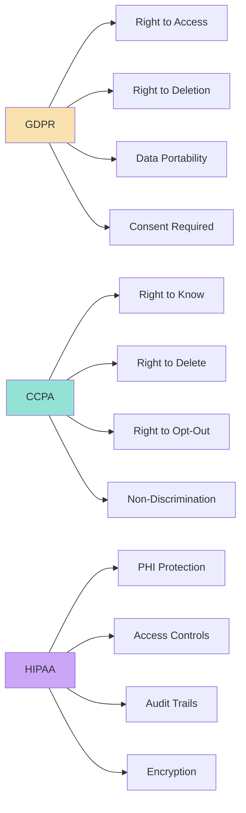

---

## 4. Encryption at Rest

### 4.1 Encryption Strategy

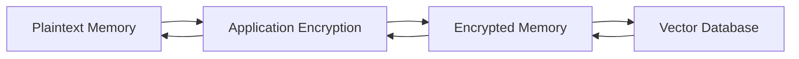

### 4.2 Implementation

```javascript
// Encrypt sensitive fields before storage
const crypto = require("crypto");

const ENCRYPTION_KEY = process.env.MEMORY_ENCRYPTION_KEY;

function encrypt(text) {
  const iv = crypto.randomBytes(16);
  const cipher = crypto.createCipheriv("aes-256-gcm", ENCRYPTION_KEY, iv);
  const encrypted = Buffer.concat([
    cipher.update(text, "utf8"),
    cipher.final()
  ]);
  const authTag = cipher.getAuthTag();
  return iv.toString("hex") + ":" + authTag.toString("hex") + ":" + encrypted.toString("hex");
}

function decrypt(encryptedText) {
  const [ivHex, authTagHex, encryptedHex] = encryptedText.split(":");
  const iv = Buffer.from(ivHex, "hex");
  const authTag = Buffer.from(authTagHex, "hex");
  const encrypted = Buffer.from(encryptedHex, "hex");
  const decipher = crypto.createDecipheriv("aes-256-gcm", ENCRYPTION_KEY, iv);
  decipher.setAuthTag(authTag);
  const decrypted = Buffer.concat([
    decipher.update(encrypted),
    decipher.final()
  ]);
  return decrypted.toString("utf8");
}

// In memory store
async function storeMemory(memory) {
  const encrypted = {
    ...memory,
    content: encrypt(memory.content)
  };
  return await db.save(encrypted);
}

async function getMemory(id) {
  const encrypted = await db.get(id);
  return {
    ...encrypted,
    content: decrypt(encrypted.content)
  };
}
```

### 4.3 Key Management

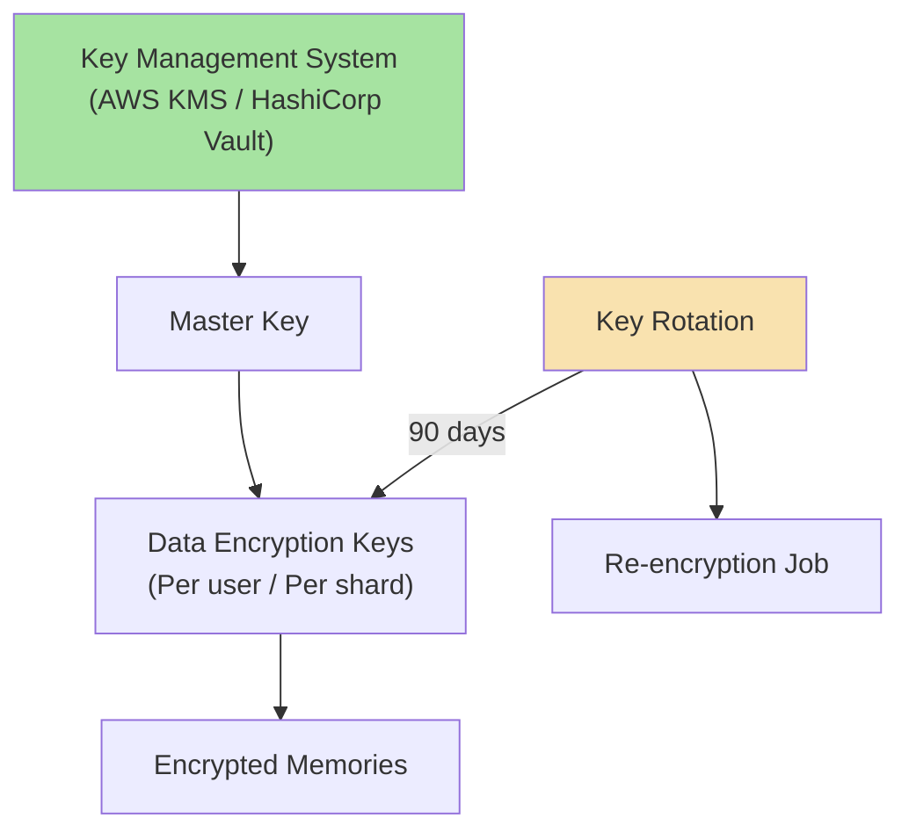

---

## 5. Caching for Latency Optimization

### 5.1 Cache Strategy

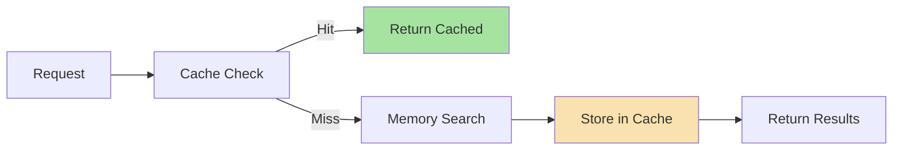

### 5.2 Cache Implementation

```javascript
// In-memory cache with TTL
class MemoryCache {
  constructor() {
    this.cache = new Map();
    this.ttl = 5 * 60 * 1000;  // 5 minutes
  }
  
  set(key, value) {
    this.cache.set(key, {
      value,
      expiresAt: Date.now() + this.ttl
    });
  }
  
  get(key) {
    const entry = this.cache.get(key);
    if (!entry) return null;
    
    if (Date.now() > entry.expiresAt) {
      this.cache.delete(key);
      return null;
    }
    
    return entry.value;
  }
  
  invalidate(key) {
    this.cache.delete(key);
  }
}

const memoryCache = new MemoryCache();

// Cached profile lookup
async function getUserProfile(userId) {
  const cached = memoryCache.get(`profile:${userId}`);
  if (cached) return cached;
  
  const profile = await memoryDatabase.getUserProfile(userId);
  memoryCache.set(`profile:${userId}`, profile);
  return profile;
}
```

### 5.3 Production: Redis Cache

```javascript
// For production, use Redis
const Redis = require("ioredis");
const redis = new Redis(process.env.REDIS_URL);

async function getCachedProfile(userId) {
  const key = `mem:profile:${userId}`;
  const cached = await redis.get(key);
  
  if (cached) {
    return JSON.parse(cached);
  }
  
  const profile = await memoryDatabase.getUserProfile(userId);
  await redis.setex(key, 300, JSON.stringify(profile));  // 5 min TTL
  return profile;
}
```

### 5.4 Cache Invalidation Strategy

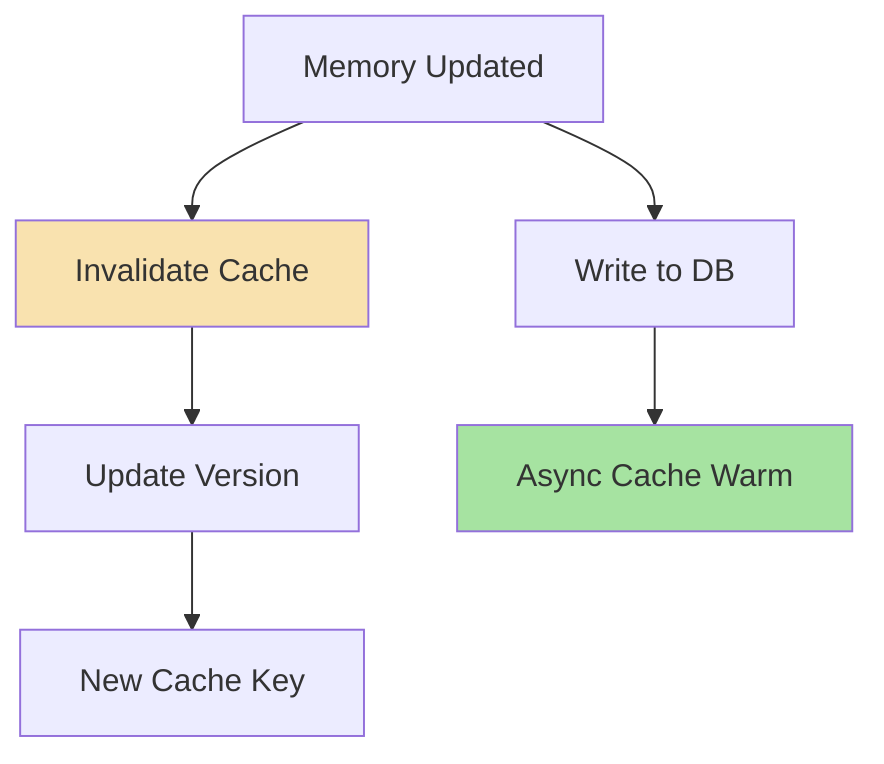

```javascript
// Cache with versioned keys for proper invalidation
class VersionedCache {
  async get(key) {
    const version = await this.getVersion(key);
    const cached = await redis.get(`${key}:v${version}`);
    return cached ? JSON.parse(cached) : null;
  }
  
  async set(key, value) {
    const version = await this.getVersion(key);
    await redis.setex(`${key}:v${version}`, 300, JSON.stringify(value));
  }
  
  async invalidate(key) {
    await this.incrementVersion(key);
  }
}
```

---

## 6. Hit-Score Tracking & Agentic Retrieval

### 6.1 Memory Hit Tracking

```javascript
// Track every time a memory is retrieved
async function searchMemories(userId, query, options = {}) {
  const results = await memory.search(query, { userId, ...options });
  
  // Record hits for retrieved memories
  for (const memory of results) {
    await memoryStore.recordHit(memory.id);
  }
  
  return results;
}

async function recordHit(memoryId) {
  await memoryStore.update(memoryId, {
    lastAccessedAt: new Date().toISOString(),
    $inc: { accessCount: 1 }
  });
}
```

### 6.2 Agentic Memory Search

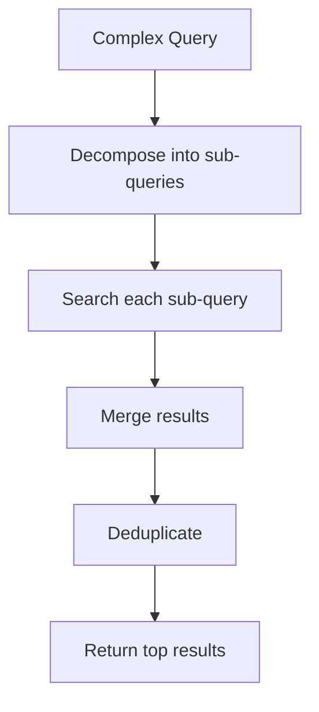

```javascript
async function agenticMemorySearch(userId, query) {
  let context = [];
  
  for (let step = 0; step < 3; step++) {
    // Generate next search query based on what we know
    const searchQuery = await generateSearchQuery(query, context);
    
    // Search memories
    const memories = await searchMemories(userId, searchQuery);
    context.push(...memories);
    
    // Check if we have enough info
    const complete = await shouldStopSearching(query, context);
    if (complete) break;
  }
  
  return deduplicateMemories(context);
}
```

### 6.3 Eager Loading / Prefetching

```javascript
// Pre-fetch likely memories before user asks
async function prefetchMemories(userId, context) {
  // Based on session context, predict what might be needed
  const predictions = await predictNextQueries(context);
  
  // Warm the cache
  for (const query of predictions) {
    await searchMemories(userId, query);
  }
}
```

---

## 7. mem0 Integration Patterns

### 7.1 Local vs Cloud Mode

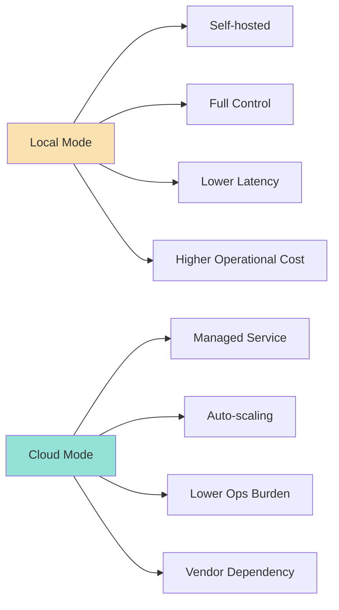

### 7.2 Custom Embeddings with mem0

```javascript
// Use custom embedding model with mem0
const memory = new Memory({
  // Custom embedding function
  embedder: async (texts) => {
    const response = await fetch("https://api.custom-embeddings.com/embed", {
      method: "POST",
      body: JSON.stringify({ texts })
    });
    return response.json();
  },
  
  // Custom vector store
  vectorStore: {
    type: "pinecone",
    indexName: "memories",
    namespace: "users"
  }
});
```

### 7.3 Graph Memory Extension

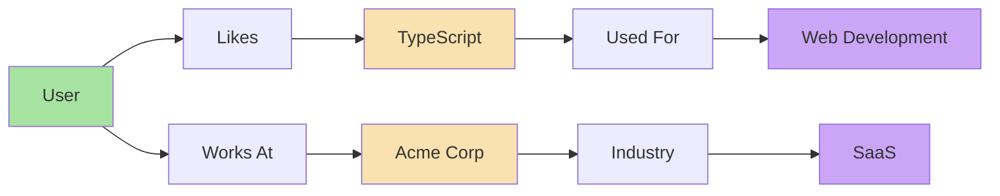

```javascript
// Enable graph memory in mem0
const memory = new Memory({
  graph: {
    enabled: true,
    // Custom graph schema
    schema: {
      entities: ["User", "Technology", "Company", "Project"],
      relations: ["LIKES", "WORKS_AT", "USED_FOR", "PART_OF"]
    }
  }
});

// Query graph
const graphResults = await memory.searchGraph(query, {
  userId: "user_123",
  depth: 2  // 2-hop relationships
});
```

---

## Common Mistakes

| Mistake | Effect | Fix |
|---------|--------|-----|
| No user isolation | Cross-user data leak | Always filter by userId in every operation |
| Storing PII without consent | Privacy violation | Implement consent checks, sanitize input |
| No deletion mechanism | Non-compliance | Implement complete memory deletion |
| No encryption at rest | Data breach risk | Encrypt sensitive memory fields |
| No cache expiration | Stale memories | Implement TTL on all cached data |
| Single-threaded dreaming | Blocked users | Use background job queues |
| No audit logging | Compliance gaps | Log all memory operations |
| Ignoring consent granularity | Over-collection | Provide per-feature consent options |

---

## Key Takeaways

1. **mem0 abstracts memory complexity** — use managed frameworks to avoid reinventing the wheel
2. **Multi-tenancy is mandatory** — every memory operation must include and enforce userId
3. **Privacy by design** — minimize PII, implement deletion, enforce consent
4. **Encryption at rest** — protect sensitive memories in storage
5. **Caching reduces latency** — cache frequent lookups with appropriate TTL
6. **Hit tracking enables eviction** — track access patterns for smart memory management
7. **Agentic retrieval handles complexity** — decompose queries for multi-step reasoning
8. **Compliance is ongoing** — automated retention, deletion, and audit logging

---

Managed memory frameworks accelerate development while providing enterprise-grade features for isolation, privacy, and scalability.

---

## Preview: Chapter 8

In the next chapter, we explore **Production Memory System Architecture** — covering the complete system architecture, data flow patterns, scaling considerations, and operational best practices for running agent memory at scale.