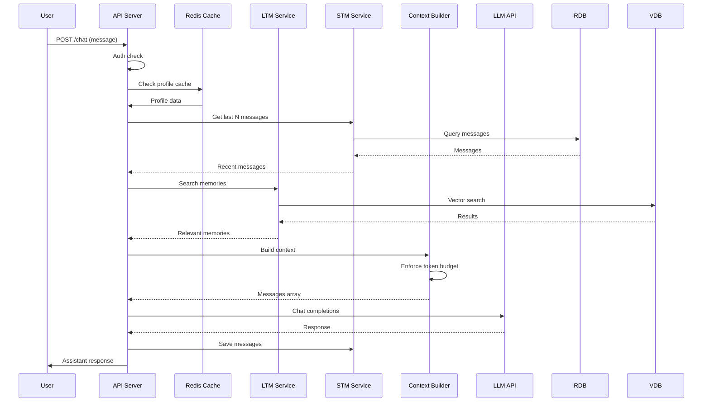
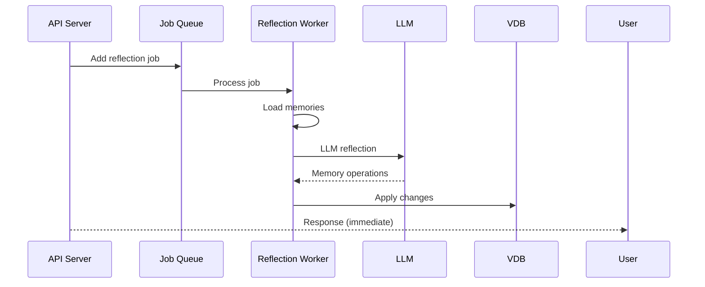
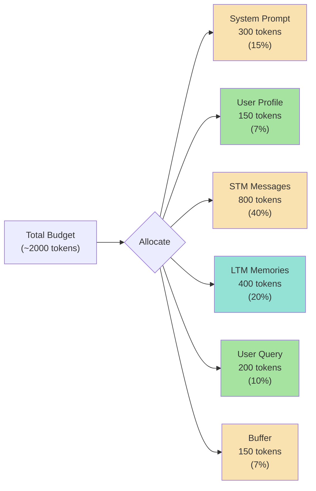
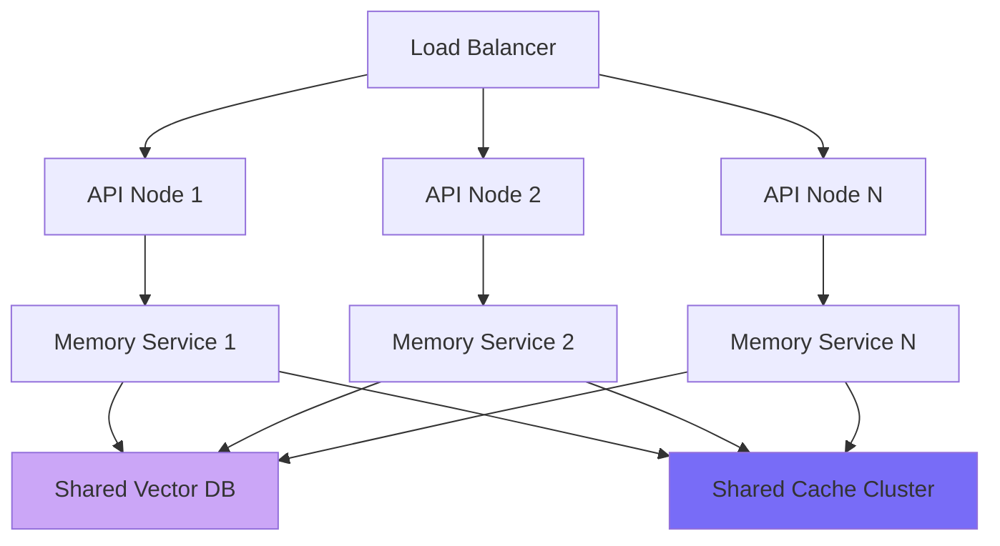
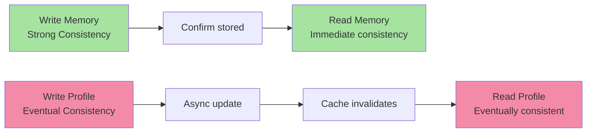
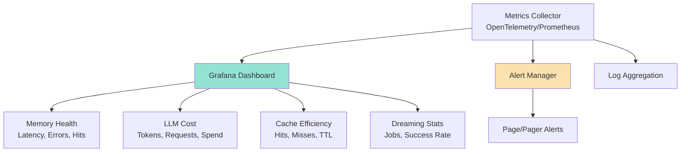

# Chapter 8: Production Memory System Architecture

## Core Concept

A production-grade agent memory system requires careful architectural design across infrastructure, data flow, consistency models, and operational concerns. This chapter covers the complete system architecture, data flow patterns, scaling considerations, and operational best practices.

---

## 1. Complete Memory System Architecture

### 1.1 High-Level Data Flow

```mermaid
diagram LR
    subgraph FrontEnd["Frontend / API Layer"]
        FE["User Request"]
    end
    
    subgraph MemoryLayer["Memory System Layer"]
        STM["STM Service<br/>Recent context"]
        LTM["LTM Service<br/>Vector memory"]
        PROFILE["Profile Service<br/>User settings"]
        CONTEXT["Context Builder<br/>Budget manager"]
    end
    
    subgraph Background["Background Layer"]
        DREAMING["Dreaming Service<br/>Memory reflection"]
        EVICTION["Eviction Service<br/>Cleanup jobs"]
        INDEXING["Indexing Service<br/>Embedding updates"]
    end
    
    subgraph Storage["Storage Layer"]
        VDB["Vector DB<br/>Memories + embeddings"]
        RDB["Relational DB<br/>Conversations"]
        CACHE["Cache<br/>Redis"]
        LOG["Immutable Log<br/>Audit trail"]
    end
    
    FE --> MemoryLayer
    MemoryLayer --> CONTEXT
    CONTEXT --> LTM
    CONTEXT --> STM
    CONTEXT --> PROFILE
    LTM --> VDB
    STM --> RDB
    PROFILE --> VDB
    
    CONTEXT -->|LLM Call| LLM["LLM / vLLM"]
    LLM --> FE
    
    DREAMING --> VDB
    EVICTION --> VDB
    EVICTION --> RDB
    INDEXING --> VDB
    
    VDB --> CACHE
    RDB --> CACHE
    
    LOG -.->|Append only| VDB
    LOG -.->|Append only| RDB
    
    style MemoryLayer fill:#94e2d5
    style Background fill:#786cf7
    style Storage fill:#f9e2af
```

### 1.2 Component Responsibilities

| Component | Responsibility |
|-----------|---------------|
| **API Layer** | Authentication, request routing, authorization |
| **STM Service** | Recent conversation storage/retrieval |
| **LTM Service** | Vector memory search, fact extraction |
| **Profile Service** | User preferences, settings |
| **Context Builder** | Token budgeting, context assembly |
| **Dreaming Service** | Background memory cleanup |
| **Eviction Service** | Memory aging, low-score removal |
| **Indexing Service** | Fresh embeddings for new memories |

---

## 2. Request Path: Synchronous Operations

### 2.1 Fast Request Path (Under 2 seconds)



### 2.2 Asynchronous Operations



---

## 3. Token Budget Management

### 3.1 Dynamic Budget Allocation



### 3.2 Budget Enforcement Logic

```javascript
function buildBudgetedContext(options) {
  const {
    systemPrompt,
    userProfile,
    stmMessages,
    ltmMemories,
    userQuery,
    totalBudget = 2000
  } = options;
  
  const budget = {
    system: Math.min(countTokens(systemPrompt), 400),
    profile: Math.min(countTokens(userProfile), 150),
    stm: Math.min(countTokens(stmMessages), 800),
    ltm: Math.min(countTokens(ltmMemories), 600),
    query: countTokens(userQuery),
    buffer: 100  // Safety margin
  };
  
  // Enforce total budget
  const totalUsed = Object.values(budget).reduce((a, b) => a + b, 0);
  if (totalUsed > totalBudget) {
    // Scale down non-essential components
    const scale = totalBudget / totalUsed;
    budget.ltm = Math.floor(budget.ltm * scale);
    budget.stm = Math.floor(budget.stm * scale);
  }
  
  return {
    messages: [
      { role: "system", content: systemPrompt },
      ...formatProfile(userProfile),
      ...stmMessages,
      ...formatMemories(ltmMemories),
      { role: "user", content: userQuery }
    ],
    budget
  };
}
```

---

## 4. Scaling Considerations

### 4.1 Horizontal Scaling



### 4.2 Caching Strategy

| Cache Level | TTL | Content | Size |
|-------------|-----|---------|------|
| **L1** | 5 min | User profile | Small |
| **L2** | 10 min | Recent memories | Medium |
| **L3** | 30 min | Compiled responses | Large |

### 4.3 Vector Database Scaling

```text
Sharded Vector DB Architecture:

Shard 0: Users A-M (alphabetical)
  ├─ Collection: memories_embedded_0
  └─ Embedded in: partition_00, partition_01, ...

Shard 1: Users N-Z (alphabetical)
  ├─ Collection: memories_embedded_1
  └─ Embedded in: partition_00, partition_01, ...

Each shard:
  - Replicates for HA
  - Indexes for fast search
  - Can be scaled independently
```

---

## 5. Consistency Models

### 5.1 Strong vs Eventual Consistency



### 5.2 Consistency Patterns

| Operation | Consistency | Reason |
|-----------|-------------|--------|
| **Load STM** | Strong | Need correct recent messages |
| **Profile read** | Eventual | Can tolerate brief staleness |
| **Memory search** | Strong | Must find correct memories |
| **Memory write** | Strong | Fact extraction must persist |
| **Memory reflection** | Async | No user-facing impact |

---

## 6. Monitoring & Observability

### 6.1 Key Metrics Dashboard



### 6.2 Essential Metrics

| Metric | Threshold | Alert |
|--------|-----------|-------|
| **Chat latency p95** | < 3s | Page if > 5s |
| **Memory search latency** | < 200ms | Page if > 500ms |
| **Cache hit ratio** | > 80% | Warn if < 70% |
| **LLM cost per request** | < $0.10 | Warn if > $0.20 |
| **Dreaming job success** | > 95% | Page if < 90% |
| **Memory consistency errors** | 0 | Page immediately |

### 6.3 Tracing Example

```javascript
// Distributed tracing
const span = tracer.startSpan("build_context", {
  attributes: {
    "user.id": userId,
    "session.id": sessionId,
    "query.length": userQuery.length
  }
});

try {
  const stm = await getSTM(userId);
  span.addEvent("stm_loaded", { count: stm.length });
  
  const ltm = await searchLTM(userId, query);
  span.addEvent("ltm_found", { count: ltm.length });
  
  const context = await buildContext(stm, ltm, query);
  span.setAttribute("context.tokens", context.tokenCount);
  
  return context;
} finally {
  span.end();
}
```

---

## 7. Failure Modes & Resilience

### 7.1 Memory System Failure Scenarios

| Failure | Impact | Mitigation |
|---------|--------|------------|
| **Vector DB down** | No LTM retrieval | Fallback: STM only, cached memories |
| **LLM outage** | Chat fails | Queue requests, return cached responses |
| **Cache miss storm** | High latency | Circuit breaker, graceful degradation |
| **Dreaming stuck** | Memory bloat | Monitor queue depth, alert on backlog |
| **Cost overrun** | Budget exceeded | Rate limiting, token budget caps |

### 7.2 Graceful Degradation

```javascript
async function resilientChat(userId, userQuery) {
  try {
    // Try full memory system
    const context = await buildLLMContext(userId, userQuery);
    return await callLLM(context);
    
  } catch (error) {
    if (error.type === "VectorDBError") {
      // Fallback to STM only
      const stmOnly = await buildSTMOnlyContext(userId, userQuery);
      return await callLLM(stmOnly);
    }
    
    if (error.type === "BudgetExceeded") {
      // Truncate context and retry
      const truncated = await buildTruncatedContext(userId, userQuery);
      return await callLLM(truncated);
    }
    
    // Unknown error - fail gracefully
    return {
      error: "Service temporarily unavailable",
      fallback: await getCachedResponse(userId, userQuery)
    };
  }
}
```

---

## 8. Data Pipeline: Ingestion & Indexing

### 8.1 Conversation Ingestion Flow


### 8.2 Batch Processing Pipeline

```javascript
// For high-throughput systems
async function batchProcessMemories(messages) {
  // 1. Batch extract facts
  const batchPrompt = messages.map((m, i) => `
    Message ${i}: ${m.content}
  `).join("\n");
  
  const facts = await extractFactsBatch(batchPrompt);
  
  // 2. Batch generate embeddings
  const embeddings = await generateEmbeddingsBatch(facts);
  
  // 3. Batch store in vector DB
  await vectorDb.batchInsert(facts.map((f, i) => ({
    ...f,
    embedding: embeddings[i]
  })));
  
  // 4. Update caches
  await updateMemoriesCache(facts);
}
```

---

## 9. Operational Best Practices

### 9.1 Deployment Checklist

- [ ] **Authentication**: Verify user ownership of all memory operations
- [ ] **Authorization**: Prevent cross-user data access
- [ ] **Budget Management**: Enforce token limits at LLM layer
- [ ] **Error Handling**: Graceful degradation for service failures
- [ ] **Monitoring**: Track latency, cost, cache efficiency, error rates
- [ ] **Debugging**: Trace context assembly and LLM calls
- [ ] **Privacy**: Data sanitization and consent management

### 9.2 Production Checklist

- [ ] **Scaling**: Horizontal scaling for high throughput
- [ ] **High Availability**: Multi-zone deployment with failover
- [ ] **Backup Strategy**: Regular data backups and restore testing
- [ ] **Security**: Encryption at rest, TLS for all communications
- [ ] **Compliance**: GDPR, CCPA, HIPAA requirements
- [ ] **Disaster Recovery**: Business continuity planning

### 9.3 Capacity Planning

| User Scale | Vector DB | Cache | LLM Calls | Jobs/Day |
|------------|-----------|-------|-----------|----------|
| 1K users | Single instance | 256MB | 10K | 1K |
| 10K users | 2 shards | 1GB | 100K | 10K |
| 100K users | 4 shards | 4GB | 1M | 100K |
| 1M users | 8+ shards | 16GB | 10M | 1M |

### 9.4 Cost Optimization

```javascript
// Track and optimize costs
const COST_MODEL = {
  stmTokens: 0.00001,   // $/token for STM context
  ltmTokens: 0.00001,   // $/token for LTM context
  extractionTokens: 0.0001,  // $/token for fact extraction
  dreamTokens: 0.001,   // $/token for dreaming LLM calls
};

function estimateCost(request) {
  const { stmTokens, ltmTokens, memoriesCount, dreamJob } = request;
  
  return (
    (stmTokens * COST_MODEL.stmTokens) +
    (ltmTokens * COST_MODEL.ltmTokens) +
    (memoriesCount * 50 * COST_MODEL.extractionTokens) +  // ~50 tokens per extraction
    (dreamJob ? 1000 * COST_MODEL.dreamTokens : 0)  // One dream job per request batch
  );
}
```

---

## Common Mistakes

| Mistake | Effect | Fix |
|---------|--------|-----|
| No circuit breakers | Cascading failures | Implement timeout and fallback logic |
| Unlimited budget | Cost overruns | Enforce hard token limits |
| No cache invalidation | Stale data | Add versioning or explicit invalidation |
| Blocking dreaming | Slow responses | Use job queues with async workers |
| No monitoring | Issues go undetected | Implement comprehensive metrics and alerts |
| Weak authentication | Security breach | Add auth checks at every layer |
| No backup strategy | Data loss | Implement regular backups and restore testing |

---

## Key Takeaways

1. **Architecture has 3 layers** — API layer (fast), Memory layer (core operations), Background layer (maintenance)
2. **Token budgeting is critical** — proactively manage context size against model limits
3. **Scale horizontally** — design stateless services that share storage and cache
4. **Choose consistency per operation** — STM and memory search need strong consistency; profiles can be eventual
5. **Monitor comprehensively** — track latency, cost, cache efficiency, and error rates
6. **Plan for failure** — implement graceful degradation and circuit breakers
7. **Operationalize privacy** — encryption, deletion, consent, and audit trails are ongoing requirements
8. **Cost is tied to token usage** — every feature (STM, LTM, dreaming) has a token cost that must be managed

---

A production memory system balances performance, reliability, privacy, and cost through thoughtful architectural design and operational discipline.

---

## Preview: Chapter 9

In the next chapter, we explore **Memory System Monitoring & Optimization** — covering observability patterns, performance tuning, and cost management strategies for production memory systems.