# Lecture 19 Complete Notes: Agent Memory Systems

## Executive Summary

Lecture 19 covers **Agent Memory Systems** — the architecture and implementation of durable memory for AI agents that survives sessions without poisoning LLM context windows. This lecture transforms stateless LLM APIs into stateful agents through three complementary memory layers: **Short-Term Memory (STM)** for immediate context, **Long-Term Memory (LTM)** for persistent facts, and **Memory Dreaming** for self-maintenance.

**Key Question**: How do you give an agent durable memory while managing token costs, attention dilution, and operational complexity?

**Answer**: Implement a **hybrid memory architecture** with STM (sliding windows), LTM (vector + graph), and managed abstractions (mem0), all operating within strict token budgets, with background dreaming for self-maintenance and production-grade observability.

---

## Table of Contents

1. [Core Architecture Overview](#1-core-architecture-overview)
2. [Memory System Fundamentals](#2-memory-system-fundamentals)
3. [Short-Term Memory (STM)](#3-short-term-memory-stm)
4. [Long-Term Memory (LTM)](#4-long-term-memory-ltm)
5. [Dynamic Context Assembly](#5-dynamic-context-assembly)
6. [Memory Eviction, Contradictions & Decay](#6-memory-eviction-contradictions--decay)
7. [Claude-Style Memory Dreaming](#7-claude-style-memory-dreaming)
8. [Managed Memory & Multi-tenancy](#8-managed-memory--multi-tenancy)
9. [Production Architecture](#9-production-architecture)
10. [Glossary](#10-glossary)
11. [Self-Check Questions](#11-self-check-questions)
12. [Key Resources & Next Steps](#12-key-resources--next-steps)

---

## 1. Core Architecture Overview

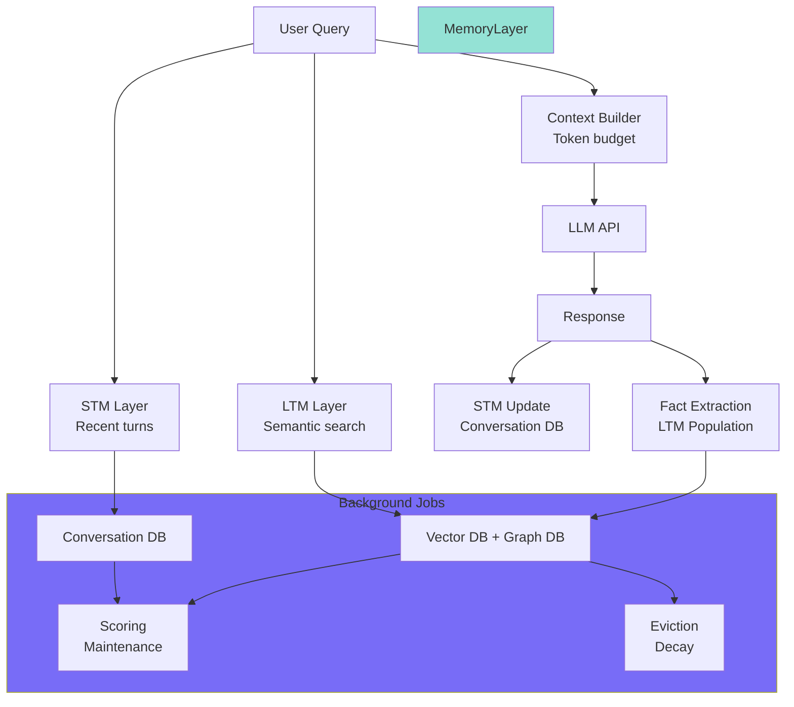

**System Principles**:
- **Stateless → Stateful**: Application manages conversation state, not the model
- **Context Budget**: Every token has latency, bandwidth, and cost implications
- **Layered Memory**: Each layer serves distinct purposes with appropriate storage and retrieval
- **Background Maintenance**: Memory cleanup operates independently of user-facing requests

---

## 2. Memory System Fundamentals

### 2.1 The Stateless Nature of LLM APIs

Most LLMs are **stateless**: each API request is independent and doesn't automatically remember previous conversations.

```text
Request 1 ──→ LLM
              ↓
           Response

Request 2 ──→ LLM
              ↓
         Does not automatically
         contain Request 1
```

### 2.2 The Complete Context Formula

```math
Context = System_Prompt + STM + LTM + Query
```

### 2.3 Memory Layer Comparison

| Layer | Storage | Size | Cost | Purpose |
|-------|---------|------|------|---------|
| **System** | Prompt | 150-400 tokens | Small, fixed | Role, instructions |
| **STM** | Conversation DB | 800-1,200 tokens | Medium, predictable | Recent conversation |
| **LTM** | Vector DB | 300-600 tokens | Variable, expensive | Relevant persistent facts |
| **Query** | Prompt | 200 tokens | Small, variable | Current request |

**Total**: ~2,000 tokens well within Claude 3.7 (128K) and GPT-4o (128K) limits

---

## 3. Short-Term Memory (STM)

### 3.1 Core Concept: Sliding Window

**Core Idea**: Keep sliding window of recent messages, not entire conversation.

```mermaid
flowchart LR
    A["Message 1"] --> B["Message 2"]
    B --> C["Message 3"]
    C --> D["..."]
    D --> E["Message N"]
    E --> F["Message N+1"]
    F -.->> B
    F -.->> C
    F -.->> D
    F -.->> E
    
    style A fill:#f38ba8
    style B fill:#a6e3a1
    style C fill:#a6e3a1
    style F fill:#a6e3a1
```

The oldest message (Message 1) scrolls out of the window, new messages enter on the right.

### 3.2 Implementation Patterns

#### Database-Sliding Window

```text
Messages stored in conversation table:
├─ chat_messages(session_id, message_id, role, content, created_at)

Query:
SELECT role, content 
FROM chat_messages 
WHERE session_id = ? 
ORDER BY created_at DESC 
LIMIT 10
```

#### Token-Aware Windowing (Production)

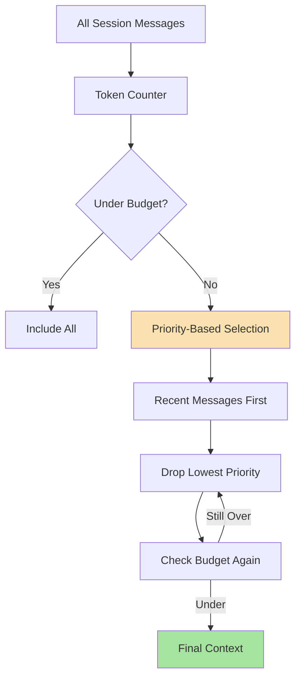

#### Database-Backed STM with Priority

```javascript
// Pseudo code: Token-aware sliding window
async function buildSTMContext(userId, sessionId) {
    // 1. Load ALL messages for the session (chronological)
    const allMessages = await db.messages.find({ sessionId })
        .sort({ createdAt: 1 })  // Oldest first
    
    // 2. Build priority queue with scores
    const priorities = new PriorityQueue((a, b) => b.priority - a.priority);
    
    let totalTokens = 0;
    const budget = 800;  // 800-token STM budget
    
    for (const msg of allMessages) {
        const tokens = estimateTokenCount(msg.content);
        const priority = calculatePriority(msg);
        
        priorities.push({
            msg,
            tokens,
            priority,
            cumulative: totalTokens + tokens
        });
        
        totalTokens += tokens;
    }
    
    // 3. If under budget, return all
    if (totalTokens <= budget) {
        return allMessages;
    }
    
    // 4. Drop lowest priority messages
    const selected = [];
    let usedTokens = 0;
    
    while (!priorities.isEmpty() && usedTokens < budget) {
        const item = priorities.pop();  // Highest priority first
        if (usedTokens + item.tokens <= budget) {
            selected.push(item.msg);
            usedTokens += item.tokens;
        }
    }
    
    // 5. Re-sort chronologically
    return selected.sort((a, b) => a.createdAt - b.createdAt);
}

function calculatePriority(msg) {
    let score = 0;
    
    // Recent messages have higher priority
    const ageHours = (Date.now() - msg.createdAt) / (1000 * 3600);
    score += Math.max(0, 10 - ageHours);  // 10 points if < 1 hour, 0 after 10 hours
    
    // User messages have higher priority than assistant
    if (msg.role === "user") score += 5;
    
    // Critical keywords boost priority
    const critical = ["urgent", "important", "remember", "never"];
    if (critical.some(kw => msg.content.toLowerCase().includes(kw))) {
        score += 15;
    }
    
    return score;
}
```

### 3.3 Key Benefits of STM

- **Solves quadratic growth**: Context window doesn't grow linearly with conversation
- **Maintains context**: Recent turns remain relevant for the current discussion
- **Predictable cost**: Fixed token budget allocation for recent messages

### 3.4 STM Failure Points

| Failure | Impact | Mitigation |
|---------|--------|------------|
| Database down | STM unavailable | Local cache fallback |
| Slow query | High latency | Indexing + caching |
| Session lost | Conversation restart | Session persistence |

### 3.5 STM Best Practices

```javascript
// Production STM with caching
class STMService {
    constructor(options = {}) {
        this.cache = new RedisCache({ ttl: 300 });  // 5 min
        this.maxMessages = options.maxMessages || 10;
        this.maxTokens = options.maxTokens || 800;
    }
    
    async getMessages(sessionId) {
        // Check cache first
        const cached = await this.cache.get(`stm:${sessionId}`);
        if (cached) return cached;
        
        // Query database
        const messages = await this.db.find({ sessionId })
            .sort({ createdAt: -1 })
            .limit(this.maxMessages);
        
        // Cache and return
        await this.cache.set(`stm:${sessionId}`, messages);
        return messages;
    }
    
    async addMessage(sessionId, message) {
        // Write to DB
        await this.db.insert({ ...message, sessionId });
        
        // Invalidate cache
        await this.cache.invalidate(`stm:${sessionId}`);
    }
}
```

---

## 4. Long-Term Memory (LTM)

### 4.1 LTM Taxonomy

LTM has four distinct types:

| Memory Type | Description | Storage | Retrieval | Examples |
|-------------|-------------|---------|-----------|----------|
| **Semantic** | Facts, preferences, attributes | Key-value / Vector | Semantic search | "Prefers TypeScript", "Allergic to nuts" |
| **Episodic** | Events, chronological actions | Time-series DB | Temporal range | "Last order was $500", "First login on Jan 5" |
| **Graph** | Entity relationships | Graph DB | Graph traversal | "Works at → Company X → Industry → Tech" |
| **Temporal** | Time-aware, validity windows | Time-series DB | Temporal query | "Worked at Company X from 2020-2023" |

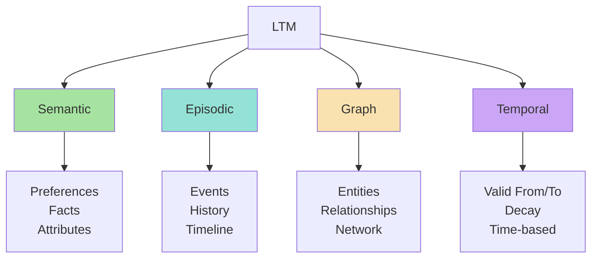

### 4.2 The Fact Extraction Pipeline

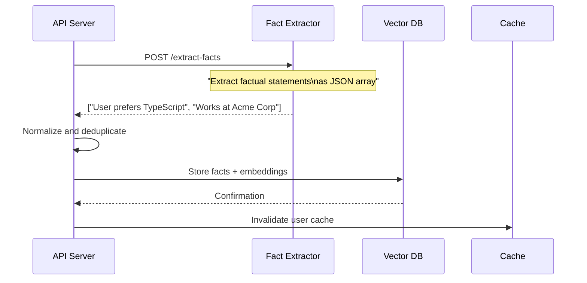

```javascript
// Pseudo code: Memory extraction pipeline
async function extractAndStoreMemories(userId, userQuery, assistantResponse) {
    // 1. Combine conversation pair
    const messages = [
        { role: "user", content: userQuery },
        { role: "assistant", content: assistantResponse }
    ];
    
    // 2. Prompt LLM to extract facts
    const facts = await llm.generate({
        task: "fact_extraction",
        context: messages,
        response_format: { type: "json_object" }
    });
    
    // Example LLM response:
    // { "facts": [
    //   {"content": "User prefers TypeScript", "confidence": 0.95, "category": "preference"},
    //   {"content": "User is debugging build errors", "confidence": 0.80, "category": "current_task"}
    // ]}
    
    // 3. For each extracted fact
    for (const fact of facts) {
        // Check if similar memory already exists
        const existing = await checkExistingMemory(userId, fact.content);
        
        if (existing && isDuplicate(existing, fact)) {
            // Update access stats
            await updateMemoryStats(existing.id);
        } else {
            // Create new memory with embedding
            const embedding = await generateEmbedding(fact.content);
            await createMemory({
                userId,
                content: fact.content,
                confidence: fact.confidence,
                category: fact.category,
                embedding
            });
        }
    }
}
```

### 4.3 LTM Retrieval Process

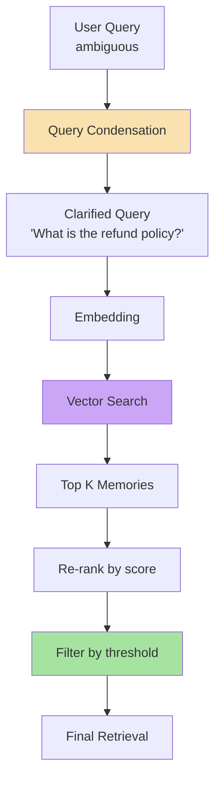

1. **Query condensation**: "And for shoes?" → "What is the refund policy for shoes?"
2. **Vector search**: Embed query, find semantically relevant memories in vector space
3. **Re-ranking**: Adjust scores based on recency, hit count, confidence
4. **Threshold filtering**: Only return memories with similarity > minimum threshold
5. **Context assembly**: Merge with STM and query for final prompt

### 4.4 Key Insight

LTM answers: **"What important information should I remember about this user?"**

**Not** every conversation detail — only distilled, useful facts.

### 4.5 Temporal Memory

```javascript
// Temporal memory with validity windows
const memory = {
    id: "mem_001",
    userId: "user_123",
    content: "Works at Acme Corp as Senior Engineer",
    type: "temporal",
    validity: {
        validFrom: "2023-06-01",   // When fact became true
        validTo: null               // Still true (or date when it ended)
    },
    metadata: {
        source: "conversation_2024-08-15",
        confidence: 0.95
    }
};
```

---

## 5. Dynamic Context Assembly

### 5.1 Dynamic Budget Allocation

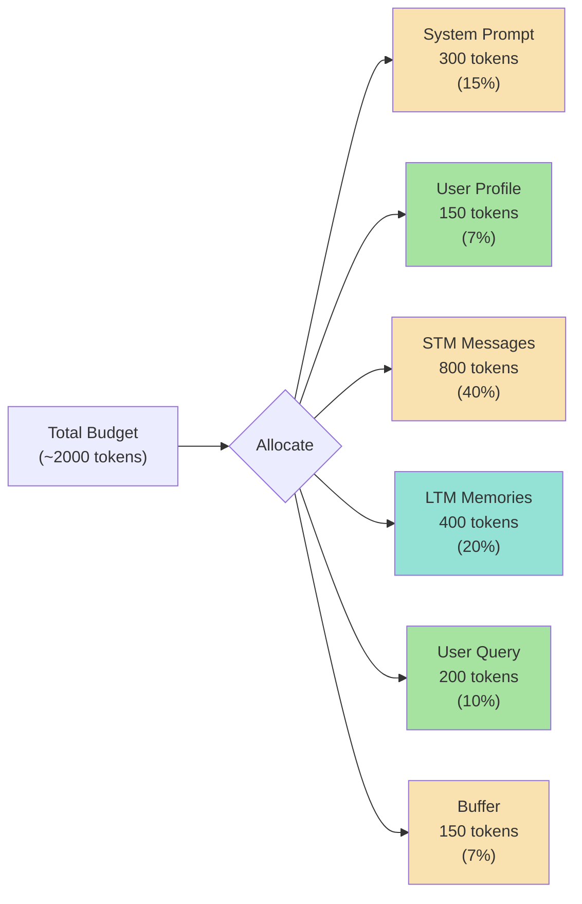

### 5.2 Budget Enforcement Logic

```javascript
function buildBudgetedContext(options) {
    const {
        systemPrompt,
        userProfile,
        stmMessages,
        ltmMemories,
        userQuery,
        totalBudget = 2000
    } = options;
    
    const budget = {
        system: Math.min(countTokens(systemPrompt), 400),
        profile: Math.min(countTokens(userProfile), 150),
        stm: Math.min(countTokens(stmMessages), 800),
        ltm: Math.min(countTokens(ltmMemories), 600),
        query: countTokens(userQuery),
        buffer: 100  // Safety margin
    };
    
    // Enforce total budget
    const totalUsed = Object.values(budget).reduce((a, b) => a + b, 0);
    if (totalUsed > totalBudget) {
        // Scale down non-essential components
        const scale = totalBudget / totalUsed;
        budget.ltm = Math.floor(budget.ltm * scale);
        budget.stm = Math.floor(budget.stm * scale);
    }
    
    return {
        messages: [
            { role: "system", content: formatPrompt(systemPrompt, profile) },
            ...stmMessages,
            ...ltmMemories,
            { role: "user", content: userQuery }
        ],
        budget
    };
}
```

### 5.3 Multi-Tier Retrieval

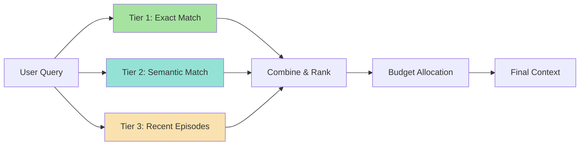

### 5.4 Query Condensation Pattern

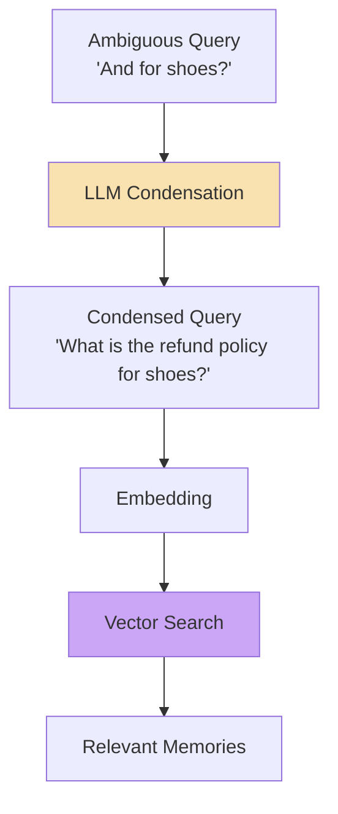

```javascript
// Query condensation for better retrieval
async function condenseQuery(query, recentMessages) {
    const prompt = `
The user's query may depend on context from the recent conversation.
Rewrite the query into a standalone question that doesn't require
conversational context. If the query is already standalone, 
return it unchanged.

Recent conversation: ${recentMessages.slice(-4).join("\n")}
User query: ${query}

Standalone question:
`;
    
    return await llm.generate({ prompt, temperature: 0.0 });
}
```

### 5.5 Common Mistakes & Fixes

| Mistake | Effect | Fix |
|---------|--------|-----|
| No token counting | Prompt truncation | Use tokenizer library (tiktoken) |
| Equal weight to all parts | Low-value facts dominate | Implement scoring for memory relevance |
| No fallback on LLM | Broken pipeline | Fallback to raw query |
| No budget enforcement | Context overflow | Hard cap tokens, trim LTM first |

---

## 6. Memory Eviction, Contradictions & Decay

### 6.1 Memory Scoring for Eviction

Each memory has a dynamic relevance score that determines eviction priority.

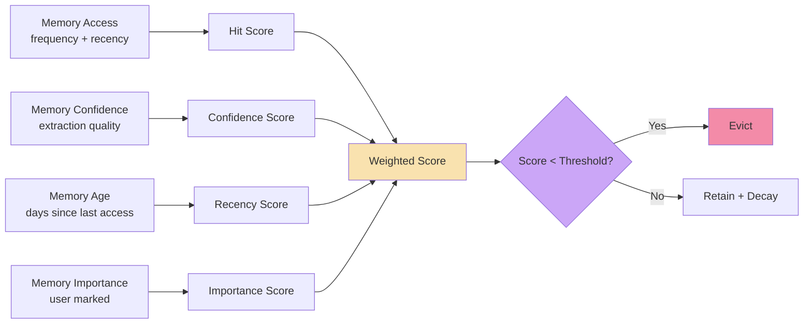

### 6.2 Scoring Function

```javascript
// Relevance scoring for eviction decisions
function calculateMemoryScore(memory) {
    // Base hit score: log-scaled to prevent domination by old high-count memories
    const hitScore = Math.log(memory.hitCount + 1) * 10;
    
    // Recency score: memory decays linearly over time
    const daysSinceAccess = (Date.now() - memory.lastAccessedAt) / (1000 * 3600 * 24);
    const recencyScore = Math.max(0, 30 - daysSinceAccess);  // Full score for 0 days, zero at 30 days
    
    // Confidence decay: older memories lose confidence
    const confidenceScore = memory.confidence * 10;
    
    // Importance multiplier: user can explicitly mark important memories
    const importance = memory.importance || 1;  // 0.5 (low) to 2.0 (high)
    
    // Composite score
    const rawScore = (hitScore + recencyScore + confidenceScore) * importance;
    
    // Decay factor for long-term staleness
    const ageDays = (Date.now() - memory.createdAt) / (1000 * 3600 * 24);
    const decayFactor = Math.pow(0.99, ageDays);  // 1% decay per day
    
    return rawScore * decayFactor;
}
```

### 6.3 Temporal Validity Windows

```javascript
// Temporal memory with validity windows
const temporalScoring = {
    valid: memory => {
        const now = new Date();
        if (memory.validity.validTo && memory.validity.validTo < now) {
            return 0;  // Expired
        }
        if (memory.validity.validFrom && memory.validity.validFrom > now) {
            return 0;  // Not yet valid
        }
        return 1;  // Valid
    },
    
    confidenceDecay: (baseConfidence, ageDays) => {
        return baseConfidence * Math.pow(0.98, ageDays);
    }
};
```

### 6.4 Contradiction Detection and Resolution

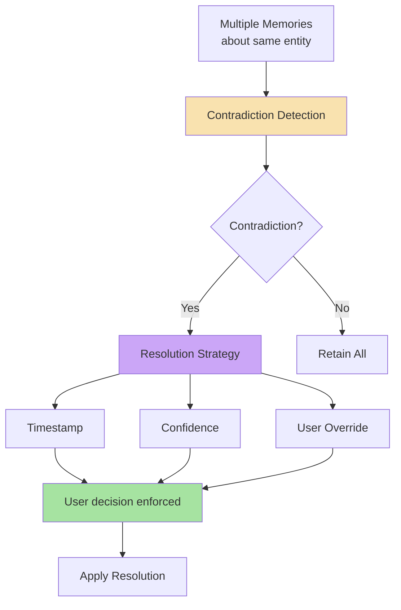

**Resolution strategies**:
1. **Timestamp-based**: Newer fact wins (most recent information)
2. **Confidence-based**: Higher-confidence extraction wins
3. **User confirmation**: Flag for explicit user resolution
4. **LLM synthesis**: Intelligently merge contradictory facts

---

## 7. Claude-Style Memory Dreaming

### 7.1 Why Dreaming is Needed

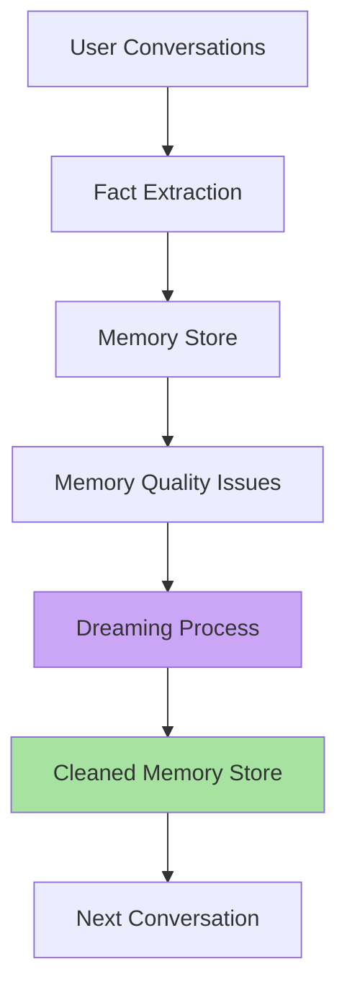

### 7.2 Background Execution (Critical)

```javascript
// NEVER in the main request path
async function handleChat(userId, userQuery) {
    // Fast path - returns within 2s
    const context = await loadContext(userId);
    const response = await callLLM(context);
    
    await saveMessage(userId, userQuery, response);
    await extractAndStoreMemories(userId, userQuery);
    
    // Queue background reflection — do NOT await
    await memoryQueue.add("reflection", { userId });
    
    return response;  // Returns immediately
}

// Worker processes later (separate process)
memoryQueue.process("reflection", async job => {
    const result = await runMemoryReflection(job.data.userId);
    await logDreamingOutcome(userId, result);
});
```

### 7.3 Dreaming Process (5 Steps)

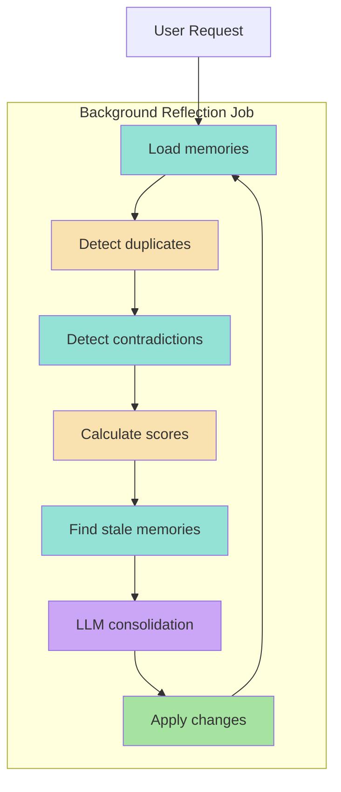

### 7.4 LLM Reflection with Structured Output

```javascript
async function reflectOnMemories(memories) {
    const prompt = `
You are an expert memory consolidation system. Analyze these stored memories.

Identify:
1. Duplicates (same fact stated differently)
2. Contradictions (opposing facts)
3. Outdated information (no longer true)
4. Memories that should be merged
5. Memories that should be removed

Return JSON only:
{
    "merge": [["mem_1", "mem_2"]],
    "replace": [{"old": "mem_3", "new": "updated content"}],
    "delete": ["mem_5", "mem_8"],
    "retain": ["mem_1", "mem_2", "mem_3"]
}

Memories: ${JSON.stringify(memories)}
`;
    
    const response = await callLLM({
        task: "memory_consolidation",
        temperature: 0.0,      // Deterministic
        maxTokens: 4000,
        response_format: { type: "json_object" }
    });
    
    return JSON.parse(response);
}
```

### 7.5 Dreaming Schedule

| Schedule | Strategy | Use Case |
|----------|----------|----------|
| **Every 24 hours** | Batch processing | Small user base (< 1K) |
| **Hourly** | Incremental | High traffic (> 10K) |
| **On large session** | Event-driven | Many new memories in session |
| **Weekly full** | Comprehensive | Full scan for all users |

### 7.6 Dreaming Failure Modes

| Failure | Impact | Mitigation |
|---------|--------|------------|
| **Invalid JSON** | Dreaming fails | JSON mode + retry + fallback |
| **Invalid memory IDs** | Runtime error | Validate before apply |
| **Contradiction unresolved** | Inconsistent state | Keep both, flag for review |
| **Queue failures** | Backlog, no cleanup | Exponential backoff, alerts |

---

## 8. Managed Memory & Multi-tenancy

### 8.1 mem0 Framework Overview

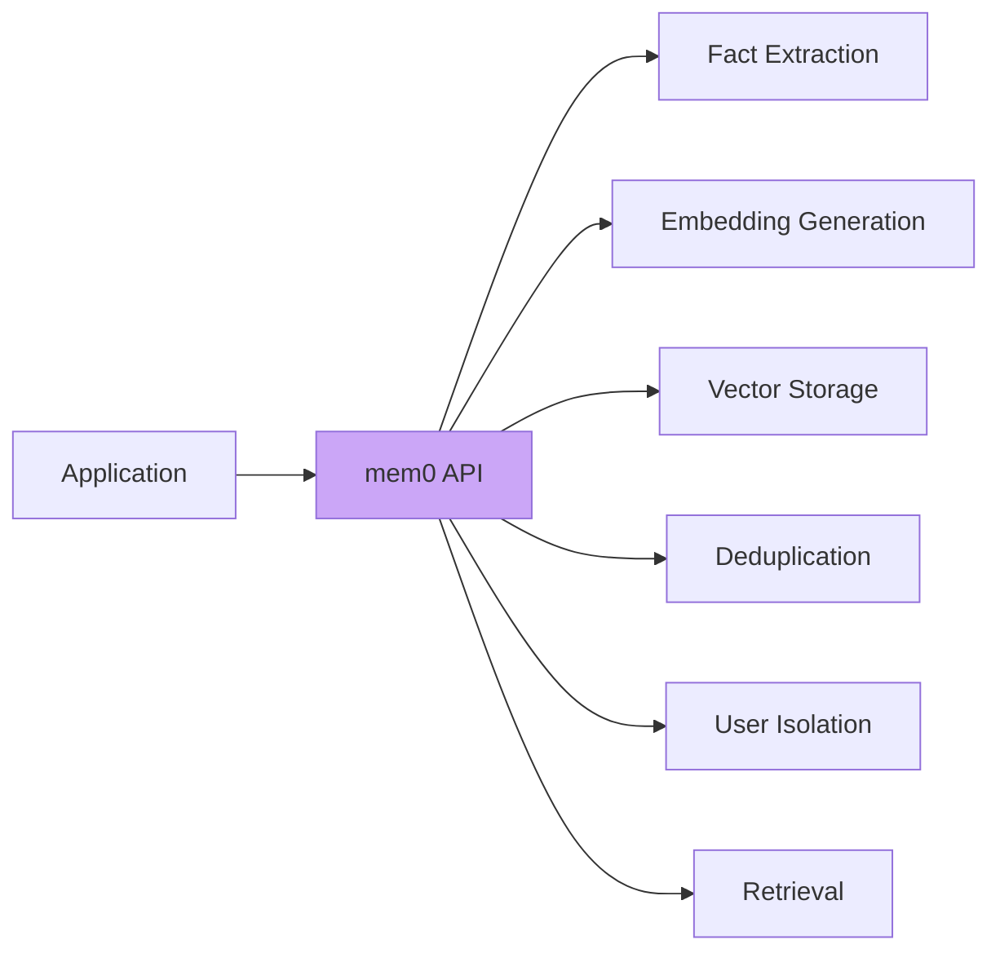

**mem0** abstracts away fact extraction, embeddings, vector DB operations, deduplication, and user isolation.

### 8.2 Multi-Tenant Isolation Patterns

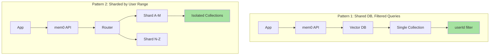

### 8.3 Privacy & Compliance

#### Data Types & Sensitivity

| Type | Sensitivity | PII Minimization |
|------|-------------|-----------------|
| **PII** | High | Mask/encrypt/remove |
| **Health** | Critical | Separate vault |
| **Financial** | Critical | Tokenize/never store |
| **Preferences** | Low | Store directly |
| **Behavioral** | Medium | Aggregate, don't store raw |

#### PII Sanitization

```javascript
function sanitizeForMemory(content) {
    return content
        .replace(/\b\d{3}-\d{2}-\d{4}\b/g, "[SSN-REDACTED]")
        .replace(/\b\d{4}[\s-]?\d{4}[\s-]?\d{4}[\s-]?\d{4}\b/g, "[CARD-REDACTED]")
        .replace(/[a-zA-Z0-9._%+-]+@[^\s@]+\.[a-zA-Z]{2,}/g, "[EMAIL-REDACTED]")
        .replace(/\b\d{3}[-.]?\d{3}[-.]?\d{4}\b/g, "[PHONE-REDACTED]");
}
```

#### Data Deletion (Right to be Forgotten)

```javascript
async function deleteUserMemory(userId) {
    // 1. Delete from vector DB
    await vectorDb.delete({ filter: { userId } });
    
    // 2. Delete from conversation store
    await conversationStore.delete({ filter: { userId } });
    
    // 3. Delete from mem0
    await memory.deleteUser(userId);
    
    // 4. Delete PII vault entries
    await piiVault.deleteUser(userId);
    
    // 5. Log for audit
    await auditLog.write({ event: "user_memory_deletion", userId });
    
    return { deleted: true };
}
```

### 8.4 Encryption at Rest

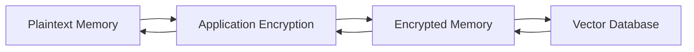

### 8.5 Retention Policies

| Data | Retention | Reason |
|------|-----------|--------|
| **Conversation logs** | 90 days | Debug/recovery |
| **Extracted memories** | 365 days | Active usefulness |
| **Audit logs** | 7 years | Compliance (SOX, etc) |
| **Session data** | 30 days | Debugging |

---

## 9. Production Architecture

### 9.1 Three-Layer Architecture

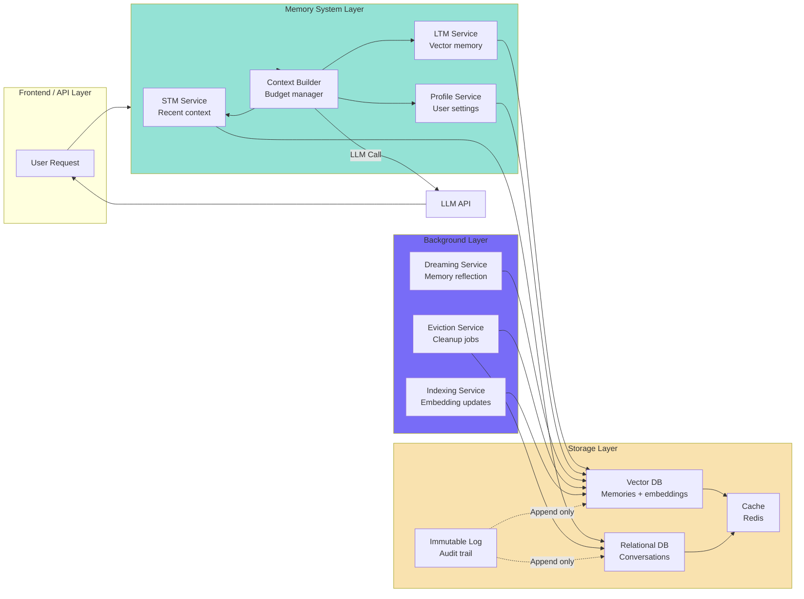

### 9.2 Complete Request Flow

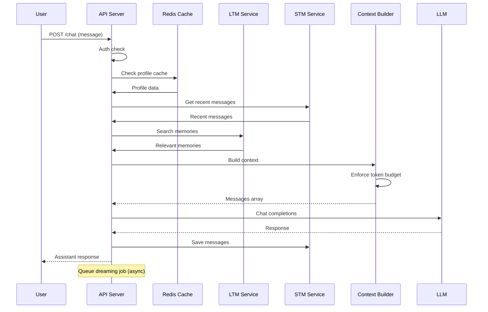

### 9.3 Key Technologies

| Layer | Technology | Role |
|-------|------------|------|
| **Vector Search** | PostgreSQL + pgvector | Semantic retrieval |
| **Memory Frameworks** | mem0 | Abstraction layer |
| **Background Jobs** | Celery / Redis Queue | Asynchronous processing |
| **Caching** | Redis / Memcached | Performance |
| **Tracing** | OpenTelemetry | Observability |
| **Metrics** | Prometheus + Grafana | Monitoring |

### 9.4 Scaling

| User Scale | Vector DB | Cache | LLM Calls | Jobs/Day |
|------------|-----------|-------|-----------|----------|
| 1K users | Single instance | 256MB | 10K | 1K |
| 10K users | 2 shards | 1GB | 100K | 10K |
| 100K users | 4 shards | 4GB | 1M | 100K |
| 1M users | 8+ shards | 16GB | 10M | 1M |

### 9.5 Consistency Models

| Operation | Consistency | Reason |
|-----------|-------------|--------|
| Load STM | Strong | Correct recent messages needed |
| Profile read | Eventual | Brief staleness acceptable |
| Memory search | Strong | Must find correct memories |
| Memory write | Strong | Fact extraction must persist |
| Memory reflection | Async | No user-facing impact |

### 9.6 Failure Modes & Graceful Degradation

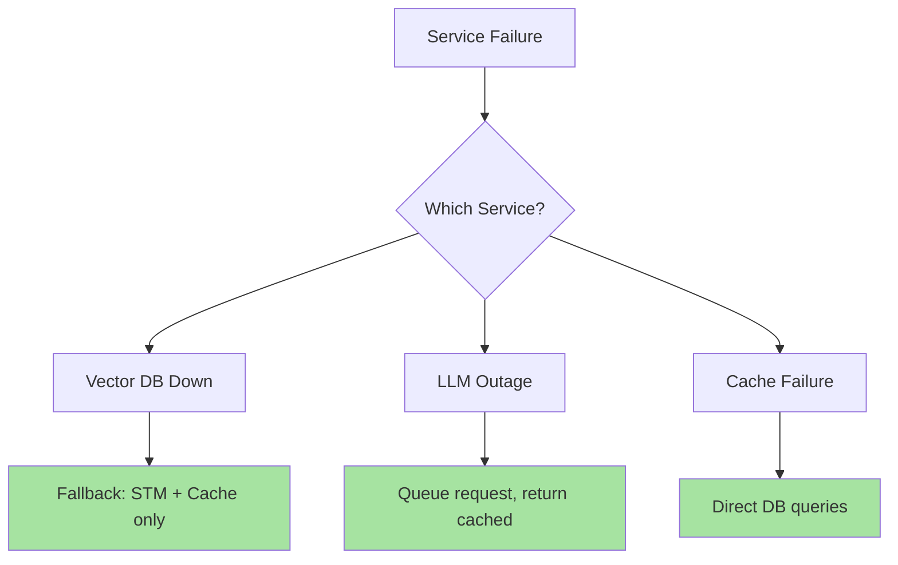

### 9.7 Operational Checklist

**Development**:
- [ ] Authentication for all memory endpoints
- [ ] User isolation enforced at query level
- [ ] Token budget limits configured
- [ ] Error handling with graceful degradation
- [ ] Monitoring: latency, cost, cache efficiency
- [ ] Debugging: trace context assembly
- [ ] Privacy: data sanitization + consent

**Production**:
- [ ] Horizontal scaling for high throughput
- [ ] Multi-zone HA with failover
- [ ] Backup + restore testing
- [ ] Encryption at rest + TLS in transit
- [ ] Compliance (GDPR, CCPA, HIPAA)
- [ ] Disaster recovery plan
- [ ] Incident response runbook

---

## 10. Glossary

| Term | Definition |
|------|------------|
| **STM** | Short-Term Memory - recent conversational context |
| **LTM** | Long-Term Memory - persistent facts and preferences |
| **Vector DB** | Database that stores embeddings for semantic search |
| **Query Condensation** | Rewriting ambiguous queries for retrieval |
| **Token Budget** | Limited context allocation per LLM call |
| **Memory Dreaming** | Background process that cleans and consolidates memories |
| **Dedup** | Removing duplicate memory entries |
| **Eviction** | Removing low-value memories based on scoring |
| **Hit-Score** | Tracks how frequently a memory is actually used |
| **Temporal Memory** | Time-aware facts with validity windows |
| **Contradiction Resolution** | Handling conflicting facts in memory |
| **PII Minimization** | Reducing personal data collection/storage |
| **Right to be Forgotten** | Legal requirement to delete user data |
| **RAG** | Retrieval-Augmented Generation |
| **mem0** | Managed memory framework for agent memory |

---

## 11. Self-Check Questions

### 11.1 Conceptual Understanding

1. **Explain the stateless nature of LLM APIs and why application-level memory is necessary.**
2. **Compare STM vs LTM in terms of purpose, size, retrieval pattern, and cost.**
3. **Why is query condensation essential for effective LTM retrieval?**
4. **How does a sliding window solve the context-growth problem?**
5. **What's the difference between semantic, episodic, graph, and temporal memory?**

### 11.2 Implementation Details

6. **Implement a basic STM system with sliding window and database persistence.**
7. **Design an LTM retrieval system using vector embeddings and semantic search.**
8. **Design the fact extraction pipeline that converts conversations to memory records.**
9. **Implement a token budget management system for context assembly.**
10. **Design and implement a memory scoring function for eviction decisions.**

### 11.3 Memory Maintenance

11. **Explain how you would implement memory dreaming (background reflection) and what operations it should perform.**
12. **How would you detect and resolve contradictions between stored memories?**
13. **Design a memory decay mechanism for temporal validity windows.**
14. **How would you implement incremental vs. full dreaming strategies?**
15. **Design a monitoring system for tracking dreaming effectiveness.**

### 11.4 Production & Compliance

16. **Design a production memory system for a chatbot handling 100K concurrent users.**
17. **How would you handle user authentication and memory isolation in a multi-tenant system?**
18. **Explain how you would implement data retention, deletion, and GDPR/CCPA compliance.**
19. **How would you monitor and optimize memory system performance (latency, cost, quality)?**
20. **Design an incident response plan for memory system failures (DB down, LLM outage).**

### 11.5 Key Formulas to Remember

- **Context Assembly**: `Context = System_Prompt + STM + LTM + Query`
- **Memory Score**: `(log(hitCount+1) * 10 + max(0, 30 - ageInDays) + confidence * 10) * importance * ageDecay`
- **Token Budget Allocation**: STM 40%, LTM 20%, Profile 7%, Query 10%, Buffer 7%, System 15%
- **Decay**: `score *= pow(0.99, ageInDays)`

---

## 12. Key Resources & Next Steps

### 12.1 Recommended Resources

- **Memory Design**: "Designing Agent Memory Systems" papers (Claude-style memory, mem0)
- **Vector Search**: PGVector documentation, Weaviate/Pinecone architectures
- **Production**: "Designing Data-Intensive Applications" (Martin Kleppmann)
- **LLM APIs**: Provider documentation (OpenAI, Anthropic, etc.)
- **Privacy**: GDPR, CCPA compliance documentation
- **Observability**: OpenTelemetry, Prometheus documentation

### 12.2 Extension Opportunities

- **Graph Memory**: Neo4j integration for relationship reasoning
- **Multi-modal Memory**: Image/audio memory alongside text
- **Hierarchical Memory**: Hot/cold/archive storage tiers
- **Memory APIs**: Standardized memory operations for other services
- **Trust & Safety**: Memory alignment with user intent verification

### 12.3 Research Directions

- **Memory Efficiency**: Better compression and storage algorithms
- **Temporal Reasoning**: Time-aware fact validity and decay
- **Meta-learning**: Learn optimal memory extraction strategies
- **Federated Memory**: Cross-device/user memory sharing with privacy

---

## Summary

These Lecture 19 notes provide a comprehensive guide to building **Agent Memory Systems** — the critical layer that transforms stateless LLM APIs into stateful, conversational agents. The system combines:

- **STM (Short-Term Memory)**: Sliding window of recent conversation turns in a relational database
- **LTM (Long-Term Memory)**: Persistent facts stored as vector embeddings with semantic search
- **Fact Extraction**: LLM-powered conversion of conversations into structured memory records
- **Context Assembly**: Token budget management to fit STM + LTM + Query within model limits
- **Scoring & Eviction**: Recency + frequency + confidence scoring for memory maintenance
- **Memory Dreaming**: Background LLM reflection for deduplication, contradiction resolution, and decay
- **Managed Frameworks**: mem0 abstraction for multi-tenant isolation, privacy, and compliance
- **Production Architecture**: Three-layer design (API/Memory/Background) with scaling, monitoring, and graceful degradation

The production architecture balances **performance** (sub-2s response times), **cost** (token budgeting), **reliability** (graceful degradation), **privacy** (encryption, PII minimization, deletion), and **observability** (comprehensive metrics) to provide a robust foundation for agent applications.

The key insight is that **memory is not storage** — it's a **budgeted resource** that must be actively managed through scoring, eviction, dreaming, and careful architectural design to deliver stateful experiences at scale.

---

*This document combines notes from 8 chapters covering all aspects of Agent Memory Systems.