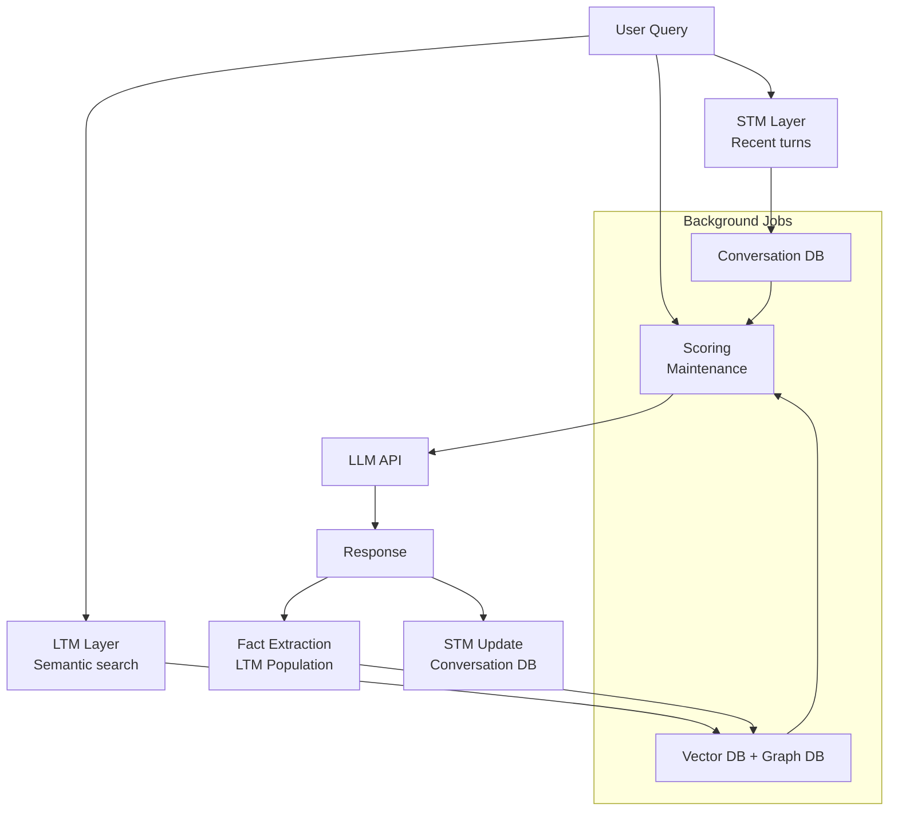

# Lecture 19 Complete Notes: Agent Memory Systems

## Executive Summary

Lecture 19 covers **Agent Memory Systems** — the architecture and implementation of durable memory for AI agents that survives sessions without poisoning LLM context windows. This lecture transforms stateless LLM APIs into stateful agents through three complementary memory layers: **Short-Term Memory (STM)** for immediate context, **Long-Term Memory (LTM)** for persistent facts, and **Memory Dreaming** for self-maintenance.

**Key Question**: How do you give an agent durable memory while managing token costs, attention dilution, and operational complexity?

**Answer**: Implement a **hybrid memory architecture** with STM (sliding windows), LTM (vector + graph), and managed abstractions (mem0), all operating within strict token budgets.

## 1. Core Architecture Overview



**System Principles**:
- **Stateless → Stateful**: Application manages conversation state, not the model
- **Context Budget**: Every token has latency, bandwidth, and cost implications
- **Layered Memory**: Each layer serves distinct purposes with appropriate storage and retrieval
- **Background Maintenance**: Memory cleanup operates independently of user-facing requests

## 2. Memory System Fundamentals

### 2.1 Why Traditional Apps Don't Work

Most LLMs are **stateless**: each API request is independent and doesn't automatically remember previous conversations.

```text
Request 1 ──→ LLM
              ↓
           Response

Request 2 ──→ LLM
              ↓
         Does not automatically
         contain Request 1
```

### 2.2 The Complete Context Formula

```math
Context = System\_Prompt + STM + LTM + Query
```

Where each component has specific characteristics:

| Component | Size | Purpose | Cost |
|-----------|------|---------|------|
| System Prompt | 150-400 tokens | Role and instructions | Small, fixed |
| STM | 800-1,200 tokens | Recent conversation | Medium, predictable |
| LTM | 300-600 tokens | Relevant persistent facts | Variable, expensive |
| Query | 200 tokens | Current request | Small, variable |

**Total**: ~2,000 tokens well within Claude 3.7 (128K) limits

## 3. Memory Layer Deep Dive

### 3.1 Short-Term Memory (STM) - Recent Context

**Core Idea**: Keep sliding window of recent messages, not entire conversation.

**Implementation**: 
- Database table `chat_messages(session_id, message_id, role, content, created_at)`
- Query: `SELECT role, content FROM chat_messages WHERE session_id = ? ORDER BY created_at DESC LIMIT 10`
- In-memory cache for performance

**Benefit**: Solves quadratic growth, maintains conversational context

### 3.2 Long-Term Memory (LTM) - Persistent Facts

**Taxonomy**:
- **Semantic**: Facts, preferences, attributes
- **Episodic**: Events, chronological actions
- **Graph**: Entity relationships

**Retrieval Process**:
1. Query condensation: "And for shoes?" → "What is the refund policy for shoes?"
2. Vector search: Embed query, find relevant memories
3. Context assembly: STM + LTM + Query

**Key Insight**: LTM answers "What important information should I remember about this user?"

### 3.3 Context Assembly - Budget Management

```text
Component    | Budget | Tokens | Strategy
------------|--------|--------|-----------
System       | 15%    | 400    | Role, instructions
Profile      | 10%    | 150    | User settings
STM          | 40%    | 800    | Recent 4-8 turns
LTM          | 20%    | 600    | Top 3-5 facts
Query        | 10%    | 200    | Current request
Buffer       | 5%     | 150    | Safety margin
```

## 4. Implementation Patterns

### 4.1 Production Architecture

```mermaid
diagram LR
    API["API Gateway<br/>Auth + Routing"] --> STM["STM Service<br/>Recent Messages"]
    API --> LTM["LTM Service<br/>Vector Search"]
    API --> PROFILE["Profile Service<br/>User Data"]
    API --> CONTEXT["Context Builder<br/>Budget Manager"]
    
    STM --> RDB[(Conversation DB)]
    LTM --> VDB[(Vector DB)]
    PROFILE --> VDB
    CONTEXT --> LLM[(LLM API)]
    
    subgraph Background["Background Jobs"]
        STM -.-> DREAMING["Dreaming Service<br/>Memory Cleanup"]
        LTM -.-> EVICTION["Eviction Service<br/>Score-Based Removal"]
        LTM -.-> INDEXING["Indexing Service<br/>Embedding Updates"]
    end
```

### 4.2 The Complete Request Flow

```text
1. Load STM (conversation history)
2. Search LTM (relevant memories)
3. Build context (STM + LTM + Query)
4. Call LLM (within token budget)
5. Save conversation (STM update)
6. Extract memories (fact extraction)
7. Queue dreaming (background maintenance)
```

## 5. Key Technologies & Tools

| Component | Technology | Role |
|-----------|------------|------|
| **Vector Search** | PostgreSQL + pgvector | Semantic retrieval |
| **Memory Frameworks** | mem0 | Abstraction layer |
| **Background Jobs** | Celery/Redis Queue | Asynchronous processing |
| **Caching** | Redis/Memcached | Performance |
| **Tracing** | OpenTelemetry | Observability |

## 6. Common Failures & Solutions

### 6.1 Retrieval Drift

**Problem**: "And for shoes?" retrieves sizing guide instead of refund policy.

**Solution**: Query condensation before embedding.

### 6.2 Memory Poisoning

**Problem**: User provides false information that's stored as memory.

**Solution**: Documents override conversation in prompt.

### 6.3 Context Inflation

**Problem**: Memory improves recall but inflates context size.

**Solution**: Token budget management and selective retrieval.

### 6.4 Dreaming Failures

**Problem**: Memory system becomes cluttered over time.

**Solution**: Background reflection with periodic cleanup.

## 7. Performance Characteristics

### 7.1 Latency Expectations

| Operation | Target Latency | Worst Case |
|-----------|---------------|-----------|
| STM retrieval | < 50ms | < 200ms |
| LTM search | < 200ms | < 500ms |
| Context assembly | < 100ms | < 200ms |
| LLM call | < 2s | < 5s |
| **Total Response** | **< 2s** | **< 5s** |

### 7.2 Cost Optimization

```text
Request Cost Breakdown:
├─ STM (800 tokens): $0.008
├─ LTM (600 tokens): $0.006
├─ Extraction (50 tokens): $0.005
├─ LLM inference: $0.030
└─ Dreaming (background): $0.001

Total per request: ~$0.050
500 requests/day: ~$25/day
```

## 8. Operational Checklist

### 8.1 Development Checklist

- [ ] **Authentication**: Verify user ownership of all memory operations
- [ ] **Authorization**: Prevent cross-user data access
- [ ] **Budget Management**: Enforce token limits at LLM layer
- [ ] **Error Handling**: Graceful degradation for service failures
- [ ] **Monitoring**: Track latency, cost, cache efficiency, error rates
- [ ] **Debugging**: Trace context assembly and LLM calls
- [ ] **Privacy**: Data sanitization and consent management

### 8.2 Production Checklist

- [ ] **Scaling**: Horizontal scaling for high throughput
- [ ] **High Availability**: Multi-zone deployment with failover
- [ ] **Backup Strategy**: Regular data backups and restore testing
- [ ] **Security**: Encryption at rest, TLS for all communications
- [ ] **Compliance**: GDPR, CCPA, HIPAA requirements
- [ ] **Disaster Recovery**: Business continuity planning

## 9. Decision Tables

### 9.1 Memory Retrieval Strategy

| User Query Type | Best Strategy | Reason |
|-----------------|--------------|--------|
| **Fact-based** | Vector search | Needs semantic understanding |
| **Entity-specific** | Keyword search | Exact matches needed |
| **Temporal** | Chronological filter | Time-based relevance |
| **Attribute** | Semantic search | Concept matching |

### 9.2 Context Assembly

| Situation | Recommended Approach | Justification |
|-----------|----------------------|---------------|
| **Interactive chat** | STM + LTM + Query | Balance context and efficiency |
| **Q&A system** | LTM only | Focused information retrieval |
| **Summarization** | STM + Profile | Conversational continuity |

## 10. Misconceptions

### 10.1 Common Myths

1. **"LLM can remember"** → Application must provide memory layer
2. **"More context always better"** → Context inflation degrades quality
3. **"Store everything"** → Memory requires active management and eviction
4. **"Background dreaming is optional"** → Memory system needs maintenance
5. **"Simple dictionary lookup”** → Semantic search requires embeddings

### 10.2 Reality Check

- Memory is **expensive** in terms of tokens, latency, and cost
- Memory is **noisy** — needs filtering and quality control
- Memory is **complex** — multiple storage backends, retrieval strategies
- Memory is **volatile** — needs constant maintenance and updating

## 11. Glossary

| Term | Definition |
|------|------------|
| **STM** | Short-Term Memory - recent conversational context |
| **LTM** | Long-Term Memory - persistent facts and preferences |
| **Vector DB** | Database that stores embeddings for semantic search |
| **Query Condensation** | Rewriting ambiguous queries for retrieval |
| **Token Budget** | Limited context allocation per LLM call |
| **Memory Dreaming** | Background process that cleans and consolidates memories |
| **Dedup** | Removing duplicate memory entries |
| **Eviction** | Removing low-value memories based on scoring |
| **Hit-Score** | Tracks how frequently a memory is actually used |
| **Contextual Inflation** | Adding memory that increases prompt size |
| **RAG** | Retrieval-Augmented Generation - combine retrieval with generation |

## 12. Self-Check Questions

### 12.1 Conceptual Understanding (5 points each)

1. **Explain the stateless nature of LLM APIs and why application-level memory is necessary.**
2. **Compare STM vs LTM in terms of purpose, size, retrieval pattern, and cost.**
3. **Why is query condensation essential for effective LTM retrieval?**
4. **How does a sliding window solve the context-growth problem?**
5. **What's the difference between semantic, episodic, and graph memory?**

### 12.2 Implementation Details (10 points each)

6. **Implement a basic STM system with sliding window and database persistence.**
7. **Design an LTM retrieval system using vector embeddings and semantic search.**
8. **Explain how you would implement memory dreaming and background reflection.**
9. **How would you handle user authentication and memory isolation in a multi-tenant system?**
10. **Design a token budget management system for context assembly.**

### 12.3 Production Considerations (15 points each)

11. **Design a production memory system for a chatbot handling 100K concurrent users.**
12. **Explain how you would monitor and optimize memory system performance.**
13. **Design a comprehensive testing strategy for memory operations.**
14. **How would you implement data retention, deletion, and compliance requirements?**
15. **Design an incident response plan for memory system failures.**

## 13. Next Steps & Further Reading

### 13.1 Recommended Resources

- **Memory Design**: "Designing Agent Memory Systems" papers
- **Vector Search**: PGVector documentation, Weaviate architectures
- **Production**: "Designing Data-Intensive Applications" (Martin Kleppmann)
- **LLM APIs**: Provider documentation (OpenAI, Anthropic, etc.)

### 13.2 Extension Opportunities

- **Graph Memory**: Implement Neo4j integration for relationship reasoning
- **Multi-modal Memory**: Add image/audio memory alongside text
- **Hierarchical Memory**: Different storage tiers (hot/cold/archive)
- **Memory APIs**: Provide standardized memory operations for other services

### 13.3 Research Directions

- **Memory Efficiency**: Better compression and storage algorithms
- **Temporal Memory**: Time-aware facts and decaying relevance
- **Meta-learning**: Learn how to extract memories more effectively
- **Trust & Safety**: Alignment of memories with user intent

## Summary

This Lecture 19 notes provide a comprehensive guide to building **Agent Memory Systems** — the critical layer that transforms stateless LLM APIs into stateful, conversational agents. The system combines:

- **STM** for immediate conversational context
- **LTM** for persistent facts and preferences  
- **Context assembly** for budget-conscious prompt building
- **Memory dreaming** for self-maintenance and quality

The production architecture balances performance, cost, reliability, and privacy while providing a robust foundation for agent applications. The key insight is that **memory is not storage** — it's a **budgeted resource** that must be managed carefully for optimal performance.

Mastering these concepts enables building agents that can maintain useful context across conversations while staying within computational constraints.