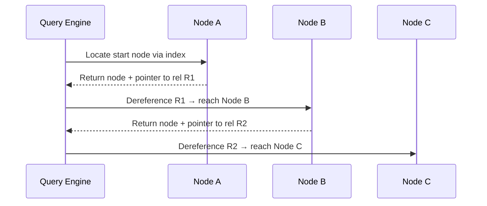

# Chapter 01 — Graph Database Fundamentals & Cognitive Memory Architecture

## 1.1 What Is a Graph Database?

A **graph database** (graph DB) is a purpose-built storage engine that persists entities as **nodes** and the relationships between entities as **relationships/edges**. Both nodes and relationships carry **properties** (key–value attributes). Relationships are stored *explicitly* on disk alongside the nodes they connect, so following a link is a direct memory-pointer dereference rather than a join.

### Core building blocks

| Block | Symbol | Description |
|-------|--------|-------------|
| **Node** | `()` | An entity (person, document, hotel, event). Can have labels and properties. |
| **Relationship** | `[]` | A directed, typed edge between two nodes. Can have properties. |
| **Property** | `{k: v}` | A key–value attribute on a node or relationship. |
| **Label** | `:Label` | A tag grouping nodes into a set for indexing and querying. |

```
(N:Hotel {name: "Grand Plaza", city: "Paris"})
  -[:LIKES {since: "2025-03-10"}]-> (P:Person {name: "Alice"})
```

## 1.2 Why Graph Databases for AI Agents?

Flat key–value stores (Redis, simple JSON blobs) work well for scalar preferences (`theme = "dark"`), but they cannot model **connected memory** — the web of associations humans use for reasoning. AI agents need:

- **Factual memory:** entities linked to entities ("Alice works at Acme").
- **Episodic memory:** events tied to entities and timestamps ("Alice visited Paris in March 2025").
- **Temporal memory:** preferences that change over time ("theme was light until 2025-01-15, now dark").
- **Multi-hop reasoning:** "Find hotels liked by friends of Alice who live in Paris."

Graph databases store these connections natively and traverse them in O(1) per hop thanks to **index-free adjacency**.

## 1.3 Graph DB vs Relational DB vs Key–Value

```mermaid
graph TD
    RDBMS[(RDBMS Tables)] -->|Foreign Keys + JOINs| R1[(JOIN Scan)]
    KV[(Key-Value Store)] -->|Scalar lookup| K1[(O(1) get by key)]
    GDB[(Graph DB)] -->|Index-free adjacency| G1[(O(1) pointer hop)]
    GDB -->|Explicit relationships| G2[(No JOIN needed)]
    
    subgraph Query cost grows with hops
    R1
    end
    
    subgraph Constant hop cost
    G1
    G2
    end

    style RDBMS fill:#f96,stroke:#333
    style KV fill:#ff9,stroke:#333
    style GDB fill:#9f6,stroke:#333
```

| Dimension | Relational (SQL) | Key–Value | Graph (Neo4j) |
|-----------|------------------|-----------|---------------|
| Data model | Normalized tables | Scalar key → value | Nodes + relationships + properties |
| Relationships | Implicit via FKs, computed at query time | None | Explicit, stored natively |
| Traversal cost | JOINs scale O(N × R^k) per hop | N/A | O(1) per hop via pointer chase |
| Schema | Rigid, predefined | Schema-flexible | Schema-optional, label-based |
| Query language | SQL | GET/SET | Cypher (declarative graph patterns) |
| Best for | Structured transactions, reporting | Caching, sessions, counters | Connected knowledge, recommendations, fraud, agents |

## 1.4 Cognitive Memory Architecture

AI agents model memory as a graph of facts, episodes, and skills. The cognitive-memory graph separates **what** (entities/facts) from **when** (temporal edges) and **how** (procedural edges).

```mermaid
graph TB
    subgraph Working Memory (Short-term)
    S[Session] -->|HAS_MESSAGE| M1[Message 1]
    S -->|HAS_MESSAGE| M2[Message 2]
    M1 -->|REPLIES_TO| M2
    end

    subgraph Episodic Memory (Immutable log)
    E1[Event: Trip to Paris] -->|INVOLVES| H[Hotel: Grand Plaza]
    E1 -->|INVOLVES| P[Person: Alice]
    E1 -->|AT_TIMESTAMP| T1[2025-03-10]
    end

    subgraph Semantic Memory (Facts)
    P -->|WORKS_AT| C[Company: Acme]
    C -->|LOCATED_IN| L[City: Paris]
    P -->|LIKES| H
    end

    subgraph Temporal Memory (Versioned preferences)
    P -.->|HAS_PREF {validFrom, validTo}| Pref[Theme: dark]
    end

    subgraph Procedural Memory (Skills)
    P -->|HAS_SKILL| Skill[Skill: Summarise]
    Skill -->|VERSION| V[v2.1]
    end

    style Working Memory fill:#f9f,stroke:#333
    style Episodic Memory fill:#ccf,stroke:#333
    style Semantic Memory fill:#cfc,stroke:#333
```

### Memory type → graph construct

| Memory type | Core labels | Temporal edge? | Typical query |
|-------------|-------------|----------------|---------------|
| Working / STM | `Session → Message` | No (TTL on session) | Last N messages of session |
| Episodic | `Event → Entity` | `Event.ts` immutable | All events involving X |
| Semantic / Factual | `Entity → Entity` | Optional `validFrom/To` on rels | Company of Alice |
| Temporal / Versioned | `Preference` on `HAS_PREF` | Yes (`validFrom`, `validTo`) | Theme on date D |
| Procedural / Skill | `Skill` node, `HAS_SKILL` edge | Version on node | Latest summarisation prompt |

## 1.5 Index-Free Adjacency

**Index-free adjacency** means each node stores direct pointers to its incident relationships. Once a starting node is located (via an index or label scan), every hop is a pointer dereference — O(1) — regardless of total graph size.



Contrast with SQL: each hop requires a B-tree index lookup plus a JOIN scan, costing O(log N + R) per hop and compounding exponentially across k hops.

## 1.6 JS/TS Pseudo Code — Conceptual Graph Model

```typescript
// Pseudo code — conceptual model only, not runnable against Neo4j
type Property = Record<string, string | number | boolean | Date>;

interface Node {
  id: string;
  labels: string[];
  properties: Property;
}

interface Relationship {
  id: string;
  type: string;
  fromNodeId: string;
  toNodeId: string;
  properties: Property;
  directed: true;
}

class ConceptualGraph {
  nodes: Map<string, Node> = new Map();
  relationships: Map<string, Relationship> = new Map();
  // Index-free adjacency: node → list of relationship IDs
  adjacency: Map<string, string[]> = new Map();

  addNode(node: Node): void {
    this.nodes.set(node.id, node);
    this.adjacency.set(node.id, []);
  }

  addRelationship(rel: Relationship): void {
    this.relationships.set(rel.id, rel);
    // O(1) pointer chase on both sides
    this.adjacency.get(rel.fromNodeId)?.push(rel.id);
    this.adjacency.get(rel.toNodeId)?.push(rel.id);
  }

  // O(degree) hop — no global index scan
  *neighbors(nodeId: string): Generator<Node> {
    for (const relId of this.adjacency.get(nodeId) ?? []) {
      const rel = this.relationships.get(relId)!;
      const other = rel.fromNodeId === nodeId ? rel.toNodeId : rel.fromNodeId;
      yield this.nodes.get(other)!;
    }
  }
}

// Usage
const g = new ConceptualGraph();
g.addNode({ id: "a1", labels: ["Person"], properties: { name: "Alice" } });
g.addNode({ id: "h1", labels: ["Hotel"], properties: { name: "Grand Plaza" } });
g.addRelationship({
  id: "r1",
  type: "LIKES",
  fromNodeId: "a1",
  toNodeId: "h1",
  properties: { since: "2025-03-10" },
  directed: true,
});

for (const neighbor of g.neighbors("a1")) {
  console.log(neighbor.properties.name); // "Grand Plaza"
}
```

## 1.7 Common Mistakes

| Mistake | Why it's wrong | Correction |
|---------|---------------|------------|
| Storing every noun as an `Entity` node | Graph size and traversal cost explode; many nouns are just attributes | Only canonicalise named entities that participate in relationships |
| Treating graph DB like a key–value store | Loses the connected-memory advantage; misses multi-hop reasoning | Model relationships explicitly, traverse them |
| Assuming O(1) for *every* operation | Index-free adjacency is O(1) per hop *after* the start node is found; locating the start node still needs an index/label scan | Index hot lookup paths, bound traversals |
| Using unbounded `*` traversals | Even modest density causes combinatorial explosion | Always bound: `*1..3` and add `WHERE` filters |

## 1.8 Key Takeaways

- A graph DB = nodes + relationships + properties + labels, with relationships stored explicitly.
- Index-free adjacency gives O(1) per-hop traversal once the start node is located.
- Graph DBs excel at connected knowledge, recommendations, fraud detection, and AI agent memory.
- Model **what** (entities/facts), **when** (temporal edges), and **how** (procedural edges) separately in the cognitive-memory graph.
- Never store every noun as a node; only entities that participate in relationships deserve node status.

---

**Self-check questions (answers at end of complete notes):**
1. What are the four core building blocks of a property graph?
2. Contrast key–value vs connected memory models for an AI agent.
