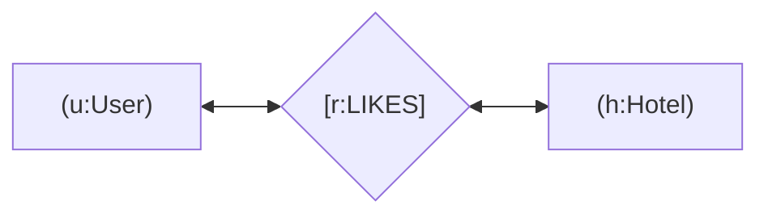
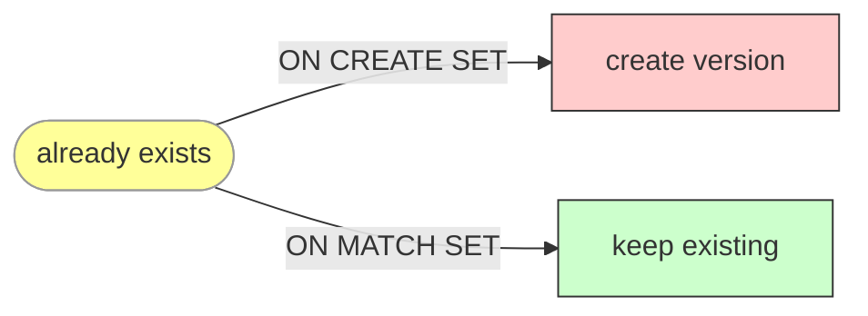
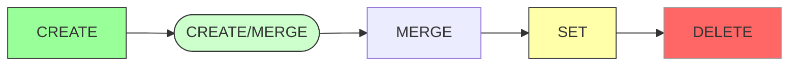

# Chapter 02 — Cypher Query Language: Syntax & Patterns

## 2.1 The ASCII-Art Syntax

Cypher is a **declarative** language — you describe *what* you want to find, not *how*. It reads like English graph patterns drawn in ASCII art.

| Symbol | Meaning | Example |
|--------|---------|---------|
| `()` | Node with labels and optional properties | `(u:User {name:"Alice"})` |
| `[]` | Relationship (typed + direction) | `-[r:LIKES]->` |
| `{k: v}` | Property on node or relationship | `{since:"2025-03-10"}` |
| `:` label | Label set on node | `:User`, `:Hotel` |
| `->` / `--` | Directional connection | `-->` / `--<` |



## 2.2 MATCH — Find Patterns

`MATCH` declares a pattern; the engine traverses it and returns matching node pairs.

```cypher
// Find hotels Alice likes
MATCH (u:User {name:"Alice"})-[r:LIKES]->(h:Hotel)
RETURN u.name AS person, h.name AS hotel;
```

**Pattern syntax rules:**

```mermaid
graph TD
    subgraph Node
    A1((Label {prop: val}))
    end
    subgraph Edge
    A1 -->|type [{prop}]| A2[[re type]]
    end
    style A1 fill:#f9f,stroke:#333
    style A2 fill:#ccf,stroke:#333
```

- Parentheses `()` = nodes.
- Square brackets `[]` = relationships. Use `<--` or `-->` for direction. Default undirected if none specified: `-[r]->`.
- Variables are case-sensitive: `userId` vs `userid`.

## 2.3 CREATE — Insert New Entities

Creates new nodes or relationships, even if duplicates exist (risk: duplicated nodes).

```cypher
CREATE (n:User {id: "u_001", name: "Bob"});

CREATE (a)-[:WORKS_AT {since: datetime()}]->(o:Organization {id: "org_1", name: "Acme"});
```

**Common pitfall:** repeated `CREATE` of the same pattern produces duplicate nodes/relationships with different identities — often silently and unexpectedly.

## 2.4 MERGE — Idempotent Match-or-Create

`MERGE` checks for an existing pattern first; if found it matches, if not it creates. Idempotent on repeat calls.

```cypher
// Safe: no duplicate on repeat
MERGE (n:User {id: "u_001", name: "Bob"})
ON CREATE SET n.createdAt = datetime();

MERGE (a)-[:FRIENDS_OF {since: datetime()}]->(b);
```

Key differences from `CREATE`:

| Aspect | `CREATE` | `MERGE` |
|--------|----------|---------|
| Behavior if pattern exists | Always creates a duplicate | Matches, doesn't duplicate |
| Idempotency | Not idempotent | Idempotent |
| Extra clauses | Cannot set existing fields | `ON CREATE SET` / `ON MATCH SET` |



## 2.5 SET / DELETE / DETACH DELETE

Set properties on an existing node. Delete relationships implicitly when deleting the node.

```cypher
SET n.age = 42;              // Set property
DETACH DELETE n;             // Delete node + all its incoming/outgoing rels
// DONT use plain DELETE (fails if rels attached):
// DELETE n;  <- error
```

## 2.6 CRUD Cheat Pattern



## 2.7 Variable-Length Path Traversals (`[*min..max]`)

Use range asterisks inside relationship brackets to bound hop depth. This prevents combinatorial explosion.

```cypher
// Friends of friends up to 2 hops
MATCH (a:User {name:"Alice"})-[:KNOWS*1..2]->(b:User)
RETURN b.name, length(path) AS hops;

// Shortest path between two nodes
MATCH p = shortestPath((n:A)-([:REL*])-(m:B))
WHERE n.id = $src AND m.id = $dst
RETURN p;
```

### Common Mistakes

| Mistake | Why | Correction |
|---------|-----|------------|
| Unbounded `*` traversals | Even small density → exponential blowup | Always bound `*1..maxHops` |
| Unwinding the path without bounds | Topology dependent; can traverse the whole graph | Bound hops + add `WHERE` filters |
| Using shortestPath where unbounded path suffices | More expensive | Only use shortestPath when BFS distance matters |

## 2.8 JS/TS Pseudo Code — Parameterised Query Helper

```typescript
// Pseudo code — demonstrates safe parameterised querying pattern
interface QueryParams {
  query: string;       // Cypher template with $param markers
  params: Record<string, unknown>;  // literal values only
}

class CypherExecutor {
  constructor(private driver: any) {}

  async executeQuery(params: QueryParams): Promise<Record[]> {
    const { query, params } = params;
    // $paramName resolved at execution time; user input never interpolated
    return this.driver.executeQuery(query, params, { database: 'neo4j' });
  }

  // Example usage:
  // const result = await exec.executeQuery({
  //   query: MATCH (u:User {name: $name})-[:LIKES]->(h:Hotel) RETURN h.name,
  //   params: { name: aliceInput },   // value passed through, not string-concatenated
  // });
}
```

**Why this matters:** Allowing `$var` injection of user strings into templates lets attackers alter query structure. The `$` markers are *never* manually substituted with raw user data.

## 2.9 Common Mistakes

| Mistake | Correct fix |
|---------|------------|
| Interpolating `+` into `{name: "${input}"}` | Use parameters `$name`, pass object separately |
| Forgetting `*bounds` on variable-length paths | Add `[*1..3]` always |
| Plain `DELETE` leaving dangling rels | Use `DETACH DELETE` |
| Confusing `CREATE` idempotency | Use `MERGE` for repeated upserts |
| ShortestPath on large graphs without indexes | Index hot start node first |

## 2.10 Key Takeaways

- Cypher is declarative, ASCII-art syntax: `()` nodes, `[]` typed edges.
- `CREATE` always inserts (duplicates possible); `MERGE` is idempotent match-or-create.
- Parameterized queries prevent injection — never concatenate user input.
- Always bound variable-length paths: `[*1..max]`.
- `DETACH DELETE` deletes node + incidental rels.

---

**Self-check questions:**
4. Difference between `CREATE` and `MERGE` when the pattern already exists?
