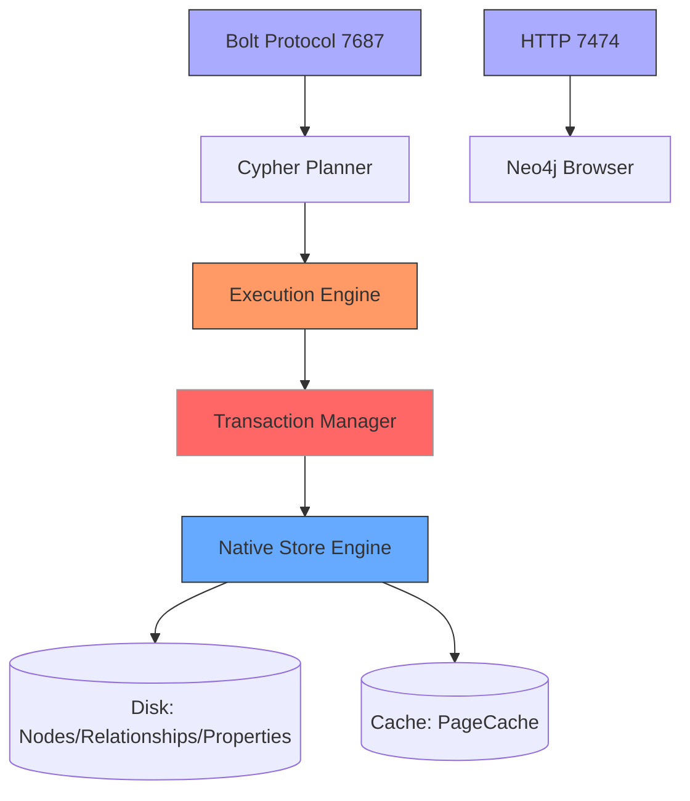
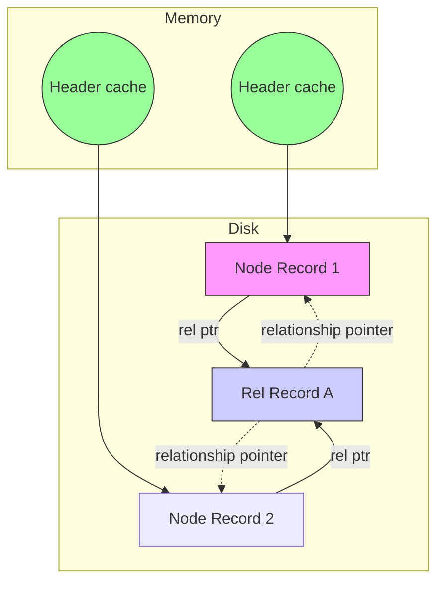
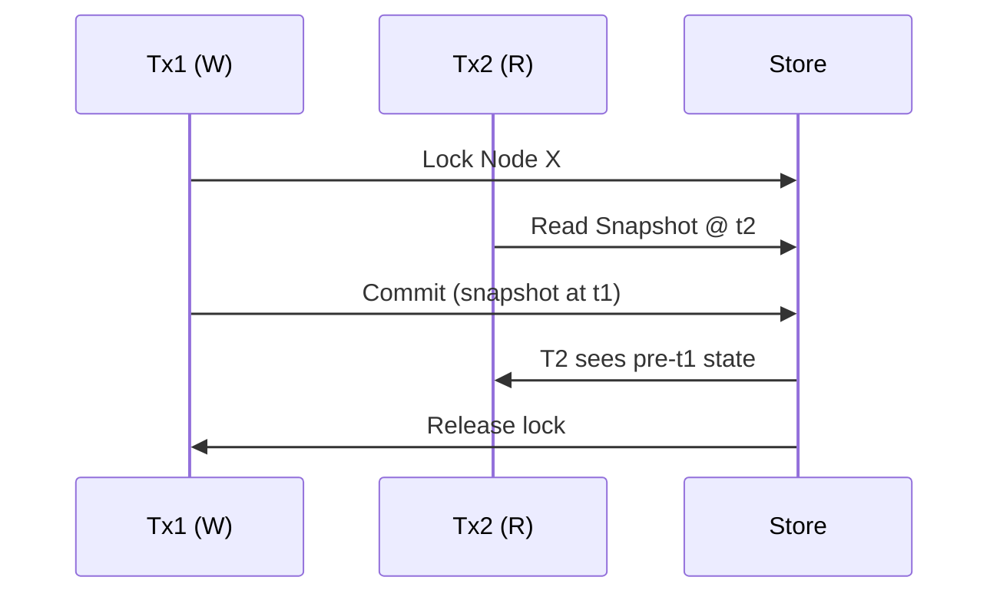
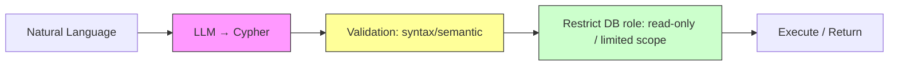
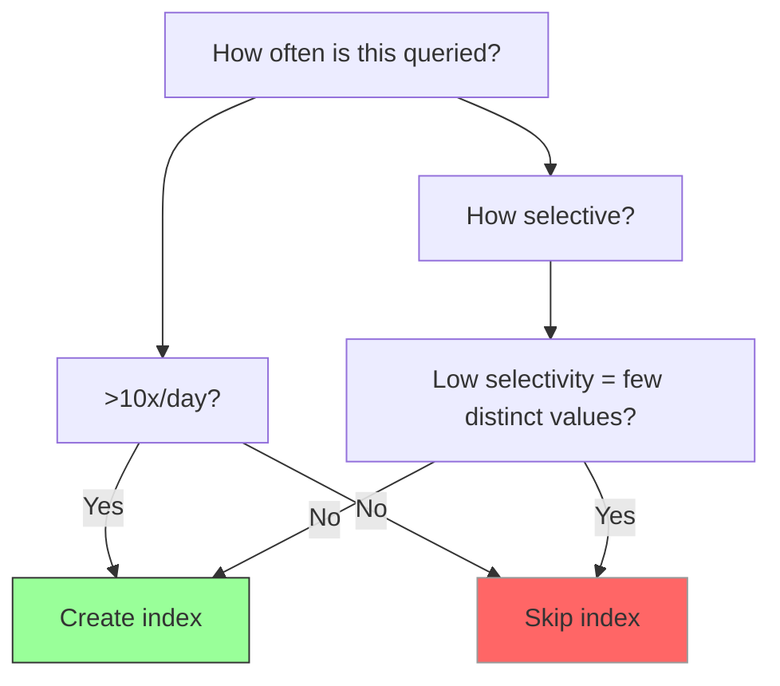

# Chapter 03 — Neo4j Architecture, Deployment & LLM Cypher

## 3.1 Neo4j Core Architecture

A Neo4j instance consists of several components working together:



### Component breakdown

1. **Bolt Protocol (port 7687)** — Binary, low-latency RPC for drivers and applications.
2. **Cypher Engine** — Parses, plans, and executes queries. Creates physical plans from AST.
3. **Transaction Manager** — Guarantees ACID semantics, MVCC concurrency control.
4. **Native Graph Storage** — Stores records in fixed-size blocks; enables index-free adjacency.

## 3.2 Index-Free Adjacency in Storage



Storage layer stores:
- **Node header** (id, label set, property record pointer, relationship pointer).
- **Relationship records** (start node, end node, type, property pointer).
- **Property records** (key=value pairs).

Following a relationship is a pointer dereference — O(1) per hop, independent of graph size.

## 3.3 ACID Transactions & MVCC

Neo4j supports ACID via Multi-Version Concurrency Control (MVCC). Writers get write locks on modified nodes; readers see consistent snapshot snapshots via transaction timestamps.



**Implication:** No deadlocks on graph traversals; write conflicts only when two txes modify the same entity concurrently.

## 3.4 Deployment Options

| Option | Pros | Cons |
|--------|------|------|
| **Aura (Cloud)** | Fully managed; auto-scaling; backups; zero ops | Vendor lock-in; cost scales with usage |
| **Self‑hosted Docker** | Portable; full control; firewall-friendly | Ops overhead; backups manual |
| **Kubernetes (Neo4j Operator)** | Scalable; rolling upgrades; HA | Complex; requires k8s expertise |

### Running in Docker (quickdev)

```bash
docker run -d \
  -p 7474:7474 -p 7687:7687 \
  -e NEO4J_AUTH=neo4j/test123 \
  --name neo4j-dev \
  neo4j:latest
```

## 3.5 LLM Text-to-Cypher Generation

Large language models can translate natural-language questions into Cypher:

**Pattern:** User asks: *"Which restaurants did Alice like in Paris?"*

LLM generates:
```cypher
MATCH (p:Person {name: "Alice"})-[:LIKES]->(r:Restaurant)
WHERE r.city = "Paris"
RETURN r.name;
```

### Safety Pipeline



**Security note:** Generated Cypher must be treated as **untrusted input** — validate, run with a restricted role, enforce query bounds, sandbox via LIMIT.

## 3.6 Performance Tuning: Profile & EXPLAIN

```cypher
EXPLAIN MATCH (p:Person)-[:LIKES]->(r:Restaurant)
RETURN r.name;
```

Output shows operator tree (NodeByLabelScan → Expand → Projection).

```cypher
PROFILE MATCH (p:Person)-[:LIKES]->(r:Restaurant)
WHERE p.name = "Alice"
RETURN r.name;
```

**Key metrics:**
- `dbHits` — cardinality of index lookups.
- `Rows` — result cardinality.
- `PageCacheHitRatio` — cache effectiveness.

## 3.7 Indexes & Constraints

Create an index to speed up lookup of a label + property:

```cypher
CREATE INDEX person_name FOR (p:Person) ON (p.name);
CREATE CONSTRAINT uni_user_id FOR (u:User) REQUIRE u.id IS UNIQUE;
```

### When to index?



## 3.8 JS/TS Pseudo Code — LLM-to-Cypher Safety Wrapper

```typescript
// Pseudo code — demonstrates safety layer for LLM-generated Cypher
type LlmCypherRequest = {
  question: string;
  cypher: string;
  params: Record<string, unknown>;
};

class SafeCypherExecutor {
  private driver: any;
  private readOnlyRole: string = 'agent_readonly';

  async executeFromLlm(req: LlmCypherRequest): Promise<unknown[]> {
    // 1. Parse tree check — no DETACH DELETE, no DROP, etc.
    const forbidden = ['DETACH DELETE', 'DROP', 'CREATE CONSTRAINT', 'ALTER'];
    for (const f of forbidden) {
      if (req.cypher.toUpperCase().includes(f)) {
        throw new Error(`Forbidden token: ${f}`);
      }
    }

    // 2. Ensure parameterized, no string interpolation
    const hasInterpolation = /\$\{[^}]+\}/.test(req.cypher);
    if (hasInterpolation) {
      throw new Error('Unsafe string interpolation detected');
    }

    // 3. Enforce LIMIT when full graph scan possible
    if (!req.cypher.toUpperCase().includes('LIMIT')) {
      req.cypher = req.cypher + '\nLIMIT 100';
    }

    // 4. Execute with restricted role
    const session = this.driver.session({ defaultDatabase: 'neo4j' });
    try {
      const result = await session.run(req.cypher, req.params);
      return result.records.map((r: any) => r.toObject());
    } finally {
      await session.close();
    }
  }
}
```

## 3.9 Common Mistakes

| Mistake | Reality | Fix |
|---------|---------|-----|
| “Neo4j uses BFS for every query” | Planner chooses operator order based on cost estimates | Use `PROFILE` to verify, add indexes |
| Running LLM-generated Cypher with admin role | Opens door to Cypher injection | Use read-only role; validate syntax |
| Indexing everything | Write overhead + storage bloat | Index only hot lookup paths |
| Storing dense nodes without overflow | One node can store only 26 relationship types natively | Model as `Entity` nodes if needed |

## 3.10 Key Takeaways

- Neo4j = Bolt driver → Cypher → Transaction Manager → native store.
- Index-free adjacency gives O(1) per hop after index/label scan.
- Deployment: Aura (managed) or Docker (dev).
- LLM text-to-Cypher must be validated + run with restricted role.
- Always `PROFILE` to verify plans; index hot paths.

---

**Self-check questions:**
9. Which protocol and default port does Neo4j Bolt driver use?
10. Name two deployment options and one trade-off each.
